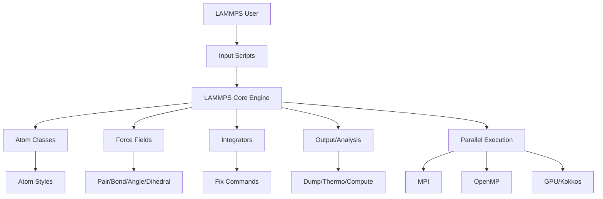

This page guides you through your first steps with LAMMPS (Large-scale Atomic/Molecular Massively Parallel Simulator), a classical molecular dynamics code designed for efficient parallel computing. You'll learn how to obtain LAMMPS, run your first simulation, and explore available resources—all within minutes of getting started.

Sources: [README](README#L1-L20), [CITATION.cff](CITATION.cff#L1-L15)

## Getting LAMMPS

LAMMPS is distributed as an open-source package under the GNU GPL version 2. You can obtain it through multiple methods:


| **Method** | **Command** | **Best For** |
|------------|-------------|--------------|
| Git Clone | `git clone https://github.com/lammps/lammps.git` | Latest development version, contributors |
| Download Tarball | From www.lammps.org | Stable releases, production use |
| Package Manager | System-specific packages | Quick installation, managed updates |

The repository structure includes essential directories: `src/` (source files), `examples/` (sample problems), `cmake/` (build system), `doc/` (documentation), and `tools/` (pre/post-processing utilities).

Sources: [README](README#L20-L40)

## Architecture Overview

LAMMPS follows a modular architecture that separates simulation logic from computational implementations:



This architecture enables flexible simulation setup through input scripts while maintaining computational efficiency through parallel execution strategies. The core processes commands sequentially but distributes computational work across available processors.

Sources: [README](README#L1-L15), [cmake/CMakeLists.txt](cmake/CMakeLists.txt#L1-L30)

## Running Your First Simulation

The quickest way to verify your installation is running a simple molecular dynamics simulation. Navigate to the `examples/melt/` directory which contains a 3D Lennard-Jones melt example:

Sources: [examples/melt/in.melt](examples/melt/in.melt#L1-L10)

```bash
cd examples/melt
lmp -in in.melt
```

This simulation demonstrates core LAMMPS concepts:

| **Section** | **Purpose** | **Key Commands** |
|-------------|-------------|------------------|
| Units & Style | Define simulation units and atom representation | `units lj`, `atom_style atomic` |
| System Setup | Create simulation box and atoms | `lattice`, `region`, `create_box`, `create_atoms` |
| Interactions | Define particle interactions | `pair_style lj/cut 2.5`, `pair_coeff 1 1 1.0 1.0 2.5` |
| Integration | Control time evolution | `fix 1 all nve` |
| Output | Monitor simulation progress | `thermo 50`, `run 250` |

The output log file shows simulation details including number of atoms created (4000 atoms in a 10×10×10 fcc lattice), computational parameters, and timing information.

Sources: [examples/melt/in.melt](examples/melt/in.melt#L1-L34), [examples/melt/log.8Apr21.melt.g++.1](examples/melt/log.8Apr21.melt.g++.1#L1-L35)

## Understanding Example Categories

LAMMPS provides a rich collection of examples organized by complexity:


| **Category** | **Naming Convention** | **Description** | **Run Time** |
|--------------|---------------------|-----------------|--------------|
| Simple Tests | Lowercase (e.g., `melt`, `min`) | Quick verification of basic functionality | Seconds to minutes |
| Complex Problems | Uppercase (e.g., `ASPHERE`, `HEAT`) | Advanced techniques and specific applications | Minutes to hours |
| Package Tests | `PACKAGES/` subdirectories | Specialized features from optional packages | Varies by package |

The `examples/README` explains that each problem includes input scripts (`in.*`), sample log files, and optional visualization outputs. Most simple examples are 2D models designed for rapid execution.

Sources: [examples/README](examples/README#L1-L25), [get_repo_structure/examples](#L3-L85)

## Build Configuration Presets

The CMake build system includes pre-configured presets for different use cases. The `basic.cmake` preset activates commonly-used packages:

```cmake
set(ALL_PACKAGES KSPACE MANYBODY MOLECULE RIGID)
foreach(PKG ${ALL_PACKAGES})
  set(PKG_${PKG} ON CACHE BOOL "" FORCE)
endforeach()
```

Available presets include:
- **basic.cmake**: Core packages for common inputs
- **all_on.cmake**: Enable all packages
- **kokkos-*.cmake**: Performance portability across CPUs/GPUs
- **gpu-cuda.cmake**: NVIDIA GPU acceleration
- **windows.cmake**: Windows-specific configurations

Sources: [cmake/presets/basic.cmake](cmake/presets/basic.cmake#L1-L9), [get_repo_structure/cmake](#L5-L33)

## Python Integration Quick Start

LAMMPS provides a Python module enabling programmatic simulation control. The `python/examples/simple.py` demonstrates basic usage:

```bash
cd python/examples
python simple.py
```

Python integration allows you to:
- Drive LAMMPS simulations from Python scripts
- Extract and analyze simulation data with NumPy
- Combine LAMMPS with scientific Python ecosystems
- Use Jupyter notebooks for interactive workflows

The `examples/python/` directory contains input scripts like `in.python` that show how to embed Python functions within LAMMPS input files using the `python` command.

Sources: [python/examples/simple.py](python/examples/simple.py), [examples/python/in.python](examples/python/in.python#L1-L40), [get_repo_structure/python](#L5-L27)

## Verification and Testing

After building LAMMPS, verify your installation using available testing resources:

| **Resource** | **Purpose** | **Location** |
|--------------|-------------|--------------|
| Simple Examples | Verify basic functionality | `examples/melt/`, `examples/min/` |
| Benchmarks | Test performance and scalability | `bench/` directory |
| Unit Tests | Validate specific components | `unittest/` directory |
| Regression Tests | Check for code changes impact | `tools/regression-tests/` |

The `bench/README` describes standardized benchmarks with 32,000 atoms running for 100 timesteps, suitable for both serial and parallel performance evaluation.

Sources: [bench/README](bench/README#L1-L30), [get_repo_structure/bench](#L5-L75)

## Visualization Tools

LAMMPS supports multiple visualization output formats in example scripts:

- **Dump files**: Text format compatible with Ovito, VMD, AtomEye
- **Image output**: JPG snapshots (requires JPG library)
- **Movie output**: MPG videos (requires FFMPEG library)

Uncomment the appropriate `dump` commands in example input scripts to generate visualization files. The `tools/` directory contains various pre/post-processing utilities including `tools/python/` for data analysis and conversion.

Sources: [examples/README](examples/README#L35-L55), [get_repo_structure/tools](#L5-L242)

## Common First Commands

When starting with LAMMPS, these input script commands appear most frequently:

| **Command Category** | **Typical Commands** | **First Simulation Usage** |
|---------------------|---------------------|--------------------------|
| Setup | `units`, `atom_style`, `dimension` | Define simulation framework |
| Geometry | `lattice`, `region`, `create_box`, `create_atoms` | Build atomic structure |
| Properties | `mass`, `velocity` | Set physical properties |
| Interactions | `pair_style`, `pair_coeff`, `bond_style` | Define force fields |
| Integration | `fix`, `run`, `minimize` | Control dynamics |
| Output | `thermo`, `dump` | Monitor results |

The `examples/min/in.min` example shows how to combine dynamics (`run 1000`) with energy minimization (`minimize`) in a single script.

Sources: [examples/min/in.min](examples/min/in.min#L1-L45)

## Next Steps

After completing this Quick Start guide, continue your LAMMPS journey with these resources:

- [Installation and Build System](3-installation-and-build-system) - Detailed compilation instructions and package configuration
- [Running Your First Simulation](4-running-your-first-simulation) - In-depth tutorial on creating custom input scripts
- [Overview](1-overview) - Comprehensive introduction to LAMMPS capabilities and applications

For immediate exploration, browse the `examples/` directory categories or examine input scripts matching your research domain. The comprehensive documentation is available online at https://docs.lammps.org/Manual.html.
