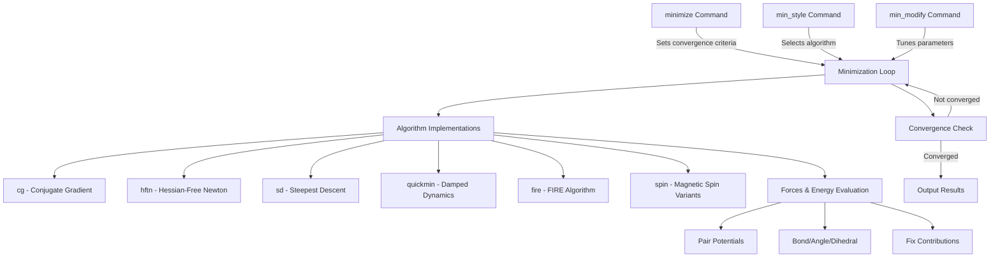
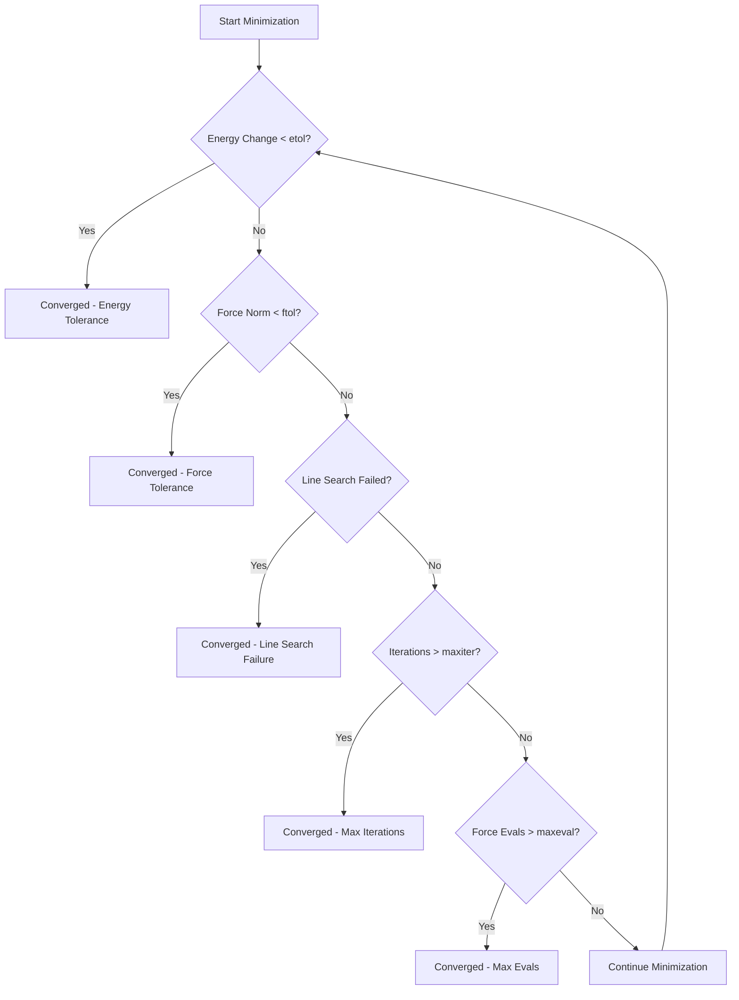

Energy minimization is a fundamental technique in molecular dynamics simulations that systematically relaxes atom configurations to find local potential energy minima. This process is essential for preparing initial structures, removing bad contacts from overlapped atoms, and finding equilibrium configurations. Unlike molecular dynamics which explores configurational space through time evolution, energy minimization performs a **systematic search** along the potential energy surface gradient to locate stationary points where forces approach zero.

Sources: [minimize.rst](doc/src/minimize.rst#L17-L25)

## Architectural Overview

The LAMMPS energy minimization framework integrates seamlessly with the simulation engine, treating minimization iterations as timesteps for output purposes. The architecture consists of three core components: minimization command interface, algorithm implementations (styles), and parameter modification controls. The **minimize command** acts as the primary interface, specifying convergence tolerances and iteration limits, while the **min_style command** selects the specific optimization algorithm, and **min_modify** tunes algorithm-specific parameters.



The objective function being minimized encompasses the total potential energy of the system, including pairwise interactions, bonded terms (bond, angle, dihedral, improper), and contributions from fixes that apply constraints or external forces. This comprehensive energy landscape represents the **N-dimensional hypersurface** defined by all atom coordinates in the system.

Sources: [minimize.rst](doc/src/minimize.rst#L51-L71), [min_style.rst](doc/src/min_style.rst#L35-L42)

## Minimization Algorithms

LAMMPS offers a diverse set of optimization algorithms, each designed for different types of systems and convergence requirements. The choice of algorithm significantly impacts both convergence speed and robustness.

### Gradient-Based Algorithms

**Conjugate Gradient (cg)** implements the Polak-Ribiere variant of the CG algorithm, combining force gradients with previous iteration information to compute search directions perpendicular to previous directions. This method is generally the **most effective choice** for most problems, balancing convergence speed with stability. At each iteration, an outer loop determines the search direction, followed by an inner line search iteration that evaluates forces and energies multiple times to find optimal coordinates along that direction.

Sources: [min_style.rst](doc/src/min_style.rst#L44-L49)

**Hessian-Free Truncated Newton (hftn)** represents a more sophisticated approach that solves a quadratic model of the energy potential using conjugate gradient inner iterations. The Hessian matrix (second derivatives) is never formed explicitly but approximated through finite difference directional derivatives. When close to an energy minimum, this algorithm exhibits **quadratic convergence rates**, making it particularly effective for high-accuracy minimizations. However, it behaves similarly to CG for most practical cases and is not affected by the `min_modify` command.

Sources: [min_style.rst](doc/src/min_style.rst#L51-L57)

**Steepest Descent (sd)** provides the simplest gradient-based approach, where the search direction at each iteration follows directly along the force vector (negative energy gradient). While typically converging more slowly than CG, steepest descent demonstrates **enhanced robustness** in certain situations, particularly when starting from highly non-equilibrium configurations with large forces.

Sources: [min_style.rst](doc/src/min_style.rst#L59-L63)

### Damped Dynamics Algorithms

**Quickmin** and **FIRE** both perform damped dynamics using Euler integration, requiring a defined timestep. Quickmin, described by Sheppard et al., applies damping related to the projection of velocity vectors along force directions, initializing all velocities to zero at minimization start. The FIRE algorithm (Fast Inertial Relaxation Engine), introduced by Bitzek et al., extends this concept with **variable timestep control** and preserves velocity components non-parallel to force vectors, leading to accelerated convergence.

Sources: [min_style.rst](doc/src/min_style.rst#L65-L72), [min_style.rst](doc/src/min_style.rst#L74-L82)

> [!TIP]
> The damped dynamics minimizers (quickmin, fire) typically converge 10x faster when using a timestep approximately 10 times larger than normal MD timesteps, but careful tuning is required for complex systems to avoid instabilities.

### Magnetic Spin Minimization

For magnetic systems, LAMMPS provides specialized algorithms including **spin** (damped spin dynamics with adaptive timestep), **spin/cg** (orthogonal spin optimization with conjugate gradient), and **spin/lbfgs** (orthogonal spin optimization with limited-memory BFGS). These methods replace force-based convergence with torque minimization on magnetic moments and are particularly useful for GNEB (geodesic nudged elastic band) calculations of magnetic transition paths.

Sources: [min_style.rst](doc/src/min_style.rst#L84-L98), [minimize.rst](doc/src/minimize.rst#L88-L93)

## Algorithm Comparison

| Algorithm | Type | Convergence Speed | Robustness | Best Use Cases | Requires Timestep |
|-----------|------|-------------------|------------|----------------|-------------------|
| **cg** | Gradient-based | Fast | High | General-purpose minimization | No |
| **hftn** | Newton-based | Very Fast (near minimum) | Medium | High-accuracy refinement | No |
| **sd** | Gradient-based | Slow | Very High | Highly overlapped initial configurations | No |
| **quickmin** | Damped dynamics | Fast | Medium | NEB calculations, rough energy landscapes | Yes |
| **fire** | Damped dynamics | Very Fast | Medium | NEB calculations, efficient relaxation | Yes |
| **spin/cg** | Magnetic | Fast | High | Magnetic system minimization | No |
| **spin/lbfgs** | Magnetic | Very Fast | Medium | Large magnetic systems, transition states | No |

Sources: [min_style.rst](doc/src/min_style.rst#L44-L98), [minimize.rst](doc/src/minimize.rst#L79-L87)

## Convergence Criteria

The minimization procedure terminates when any of several stopping criteria are satisfied, providing flexible control over the quality of the relaxed structure. These criteria balance computational cost with desired accuracy.



**Energy tolerance (etol)** represents a unitless criterion where the relative energy change between successive iterations divided by the energy magnitude must be less than or equal to the specified value. For example, an etol of 1.0e-4 requires energy changes smaller than one part in 10,000. This criterion provides a **dimensionless convergence measure** independent of system size or energy scale.

Sources: [minimize.rst](doc/src/minimize.rst#L108-L115)

**Force tolerance (ftol)** specifies a maximum acceptable force magnitude in force units, computed as the 2-norm (Euclidean length) of the global force vector for all atoms. With ftol = 1.0e-4, no x, y, or z force component on any atom exceeds this value after minimization. For magnetic systems using spin minimization styles, this criterion is replaced by torque tolerance.

Sources: [minimize.rst](doc/src/minimize.rst#L116-L124), [minimize.rst](doc/src/minimize.rst#L88-L93)

**Iteration and evaluation limits** (maxiter and maxeval) provide safeguards against infinite loops. Maxiter limits outer iterations (timesteps in damped dynamics), while maxeval limits total force/energy evaluations. These are particularly important when minimizing systems with discontinuous force fields that may prevent precise convergence.

Sources: [minimize.rst](doc/src/minimize.rst#L125-L132)

## Parameter Configuration

The `min_modify` command provides extensive control over algorithm behavior, enabling optimization of convergence rates for specific systems.

### Distance Control

The **dmax parameter** controls maximum atom movement per iteration, preventing large displacements that could cause atoms to pass through each other in highly overlapped systems. For gradient-based methods (cg, sd), this applies to line search steps, while for damped dynamics (quickmin, fire), it limits timestep displacement. Typical values range from 0.1 to 0.5 in distance units, with smaller values providing more stability at the cost of slower convergence.

Sources: [min_modify.rst](doc/src/min_modify.rst#L18-L31)

### Line Search Options

Multiple line search algorithms are available for gradient-based methods:

- **backtrack**: Robust method that finds local minima by progressively reducing step size when energy increases
- **quadratic**: Default method combining backtracking for robustness with zero-gradient estimation for efficiency near minima
- **forcezero**: Similar to quadratic, potentially more efficient on some systems
- **spin_cubic**: Cubic interpolation for magnetic spin systems (spin/cg, spin/lbfgs)
- **spin_none**: Disables line search, default for spin minimization styles

Sources: [min_modify.rst](doc/src/min_modify.rst#L32-L48)

### Norm Selection

The convergence norm can be customized for different optimization needs:

- **two (default)**: Euclidean 2-norm of the global force vector, providing a system-wide force measure
- **max**: Maximum per-atom force norm, emphasizing worst-case atom forces
- **inf**: Maximum force component across all atoms, most sensitive to individual force outliers

For magnetic systems, these norms are applied to the spin-torque vector instead of forces.

Sources: [min_modify.rst](doc/src/min_modify.rst#L49-L73)

### FIRE-Specific Parameters

The FIRE algorithm includes numerous tunable parameters for optimization:

- **integrator**: Time integration scheme (eulerimplicit, verlet, leapfrog, eulerexplicit)
- **tmax/tmin**: Maximum/minimum adaptive timestep factors (multiplicative of base timestep)
- **alpha0/alphashrink**: Velocity damping parameter and shrinkage rate
- **dtgrow/dtshrink**: Timestep growth and shrinkage factors
- **delaystep**: Delay before parameter modifications
- **vdfmax**: Maximum consecutive iterations with negative power projection
- **abcfire**: Activates ABC-FIRE variant for enhanced convergence

Sources: [min_modify.rst](doc/src/min_modify.rst#L86-L123), [min_modify.rst](doc/src/min_modify.rst#L139-L159)

## Practical Configuration Examples

### Basic Energy Minimization

```lammps
# Set minimization style and perform relaxation
min_style cg
minimize 1.0e-6 1.0e-8 1000 10000
```

This example uses conjugate gradient minimization with tight energy (1e-6) and force (1e-8) tolerances, allowing up to 1000 iterations and 10000 force evaluations.

Sources: [examples/min/in.min](examples/min/in.min#L39-L44)

### FIRE Minimization with Custom Parameters

```lammps
# Configure FIRE with optimized parameters
min_style fire
min_modify integrator verlet tmax 4.0 dtgrow 1.15 alpha0 0.2
timestep 1.0
minimize 0.0 1.0e-4 10000 100000
```

This configuration uses the FIRE algorithm with velocity Verlet integration, increased timestep growth factor (1.15), reduced initial damping (0.2), and a 4× maximum timestep multiplier. The energy tolerance is disabled (0.0) to rely solely on force convergence.

Sources: [examples/min/in.min](examples/min/in.min#L39-L44), [min_modify.rst](doc/src/min_modify.rst#L86-L123)

### Progressive Box Relaxation

For systems requiring both atomic and box relaxation, a **progressive relaxation strategy** can improve convergence:

```lammps
# Initial atomic relaxation
minimize 1.0e-6 0.001 1000 10000

# Isotropic box relaxation to hydrostatic pressure
fix 3 all box/relax iso 1.5 vmax 1.0e-3
minimize 0.0 10.0e0 10000 100000

# Anisotropic relaxation to non-hydrostatic target
fix 3 all box/relax x 1.0 y 2.0 vmax 1.0e-3
minimize 0.0 10.0 10000 100000

# Final refinement
minimize 0.0 1.0e-2 10000 100000
minimize 0.0 1.0e-4 10000 100000
```

This approach progressively tightens force tolerances while allowing the simulation box to relax toward target stress states using the `fix box/relax` command.

Sources: [examples/min/in.min.box](examples/min/in.min.box#L38-L56)

## Integration with Other Features

### Neighbor List Requirements

The distance atoms can move during minimization, especially initially, can be quite large. Consequently, **neighbor list settings** of `every = 1` and `delay = 0` are required. The recommended configuration uses `check = yes` to avoid unnecessary reneighboring when atoms move small distances near convergence. If these settings are not specified, LAMMPS temporarily applies them during minimization and restores original settings afterward.

Sources: [minimize.rst](doc/src/minimize.rst#L27-L45)

### Fix Integration

Certain fixes can be invoked during minimization to apply constraints or external forces:

- **fix addforce**: Add constant force components to atoms
- **fix setforce**: Set forces to zero (effectively freezing atoms)
- **fix spring**: Apply harmonic spring forces
- **fix viscous**: Add damping forces (alternative to damped dynamics minimizers)
- **fix efield**: Apply electric field forces
- **fix box/relax**: Allow box dimensions to relax under pressure

Fixes with associated potential energy contributions must enable the `fix_modify energy` option to include their energy in the total potential energy being minimized.

Sources: [minimize.rst](doc/src/minimize.rst#L150-L180)

> [!TIP]
> For fixes that contribute potential energy, always enable `fix_modify energy` option to ensure their energy is included in the total potential energy being minimized, otherwise the minimizer may converge to incorrect local minima.

## Limitations and Considerations

### Potential Field Discontinuities

Several force field implementations in LAMMPS contain discontinuities or approximations that can prevent tight convergence:

- Pair potentials should go smoothly to zero at cutoff distance
- Many-body potentials use splines with inherent cutoff problems
- Long-range Coulombic methods (PPPM, Ewald) are approximate within specified tolerance
- Tabulation introduces additional numerical errors

To mitigate these issues, use shifted potentials (via `pair_modify shift yes`) or pair styles specifically designed for smooth cutoffs (CHARMM, GROMACS styles).

Sources: [minimize.rst](doc/src/minimize.rst#L185-L215)

### Constraint Handling

- **fix shake/rattle**: Now supported (as of Sep 2022), substitutes constraints with stiff harmonic bonds
- **fix rigid**: Not supported; rigid bodies will not remain rigid during minimization
- **Torque-generating potentials** (granular, Gay-Berne for ellipsoids): Radial relaxations occur, but rotational degrees of freedom are not optimized

For systems requiring rigid body minimization, simulated annealing provides an approximate alternative.

Sources: [minimize.rst](doc/src/minimize.rst#L218-L235)

## Monitoring and Diagnostics

### Thermodynamic Output

Use `thermo_style custom` with force-related keywords to monitor minimization progress:

- **fmax**: Maximum force component on any atom
- **fnorm**: 2-norm of the global force vector

These outputs reflect only atomic forces and do not include additional degrees of freedom such as box relaxation contributions.

Sources: [minimize.rst](doc/src/minimize.rst#L134-L137)

### Minimization Statistics

After completion, LAMMPS prints a detailed summary including:

- **Stopping criterion**: Which criterion terminated minimization
- **Energy values**: Initial, next-to-last, and final energies (checked by etol)
- **Force norms**: Initial and final 2-norm force values (checked by ftol)
- **Force max components**: Infinity-norm force values
- **Line search parameters**: Alpha parameter and maximum atom movement
- **Iteration counts**: Total outer iterations and force evaluations

This diagnostic information helps assess convergence quality and identify potential issues such as premature termination or numerical precision limitations.

Sources: [minimize.rst](doc/src/minimize.rst#L139-L151)

## Next Steps

After mastering energy minimization fundamentals, explore these advanced topics:

- [NEB and Transition State Calculations](21-neb-and-transition-state-calculations) for finding minimum energy paths between configurations
- [Free Energy Calculations](22-free-energy-calculations) for thermodynamic property computation
- [Pair Styles Overview](16-pair-styles-overview) to understand force field options compatible with minimization
- [Simulation Ensembles and Thermostats](10-simulation-ensembles-and-thermostats) for transitioning from minimized structures to dynamic simulations
