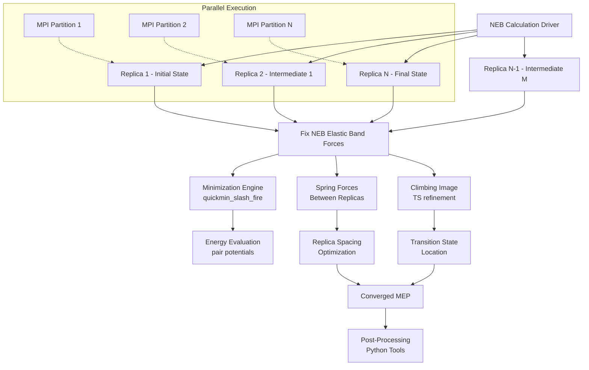
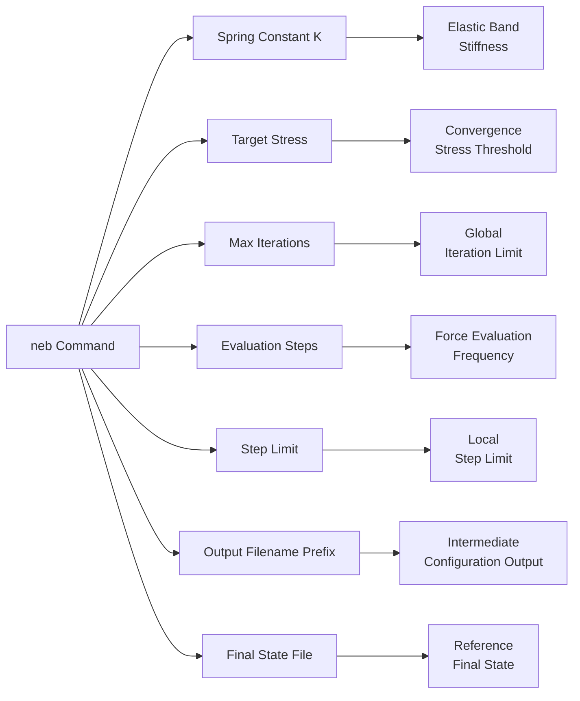
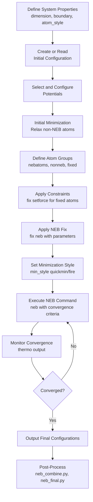
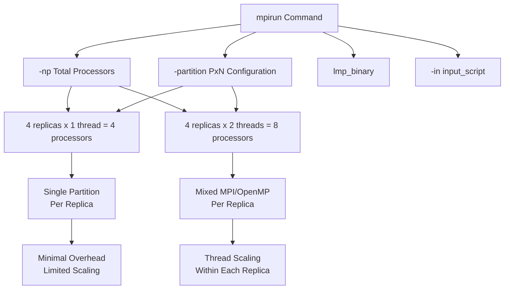
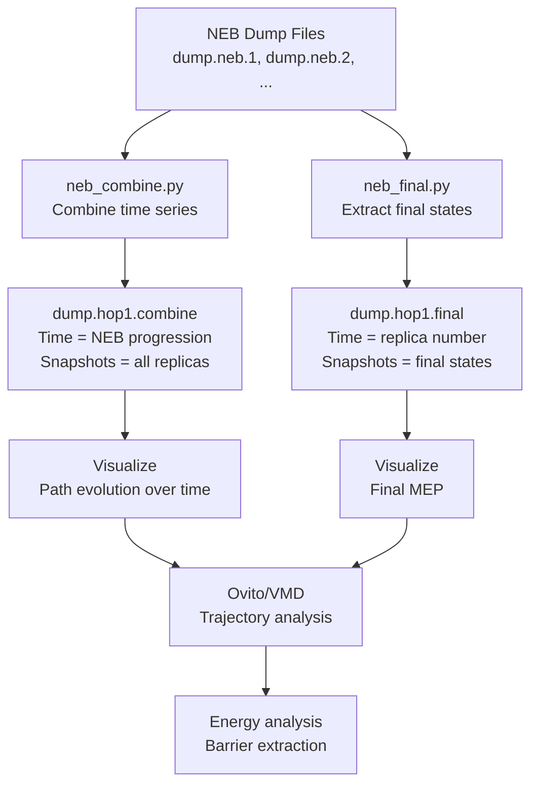
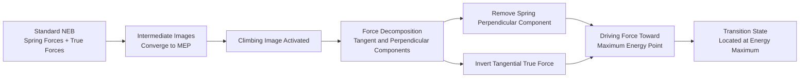
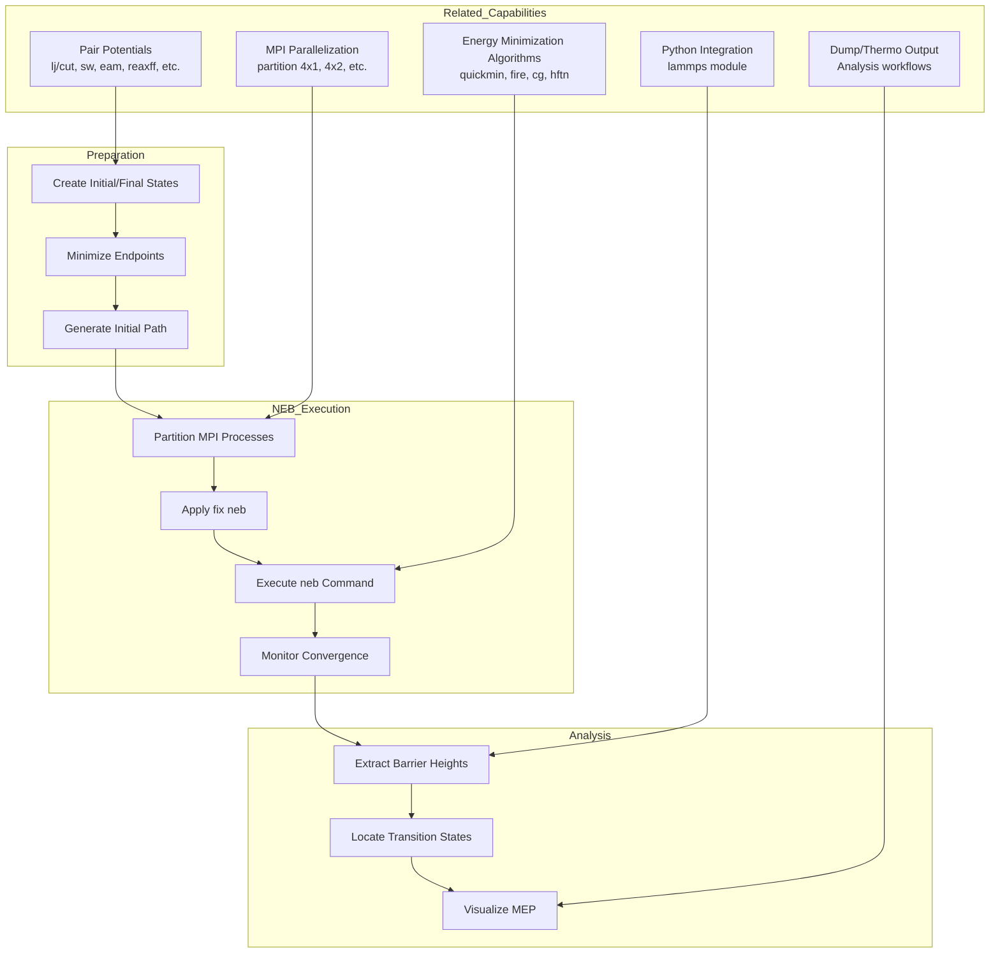

Nudged Elastic Band (NEB) calculations in LAMMPS enable the identification of minimum energy paths and transition states between two configurational states, providing critical insights into kinetic barriers and reaction mechanisms. This page covers the theoretical framework, implementation architecture, practical workflows, and parallel execution strategies for performing NEB calculations to study atomic-scale transitions such as surface diffusion, vacancy migration, and chemical reactions.

Sources: [examples/neb/README](examples/neb/README#L1-L34), [examples/neb/in.neb.hop1](examples/neb/in.neb.hop1#L1-L67), [examples/neb/in.neb.sivac](examples/neb/in.neb.sivac#L1-L79)

## Architectural Framework

LAMMPS implements NEB through a multi-replica architecture where each replica represents a configuration along the reaction coordinate, with inter-replica elastic band constraints maintaining replica spacing and climbing image techniques locating transition states. The implementation leverages MPI partitioning for parallel execution across replicas and integrates with LAMMPS minimization algorithms for energy minimization of each replica configuration.

Sources: [examples/neb/README](examples/neb/README#L1-L34), [tools/python/README](tools/python/README#L1-L91)

### NEB System Architecture



This architecture separates concerns: the NEB driver manages replica coordination, fix NEB computes elastic band constraints, the minimization engine handles intra-replica optimization, and Python tools provide visualization and analysis capabilities. Each replica operates independently except for spring force communication, enabling efficient parallelization.

Sources: [examples/neb/in.neb.hop1](examples/neb/in.neb.hop1#L48-L67), [examples/neb/in.neb.hop2](examples/neb/in.neb.hop2#L48-L69)

## NEB Command Syntax and Parameters

The `neb` command serves as the primary interface for initiating NEB calculations, controlling parameters such as spring constants, convergence criteria, iteration limits, and output specifications. This command orchestrates the multi-replica minimization process and manages communication between replicas.

Sources: [examples/neb/in.neb.hop1](examples/neb/in.neb.hop1#L67), [examples/neb/in.neb.hop2](examples/neb/in.neb.hop2#L69), [examples/neb/in.neb.sivac](examples/neb/in.neb.sivac#L78-L79)

### Command Structure



**Parameter Examples from Examples:**

```lammps
# 2D surface hopping simulation
neb 0.0 0.1 1000 1000 100 final final.hop1

# Silicon vacancy hopping (metal units)
neb 0.0 0.01 100 100 10 final final.sivac
```

Sources: [examples/neb/in.neb.hop1](examples/neb/in.neb.hop1#L67), [examples/neb/in.neb.hop2](examples/neb/in.neb.hop2#L69), [examples/neb/in.neb.sivac](examples/neb/in.neb.sivac#L78-L79)

### NEB Parameter Reference

| Parameter | Type | Description | Example Values | Usage Context |
|-----------|------|-------------|----------------|---------------|
| Spring Constant | real | Elastic band spring stiffness | 1.0 (LJ), 0.01 (metal) | Higher values maintain tighter replica spacing, lower values allow more flexibility in path exploration |
| Target Stress | real | Convergence stress threshold | 0.0 (LJ), 0.01 (metal) | Determines when replica forces are sufficiently relaxed |
| Max Iterations | integer | Global iteration limit | 100, 1000 | Prevents runaway calculations if convergence stalls |
| Evaluation Steps | integer | Steps between force evaluations | 100, 1000 | Controls frequency of spring force recomputation |
| Step Limit | integer | Local minimization steps | 10, 100 | Bounds individual replica minimization cycles |
| Output Prefix | string | Filename prefix for intermediate configurations | "final" | Generates numbered dump files for each output event |
| Final State File | string | Reference final configuration file | "final.hop1" | Specifies the known final state for path reconstruction |

Sources: [examples/neb/in.neb.hop1](examples/neb/in.neb.hop1#L67), [examples/neb/in.neb.hop2](examples/neb/in.neb.hop2#L69), [examples/neb/in.neb.sivac](examples/neb/in.neb.sivac#L78-L79)

## Fix NEB Configuration

The `fix neb` command applies elastic band constraints to specified atom groups, controlling spring force calculations, climbing image behavior, and replica coupling options. This fix is essential for implementing the NEB energy terms that maintain replica spacing along the reaction path.

Sources: [examples/neb/in.neb.hop1](examples/neb/in.neb.hop1#L48), [examples/neb/in.neb.hop2](examples/neb/in.neb.hop2#L52), [examples/neb/in.neb.hop1.end](examples/neb/in.neb.hop1.end#L45), [examples/neb/in.neb.sivac](examples/neb/in.neb.sivac#L57)

### Fix NEB Syntax

```mermaid
graph LR
    A[fix ID group neb K] --> B[parallel | <br/>serial]
    A --> C[ideal | <br/>variable]
    A --> D[end]
    A --> E[first]
    A --> F[spring_constant]
    
    B --> G[Replica<br/>Communication Mode]
    C --> H[Spring<br/>Force Type]
    D --> I[Final<br/>State Behavior]
    E --> J[First<br/>State Behavior]
    F --> K[Override<br/>Spring Constant]
```

**Examples from Input Scripts:**

```lammps
# Standard parallel NEB with ideal springs
fix 2 nebatoms neb 1.0 parallel ideal

# With climbing image at end state
fix 2 nebatoms neb 1.0 parallel ideal end first 1.0

# Simple single-group NEB (silicon vacancy)
fix 1 all neb 1.0
```

Sources: [examples/neb/in.neb.hop1](examples/neb/in.neb.hop1#L48), [examples/neb/in.neb.hop2](examples/neb/in.neb.hop2#L52), [examples/neb/in.neb.hop1.end](examples/neb/in.neb.hop1.end#L45), [examples/neb/in.neb.sivac](examples/neb/in.neb.sivac#L57)

### Fix NEB Options

| Option | Values | Effect | Typical Use Cases |
|--------|--------|--------|-------------------|
| Communication Mode | `parallel`, `serial` | Controls replica force communication strategy | `parallel` for MPI multi-partition execution, `serial` for single-partition debugging |
| Spring Type | `ideal`, `variable` | Determines spring force calculation method | `ideal` uses constant spring constant, `variable` allows adaptive stiffness |
| End State | `end` | Enables climbing image at final replica | Transition state refinement near reaction completion |
| First State | `first` | Enables climbing image at initial replica | Transition state refinement near reaction initiation |
| Spring Constant Override | numeric | Overrides command-line spring constant | Fine-tuning for specific reaction segments |

Sources: [examples/neb/in.neb.hop1](examples/neb/in.neb.hop1#L48), [examples/neb/in.neb.hop2](examples/neb/in.neb.hop2#L52), [examples/neb/in.neb.hop1.end](examples/neb/in.neb.hop1.end#L45), [examples/neb/in.neb.sivac](examples/neb/in.neb.sivac#L57)

> [!TIP]
> When using climbing images (`end` or `first` keywords), ensure your NEB calculation has converged to a reasonable minimum energy path before enabling climbing. The climbing image algorithm removes spring forces perpendicular to the path and inverts forces along the tangent direction to drive the image to the maximum energy point. Premature climbing image application can lead to poor convergence or incorrect transition state identification.

## NEB Workflow Implementation

Establishing a successful NEB calculation requires careful preparation of initial and final states, appropriate system definition, controlled minimization before NEB, and proper replica configuration for the transition path. The workflow involves sequential setup stages that progressively prepare the system for NEB execution.

Sources: [examples/neb/in.neb.hop1](examples/neb/in.neb.hop1#L1-L67), [examples/neb/in.neb.hop2](examples/neb/in.neb.hop2#L1-L69), [examples/neb/in.neb.sivac](examples/neb/in.neb.sivac#L1-L79)

### Complete NEB Execution Flowchart



### System Setup Phase

**1. Define Basic System Properties:**

```lammps
# 2D LJ surface hopping example
dimension       2
boundary        p s p
atom_style      atomic
neighbor        0.3 bin
neigh_modify    delay 5
atom_modify     map array sort 0 0.0

# 3D silicon vacancy example
units           metal
atom_style      atomic
atom_modify     map array
boundary        p p p
atom_modify     sort 0 0.0
```

Sources: [examples/neb/in.neb.hop1](examples/neb/in.neb.hop1#L1-L8), [examples/neb/in.neb.sivac](examples/neb/in.neb.sivac#L1-L8)

**2. Create or Read Initial Configuration:**

```lammps
# Option 1: Read prepared data file
read_data initial.hop1

# Option 2: Generate structure on-the-fly
lattice hex 0.9
region box block 0 20 0 10 -0.25 0.25
create_box 3 box
create_atoms 1 box
mass * 1.0
write_data initial.hop1
```

Sources: [examples/neb/in.neb.hop1](examples/neb/in.neb.hop1#L10-L20), [examples/neb/in.neb.hop2](examples/neb/in.neb.hop2#L10-L20), [examples/neb/in.neb.sivac](examples/neb/in.neb.sivac#L11-L31)

**3. Configure Potentials:**

```lammps
# Lennard-Jones potential (2D system)
pair_style lj/cut 2.5
pair_coeff * * 1.0 1.0 2.5
pair_modify shift yes

# Stillinger-Weber potential (silicon)
pair_style sw
pair_coeff * * Si.sw Si
```

Sources: [examples/neb/in.neb.hop1](examples/neb/in.neb.hop1#L22-L26), [examples/neb/in.neb.sivac](examples/neb/in.neb.sivac#L42-L43)

### Pre-NEB Preparation

**Initial Energy Minimization:**

```lammps
# Relax surface before NEB
minimize 1.0e-6 1.0e-4 1000 10000
reset_timestep 0
```

Sources: [examples/neb/in.neb.hop1](examples/neb/in.neb.hop1#L28-L30), [examples/neb/in.neb.hop2](examples/neb/in.neb.hop2#L28-L30)

**Define Atom Groups:**

```lammps
# Define fixed boundary atoms
region 1 block INF INF INF 1.25 INF INF
group lower region 1
group mobile subtract all lower
set group lower type 2

# Define NEB active atoms
region surround block 10 18 17 20 0 0 units box
group nebatoms region surround
set group nebatoms type 3
group nonneb subtract all nebatoms
```

Sources: [examples/neb/in.neb.hop1](examples/neb/in.neb.hop1#L32-L43), [examples/neb/in.neb.hop2](examples/neb/in.neb.hop2#L32-L43)

**Apply Constraints and NEB Fix:**

```lammps
# Fix boundary atoms
fix 1 lower setforce 0.0 0.0 0.0

# Apply NEB elastic band constraint
fix 2 nebatoms neb 1.0 parallel ideal

# Optional: enforce 2D constraint for 2D simulations
fix 3 all enforce2d
```

Sources: [examples/neb/in.neb.hop1](examples/neb/in.neb.hop1#L45-L50), [examples/neb/in.neb.hop2](examples/neb/in.neb.hop2#L45-L51), [examples/neb/in.neb.sivac](examples/neb/in.neb.sivac#L57)

**Set Minimization Style:**

```lammps
# Choose minimization algorithm
min_style quickmin    # or fire, or other minimizer
```

Sources: [examples/neb/in.neb.hop1](examples/neb/in.neb.hop1#L64), [examples/neb/in.neb.hop2](examples/neb/in.neb.hop2#L64), [examples/neb/in.neb.sivac](examples/neb/in.neb.sivac#L76)

> [!TIP]
> The choice of minimization style significantly affects NEB convergence. `quickmin` is often robust for surface diffusion problems, while `fire` may converge faster for systems with steep potential gradients. Test different minimizers on your specific system to determine optimal convergence characteristics.

## Parallel Execution Strategy

NEB calculations in LAMMPS leverage MPI partitioning to execute replicas in parallel, distributing computational load across available processors and enabling efficient multi-replica simulations. Each partition handles one replica independently, with synchronization occurring during spring force calculations.

Sources: [examples/neb/README](examples/neb/README#L1-L34)

### MPI Partitioning Commands



**Execution Examples:**

```bash
# Basic 4-replica NEB (4 processors total)
mpirun -np 4 lmp_g++ -partition 4x1 -in in.neb.hop1

# 4-replica NEB with threading (8 processors total)
mpirun -np 8 lmp_g++ -partition 4x2 -in in.neb.hop1

# 3-replica NEB (3 processors total)
mpirun -np 3 lmp_g++ -partition 3x1 -in in.neb.sivac
```

Sources: [examples/neb/README](examples/neb/README#L1-L17)

### Parallel Configuration Options

| Partition Scheme | Processors | Replicas | Threads/Replica | Use Case | Performance Characteristics |
|------------------|------------|----------|-----------------|----------|----------------------------|
| `-partition 4x1` | 4 | 4 | 1 | Minimal resource environments | Lowest overhead, limited intra-replica scaling |
| `-partition 4x2` | 8 | 4 | 2 | Balanced compute resources | Good inter-replica parallelism with some intra-replica threading |
| `-partition 8x4` | 32 | 8 | 4 | High-resource systems | Maximum replica count with significant per-replica parallelism |

> [!TIP]
> The optimal partition scheme depends on your system size and available resources. For small systems (<1000 atoms), inter-replica parallelism dominates performance considerations. For large systems (>10,000 atoms), intra-replica threading becomes increasingly important. Always verify that replica synchronization overhead doesn't outweigh computational benefits from increased replica count.

Sources: [examples/neb/README](examples/neb/README#L9-L17)

## Practical Application Examples

LAMMPS provides comprehensive examples demonstrating NEB application to diverse physical systems including 2D surface diffusion, 3D vacancy migration in covalent crystals, and adatom hopping on crystalline surfaces. These examples illustrate workflow patterns and parameter selection strategies applicable across materials systems.

Sources: [examples/neb/README](examples/neb/README#L1-L34), [examples/neb/in.neb.hop1](examples/neb/in.neb.hop1#L1-L67), [examples/neb/in.neb.hop2](examples/neb/in.neb.hop2#L1-L69), [examples/neb/in.neb.sivac](examples/neb/in.neb.sivac#L1-L79)

### Application Comparison Table

| Application | System Type | Potential | Units | Spring Constant | Key Features |
|-------------|-------------|-----------|-------|-----------------|--------------|
| Surface Hopping 1 | 2D Hexagonal Lattice | Lennard-Jones | LJ | 1.0 | Flat surface → adatom formation, single-atom NEB group |
| Surface Hopping 2 | 2D Hexagonal Lattice | Lennard-Jones | LJ | 1.0 | Adatom migration across surface, intermediate hopping event |
| Silicon Vacancy | 3D Diamond Crystal | Stillinger-Weber | Metal | 1.0 | Bulk vacancy diffusion, coordination number analysis, larger system |

Sources: [examples/neb/in.neb.hop1](examples/neb/in.neb.hop1#L1-L67), [examples/neb/in.neb.hop2](examples/neb/in.neb.hop2#L1-L69), [examples/neb/in.neb.sivac](examples/neb/in.neb.sivac#L1-L79)

### Silicon Vacancy Hopping Example Analysis

The silicon vacancy example demonstrates NEB application to realistic 3D covalent systems with complex potential functions:

```lammps
# Coordination number cutoff for analysis
variable r equal 2.835

# Diamond unit cell definition
variable a equal 5.431
lattice custom $a               &
    a1 1.0 0.0 0.0              &
    a2 0.0 1.0 0.0              &
    a3 0.0 0.0 1.0              &
    basis 0.0 0.0 0.0           &
    basis 0.0 0.5 0.5           &
    basis 0.5 0.0 0.5           &
    basis 0.5 0.5 0.0           &
    basis 0.25 0.25 0.25        &
    basis 0.25 0.75 0.75        &
    basis 0.75 0.25 0.75        &
    basis 0.75 0.75 0.25

# Create supercell
region myreg block 0 4 0 4 0 4
create_box 1 myreg
create_atoms 1 region myreg
mass 1 28.06
write_data initial.sivac

# Make vacancy by deleting atom
read_data initial.sivac
group Si type 1
group del id 300
delete_atoms group del compress no
group vacneigh id 174 175 301 304 306 331 337

# Apply Stillinger-Weber potential
pair_style sw
pair_coeff * * Si.sw Si

# Initial random displacement to break symmetry
displace_atoms all random 0.1 0.1 0.1 123456
minimize 1.0e-6 1.0e-4 1000 10000
reset_timestep 0

# Apply NEB fix
fix 1 all neb 1.0

# Execute NEB with strict convergence
timestep 0.01
min_style quickmin
neb 0.0 0.01 100 100 10 final final.sivac
```

Sources: [examples/neb/in.neb.sivac](examples/neb/in.neb.sivac#L1-L79)

**Key Implementation Details:**

1. **Crystal Structure**: Diamond lattice with 4×4×4 supercell (256 atoms before vacancy creation)
2. **Vacancy Creation**: Single atom deletion creates initial defect state
3. **Potential Model**: Stillinger-Weber accurately captures Si-Si covalent bonding
4. **Symmetry Breaking**: Random displacement prevents minimizer from staying in symmetric configuration
5. **Strict Convergence**: Low target stress (0.01 metal units) and short iteration limits (100) require careful spring constant tuning

Sources: [examples/neb/in.neb.sivac](examples/neb/in.neb.sivac#L1-L79)

## Post-Processing and Visualization

Python tools provided with LAMMPS enable combination of NEB replica dump files into visualizable formats, generation of combined time series showing path evolution, and extraction of final state configurations for analysis. These tools leverage the Pizza.py toolkit for efficient LAMMPS data manipulation.

Sources: [tools/python/README](tools/python/README#L1-L91), [tools/python/neb_combine.py](tools/python/neb_combine.py#L1-L89), [tools/python/neb_final.py](tools/python/neb_final.py#L1-L72)

### NEB Visualization Workflow



### Python Tool Configuration

**Setup Environment Variable:**

```bash
# Required for accessing Pizza.py modules
setenv LAMMPS_PYTHON_TOOLS /path/to/lammps/tools/python/pizza
```

Sources: [tools/python/README](tools/python/README#L39-L52)

**Execute neb_combine.py:**

```bash
python neb_combine.py -o dump.hop1.combine -b dump.nonneb.1 -r dump.neb.*
```

**Execute neb_final.py:**

```bash
python neb_final.py -o dump.hop1.final -b dump.nonneb.1 -r dump.neb.*
```

Sources: [examples/neb/README](examples/neb/README#L20-L28)

### Python Tool Syntax Reference

| Script | Required Arguments | Optional Arguments | Output | Purpose |
|--------|-------------------|-------------------|--------|---------|
| `neb_combine.py` | `-o outfile`, `-r dump1 dump2 ...` | `-b backfile` | Combined dump file with time series | Shows NEB path evolution through all replicas over calculation time |
| `neb_final.py` | `-o outfile`, `-r dump1 dump2 ...` | `-b backfile` | Combined dump file with final states | Shows converged minimum energy path with all replica configurations |

Sources: [tools/python/neb_combine.py](tools/python/neb_combine.py#L1-L89), [tools/python/neb_final.py](tools/python/neb_final.py#L1-L72)

## Advanced NEB Techniques

Sophisticated NEB implementations incorporate climbing image methods for precise transition state location, replica count optimization for barrier accuracy, and spring constant tuning for convergence stability. These advanced techniques enable more accurate determination of activation energies and reaction mechanisms.

Sources: [examples/neb/README](examples/neb/README#L19-L21), [examples/neb/in.neb.hop1.end](examples/neb/in.neb.hop1.end#L1-L57)

### Climbing Image NEB Implementation

Climbing image modification removes spring forces perpendicular to the path and inverts the true force component along the tangent direction, driving the climbing image to the maximum energy point along the path:

```lammps
# Apply climbing image at end state
fix 2 nebatoms neb 1.0 parallel ideal end first 1.0
```

Sources: [examples/neb/in.neb.hop1.end](examples/neb/in.neb.hop1.end#L45)

**Climbing Image Strategy:**



> [!TIP]
> Climbing image should only be activated after the standard NEB calculation has converged to a reasonable approximation of the minimum energy path. Premature climbing image application can cause the image to climb incorrect energy maxima or fail to converge due to large forces in unconverged regions of the path.

### Parameter Optimization Guidelines

| Parameter | Low Value Effect | High Value Effect | Optimization Strategy | Warning Signs |
|-----------|------------------|------------------|----------------------|---------------|
| Spring Constant | Replicas may drift apart, poor path resolution | Replicas too stiff, slow convergence, may miss true MEP | Start with moderate value (0.1-1.0), adjust based on energy barrier smoothness | Erratic energy profiles, replicas clumping, barrier discontinuities |
| Replica Count | Poor barrier resolution, inaccurate activation energy | Increased computational cost, diminishing returns | 4-8 replicas for initial studies, 12+ for publication-quality results | Large energy jumps between adjacent replicas |
| Target Stress | Loose convergence, unreliable transition state | Excessive computation time, diminishing accuracy | Tighten gradually: 0.1 → 0.01 → 0.001 for final production runs | Forces on replicas remain high despite iteration progress |

Sources: [examples/neb/README](examples/neb/README#L19-L21)

## Troubleshooting and Common Issues

NEB calculations frequently encounter convergence difficulties, replica spacing problems, and computational resource challenges. Systematic diagnosis of these issues requires examination of energy profiles, replica configurations, and iteration histories.

Sources: [examples/neb/README](examples/neb/README#L1-L34)

### Common NEB Problems and Solutions

| Symptom | Possible Causes | Diagnostic Actions | Resolution Strategies |
|---------|---------------|-------------------|----------------------|
| Non-converging after max iterations | Inappropriate spring constant, poor initial path, insufficient replicas | Plot energy vs iteration for each replica, examine replica positions | Adjust spring constant, increase replica count, regenerate initial path with intermediate minimization |
| Large energy jumps between replicas | Insufficient replica count, steep potential gradients, spring constant mismatch | Calculate energy differences between adjacent replicas | Add intermediate replicas, reduce spring constant, apply adaptive spring schemes |
| Replicas clustering at endpoints | Spring constant too low, attractive endpoint minima too deep | Visualize replica distribution along reaction coordinate | Increase spring constant, add intermediate anchor points, apply climbing image |
| Incorrect transition state location | Poor initial path approximation, insufficient convergence | Examine force components at climbing image | Run longer pre-climbing standard NEB, tighten convergence criteria, verify force decomposition |
| Memory/exceeding time limits | Too many atoms per replica, excessive replica count | Monitor memory usage per replica, profile computation time | Reduce replica count, use smaller systems, employ hybrid MPI/OpenMP schemes |

> [!TIP]
> Always verify that your initial and final states are properly minimized before running NEB. Poorly relaxed endpoints can create artificial barriers or cause convergence issues. Additionally, ensure that the NEB atom group includes all atoms that participate in the transition and excludes truly frozen atoms that only serve as boundary conditions.

Sources: [examples/neb/in.neb.hop1](examples/neb/in.neb.hop1#L28-L30), [examples/neb/in.neb.hop2](examples/neb/in.neb.hop2#L28-L30), [examples/neb/in.neb.sivac](examples/neb/in.neb.sivac#L50-L52)

## Integration with LAMMPS Ecosystem

NEB calculations integrate seamlessly with LAMMPS minimization algorithms, parallel computing infrastructure, and post-processing tools, enabling comprehensive studies of kinetic processes in diverse materials systems. This integration allows leveraging of existing LAMMPS capabilities for potentials, diagnostics, and analysis.

Sources: [examples/neb/in.neb.hop1](examples/neb/in.neb.hop1#L1-L67), [tools/python/README](tools/python/README#L1-L91)

### NEB in LAMMPS Workflow



### Related Documentation Pages

For comprehensive understanding of NEB calculations, consult these related documentation pages:

- **[Energy Minimization Algorithms](20-energy-minimization-algorithms)**: Detailed explanation of minimization styles (quickmin, fire, cg, hftn) and their application to NEB calculations
- **[Units and Dimensions](9-units-and-dimensions)**: Guidance on selecting appropriate units systems (LJ, metal, real) for NEB calculations
- **[MPI Parallelization Strategy](24-mpi-parallelization-strategy)**: In-depth discussion of MPI partitioning strategies for replica-based calculations
- **[Dump Files and Trajectory Output](32-dump-files-and-trajectory-output)**: Configuration of dump commands for NEB trajectory capture and post-processing
- **[Python Integration](28-lammps-python-module-basics)**: Using the LAMMPS Python module for automated NEB workflows and analysis
