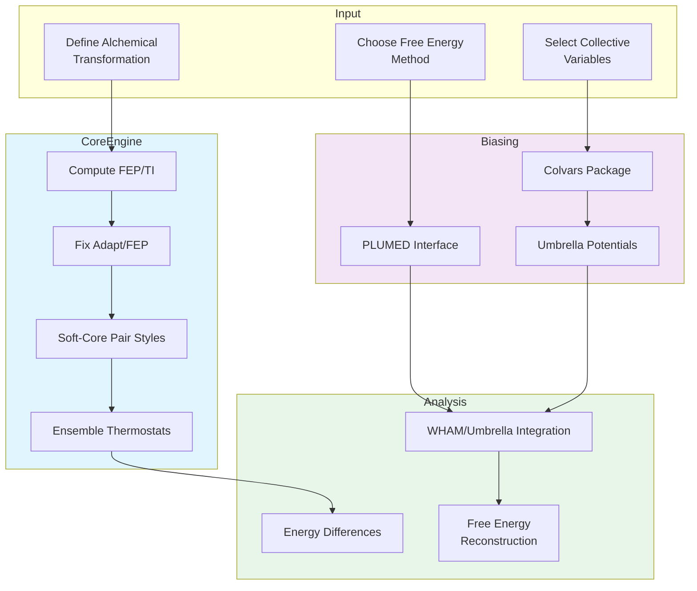
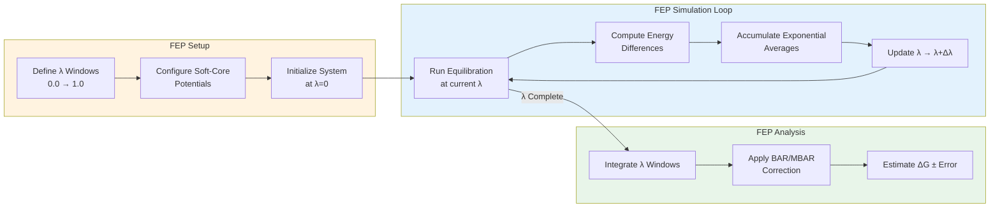

Free energy calculations represent the most sophisticated analysis capability in LAMMPS, enabling quantitative determination of thermodynamic properties that govern molecular recognition, phase transitions, and chemical reaction pathways. These calculations bridge the gap between microscopic simulation trajectories and macroscopic thermodynamic observables through statistical mechanical frameworks that transform ensemble averages into free energy differences. This documentation explores the architectural foundations, implementation patterns, and practical application of LAMMPS's free energy computational ecosystem.

Sources: [README](README#L1-L60), [CH4hyd README](examples/PACKAGES/fep/CH4hyd/README.md#L1-L59)

## Architectural Framework

LAMMPS implements free energy calculations through a modular architecture that integrates specialized compute classes with the core simulation engine. The design follows a clear separation of concerns: computes handle energy difference calculations, fixes manage parameter adaptation and bias potentials, and pair styles provide soft-core interaction handling for alchemical transformations. This architecture supports multiple complementary methods—Free Energy Perturbation (FEP), Thermodynamic Integration (TI), Umbrella Sampling, and advanced metadynamics techniques—while maintaining consistent interfaces for data collection and analysis.

The free energy computational pipeline follows a staged workflow where users define collective variables or alchemical parameters, apply biasing potentials or adaptive coupling schemes, collect ensemble averages, and post-process results to extract free energy differences. Critical design elements include soft-core potentials to avoid singularities during particle creation/deletion, volume correction terms for constant pressure simulations, and histogram-based reconstruction methods for biased simulations.

Sources: [README](README#L1-L60)

## Free Energy Perturbation (FEP)

Free Energy Perturbation implements the exponential averaging formula ΔG = -kT ln⟨exp(-ΔU/kT)⟩_0 to compute free energy differences between thermodynamic states through gradual alchemical transformations. LAMMPS provides the `compute fep` command which evaluates energy differences between reference and perturbed states at each simulation timestep, accumulating statistics that converge to the free energy change. The implementation requires careful treatment of singularities—particles being created or deleted must use soft-core potentials to avoid divergent energies as intermolecular distances approach zero.

The FEP workflow typically involves defining a coupling parameter λ that smoothly interpolates between initial (λ=0) and final (λ=1) states, modifying interaction strengths, partial charges, or particle existence through `fix adapt/fep`. The system is simulated at discrete λ windows, and free energy differences are computed using exponential averaging of energy differences between neighboring windows. For high-accuracy results, bidirectional transformations (forward and reverse) enable estimation of systematic errors through the Bennett Acceptance Ratio (BAR) method.

The methane hydration example demonstrates a complete FEP workflow where a methane molecule is alchemically created (fep01) and deleted (fep10) in water using `pair lj/cut/tip4p/long/soft` for soft-core interactions and `fix adapt/fep` to gradually scale Lennard-Jones parameters and partial charges via the λ coupling parameter [in.fep01.lmp](examples/PACKAGES/fep/CH4hyd/fep01/in.fep01.lmp#L1-L86). The simulation collects energy differences through `compute fep` which are then post-processed using Python scripts to obtain the hydration free energy in kcal/mol [README.md](examples/PACKAGES/fep/CH4hyd/README.md#L1-L59).

Sources: [CH4hyd input](examples/PACKAGES/fep/CH4hyd/fep01/in.fep01.lmp#L1-L86), [CH4hyd README](examples/PACKAGES/fep/CH4hyd/README.md#L1-L59)

## Thermodynamic Integration (TI)

Thermodynamic Integration computes free energy differences by integrating the ensemble average of the derivative of the Hamiltonian with respect to the coupling parameter: ΔG = ∫₀¹ ⟨∂H/∂λ⟩_λ dλ. LAMMPS implements this method through `compute ti`, which calculates ⟨∂U/∂λ⟩ directly from the current configuration without needing explicit energy difference calculations. The TI approach often demonstrates superior convergence compared to FEP for large perturbations, particularly when implemented with finite-difference thermodynamic integration (FDTI) that evaluates the derivative numerically.

The TI workflow requires evaluation of ∂U/∂λ at multiple λ values spanning the transformation, followed by numerical integration (trapezoidal rule or higher-order methods) to obtain the total free energy change. For systems with singularities or discontinuous derivatives, careful selection of integration points and soft-core potentials remains essential. LAMMPS provides both direct TI and FDTI implementations, with the latter offering flexibility in handling complex parameter dependencies.

Sources: [CH4hyd README](examples/PACKAGES/fep/CH4hyd/README.md#L1-L59)

## Soft-Core Potentials and Alchemical Transformations

Alchemical transformations involving particle creation or deletion require special treatment to avoid infinite energies as atoms overlap during coupling. LAMMPS implements soft-core potentials that modify the standard Lennard-Jones and Coulomb interactions by adding a λ-dependent softening parameter that prevents singularities at r=0. The `pair lj/cut/tip4p/long/soft` style exemplifies this approach, where the standard potential is replaced with a softened version that remains finite even when λ=0 or λ=1 and particles occupy overlapping positions.

Soft-core potentials are essential for FEP and TI calculations involving insertion/deletion of particles, but they introduce additional complexity: the choice of softening parameters affects both convergence rates and accuracy, and the modified potential must be consistently applied across all affected interactions. The methane hydration example demonstrates proper implementation, with soft-core interactions specified for all water-methane cross terms [in.fep01.lmp](examples/PACKAGES/fep/CH4hyd/fep01/in.fep01.lmp#L1-L86).

> [!TIP]
> When implementing alchemical transformations, always verify that soft-core parameters are applied to all pair coefficients involving the coupling species. Inconsistent soft-core application leads to divergent energies and simulation failure, particularly during initial λ windows where partial atoms overlap with solvent.

Sources: [CH4hyd input](examples/PACKAGES/fep/CH4hyd/fep01/in.fep01.lmp#L1-L86)

## Umbrella Sampling and Collective Variables

Umbrella sampling enhances sampling along predefined collective variables by adding harmonic bias potentials that restrain the system at specific windows along the reaction coordinate. LAMMPS implements umbrella sampling through the colvars package, which provides a flexible interface for defining collective variables (distances, angles, dihedrals, coordination numbers) and applying restraints. The colvars interface enables definition of multiple collective variables with coupling terms, time-dependent bias potentials, and on-the-fly free energy estimation using metadynamics or adaptive biasing force methods.

The umbrella sampling workflow divides the reaction coordinate into overlapping windows, each with a harmonic restraint centered at different values. After independent simulations at each window, the Weighted Histogram Analysis Method (WHAM) or Multistate Bennett Acceptance Ratio (MBAR) reconstructs the unbiased potential of mean force (PMF) along the collective variable. The colvars package outputs histograms and bias energies suitable for WHAM analysis, with optional on-the-fly PMF computation for adaptive methods.

Sources: [colvars examples](examples/PACKAGES/colvars)

## PLUMED Integration for Enhanced Sampling

LAMMPS provides seamless integration with PLUMED, an extensive library for enhanced sampling and free energy calculations. Through the PLUMED package, users can access advanced methods including metadynamics, well-tempered metadynamics, bias-exchange metadynamics, parallel tempering with metadynamics, and string methods. The interface enables specification of collective variables and biasing potentials through external PLUMED configuration files while maintaining full access to LAMMPS simulation capabilities.

The PLUMED integration follows a plug-in architecture where the fix plumed command handles communication between LAMMPS and PLUMED at each timestep, passing coordinates and forces and receiving bias forces and energy contributions. This separation allows LAMMPS users to leverage PLUMED's extensive documentation and method development while maintaining LAMMPS's performance and parallel scalability.

Sources: [plumed examples](examples/PACKAGES/plumed)

## Method Comparison and Selection Strategy

The choice of free energy calculation method depends on system characteristics, transformation complexity, and available computational resources. Each method offers distinct advantages and limitations, often making hybrid approaches optimal for challenging systems.

| Method | Strengths | Limitations | Best For |
|--------|-----------|-------------|----------|
| **FEP** | Simple implementation; direct free energy estimates | Poor convergence for large perturbations; exponential averaging susceptible to outliers | Small perturbations; solvation free energies; ligand binding |
| **TI** | Better convergence for larger transformations; smoother integration | Requires numerical integration; sensitive to λ point selection | Phase transitions; large conformational changes |
| **Umbrella Sampling** | Excellent for reaction coordinates; parallelizable | Requires window overlap; WHAM analysis complexity | PMF calculations; ion permeation; protein folding barriers |
| **Metadynamics** | Explores multidimensional free energy surfaces; adaptive | Bias deposition parameters critical; requires restart analysis | Rare events; unknown reaction coordinates; complex landscapes |

Sources: [README](README#L1-L60), [FEP examples](examples/PACKAGES/fep)

## Entropy Calculations

LAMMPS provides direct entropy calculation capabilities through `compute entropy/atom`, which implements the two-phase thermodynamic (2PT) method for decomposing vibrational density of states into gas-like and solid-like components. This approach enables estimation of absolute entropies from molecular dynamics trajectories without requiring reference states or integration over thermodynamic pathways. The entropy calculation considers both global and local density environments, providing per-atom entropy contributions that reveal spatial heterogeneity in liquid systems.

The entropy compute accepts parameters controlling cutoff distances, averaging over neighbors, and local/global density treatments. The Na interface example demonstrates entropy calculation for a metal system, showing how the method handles interfaces where local density variations create significant entropy gradients [in.entropy](examples/PACKAGES/entropy/in.entropy#L1-L35).

Sources: [entropy example](examples/PACKAGES/entropy/in.entropy#L1-L35)

> [!TIP]
> Entropy calculations require extensive sampling to converge the vibrational density of states. For accurate results, run simulations long enough to achieve statistical convergence in the high-frequency gas-like component, which typically requires nanoseconds of simulation time for liquids at ambient conditions.

## Advanced Integration and Workflow Patterns

Complex free energy calculations often require combining multiple methods or implementing sophisticated workflow patterns. LAMMPS supports advanced integration through variable coupling schemes, where multiple λ parameters control different aspects of the transformation independently. The adapt/fep fix enables simultaneous modification of pair coefficients, atomic charges, and force field parameters using arbitrary expressions involving λ, enabling implementation of multi-stage protocols with smooth coupling schedules.

For challenging systems, replica exchange enhanced sampling with λ as the exchange variable (λ-REMD) dramatically improves convergence by allowing replicas at different λ values to exchange configurations based on Metropolis criteria. This approach combines the benefits of TI's smooth integration with replica exchange's enhanced barrier crossing, though it requires multiple parallel simulations and careful tuning of exchange parameters.

Sources: [CH4hyd input](examples/PACKAGES/fep/CH4hyd/fep01/in.fep01.lmp#L1-L86)

## Post-Processing and Analysis

LAMMPS provides built-in output collection for free energy calculations through custom thermo styles and fix ave/time, but comprehensive analysis typically requires external tools. The tools directory includes Python scripts for FEP, FDTI, and numerical thermodynamic integration (NTI) analysis that process the output files generated by compute fep and compute ti [README.md](examples/PACKAGES/fep/CH4hyd/README.md#L1-L59). These scripts implement exponential averaging, trapezoidal integration, and error estimation methods necessary for rigorous free energy determination.

For umbrella sampling, the colvars package outputs histogram data compatible with WHAM analysis programs, and PLUMED provides native tools for metadynamics bias reconstruction and free energy surface visualization. Analysis workflows typically involve verifying convergence through time-series analysis, comparing forward and reverse transformations for consistency, and estimating statistical errors through block averaging or bootstrap methods.

Sources: [CH4hyd README](examples/PACKAGES/fep/CH4hyd/README.md#L1-L59)

## Best Practices and Optimization Considerations

Successful free energy calculations require careful attention to simulation protocol design and computational efficiency. Equilibration periods at each λ window must be sufficiently long to relax the system to the new coupling conditions, and production runs must achieve statistical convergence of the measured averages. For parallel efficiency, load balancing is critical—different λ windows may have different computational costs due to varying interaction cutoffs or neighbor list requirements.

Memory optimization considerations include limiting output frequency, using per-processor storage for histogram data, and choosing appropriate neighbor list rebuild frequencies. For long simulations, periodic restart capabilities enable checkpointing and recovery from interruptions while maintaining statistical consistency.

Sources: [README](README#L1-L60)

## Next Steps

For comprehensive understanding of free energy calculations in LAMMPS, continue with these related topics:

- **[Molecular Dynamics Fundamentals](8-molecular-dynamics-fundamentals)** - Essential background on ensemble theory and statistical mechanics
- **[Simulation Ensembles and Thermostats](10-simulation-ensembles-and-thermostats)** - Foundation for proper free energy calculation protocols
- **[NEB and Transition State Calculations](21-neb-and-transition-state-calculations)** - Complementary methods for reaction pathway exploration
- **[Replica Exchange Methods](23-replica-exchange-methods)** - Advanced sampling techniques for enhanced convergence
