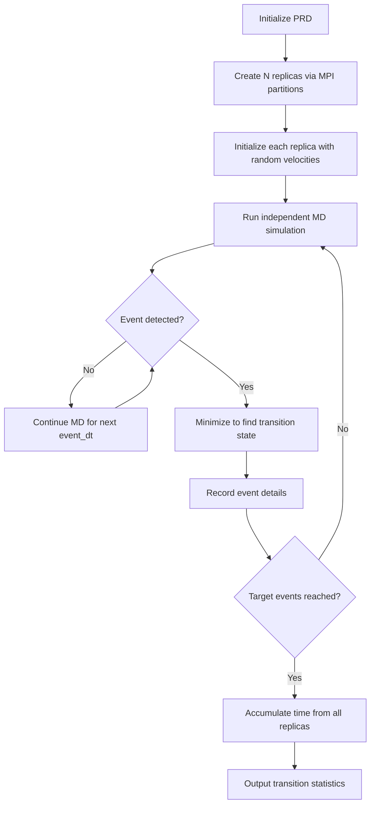

Replica exchange methods represent a powerful class of accelerated dynamics techniques that enable exploration of rare events and complex energy landscapes in LAMMPS simulations. These methods address a fundamental challenge in molecular dynamics: the timescale gap between atomic vibrations (femtoseconds to picoseconds) and physically relevant processes (microseconds to seconds). By running multiple replicas of the system under different conditions and allowing exchanges between them, these methods dramatically enhance sampling efficiency while maintaining statistical rigor. This documentation covers the three primary replica exchange techniques available in LAMMPS: Parallel Replica Dynamics (PRD), Temperature Accelerated Dynamics (TAD), and Nudged Elastic Band (NEB), providing advanced developers with the technical foundation needed to implement and optimize these methods for materials science research.

Sources: [in.prd](examples/prd/in.prd#L1-L98), [in.tad](examples/tad/in.tad#L1-L111)

## Parallel Replica Dynamics (PRD)

Parallel Replica Dynamics is designed for accelerated sampling of infrequent-event systems, where the system remains trapped in potential energy basins for long periods between transition events. PRD addresses this by distributing multiple replicas of the system across processor partitions, each evolving independently until a transition event is detected. When a transition occurs, the simulation time from all replicas is combined, effectively achieving linear speedup proportional to the number of replicas. This method is particularly effective for studying vacancy diffusion, grain boundary migration, and other rare-event processes in condensed matter systems.

The PRD algorithm requires careful configuration of several parameters that control event detection, minimization, and replica synchronization. The implementation in LAMMPS uses the `prd` command with the following syntax: `prd nsteps nevent event_dt tmax temp compute_ID min etol ftol maxiter maxeval` where these parameters define the dynamics protocol and minimization convergence criteria. The method relies on coordination number analysis to detect transitions, as demonstrated in the silicon vacancy example where a cutoff radius of 2.835 Å identifies atomic coordination changes when atoms migrate into vacant sites.

Sources: [in.prd](examples/prd/in.prd#L60-L98)

### PRD Configuration and Parameters

The following table summarizes the key parameters for configuring PRD simulations, which must be carefully tuned based on the specific material system and transition kinetics being studied:

| Parameter | Description | Typical Values | Impact on Simulation |
|-----------|-------------|----------------|----------------------|
| nsteps | Total simulation steps per replica | 1000-10000 | Longer runs increase likelihood of detecting events |
| nevent | Number of events to collect before termination | 10-100 | Determines statistical sampling of transition pathways |
| event_dt | Timestep between event checks | 0.5-2.0 | Smaller values increase computational cost but improve detection accuracy |
| tmax | Maximum simulation time per replica | 100-1000 | Prevents indefinite trapping in metastable states |
| etol | Energy tolerance for minimization | 1.0e-5 to 1.0e-4 | Controls convergence of transition state refinement |
| ftol | Force tolerance for minimization | 1.0e-5 to 1.0e-4 | Affects precision of identified transition states |

The practical execution of PRD requires proper MPI partition configuration, as demonstrated in the example: `mpirun -np 4 lmp_g++ -partition 4x1 -in in.prd`. This allocates four processor partitions, with each partition running an independent replica of the system. The `-partition 4x1` flag specifies 4 replicas with 1 world each, though alternative configurations like `-partition 4x2` are supported for larger systems requiring more computational resources per replica.

Sources: [README.prd](examples/prd/README#L1-L7)

## Temperature Accelerated Dynamics (TAD)

Temperature Accelerated Dynamics leverages the Arrhenius relationship to accelerate rare event sampling by simulating at elevated temperatures where transition rates are higher, then extrapolating the results to the target temperature of interest. The fundamental insight is that transition rates increase exponentially with temperature, so brief simulations at high temperature can reveal pathways that would be inaccessible in practical simulation times at low temperature. TAD combines this acceleration with harmonic transition state theory (HTST) to compute the prefactors and activation energies needed for accurate extrapolation.

The TAD implementation in LAMMPS is specified using the `tad` command, which integrates high-temperature dynamics, event detection, saddle point searches via NEB, and extrapolation calculations. In the silicon vacancy example, TAD operates between a low temperature of 1800K and a high temperature of 2400K, with the command: `tad 2000 50 ${tlo} ${thi} 0.05 1.0 event min ${etol} ${ftol} ${maxiter} ${maxeval} neb 0.0 0.01 200 200 20 neb_style fire neb_log log.neb`. This configuration specifies 2000 steps per high-temperature trajectory, collection of 50 events, and comprehensive NEB parameters for transition state refinement.

Sources: [in.tad](examples/tad/in.tad#L1-L111)

### TAD Temperature Protocol and Extrapolation

The temperature parameters in TAD require careful selection to balance acceleration against the validity of harmonic transition state theory assumptions:

| Temperature Parameter | Physical Meaning | Selection Criteria | Common Pitfalls |
|----------------------|------------------|-------------------|-----------------|
| tlo | Target (low) temperature | Desired operating condition | Too low → insufficient statistics |
| thi | Accelerated (high) temperature | 1.2-2.0 × tlo typically | Too high → anharmonic effects, pathway changes |
| delta_conf | Configuration difference threshold | 0.01-0.1 dimensionless | Too small → false positive detections |
| tmax | Maximum high-T trajectory time | Based on expected event rate | Too short → misses events; too long → wasted computation |

The TAD workflow involves a sophisticated interplay between high-temperature molecular dynamics, event detection, and saddle point refinement. Each high-temperature trajectory continues until an event occurs or tmax is reached, at which point the system is minimized to the nearest local minimum and the transition state is located using NEB methods. The activation energy and prefactor computed from the NEB calculation are then used to extrapolate the rate to the low temperature, enabling reconstruction of kinetics at conditions that would be impossible to simulate directly.

> [!TIP]
> The critical assumption in TAD is that the transition pathway does not change between the high and low temperatures. For systems where pathways are temperature-dependent, alternative methods like PRD or direct TAD with pathway validation are necessary to ensure accurate results.

Sources: [in.tad](examples/tad/in.tad#L40-L111)

## Nudged Elastic Band (NEB) Method

The Nudged Elastic Band method is a computational technique for finding minimum energy paths (MEPs) and transition states between two stable configurations of a system. NEB works by creating a string of intermediate images (replicas) connecting the initial and final states, then relaxing this string under constraints that ensure it follows the MEP. The "nudged" aspect refers to the force decomposition: spring forces parallel to the path maintain image spacing, while true atomic forces perpendicular to the path drive relaxation toward the MEP. This decoupling ensures the band converges to the physically relevant transition pathway rather than drifting into intermediate minima.

NEB is particularly valuable as a component within accelerated dynamics methods like TAD, where it provides the precise transition state energies and geometries required for rate calculations. As a standalone method, NEB enables detailed analysis of reaction mechanisms, activation barriers, and transition state properties. The LAMMPS NEB implementation uses the `neb` command with multiple replicas running in parallel, each representing one image along the reaction coordinate. The command syntax is: `neb etol ftol N1 N2 Nevery keyword values`, where N1 and N2 control minimization iterations, Nevery specifies output frequency, and keywords define additional options like the final state file and climb options.

Sources: [in.neb.sivac](examples/neb/in.neb.sivac#L1-L79)

### NEB Parallel Execution Strategy

NEB requires careful partition configuration similar to PRD and TAD, as each replica represents one image along the reaction path. The execution model demonstrates the flexibility of LAMMPS partition management:

The parallel execution command `mpirun -np 4 lmp_g++ -partition 4x1 -in in.neb.sivac` allocates one processor to each of four images, though the NEB README notes that more replicas (typically 7-15) should be used for precise activation energy estimates. The initial and final states are read from separate files, and intermediate images are generated either by linear interpolation or through targeted displacements that guide the initial guess toward reasonable transition geometries.

Sources: [README.neb](examples/neb/README#L1-L34)

### NEB Convergence and Optimization

Effective NEB calculations require attention to several convergence criteria and optimization parameters:

| Parameter | Function | Recommended Range | Optimization Strategy |
|-----------|----------|-------------------|----------------------|
| etol | Energy convergence tolerance | 1.0e-6 to 1.0e-4 | Tighten for final refinement |
| ftol | Force convergence tolerance | 1.0e-6 to 1.0e-4 | Loosen initial stages to speed convergence |
| N1 | Minimization iterations per image | 50-200 | Increase for difficult pathways |
| N2 | Maximum total iterations | 1000-10000 | Base on system complexity and desired precision |
| spring constant | Inter-image spring strength | 0.1-10.0 | Adjust based on energy landscape curvature |

The NEB method supports climbing image variants where the highest-energy image is modified to converge precisely to the saddle point. This is particularly valuable when combined with accelerated dynamics methods, as the accurate saddle point energy is critical for reliable rate calculations. The `neb_style` keyword allows selection of different minimization algorithms (quickmin, fire, cg) that can be tuned based on the system characteristics and convergence requirements.

Sources: [in.neb.sivac](examples/neb/in.neb.sivac#L60-L79)

## Method Comparison and Selection Criteria

Selecting the appropriate replica exchange method requires careful consideration of the specific scientific question, system characteristics, and computational resources. Each method excels in particular regimes and exhibits distinct limitations that must be evaluated before implementation:

| Method | Strengths | Limitations | Ideal Applications |
|--------|-----------|-------------|---------------------|
| **PRD** | Linear speedup, straightforward implementation, no temperature extrapolation assumptions | Requires many replicas for optimal performance, limited to infrequent-event regime | Diffusion in solids, vacancy migration, defect dynamics |
| **TAD** | Exponential acceleration with few replicas, provides detailed pathway information | Requires HTST validity, temperature-dependent pathways problematic | Surface diffusion, thin film growth, rare event kinetics |
| **NEB** | Precise transition state identification, detailed pathway characterization | Computationally intensive per pathway, requires known endpoints | Reaction mechanism analysis, transition state searches, activation energy calculations |

> [!TIP]
> For complex systems exhibiting multiple competing pathways, combining methods can be particularly powerful: use PRD or TAD for comprehensive event discovery, then apply NEB for detailed analysis of the most kinetically significant transitions identified during the accelerated sampling.

The computational cost structure differs significantly between methods. PRD scales linearly with the number of replicas but requires many replicas for substantial acceleration, making it well-suited for large-scale parallel computing resources. TAD requires fewer replicas but involves expensive NEB calculations for each detected event, making it most efficient when the event rate at elevated temperature is moderate and transitions can be characterized with relatively few NEB images. NEB as a standalone method is typically used when a specific transition pathway is of interest, rather than for comprehensive rare event sampling.

## Implementation Best Practices

Successful implementation of replica exchange methods requires attention to several practical considerations that impact both performance and accuracy. The silicon vacancy examples provide valuable insights into these practices, which can be generalized to other material systems:

1. **System Preparation**: Initial configurations should be properly minimized and equilibrated before accelerated dynamics begins. In both PRD and TAD examples, the system undergoes initial NVT equilibration for 100-1000 steps to ensure stable temperature and proper atomic velocities. This equilibration stage eliminates artificial transients that could trigger false positive event detection.

2. **Event Detection Criteria**: Coordination number analysis provides a robust basis for event detection in covalent systems like silicon. The cutoff radius must be chosen to clearly distinguish between different coordination environments while accommodating thermal vibrations. The example uses `compute coord all coord/atom cutoff $r` with `variable r equal 2.835`, which corresponds to approximately 1.2 times the Si-Si bond length in diamond cubic silicon.

3. **Minimization Protocols**: The conjugent gradient minimization parameters (`etol`, `ftol`, `maxiter`, `maxeval`) must be sufficiently tight to ensure accurate transition state identification but loose enough to allow practical computation times. The examples use `variable etol equal 1.0e-5` and `variable ftol equal 1.0e-5`, which provide a good balance for the Stillinger-Weber potential used in silicon simulations.

4. **Potential Selection**: The choice of interatomic potential significantly impacts the reliability of accelerated dynamics results. The examples use the Stillinger-Weber potential (`pair_style sw`), which accurately describes covalent bonding in silicon and has been extensively validated for defect and diffusion studies. When applying these methods to new systems, potential validation against available experimental or first-principles data is essential.

Sources: [in.prd](examples/prd/in.prd#L1-L50), [in.tad](examples/tad/in.tad#L1-L50)

## Integration with Advanced Simulation Features

Replica exchange methods can be combined with other LAMMPS features to address increasingly complex materials science questions. The modular architecture of LAMMPS allows flexible integration of these accelerated dynamics techniques with:

- **Advanced Potentials**: EAM, MEAM, ReaxFF, and machine learning potentials enable application to metallic, alloy, and reactive systems beyond the silicon example
- **Thermostats**: Multiple thermostat options (Langevin, Nosé-Hoover, Berendsen) provide temperature control flexibility; the TAD example demonstrates `fix 2 all langevin ${thi} ${thi} 0.1 48278` for proper canonical ensemble sampling
- **Analysis Computes**: Coordination number, local structure, and stress calculations enable detailed characterization of transition events and their consequences
- **Output Customization**: Thermo styles and dump commands can be configured to output specific quantities relevant to the process being studied

For continued learning, readers should explore [Free Energy Calculations](22-free-energy-calculations) for complementary methods that address sampling challenges through alternative approaches, and [NEB and Transition State Calculations](21-neb-and-transition-state-calculations) for detailed treatment of transition state search methods. The [Running Your First Simulation](4-running-your-first-simulation) guide provides foundational knowledge for understanding LAMMPS execution modes, while [MPI Parallelization Strategy](24-mpi-parallelization-strategy) details the partition management strategies essential for replica exchange methods.
