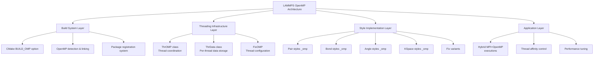

This page explores LAMMPS's OpenMP threading implementation, which enables efficient shared-memory parallelization within compute nodes. Understanding these threading mechanisms is essential for maximizing performance on modern multi-core processors and achieving optimal scalability in hybrid MPI+OpenMP configurations.

## Architecture Overview

LAMMPS implements a hybrid parallelization strategy where MPI handles inter-node communication and OpenMP manages intra-node threading. The threading infrastructure is built around a modular design with separate classes for thread coordination, data management, and style-specific threading variants.



## Build System Integration

Enabling OpenMP support in LAMMPS requires configuration through the CMake build system. The build process automatically detects OpenMP capabilities and configures appropriate compiler flags and compatibility levels.

**OpenMP Detection and Configuration**

The CMake build system searches for OpenMP support and sets default values based on compiler capabilities. When OpenMP is detected with the `omp.h` header file available, `BUILD_OMP` defaults to enabled [cmake/CMakeLists.txt](/cmake/CMakeLists.txt#L435-L443). This detection ensures that OpenMP is only enabled when fully supported by the build environment.

**Compiler Compatibility Levels**

LAMMPS establishes OpenMP compatibility levels based on compiler versions to ensure correct semantic behavior. Modern compilers (GCC 9+, Clang 10+, Intel 19+, NVHPC, XLClang, AppleClang 10+, and CrayClang 10+) use OpenMP 4.0 semantics, while older compilers default to OpenMP 3.0 compatibility [cmake/CMakeLists.txt](/cmake/CMakeLists.txt#L445-L456). The compatibility level is set via the `LAMMPS_OMP_COMPAT` preprocessor definition.

**Build Configuration Options**

| Option | Description | Default |
|--------|-------------|---------|
| `-DBUILD_OMP=ON` | Enable OpenMP support | Auto-detected |
| `-DPKG_OPENMP=ON` | Include OPENMP package | Required for threading styles |
| `-DLAMMPS_OMP_COMPAT=N` | Set OpenMP compatibility level | Auto-determined |

## Threading Infrastructure

The core threading infrastructure consists of two primary classes that manage thread coordination and per-thread data storage.

**ThrOMP Class: Thread Coordination**

The `ThrOMP` class serves as the central coordinator for OpenMP threading operations. During initialization, it retrieves a reference to the `FixOMP` instance through the LAMMPS modify system and sets the thread count based on the communication configuration [src/OPENMP/thr_omp.cpp](/src/OPENMP/thr_omp.cpp#L46-L56). The class uses bitwise flags to identify threading styles for different interaction types:

- `THR_PAIR`: Pair force calculations
- `THR_BOND`: Bonded interactions
- `THR_ANGLE`: Angle interactions
- `THR_DIHEDRAL`: Dihedral interactions
- `THR_IMPROPER`: Improper interactions
- `THR_KSPACE`: Long-range electrostatics
- `THR_FIX`: Fix-based threading
- `THR_INTGR`: Integration threading [src/OPENMP/thr_omp.h](/src/OPENMP/thr_omp.h#L64-L75)

**ThrData Class: Per-Thread Data Storage**

The `ThrData` class manages thread-local data structures that enable independent computation without data races. Each thread maintains its own arrays for forces, energies, virials, and temporary storage [src/OPENMP/thr_data.cpp](/src/OPENMP/thr_data.cpp#L31-L34). The class provides initialization methods for different force field types:

- `init_force()`: Basic force arrays [src/OPENMP/thr_data.cpp](/src/OPENMP/thr_data.cpp#L71-L119)
- `init_eam()`: Embedded Atom Method specific arrays [src/OPENMP/thr_data.cpp](/src/OPENMP/thr_data.cpp#L120-L129)
- `init_adp()`: Angular-dependent potentials arrays [src/OPENMP/thr_data.cpp](/src/OPENMP/thr_data.cpp#L130-L143)
- `init_pppm()`: Particle-particle particle-mesh arrays [src/OPENMP/thr_data.cpp](/src/OPENMP/thr_data.cpp#L164-L190)

**Thread Synchronization**

The infrastructure provides synchronization mechanisms through barrier constructs:

```cpp
inline void sync_threads(){
#if defined(_OPENMP)
#pragma omp barrier
#endif
    ;
}
```

This synchronization point ensures all threads reach consistent states before critical reduction operations [src/OPENMP/thr_omp.h](/src/OPENMP/thr_omp.h#L56-L61).

## Threaded Style Implementation

LAMMPS implements threaded variants of computational styles using the `_omp` suffix naming convention. The build system automatically discovers these styles through the `RegisterStylesExt` mechanism [cmake/Modules/Packages/OPENMP.cmake](/cmake/Modules/Packages/OPENMP.cmake#L6-L11).

**Energy and Virial Tallying**

Threaded styles must use specialized tallying methods that accumulate results in thread-local storage rather than global variables. The `ev_tally_thr` family of methods provides thread-safe variants for different interaction types:

- `ev_tally_thr(Pair, ...)`: Pair interaction tallying [src/OPENMP/thr_omp.cpp](/src/OPENMP/thr_omp.cpp#L558-L596)
- `ev_tally_thr(Bond, ...)`: Bond interaction tallying [src/OPENMP/thr_omp.cpp](/src/OPENMP/thr_omp.cpp#L863-L935)
- `ev_tally_thr(Angle, ...)`: Angle interaction tallying [src/OPENMP/thr_omp.cpp](/src/OPENMP/thr_omp.cpp#L936-L1084)
- `ev_tally_thr(Dihedral, ...)`: Dihedral interaction tallying [src/OPENMP/thr_omp.cpp](/src/OPENMP/thr_omp.cpp#L1144-L1324)
- `ev_tally_thr(Improper, ...)`: Improper interaction tallying [src/OPENMP/thr_omp.cpp](/src/OPENMP/thr_omp.cpp#L1325-L1505)

**Thread-Local Array Allocation**

The `ev_setup_thr` method allocates per-thread slices of global arrays for per-atom energy and virial storage:

```cpp
if (eflag & ENERGY_ATOM) {
  thr->eatom_pair = eatom + tid*nall;
  if (nall > 0)
    memset(&(thr->eatom_pair[0]),0,nall*sizeof(double));
}
```

Each thread receives a contiguous block of `nall` elements offset by its thread ID [src/OPENMP/thr_omp.cpp](/src/OPENMP/thr_omp.cpp#L75-L83).

## Data Reduction Mechanisms

After threaded computation completes, per-thread results must be reduced to global arrays. The reduction process uses a combination of critical sections and specialized reduction functions.

**Global Variable Reduction**

Global energy and virial values are reduced through critical sections to prevent race conditions:

```cpp
#if defined(_OPENMP)
#pragma omp critical
#endif
{
  if (eflag & ENERGY_GLOBAL) {
    pair->eng_vdwl += thr->eng_vdwl;
    pair->eng_coul += thr->eng_coul;
    thr->eng_vdwl = 0.0;
    thr->eng_coul = 0.0;
  }
}
```

[Source: src/OPENMP/thr_omp.cpp](/src/OPENMP/thr_omp.cpp#L199-L213)

**Array-Based Reduction**

Per-atom arrays are reduced using the `data_reduce_thr` function, which performs inter-thread summation:

```cpp
void LAMMPS_NS::data_reduce_thr(double *dall, int nall, int nthreads, int ndim, int tid)
```

This function combines contributions from all threads for multidimensional arrays, handling forces (ndim=3), energies (ndim=1), and virials (ndim=6 or 9) [src/OPENMP/thr_data.cpp](/src/OPENMP/thr_data.cpp#L284-L368).

**Reduction Strategy**

| Data Type | Reduction Method | Thread Safety Mechanism |
|-----------|------------------|-------------------------|
| Global energy/virial | `#pragma omp critical` | Mutual exclusion |
| Per-atom forces | `data_reduce_thr()` | Inter-thread summation |
| Per-atom energies | `data_reduce_thr()` | Inter-thread summation |
| Per-atom virials | `data_reduce_thr()` | Inter-thread summation |

> [!TIP]
> The reduction process uses barrier synchronization before critical sections to ensure all threads have completed computation. The `sync_threads()` call before `evflag` processing prevents race conditions where early threads might begin reduction before others finish computation.

## Performance Optimization Strategies

Effective use of OpenMP threading requires understanding several performance-critical aspects of LAMMPS's threading implementation.

**Thread Count Configuration**

The optimal thread count depends on the computational workload and system architecture. LAMMPS uses the `package omp` command to configure threading parameters:

```
package omp <Nthreads> <mode> [options]
```

The `Nthreads` parameter sets the number of OpenMP threads per MPI task, while `mode` controls the threading strategy (typically 0 for standard threading).

**Load Balancing Considerations**

Pair force calculations often provide the best threading performance due to their computational intensity and regular workload distribution. Bonded interactions (bonds, angles, dihedrals) may have more irregular workloads due to varying molecular topologies. The threading infrastructure uses work-sharing constructs that distribute iterations among threads:

```cpp
#pragma omp for schedule(dynamic)
for (int i = 0; i < nlocal; i++) {
  // Thread-local computation
}
```

Dynamic scheduling helps balance workloads when iteration costs vary significantly.

**Memory Access Patterns**

Per-thread data storage improves performance by reducing false sharing between threads. Each thread's data is stored in separate array segments, allowing independent access without cache coherency overhead. The initialization of thread-local arrays uses `memset` to zero per-thread regions:

```cpp
if (nall > 0)
  memset(&(thr->eatom_pair[0]),0,nall*sizeof(double));
```

[Source: src/OPENMP/thr_omp.cpp](/src/OPENMP/thr_omp.cpp#L76-L78)

**Hybrid MPI+OpenMP Scaling**

Hybrid parallelization combines the benefits of both MPI and OpenMP:

- **MPI**: Distributes spatial domains across nodes
- **OpenMP**: Parallelizes computation within each domain

The optimal configuration depends on system architecture:
- For CPU-bound workloads: 1-2 MPI ranks per socket, OpenMP threads filling remaining cores
- For memory-bound workloads: More MPI ranks to distribute memory bandwidth

## Specialized Threading Packages

The OPENMP package includes specialized threading for complex force fields and integration methods.

**ReaxFF Threading**

The reactive force field (ReaxFF) package includes comprehensive OpenMP threading support with multiple specialized modules:

- `reaxff_bond_orders_omp.cpp`: Bond order calculations
- `reaxff_hydrogen_bonds_omp.cpp`: Hydrogen bonding
- `reaxff_nonbonded_omp.cpp`: Non-bonded interactions
- `reaxff_bonds_omp.cpp`: Bonded interactions
- `reaxff_init_md_omp.cpp`: Initialization
- `reaxff_torsion_angles_omp.cpp`: Torsion angle calculations
- `reaxff_forces_omp.cpp`: Force computation
- `reaxff_multi_body_omp.cpp`: Multi-body interactions
- `reaxff_valence_angles_omp.cpp`: Valence angle calculations

[Source: cmake/Modules/Packages/OPENMP.cmake](/cmake/Modules/Packages/OPENMP.cmake#L24-L33)

**Aspherical Particle Threading**

When the ASPHERE package is enabled, additional threading support for aspherical particle thermostats is included via `fix_nh_asphere_omp.cpp` [cmake/Modules/Packages/OPENMP.cmake](/cmake/Modules/Packages/OPENMP.cmake#L36-L38).

**Rigid Body Threading**

The RIGID package integrates with OpenMP through `fix_rigid_nh_omp.cpp`, providing threaded NPT/NVT integration for rigid bodies [cmake/Modules/Packages/OPENMP.cmake](/cmake/Modules/Packages/OPENMP.cmake#L40-L42).

## Runtime Configuration and Environment Variables

Several environment variables control OpenMP thread behavior at runtime:

| Environment Variable | Purpose | Typical Usage |
|---------------------|---------|---------------|
| `OMP_NUM_THREADS` | Set thread count | `export OMP_NUM_THREADS=8` |
| `OMP_PROC_BIND` | Control thread affinity | `export OMP_PROC_BIND=true` |
| `OMP_PLACES` | Specify thread placement | `export OMP_PLACES=cores` |
| `OMP_SCHEDULE` | Set loop scheduling | `export OMP_SCHEDULE=dynamic` |

**Thread Affinity**

Proper thread binding prevents OS migration and improves cache locality:

```bash
export OMP_PROC_BIND=true
export OMP_PLACES=cores
```

This binds each OpenMP thread to a specific CPU core, reducing migration overhead.

**Example Configuration**

For a 2-socket system with 16 cores per socket running 2 MPI ranks:

```bash
export OMP_NUM_THREADS=16
export OMP_PROC_BIND=true
export OMP_PLACES=cores
mpirun -np 2 -bind-to socket ./lmp -in input.lammps
```

This configuration places one MPI rank per socket with 16 OpenMP threads filling each socket.

## Memory Considerations

OpenMP threading increases memory usage due to per-thread data storage. The `memory_usage_thr()` method tracks additional memory consumption from threading data structures [src/OPENMP/thr_omp.cpp](/src/OPENMP/thr_omp.cpp#L1623-L1629).

**Per-Thread Memory Overhead**

The memory overhead scales with thread count and array sizes:

- Forces: 3 × nall × nthreads × sizeof(double)
- Per-atom energies: nall × nthreads × sizeof(double)
- Per-atom virials: 6 × nall × nthreads × sizeof(double)
- Temporary storage: varies by force field type

> [!TIP]
> When memory is constrained, reduce the number of OpenMP threads per MPI rank and increase MPI ranks. This trade-off balances threading overhead against memory usage and communication costs.

## Error Handling in Threaded Code

The threading infrastructure provides thread-safe error handling through the `check_error_thr` method. This mechanism allows any thread to signal an error condition without causing race conditions or duplicate error messages [src/OPENMP/thr_omp.h](/src/OPENMP/thr_omp.h#L96-L113).

Threads set a global error flag (`thr_error`) when errors are detected. Thread 0 checks this flag and issues the error message, preventing multiple error reports from different threads.

## Next Steps

- For parallel computing strategy overview, see [MPI Parallelization Strategy](24-mpi-parallelization-strategy)
- To explore GPU acceleration alternatives, see [GPU Acceleration](26-gpu-acceleration)
- For performance portability across devices, see [Kokkos Performance Portability](27-kokkos-performance-portability)