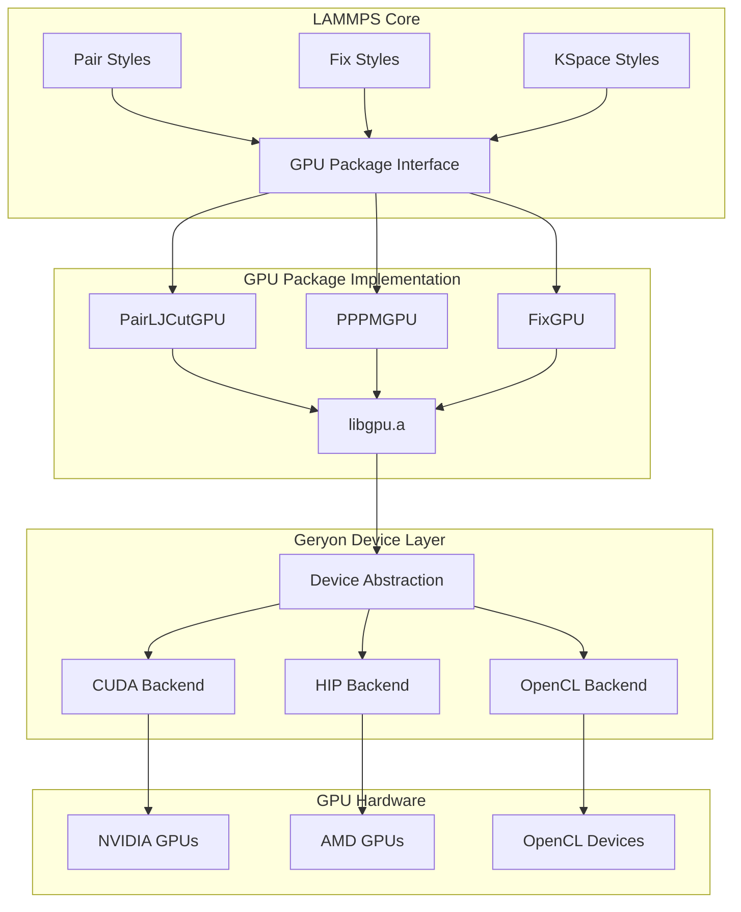

The LAMMPS GPU acceleration package provides high-performance implementations of molecular dynamics algorithms for NVIDIA CUDA, AMD ROCm HIP, and OpenCL platforms. This package enables significant speedups for pair-style computations, neighbor list builds, and long-range electrostatic calculations by offloading compute-intensive operations to GPU accelerators. The architecture employs a hybrid CPU-GPU approach where the host manages simulation state and orchestration while the GPU handles parallel force computations and particle interactions.

## Architecture Overview

The GPU package implements a three-tier architecture comprising LAMMPS interface classes, the Geryon device abstraction layer, and backend-specific GPU kernels. The LAMMPS interface classes (e.g., `PairLJCutGPU`, `PPPMGPU`) extend standard LAMMPS styles with GPU-enabled code paths, delegating computational work to the external `libgpu.a` library. The Geryon layer provides a unified API across CUDA, HIP, and OpenCL backends, enabling code portability while maintaining backend-specific optimizations. GPU kernels implement core computational algorithms using device-optimized memory access patterns and reduction strategies.



The execution flow begins with LAMMPS calling the `compute()` method on GPU-enabled styles, which triggers data transfer to GPU memory, launches GPU kernels for force computation, and retrieves results back to host memory. For neighbor list builds, the package supports three operational modes depending on performance characteristics and system requirements.

## GPU Execution Modes

The GPU package supports three distinct execution modes that control how neighbor lists are constructed and where computations are performed. These modes are specified at runtime and offer different performance trade-offs based on system size, particle density, and hardware capabilities.

| Mode | Description | Use Case | Performance Characteristics |
|------|-------------|----------|----------------------------|
| GPU_FORCE | Neighbor list built on CPU, forces computed on GPU | Small to medium systems, irregular domains | Lower GPU memory usage, flexible neighbor list algorithms |
| GPU_NEIGH | Neighbor list built and computed entirely on GPU | Large systems, uniform particle distributions | Highest throughput, requires sufficient GPU memory |
| GPU_HYB_NEIGH | Hybrid approach with CPU-GPU neighbor list coordination | Mixed workloads, variable density | Balanced approach, adapts to local conditions |

The mode selection occurs during `init_style()` through the `gpu_mode` member variable [src/GPU/pair_lj_cut_gpu.h#L44](src/GPU/pair_lj_cut_gpu.h#L44-L46). When `GPU_NEIGH` or `GPU_HYB_NEIGH` modes are active, the system invokes `ljl_gpu_compute_n()` which performs both neighbor list construction and force calculation on the device [src/GPU/pair_lj_cut_gpu.cpp#L79-L85](src/GPU/pair_lj_cut_gpu.cpp#L79-L85). The `GPU_FORCE` mode delegates neighbor list construction to the standard LAMMPS neighbor module and only offloads force computation to the GPU via `ljl_gpu_compute()` [src/GPU/pair_lj_cut_gpu.cpp#L87-L90](src/GPU/pair_lj_cut_gpu.cpp#L87-L90).

Sources: [src/GPU/pair_lj_cut_gpu.h](src/GPU/pair_lj_cut_gpu.h#L44-L46), [src/GPU/pair_lj_cut_gpu.cpp](src/GPU/pair_lj_cut_gpu.cpp#L79-L90)

## Supported Functionality

The GPU package provides implementations for a comprehensive set of LAMMPS computational styles, covering the most commonly used pair potentials, time integration fixes, and long-range electrostatic methods.

### Pair Styles

GPU-accelerated pair styles follow the naming convention of appending `/gpu` to the base style name. The implementation hierarchy shows that GPU pair styles inherit from their CPU counterparts and override key computational methods. For example, `PairLJCutGPU` extends `PairLJCut` [src/GPU/pair_lj_cut_gpu.h#L30](src/GPU/pair_lj_cut_gpu.h#L30-L31), enabling drop-in replacement with minimal script modifications.

Supported pair potential categories include:

- **Lennard-Jones variants**: lj/cut, lj/charmm, lj/class2, lj/gromacs, lj/spica, and numerous coulomb hybrid variants
- **Electrostatic models**: coul/long, coul/cut, coul/debye, coul/dsf, coul/wolf with GPU implementations
- **Many-body potentials**: EAM (alloy, fs), Tersoff (including mod and ZBL variants), Stillinger-Weber, Vashishta
- **Polarizable models**: AMOEBA, HIPPO with specialized convolution kernels
- **Complex interactions**: Gayberne ellipsoidal, RE-squared, DPD, EDPD, and SPH formulations

The GPU library maintains separate kernel implementations for different precision modes, controlled through preprocessor definitions: `_SINGLE_SINGLE`, `_SINGLE_DOUBLE`, and `_DOUBLE_DOUBLE` [lib/gpu/README](lib/gpu/README#L72-L74).

Sources: [src/GPU/pair_lj_cut_gpu.h](src/GPU/pair_lj_cut_gpu.h#L30-L31), [lib/gpu/README](lib/gpu/README#L72-L74)

### KSpace Methods

Long-range electrostatic calculations are supported through the PPPM (Particle-Particle Particle-Mesh) method implemented in `PPPMGPU` [src/GPU/pppm_gpu.h](src/GPU/pppm_gpu.h#L30). This class extends the standard `PPPM` class and overrides the `compute()` method to leverage GPU acceleration for grid-based charge spreading, reciprocal space solving via FFT, and force interpolation back to particles. The implementation supports both real-space and reciprocal-space splitting strategies controlled by the `kspace_split` flag [src/GPU/pppm_gpu.h#L48](src/GPU/pppm_gpu.h#L48).

Key GPU-accelerated operations in PPPM include:
- Charge spreading to 3D grid (`brick2fft_gpu()`)
- 3D FFT operations (using vendor-optimized libraries)
- Poisson equation solving in reciprocal space
- Force interpolation from grid back to particles

Sources: [src/GPU/pppm_gpu.h](src/GPU/pppm_gpu.h#L30-L50)

### Integration Fixes

GPU-accelerated time integration fixes provide NVE, NVT, and NPT ensemble dynamics. The base `FixGPU` class [src/GPU/fix_gpu.h](src/GPU/fix_gpu.h#L30) manages GPU-specific state and provides methods for time step integration, thermostat/barostat application, and force accumulation. Derived classes include:
- `FixNVegasGPU`: Velocity Verlet integration for NVE ensemble
- `FixNVTGPU`: NVT ensemble with velocity rescaling or Nosé-Hoover thermostat
- `FixNPTGPU`: NPT ensemble with pressure control via Parrinello-Rahman or Berendsen barostat
- `FixNHGPU`: General NPH/NVT/NPT framework supporting various thermostat/barostat combinations

These fixes coordinate with pair styles to ensure GPU-resident data consistency and minimize data transfer overhead during timestepping loops.

Sources: [src/GPU/fix_gpu.h](src/GPU/fix_gpu.h#L30-L54)

## Build Configuration and Installation

Building LAMMPS with GPU support requires a multi-stage process involving toolchain setup, GPU library compilation, and LAMMPS configuration. The GPU package depends on the external `lib/gpu` library which provides the Geryon abstraction layer and device-specific implementations.

### Prerequisites

The build requires appropriate SDK installations depending on the target backend:

- **CUDA**: NVIDIA CUDA toolkit (minimum version depends on hardware, typically 11.0+ for modern GPUs). Note that only the toolkit is required, not the full SDK.
- **ROCm HIP**: AMD ROCm platform for AMD GPU support
- **OpenCL**: Intel oneAPI, NVIDIA OpenCL, or vendor-specific OpenCL implementations

The lib/gpu directory includes device query utilities (`ocl_get_devices`, `nvc_get_devices`, `hip_get_devices`) that should be run after successful compilation to verify GPU detection and obtain correct device numbering for multi-GPU systems [lib/gpu/README](lib/gpu/README#L137-L145).

Sources: [lib/gpu/README](lib/gpu/README#L137-L145)

### Build Process

The recommended build approach uses CMake with GPU package specification:

```mermaid
flowchart TD
    A[Install SDK<br/>CUDA/HIP/OpenCL] --> B[Configure CMake<br/>-D PKG_GPU=ON]
    B --> C[Select Backend<br/>-D GPU_API=cuda|hip|opencl]
    C --> D[Select Precision<br/>-D GPU_PREC=single|mixed|double]
    D --> E[Build libgpu.a<br/>during LAMMPS build]
    E --> F[Compile LAMMPS<br/>with GPU styles]
    F --> G[Run device query<br/>verify GPU detection]
    G --> H[Simulation ready]
```

Key CMake configuration options include:
- `PKG_GPU=ON`: Enable GPU package
- `GPU_API=cuda|hip|opencl`: Select backend implementation
- `GPU_PREC=single|mixed|double`: Choose precision mode (single = fastest, double = most accurate, mixed = balance)
- `GPU_ARCH=value`: Specify GPU architecture code for CUDA builds

Advanced users can enable additional preprocessor options through CMake definitions for specific optimizations or debugging capabilities. Options such as `LAL_NO_BLOCK_REDUCE` (use host for energy/virial accumulation), `LAL_USE_OLD_NEIGHBOR` (use legacy neighbor algorithm), and `LAL_SERIALIZE_INIT` (force serialization for multi-process GPU sharing) provide fine-grained control over runtime behavior [lib/gpu/README](lib/gpu/README#L75-L103).

Sources: [lib/gpu/README](lib/gpu/README#L72-L103)

### Precision Modes

The GPU library supports three precision configurations that significantly impact both performance and accuracy:

| Precision Mode | Storage | Computation | Performance Impact | Accuracy Impact |
|----------------|----------|--------------|-------------------|-----------------|
| Single (GPU_PREC=single) | 32-bit float | 32-bit float | Highest throughput | May cause energy drift in long simulations |
| Mixed (GPU_PREC=mixed) | 32-bit positions, 64-bit accumulation | Mixed precision | Balanced performance | Improved energy conservation |
| Double (GPU_PREC=double) | 64-bit double | 64-bit double | Lower throughput, higher memory usage | Highest accuracy, numerical stability |

Mixed precision mode is recommended for most production simulations as it provides good performance while maintaining sufficient accuracy for thermodynamic property calculations. The mode selection occurs at compile time through preprocessor definitions [lib/gpu/README](lib/gpu/README#L72-L74).

Sources: [lib/gpu/README](lib/gpu/README#L72-L74)

## Runtime Configuration

GPU-accelerated simulations require specific runtime configuration through LAMMPS input scripts and optional environment variables. The `package gpu` command controls global GPU package settings, while individual GPU styles accept GPU-specific parameters.

### Package Command Syntax

The `package gpu` command configures global GPU behavior:

```lamm
package gpu <Ngpu> <gpu_id> <neigh> <split> <blocksize> <mixed_int>
```

Parameters include:
- `Ngpu`: Number of GPUs per MPI task (typically 0 or 1)
- `gpu_id`: GPU device ID (from device query output)
- `neigh`: Neighbor list storage (0 = GPU, 1 = host)
- `split`: Force compute split factor for load balancing
- `blocksize`: GPU thread block size (default varies by kernel)
- `mixed_int`: Use mixed precision for integer arrays

### Style-Specific GPU Parameters

GPU pair styles accept the `gpu` keyword with optional mode specification:

```lamm
pair_style lj/cut/gpu 2.5
pair_coeff * * 1.0 1.0
```

GPU fixes are typically invoked through suffix notation:

```lamm
fix 1 all nvt/gpu temp 300.0 300.0 100.0
```

The suffix automatically triggers GPU-accelerated implementations when the GPU package is enabled.

## Performance Optimization Strategies

Achieving optimal performance with GPU acceleration requires understanding the hardware characteristics, workload distribution, and memory access patterns. Several strategies can help maximize throughput and minimize latency.

### GPU Mode Selection

Choosing the appropriate GPU execution mode is critical for performance:

- **Use GPU_NEIGH** for systems with >10,000 atoms per GPU and uniform particle distributions. The fully GPU-based neighbor list construction minimizes PCIe data transfer and leverages GPU parallelism for binning and neighbor search operations.
- **Use GPU_FORCE** for smaller systems (<5,000 atoms per GPU) or highly inhomogeneous particle distributions where CPU neighbor list construction provides better load balancing. The CPU can optimize irregular work distributions more effectively than GPU kernels.
- **Use GPU_HYB_NEIGH** for medium-sized systems (5,000-10,000 atoms per GPU) where the hybrid approach provides flexibility.

> [!TIP]
> The GPU package may split multi-GPU accelerators or NUMA-affiliated GPUs into separate virtual accelerators for better MPI-GPU affinity. Always run the device query utilities to determine the actual device numbering and mapping for your hardware configuration.

### Memory and Data Transfer Optimization

Minimizing host-device data transfer is essential for performance. The GPU package uses several strategies:

- **Persistent GPU data**: Atom positions, types, and force arrays remain resident on GPU memory across timesteps
- **Batched reductions**: Energy and virial contributions are accumulated in GPU memory and transferred as single values
- **Asynchronous transfers**: Where supported, computation and data transfer overlap to hide latency

Users should avoid frequently modifying per-atom properties that would trigger full array transfers. For trajectory output, use the GPU-accelerated dump styles when available.

### Load Balancing in Multi-GPU Configurations

When using multiple GPUs with MPI, consider load balancing strategies:

- **Spatial decomposition**: Ensure each MPI process (and its associated GPU) handles approximately equal numbers of atoms
- **Split factor tuning**: The `split` parameter in the `package gpu` command controls the fraction of pairwise forces computed on GPU vs CPU. Values around 0.9-1.0 are typical for GPU-dominant configurations.
- **Neighbor list sharing**: In hybrid CPU-GPU neighbor modes, the neighbor list may be shared between host and device to reduce memory footprint

For very large simulations across multiple compute nodes, ensure proper GPU affinity mapping between MPI ranks and physical devices to avoid cross-node GPU access penalties.

## Integration with Other Packages

The GPU package can be combined with other LAMMPS acceleration packages and features, but certain combinations require careful consideration.

### Kokkos Coexistence

Both the GPU package and the [Kokkos Performance Portability](27-kokkos-performance-portability) package offer GPU acceleration. Key differences:

- **GPU package**: Specialized CUDA/HIP/OpenCL implementations with hand-tuned kernels
- **Kokkos package**: Portable implementations using Kokkos abstractions

Generally, choose one acceleration strategy per style to avoid code bloat and maintain clear performance expectations. The GPU package often provides higher peak performance on specific hardware due to backend-specific optimizations, while Kokkos offers broader portability across CPU, GPU, and other accelerator architectures.

### MPI Parallelization

The GPU package integrates with standard [MPI Parallelization Strategy](24-mpi-parallelization-strategy) used throughout LAMMPS. Each MPI rank typically controls one GPU, with spatial domain decomposition dividing the simulation volume. For multi-GPU nodes, use process binding tools (e.g., `numactl`, `taskset`) to ensure proper CPU-GPU affinity:

```bash
mpirun -np 4 -bind-to hwthread -map-by slot:PE=1 ./lmp_gpu -in script.in
```

The GPU library includes MPI-aware error handling when compiled with the `MPI_GERYON` preprocessor flag [lib/gpu/README](lib/gpu/README#L99).

Sources: [lib/gpu/README](lib/gpu/README#L99)

## Troubleshooting and Common Issues

### Build Failures

Common build issues include:
- **SDK not found**: Ensure CUDA, HIP, or OpenCL toolchains are in PATH and LD_LIBRARY_PATH
- **Architecture mismatch**: Specify correct GPU_ARCH for CUDA builds matching your hardware
- **CMake cache issues**: Delete CMakeCache.txt and CMakeFiles/ when switching backends or precision modes

### Runtime Errors

**GPU not found**: Run the appropriate device query utility to verify GPU detection. Check that the user has permissions to access GPU devices (`nvidia-smi`, `rocminfo`, or `clinfo`).

**Out of memory**: Reduce per-GPU atom count by increasing MPI ranks, or switch to `GPU_FORCE` mode which uses less GPU memory. Consider using mixed precision mode if numerical accuracy requirements permit.

**Incorrect forces**: Verify precision mode selection and compare small test systems between CPU and GPU implementations. Double precision is required for production-quality results in most cases.

**Performance degradation**: Profile GPU utilization using vendor tools (nvprof, rocprof, Intel VTune). Low utilization may indicate host-GPU imbalance or suboptimal GPU mode selection.

## Next Steps

For comprehensive parallelization strategies, continue to [MPI Parallelization Strategy](24-mpi-parallelization-strategy) to understand how GPU acceleration integrates with distributed memory parallelism. To explore alternative acceleration approaches, refer to [Kokkos Performance Portability](27-kokkos-performance-portability) for portable code that runs across multiple accelerator types. For Python-based workflows, see [LAMMPS Python Module Basics](28-lammps-python-module-basics) to learn about integrating GPU-accelerated LAMMPS with Python scripting environments.