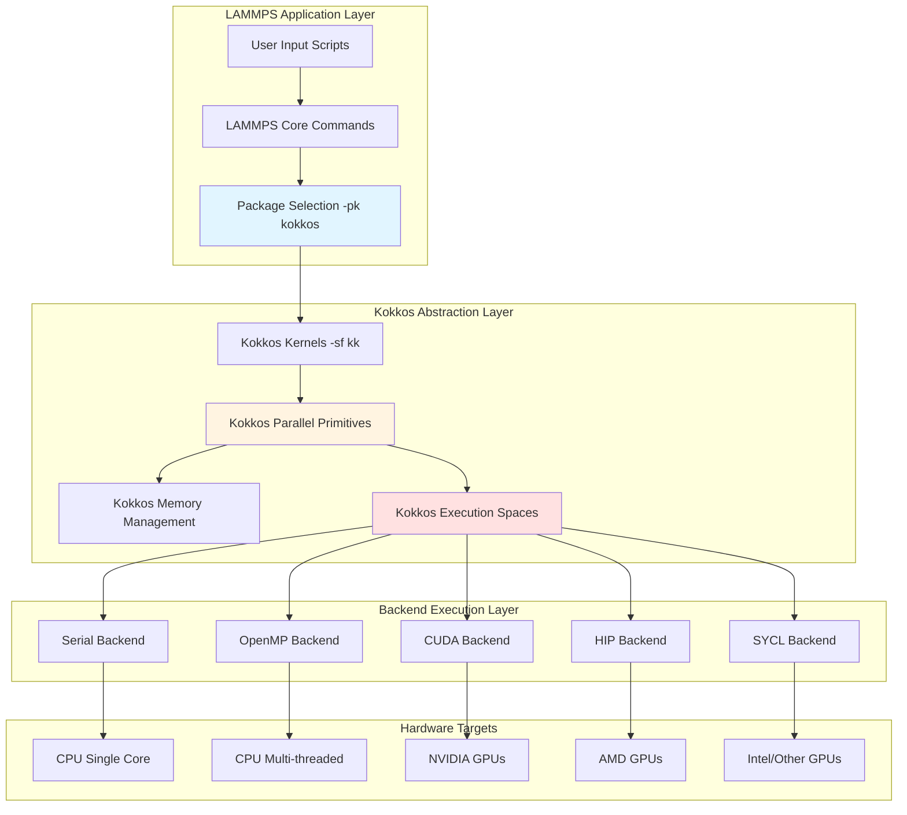

Kokkos provides a performance portability layer for LAMMPS, enabling efficient execution across diverse hardware architectures including CPUs, GPUs, and accelerators without requiring code modifications for each target platform. This architecture abstracts hardware-specific programming models while maintaining high performance through compile-time optimization and specialized backend implementations.

Sources: [README](README#L1-L60), [kokkos-cuda.cmake](cmake/presets/kokkos-cuda.cmake#L1-L14)

## Architecture Overview

The Kokkos integration in LAMMPS follows a layered architecture where computational kernels are written once using Kokkos abstractions, then compiled for specific hardware backends. This design eliminates the need for maintaining separate GPU, CPU, and accelerator implementations while achieving performance comparable to hand-tuned native code.



The architecture enables developers to write performance-portable code using Kokkos's C++ template-based abstractions for parallel execution patterns, memory spaces, and execution policies. The compile-time selection mechanism ensures zero runtime overhead for abstraction layers while allowing hardware-specific optimizations through backend implementations.

Sources: [kokkos-cuda.cmake](cmake/presets/kokkos-cuda.cmake#L1-L14), [kokkos-openmp.cmake](cmake/presets/kokkos-openmp.cmake#L1-L9), [kokkos-serial.cmake](cmake/presets/kokkos-serial.cmake#L1-L7)

## Supported Execution Backends

Kokkos supports multiple execution backends, each optimized for specific hardware architectures. LAMMPS provides CMake presets that configure the appropriate backend combinations for common deployment scenarios.

| Backend | Description | Use Case | CMake Preset |
|---------|-------------|----------|--------------|
| Serial | Single-threaded CPU execution | Debugging, single-core testing | [kokkos-serial.cmake](cmake/presets/kokkos-serial.cmake#L1-L7) |
| OpenMP | Multi-threaded CPU execution | Multi-core CPU systems | [kokkos-openmp.cmake](cmake/presets/kokkos-openmp.cmake#L1-L9) |
| CUDA | NVIDIA GPU execution | NVIDIA GPU clusters | [kokkos-cuda.cmake](cmake/presets/kokkos-cuda.cmake#L1-L14) |
| HIP | AMD GPU execution | AMD GPU systems | [kokkos-hip.cmake](cmake/presets/kokkos-hip.cmake#L1-L1) |
| SYCL Intel | Intel GPU execution | Intel Data Center GPUs | [kokkos-sycl-intel.cmake](cmake/presets/kokkos-sycl-intel.cmake#L1-L1) |
| SYCL NVIDIA | NVIDIA GPU via SYCL | Alternative CUDA path | [kokkos-sycl-nvidia.cmake](cmake/presets/kokkos-sycl-nvidia.cmake#L1-L1) |

Each backend can be combined with the Serial backend for hybrid execution patterns, such as MPI+Kokkos(OpenMP) for multi-node CPU systems or MPI+Kokkos(CUDA) for GPU clusters. The backend selection occurs at compile time, with runtime parameters controlling the degree of parallelism within each backend.

Sources: [kokkos-cuda.cmake](cmake/presets/kokkos-cuda.cmake#L1-L14), [kokkos-openmp.cmake](cmake/presets/kokkos-openmp.cmake#L1-L9), [kokkos-serial.cmake](cmake/presets/kokkos-serial.cmake#L1-L7)

## Build Configuration

### Enabling the Kokkos Package

The Kokkos package is enabled through CMake build configuration, with presets available for common configurations. The fundamental activation requires setting the KOKKOS package flag:

```cmake
set(PKG_KOKKOS ON CACHE BOOL "" FORCE)
```

This can be accomplished through CMake presets or command-line arguments. The presets in [cmake/presets/](cmake/presets/) directory provide pre-configured settings for various backends:

```bash
# For CUDA backend
cmake -C ../cmake/presets/kokkos-cuda.cmake -D LAMMPS_MACHINE=kokkos-cuda ../cmake

# For OpenMP backend  
cmake -C ../cmake/presets/kokkos-openmp.cmake -D LAMMPS_MACHINE=kokkos-openmp ../cmake

# For serial backend
cmake -C ../cmake/presets/kokkos-serial.cmake -D LAMMPS_MACHINE=kokkos-serial ../cmake
```

> [!TIP]
> When using the CUDA preset, the GPU architecture must match your hardware. Kokkos attempts autodetection if not manually specified, but explicit configuration via `Kokkos_ARCH_<arch>` CMake variable ensures correct code generation.

### Backend-Specific Configuration

Each backend requires specific compiler and library configurations:

- **CUDA**: Uses nvcc_wrapper for compilation, integrates with CUFFT for KSPACE operations
- **OpenMP**: Requires OpenMP-capable compiler and libraries, integrates with LAMMPS OpenMP threading
- **HIP**: Uses hipcc compiler with GCC for host code
- **SYCL**: Requires SYCL-capable compiler (Intel DPC++ or other)

The CUDA preset demonstrates additional integration points:

```cmake
set(Kokkos_ENABLE_SERIAL ON CACHE BOOL "" FORCE)
set(Kokkos_ENABLE_CUDA   ON CACHE BOOL "" FORCE)
set(CMAKE_CXX_COMPILER ${NVCC_WRAPPER_CMD} CACHE FILEPATH "" FORCE)
set(FFT_KOKKOS "CUFFT" CACHE STRING "" FORCE)
```

This configuration enables both Serial and CUDA backends, sets the compiler wrapper, and selects CUFFT for FFT operations when the KSPACE package is also enabled.

Sources: [kokkos-cuda.cmake](cmake/presets/kokkos-cuda.cmake#L1-L14), [kokkos-openmp.cmake](cmake/presets/kokkos-openmp.cmake#L1-L9), [kokkos-serial.cmake](cmake/presets/kokkos-serial.cmake#L1-L7), [kokkos-hip.cmake](cmake/presets/hip.cmake#L1-L27)

## Runtime Configuration

### Command-Line Flags

Kokkos-enabled LAMMPS binaries accept specific runtime flags that control parallelism and algorithmic choices. The primary flags include:

```bash
# Enable Kokkos package and select GPU
lmp -k on g 2 -sf kk -pk kokkos newton on neigh half

# Enable Kokkos with threads (OpenMP)
lmp -k on t 2 -sf kk -pk kokkos newton on neigh half
```

The `-k` flag controls Kokkos settings with the format: `-k on <device> <num>`. Device options include:
- `g N`: Use N GPUs (CUDA/HIP/SYCL)
- `t N`: Use N threads (OpenMP)
- `n N`: Use N MPI ranks (combined with other options)

The `-sf kk` flag automatically uses Kokkos versions of available styles, and `-pk kokkos` sets package-specific options including newton settings and neighbor list algorithms.

Sources: [config_kokkos.yaml](tools/regression-tests/config_kokkos.yaml#L1-L27), [config_kokkos_openmp.yaml](tools/regression-tests/config_kokkos_openmp.yaml#L1-L27)

### Package Options

The `-pk kokkos` flag accepts several options that affect performance and behavior:

| Option | Values | Description |
|--------|--------|-------------|
| `newton` | on/off | Enable/disable Newton's third law optimization |
| `neigh` | full/half | Neighbor list type |
| `thread` | N | Number of threads per MPI rank |
| `comm` | host/device | Communication mode (device for GPU-direct) |
| `gpu/aware` | on/off | Enable GPU-aware MPI |

These options should be tuned based on your specific hardware and problem characteristics. For GPU systems, `comm device` and `newton off` often provide better performance, while CPU systems typically benefit from `newton on` and `neigh half`.

Sources: [config_kokkos.yaml](tools/regression-tests/config_kokkos.yaml#L4-L4), [config_kokkos_openmp.yaml](tools/regression-tests/config_kokkos_openmp.yaml#L4-L4)

## Integration with LAMMPS Styles

Kokkos provides performance-portable implementations of core LAMMPS computational styles. The `-sf kk` flag automatically selects Kokkos versions when available, enabling GPU acceleration without script modifications. Supported style categories include:

- **Pair styles**: Lennard-Jones, EAM, Tersoff, and many other potentials
- **Fix styles**: Integration, thermostat, and boundary condition fixes
- **Compute styles**: Thermodynamic and structural property calculations
- **K-space styles**: PPPM and other long-range electrostatic methods

The KOKKOS package implements these styles using Kokkos parallel patterns such as `Kokkos::parallel_for`, `Kokkos::parallel_reduce`, and `Kokkos::parallel_scan`. These patterns are mapped to backend-specific implementations at compile time, ensuring optimal performance on each architecture.

When using GPU backends, memory management becomes critical. Kokkos provides unified memory views that automatically handle data transfer between host and device when necessary. Advanced users can optimize this by managing memory spaces explicitly and minimizing host-device transfers.

> [!TIP]
> The `-sf kk` flag provides transparent acceleration but may not always be optimal. For production runs, explicitly specifying Kokkos styles in your input script (e.g., `pair_style lj/cut/kk` instead of `pair_style lj/cut`) ensures consistent behavior and enables better documentation of performance optimizations.

Sources: [kokkos-cuda.cmake](cmake/presets/kokkos-cuda.cmake#L8-L8), [kokkos-openmp.cmake](cmake/presets/kokkos-openmp.cmake#L3-L3)

## Testing and Validation

The LAMMPS regression test suite includes specific configurations for Kokkos-enabled builds, validating correctness across different backends. These configurations are located in [tools/regression-tests/](tools/regression-tests/):

- **[config_kokkos.yaml](tools/regression-tests/config_kokkos.yaml#L1-L27)**: Tests GPU execution with 2 GPUs
- **[config_kokkos_openmp.yaml](tools/regression-tests/config_kokkos_openmp.yaml#L1-L27)**: Tests threaded CPU execution with 2 threads

Both configurations set tight numerical tolerances to ensure results match reference implementations:

```yaml
tolerance:
  PotEng:
    abs: 1e-4
    rel: 1e-6
  TotEng:
    abs: 1e-4
    rel: 1e-6
  Press:
    abs: 1e-4
    rel: 1e-6
```

These tests verify that Kokkos-accelerated styles produce identical results to standard LAMMPS implementations, within floating-point precision limits. The test suite provides a valuable resource for validating new hardware backends and ensuring correctness after code modifications.

Sources: [config_kokkos.yaml](tools/regression-tests/config_kokkos.yaml#L6-L16), [config_kokkos_openmp.yaml](tools/regression-tests/config_kokkos_openmp.yaml#L6-L16)

## Performance Considerations

### Hardware-Specific Optimization

Kokkos enables performance portability but still requires hardware-aware tuning for optimal results. Key considerations include:

1. **GPU Utilization**: Ensure sufficient problem size per GPU to hide latency. Small problems may perform better on CPU backends due to kernel launch overhead.

2. **Memory Bandwidth**: GPU backends are bandwidth-limited; algorithms should maximize data reuse and minimize global memory accesses.

3. **Thread Mapping**: OpenMP backend performance depends on proper thread affinity and NUMA awareness. Use environment variables like `OMP_PROC_BIND` and `OMP_PLACES` to optimize placement.

4. **Neighbor List Configuration**: GPU backends often benefit from `neigh full` and `newton off`, while CPU backends typically perform better with `neigh half` and `newton on`.

### Hybrid Parallelization

The most powerful deployment mode combines MPI with Kokkos threading for multi-node systems:

```bash
# Example: 4 nodes, 2 MPI ranks per node, 1 GPU per rank
mpirun -np 8 lmp -k on g 1 -sf kk -pk kokkos newton off neigh half

# Example: 2 nodes, 1 MPI rank per node, 8 threads per rank
mpirun -np 2 lmp -k on t 8 -sf kk -pk kokkos newton on neigh half
```

The optimal balance depends on communication-to-computation ratio, network bandwidth, and problem decomposition. Generally, use more MPI ranks for communication-intensive problems and more threads for compute-intensive problems.

Sources: [kokkos-cuda.cmake](cmake/presets/kokkos-cuda.cmake#L3-L4), [kokkos-openmp.cmake](cmake/presets/kokkos-openmp.cmake#L3-L3)

## Migration Path from Other Packages

LAMMPS supports multiple GPU acceleration packages (GPU, INTEL, KOKKOS). Migrating to Kokkos offers advantages in portability and maintainability:

### Comparison of GPU Packages

| Feature | Kokkos | GPU Package | INTEL Package |
|---------|--------|-------------|---------------|
| Portability | Multi-vendor GPUs + CPU | NVIDIA only | Intel CPUs/GPUs |
| Code Maintenance | Single codebase | Separate implementations | Separate implementations |
| Future-proofing | Active development | Mature, stable | Mature, stable |
| Integration | Deep LAMMPS integration | Older interface | Xeon Phi focus |

For users migrating from the GPU package, Kokkos provides comparable performance on NVIDIA GPUs while adding support for other hardware. The migration typically involves:
1. Rebuilding with Kokkos-enabled configuration
2. Adding `-k` and `-sf kk` flags to command line
3. Adjusting package-specific options in `-pk kokkos`

The transition path is designed to be incremental, allowing developers to validate Kokkos performance before fully committing to the new approach.

Sources: [kokkos-cuda.cmake](cmake/presets/kokkos-cuda.cmake#L1-L14), [kokkos-openmp.cmake](cmake/presets/kokkos-openmp.cmake#L1-L9)

## Advanced Topics

### Custom Kokkos Styles

Advanced developers can create custom LAMMPS styles using Kokkos abstractions. The development pattern follows these principles:

1. Use Kokkos data structures (Views, Arrays) for particle data
2. Implement kernels using `Kokkos::parallel_for` with appropriate execution policies
3. Use `Kokkos::parallel_reduce` for reductions (forces, energies)
4. Manage memory spaces explicitly for optimal performance
5. Test across multiple backends during development

The lib/kokkos directory contains the Kokkos library source, while KOKKOS-specific LAMMPS implementations reside in src/KOKKOS/. This separation enables updating Kokkos independently of LAMMPS styles.

### Performance Profiling

Kokkos provides built-in profiling tools that integrate with external profilers. Enable profiling with:

```bash
export KOKKOS_PROFILE_LIBRARY=<profiler_library>
```

Common profilers include NVprof/Nsight Systems for CUDA backends, Intel VTune for CPU backends, and rocprof for HIP. Kokkos also provides lightweight timing information through the `Kokkos::Profiling` interface.

For production runs, consider using LAMMPS built-in timers and the [bench/](bench/) directory examples to benchmark performance across different configurations. The benchmark inputs provide standardized test cases for comparing architectures and optimization strategies.

Sources: [README](README#L45-L53), [lib/](lib#L1-L1)

## Next Steps

For comprehensive understanding of LAMMPS parallel architecture, explore these related topics:

- [MPI Parallelization Strategy](24-mpi-parallelization-strategy) for multi-node deployment patterns
- [OpenMP Threading and Performance](25-openmp-threading-and-performance) for CPU threading optimization
- [GPU Acceleration](26-gpu-acceleration) for alternative GPU programming models
- [Running Your First Simulation](4-running-your-first-simulation) for practical execution guidance

The combination of Kokkos performance portability with LAMMPS's modular architecture provides a powerful platform for molecular dynamics simulations across current and future hardware platforms. By mastering Kokkos configuration and tuning, developers can achieve optimal performance while maintaining code portability across diverse computing environments.
