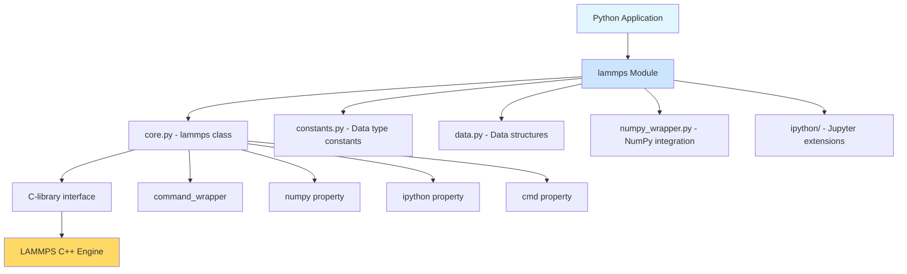

The LAMMPS Python module provides a comprehensive interface that bridges Python's flexibility with LAMMPS' molecular dynamics capabilities, enabling researchers to build sophisticated simulation workflows. This module serves as the foundation for programmatic control of LAMMPS, offering everything from basic command execution to advanced data manipulation and parallel processing.


## Module Architecture

The Python module architecture centers around a layered design that cleanly separates interface concerns while maintaining seamless integration with the underlying C++ library. The `lammps` class acts as the primary gateway, wrapping the C-library interface through ctypes and exposing functionality through multiple specialized interfaces.



The module exports three primary components from its `__init__.py`: constants for data type specifications, the core `lammps` class for simulation control, and data structures for specialized operations like neighbor list access [Sources: python/lammps/__init__.py#L13-L18](python/lammps/__init__.py#L13-L18). The version information is automatically extracted and converted to a numeric format, following LAMMPS' version numbering convention [Sources: python/lammps/__init__.py#L16-L52](python/lammps/__init__.py#L16-L52).

## Installation and Setup

Building and installing the LAMMPS Python module requires compiling LAMMPS as a shared library, which can be accomplished through either CMake or the traditional GNU build system. The CMake approach requires setting the `-D BUILD_SHARED_LIBS=ON` flag during configuration, followed by executing `cmake --build . --target install-python` [Sources: python/README#L8-L11](python/README#L8-L11). For the GNU build system, you would execute `make g++ mode=shlib` followed by `make install-python` in the src directory [Sources: python/README#L12-L14](python/README#L12-L14).

The installation process, managed by `python/install.py`, creates a binary wheel package that includes both the Python module and the compiled shared library. This script handles path validation, library copying, and virtual environment creation for wheel building [Sources: python/install.py#L1-L35](python/install.py#L1-L35). After successful installation, you can verify the setup by instantiating a LAMMPS instance:

```python
from lammps import lammps
lmp = lammps()
```

If this executes without errors, your Python environment successfully wraps LAMMPS [Sources: python/README#L22-L27](python/README#L22-L27).

## Creating a LAMMPS Instance

The `lammps` class constructor accepts several parameters that control initialization behavior. The `name` parameter specifies which shared library variant to load (e.g., `"mpi"` loads `liblammps_mpi.so`), while `cmdargs` provides a list of command-line arguments passed to the underlying C interface [Sources: python/lammps/core.py#L157-L162](python/lammps/core.py#L157-L162). For parallel execution using MPI, you can pass an MPI communicator object from mpi4py through the `comm` parameter [Sources: python/lammps/core.py#L127-L156](python/lammps/core.py#L127-L156).

The class implements Python's context manager protocol, allowing you to use `with` statements for automatic resource cleanup:

```python
with lammps() as lmp:
    lmp.file("input.in")
    lmp.command("run 100")
# LAMMPS instance automatically closed here
```

This pattern ensures proper cleanup even when exceptions occur during execution [Sources: python/lammps/core.py#L566-L570](python/lammps/core.py#L566-L570).

## Command Execution Methods

The module provides three distinct methods for executing LAMMPS commands, each suited for different use cases. The most fundamental approach uses the `command()` method to process single commands from strings [Sources: python/lammps/core.py#L814-L823](python/lammps/core.py#L814-L823). For batch operations, `commands_list()` accepts a list of command strings, while `commands_string()` processes multi-line blocks from a single string [Sources: python/lammps/core.py#L833-L853](python/lammps/core.py#L833-L853).

For more Pythonic command execution, the `cmd` property returns a `command_wrapper` object that enables calling LAMMPS commands as if they were Python methods:

```python
lmp = lammps()
lmp.cmd.units("lj")
lmp.cmd.atom_style("atomic")
lmp.cmd.lattice("fcc", 0.8442)
lmp.cmd.region("box block", 0, 10, 0, 10, 0, 10)
```

This approach provides auto-completion support in interactive environments and more readable code [Sources: python/lammps/core.py#L594-L631](python/lammps/core.py#L594-L631). The wrapper automatically concatenates arguments and even supports passing Python callback functions to LAMMPS commands that accept them [Sources: python/lammps/core.py#L93-L126](python/lammps/core.py#L93-L126).

> [!TIP]
> Use the `cmd` wrapper for interactive development and readability, but stick with `command()` methods when you need maximum performance or are dynamically generating command strings.

## Data Extraction and Retrieval

Retrieving simulation data from LAMMPS follows a systematic pattern based on data type and location. The module provides specialized methods for accessing different data categories:

| Method Category | Purpose | Typical Return Type |
|-----------------|---------|---------------------|
| `get_thermo()` | Current thermo output value | float/double |
| `extract_global()` | Global simulation settings | varies by property |
| `extract_atom()` | Per-atom properties | 2D arrays/pointers |
| `extract_compute()` | Compute results | varies by compute type |
| `extract_variable()` | Variable values | varies by variable type |

Thermodynamic data, accessible via `get_thermo()`, returns the current value of any defined thermo keyword like temperature, pressure, or volume [Sources: python/lammps/core.py#L944-L961](python/lammps/core.py#L944-L961). For accessing the complete thermo output from the last timestep, use `last_thermo()` which returns a dictionary containing all thermo quantities [Sources: python/lammps/core.py#L975-L1022](python/lammps/core.py#L975-L1022).

Global simulation parameters are retrieved through `extract_global()`, which accepts a property name and optionally a data type specification. This method handles conversion automatically when given `LAMMPS_AUTODETECT` [Sources: python/lammps/core.py#L1069-L1142](python/lammps/core.py#L1069-L1142). Per-atom data like positions, velocities, or forces are accessed via `extract_atom()`, which requires specifying the property name and handles the complex memory management internally [Sources: python/lammps/core.py#L1308-L1370](python/lammps/core.py#L1308-L1370).

## Data Manipulation

The module provides symmetric methods for modifying simulation data after extraction. The `gather_atoms()` family of methods retrieves per-atom data from all processors into a contiguous array, while `scatter_atoms()` writes modified data back to LAMMPS [Sources: python/lammps/core.py#L1771-L1845](python/lammps/core.py#L1771-L1845). These operations enable complex in-simulation modifications:

```python
x = lmp.gather_atoms("x", 1, 3)  # Get positions (1=float, 3=components per atom)
x[0][0] += 0.1                  # Modify first atom's x-coordinate
lmp.scatter_atoms("x", 1, 3, x)  # Send modified positions back
```

For performance-critical applications working with specific atom subsets, the module provides `gather_atoms_subset()` and `scatter_atoms_subset()` methods that operate only on specified atom IDs [Sources: python/lammps/core.py#L1807-L1845](python/lammps/core.py#L1807-L1845). The simulation box itself can be queried via `extract_box()` which returns box dimensions, tilt factors, and periodicity information [Sources: python/lammps/core.py#L886-L919](python/lammps/core.py#L886-L919), and modified using `reset_box()` [Sources: python/lammps/core.py#L920-L943](python/lammps/core.py#L920-L943).

> [!TIP]
> Always verify data type specifications when using gather/scatter methods—the second parameter (1 for float, 0 for int) must match the data type or you'll encounter corrupted values.

## NumPy Integration

When NumPy is available, the `numpy` property provides an alternative interface that returns NumPy arrays instead of ctypes pointers, significantly simplifying data manipulation for numerical computing workflows [Sources: python/lammps/core.py#L574-L593](python/lammps/core.py#L574-L593). The `numpy_wrapper` class provides NumPy-compatible versions of key extraction methods:

```python
import numpy as np

# Without NumPy (returns ctypes pointer)
x_ptr = lmp.extract_atom("x")

# With NumPy (returns NumPy array)
x_array = lmp.numpy.extract_atom("x")
x_array[0, :] += np.array([0.1, 0.0, 0.0])  # Vectorized operation
```

This integration eliminates manual memory management and enables direct use of NumPy's vectorized operations [Sources: python/lammps/numpy_wrapper.py#L59-L114](python/lammps/numpy_wrapper.py#L59-L114). The NumPy interface also provides specialized neighbor list access through `NumPyNeighList`, which returns NumPy arrays of neighbor indices [Sources: python/lammps/numpy_wrapper.py#L490-L534](python/lammps/numpy_wrapper.py#L490-L534).

## Configuration Querying

The module includes extensive capabilities for querying LAMMPS configuration and available features. You can check for specific package support using `has_package()`, determine if a particular command style exists with `has_style()`, and list available styles via `available_styles()` [Sources: python/lammps/core.py#L2368-L2535](python/lammps/core.py#L2368-L2535). Runtime capabilities like OpenMP support, GPU availability, and compression libraries (gzip, PNG, JPEG, ffmpeg) are exposed as boolean properties [Sources: python/lammps/core.py#L2212-L2348](python/lammps/core.py#L2212-L2348).

Configuration queries help ensure compatibility before attempting specific operations:

```python
if lmp.has_gpu_device:
    print("GPU acceleration available")
    
if "KSPACE" in lmp.installed_packages:
    print("Long-range electrostatics enabled")
    
available_pair_styles = lmp.available_styles("pair")
```

The `installed_packages` property returns a complete list of enabled packages in the compiled library [Sources: python/lammps/core.py#L2447-L2466](python/lammps/core.py#L2447-L2466).

## Basic Example Workflow

A typical LAMMPS Python workflow follows a logical progression from initialization through execution and analysis. The `trivial.py` example demonstrates the simplest pattern—reading and executing a complete input file:

```python
from lammps import lammps

lmp = lammps()
lmp.file("input.in")
# Simulation proceeds as defined in input file
```

For more interactive control, the `demo.py` example shows how to interleave commands with data extraction [Sources: python/examples/demo.py#L1-L55](python/examples/demo.py#L1-L55):

```python
from lammps import lammps, LMP_STYLE_GLOBAL, LMP_VAR_EQUAL, LMP_VAR_ATOM

lmp = lammps()
lmp.file("in.demo")

# Extract data mid-simulation
natoms = lmp.extract_global("natoms")
x = lmp.extract_atom("x")
temp = lmp.extract_compute("thermo_temp", LMP_STYLE_GLOBAL, 0)

# Run additional commands
lmp.command("run 100")

# Extract updated data
vol = lmp.get_thermo("vol")
```

The `simple.py` example demonstrates advanced data manipulation, showing how to modify atomic positions and forces during simulation [Sources: python/examples/simple.py#L48-L130](python/examples/simple.py#L48-L130). This pattern enables implementing custom algorithms or coupling LAMMPS with external force fields.

## Error Handling and Exceptions

The module provides robust error handling through the `ExceptionCheck` context manager, which catches C++ exceptions from LAMMPS and re-raises them as Python exceptions [Sources: python/lammps/core.py#L44-L53](python/lammps/core.py#L44-L53). Specialized exceptions like `MPIAbortException` handle critical errors requiring termination of parallel jobs [Sources: python/lammps/core.py#L34-L43](python/lammps/core.py#L34-L43).

Error handling behavior can be configured using `set_show_error()` to control error display [Sources: python/lammps/core.py#L2243-L2263](python/lammps/core.py#L2243-L2263), and the `has_exceptions` property indicates whether the underlying library was compiled with exception support [Sources: python/lammps/core.py#L2279-L2293](python/lammps/core.py#L2279-L2293).

## Next Steps

With these fundamentals mastered, you're ready to explore more advanced integration patterns. Continue your learning journey with [Embedding LAMMPS in Python Workflows](29-embedding-lammps-in-python-workflows) to understand parallel execution patterns, then move to [Data Exchange and NumPy Integration](30-data-exchange-and-numpy-integration) for efficient data handling. For interactive visualization and analysis workflows, proceed to [Jupyter Notebook and Visualization](31-jupyter-notebook-and-visualization).