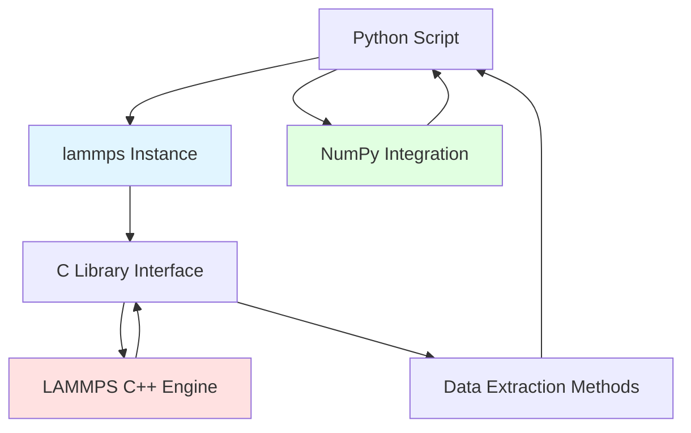
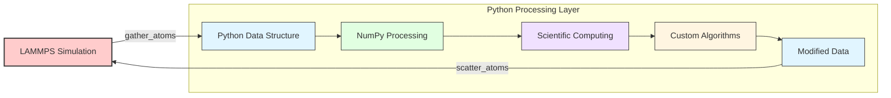

This guide explains how to integrate LAMMPS molecular dynamics simulations directly into Python workflows, enabling seamless data exchange, custom algorithm implementation, and coupling with other computational tools. By embedding LAMMPS as a Python module, you gain programmatic control over simulations while leveraging Python's rich ecosystem for data analysis and visualization.

## Architecture Overview

The LAMMPS-Python integration follows a client-server architecture where Python acts as the controlling client, invoking LAMMPS C-library functions through a ctypes-based wrapper. This design allows you to execute LAMMPS commands programmatically while maintaining direct access to simulation data structures.



The core `lammps` class ([`python/lammps/core.py`](python/lammps/core.py#L127)) serves as the primary interface, automatically loading the shared LAMMPS library upon instantiation and maintaining an internal handle to the C++ LAMMPS object. This handle is transparently passed to all library interface calls, eliminating the need for manual pointer management.

## Creating a LAMMPS Instance

The fundamental step in embedding LAMMPS is instantiating the `lammps` class, which initializes the LAMMPS simulation environment. The most basic form creates a serial LAMMPS instance with default settings:

```python
from lammps import lammps

lmp = lammps()
```

The constructor accepts several parameters to customize initialization ([`python/lammps/core.py`](python/lammps/core.py#L127-L157)):

| Parameter | Type | Default | Purpose |
|-----------|------|---------|---------|
| `name` | string | `''` | Library suffix (e.g., 'mpi' loads liblammps_mpi.so) |
| `cmdargs` | list | `None` | Command-line arguments to pass to LAMMPS |
| `ptr` | pointer | `None` | Direct C++ instance pointer (for embedded interpreters) |
| `comm` | MPI_Comm | `None` | MPI communicator from mpi4py for parallel execution |

For parallel execution with MPI, you can pass an mpi4py communicator:

```python
from mpi4py import MPI
from lammps import lammps

comm = MPI.COMM_WORLD
lmp = lammps(comm=comm)
```

This pattern enables running a single LAMMPS instance distributed across multiple MPI ranks, with both Python and LAMMPS utilizing the full parallel environment ([`python/examples/split.py`](python/examples/split.py#L28-L36)).

> [!TIP]
> Use the context manager protocol (`with` statement) to ensure proper cleanup of LAMMPS resources. The `__enter__` and `__exit__` methods ([`python/lammps/core.py`](python/lammps/core.py#L566-L570)) automatically call `close()` when exiting the context, preventing memory leaks in long-running workflows.

## Executing LAMMPS Commands

The Python interface provides three complementary methods for executing LAMMPS commands, each suited to different workflow patterns.

### Single Command Execution

The `command()` method ([`python/lammps/core.py`](python/lammps/core.py#L814-L823)) executes individual LAMMPS input commands from strings:

```python
lmp.command("units lj")
lmp.command("atom_style atomic")
lmp.command("pair_style lj/cut 2.5")
lmp.command("run 100")
```

This approach is ideal for interactive sessions and debugging, where commands are issued one at a time with potential Python logic between them.

### Batch Command Lists

For executing multiple commands sequentially, `commands_list()` ([`python/lammps/core.py`](python/lammps/core.py#L833-L852)) accepts a list of command strings:

```python
cmds = [
    "units lj",
    "atom_style atomic",
    "pair_style lj/cut 2.5",
    "pair_coeff 1 1 1.0 1.0 2.5",
    "run 100"
]
lmp.commands_list(cmds)
```

This method is more efficient than calling `command()` repeatedly for each instruction, as it reduces the overhead of crossing the Python-C boundary.

### Multi-Command Blocks

When you have command blocks stored as strings (perhaps read from files or templates), `commands_string()` ([`python/lammps/core.py`](python/lammps/core.py#L853-L872)) processes them as a single unit:

```python
multicmd = """
units lj
atom_style atomic
pair_style lj/cut 2.5
pair_coeff 1 1 1.0 1.0 2.5
run 100
"""
lmp.commands_string(multicmd)
```

This approach is particularly useful when integrating LAMMPS with existing input script workflows.

### Command Wrapper Convenience

The `cmd` property provides a syntactic shortcut that enables calling LAMMPS commands as methods rather than strings ([`python/lammps/core.py`](python/lammps/core.py#L593-L631)):

```python
lmp.cmd.units("lj")
lmp.cmd.atom_style("atomic")
lmp.cmd.pair_style("lj/cut", 2.5)
lmp.cmd.pair_coeff(1, 1, 1.0, 1.0, 2.5)
lmp.cmd.run(100)
```

This wrapper automatically formats the command string and handles argument conversion, making Python code more readable and reducing syntax errors.

## Data Exchange Patterns

The true power of embedding LAMMPS in Python lies in the ability to extract simulation data, manipulate it with Python libraries, and inject modified data back into LAMMPS. This enables custom algorithms, coupling with other simulation codes, and advanced analysis workflows.



### Extracting Atom Data

The `gather_atoms()` method ([`python/lammps/core.py`](python/lammps/core.py#L1771-L1790)) collects per-atom properties across all processors into contiguous arrays:

```python
# Gather positions (dtype=1 for double, count=3 for x,y,z)
x = lmp.gather_atoms("x", 1, 3)

# Gather velocities
v = lmp.gather_atoms("v", 1, 3)

# Gather forces
f = lmp.gather_atoms("f", 1, 3)

# Gather atom types (dtype=0 for int, count=1)
atype = lmp.gather_atoms("type", 0, 1)
```

The method returns ctypes arrays that can be converted to NumPy arrays for efficient manipulation. In the example workflow ([`python/examples/simple.py`](python/examples/simple.py#L49-L62)), atom positions are modified and scattered back to LAMMPS:

```python
epsilon = 0.1
x[0] += epsilon  # Displace first atom
lmp.scatter_atoms("x", 1, 3, x)  # Update LAMMPS
lmp.command("run 1")  # Run one step with modified positions
```

### Subset Data Access

For large systems, you may only need data from specific atoms. The `gather_atoms_subset()` method ([`python/lammps/core.py`](python/lammps/core.py#L1807-L1827)) retrieves data only for selected atom IDs:

```python
import ctypes

# Select atoms with IDs 2 and 4
ids = (2*ctypes.c_int)()
ids[0] = 2
ids[1] = 4

x_subset = lmp.gather_atoms_subset("x", 1, 3, 2, ids)
f_subset = lmp.gather_atoms_subset("f", 1, 3, 2, ids)
```

This pattern is demonstrated in [`python/examples/simple.py`](python/examples/simple.py#L100-L106), where only specific atoms are queried for analysis.

Similarly, `scatter_atoms_subset()` ([`python/lammps/core.py`](python/lammps/core.py#L1844-L1854)) updates data only for selected atoms, useful when applying localized perturbations ([`python/examples/simple.py`](python/examples/simple.py#L108-L118)).

### NumPy Integration

The `numpy` property ([`python/lammps/core.py`](python/lammps/core.py#L574-L592)) provides a wrapper that returns NumPy arrays directly, bypassing ctypes conversion:

```python
# Access NumPy wrapper
np_lmp = lmp.numpy

# Extract data directly as NumPy arrays
x = np_lmp.extract_atom("x")
f = np_lmp.extract_atom("f")
```

The `numpy_wrapper` class ([`python/lammps/numpy_wrapper.py`](python/lammps/numpy_wrapper.py#L29)) implements optimized methods that create NumPy arrays sharing memory with LAMMPS data structures, eliminating copy overhead and enabling efficient in-place modifications.

> [!TIP]
> When working with large systems, prefer the NumPy interface over the ctypes interface for data extraction and modification. The NumPy arrays provide zero-copy access to LAMMPS memory, significantly reducing memory bandwidth and improving performance for data-intensive workflows.

## Thermodynamic and Global Data

Accessing simulation state and thermodynamic quantities is essential for monitoring progress and implementing custom analysis.

### Thermo Output

The `get_thermo()` method ([`python/lammps/core.py`](python/lammps/core.py#L944-L962)) retrieves thermodynamic properties by name:

```python
temp = lmp.get_thermo("temp")
press = lmp.get_thermo("press")
pe = lmp.get_thermo("pe")
ke = lmp.get_thermo("ke")
```

This returns scalar values that can be used for conditional logic, adaptive sampling, or real-time plotting. The demo script ([`python/examples/demo.py`](python/examples/demo.py#L35-L40)) shows retrieving volume information:

```python
vol = lmp.get_thermo("vol")
print("Volume from get_thermo =", vol)
```

### Global Properties

The `extract_global()` method ([`python/lammps/core.py`](python/lammps/core.py#L1069-L1142)) provides access to global simulation parameters:

```python
natoms = lmp.extract_global("natoms")
dt = lmp.extract_global("dt")
boxlo = lmp.extract_global("boxlo")
boxhi = lmp.extract_global("boxhi")
```

### Compute and Fix Data

For accessing custom computes and fixes, the `extract_compute()` ([`python/lammps/core.py`](python/lammps/core.py#L1371-L1443)) and `extract_fix()` ([`python/lammps/core.py`](python/lammps/core.py#L1444-L1535)) methods retrieve their data:

```python
from lammps import LMP_STYLE_GLOBAL, LAMMPS_INT

# Extract global compute value
temp = lmp.extract_compute("thermo_temp", LMP_STYLE_GLOBAL, LAMMPS_INT)

# Extract per-atom compute data
pe_atom = lmp.extract_compute("pe", LMP_STYLE_ATOM, LAMMPS_DOUBLE)
```

## Advanced Workflow Patterns

### Custom Algorithm Implementation

The Monte Carlo example ([`python/examples/mc.py`](python/examples/mc.py#L71-L70)) demonstrates embedding a custom Monte Carlo algorithm that uses LAMMPS for energy evaluation:

```python
for i in range(nloop):
    iatom = random.randrange(0, natoms)
    
    # Store original position
    x0 = x[iatom][0]
    y0 = x[iatom][1]
    
    # Propose move
    x[iatom][0] += deltamove * (2*random.random()-1)
    x[iatom][1] += deltamove * (2*random.random()-1)
    
    # Evaluate energy with LAMMPS
    lmp.command("run 1 pre no post no")
    x = lmp.extract_atom("x")
    e = lmp.extract_compute("thermo_pe", LMP_STYLE_GLOBAL, LAMMPS_INT) / natoms
    
    # Metropolis acceptance criterion
    if e <= elast or random.random() <= math.exp(natoms*(elast-e)/kT):
        elast = e
        naccept += 1
    else:
        # Reject move: restore original position
        x[iatom][0] = x0
        x[iatom][1] = y0
```

This pattern leverages LAMMPS as a callable energy evaluator while implementing the sampling logic entirely in Python.

### Multi-Instance Parallel Workflows

The `split.py` example ([`python/examples/split.py`](python/examples/split.py#L43-L60)) shows running multiple LAMMPS instances concurrently using MPI sub-communicators:

```python
from mpi4py import MPI
comm = MPI.COMM_WORLD
me = comm.Get_rank()
nprocs = comm.Get_size()

# Create sub-communicators
if me < nprocs // 2:
    color = 0
else:
    color = 1

split = comm.Split(color, key=0)

# Run LAMMPS only on first partition
if color == 0:
    from lammps import lammps
    lmp = lammps(comm=split)
    # ... run simulation ...
else:
    # Could run another code or different simulation
    pass
```

This enables workflows where LAMMPS runs on a subset of processors while another computational task uses the remaining resources.

### Jupyter Notebook Integration

For interactive development and analysis, the `ipython` extension ([`python/lammps/ipython/wrapper.py`](python/lammps/ipython/wrapper.py)) provides notebook-specific utilities:

```python
%load_ext lammps.ipython

# Suppress LAMMPS output
%%capture_lammps_output
lmp.cmd.run(100)

# Store output in variable
%%capture_lammps_output output
lmp.cmd.info("system")
```

The notebook examples ([`python/examples/ipython/simple.ipynb`](python/examples/ipython/simple.ipynb#L59-L83)) demonstrate real-time visualization and interactive simulation control.

## Error Handling and Resource Management

Proper error handling ensures robust workflows that can recover from failures and release resources cleanly.

### Exception Handling

The `ExceptionCheck` context manager ([`python/lammps/core.py`](python/lammps/core.py#L44-L57)) automatically converts LAMMPS C++ exceptions into Python exceptions:

```python
try:
    lmp.command("invalid_command")
except Exception as e:
    print(f"LAMMPS error: {e}")
```

### Resource Cleanup

Always explicitly close LAMMPS instances or use the context manager:

```python
# Explicit cleanup
lmp = lammps()
try:
    # ... simulation code ...
finally:
    lmp.close()

# Or use context manager (preferred)
with lammps() as lmp:
    # ... simulation code ...
```

The `finalize()` method ([`python/lammps/core.py`](python/lammps/core.py#L661-L669)) shuts down MPI and Kokkos environments when you're completely done with all LAMMPS instances:

```python
lmp.finalize()  # Cannot create new instances after this
```

## Practical Example: Simple Analysis Workflow

Combining the concepts above, here's a complete workflow that sets up a simulation, runs it, extracts data for analysis, and visualizes results:

```python
from lammps import lammps
import matplotlib.pyplot as plt
import numpy as np

# Create LAMMPS instance
with lammps() as lmp:
    # Setup simulation
    lmp.commands_string("""
    units lj
    atom_style atomic
    lattice fcc 0.8442
    region box block 0 4 0 4 0 4
    create_box 1 box
    create_atoms 1 box
    mass 1 1.0
    pair_style lj/cut 2.5
    pair_coeff 1 1 1.0 1.0 2.5
    velocity all create 1.44 87287 loop geom
    fix 1 all nve
    thermo 10
    """)
    
    # Run initial equilibration
    lmp.command("run 100")
    
    # Store initial energy
    e_initial = lmp.get_thermo("pe")
    
    # Extract initial positions
    x_initial = lmp.numpy.extract_atom("x").copy()
    
    # Continue simulation
    temps = []
    energies = []
    for step in range(10):
        lmp.command("run 10")
        temps.append(lmp.get_thermo("temp"))
        energies.append(lmp.get_thermo("pe"))
    
    # Extract final positions
    x_final = lmp.numpy.extract_atom("x").copy()
    
    # Compute displacement
    displacement = np.linalg.norm(x_final - x_initial, axis=1)

# Visualize results
fig, (ax1, ax2) = plt.subplots(1, 2, figsize=(12, 4))
ax1.plot(temps, 'o-')
ax1.set_xlabel('Step')
ax1.set_ylabel('Temperature')
ax1.set_title('Temperature Evolution')

ax2.hist(displacement, bins=20)
ax2.set_xlabel('Displacement')
ax2.set_ylabel('Count')
ax2.set_title('Atomic Displacement Distribution')

plt.tight_layout()
plt.show()
```

This workflow demonstrates the complete cycle: setup, execution, data extraction, analysis, and visualization, all orchestrated from Python.

## Next Steps

For deeper integration with LAMMPS Python workflows, explore these related topics:

- [LAMMPS Python Module Basics](28-lammps-python-module-basics) - Comprehensive API reference for the Python interface
- [Data Exchange and NumPy Integration](30-data-exchange-and-numpy-integration) - Advanced patterns for efficient data manipulation
- [Jupyter Notebook and Visualization](31-jupyter-notebook-and-visualization) - Interactive workflows and real-time visualization techniques
- [Running Your First Simulation](4-running-your-first-simulation) - If you need guidance on basic LAMMPS simulation concepts
- [Molecular Dynamics Fundamentals](8-molecular-dynamics-fundamentals) - Understanding the physics behind your simulations