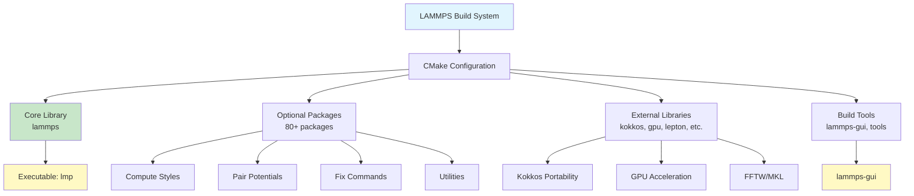

This guide covers installing and building LAMMPS using the modern CMake-based build system. LAMMPS offers flexibility through multiple build configurations, package selections, and platform-specific optimizations tailored for different use cases from basic simulations to high-performance computing environments.

## Build System Architecture

LAMMPS utilizes a modular CMake build system that separates concerns between core compilation, optional packages, external libraries, and platform-specific configurations. The build process follows a hierarchical structure where components are conditionally compiled based on user requirements and system capabilities.



The repository structure organizes these components logically:


| Directory | Purpose | Key Contents |
|-----------|---------|--------------|
| `cmake/` | CMake build system | Main CMakeLists.txt, Modules, presets |
| `src/` | Core source code | LAMMPS kernel, style implementations |
| `lib/` | External libraries | kokkos, gpu, lepton, molfile, etc. |
| `tools/` | Pre/post-processing | Utilities for data conversion, analysis |
| `doc/` | Documentation | Sphinx source, build scripts |
| `examples/` | Example inputs | Simulation templates by topic |

Sources: [cmake/CMakeLists.txt](cmake/CMakeLists.txt#L1-L80), [README](README#L1-L60)

## Prerequisites

Before building LAMMPS, ensure your system meets these requirements:

### Core Requirements
- **C++ Compiler**: GCC 9.3+, Clang 10.0+, Intel 19.0+, or MSVC 2019+ with C++17 support
- **CMake**: Version 3.20 or later
- **MPI**: For parallel builds (optional but recommended)
- **Python**: 3.8+ (optional, for Python module)

### Platform-Specific Notes
- **Linux**: GCC or Clang recommended; Intel compilers supported via presets
- **macOS**: AppleClang 10.0+ or GCC via Homebrew; Xcode command-line tools required
- **Windows**: MSVC 2019+ or MinGW; Visual Studio recommended

> [!TIP]
> CMake 3.20 is strictly required. Older versions will fail with policy errors. Check with `cmake --version` before proceeding.

Sources: [cmake/CMakeLists.txt](cmake/CMakeLists.txt#L1-L15), [cmake/CMakeLists.txt](cmake/CMakeLists.txt#L128-L160)

## Basic CMake Build

The simplest build uses CMake's out-of-source build pattern with minimal configuration:


**Step-by-step process:**

```bash
# 1. Navigate to LAMMPS directory
cd lammps/

# 2. Create and enter build directory
mkdir build && cd build

# 3. Configure with default settings
cmake ../cmake

# 4. Build LAMMPS (adjust -j for available cores)
cmake --build . -j 8

# 5. Install to default location (~/.local on Linux/macOS)
cmake --install .
```

**Key configuration options:**

| Option | Default | Description |
|--------|---------|-------------|
| `-C <preset>` | none | Load configuration preset (see below) |
| `-DPKG_<PACKAGE>=ON` | OFF | Enable specific package |
| `-DBUILD_SHARED_LIBS=ON` | OFF | Build shared library instead of static |
| `-DCMAKE_INSTALL_PREFIX` | `~/.local` | Installation directory |
| `-DBUILD_MPI=ON` | auto-detected | Enable MPI support |

Sources: [cmake/CMakeLists.txt](cmake/CMakeLists.txt#L50-L70), [README](README#L35-L60)

## Build Presets

LAMMPS provides pre-configured CMake presets in `cmake/presets/` for common scenarios. These simplify configuration by bundling package selections and compiler settings.

### Available Presets

| Preset | Description | Use Case |
|--------|-------------|----------|
| `basic.cmake` | Minimal packages (KSPACE, MANYBODY, MOLECULE, RIGID) | Quick builds, simple systems |
| `most.cmake` | Wide range of packages, requires some external libs | General-purpose simulations |
| `all_on.cmake` | All packages enabled | Maximum features, longest build time |
| `kokkos-cuda.cmake` | Kokkos with CUDA GPU support | NVIDIA GPU acceleration |
| `intel.cmake` | Intel compilers with optimizations | Intel CPUs, AVX-512 |
| `windows.cmake` | Windows-compatible packages | MSVC/MinGW builds |

**Using presets:**

```bash
# Basic build with common packages
cmake -C ../cmake/presets/basic.cmake ../cmake

# Kokkos GPU build
cmake -C ../cmake/presets/kokkos-cuda.cmake ../cmake

# Intel compiler optimization
cmake -C ../cmake/presets/intel.cmake ../cmake

# Windows with Visual Studio
cmake -C ../cmake/presets/windows.cmake -G "Visual Studio 17 2022" ../cmake
```

Sources: [cmake/presets/basic.cmake](cmake/presets/basic.cmake#L1-L9), [cmake/presets/most.cmake](cmake/presets/most.cmake#L1-L78), [cmake/presets/all_on.cmake](cmake/presets/all_on.cmake#L1-L102), [cmake/presets/kokkos-cuda.cmake](cmake/presets/kokkos-cuda.cmake#L1-L14), [cmake/presets/intel.cmake](cmake/presets/intel.cmake#L1-L29), [cmake/presets/windows.cmake](cmake/presets/windows.cmake#L1-L76)

## Package Selection

LAMMPS functionality is modularized through packages. Each package adds specific features like potential styles, compute commands, or fix operations.

### Enabling Packages

**Individual package selection:**

```bash
cmake -DPKG_KSPACE=ON \
      -DPKG_MANYBODY=ON \
      -DPKG_MOLECULE=ON \
      -DPKG_RIGID=ON \
      ../cmake
```

**Package categories:**

| Category | Example Packages | Functionality |
|----------|------------------|---------------|
| **Physics** | MANYBODY, KSPACE, MOLECULE | EAM potentials, long-range electrostatics, molecular systems |
| **Materials** | GRANULAR, PERI, SPH | Granular flow, peridynamics, smoothed-particle hydrodynamics |
| **ML/AI** | ML-SNAP, ML-IAP, ML-PACE | Machine learning potentials |
| **Accelerators** | GPU, KOKKOS, INTEL | GPU and many-core optimizations |
| **Analysis** | COLVARS, PHONON, REPLICA | Enhanced analysis capabilities |

### Package Dependencies

Some packages require others or external libraries:

```
ML-IAP → ML-SNAP
DIELECTRIC → KSPACE + EXTRA-PAIR
CG-DNA → MOLECULE + ASPHERE
AMOEBA → KSPACE
```

> [!TIP]
> Use `-C ../cmake/presets/all_off.cmake` to reset all packages before enabling specific ones.

Sources: [cmake/CMakeLists.txt](cmake/CMakeLists.txt#L415-L435), [cmake/presets/all_off.cmake](cmake/presets/all_off.cmake#L1-L100)

## External Libraries

Several packages require external libraries located in `lib/`. CMake handles building these automatically when packages are enabled.

### Automated Library Building

```bash
# Enable packages with external dependencies
cmake -DPKG_KOKKOS=ON \
      -DPKG_GPU=ON \
      -DPKG_ML-SNAP=ON \
      -DPKG_VORONOI=ON \
      ../cmake

# CMake will automatically:
# 1. Download/build Kokkos (if not found)
# 2. Build GPU library
# 3. Download/build ScaFaCoS (for long-range)
# 4. Find/build Voro++ (for Voronoi analysis)
```

### Key External Libraries

| Library | Required By | Description |
|---------|-------------|-------------|
| Kokkos | KOKKOS, ML-* packages | Performance portability layer |
| GPU | GPU package | CUDA/OpenCL acceleration |
| FFTW/MKL | KSPACE, COLVARS | Fast Fourier transforms |
| Voro++ | VORONOI package | Voronoi tessellation |
| NetCDF | NETCDF package | Trajectory I/O |
| ScaFaCoS | SCAFACOS package | Long-range solvers |

Sources: [lib/README](lib/README#L1-L30)

## Platform-Specific Builds

### Linux with GCC/Clang

```bash
# Standard GCC build
cmake -DCMAKE_CXX_COMPILER=g++ \
      -DCMAKE_C_COMPILER=gcc \
      -C ../cmake/presets/most.cmake \
      ../cmake

# Clang build with LTO
cmake -DCMAKE_CXX_COMPILER=clang++ \
      -DCMAKE_C_COMPILER=clang \
      -DCMAKE_INTERPROCEDURAL_OPTIMIZATION=ON \
      -C ../cmake/presets/most.cmake \
      ../cmake
```

### macOS

```bash
# AppleClang with Homebrew dependencies
cmake -DCMAKE_CXX_COMPILER=clang++ \
      -DPKG_KSPACE=ON \
      -DPKG_MANYBODY=ON \
      -DPKG_MOLECULE=ON \
      -DBUILD_MPI=OFF \
      ../cmake

# Multi-architecture build (ARM64 + x86_64)
cmake -C ../cmake/presets/macos-multiarch.cmake ../cmake
```

### Windows with Visual Studio

```bash
# From Visual Studio Developer Command Prompt
cmake -G "Visual Studio 17 2022" -A x64 ^
      -C ..\cmake\presets\windows.cmake ^
      ..\cmake

cmake --build . --config Release

cmake --install . --config Release
```

Sources: [cmake/CMakeLists.txt](cmake/CMakeLists.txt#L100-L160), [cmake/presets/macos-multiarch.cmake](cmake/presets/macos-multiarch.cmake#L1-L20)

## Build Tools and Utilities

LAMMPS includes additional tools that can be built alongside the main executable.

### LAMMPS GUI

```bash
# Enable GUI build
cmake -DPKG_MOLFILE=ON \
      -DBUILD_TOOLS=ON \
      ../cmake

cmake --build . --target lammps-gui
```

### Pre/Post-Processing Tools

The `tools/` directory contains standalone utilities for data preparation and analysis:


| Tool | Purpose | Build Method |
|------|---------|--------------|
| `binary2txt` | Convert binary dump to text | `make binary2txt` in tools/ |
| `lmp2cfg` | Convert to AtomEye format | `make lmp2cfg` in tools/ |
| `createatoms` | Generate atom lattices | See tools/createatoms/README |
| `phonon` | Post-process phonon data | CMake in tools/phonon/ |
| `python/*` | Python analysis scripts | No build required |

Sources: [tools/README](tools/README#L1-L63), [tools/Makefile](tools/Makefile#L1-L38)

## Documentation Build

Build the LAMMPS manual locally for offline reference:

```bash
cd doc

# HTML version (requires Python 3.8+, Sphinx, Doxygen)
make html

# PDF version (requires LaTeX with additional packages)
make pdf

# Output locations:
# HTML: doc/html/Manual.html
# PDF:  doc/Manual.pdf
```

### Documentation Requirements

**HTML build:**
- Python 3.8+
- Sphinx
- Doxygen 1.8.10+
- Internet connection (for initial downloads)

**PDF build (additional):**
- LaTeX (TeX Live or MiKTeX)
- Required packages: amsmath, babel, hyperref, geometry, fncychap, and 15+ others

Sources: [doc/README](doc/README#L1-L86)

## Troubleshooting Common Issues

### CMake Configuration Failures

| Issue | Solution |
|-------|----------|
| "CMake 3.20 or higher required" | Update CMake: `pip install cmake --upgrade` or use package manager |
| "Could not find MPI" | Install OpenMPI or MPICH, or set `-DBUILD_MPI=OFF` |
| "C++17 support required" | Ensure compiler supports C++17 (GCC 9.3+, Clang 10+) |
| "omp.h not found" | Install OpenMP headers or set `-DBUILD_OMP=OFF` |

### Build Failures

| Issue | Solution |
|-------|----------|
| "undefined reference to omp" | Link OpenMP: `-DBUILD_OMP=ON` |
| Kokkos build errors | Use system Kokkos: `-DKokkos_DIR=/path/to/kokkos` |
| Out of memory during link | Reduce parallel jobs: `cmake --build . -j 4` |

Sources: [cmake/CMakeLists.txt](cmake/CMakeLists.txt#L440-L500)

## Verification and Testing

After building, verify your installation:

```bash
# Check executable
./lmp -h

# Run simple benchmark
cd ../bench
../../build/lmp -in in.lj

# Run regression tests (requires CTEST)
cd ../tools/regression-tests
python run_tests.py
```

## Next Steps

After successfully building LAMMPS, you can:

- Learn how to run your first simulation in **[Running Your First Simulation](4-running-your-first-simulation)**
- Understand the physics behind molecular dynamics in **[Molecular Dynamics Fundamentals](8-molecular-dynamics-fundamentals)**
- Explore LAMMPS command syntax in **[Command Syntax and Structure](12-command-syntax-and-structure)**
- Configure parallel execution strategies in **[MPI Parallelization Strategy](24-mpi-parallelization-strategy)**