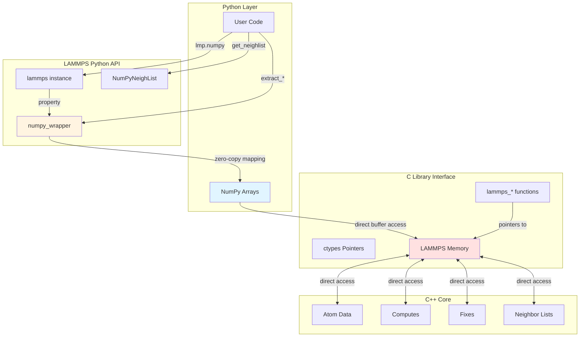

The NumPy integration layer in LAMMPS provides a high-performance bridge between LAMMPS simulation data and Python's scientific computing ecosystem. This interface enables seamless data exchange without copying, allowing direct manipulation of simulation data through NumPy arrays while maintaining the performance of LAMMPS' native C++ data structures.

## Architecture Overview

The NumPy integration architecture centers on the `numpy_wrapper` class, which serves as a translation layer between LAMMPS' ctypes-based C-library interface and NumPy's array objects. Each `lammps` instance exposes this functionality through the `numpy` property, returning a lazily instantiated wrapper object that provides NumPy-native alternatives to the standard API methods.

The core design principle is **zero-copy data access**: NumPy arrays are created directly from LAMMPS memory buffers, enabling read and write operations without intermediate data duplication. This approach is critical for performance in large-scale simulations where memory bandwidth becomes a bottleneck.

Sources: [numpy_wrapper.py](/python/lammps/numpy_wrapper.py#L29-L46), [core.py](/python/lammps/core.py#L574-L589)



## Enabling NumPy Integration

Accessing NumPy integration requires a properly configured LAMMPS build with Python support. After building LAMMPS as a shared library (`-DBUILD_SHARED_LIBS=ON`), the NumPy interface becomes available through the standard import pattern:

```python
from lammps import lammps

# Create LAMMPS instance
lmp = lammps()

# Access NumPy wrapper
numpy_interface = lmp.numpy  # Returns numpy_wrapper instance
```

The `numpy` property performs lazy initialization—the wrapper is only created on first access, avoiding import overhead when NumPy functionality isn't needed. If NumPy is not installed, accessing this property raises an `ImportError`, making the dependency explicit and fail-fast.

Sources: [core.py](/python/lammps/core.py#L574-L589)

## Extracting Per-Atom Data

The `extract_atom()` method retrieves per-atom properties as NumPy arrays, providing direct access to LAMMPS' internal atom data. This is the most frequently used data extraction operation, enabling manipulation of positions, velocities, forces, and other per-atom quantities.

### Basic Extraction Pattern

```python
from lammps import lammps
import numpy as np

lmp = lammps()
lmp.file("in.melt")

# Extract atom positions as NumPy array (nlocal × 3)
x = lmp.numpy.extract_atom("x")

# Extract velocities (nlocal × 3)
v = lmp.numpy.extract_atom("v")

# Extract forces (nlocal × 3)
f = lmp.numpy.extract_atom("f")
```

The returned arrays are dimensioned according to LAMMPS' internal storage: the underlying buffer always has size `[0:nmax]` where `nmax` is the maximum number of atoms LAMMPS has allocated. However, only data in the range `[0:nlocal]` contains valid local atom data. The `dim` parameter automatically adjusts based on property type—scalars use `dim=1`, vectors like positions use `dim=3`, and custom properties may have different dimensions.

Sources: [numpy_wrapper.py](/python/lammps/numpy_wrapper.py#L59-L110)

> [!TIP]
> **Critical Memory Boundary**: When working with ghost atoms, only certain properties are updated in the range `[nlocal:nlocal+nghost]`. Always check the documentation or LAMMPS source to verify whether a specific property is synchronized for ghost atoms before accessing beyond `nlocal`.

### Data Type Control

The NumPy wrapper automatically detects data types through LAMMPS' internal type system, but explicit control is available for performance optimization or special cases:

```python
# Automatic type detection (default)
x = lmp.numpy.extract_atom("x")

# Explicit double precision
x = lmp.numpy.extract_atom("x", dtype=lmp.LAMMPS_DOUBLE_2D, 
                            nelem=lmp.extract_global("nlocal"), dim=3)
```

Supported type constants include `LAMMPS_DOUBLE`, `LAMMPS_DOUBLE_2D`, `LAMMPS_INT`, `LAMMPS_INT_2D`, `LAMMPS_INT64`, and `LAMMPS_INT64_2D`. The `LAMMPS_AUTODETECT` constant enables automatic inference when type information isn't critical.

Sources: [numpy_wrapper.py](/python/lammps/numpy_wrapper.py#L91-L110), [core.py](/python/lammps/core.py#L1253-L1308)

## Accessing Compute Data

Computes in LAMMPS calculate derived quantities during simulations. The NumPy wrapper provides three levels of compute access: global scalars/vectors/arrays, per-atom quantities, and local data (e.g., bond/angle lists).

### Global Computes

Global computes produce scalar, vector, or array results aggregated over the entire system or specific groups:

```python
# Define a temperature compute
lmp.command("compute myTemp all temp")

# Extract as scalar
temp = lmp.numpy.extract_compute("myTemp", lmp.LMP_STYLE_GLOBAL, 
                                  lmp.LMP_TYPE_SCALAR)

# Define a center-of-mass compute returning vector
lmp.command("compute myCOM all com")

# Extract as vector
com = lmp.numpy.extract_compute("myCOM", lmp.LMP_STYLE_GLOBAL, 
                                lmp.LMP_TYPE_VECTOR)

# Define an RDF compute returning array
lmp.command("compute myRDF all rdf 100")

# Extract as 2D array (bins × 3 columns)
rdf = lmp.numpy.extract_compute("myRDF", lmp.LMP_STYLE_GLOBAL, 
                                 lmp.LMP_TYPE_ARRAY)
```

The wrapper automatically determines array dimensions by querying LAMMPS for size information before creating the NumPy array.

Sources: [numpy_wrapper.py](/python/lammps/numpy_wrapper.py#L114-L141)

### Per-Atom Computes

Per-atom computes calculate values for each atom individually, such as coordination numbers, stress, or custom properties:

```python
# Define a per-atom coordination number compute
lmp.command("compute myCoord all coord/atom cutoff 3.0")

# Extract as 1D array (nlocal elements)
coord = lmp.numpy.extract_compute("myCoord", lmp.LMP_STYLE_ATOM, 
                                   lmp.LMP_TYPE_VECTOR)

# Define a per-atom stress compute
lmp.command("compute myStress all stress/atom NULL virial")

# Extract as 2D array (nlocal × 6 columns for stress tensor)
stress = lmp.numpy.extract_compute("myStress", lmp.LMP_STYLE_ATOM, 
                                    lmp.LMP_TYPE_ARRAY)
```

Per-atom compute arrays are automatically dimensioned to `nlocal`, the number of local atoms on the current MPI rank.

Sources: [numpy_wrapper.py](/python/lammps/numpy_wrapper.py#L147-L154)

### Local Computes

Local computes produce lists of local interactions, such as bonds, angles, or dihedrals:

```python
# Define a compute that tracks bond lengths
lmp.command("compute myBonds all property/local batom1 batom2 btype")

# Extract as 2D array (nbonds × columns)
bonds = lmp.numpy.extract_compute("myBonds", lmp.LMP_STYLE_LOCAL, 
                                   lmp.LMP_TYPE_ARRAY)
```

Local compute dimensions are determined by querying LAMMPS for row and column counts, accommodating dynamically changing interaction lists.

Sources: [numpy_wrapper.py](/python/lammps/numpy_wrapper.py#L141-L146)

## Accessing Fix Data

Fixes in LAMMPS apply operations to atoms and store associated data. The NumPy wrapper provides access to fix data in a similar manner to computes:

```python
# Define an ave/time fix that stores time-averaged temperature
lmp.command("fix myAve all ave/time 100 10 1000 temp ave one file temp.dat")

# Extract fix data (note: global fixes return scalars)
temp_ave = lmp.numpy.extract_fix("myAve", lmp.LMP_STYLE_GLOBAL, 
                                  lmp.LMP_TYPE_SCALAR)

# For per-atom fixes (e.g., fix store/state)
lmp.command("fix mystore all store/state 0 x y z")

# Extract as 2D array (nlocal × 3)
stored_pos = lmp.numpy.extract_fix("mystore", lmp.LMP_STYLE_ATOM, 
                                    lmp.LMP_TYPE_ARRAY)
```

Global fix data is accessed one element at a time due to LAMMPS' internal API, requiring explicit row/column indices for vector/array data. Per-atom and local fixes support direct array extraction.

Sources: [numpy_wrapper.py](/python/lammps/numpy_wrapper.py#L159-L204)

> [!TIP]
> **Global Fix Limitation**: When accessing global vector or array data from fixes, you must specify `nrow` and `ncol` parameters to access individual elements. The wrapper cannot return the entire vector/array at once due to LAMMPS' C-library interface limitations.

## Variable Evaluation with NumPy

The `extract_variable()` method evaluates LAMMPS variables and returns NumPy arrays for atom-style variables:

```python
# Define an atom-style variable (function of atom properties)
lmp.command("variable myVar atom v_x^2+v_y^2+v_z^2")

# Evaluate and extract as NumPy array (nlocal elements)
atom_energies = lmp.numpy.extract_variable("myVar", vartype=lmp.LMP_VAR_ATOM)

# Equal-style variables return scalars directly
lmp.command("variable myEq equal step*dt")
timestep = lmp.numpy.extract_variable("myEq", vartype=lmp.LMP_VAR_EQUAL)
```

Atom-style variables are particularly powerful for creating custom per-atom quantities on-the-fly without defining dedicated computes or fixes.

Sources: [numpy_wrapper.py](/python/lammps/numpy_wrapper.py#L208-L228)

## Topology Data Extraction

The NumPy wrapper provides methods to gather molecular topology data (bonds, angles, dihedrals, impropers) as NumPy arrays:

```python
# Gather all bonds as integer array
# Returns: nbonds × 3 array [bond_type, atom1, atom2]
bonds = lmp.numpy.gather_bonds()

# Gather all angles
# Returns: nangles × 4 array [angle_type, atom1, atom2, atom3]
angles = lmp.numpy.gather_angles()

# Gather all dihedrals
# Returns: ndihedrals × 5 array [dihedral_type, atom1, atom2, atom3, atom4]
dihedrals = lmp.numpy.gather_dihedrals()

# Gather all impropers
# Returns: nimpropers × 5 array [improper_type, atom1, atom2, atom3, atom4]
impropers = lmp.numpy.gather_impropers()
```

These methods automatically handle parallel communication, aggregating topology data from all MPI ranks into arrays accessible on rank 0. The atom IDs are global IDs, enabling direct mapping to atom data.

Sources: [numpy_wrapper.py](/python/lammps/numpy_wrapper.py#L232-L298)

## Neighbor List Access

Neighbor lists contain critical connectivity information for force calculations. The NumPy wrapper provides the `NumPyNeighList` class for efficient neighbor list iteration:

```python
# Find pair neighbor list index
idx = lmp.find_pair_neighlist("lj/cut", exact=True)

# Get NumPy-wrapped neighbor list
neigh_list = lmp.numpy.get_neighlist(idx)

# Iterate through all atoms with neighbors
for i in range(neigh_list.size):
    atom_idx, neighbors = neigh_list.get(i)
    # atom_idx: local atom index
    # neighbors: NumPy array of neighbor local indices
    
# Find neighbors for a specific atom
my_neighbors = neigh_list.find(local_atom_idx)
if my_neighbors is not None:
    print(f"Atom {local_atom_idx} has {len(my_neighbors)} neighbors")
```

The `NumPyNeighList` class implements Python's sequence protocol, enabling list-like iteration while returning NumPy arrays instead of ctypes pointers. This enables efficient vectorized operations on neighbor data.

Sources: [numpy_wrapper.py](/python/lammps/numpy_wrapper.py#L381-L412), [numpy_wrapper.py](/python/lammps/numpy_wrapper.py#L490-L528), [data.py](/python/lammps/data.py#L21-L88)

```mermaid
sequenceDiagram
    participant User
    participant NW as numpy_wrapper
    participant NL as NumPyNeighList
    participant CLib as C Library
    participant LMP as LAMMPS C++
    
    User->>NW: get_neighlist(idx)
    NW->>NL: new NumPyNeighList(lmp, idx)
    NL-->>User: NumPyNeighList instance
    
    User->>NL: get(element)
    NL->>NW: get_neighlist_element_neighbors(idx, element)
    NW->>CLib: lammps_get_neighlist_element_neighbors()
    CLib->>LMP: Access neighbor data
    LMP-->>CLib: Return pointer and count
    CLib-->>NW: (iatom, numneigh, neighbors_ptr)
    NW->>NW: iarray(c_int, ptr, numneigh, 1)
    NW-->>NL: (iatom, neighbors_array)
    NL-->>User: (atom_idx, NumPy_array)
    
    User->>NL: find(iatom)
    loop each element
        NL->>NW: get_neighlist_element_neighbors()
        NW-->>NL: (atom_idx, neighbors)
        alt atom_idx matches iatom
            NL-->>User: neighbors array
    end
    NL-->>User: None (not found)
```

## Modifying Simulation Data

While the `extract_*` methods provide read access, simulation data can be modified using scatter operations. The standard `scatter_atoms()` method from the base `lammps` class accepts NumPy arrays:

```python
# Extract current positions
x = lmp.numpy.extract_atom("x")

# Apply displacement
displacement = np.array([0.1, 0.0, 0.0])
x[0:10] += displacement  # Shift first 10 atoms

# Scatter modified positions back to LAMMPS
lmp.scatter_atoms("x", 1, 3, x)

# Run with modified positions
lmp.command("run 100")
```

For subset operations, `scatter_atoms_subset()` allows modifying specific atoms identified by global IDs:

```python
# Get specific atoms
ids = np.array([100, 200, 300], dtype=np.int32)
x_subset = lmp.gather_atoms_subset("x", 1, 3, len(ids), ids)

# Modify subset
x_subset[:, 0] += 0.5

# Scatter back using modified IDs
new_ids = np.array([100, 200, 300], dtype=np.int32)
lmp.scatter_atoms_subset("x", 1, 3, len(new_ids), new_ids, x_subset)
```

These operations demonstrate the two-way data flow capability: extracting data, processing it with NumPy, and writing modifications back to LAMMPS with full NumPy array support.

Sources: [core.py](/python/lammps/core.py#L1834-L1844), [core.py](/python/lammps/core.py#L1844-L1854), [simple.py](/python/examples/simple.py#L58-L65)

## External Force Integration

For custom force calculations implemented in Python, the `fix external` mechanism provides bidirectional data exchange:

```python
# Enable fix external
lmp.command("fix ext all external pf/callback 1")

# Retrieve current forces
forces = lmp.numpy.fix_external_get_force("ext")

# Calculate custom forces (e.g., from external potential)
forces += compute_external_potential_forces(positions)

# Return forces to LAMMPS
# Note: forces are automatically updated via the pointer
```

For per-atom energy contributions from external potentials:

```python
# Calculate per-atom energies
eatom = compute_external_potential_energies(positions)

# Set per-atom energy (accumulates with other contributions)
lmp.numpy.fix_external_set_energy_peratom("ext", eatom)

# Optionally set per-atom virial (6 components per atom)
vatom = compute_external_potential_virial(positions, forces)
lmp.numpy.fix_external_set_virial_peratom("ext", vatom)
```

These methods enable seamless integration of Python-implemented potentials with LAMMPS' energy/force accounting system.

Sources: [numpy_wrapper.py](/python/lammps/numpy_wrapper.py#L300-L377), [core.py](/python/lammps/core.py#L2646-L2727)

## Low-Level Array Conversion

The `iarray()` and `darray()` methods provide direct conversion from ctypes pointers to NumPy arrays, serving as the foundation for higher-level extraction methods:

```python
# Convert integer array pointer to NumPy
int_array = lmp.numpy.iarray(ctypes.c_int32, ptr, nelem=100, dim=3)

# Convert double array pointer to NumPy
double_array = lmp.numpy.darray(ptr, nelem=50, dim=2)
```

These methods use `np.frombuffer()` to create zero-copy views of the underlying memory, then reshape to appropriate dimensions. The `dim` parameter controls whether the result is 1D (`dim=1`) or 2D (`dim>1`).

Sources: [numpy_wrapper.py](/python/lammps/numpy_wrapper.py#L416-L485)

## Performance Considerations

### Zero-Copy vs. Copy Operations

The NumPy wrapper's zero-copy design provides significant performance advantages but requires understanding of lifetime and ownership semantics. The returned NumPy arrays share memory with LAMMPS; modifications to array elements immediately affect LAMMPS data, and the array becomes invalid if LAMMPS reallocates or destroys the underlying buffer.

**Safe usage pattern**: Extract arrays, perform operations, then immediately use or return results before calling LAMMPS commands that might reallocate memory.

```python
# Safe pattern
forces = lmp.numpy.extract_atom("f")
max_force = np.max(np.linalg.norm(forces, axis=1))

# Potentially unsafe if run commands could reallocate
x = lmp.numpy.extract_atom("x")
lmp.command("run 1000")  # May reallocate x buffer
# x array may now be invalid!
```

### MPI Parallelism

In parallel simulations, each MPI rank has access only to its local atoms. The NumPy wrapper respects this partition—`nlocal` determines array size on each rank. For global aggregation, use LAMMPS' built-in gather operations:

```python
# Local data extraction
x_local = lmp.numpy.extract_atom("x")
nlocal = lmp.extract_global("nlocal")

# For global aggregation, use LAMMPS gather (only valid on rank 0)
from mpi4py import MPI
comm = MPI.COMM_WORLD

# Gather all positions to rank 0
if comm.rank == 0:
    total_atoms = comm.reduce(nlocal, op=MPI.SUM)
    x_global = np.empty((total_atoms, 3))
else:
    x_global = None

comm.Gatherv(x_local, x_global)
```

### Memory Efficiency

The automatic dimension detection using `LAMMPS_AUTODETECT` adds small overhead. For performance-critical loops, explicitly specify dimensions:

```python
nlocal = lmp.extract_global("nlocal")

# Slightly faster with explicit parameters
x = lmp.numpy.extract_atom("x", dtype=lmp.LAMMPS_DOUBLE_2D, 
                            nelem=nlocal, dim=3)
```

## Complete Example: In-Situ Analysis

The following example demonstrates a complete workflow combining data extraction, analysis, and visualization:

```python
from lammps import lammps
import numpy as np
import matplotlib.pyplot as plt

# Initialize LAMMPS
lmp = lammps()
lmp.file("in.melt")

# Define computes for analysis
lmp.command("compute msd all msd")
lmp.command("compute rdf all rdf 100")

# Storage for analysis data
msd_history = []
rdf_history = []

# Run simulation with periodic analysis
for i in range(100):
    lmp.command("run 100")
    
    # Extract MSD
    msd = lmp.numpy.extract_compute("msd", lmp.LMP_STYLE_GLOBAL, 
                                    lmp.LMP_TYPE_VECTOR)[3]  # Total MSD
    msd_history.append(msd)
    
    # Extract RDF every 10 steps
    if i % 10 == 0:
        rdf = lmp.numpy.extract_compute("rdf", lmp.LMP_STYLE_GLOBAL, 
                                        lmp.LMP_TYPE_ARRAY)
        rdf_history.append(rdf.copy())  # Copy to persist

    # Extract forces for outlier detection
    forces = lmp.numpy.extract_atom("f")
    force_mags = np.linalg.norm(forces, axis=1)
    outliers = force_mags > np.mean(force_mags) + 3*np.std(force_mags)
    
    if np.any(outliers):
        print(f"Step {i*100}: {np.sum(outliers)} atoms with high forces")

# Plot MSD evolution
plt.plot(np.arange(len(msd_history))*100, msd_history)
plt.xlabel("Timestep")
plt.ylabel("Mean Squared Displacement")
plt.savefig("msd_evolution.png")

# Plot final RDF
rdf_final = rdf_history[-1]
r = rdf_final[:, 0]
g_r = rdf_final[:, 1]
plt.figure()
plt.plot(r, g_r)
plt.xlabel("Distance r")
plt.ylabel("g(r)")
plt.savefig("rdf_final.png")

lmp.close()
```

This example showcases the integration of LAMMPS simulation with NumPy-based scientific computing, enabling in-situ analysis without intermediate file I/O.

Sources: [plot.py](/python/examples/plot.py#L35-L50)

## API Reference Summary

The following table summarizes the key NumPy wrapper methods:

| Method | Purpose | Return Type |
|--------|---------|-------------|
| `extract_atom(name, dtype, nelem, dim)` | Per-atom properties | `np.ndarray` or `None` |
| `extract_compute(cid, cstyle, ctype)` | Compute data | `float`, `np.ndarray`, or `None` |
| `extract_fix(fid, fstyle, ftype, nrow, ncol)` | Fix data | Scalar, `np.ndarray`, or `None` |
| `extract_variable(name, group, vartype)` | Variable evaluation | `float`, `np.ndarray`, or `None` |
| `gather_bonds()` | Global bond list | `np.ndarray` (nbonds × 3) |
| `gather_angles()` | Global angle list | `np.ndarray` (nangles × 4) |
| `gather_dihedrals()` | Global dihedral list | `np.ndarray` (ndihedrals × 5) |
| `gather_impropers()` | Global improper list | `np.ndarray` (nimpropers × 5) |
| `get_neighlist(idx)` | Neighbor list wrapper | `NumPyNeighList` |
| `get_neighlist_element_neighbors(idx, element)` | Single neighbor list entry | `(int, np.ndarray)` |
| `fix_external_get_force(fix_id)` | External force array | `np.ndarray` |
| `fix_external_set_energy_peratom(fix_id, eatom)` | Set per-atom energies | `None` |
| `fix_external_set_virial_peratom(fix_id, vatom)` | Set per-atom virial | `None` |
| `iarray(c_int_type, ptr, nelem, dim)` | Integer pointer conversion | `np.ndarray` |
| `darray(ptr, nelem, dim)` | Double pointer conversion | `np.ndarray` |

Sources: [numpy_wrapper.py](/python/lammps/numpy_wrapper.py#L29-L534)

## Next Steps

With data exchange capabilities established, you're ready to explore more advanced Python integration topics:

- **[Jupyter Notebook and Visualization](31-jupyter-notebook-and-visualization)** - Interactive environments for real-time simulation analysis and visualization
- **[Embedding LAMMPS in Python Workflows](29-embedding-lammps-in-python-workflows)** - Architectural patterns for integrating LAMMPS into larger Python applications
- **[LAMMPS Python Module Basics](28-lammps-python-module-basics)** - Fundamental Python interface concepts and initialization

For parallel computing considerations, review **[MPI Parallelization Strategy](24-mpi-parallelization-strategy)** to understand how data distribution affects Python-LAMMPS integration in multi-rank simulations.