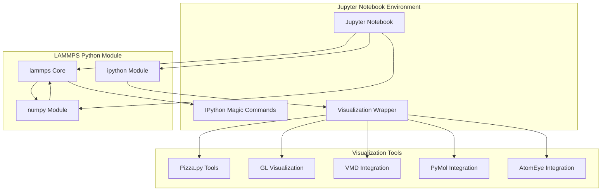

LAMMPS provides comprehensive integration with Jupyter Notebook environments, enabling interactive molecular dynamics simulations, real-time visualization, and seamless data analysis workflows. This integration transforms LAMMPS from a traditional batch-mode simulation engine into an interactive computational laboratory where researchers can explore, analyze, and visualize atomic-scale phenomena in real-time.

## Architecture Overview

The Jupyter integration for LAMMPS follows a modular architecture comprising three primary components: IPython magic commands for output control, visualization wrappers for image and video rendering, and NumPy bridges for efficient data exchange.




## IPython Magic Commands

The `lammps.ipython` extension provides powerful magic commands that enhance the interactive LAMMPS experience in Jupyter notebooks. The primary magic command `%%capture_lammps_output` enables fine-grained control over LAMMPS library output, which is crucial for maintaining clean notebook interfaces.

Sources: [magics.py](python/lammps/ipython/magics.py#L59-L76), [ipython/__init__.py](python/lammps/ipython/__init__.py#L22-L24)

### Loading the Extension

Before using any IPython-specific features, you must load the extension:

```python
%load_ext lammps.ipython
```

This command registers the LAMMPS magic commands with your Jupyter kernel.

### Capturing Output

The `%%capture_lammps_output` cell magic serves dual purposes: suppressing excessive LAMMPS output to keep notebooks clean, and capturing that output for programmatic analysis.

Sources: [simple.ipynb](python/examples/ipython/simple.ipynb#L1-L200)

```python
%%capture_lammps_output
L.cmd.info("system")
```

For output capture and storage:

```python
%%capture_lammps_output output_var
L.cmd.run(1000)
# Output now stored in output_var variable
print(output_var)
```

> [!TIP]
> The output capture mechanism uses temporary file redirection at the file descriptor level, ensuring all stdout is captured without affecting LAMMPS internal buffering. This approach is more reliable than simple string redirection methods.

## Visualization Methods

The `lammps.ipython.wrapper` class provides two primary visualization methods: `image()` for generating static snapshots and `video()` for embedding movie files directly into notebooks.

Sources: [wrapper.py](python/lammps/ipython/wrapper.py#L19-L114)

### Static Image Generation

The `image()` method leverages LAMMPS's native `write_dump image` command to generate high-quality atomic configuration visualizations with extensive customization options.

```python
L = lammps()
L.cmd.units("lj")
L.cmd.atom_style("atomic")
# ... setup system ...

# Generate and display image with default settings
L.ipython.image()

# Customized visualization
L.ipython.image(
    filename="melt_snapshot.png",
    group="all",
    color="type",
    diameter="type",
    size=(800, 600),
    view=(60, 30),
    center=(0, 25, 25, 25),
    up=(0, 1, 0),
    zoom=1.5,
    background_color="black"
)
```

Sources: [atoms.ipynb](python/examples/ipython/atoms.ipynb#L1-L200)

| Parameter | Type | Default | Description |
|-----------|------|---------|-------------|
| `filename` | string | "snapshot.png" | Output file name (extension determines PNG/JPEG) |
| `group` | string | "all" | Atom group to visualize |
| `color` | string | "type" | Property determining atom colors |
| `diameter` | string | "type" | Property determining atom diameters |
| `size` | tuple | None | Image dimensions (width, height) |
| `view` | tuple | None | View angles (theta, phi) |
| `center` | tuple | None | Center point (flag, x, y, z) |
| `up` | tuple | None | Up direction vector (x, y, z) |
| `zoom` | float | 1.0 | Zoom factor |
| `background_color` | string | "white" | Scene background color |

### Video Embedding

For trajectory animations, the `video()` method creates HTML video tags that embed movies generated by LAMMPS's `dump movie` command.

Sources: [wrapper.py](python/lammps/ipython/wrapper.py#L101-L114)

```python
# Generate movie using dump movie command
L.cmd.dump("1", "all", "movie", "100", "trajectory.mp4", "atom", 100)
L.cmd.run(10000)

# Embed video in notebook
L.ipython.video("trajectory.mp4")
```

<CgxTip>Movie generation requires FFmpeg support compiled into LAMMPS. Verify availability with `L.has_ffmpeg_support` before attempting to create videos.</cgt_tip>

## NumPy Integration

The `lammps.numpy` wrapper provides seamless conversion between LAMMPS internal data structures and NumPy arrays, enabling efficient scientific computing workflows. This integration offers direct memory access without data copying where possible, significantly improving performance for large-scale systems.

Sources: [numpy_wrapper.py](python/lammps/numpy_wrapper.py#L1-L100), [numpy_wrapper.py](python/lammps/numpy_wrapper.py#L59-L114)

### Extracting Per-Atom Data

```python
from lammps import lammps
import numpy as np

L = lammps()
# ... setup and run simulation ...

# Extract positions as NumPy array
positions = L.numpy.extract_atom("x")
# Returns shape (nmax, 3) - first nlocal entries contain local atom data

# Extract velocities
velocities = L.numpy.extract_atom("v")

# Extract forces
forces = L.numpy.extract_atom("f")

# Extract atom types
types = L.numpy.extract_atom("type")
```

Sources: [atoms.ipynb](python/examples/ipython/atoms.ipynb#L150-L200), [numpy_wrapper.py](python/lammps/numpy_wrapper.py#L59-L114)

### Analyzing Thermodynamic Data

The `last_thermo()` method returns the most recent thermodynamic output as a dictionary, which can be combined with Python callbacks for real-time data collection and analysis.

Sources: [core.py](python/lammps/core.py#L975-L1022), [thermo.ipynb](python/examples/ipython/thermo.ipynb#L1-L200)

```python
thermo_data = {}

def collect_thermo(lmp):
    for key, value in lmp.last_thermo().items():
        thermo_data.setdefault(key, []).append(value)

# Register callback with fix python/invoke
L.cmd.fix("collector", "all", "python/invoke", 50, "end_of_step", collect_thermo)
L.cmd.run(1000)

# thermo_data now contains time series for all thermo columns
import matplotlib.pyplot as plt

plt.figure(figsize=(10, 6))
plt.plot(thermo_data['Step'], thermo_data['Temp'], label='Temperature')
plt.plot(thermo_data['Step'], thermo_data['Press'], label='Pressure')
plt.xlabel('Timestep')
plt.ylabel('Value')
plt.legend()
plt.title('System Evolution')
plt.show()
```

## Real-Time Visualization Tools

Beyond notebook-embedded visualizations, LAMMPS Python integration supports several external visualization packages through the Pizza.py toolkit and dedicated Python scripts.

Sources: [README](python/README#L1-L138), [viz_gl.py](python/examples/viz_gl.py#L1-L88)

### Pizza.py Integration

The Pizza.py toolkit (included in `python/examples/pizza/`) provides real-time visualization capabilities with GL (OpenGL), VMD, PyMol, and AtomEye backends.

```python
#!/usr/bin/env python
from lammps import lammps
import sys
sys.path.append("./pizza")
from dump import dump
from gl import gl

lmp = lammps()
lmp.file("in.simulation")
lmp.command("dump 1 all atom 100 tmp.dump")
lmp.command("run 0 pre yes post no")

# Real-time visualization
d = dump("tmp.dump", 0)
g = gl(d)
d.next()
d.unscale()
g.zoom(1)
g.box(1)
g.show(0)

while ntimestep < nsteps:
    lmp.command("run 100 pre no post no")
    ntimestep += 100
    d.next()
    d.unscale()
    g.show(ntimestep)
```

Sources: [viz_gl.py](python/examples/viz_gl.py#L1-L88), [plot.py](python/examples/plot.py#L1-L76)

### Real-Time Plotting

For monitoring scalar properties during simulation, LAMMPS provides plotting integration with both GnuPlot (via Pizza.py) and Matplotlib.

```python
# GnuPlot integration (via Pizza.py)
from gnu import gnu

gn = gnu()
gn.plot([timesteps], [temperatures])
gn.xrange(0, nsteps)
gn.title("Temperature Evolution", "Timestep", "Temperature")

# Matplotlib integration
import matplotlib.pyplot as plt

plt.ion()  # Enable interactive mode
fig, ax = plt.subplots()
line, = ax.plot([], [], 'b-')

for step in range(nsteps):
    lmp.command("run 100")
    temp = lmp.extract_compute("thermo_temp", 0, 0)
    xdata.append(step)
    ydata.append(temp)
    line.set_data(xdata, ydata)
    ax.relim()
    ax.autoscale_view()
    plt.pause(0.01)
```

Sources: [plot.py](python/examples/plot.py#L1-L76), [matplotlib_plot.py](python/examples/matplotlib_plot.py#L1-L88)

## Complete Workflow Example

The following example demonstrates a complete Jupyter-based molecular dynamics workflow combining simulation, visualization, and analysis:

Sources: [simple.ipynb](python/examples/ipython/simple.ipynb#L1-L200), [thermo.ipynb](python/examples/ipython/thermo.ipynb#L1-L200), [atoms.ipynb](python/examples/ipython/atoms.ipynb#L1-L200)

```python
%load_ext lammps.ipython

from lammps import lammps
import numpy as np
import matplotlib.pyplot as plt

# Initialize LAMMPS
L = lammps()
L.cmd.auto_flush = True  # Enable immediate output

# Setup 3D Lennard-Jones melt
L.cmd.units("lj")
L.cmd.atom_style("atomic")
L.cmd.lattice("fcc", 0.8442)
L.cmd.region("box", "block", 0, 4, 0, 4, 0, 4)
L.cmd.create_box(1, "box")
L.cmd.create_atoms(1, "box")
L.cmd.mass(1, 1.0)
L.cmd.velocity("all", "create", 1.44, 87287, "loop geom")
L.cmd.pair_style("lj/cut", 2.5)
L.cmd.pair_coeff(1, 1, 1.0, 1.0, 2.5)
L.cmd.fix("1", "all", "nve")
L.cmd.thermo(50)

# Visualize initial configuration
L.ipython.image(size=(600, 400), background_color="black")

# Collect data during simulation
data = {'step': [], 'temp': [], 'press': [], 'pe': []}

def log_data(lmp):
    thermo = lmp.last_thermo()
    data['step'].append(thermo['Step'])
    data['temp'].append(thermo['Temp'])
    data['press'].append(thermo['Press'])
    data['pe'].append(thermo['Pe'])

L.cmd.fix("logger", "all", "python/invoke", 50, "end_of_step", log_data)

# Run simulation
%%capture_lammps_output
L.cmd.run(1000)

# Analyze final configuration
final_positions = L.numpy.extract_atom("x")
final_velocities = L.numpy.extract_atom("v")

# Calculate radial distribution function
def rdf(positions, box_size, n_bins=100):
    distances = []
    n_atoms = len(positions)
    for i in range(n_atoms):
        for j in range(i+1, n_atoms):
            dx = positions[j][0] - positions[i][0]
            dy = positions[j][1] - positions[i][1]
            dz = positions[j][2] - positions[i][2]
            # Minimum image convention
            dx -= box_size[0] * round(dx/box_size[0])
            dy -= box_size[1] * round(dy/box_size[1])
            dz -= box_size[2] * round(dz/box_size[2])
            r = np.sqrt(dx*dx + dy*dy + dz*dz)
            distances.append(r)
    
    hist, bin_edges = np.histogram(distances, bins=n_bins, range=(0, box_size[0]/2))
    r_centers = 0.5 * (bin_edges[1:] + bin_edges[:-1])
    return r_centers, hist

r, g_r = rdf(final_positions, [10.1, 10.1, 10.1])

# Visualize results
fig, axes = plt.subplots(1, 3, figsize=(15, 4))

# Temperature evolution
axes[0].plot(data['step'], data['temp'])
axes[0].set_xlabel('Timestep')
axes[0].set_ylabel('Temperature')
axes[0].set_title('Temperature')

# Pressure evolution
axes[1].plot(data['step'], data['press'])
axes[1].set_xlabel('Timestep')
axes[1].set_ylabel('Pressure')
axes[1].set_title('Pressure')

# Radial distribution function
axes[2].plot(r, g_r)
axes[2].set_xlabel('Distance r')
axes[2].set_ylabel('g(r)')
axes[2].set_title('RDF')

plt.tight_layout()
plt.show()

# Visualize final state
L.ipython.image(filename="final_state.png", size=(600, 400), zoom=1.2)
```

## Parallel Execution with MPI4Py

Jupyter notebooks can leverage parallel LAMMPS execution through MPI4Py, enabling large-scale simulations with interactive monitoring.

Sources: [simple.py](python/examples/simple.py#L1-L132), [mpi4py/hello.py](python/examples/ipython/mpi4py/hello.py#L1-L50)

```python
from mpi4py import MPI
from lammps import lammps

# MPI initialization
comm = MPI.COMM_WORLD
rank = comm.Get_rank()
size = comm.Get_size()

# Create LAMMPS instance with MPI communicator
lmp = lammps(cmdargs=['-log', 'none'], comm=comm)

if rank == 0:
    print(f"Running on {size} MPI ranks")

# Parallel simulation setup and execution
# ... (commands executed on all ranks)

if rank == 0:
    # Only root rank does visualization and analysis
    positions = lmp.numpy.extract_atom("x")
    # ... analysis and plotting
```

## Best Practices and Performance Considerations

When working with LAMMPS in Jupyter notebooks, consider the following optimization strategies:

1. **Buffer Management**: Use `L.cmd.auto_flush = True` for immediate output during development, but disable it for production runs to improve performance.

2. **Memory Efficiency**: The NumPy wrapper provides direct memory access without copying. Use `L.numpy.extract_atom()` instead of `L.gather_atoms()` followed by conversion to NumPy arrays.

3. **Parallel Visualization**: For MPI-parallel simulations, only rank 0 should perform visualization and plotting to avoid duplicate work and display issues.

4. **Output Control**: Use `%%capture_lammps_output` for long-running simulations to prevent notebook cell timeout and memory issues from excessive output accumulation.

5. **Checkpointing**: Implement periodic saving of simulation state using LAMMPS restart files to enable recovery from notebook interruptions.

Sources: [core.py](python/lammps/core.py#L1647-L1653), [numpy_wrapper.py](python/lammps/numpy_wrapper.py#L59-L114)

## Installation and Setup

Complete setup instructions for LAMMPS with Jupyter integration are provided in the IPython examples directory. The process involves building LAMMPS as a shared library, installing the Python package, and configuring the environment.

Sources: [README.md](python/examples/ipython/README.md#L1-L90)

```bash
# Clone LAMMPS
git clone -b develop https://github.com/lammps/lammps.git
cd lammps

# Build with Python support
mkdir build && cd build
cmake -C ../cmake/presets/basic.cmake \
      -D BUILD_SHARED_LIBS=on \
      -D PKG_PYTHON=on \
      -D CMAKE_INSTALL_PREFIX=$VIRTUAL_ENV \
      ../cmake
cmake --build .
make install-python

# Install Jupyter and visualization dependencies
pip install jupyter matplotlib pandas mpi4py

# Launch notebook
cd ../python/examples/ipython
jupyter notebook
```

## Next Steps

For deeper exploration of LAMMPS Python capabilities, consult these related documentation pages:

- **[LAMMPS Python Module Basics](28-lammps-python-module-basics)**: Comprehensive guide to the core Python API
- **[Embedding LAMMPS in Python Workflows](29-embedding-lammps-in-python-workflows)**: Advanced integration patterns
- **[Data Exchange and NumPy Integration](30-data-exchange-and-numpy-integration)**: Detailed NumPy wrapper documentation
- **[MPI Parallelization Strategy](24-mpi-parallelization-strategy)**: Parallel execution architecture
- **[Dump Files and Trajectory Output](32-dump-files-and-trajectory-output)**: Output formats and analysis

The Jupyter examples in `python/examples/ipython/` provide practical, runnable demonstrations of all concepts discussed here. Start with `simple.ipynb` for basic usage, progress through `thermo.ipynb` for data analysis, and explore `atoms.ipynb` for visualization techniques.