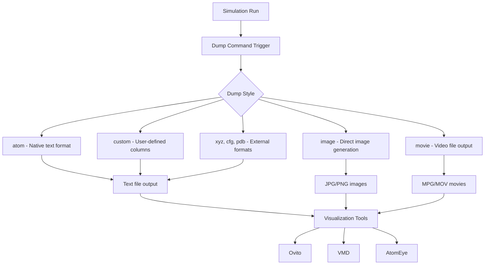
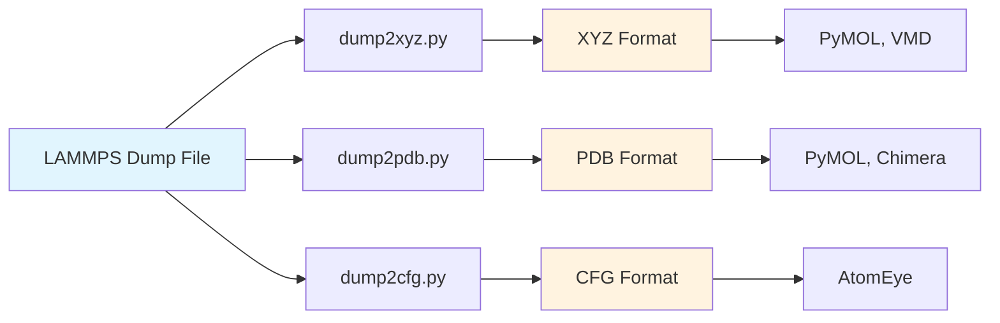
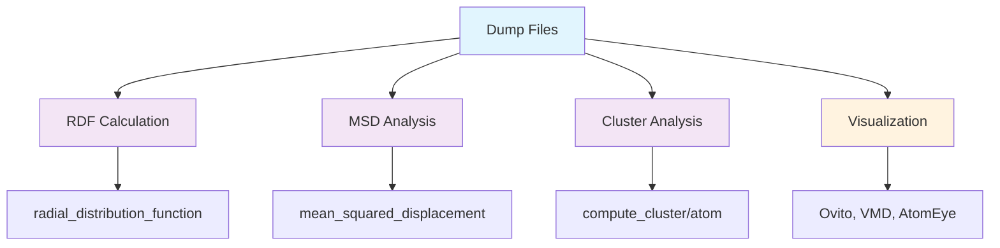

This page explains how to capture and analyze simulation trajectories in LAMMPS through dump files. Understanding dump functionality is essential for visualizing molecular dynamics simulations, analyzing structural evolution, and creating publication-quality animations.

## Understanding Dump Files in LAMMPS

Dump files store snapshots of your simulation at specified timesteps, containing atomic coordinates, velocities, forces, and other per-atom properties. They serve as the primary mechanism for trajectory visualization and post-processing analysis in molecular dynamics simulations.

The dump system in LAMMPS follows a modular architecture where different dump styles determine the output format, while `dump_modify` commands provide runtime customization options. This separation enables flexible trajectory output for various visualization tools and analysis workflows.

Sources: [examples/README](examples/README#L27-L35), [examples/melt/in.melt](examples/melt/in.melt#L22-L25)

## Dump Command Architecture



The dump command controls when and how simulation data is written to disk. At each specified timestep, LAMMPS collects atom data from the specified group and writes it according to the selected dump style. This happens efficiently in parallel, with each processor writing its local atom data to the output file.

Sources: [examples/README](examples/README#L31-L45), [examples/micelle/in.micelle](examples/micelle/in.micelle#L56-L58)

## Basic Dump Command Syntax

The fundamental dump command syntax follows this pattern:

```
dump ID group style N file
```

- **ID**: Unique identifier for this dump (e.g., 1, 2, 3)
- **group**: Atom group to dump (e.g., all, mobile, boundary)
- **style**: Output format type (atom, custom, image, movie, etc.)
- **N**: Write frequency in timesteps
- **file**: Output filename (can include wildcards for time stamps)

For example, a basic atom dump writes every 50 timesteps:

```
dump 1 all atom 50 dump.melt
```

This command creates snapshots in LAMMPS native text format, which includes timestep information, number of atoms, and periodic boundary conditions followed by atom-specific data.

Sources: [examples/melt/in.melt](examples/melt/in.melt#L22), [examples/flow/in.flow.couette](examples/flow/in.flow.couette#L73)

## Dump Style Comparison

| Dump Style | Output Format | Use Case | File Size | Visualization |
|------------|---------------|----------|-----------|---------------|
| **atom** | Native LAMMPS text | General purpose, debugging | Medium | Ovito, VMD, AtomEye |
| **custom** | User-defined columns | Specific property analysis | Variable | Ovito, VMD |
| **xyz** | XYZ format | Simple molecular visualization | Small | VMD, PyMOL |
| **cfg** | CFG format | AtomEye visualization | Medium | AtomEye |
| **dcd** | Binary trajectory | Long simulations, compact | Small | VMD, PyMOL |
| **image** | JPG/PNG images | Direct visualization | Large per image | Web browsers, viewers |
| **movie** | MPG/MOV video | Presentation animations | Large | Video players |

The native `atom` style provides comprehensive output including atom IDs, types, coordinates, velocities, and optional additional fields. For specialized analysis, the `custom` style allows precise control over which properties are written.

Sources: [examples/README](examples/README#L36-L44), [tools/python/dump2xyz.py](tools/python/dump2xyz.py#L1-L13)

## Native Atom Dump Format

The LAMMPS atom dump format uses a structured text layout that is both human-readable and machine-parseable. Each timestep block contains:

```
ITEM: TIMESTEP
1000
ITEM: NUMBER OF ATOMS
4000
ITEM: BOX BOUNDS
0.0 10.0
0.0 10.0  
0.0 10.0
ITEM: ATOMS id type x y z vx vy vz
1 1 1.23 4.56 7.89 0.01 -0.02 0.03
2 1 2.34 5.67 8.90 0.02 -0.01 0.04
...
```

This format includes metadata (timestep, atom count, box dimensions) followed by a header row indicating which atom properties are included, then one line per atom with space-separated values.

Sources: [examples/README](examples/README#L31-L35), [tools/python/dump2xyz.py](tools/python/dump2xyz.py#L19-L24)

## Custom Dump for Specific Properties

The custom dump style provides flexibility to output only the properties you need, reducing file size and improving analysis efficiency:

```
dump 2 all custom 100 dump.custom id type x y z c_peatom[1]
```

This command outputs only atom ID, type, coordinates, and a specific per-atom compute value. Common custom dump properties include:

| Property | Syntax | Description |
|----------|--------|-------------|
| ID | `id` | Atom identifier |
| Type | `type` | Atom type number |
| Position | `x y z` | Coordinates |
| Velocity | `vx vy vz` | Velocity components |
| Force | `fx fy fz` | Force components |
| Compute | `c_name[index]` | Per-atom compute value |
| Fix | `f_name[index]` | Per-atom fix value |
| Variable | `v_name` | Per-atom variable value |

Sources: [tools/python/dump2pdb.py](tools/python/dump2pdb.py#L19-L24), [tools/python/dump2xyz.py](tools/python/dump2xyz.py#L19-L24)

## Image Dump for Direct Visualization

LAMMPS can generate visualization images directly during simulation, eliminating the need for separate post-processing:

```
dump 2 all image 25 image.*.jpg type type zoom 1.6
dump_modify 2 pad 3 adiam 1 0.5 adiam 2 1.5
```

This creates JPG images every 25 timesteps, coloring atoms by type with different diameters for different atom types. The `dump_modify` command provides additional customization:

| Parameter | Function | Example |
|-----------|----------|---------|
| `pad N` | Zero-pad file numbers | `pad 3` → `image.001.jpg` |
| `adiam type value` | Set atom display size | `adiam 1 0.5` |
| `color type scheme` | Color mapping | `color type type` |
| `zoom factor` | View zoom level | `zoom 1.6` |
| `view theta phi` | Camera angle | `view 60 -30` |

> [!TIP]
> Image dumps require LAMMPS to be compiled with a JPG or PNG library. Use the `-DLAMMPS_JPEG` or `-DLAMMPS_PNG` CMake flags during build.

Sources: [examples/melt/in.melt](examples/melt/in.melt#L23-L28), [examples/micelle/in.micelle](examples/micelle/in.micelle#L60-L61)

## Movie Dump for Animation

For direct video output, LAMMPS provides the movie dump style that requires the FFmpeg library:

```
dump 3 all movie 25 movie.mpg type type zoom 1.6
dump_modify 3 pad 3 adiam 1 0.5 adiam 2 1.5
```

This creates an MPEG video file with frames every 25 timesteps. Movie parameters mirror image dump options, with the output being a compressed video file suitable for presentations and web distribution.

Sources: [examples/melt/in.melt](examples/melt/in.melt#L30-L33), [examples/micelle/in.micelle](examples/micelle/in.micelle#L63-L64)

## Dump Modify Command

The `dump_modify` command customizes dump behavior after the dump is defined:

| Option | Description | Example |
|--------|-------------|---------|
| `append yes/no` | Append to existing file | `dump_modify 1 append yes` |
| `region name` | Only dump atoms in region | `dump_modify 1 region liquid` |
| `sort yes/no` | Sort atoms by ID | `dump_modify 1 sort yes` |
| `format line string` | C-style format string | `dump_modify 1 format line "%d %d %g %g %g"` |
| `first yes/no` | Write on first timestep | `dump_modify 1 first yes` |
| `every N` | Change output frequency | `dump_modify 1 every 100` |
| `scale yes/no` | Scale to box units | `dump_modify 1 scale yes` |

These modifiers provide runtime control without redefining the dump command, enabling dynamic adjustment of output behavior during simulations.

Sources: [examples/README](examples/README#L42-L44), [examples/micelle/in.micelle](examples/micelle/in.micelle#L60-L64)

## Post-Processing Tools

LAMMPS includes Python utilities for converting dump files to various formats:



These conversion scripts map LAMMPS dump columns to the target format:

```bash
# Convert to XYZ (specify column positions for id, type, x, y, z)
dump2xyz.py dump.melt 1 2 3 4 5 trajectory.xyz

# Convert to PDB (optional template file)
dump2pdb.py dump.melt 1 2 3 4 5 trajectory.pdb template.pdb
```

The column numbers specify which dump file columns correspond to atom ID, type, and coordinates, accommodating custom dump formats.

Sources: [tools/python/dump2xyz.py](tools/python/dump2xyz.py#L1-L33), [tools/python/dump2pdb.py](tools/python/dump2pdb.py#L1-L38)

## Practical Example Workflow

Here's a complete workflow from simulation to visualization:

**Step 1: Configure Dump in Input Script**
```
# Write atom positions every 100 timesteps
dump 1 all atom 100 dump.melt

# Optional: Write images for quick preview
dump 2 all image 200 image.*.jpg type type zoom 1.5
dump_modify 2 pad 4
```

**Step 2: Run Simulation**
```bash
lmp_mpi -in in.melt
```

**Step 3: Convert for Visualization**
```bash
# Convert to XYZ format
python dump2xyz.py dump.melt 1 2 3 4 5 trajectory.xyz
```

**Step 4: Visualize**
- Open `trajectory.xyz` in Ovito or VMD for interactive analysis
- Review `image.*.jpg` files for quick simulation progress checks

Sources: [examples/melt/in.melt](examples/melt/in.melt#L22-L28), [tools/python/dump2xyz.py](tools/python/dump2xyz.py#L1-L33)

## Advanced Dump Strategies

For large-scale simulations, consider these optimization strategies:

| Strategy | Benefit | Implementation |
|----------|---------|----------------|
| **Selective output** | Reduce I/O overhead | Use custom dump with only needed properties |
| **Less frequent dumping** | Smaller files | Increase timestep interval |
| **Binary formats** | Faster I/O, smaller files | Use DCD or other binary formats |
| **Region-based dumping** | Focus on area of interest | Apply `dump_modify region` |
| **Multi-dump approach** | Different data for different needs | Separate dumps for trajectories vs. analysis |

> [!TIP]
> For very large systems, consider using the `dump dcd` style which writes binary trajectory files that are significantly smaller and faster to process than text formats.

Sources: [examples/README](examples/README#L31-L35), [examples/flow/in.flow.couette](examples/flow/in.flow.couette#L73-L78)

## Integration with Analysis Workflows

Dump files serve as the foundation for various analysis techniques:



The Python tools directory includes scripts for various analyses that can be combined with dump file output to extract physical properties from your simulations.

Sources: [examples/README](examples/README#L27-L35), [tools/python/README](tools/python/README)

## Summary and Best Practices

| Practice | Reason | Recommendation |
|----------|--------|----------------|
| **Start simple** | Debug before complexity | Use atom dump initially |
| **Plan storage** | Trajectories grow quickly | Estimate disk needs beforehand |
| **Document columns** | Remember custom formats | Comment custom dump mappings |
| **Test visualization** | Verify output early | Check first dump file in viewer |
| **Use efficient formats** | Large systems need compression | Binary formats for production runs |

Begin with basic atom dumps to understand your system, then progress to custom dumps or image/movie output as needed for specific visualization or analysis requirements.

Sources: [examples/README](examples/README#L27-L35), [examples/melt/in.melt](examples/melt/in.melt#L22-L33)

## Next Steps

Now that you understand dump files and trajectory output, you can explore:

- [Reading and Writing Data Files](14-reading-and-writing-data-files) - Learn about LAMMPS data file formats for initial configurations
- [LAMMPS Python Module Basics](28-lammps-python-module-basics) - Discover Python-based trajectory analysis
- [Jupyter Notebook and Visualization](31-jupyter-notebook-and-visualization) - Advanced visualization workflows with notebooks

For practical examples, explore the `examples/` directory where dump commands are demonstrated in various simulation contexts including flow problems [examples/flow](examples/flow/in.flow.couette#L73-L78), molecular assembly [examples/micelle](examples/micelle/in.micelle#L56-L64), and basic melting [examples/melt](examples/melt/in.melt#L22-L33).