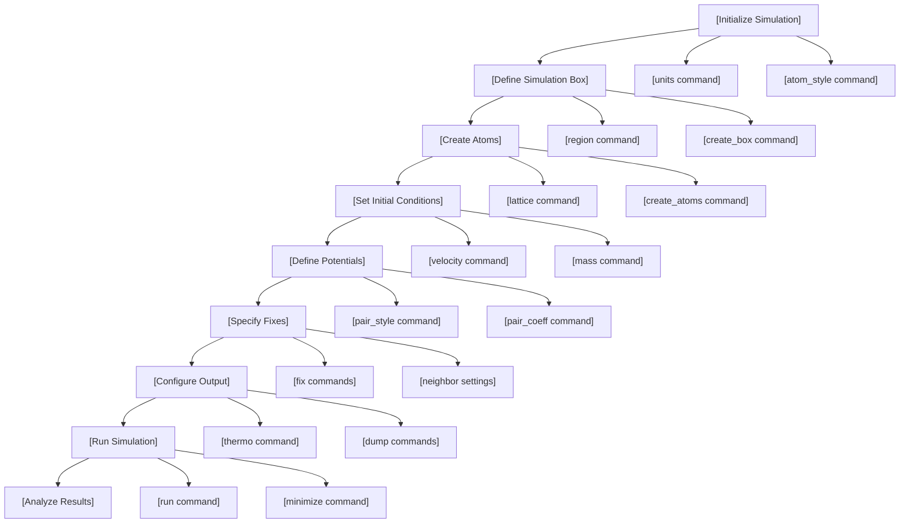

This page guides you through executing your first molecular dynamics simulation with LAMMPS. You'll learn the fundamental structure of LAMMPS input scripts, understand how to run simulations via command line and Python interfaces, and interpret the output results. This foundation will prepare you for exploring more advanced simulation concepts and techniques.

## Understanding the LAMMPS Simulation Architecture

Before diving into execution, it's essential to understand how LAMMPS organizes simulation workflows. LAMMPS operates through input scripts that define every aspect of your simulation, from units and boundary conditions to interatomic potentials and output specifications. The execution follows a sequential command processing model where each line modifies the simulation state. This modular approach allows you to build complex simulations from simple, well-defined components.


The simulation lifecycle can be visualized as a structured flow from initialization through production and analysis:



Sources: [examples/README](examples/README#L1-L50), [examples/melt/in.melt](examples/melt/in.melt#L1-L34)

## Your First Simulation: The Lennard-Jones Melt

We'll start with the classic Lennard-Jones melt example, located in the `examples/melt` directory. This simulation models a simple fluid of particles interacting through the Lennard-Jones potential, making it an ideal starting point for understanding LAMMPS fundamentals. The example demonstrates all essential components of a working simulation while remaining computationally lightweight.


Let's examine the complete input script and understand each component:

```
# 3d Lennard-Jones melt

units           lj
atom_style      atomic

lattice         fcc 0.8442
region          box block 0 10 0 10 0 10
create_box      1 box
create_atoms    1 box
mass            1 1.0

velocity        all create 3.0 87287 loop geom

pair_style      lj/cut 2.5
pair_coeff      1 1 1.0 1.0 2.5

neighbor        0.3 bin
neigh_modify    every 20 delay 0 check no

fix             1 all nve

#dump           id all atom 50 dump.melt

thermo          50
run             250
```

Sources: [examples/melt/in.melt](examples/melt/in.melt#L1-L34)

### Simulation Initialization

The first two commands establish the fundamental units and atom representation. The `units lj` command selects Lennard-Jones reduced units, where mass, distance, energy, and time are expressed in dimensionless form. The `atom_style atomic` command specifies that atoms are represented simply by their position and type, without additional properties like molecular bonds or charges. These choices significantly simplify the simulation while maintaining physical realism for studying basic liquid behavior.

Sources: [examples/melt/in.melt](examples/melt/in.melt#L2-L3)

### System Geometry and Atom Creation

The simulation box construction begins with defining a face-centered cubic lattice. The `lattice fcc 0.8442` command creates a lattice structure with a density parameter of 0.8442, which corresponds to a reduced density of approximately 0.8442 atoms per unit volume. This particular density is chosen because it represents a liquid state at the target temperature. The lattice command actually doesn't create atoms immediately—it defines the reference structure.

The `region box block 0 10 0 10 0 10` command defines a rectangular simulation domain extending from 0 to 10 in each dimension. The `create_box 1 box` command initializes the simulation box for one atom type, followed by `create_atoms 1 box` which actually places atoms at all lattice sites within the defined region. This approach creates a perfectly ordered initial configuration of 4000 atoms (10×10×10 unit cells, with 4 atoms per fcc unit cell).

Sources: [examples/melt/in.melt](examples/melt/in.melt#L5-L7)

### Initial Conditions and Mass Assignment

Setting atom masses is straightforward: `mass 1 1.0` assigns a mass of 1.0 (in reduced units) to atom type 1. The velocity initialization uses `velocity all create 3.0 87287 loop geom`, which generates random velocities for all atoms corresponding to a temperature of 3.0 reduced units. The seed value 87287 ensures reproducibility while the `loop geom` option distributes velocities ensuring zero net momentum. This initial temperature creates an energetic state that will rapidly thermalize into a liquid.

Sources: [examples/melt/in.melt](examples/melt/in.melt#L9-L11)

### Interatomic Potentials

The interaction model is defined by two commands. `pair_style lj/cut 2.5` selects the Lennard-Jones potential with a cutoff radius of 2.5 reduced distance units. This potential models the attractive van der Waals forces and short-range repulsion between atoms. The `pair_coeff 1 1 1.0 1.0 2.5` command sets the Lennard-Jones parameters (ε=1.0, σ=1.0) for interactions between type 1 atoms, with the same cutoff distance. These parameters create a standard Lennard-Jones fluid widely studied in the literature.

Sources: [examples/melt/in.melt](examples/melt/in.melt#L13-L14)

### Neighbor List Optimization

Efficient force calculation requires managing neighbor lists. The `neighbor 0.3 bin` command establishes that atoms within 0.3 reduced distance units beyond the force cutoff should be included in neighbor lists, providing a safety buffer for atoms moving between updates. The `neigh_modify every 20 delay 0 check no` command configures rebuilding neighbor lists every 20 timesteps with no initial delay. The `check no` option disables distance checking between rebuilds for additional efficiency at the cost of accuracy—acceptable for this demonstration but something to consider carefully for production simulations.

Sources: [examples/melt/in.melt](examples/melt/in.melt#L16-L17)

### Time Integration

The `fix 1 all nve` command applies the microcanonical (NVE) ensemble integrator to all atoms using the Velocity Verlet algorithm. This "fix" in LAMMPS terminology is an operation that modifies the system state at each timestep. The NVE ensemble conserves total energy, making it ideal for fundamental dynamics studies. The fix ID "1" allows reference to this integrator later if needed.

Sources: [examples/melt/in.melt](examples/melt/in.melt#L19)

### Output Configuration

The `thermo 50` command instructs LAMMPS to print thermodynamic output (temperature, energy, pressure, etc.) every 50 timesteps. This provides essential monitoring of the simulation's evolution. The commented `dump` commands show alternative output methods for visualization, including atomic trajectory dumps and image generation—these are disabled by default to keep the example simple.

Sources: [examples/melt/in.melt](examples/melt/in.melt#L25-L33)

### Running the Simulation

The `run 250` command executes 250 timesteps of molecular dynamics. Combined with the thermo output interval, this produces 6 thermodynamic snapshots capturing the system's evolution from ordered lattice to disordered liquid. The total wall time is approximately 1-2 seconds on modern processors, making it an excellent test case.

Sources: [examples/melt/in.melt](examples/melt/in.melt#L33)

## Running LAMMPS from the Command Line

The most common way to execute LAMMPS is through the command line interface. After building LAMMPS following the [Installation and Build System](3-installation-and-build-system) instructions, you can run simulations by invoking the executable with an input script argument.

The basic execution syntax is straightforward:


Navigate to the melt example directory and execute:

```
cd examples/melt
lmp -in in.melt
```

This produces a log file (typically named `log.lammps`) containing thermodynamic data and timing information. The log file from a sample run shows the expected behavior:

```
Step Temp E_pair E_mol TotEng Press 
    0   3   -6.7733681   0   -2.2744931   -3.7033504 
   50   1.6842865   -4.8082494   0   -2.2824513   5.5666131 
  100   1.6712577   -4.7875609   0   -2.281301   5.6613913 
  150   1.6444751   -4.7471034   0   -2.2810074   5.8614211 
  200   1.6471542   -4.7509053   0   -2.2807916   5.8805431 
  250   1.6645597   -4.7774327   0   -2.2812174   5.7526089 
```

The temperature drops from the initial value of 3.0 to approximately 1.65 as kinetic energy converts to potential energy during the melting process. The total energy remains approximately constant (around -2.28), as expected for an NVE ensemble. The pressure stabilizes around 5.7 reduced pressure units, characteristic of a dense Lennard-Jones fluid.

Sources: [examples/melt/log.8Apr21.melt.g++.1](examples/melt/log.8Apr21.melt.g++.1#L44-L50)

> [!TIP]
> The log file contains critical diagnostic information beyond thermodynamics. Check the "Loop time" section for performance metrics and "Neighbor list info" for verification that neighbor list settings are appropriate for your system. Dangerous builds warnings indicate atoms moving too far between neighbor list updates, requiring adjustment of neighbor list parameters.

## Running LAMMPS as a Python Library

For programmatic control and integration with Python workflows, LAMMPS provides a Python interface that offers both convenience and flexibility. This approach enables you to embed LAMMPS simulations within larger Python scripts, access simulation data directly, and implement custom analysis workflows.


The basic Python script mirrors the command-line approach:

```python
from lammps import lammps

# Create LAMMPS instance
lmp = lammps()

# Run commands one at a time
lmp.command("units lj")
lmp.command("atom_style atomic")
lmp.command("lattice fcc 0.8442")
lmp.command("region box block 0 10 0 10 0 10")
lmp.command("create_box 1 box")
lmp.command("create_atoms 1 box")
lmp.command("mass 1 1.0")
lmp.command("velocity all create 3.0 87287 loop geom")
lmp.command("pair_style lj/cut 2.5")
lmp.command("pair_coeff 1 1 1.0 1.0 2.5")
lmp.command("neighbor 0.3 bin")
lmp.command("neigh_modify every 20 delay 0 check no")
lmp.command("fix 1 all nve")
lmp.command("thermo 50")
lmp.command("run 250")
```

The Python interface provides several powerful features:

**Data Extraction**: Access atomic coordinates, velocities, and forces programmatically:

```python
# Gather all atomic coordinates
x = lmp.gather_atoms("x", 1, 3)
# Gather all forces
f = lmp.gather_atoms("f", 1, 3)
```

**Interactive Simulation Control**: Modify the simulation between runs:

```python
# Run additional steps
lmp.command("run 10")

# Extract and modify coordinates
x = lmp.gather_atoms("x", 1, 3)
x[0] += 0.1  # Move first atom
lmp.scatter_atoms("x", 1, 3, x)

# Continue simulation
lmp.command("run 1")
```

Sources: [python/examples/simple.py](python/examples/simple.py#L21-L57)

## Comparison: Command Line vs Python Interface

| Feature | Command Line | Python Interface |
|---------|--------------|------------------|
| **Ease of Use** | Simple for standard workflows | Requires programming knowledge |
| **Performance** | Minimal overhead | Slight overhead from Python |
| **Data Access** | Limited to output files | Direct access to simulation data |
| **Customization** | Input script modification only | Full Python programming capabilities |
| **Integration** | Standalone execution | Easy integration with Python ecosystem |
| **Interactive Analysis** | Post-processing only | Real-time analysis and control |

## Parallel Execution Considerations

LAMMPS is designed for efficient parallel execution using MPI. The melt example runs quickly on a single processor, but for larger simulations, parallel execution becomes essential. The syntax remains simple:

```
mpirun -np 4 lmp -in in.melt
```

This distributes the simulation across 4 MPI processes, with automatic domain decomposition. Python scripts can also run in parallel by uncommenting the mpi4py sections in the example code and launching with MPI:

```
mpirun -np 4 python simple.py in.lammps
```

Sources: [python/examples/simple.py](python/examples/simple.py#L19-L23)

## Exploring Other Example Problems

The `examples` directory contains numerous well-documented test problems demonstrating various LAMMPS capabilities. These are organized into three categories:

- **Lower-case directories**: Simple test problems for individual features (e.g., `melt`, `min`, `crack`, `balance`)
- **Upper-case directories**: More complex, application-oriented examples (e.g., `ASPHERE`, `HEAT`, `KAPPA`)
- **PACKAGES directory**: Examples specific to optional LAMMPS packages

Each example directory contains an input script (`in.*`), reference log files, and often data files or documentation. The examples README provides detailed descriptions of each problem, making them excellent learning resources.


Some recommended next examples to explore:

- `examples/min/in.min`: Demonstrates energy minimization following dynamics
- `examples/crack/in.crack`: Shows fracture mechanics with more complex boundary conditions
- `examples/balance/in.balance`: Illustrates load balancing for parallel performance

Sources: [examples/README](examples/README#L1-L100)

## Troubleshooting Common Issues

| Issue | Symptom | Solution |
|-------|---------|----------|
| **Executable not found** | `command not found: lmp` | Ensure LAMMPS is built and executable is in PATH or use full path |
| **Missing package** | `ERROR: Unknown pair style` | Rebuild LAMMPS with required package enabled via CMake |
| **File not found** | `ERROR: Cannot open input script` | Verify working directory and file path |
| **Segfault** | Sudden termination | Check for incorrect parameters, especially cutoff distances |
| **Energy drift** | Total energy not conserved | Reduce timestep, check neighbor list settings |

## Next Steps

Congratulations on running your first LAMMPS simulation! You've now experienced the complete workflow from input script creation to output analysis. To deepen your understanding, we recommend exploring these topics in sequence:

- [Molecular Dynamics Fundamentals](8-molecular-dynamics-fundamentals) to understand the physics behind the simulations
- [Units and Dimensions](9-units-and-dimensions) to master unit systems beyond Lennard-Jones reduced units
- [Command Syntax and Structure](12-command-syntax-and-structure) to learn advanced input script features
- [Energy Minimization Algorithms](20-energy-minimization-algorithms) to explore geometry optimization techniques

The examples directory remains an invaluable resource. Each input script demonstrates specific features and techniques. Study them, modify parameters, and observe the effects—that's how expertise in molecular dynamics simulation develops.
