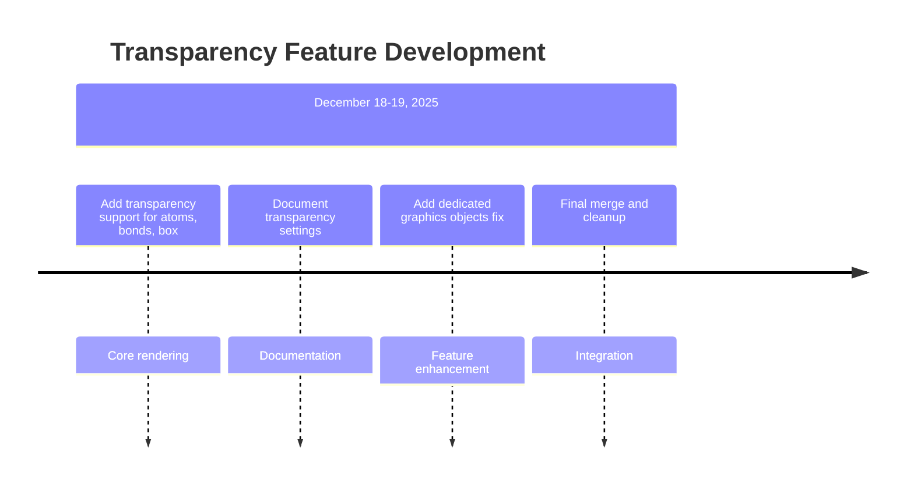

LAMMPS (Large-scale Atomic/Molecular Massively Parallel Simulator) has evolved into one of the most widely used molecular dynamics software packages, but this didn't happen in isolation. Behind every commit, bug fix, and feature addition is a network of researchers, developers, and users who collectively shape the project. This page pulls back the curtain on the people driving LAMMPS forward.

## Core Development Team

The LAMMPS project follows a distributed development model, with contributions flowing from researchers across institutions worldwide. Based on recent activity in the [repository](https://github.com/lammps/lammps), we can identify several key patterns in how development happens:

### Active Maintainers

**Axel Kohlmeyer** emerges as a particularly active contributor and maintainer. A recent examination of the commit history shows sustained engagement across multiple areas:

- Merging pull requests and coordinating fixes, as seen in the [Collected small fixes and updates](https://github.com/lammps/lammps/commit/a51f9ba0e719be544293987bb3cbd9939f1b01ee) merge (PR #4816)
- Implementing significant features like transparency support in dump image rendering ([commit](https://github.com/lammps/lammps/commit/f3137c521d76ca6c213388cef9134af7265c1c71))
- Performing iterative improvements like [rewrapping text](https://github.com/lammps/lammps/commit/81c2423541af7319082ac358cf3a1c1e9f861db5) and making small corrections
- Handling complex graphical rendering features, such as adding support for [graphics objects from fixes](https://github.com/lammps/lammps/commit/c4e55dc01d1feca901bb7ae52082194b6b137ce6)

The breadth of this activity—spanning graphics, build systems, documentation, and core functionality—suggests a deep, systems-level understanding of the codebase that comes from long-term involvement.

### Community Contributors

The project benefits from a diverse base of contributors. Recent examples include:

- **Jeremy FERSULA**, who contributed documentation improvements through [PR #80](https://github.com/lammps/lammps/commit/5e14b2de6f466df7b0bfc3aa898161abe6396d50), clarifying the fix align-self documentation. This kind of contribution—while small in code volume—is valuable for reducing user confusion and improving the overall usability of the software.

## How Contributors Work Together

Looking at the [commit history](https://github.com/lammps/lammps/commits), we can observe several patterns in how LAMMPS development operates:

### Feature Development Workflow

A typical feature often goes through an iterative refinement process. The transparency rendering feature, for instance, evolved through multiple commits:

This progression shows how features are built incrementally, with documentation and cleanup being treated as integral parts of the development process—not afterthoughts.

### Issue-Driven Development

The project maintains a steady flow of [open issues](https://github.com/lammps/lammps/issues) covering bugs, feature requests, and clarifications. Recent activity includes:

- **Build system issues**: A detailed [bug report](https://github.com/lammps/lammps/issues/4815) about building with the Scafacos module, including a proposed fix from the community
- **Feature requests**: Users requesting enhancements like [reading dump files with triclinic/general format](https://github.com/lammps/lammps/issues/4803)
- **Clarification requests**: Issues where users ask for better documentation, such as the [fix rigid infile COM and image flags](https://github.com/lammps/lammps/issues/4765) discussion

These issues aren't just bug reports—they're part of a dialogue where users help identify gaps and contributors work to address them. The [closed issues](https://github.com/lammps/lammps/issues?q=is%3Aissue+is%3Aclosed) show that many requests do get addressed, often within weeks or months.

## Institutional Context

While the repository itself is on GitHub, LAMMPS has roots in research institutions. The repository description identifies it as a "Public development project," and the codebase reflects the complexity you'd expect from software that has evolved over decades of academic research.

The topics associated with the repository—**kokkos**, **lammps**, **molecular-dynamics**, **simulation**—signal the technical domains contributors work in:

- **Kokkos integration**: Performance portability across different hardware architectures
- **Molecular dynamics**: The core physics engine
- **Simulation workflows**: How the software fits into larger research pipelines

## Contribution Patterns

Based on the available data, we can characterize the types of contributions that sustain LAMMPS:

| Contribution Type | Examples | Impact |
|------------------|----------|---------|
| Core features | Transparency rendering, fix enhancements | Extends simulation capabilities |
| Bug fixes | Linker errors, numerical issues | Improves reliability |
| Documentation | Clarifications, README updates | Reduces learning curve |
| Build system | CMake improvements, packaging | Makes the software easier to use |
| Issue triage | Responding to bug reports | Maintains project health |

## Becoming a Contributor

For those interested in contributing to LAMMPS, the repository activity provides several pathways:

1. **Documentation improvements**: Like Jeremy FERSULA's [fix align-self doc correction](https://github.com/lammps/lammps/commit/4a36b4e0343ce05793486038063275c7d1d3e7ab), these are often accessible starting points
2. **Bug reports**: The detailed [SCAFACOS build issue](https://github.com/lammps/lammps/issues/4815) shows how thorough bug reports include reproduction steps, error logs, and proposed fixes
3. **Feature requests**: Well-specified requests like the [triclinic/general format support](https://github.com/lammps/lammps/issues/4803) can guide development priorities
4. **Code contributions**: The PR workflow is active, with merge requests being processed regularly

## The Community Beyond Code

What stands out from the issues and commits is that LAMMPS isn't just code—it's a community of researchers solving real scientific problems. When users report issues like the [MACELES-LAMMPS-MLIAP interface](https://github.com/lammps/lammps/issues/4787) problem, they're connecting molecular dynamics simulation to machine learning workflows. When someone asks about [RDKit JSON compatibility](https://github.com/lammps/lammps/issues/4763), they're bridging cheminformatics and MD simulation.

These cross-disciplinary connections are where LAMMPS gets much of its value, and they only work because contributors are willing to engage beyond the immediate scope of a single pull request.

## Acknowledgments

The sustained development of LAMMPS depends on contributions from many individuals and institutions. The specific contributors mentioned here—Axel Kohlmeyer, Jeremy FERSULA, and the users who report issues—represent only a fraction of the broader community. Each commit, issue comment, and documentation update contributes to making LAMMPS more capable, reliable, and accessible.

For a complete picture of who's contributing, the best resource remains the [GitHub repository's contributor list](https://github.com/lammps/lammps/graphs/contributors), which shows the ongoing, distributed nature of development.