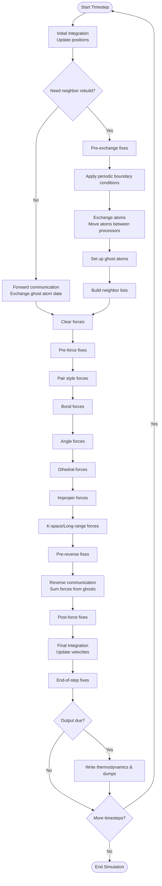
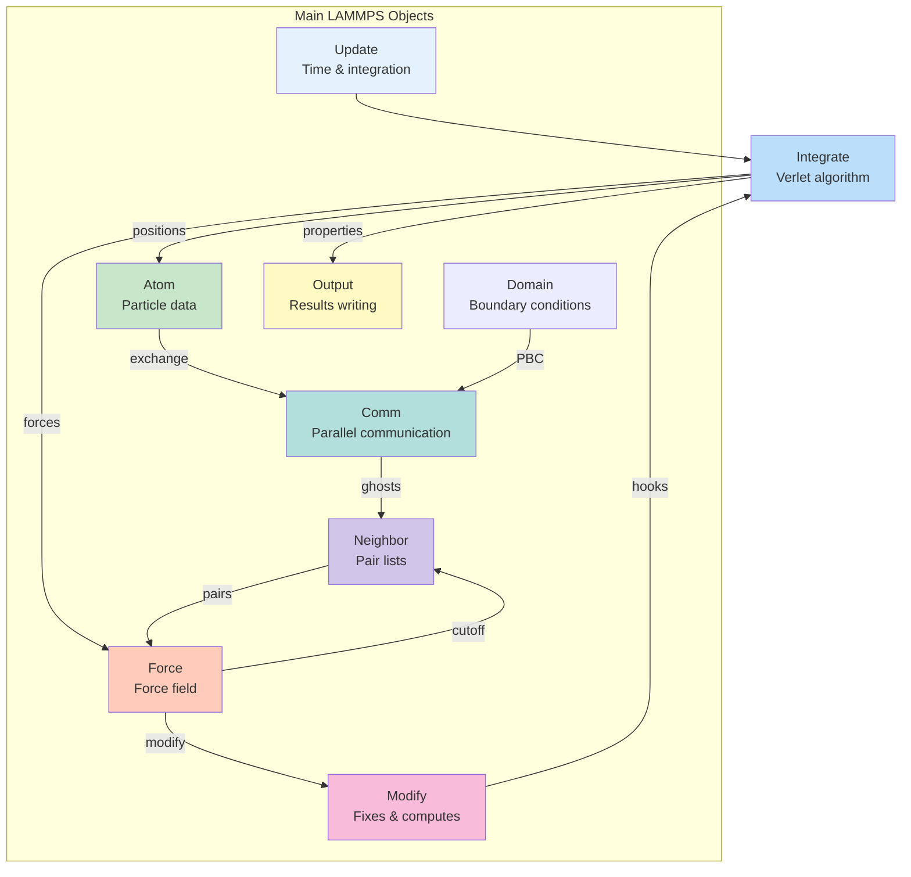

This page explains the core computational concepts underlying molecular dynamics simulations in LAMMPS. We'll examine how LAMMPS implements the fundamental MD algorithm—from integrating equations of motion to computing forces and managing particle interactions. Understanding these fundamentals provides the foundation for exploring more advanced simulation techniques covered in subsequent documentation pages.

## The MD Simulation Loop

LAMMPS implements the classical molecular dynamics algorithm through a well-structured time integration loop. The `Verlet` class in `src/verlet.cpp` orchestrates this process, executing a sequence of operations at each timestep that advances the system's state while conserving energy and momentum.



The core integration loop resides in the `Verlet::run()` method, which iterates through timesteps performing the complete MD cycle [src/verlet.cpp](src/verlet.cpp#L229-L360).

## Time Integration Algorithms

LAMMPS implements the **velocity Verlet** algorithm as its default integration scheme, which provides excellent energy conservation properties and time-reversibility. The algorithm splits each timestep into two half-steps for velocity updates with a position update in between.

The implementation follows this sequence:

1. **Initial half-step velocity update** (via `modify->initial_integrate()`)
2. **Full-step position update** 
3. **Force computation** at new positions
4. **Final half-step velocity update** (via `modify->final_integrate()`)

The integration classes inherit from `Integrate` [src/integrate.h](src/integrate.h), with `Verlet` providing the standard velocity Verlet implementation. Other integrators like `FixNVT`, `FixNPT`, and `FixNH` extend this pattern to implement specific ensemble thermostats and barostats.

Sources: [src/verlet.cpp](src/verlet.cpp#L229-L360), [src/integrate.h](src/integrate.h)

## Force Computation Architecture

LAMMPS computes interatomic forces through a modular, extensible force field architecture. The `Force` class serves as the central manager, coordinating multiple types of force contributions:

| Force Type | Purpose | Key Classes | Typical Applications |
|------------|---------|-------------|---------------------|
| **Pair Styles** | Non-bonded pairwise interactions | `Pair`, subclasses | Lennard-Jones, Coulomb, Buckingham |
| **Bond Styles** | Covalent bond stretching | `Bond`, subclasses | Harmonic, FENE, Morse |
| **Angle Styles** | Three-body angle bending | `Angle`, subclasses | Harmonic, cosine |
| **Dihedral Styles** | Four-body torsional rotation | `Dihedral`, subclasses | CHARMM, OPLS |
| **Improper Styles** | Out-of-plane deformation | `Improper`, subclasses | Harmonic inversion |
| **K-Space Styles** | Long-range electrostatics | `KSpace`, subclasses | Ewald, PPPM, particle-particle |

The force initialization sequence ensures proper ordering—K-space must initialize before pair styles to define screening parameters like `g_ewald` [src/force.cpp](src/force.cpp#L176-L220).

### Force Computation Order

During each timestep, forces accumulate in this specific order:


This ordering is critical because some bonded potentials tally pairwise energy/virial contributions that depend on pair calculations being completed first [src/verlet.cpp](src/verlet.cpp#L310-L340).

Sources: [src/force.cpp](src/force.cpp#L176-L220), [src/verlet.cpp](src/verlet.cpp#L310-L340)

## Neighbor List Management

Efficient force computation requires knowing which atoms interact. LAMMPS uses **neighbor lists** to track atom pairs within a cutoff distance plus a "skin" distance, avoiding O(N²) pairwise checks.

### When to Rebuild

The `Neighbor::decide()` method determines whether lists need rebuilding based on [src/neighbor.cpp](src/neighbor.cpp#L2362-L2390):

- **Delay**: Minimum timesteps between potential rebuilds
- **Every**: Check periodically after delay expires  
- **Distance check**: Verify if any atom moved more than half the skin distance

### Distance Checking Algorithm

The skin distance ensures atoms cannot move further than the skin without triggering a rebuild. For orthogonal boxes, LAMMPS checks the 8 corner displacements and conservatively reduces the effective skin distance [src/neighbor.cpp](src/neighbor.cpp#L2396-L2440):

```
effective_skin = 0.5 × (skin - (Δcorner1 + Δcorner2))
```

If atoms have moved further than this reduced distance across any processor, all processors rebuild their neighbor lists.

### Neighbor List Types

LAMMPS supports several neighbor list strategies:

| List Type | Description | Memory | Speed | Use Case |
|-----------|-------------|--------|-------|----------|
| **Half** | Store i-j pairs once (i < j) | Lower | Slower | Most common |
| **Full** | Store both i-j and j-i | Higher | Faster | Many-body potentials |
| **Multi** | Multiple lists at different cutoffs | Variable | Optimized | Multi-scale interactions |
| **Granular** | Specialized for particle contacts | Optimized | Efficient | Granular materials |

> [!TIP]
> The neighbor skin parameter (`neigh modify skin`) balances performance: larger skins reduce rebuild frequency but increase computation per timestep. Optimal values depend on particle velocities and system density.

Sources: [src/neighbor.cpp](src/neighbor.cpp#L2362-L2460)

## Periodic Boundary Conditions

Molecular dynamics simulations typically model bulk materials rather than isolated clusters. LAMMPS implements **periodic boundary conditions** (PBC) that simulate infinite systems by replicating the simulation box in all directions.

When an atom crosses a box face, it re-enters from the opposite face, maintaining particle number and density. The communication system handles three key tasks:

1. **Exchange**: Move atoms that have left the local processor's domain to neighboring processors
2. **Borders**: Create ghost atoms near processor boundaries for force calculations  
3. **Reverse**: Sum force contributions from ghost atoms back to their owners

The domain transformation handles both orthogonal and **triclinic** boxes through coordinate transformations (`x2lamda` and `lamda2x`) when necessary [src/verlet.cpp](src/verlet.cpp#L272-L285).

Sources: [src/verlet.cpp](src/verlet.cpp#L262-L290)

## Communication and Parallelization

LAMMPS uses spatial domain decomposition for parallel efficiency. The simulation volume is partitioned among processors, with each processor responsible for atoms in its subdomain. This requires:

### Forward Communication
After position updates, processors send updated positions to neighbors to maintain consistent ghost atom data [src/verlet.cpp](src/verlet.cpp#L259-L260).

### Reverse Communication  
After force computation, forces computed on ghost atoms are summed back to their owner processors. This uses Newton's third law to avoid double-counting when `newton` flag is enabled [src/verlet.cpp](src/verlet.cpp#L335-L338).

> [!TIP]
> Use `comm_modify mode` to choose between communication strategies: 'single' sends messages one neighbor at a time (lower latency), while 'multi' buffers all communications together (higher bandwidth utilization).

## The Modify System: Hooks for Customization

LAMMPS provides extensive customization through the `Modify` system, which executes user-defined operations at specific points in the timestep [src/modify.cpp](src/modify.cpp). These "hooks" allow adding:

| Hook Point | Timing | Typical Uses |
|------------|--------|--------------|
| `initial_integrate` | After position update | Thermostats, constraints |
| `post_integrate` | After position update, before comm | Velocity modifications |
| `pre_neighbor` | Before neighbor list build | Pair style overrides |
| `post_neighbor` | After neighbor list build | List processing |
| `pre_force` | Before force computation | Force field modifications |
| `post_force` | After force computation | External forces, constraints |
| `final_integrate` | After velocity update | Thermostats, constraints |
| `end_of_step` | At timestep end | Analysis, property calculation |

This modular design enables complex simulation protocols without modifying the core integration loop.

Sources: [src/modify.cpp](src/modify.cpp#L401-L503)

## Output and Analysis

The `Output` class manages simulation output, including thermodynamic quantities and trajectory files [src/output.cpp](src/output.cpp#L354-L487):

- **Thermodynamics**: Instantaneous properties (temperature, pressure, energy) printed at specified intervals
- **Dump files**: Atom coordinates, velocities, and custom properties for visualization and analysis
- **Restart files**: Complete simulation state for continuation or checkpointing

Output timing follows the main loop, occurring after all timestep operations complete [src/verlet.cpp](src/verlet.cpp#L350-L356).

Sources: [src/output.cpp](src/output.cpp#L354-L487)

## Core Architecture Overview



This architecture demonstrates LAMMPS's object-oriented design, where each component has clear responsibilities while working together through well-defined interfaces.

## Next Steps

Now that you understand the fundamental MD workflow in LAMMPS, explore these related topics:

- **[Units and Dimensions](9-units-and-dimensions)** — Learn how LAMMPS handles different unit systems and unit conversions
- **[Simulation Ensembles and Thermostats](10-simulation-ensembles-and-thermostats)** — Understand how to control temperature and pressure through thermostat and barostat implementations
- **[Boundary Conditions and Periodic Systems](11-boundary-conditions-and-periodic-systems)** — Dive deeper into PBC implementation and alternative boundary conditions
- **[Pair Styles Overview](16-pair-styles-overview)** — Explore the extensive library of pair-wise interaction potentials available in LAMMPS
- **[Running Your First Simulation](4-running-your-first-simulation)** — Apply these fundamentals by setting up and executing your own MD simulation

The fundamentals covered here form the foundation for all simulation techniques in LAMMPS. Mastering these concepts will help you understand and effectively use the more advanced features available in the simulator.