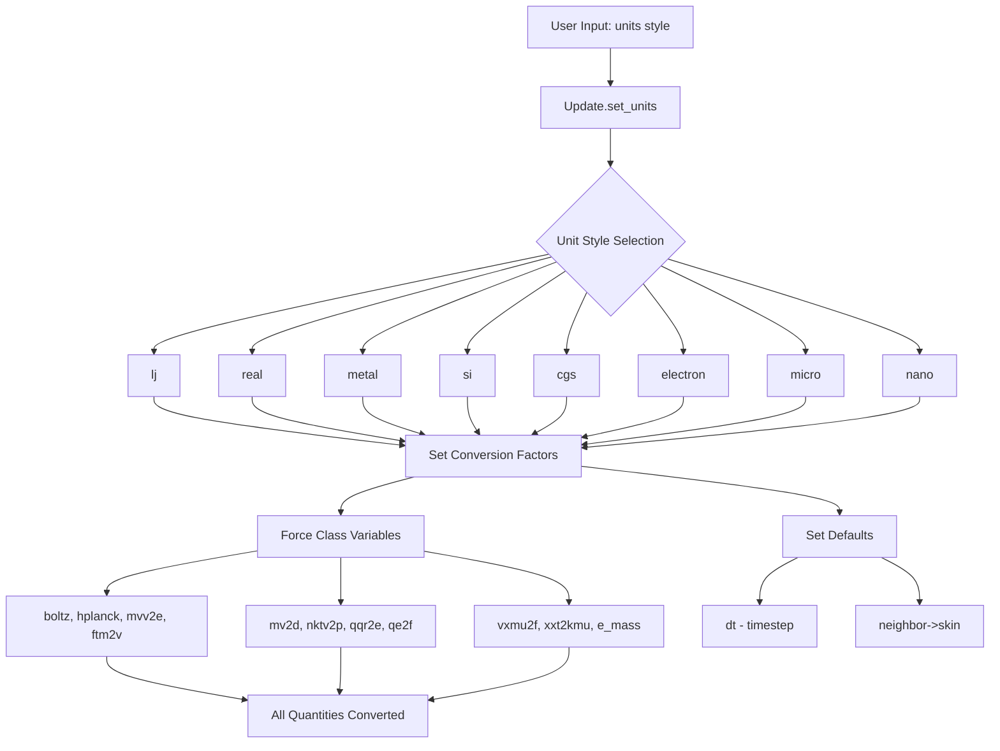

This page explains how LAMMPS handles unit systems and dimensions in molecular dynamics simulations. Understanding units is fundamental to setting up correct simulations, interpreting results, and ensuring reproducibility. LAMMPS provides eight predefined unit styles that define the units for all physical quantities throughout a simulation, from input parameters to output values.

Sources: [units.rst](doc/src/units.rst#L1-L50)

## Architecture Overview

The unit system in LAMMPS follows a centralized architecture where a single global unit style governs all dimensional quantities in a simulation. The `Update` class manages unit settings through the `set_units()` method, which establishes conversion factors and default parameters when you specify a unit style.



The system uses internal conversion factors stored in the `Force` class to translate between the chosen unit system and internal calculations. When you change unit styles, LAMMPS adjusts these factors but maintains the physical equivalence of the simulation—the particles follow identical trajectories (up to round-off differences).

Sources: [update.h](src/update.h#L1-L80), [update.cpp](src/update.cpp#L141-L200)

## Unit Styles Overview

LAMMPS provides eight unit styles tailored to different simulation domains. Each style defines consistent units for all physical quantities, ensuring dimensional consistency throughout your simulation.

| Unit Style | Domain | Mass | Distance | Time | Energy |
|------------|--------|------|----------|------|--------|
| **lj** | Generic/reduced | dimensionless | dimensionless | dimensionless | dimensionless |
| **real** | Biochemistry | g/mol | Å | fs | kcal/mol |
| **metal** | Materials science | g/mol | Å | ps | eV |
| **si** | General physics | kg | m | s | J |
| **cgs** | Classical physics | g | cm | s | erg |
| **electron** | Electronic structure | amu | Bohr | fs | Hartree |
| **micro** | Microsystems | pg | μm | μs | pg·μm²/μs² |
| **nano** | Nanosystems | ag | nm | ns | ag·nm²/ns² |

The choice of unit style should match your application domain and the conventions used in your field. This makes it easier to compare results with literature and use appropriate potential parameters.

Sources: [units.rst](doc/src/units.rst#L1-L246)

## Reduced Lennard-Jones (LJ) Units

The LJ unit style implements dimensionless reduced units commonly used in theoretical studies and generic simulations. All quantities are expressed relative to fundamental reference values, making LJ units particularly useful for exploring universal behavior independent of specific material properties.

For LJ units, LAMMPS sets the fundamental quantities mass (m), σ (sigma), ε (epsilon), and the Boltzmann constant k_B = 1. The derived units follow from these base values:

- **Mass**: M* = M/m
- **Distance**: x* = x/σ
- **Time**: τ* = τ√(ε/mσ²)
- **Energy**: E* = E/ε
- **Velocity**: v* = v·τ/σ
- **Force**: f* = f·σ/ε
- **Temperature**: T* = T·k_B/ε
- **Pressure**: p* = p·σ³/ε

The time unit in LJ systems is not independent—it must satisfy the energy relation ε = mσ²/τ² (analogous to 1 J = 1 kg·m²/s² in SI units). This constraint ensures dimensional consistency.

> [!TIP]
> For LJ units, the default thermodynamic output normalizes extensive quantities by the number of atoms (e.g., energy is output as energy/atom). This behavior can be modified using the thermo_modify norm command if needed.

Sources: [units.rst](doc/src/units.rst#L30-L85)

## Real and Metal Units

Real and metal units are the most commonly used styles for condensed matter simulations. Both use grams/mole for mass and Angstroms for distance, but differ in their time and energy scales to match different communities' conventions.

### Real Units

Real units are standard in biochemistry and molecular dynamics simulations:

- **Mass**: grams/mole
- **Distance**: Angstroms
- **Time**: femtoseconds (fs)
- **Energy**: kcal/mol
- **Velocity**: Å/fs
- **Force**: (kcal/mol)/Å
- **Temperature**: Kelvin
- **Pressure**: atmospheres
- **Charge**: multiples of electron charge (1.0 = proton)

Real units use the thermochemical calorie definition where 1 kcal = 4.184 J exactly.

### Metal Units

Metal units are optimized for materials science and metallurgy applications:

- **Mass**: grams/mole
- **Distance**: Angstroms
- **Time**: picoseconds (ps)
- **Energy**: electron volts (eV)
- **Velocity**: Å/ps
- **Force**: eV/Å
- **Temperature**: Kelvin
- **Pressure**: bars
- **Charge**: multiples of electron charge (1.0 = proton)

The key difference is the timescale (ps vs fs) and energy units (eV vs kcal/mol), which are more natural for solid-state and metallic systems.

Sources: [units.rst](doc/src/units.rst#L88-L130)

## SI and CGS Units

SI and CGS units provide standard metric systems that are useful when interfacing with other computational tools or experimental data in standard units.

### SI Units

SI units use the International System of Units:

- **Mass**: kilograms
- **Distance**: meters
- **Time**: seconds
- **Energy**: Joules
- **Velocity**: m/s
- **Force**: Newtons
- **Torque**: N·m
- **Temperature**: Kelvin
- **Pressure**: Pascals
- **Charge**: Coulombs (1.6021765×10⁻¹⁹ C = proton)

SI units are ideal for general physics calculations and when working with experimental data reported in standard metric units.

### CGS Units

CGS units use the centimeter-gram-second system:

- **Mass**: grams
- **Distance**: centimeters
- **Time**: seconds
- **Energy**: ergs
- **Velocity**: cm/s
- **Force**: dynes
- **Torque**: dyne·cm
- **Temperature**: Kelvin
- **Pressure**: dyne/cm² (barye = 1.0×10⁻⁶ bars)
- **Charge**: statcoulombs/esu (4.8032044×10⁻¹⁰ = proton)

CGS units are historically important in physics and still used in some subfields, particularly in plasma physics and astrophysics.

Sources: [units.rst](doc/src/units.rst#L133-L175)

## Electron, Micro, and Nano Units

These specialized unit styles are designed for specific length scales and scientific domains.

### Electron Units

Electron units are tailored for electronic structure and quantum chemistry applications:

- **Mass**: atomic mass units (amu)
- **Distance**: Bohr (atomic unit of length)
- **Time**: femtoseconds
- **Energy**: Hartrees (atomic unit of energy)
- **Velocity**: Bohr/atomic time units (1.03275×10⁻¹⁵ s)
- **Temperature**: Kelvin
- **Pressure**: Pascals
- **Charge**: multiples of electron charge
- **Dipole moment**: Debye

### Micro Units

Micro units are designed for microfluidic and MEMS (Micro-Electro-Mechanical Systems) simulations:

- **Mass**: picograms (pg)
- **Distance**: micrometers (μm)
- **Time**: microseconds (μs)
- **Energy**: pg·μm²/μs²
- **Temperature**: Kelvin
- **Pressure**: pg/(μm·μs²)
- **Charge**: picocoulombs (pC)

### Nano Units

Nano units are optimized for nanoscale materials and devices:

- **Mass**: attograms (ag)
- **Distance**: nanometers (nm)
- **Time**: nanoseconds (ns)
- **Energy**: ag·nm²/ns²
- **Temperature**: Kelvin
- **Pressure**: ag/(nm·ns²)
- **Charge**: multiples of electron charge

Sources: [units.rst](doc/src/units.rst#L178-L210)

## Default Parameters

The units command automatically sets appropriate default values for timestep size and neighbor skin distance based on the chosen unit style. These defaults are calibrated to provide stable simulations for typical systems.

| Unit Style | Timestep (dt) | Neighbor Skin |
|------------|---------------|---------------|
| **lj** | 0.005 τ | 0.3 σ |
| **real** | 1.0 fs | 2.0 Å |
| **metal** | 0.001 ps | 2.0 Å |
| **si** | 1.0×10⁻⁸ s | 0.001 m |
| **cgs** | 1.0×10⁻⁸ s | 0.1 cm |
| **electron** | 0.001 fs | 2.0 Bohr |
| **micro** | 2.0 μs | 0.1 μm |
| **nano** | 0.00045 ns | 0.1 nm |

> [!TIP]
> While these defaults work for many systems, you should adjust them based on your specific application. The timestep must be small enough to resolve the fastest motions in your system (typically 10× smaller than the shortest vibration period).

Sources: [units.rst](doc/src/units.rst#L211-L230)

## Internal Implementation

The unit system implementation uses conversion factors stored in the `Force` class. When `set_units()` is called with a style string, it sets multiple conversion constants that scale quantities between the user-specified units and LAMMPS internal calculations.

Key conversion factors include:

- **boltz**: Boltzmann constant (converts temperature to energy)
- **hplanck**: Planck's constant (for quantum effects)
- **mvv2e**: mass × velocity² → energy conversion
- **ftm2v**: force × time / mass → velocity conversion
- **mv2d**: mass / volume → density conversion
- **nktv2p**: number × k_B × T / volume → pressure conversion
- **qqr2e**: charge × charge / distance → energy (Coulomb interactions)
- **qe2f**: charge × electric field → force conversion

For example, the real unit style sets:
- `boltz = 0.0019872067` (k_B in kcal/(mol·K))
- `qqr2e = 332.06371` (Coulomb constant in kcal·Å/mol·e²)
- `nktv2p = 68568.415` (atmosphere conversion)

Physical constants are taken from the NIST CODATA values (https://physics.nist.gov) for all unit styles except LJ, where all constants are set to 1.0 by definition.

Sources: [update.cpp](src/update.cpp#L141-L200)

## Usage Guidelines

### Setting Units

The units command should appear at the beginning of your input script, before defining the simulation box:

```bash
units metal  # Use metal units for this simulation
```

This command cannot be used after the simulation box is defined with `read_data` or `create_box`.

### Unit Consistency

All quantities you specify—initial positions, velocities, force field parameters, thermostat settings—must be in the chosen units. LAMMPS does not perform automatic conversion between unit styles for input values.

### Output Units

Output quantities (thermodynamic data, dump files, trajectory data) are reported in the same units as your input style. When comparing results from simulations using different unit styles, you must manually convert the output values.

### Potential File Compatibility

Some potential and table files include a `UNITS:` tag in their first line indicating the unit style they were created for. If present, LAMMPS checks for a match and issues an error if there's a mismatch. In select cases, LAMMPS can automatically convert potential parameters between compatible unit styles.

Sources: [units.rst](doc/src/units.rst#L1-L30), [units.rst](doc/src/units.rst#L231-L246)

## Choosing the Right Unit Style

Select your unit style based on these criteria:

1. **Domain conventions**: Use the style standard in your field (real for biomolecules, metal for materials, si for general physics)
2. **Potential parameters**: Choose a style matching your force field's parameter units
3. **Scale considerations**: Use micro or nano units for systems at those scales to avoid extremely small or large numbers
4. **Comparison needs**: Match units used in literature you're comparing against

The default unit style is `lj`, which is appropriate for dimensionless reduced-unit studies but requires conversion to physical units for meaningful comparisons with experiments.

Sources: [units.rst](doc/src/units.rst#L1-L10), [update.cpp](src/update.cpp#L141-L160)

## Next Steps

With a solid understanding of units and dimensions, you're ready to explore other core simulation concepts:

- **[Molecular Dynamics Fundamentals](8-molecular-dynamics-fundamentals)**: Learn the mathematical foundations of MD simulations
- **[Simulation Ensembles and Thermostats](10-simulation-ensembles-and-thermostats)**: Understand how temperature and pressure are controlled in different ensembles
- **[Pair Styles Overview](16-pair-styles-overview)**: Explore force field implementations and their unit requirements
