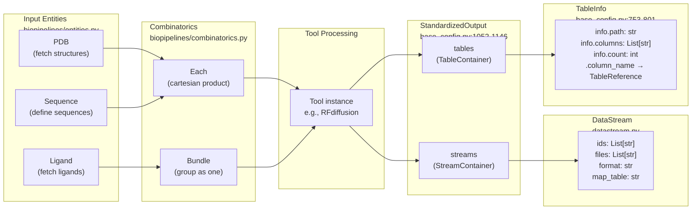
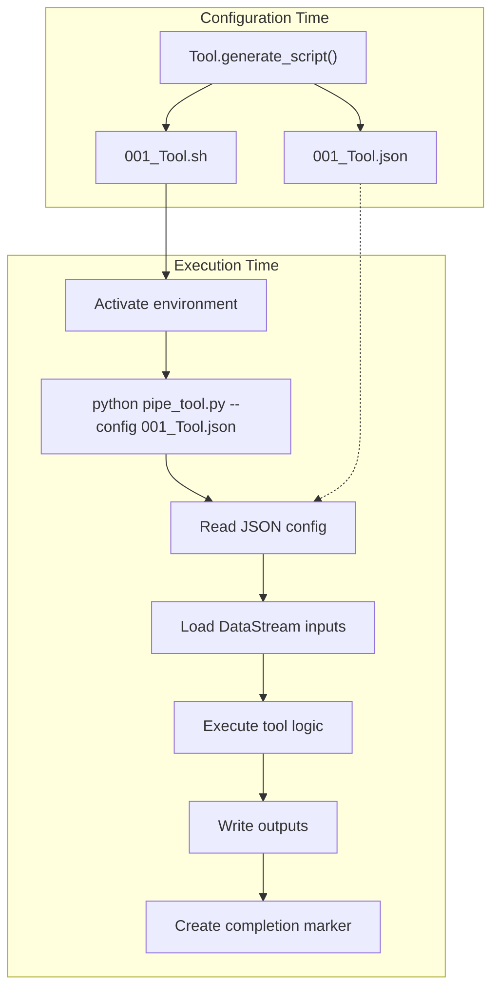

# Overview

<details>
<summary>Relevant source files</summary>

The following files were used as context for generating this wiki page:

- [Docs/UserManual.md](Docs/UserManual.md)
- [HelpScripts/pipe_plot.py](HelpScripts/pipe_plot.py)
- [biopipelines/base_config.py](biopipelines/base_config.py)
- [biopipelines/plot.py](biopipelines/plot.py)
- [biopipelines/pymol.py](biopipelines/pymol.py)
- [config.yaml](config.yaml)

</details>


BioPipelines is a Python framework for orchestrating bioinformatics workflows on HPC clusters and in Jupyter notebooks. It provides a declarative interface for chaining together computational biology tools (structure generation, sequence design, structure prediction, analysis) while handling job scheduling, dependency management, and data tracking.

This page introduces the framework's architecture, execution model, and core design principles. For installation and setup instructions, see [Getting Started](#2). For detailed explanations of fundamental concepts, see [Core Concepts](#3).

---

## What is BioPipelines?

BioPipelines is a **configuration framework**, not an execution engine. It does not run bioinformatics tools directly. Instead, it:

1. **Predicts** the filesystem structure that will be created
2. **Generates** bash scripts to execute tools
3. **Writes** JSON configuration files consumed by helper scripts
4. **Tracks** data flow and provenance across tools

This separation enables the same pipeline code to run on SLURM clusters (batch submission), local machines (sequential execution), or Jupyter notebooks (interactive execution) without modification.

### Key Characteristics

| Characteristic | Description |
|----------------|-------------|
| **Declarative** | Pipeline structure is defined in Python, execution happens in bash |
| **Predictive** | Output file paths and IDs are known before execution |
| **Type-safe** | Unified data containers (`DataStream`, `StandardizedOutput`) with compile-time validation |
| **Provenance-aware** | ID mapping and ancestry tracking built into all outputs |
| **Environment-agnostic** | Supports conda/mamba, pip (Colab), and Singularity containers |

**Sources:** [Docs/UserManual.md:24-46](), [biopipelines/base_config.py:1-11]()

---

## Two-Phase Execution Model

BioPipelines operates in two distinct phases:


**Diagram: Two-phase execution flow separates configuration from computation**

### Configuration Phase (Python)

When you run `biopipelines-submit pipeline.py`, Python executes and:

1. **Validates** tool parameters against schemas
2. **Predicts** output IDs using combinatorics rules (see [ID Generation](#3.5))
3. **Generates** bash wrapper scripts for each tool
4. **Writes** JSON configuration files to disk
5. **Creates** the expected filesystem structure

**No computational work happens in this phase.** It's pure metadata processing.

**Code entities:**
- Context manager: `Pipeline` class [biopipelines/pipeline.py]()
- Tool base: `BaseConfig` abstract class [biopipelines/base_config.py:34-656]()
- Script generation: `BaseConfig.generate_script()` [biopipelines/base_config.py:351-362]()

### Execution Phase (Bash)

After configuration completes, the generated scripts execute (via SLURM or directly):

1. **Environment activation** (conda/mamba/pip/container)
2. **Helper script invocation** with JSON config path
3. **Input resolution** from `DataStream` JSON files
4. **Tool execution** (e.g., RFdiffusion, AlphaFold, Boltz2)
5. **Output writing** to predicted locations
6. **Completion checking** against expected outputs

**Code entities:**
- Helper scripts: `HelpScripts/pipe_*.py` files
- Completion checker: `HelpScripts/pipe_check_completion.py`
- Environment activation: `BaseConfig.activate_environment()` [biopipelines/base_config.py:227-281]()

**Sources:** [Docs/UserManual.md:156-170](), [biopipelines/base_config.py:499-649]()

---

## High-Level Architecture

```mermaid
graph TB
    subgraph "User Interface"
        UserScript["pipeline.py or .ipynb"]
        Submit["biopipelines-submit<br/>(SLURM submission)"]
        Run["biopipelines-run<br/>(local execution)"]
    end
    
    subgraph "Core Framework<br/>biopipelines/"
        Pipeline["Pipeline<br/>(context manager)"]
        BaseConfig["BaseConfig<br/>(abstract tool class)"]
        Resources["Resources<br/>(GPU/memory/time)"]
        
        DataStream["DataStream<br/>(file tracking)"]
        StandardizedOutput["StandardizedOutput<br/>(unified I/O)"]
        
        Combinatorics["Each/Bundle<br/>(combinatorics)"]
    end
    
    subgraph "Tool Implementations<br/>biopipelines/"
        RFdiffusion["RFdiffusion"]
        AlphaFold["AlphaFold"]
        Boltz2["Boltz2"]
        ProteinMPNN["ProteinMPNN"]
        Panda["Panda (data mgmt)"]
        PyMOL["PyMOL (visualization)"]
        Plot["Plot (charts)"]
    end
    
    subgraph "Helper Scripts<br/>HelpScripts/"
        PipePDB["pipe_pdb.py"]
        PipeLigand["pipe_ligand.py"]
        PipeBoltz["pipe_boltz_config_unified.py"]
        PipePlot["pipe_plot.py"]
        PipePyMOL["pipe_pymol.py"]
        PipeCheck["pipe_check_completion.py"]
    end
    
    subgraph "Configuration<br/>config.yaml"
        Folders["folders:<br/>HelpScripts, PDBs, cache"]
        Environments["environments:<br/>tool → conda env"]
        Containers["containers:<br/>tool → .sif"]
    end
    
    UserScript --> Pipeline
    Submit --> Pipeline
    Run --> Pipeline
    
    Pipeline --> Resources
    Pipeline --> BaseConfig
    
    BaseConfig --> DataStream
    BaseConfig --> StandardizedOutput
    BaseConfig --> Combinatorics
    
    RFdiffusion -.inherits.-> BaseConfig
    AlphaFold -.inherits.-> BaseConfig
    Boltz2 -.inherits.-> BaseConfig
    ProteinMPNN -.inherits.-> BaseConfig
    Panda -.inherits.-> BaseConfig
    PyMOL -.inherits.-> BaseConfig
    Plot -.inherits.-> BaseConfig
    
    BaseConfig --> PipePDB
    BaseConfig --> PipeLigand
    BaseConfig --> PipeBoltz
    BaseConfig --> PipePlot
    BaseConfig --> PipePyMOL
    
    PipeCheck --> StandardizedOutput
    
    Pipeline --> Folders
    BaseConfig --> Environments
    BaseConfig --> Containers
```



**Diagram: Core architecture showing code entities and their relationships**

### Core Framework Components

The core framework resides in `biopipelines/` and provides:

| Component | File | Purpose |
|-----------|------|---------|
| `Pipeline` | `pipeline.py` | Context manager for job orchestration, batch management |
| `BaseConfig` | `base_config.py` | Abstract base class for all tools |
| `Resources` | `pipeline.py` | GPU/memory/time specifications for SLURM |
| `DataStream` | `datastream.py` | Tracks IDs and file paths for structures/sequences/compounds |
| `StandardizedOutput` | `base_config.py:1052-1146` | Unified container for `streams` and `tables` |
| `StreamContainer` | `base_config.py:1001-1050` | Dot-notation access to DataStreams |
| `TableContainer` | `base_config.py:924-999` | Dot-notation access to TableInfo objects |
| `Each`/`Bundle` | `combinatorics.py` | Combinatorics operators for input expansion |

**Sources:** [biopipelines/base_config.py:34-1146](), [Docs/UserManual.md:155-219]()

### Tool Inheritance Pattern

All tools inherit from `BaseConfig` and implement four required methods:

```python
class MyTool(BaseConfig):
    TOOL_NAME = "MyTool"
    
    def validate_params(self):
        """Validate tool-specific parameters"""
        pass
    
    def configure_inputs(self, pipeline_folders: Dict[str, str]):
        """Configure input sources from pipeline context"""
        pass
    
    def generate_script(self, script_path: str) -> str:
        """Generate bash script for tool execution"""
        pass
    
    def get_output_files(self) -> Dict[str, Any]:
        """Return predicted output structure"""
        pass
```

The `BaseConfig.__new__()` method enables auto-registration: when a tool is instantiated inside a `Pipeline` context, it automatically registers itself and returns a `StandardizedOutput` object instead of the tool instance.

**Sources:** [biopipelines/base_config.py:117-160](), [biopipelines/base_config.py:283-372]()

### Data Flow Through Containers



**Diagram: Data containers bridge inputs to outputs with type safety**

**Key access patterns:**

```python
# Accessing structures from a tool output
boltz = Boltz2(proteins=..., ligands=...)
for structure in boltz.streams.structures:  # Iterate DataStream
    print(structure.ids[0], structure.files[0])

# Accessing table metadata
print(boltz.tables.confidence.info.path)     # Table file path
print(boltz.tables.confidence.info.columns)  # Column names

# Column references for downstream tools
pmpnn = ProteinMPNN(
    structures=rfd,
    redesigned=rfd.tables.structures.designed  # TableReference
)
```

**Sources:** [Docs/UserManual.md:172-220](), [biopipelines/base_config.py:753-1146]()

---

## Filesystem Structure

BioPipelines creates a predictable directory structure:

```
<biopipelines_output>/<project>/<job>_NNN/
├── RunTime/                    # Generated bash scripts
│   ├── pipeline.sh            # Master script
│   ├── slurm.sh               # SLURM submission wrapper
│   ├── 001_RFdiffusion.sh     # Tool-specific script
│   └── 002_ProteinMPNN.sh
│
├── Logs/                       # Execution logs
│   ├── 001_RFdiffusion.log
│   └── 002_ProteinMPNN.log
│
├── ToolOutputs/                # Output metadata (JSON)
│   ├── 001_RFdiffusion.json
│   └── 002_ProteinMPNN.json
│
├── 001_RFdiffusion/            # Tool outputs
│   ├── .expected_outputs.json  # Predicted structure
│   ├── .log                    # Tool-specific log
│   ├── structures.csv          # ID → file mapping
│   ├── protein1.pdb
│   └── protein2.pdb
│
└── 002_ProteinMPNN/
    ├── sequences.csv           # ID → sequence mapping
    └── results.csv             # Metrics table
```

**Key files:**
- `.expected_outputs.json`: Written at **configuration time** with predicted structure
- `structures.csv` / `sequences.csv`: Map tables linking IDs to file paths
- Tool output folders (`NNN_ToolName/`): Contain actual computational results

**Sources:** [Docs/UserManual.md:554-578](), [biopipelines/base_config.py:625-649]()

---

## Key Design Principles

### 1. Declarative Configuration

Tools are configured, not executed, in Python:

```python
with Pipeline(project="Examples", job="BinderDesign"):
    Resources(gpu="A100", time="4:00:00")
    
    target = PDB("1ABC")
    binder = RFdiffusion(
        pdb=target,
        contigs="50-70/A1-140",
        num_designs=100
    )
    sequences = ProteinMPNN(structures=binder, num_sequences=10)
    predictions = AlphaFold(proteins=sequences)
```

No computation happens when this runs. Python just creates the pipeline structure.

### 2. Predictable Filesystem Structure

Output paths and IDs are computed **before execution**:

```python
# At configuration time (before execution):
rfd = RFdiffusion(pdb=lysozyme, num_designs=3)
print(rfd.streams.structures.ids)  # ['168L_1', '168L_2', '168L_3']
print(rfd.streams.structures.files[0])  
# '/output/001_RFdiffusion/168L_1.pdb'
```

This enables:
- Downstream tools to reference outputs before they exist
- Filesystem-based completion checking
- DAG construction without execution

**Sources:** [Docs/UserManual.md:156-170](), [biopipelines/base_config.py:425-435]()

### 3. Unified Data Types

All tools consume and produce `StandardizedOutput` objects with:
- `.streams.structures` → `DataStream` (PDB/CIF files)
- `.streams.sequences` → `DataStream` (FASTA or CSV with sequences)
- `.streams.compounds` → `DataStream` (SDF or CSV with SMILES)
- `.streams.msas` → `DataStream` (A3M files)
- `.tables.<name>` → `TableInfo` (CSV metadata)

This uniformity enables tool chaining without type conversions.

### 4. ID-Based Provenance Tracking

Every output ID encodes its ancestry:

| Tool | Input IDs | Output IDs |
|------|-----------|------------|
| RFdiffusion | `pdb="1ABC"` | `1ABC_1`, `1ABC_2`, `1ABC_3` |
| ProteinMPNN | `1ABC_1`, `1ABC_2` | `1ABC_1_1`, `1ABC_1_2`, `1ABC_2_1`, ... |
| Boltz2 | `prot1`, `lig1`, `lig2` | `prot1_lig1`, `prot1_lig2` |

Tables include provenance columns (`structures.id`, `sequences.id`, `compounds.id`) that enable filtering:

```python
df = pd.read_csv(boltz.tables.confidence.info.path)
prot1_results = df[df['sequences.id'] == 'prot1']  # Filter by source
```

**Sources:** [Docs/UserManual.md:359-370](), [biopipelines/base_config.py:374-423]()

### 5. Environment Flexibility

Tools can run in:
- **Conda/Mamba environments** (HPC clusters): `config.yaml` maps tool → environment
- **Pip mode** (Google Colab): Single environment, `pip install` for tools
- **Singularity containers** (HPC clusters): `config.yaml` maps tool → `.sif` image

Configuration switching happens via `config.yaml` and `colab.yaml`:

```yaml
# config.yaml (cluster)
cluster:
  env_manager: "mamba"
environments:
  RFdiffusion: "SE3nv"
  AlphaFold: "biopipelines"

# colab.yaml (Colab/Jupyter)
cluster:
  env_manager: "pip"
```

**Sources:** [config.yaml:61-121](), [biopipelines/base_config.py:195-226](), [Docs/UserManual.md:73-139]()

---

## Execution Modes

BioPipelines supports three execution modes:

### SLURM Cluster Execution

```bash
biopipelines-submit pipeline.py
```

- Generates SLURM submission scripts (`slurm.sh`)
- Creates batch dependencies from `Resources()` calls
- Submits jobs via `sbatch`
- See [SLURM Cluster Execution](#4.1)

### Local Execution

```bash
biopipelines-run pipeline.py
```

- Executes `pipeline.sh` directly in bash
- Runs batches sequentially
- No SLURM dependency
- See [Local Execution](#4.2)

### Interactive Mode (Jupyter/Colab)

```python
Pipeline("Project", "Job")  # No 'with' needed
tool1 = RFdiffusion(...)    # Executes immediately
tool2 = ProteinMPNN(...)    # Executes after tool1 completes
```

- Auto-detected in notebook environments
- Executes bash scripts on-the-fly
- Streams stdout/stderr in real-time
- See [Interactive Mode](#4.3)

**Sources:** [Docs/UserManual.md:421-453](), [Docs/UserManual.md:457-478]()

---

## Tool Categories

BioPipelines includes 40+ tools organized into six categories:

| Category | Tools | Purpose | See |
|----------|-------|---------|-----|
| **Utilities** | PDB, RCSB, Sequence, Ligand, CompoundLibrary, Load, MMseqs2 | Data input and fetching | [5.1](#5.1) |
| **Structure Generation** | RFdiffusion, RFdiffusion3, RFdiffusionAllAtom, BoltzGen | Backbone design | [5.2](#5.2) |
| **Sequence Design** | ProteinMPNN, LigandMPNN, MutationComposer, Fuse, StitchSequences | Sequence optimization | [5.3](#5.3) |
| **Structure Prediction** | AlphaFold, Boltz2, Gnina | Folding and docking | [5.4](#5.4) |
| **Analysis** | Distance, Angle, Contacts, PoseBusters, ConformationalChange | Structural analysis | [5.5](#5.5) |
| **Data Management** | Panda, ReMap, Selection, ExtractMetrics | Data transformation | [5.6](#5.6) |

**Visualization** tools (PyMOL, Plot) enable session creation and chart generation. See [5.7](#5.7).

**Sources:** [Docs/UserManual.md:221-325](), [biopipelines/plot.py:1-642](), [biopipelines/pymol.py:1-786]()

---

## Helper Scripts

Helper scripts (`HelpScripts/pipe_*.py`) execute the actual computational work:



**Diagram: Helper script execution pattern**

**Key helper scripts:**

| Script | Purpose |
|--------|---------|
| `pipe_pdb.py` | Structure fetching (local/RCSB) and format conversion |
| `pipe_ligand.py` | Ligand fetching (CCD/PubChem) and SMILES → PDB conversion |
| `pipe_boltz_config_unified.py` | Boltz2 YAML config generation with combinatorics |
| `pipe_boltz_postprocessing.py` | Boltz2 output renaming and metric extraction |
| `pipe_plot.py` | Matplotlib chart generation from table operations |
| `pipe_pymol.py` | PyMOL session creation from declarative operations |
| `pipe_check_completion.py` | Validates outputs against `.expected_outputs.json` |

**Sources:** [HelpScripts/pipe_plot.py:1-806](), [biopipelines/base_config.py:499-524](), [biopipelines/base_config.py:526-649]()

---

## Next Steps

- **Installation and setup**: See [Getting Started](#2)
- **Core concepts deep dive**: See [Core Concepts](#3) for Pipeline context, DataStreams, and combinatorics
- **Tool usage**: See [Tool Categories](#5) for comprehensive tool documentation
- **Advanced workflows**: See [Major Workflows](#6) for Boltz2, BoltzGen, and MSA generation patterns

---