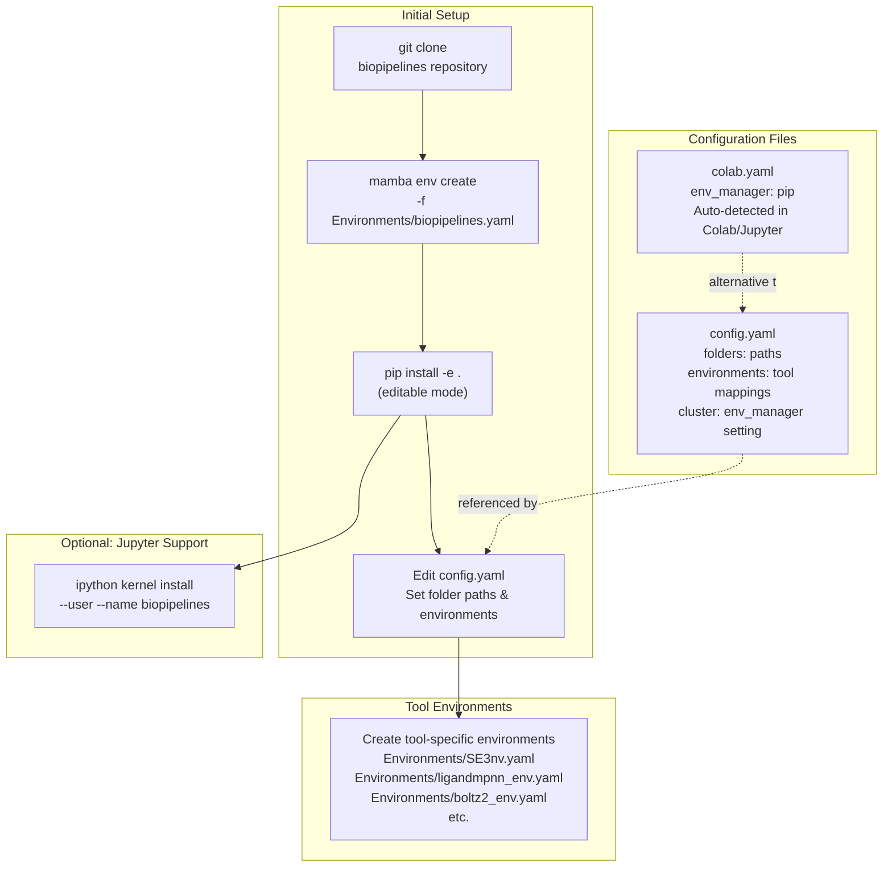
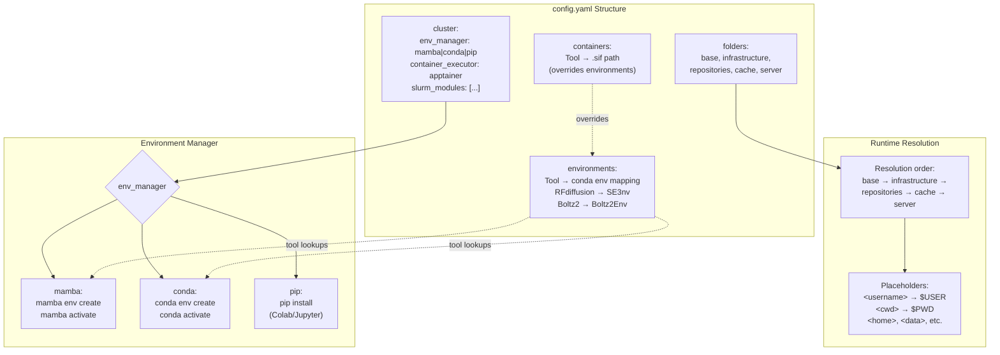
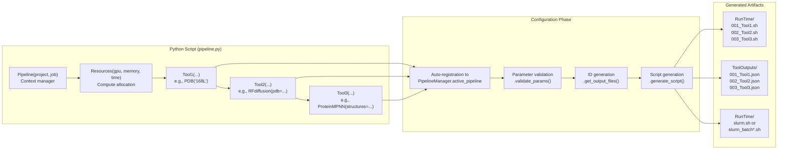
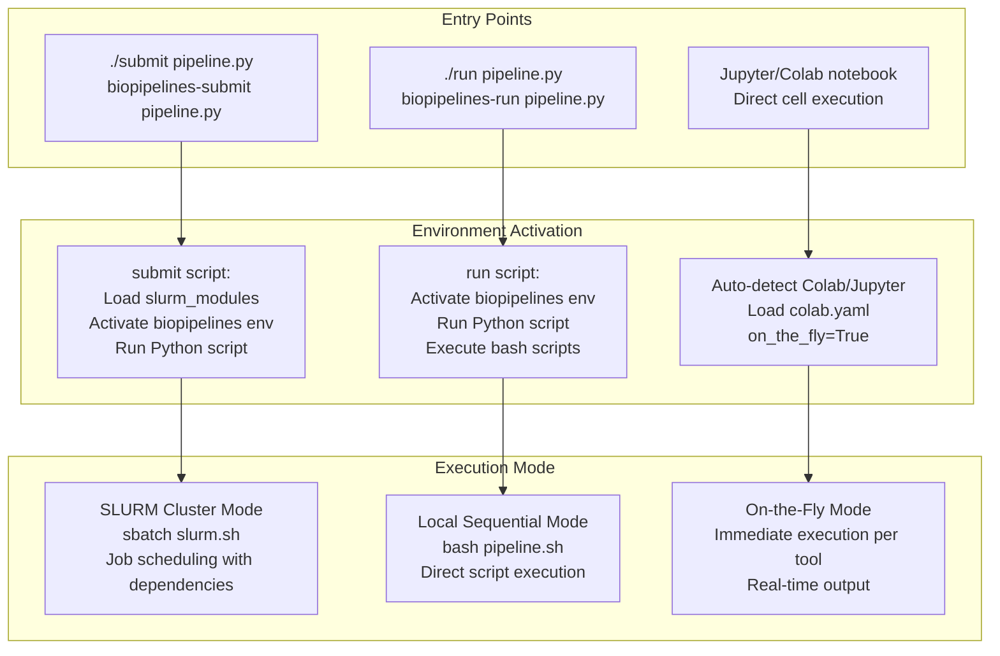

# Getting Started

<details>
<summary>Relevant source files</summary>

The following files were used as context for generating this wiki page:

- [Docs/UserManual.md](Docs/UserManual.md)
- [config.yaml](config.yaml)
- [run](run)
- [submit](submit)

</details>


This page guides you through the essential steps to install BioPipelines, configure your environment, and execute your first pipeline. It provides an overview of the installation process, basic configuration, and execution modes to get you up and running quickly.

For detailed installation instructions and environment configuration, see [Installation and Environment Setup](#2.1). For a comprehensive walkthrough of creating pipelines with examples, see [Your First Pipeline](#2.2).

---

## Overview of BioPipelines Setup

BioPipelines operates in a two-phase execution model where Python scripts generate bash execution scripts, which are then run either on SLURM clusters or locally. The setup process involves installing the framework, configuring paths and environments, and choosing an execution mode appropriate for your computing environment.

**Installation and Setup Flow**



Sources: [Docs/UserManual.md:49-70](), [config.yaml:1-187]()

---

## Prerequisites

BioPipelines requires the following to be installed on your system:

| Component | Purpose | Installation |
|-----------|---------|--------------|
| **Git** | Clone repository | System package manager |
| **Mamba/Conda** | Environment management | Miniforge or Mambaforge |
| **Python 3.9+** | Framework runtime | Included in conda environments |
| **SLURM** (optional) | Cluster job scheduling | HPC system dependent |

For Google Colab environments, only Git is required - Python and pip are pre-installed.

Sources: [Docs/UserManual.md:49-70](), [submit:20-41]()

---

## Installation Process

The installation process differs based on your execution environment. The core framework installation is the same, but tool installation varies.

### HPC Cluster / Local Workstation

```bash
# 1. Clone repository
git clone https://github.com/locbp-uzh/biopipelines
cd biopipelines

# 2. Create biopipelines environment
mamba env create -f Environments/biopipelines.yaml
mamba activate biopipelines

# 3. Install package in editable mode
pip install -e .

# 4. Optional: Jupyter kernel
ipython kernel install --user --name biopipelines
```

After installation, edit `config.yaml` to configure folder paths and environment settings for your system. See [Installation and Environment Setup](#2.1) for detailed configuration instructions.

### Google Colab

```python
# Cell 1: Clone and install
!git clone https://github.com/locbp-uzh/biopipelines
%cd biopipelines
!pip install -e .

# Cell 2: Install tools on-demand
from biopipelines.pipeline import *
from biopipelines.rfdiffusion import RFdiffusion

with Pipeline("Setup", "install", description="Install tools"):
    RFdiffusion.install()
```

BioPipelines automatically detects Colab environments and loads `colab.yaml` instead of `config.yaml`, which sets `env_manager: "pip"` to use pip-based installation instead of conda.

Sources: [Docs/UserManual.md:49-70](), [Docs/UserManual.md:73-139](), [config.yaml:140-142]()

---

## Configuration Basics

BioPipelines uses `config.yaml` as its central configuration file. The configuration system uses a hierarchical folder resolution strategy with runtime placeholders.

**Configuration Structure**



Sources: [config.yaml:1-187](), [submit:20-26]()

### Key Configuration Sections

| Section | Purpose | Example |
|---------|---------|---------|
| `folders.base` | Root paths with placeholders | `home: "/home/<username>"` |
| `folders.repositories` | Tool installation directories | `RFdiffusion: "<data>/RFdiffusion"` |
| `environments` | Tool-to-conda-env mapping | `ProteinMPNN: "SE3nv"` |
| `cluster.env_manager` | Environment system | `"mamba"` or `"conda"` or `"pip"` |
| `containers` | Singularity container paths | Optional, overrides `environments` |

The `env_manager` setting controls how tools are executed:
- `"mamba"` or `"conda"`: Uses conda environments (HPC/local)
- `"pip"`: Single environment, pip-based (Colab/Jupyter)

Sources: [config.yaml:9-60](), [config.yaml:62-121](), [config.yaml:140-154]()

---

## Your First Pipeline

A minimal BioPipelines script consists of three components: the `Pipeline` context manager, `Resources` specification, and tool invocations.

**Basic Pipeline Structure**



Sources: [Docs/UserManual.md:28-45]()

### Minimal Example

```python
from biopipelines.pipeline import Pipeline, Resources
from biopipelines.pdb import PDB
from biopipelines.rfdiffusion import RFdiffusion
from biopipelines.protein_mpnn import ProteinMPNN
from biopipelines.alphafold import AlphaFold

with Pipeline(project="Examples",
              job="RFD-ProteinMPNN-AlphaFold2",
              description="Redesign of N terminus domain of lysozyme"):
    Resources(gpu="A100", time="4:00:00", memory="16GB")
    
    lysozyme = PDB("168L")
    rfd = RFdiffusion(pdb=lysozyme,
                      contigs='50-70/A81-140',
                      num_designs=3)
    pmpnn = ProteinMPNN(structures=rfd, num_sequences=2)
    af = AlphaFold(proteins=pmpnn)
```

This example:
1. Creates a `Pipeline` context with project/job organization
2. Specifies compute resources via `Resources`
3. Fetches a PDB structure using the `PDB` utility
4. Generates new backbone designs with `RFdiffusion`
5. Designs sequences for the backbones with `ProteinMPNN`
6. Predicts structures for designed sequences with `AlphaFold`

For a comprehensive walkthrough with detailed explanations, see [Your First Pipeline](#2.2).

Sources: [Docs/UserManual.md:28-45]()

---

## Execution Modes

BioPipelines supports three execution modes, controlled by the wrapper scripts `submit`, `run`, or direct notebook execution.

**Execution Mode Selection**



Sources: [submit:1-311](), [run:1-252](), [Docs/UserManual.md:421-454]()

### Mode Comparison

| Mode | Command | Execution | Use Case |
|------|---------|-----------|----------|
| **SLURM** | `./submit pipeline.py` | Cluster job queue | Production runs on HPC |
| **Local** | `./run pipeline.py` | Sequential bash execution | Testing on workstation |
| **On-the-Fly** | Notebook cells | Immediate per-tool execution | Interactive prototyping |

### SLURM Cluster Mode

```bash
# Submit to SLURM
./submit pipeline.py

# Or use installed command
biopipelines-submit pipeline.py

# From notebooks
biopipelines-submit pipeline.ipynb
```

The `submit` script:
1. Loads SLURM modules from `config.yaml` ([submit:28-34]())
2. Activates the `biopipelines` conda environment ([submit:46-57]())
3. Runs the Python script to generate bash scripts ([submit:88]())
4. Submits jobs via `sbatch` with dependency management ([submit:207-220]())

For multi-batch pipelines (multiple `Resources()` calls), batches are submitted with `afterok` dependencies to enforce sequential execution.

Sources: [submit:1-311](), [Docs/UserManual.md:459-494]()

### Local Execution Mode

```bash
# Run locally
./run pipeline.py

# Or use installed command
biopipelines-run pipeline.py
```

The `run` script:
1. Activates the `biopipelines` conda environment ([run:46-58]())
2. Runs the Python script to generate bash scripts ([run:89]())
3. Executes `pipeline.sh` or `pipeline_batch*.sh` sequentially ([run:183]())

This mode is useful for testing pipelines on local workstations without SLURM overhead.

Sources: [run:1-252](), [Docs/UserManual.md:465-471]()

### On-the-Fly Interactive Mode

In Jupyter notebooks or Google Colab, on-the-fly mode is enabled automatically. Each tool executes immediately when added to the pipeline.

```python
# Automatically enabled in notebooks - no special syntax needed
Pipeline("Examples", "interactive_test",
         description="Quick test run")

lysozyme = PDB("168L")
# lysozyme has already been fetched at this point

rfd = RFdiffusion(pdb=lysozyme, contigs='50-70/A81-140', num_designs=3)
# rfd has already finished running at this point
```

Key differences:
- `with` statement is optional - pipeline context stays active across cells
- `Resources()` is optional and ignored for execution
- Tools run sequentially as added
- Output written to `./BioPipelines/` (current directory)
- Re-running the `Pipeline()` cell starts a new pipeline

For details on interactive execution, see [Interactive Mode (Jupyter/Colab)](#4.3).

Sources: [Docs/UserManual.md:421-454]()

---

## Filesystem Organization

BioPipelines generates a structured output directory for each job:

```
<biopipelines_output>/<project>/<job>_<NNN>/
├── RunTime/                    # Execution scripts
│   ├── pipeline.sh             # Single-batch: main script
│   ├── slurm.sh                # Single-batch: SLURM wrapper
│   ├── pipeline_batch001.sh   # Multi-batch: batch scripts
│   ├── slurm_batch001.sh      # Multi-batch: SLURM wrappers
│   ├── 001_PDB.sh
│   ├── 002_RFdiffusion.sh
│   └── 003_ProteinMPNN.sh
├── ToolOutputs/               # Pre-execution predictions
│   ├── 001_PDB.json
│   ├── 002_RFdiffusion.json
│   └── 003_ProteinMPNN.json
├── Logs/                      # Execution logs
│   ├── 001_PDB.log
│   ├── 002_RFdiffusion.log
│   └── 003_ProteinMPNN.log
├── 001_PDB/                   # Tool outputs
│   ├── .expected_outputs.json
│   ├── .completed
│   ├── structures.csv
│   ├── sequences.csv
│   └── 168L.pdb
├── 002_RFdiffusion/
│   ├── .expected_outputs.json
│   ├── .completed
│   ├── structures.csv
│   ├── structures/
│   │   ├── 168L_rfd_1.pdb
│   │   ├── 168L_rfd_2.pdb
│   │   └── 168L_rfd_3.pdb
│   └── designed.csv
└── 003_ProteinMPPN/
    ├── .expected_outputs.json
    ├── .completed
    ├── sequences.csv
    └── ...
```

The output location is configured via `folders.biopipelines_output` in `config.yaml` ([config.yaml:22]()). Jobs are automatically numbered (`_001`, `_002`, etc.) to prevent overwrites.

Sources: [Docs/UserManual.md:554-576](), [config.yaml:22]()

---

## Verification and Troubleshooting

### Verify Installation

```bash
# Check biopipelines environment
mamba env list | grep biopipelines

# Activate and test import
mamba activate biopipelines
python -c "from biopipelines.pipeline import Pipeline; print('Success')"
```

### Common Issues

| Issue | Cause | Solution |
|-------|-------|----------|
| `biopipelines environment not found` | Environment not created | `mamba env create -f Environments/biopipelines.yaml` |
| `env_manager not found in config.yaml` | Missing cluster configuration | Add `env_manager: "mamba"` under `cluster:` in `config.yaml` |
| Path errors | Wrong working directory | Run from biopipelines root or use installed commands |
| Missing tool environments | Tool-specific envs not created | Create environments from `Environments/*.yaml` files |

For comprehensive troubleshooting, see [Troubleshooting and FAQs](#9).

Sources: [submit:46-57](), [submit:20-26](), [Docs/UserManual.md:581-610]()

---

## Next Steps

After completing the basic setup:

1. **Configure your environment**: See [Installation and Environment Setup](#2.1) for detailed configuration of `config.yaml`, tool environments, and cluster-specific settings.

2. **Run your first pipeline**: See [Your First Pipeline](#2.2) for a comprehensive walkthrough with examples of the `Pipeline` context, `Resources`, and basic tool usage.

3. **Understand core concepts**: See [Core Concepts](#3) to learn about the two-phase execution model, data streams, combinatorics, and ID generation.

4. **Explore tool categories**: See [Tool Categories](#5) for documentation on available tools organized by function (utilities, structure generation, sequence design, prediction, analysis, data management, and visualization).

5. **Learn execution modes**: See [Execution Modes](#4) for detailed information on SLURM cluster execution, local execution, and interactive notebook mode.

Sources: [Docs/UserManual.md:1-611]()

---