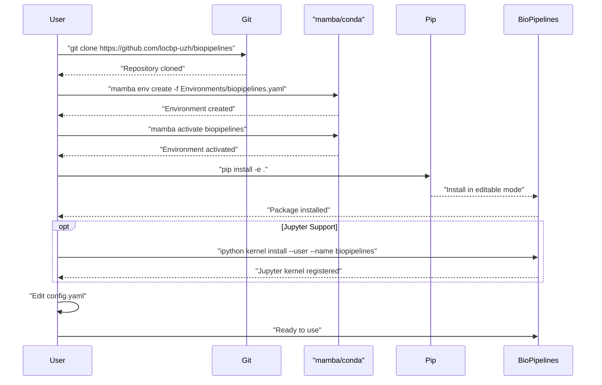
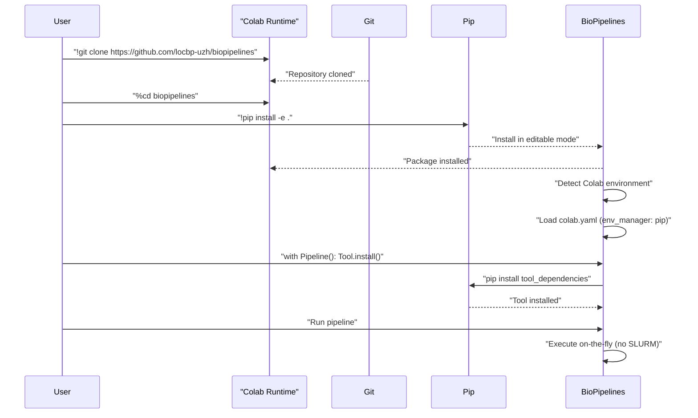
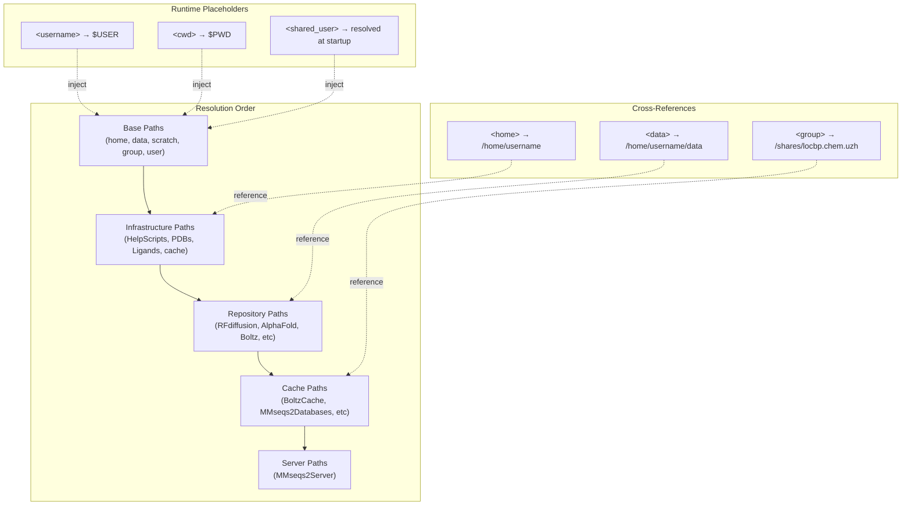
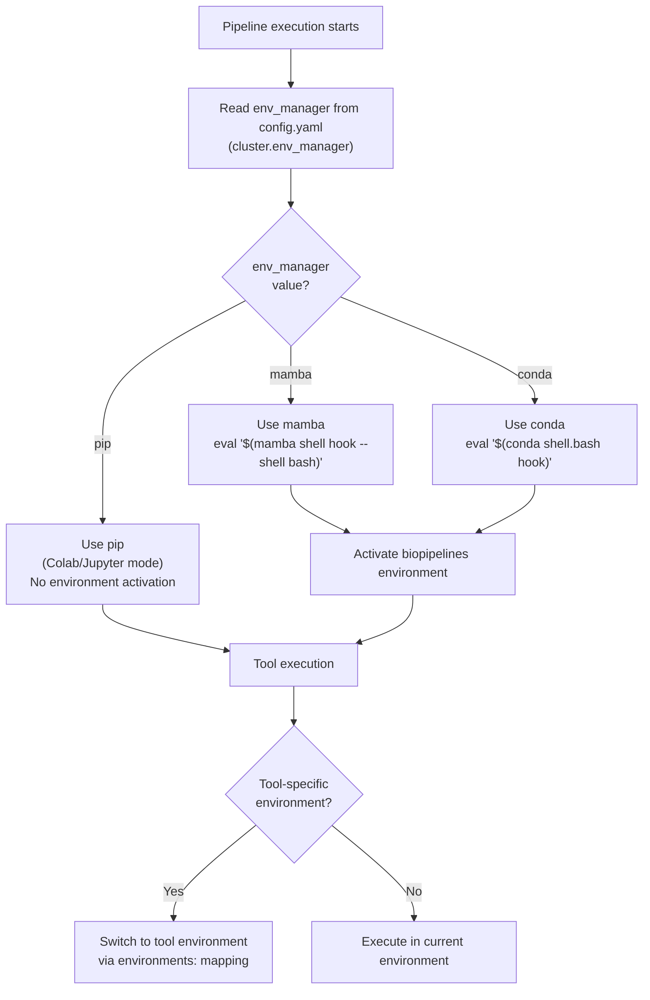
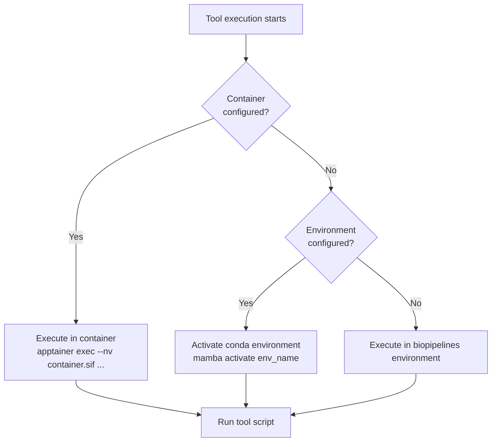

# Installation and Environment Setup

<details>
<summary>Relevant source files</summary>

The following files were used as context for generating this wiki page:

- [Docs/UserManual.md](Docs/UserManual.md)
- [config.yaml](config.yaml)
- [run](run)
- [submit](submit)

</details>


This page details the installation process, environment configuration, and initial setup required to run BioPipelines. It covers both HPC cluster deployment (using conda/mamba) and Google Colab/Jupyter environments (using pip). For information about executing pipelines after installation, see [Your First Pipeline](#2.2). For advanced container-based execution, see [Container Execution with Singularity](#7.3).

---

## Prerequisites

BioPipelines requires:
- Python 3.8 or higher
- One of: mamba, conda, or pip (for Colab/Jupyter)
- Git for cloning the repository
- (HPC only) SLURM job scheduler
- (Optional) Singularity/Apptainer for containerized execution

---

## HPC Cluster Installation

### Installation Workflow



**Sources:** [Docs/UserManual.md:49-70]()

### Step-by-Step Installation

**1. Clone the repository:**

```bash
git clone https://github.com/locbp-uzh/biopipelines
cd biopipelines
```

**2. Create the biopipelines conda environment:**

The base `biopipelines` environment contains the framework itself and core dependencies (pyyaml, pandas). Individual tools use separate environments specified in [config.yaml:65-121]().

```bash
mamba env create -f Environments/biopipelines.yaml
mamba activate biopipelines
```

> **Note:** `mamba` is recommended over `conda` for faster dependency resolution. If `mamba` is not available, replace `mamba` with `conda` in all commands.

**3. Install the package in editable mode:**

Editable mode (`-e`) allows updates via `git pull` to take effect immediately without reinstallation.

```bash
pip install -e .
```

**4. (Optional) Register Jupyter kernel:**

```bash
ipython kernel install --user --name biopipelines
```

**5. Configure `config.yaml`:**

Edit [config.yaml]() to match your cluster configuration. See [Configuration File Structure](#configuration-file-structure) below.

**Sources:** [Docs/UserManual.md:49-70](), [submit:46-57](), [run:46-58]()

---

## Google Colab / Jupyter Setup

BioPipelines automatically detects Colab/Jupyter environments and switches to pip-based installation mode. The system loads `colab.yaml` instead of `config.yaml`, which sets `env_manager: "pip"`.

### Colab Installation Workflow



**Sources:** [Docs/UserManual.md:73-139]()

### Setup in Colab Notebook

**Cell 1: Clone and install BioPipelines**

```python
!git clone https://github.com/locbp-uzh/biopipelines
%cd biopipelines
!pip install -e .
```

**Cell 2: Install required tools**

BioPipelines tools provide an `.install()` method that executes `pip install` in Colab mode. Installation only needs to run once per session:

```python
from biopipelines.pipeline import *
from biopipelines.rfdiffusion import RFdiffusion
from biopipelines.protein_mpnn import ProteinMPNN
from biopipelines.alphafold import AlphaFold

with Pipeline("Setup", "install", description="Install tools"):
    RFdiffusion.install()
    ProteinMPNN.install()
    AlphaFold.install()
```

**Sources:** [Docs/UserManual.md:78-108]()

### Environment Detection and Differences

| Feature | HPC Cluster | Google Colab |
|---------|-------------|--------------|
| **Config file** | `config.yaml` | `colab.yaml` (auto-detected) |
| **Environment manager** | `mamba` or `conda` | `pip` |
| **Execution mode** | SLURM or local bash | On-the-fly only |
| **GPU allocation** | Via `Resources()` | Colab-assigned GPU |
| **Output location** | Configured in `config.yaml` (typically shared storage) | `./BioPipelines/` (current directory) |
| **Tool installation** | Separate conda environments per tool | `pip install` into single environment |

**Sources:** [Docs/UserManual.md:126-136]()

---

## Configuration File Structure

The `config.yaml` file controls all paths, environment mappings, and cluster-specific settings. It uses a hierarchical resolution system with runtime placeholder injection.

### Folder Resolution Hierarchy



**Sources:** [config.yaml:1-60]()

### Base Paths

Base paths are resolved first and support runtime placeholders:

```yaml
folders:
  base:
    home: "/home/<username>"           # <username> → actual Unix username
    data: "<home>/data"                # <home> → /home/username
    scratch: "/scratch/<username>"
    group: "/shares/locbp.chem.uzh"
    user: "<group>/<username>"
    biopipelines: "<cwd>"              # <cwd> → current working directory
    biopipelines_output: "<user>/BioPipelines"
```

**Placeholder injection:**
- `<username>`: Replaced with `$USER` at runtime
- `<cwd>`: Replaced with `$PWD` at runtime
- `<shared_user>`: Resolved at startup based on shared storage detection

**Cross-references:**
- `<home>`, `<data>`, `<group>`, etc. reference other keys in the same section or previously resolved sections

**Sources:** [config.yaml:10-23]()

### Infrastructure Paths

Infrastructure paths define locations for helper scripts, cached structures, and containers:

```yaml
folders:
  infrastructure:
    HelpScripts: "<biopipelines>/HelpScripts"
    PDBs: "<biopipelines>/PDBs"
    Ligands: "<biopipelines>/Ligands"
    Sequences: "<biopipelines>/Sequences"
    Tables: "<biopipelines>/Tables"
    cache: "<group>/cache"
    containers: "<group>/containers"
```

**Sources:** [config.yaml:24-33]()

### Tool Repository Paths

Repository paths point to installed tool codebases:

```yaml
folders:
  repositories:
    RFdiffusion: "<data>/RFdiffusion"
    RFdiffusionAllAtom: "<data>/rf_diffusion_all_atom"
    RFdiffusion3: "<data>/rfdiffusion3"
    ProteinMPNN: "<data>/ProteinMPNN"
    LigandMPNN: "<data>/LigandMPNN"
    AlphaFold: "<data>/localcolabfold"
    Boltz: "<data>/boltz"
    BoltzGen: "<data>/boltzgen"
    # ... additional tools
```

**Sources:** [config.yaml:34-49]()

### Cache Paths

Cache paths define shared model weights and databases:

```yaml
folders:
  cache:
    BoltzCache: "<cache>/Boltz"
    BoltzGenCache: "<cache>/BoltzGen"
    ColabFoldDatabases: "<group>/models/colabfold_databases"
    MMseqs2Databases: "<group>/models/mmseqs2_databases/gpu"
```

**Sources:** [config.yaml:50-56]()

---

## Environment Manager Configuration

### Environment Manager Selection



**Sources:** [config.yaml:140-142](), [submit:20-41](), [run:19-42]()

### Environment Manager Options

The `env_manager` setting in [config.yaml:140-142]() controls environment activation:

```yaml
cluster:
  env_manager: "mamba"  # Options: "mamba", "conda", "pip"
```

**mamba** (recommended for HPC):
- Fastest dependency resolution
- Requires mambaforge or miniforge
- Initialization: `eval "$(mamba shell hook --shell bash)"`
- Used by [submit:38-41]() and [run:29-33]()

**conda**:
- Standard conda package manager
- Slower dependency resolution than mamba
- Initialization: `eval "$(conda shell.bash hook)"`
- Fallback option in [run:34-38]()

**pip**:
- Single environment mode for Colab/Jupyter
- No environment switching
- Environment activation becomes no-op
- Automatically set by `colab.yaml`

**Sources:** [config.yaml:140-142](), [submit:20-41](), [run:19-42](), [Docs/UserManual.md:88-92]()

### Tool-Environment Mapping

The `environments:` section maps each tool to its conda environment:

```yaml
environments:
  # Structure generation
  RFdiffusion: "SE3nv"
  RFdiffusionAllAtom: "SE3nv"
  RFdiffusion3: "foundry"
  BoltzGen: "boltzgen"
  
  # Sequence design
  ProteinMPNN: "SE3nv"
  LigandMPNN: "ligandmpnn_env"
  
  # Structure prediction
  AlphaFold: "biopipelines"
  Boltz2: "Boltz2Env"
  
  # Analysis
  Distance: "biopipelines"
  PoseBusters: "posebusters"
  
  # Data management (all use base environment)
  Panda: "biopipelines"
  Load: "biopipelines"
```

**Tool execution flow:**
1. The `submit` or `run` script activates the `biopipelines` environment
2. The Python configuration phase runs in `biopipelines`
3. Each generated bash script includes environment activation for its specific tool
4. Tools with `null` environment manage their own environment switching (e.g., tools requiring multiple environments)

**Sources:** [config.yaml:65-121]()

---

## Container Configuration

BioPipelines supports Singularity/Apptainer containers as an alternative to conda environments. When a container is configured for a tool, it overrides the conda environment.

### Container Mapping

```yaml
cluster:
  container_executor: "apptainer"  # or "singularity"

containers:
  # Add container paths here
  # Example:
  RFdiffusionAllAtom: "<containers>/rfdaa.sif"
```

### Container Execution Priority



**Sources:** [config.yaml:122-129](), [config.yaml:144-146]()

---

## SLURM Module Configuration

HPC clusters often use environment modules to load software. BioPipelines supports automatic module loading via the `slurm_modules` setting:

```yaml
cluster:
  slurm_modules:
    - "miniforge3"
    - "apptainer"
```

These modules are loaded by:
1. The `submit` script before environment initialization ([submit:29-34]())
2. The generated `slurm.sh` scripts in each job's `RunTime/` directory

**Sources:** [config.yaml:148-154](), [submit:29-34]()

---

## Verification

After installation, verify the setup:

### 1. Check biopipelines environment

```bash
mamba activate biopipelines
python -c "import biopipelines; print(biopipelines.__file__)"
```

Expected output: Path to the cloned repository's `biopipelines/__init__.py`

### 2. Verify configuration loading

```bash
python -c "from biopipelines.config_loader import ConfigLoader; config = ConfigLoader(); print(config.folders['biopipelines'])"
```

Expected output: Path to your BioPipelines installation

### 3. Test pipeline generation (without execution)

```bash
cd ExamplePipelines
python simple_pipeline.py
```

Expected: Pipeline generates without errors and prints the `RunTime/` directory path

### 4. Test submission script

```bash
./submit --help
```

Expected: Usage message showing submission options

**Sources:** [Docs/UserManual.md:142-153](), [submit:60-78](), [run:61-79]()

---

## Common Issues

### Environment not found

**Problem:** `biopipelines environment not found`

**Solution:**
```bash
mamba env create -f Environments/biopipelines.yaml
mamba activate biopipelines
pip install -e .
```

**Sources:** [submit:50-57](), [run:50-58]()

### env_manager not configured

**Problem:** `ERROR: env_manager not found in config.yaml`

**Solution:** Add to `config.yaml`:
```yaml
cluster:
  env_manager: "mamba"  # or "conda"
```

**Sources:** [submit:21-26](), [run:20-25]()

### Module load failures (HPC)

**Problem:** `module: command not found`

**Solution:** Either:
1. Ensure your cluster uses environment modules and they are in your `$PATH`
2. Set `slurm_modules: []` in `config.yaml` if modules are not used

**Sources:** [config.yaml:148-154]()

### Colab session timeout

**Problem:** Installed tools lost after Colab disconnects

**Solution:** Colab sessions are ephemeral. Either:
1. Mount Google Drive and write outputs there
2. Download results before session ends
3. Re-run installation cells after reconnection

**Sources:** [Docs/UserManual.md:137-139]()

---

For next steps, see [Your First Pipeline](#2.2) to learn how to create and execute BioPipelines workflows.

---