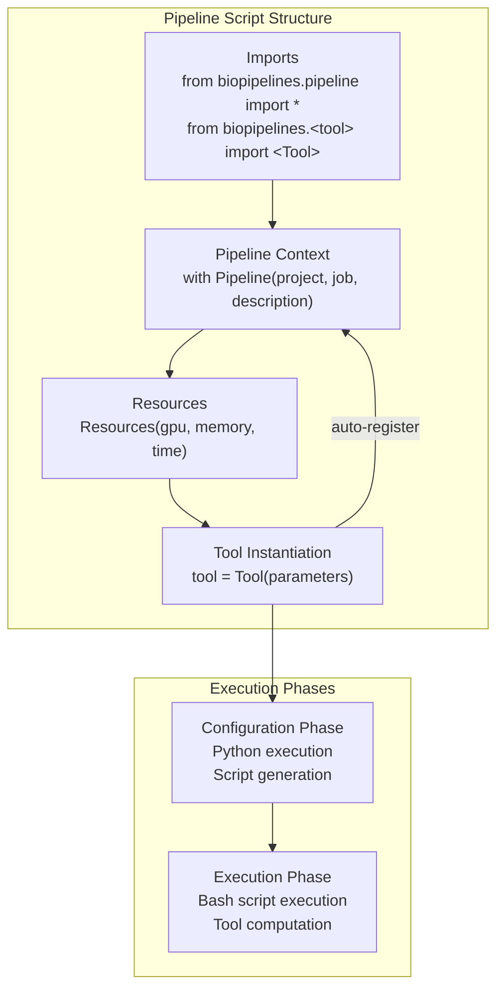
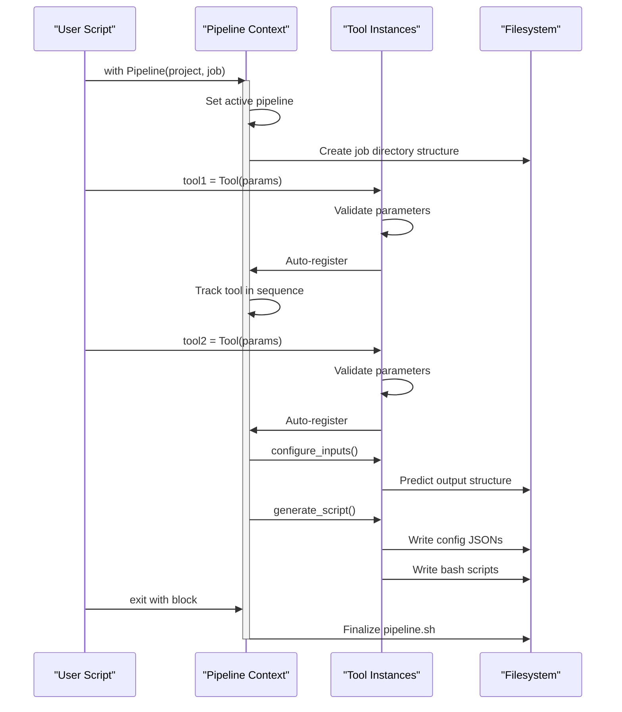
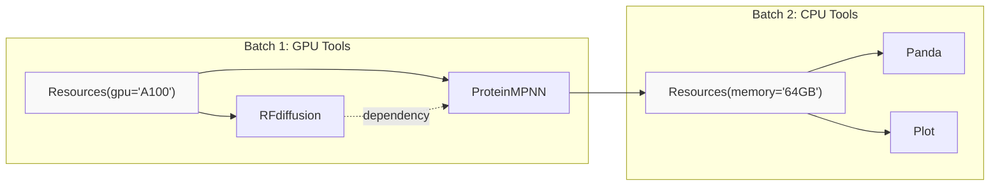
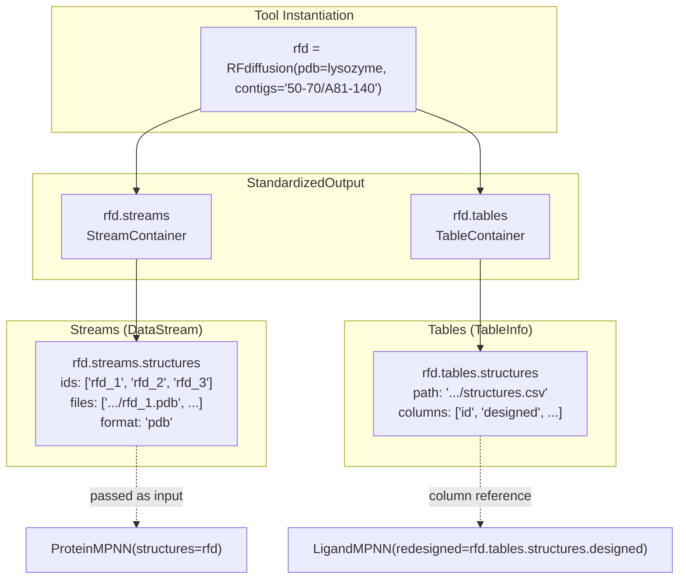
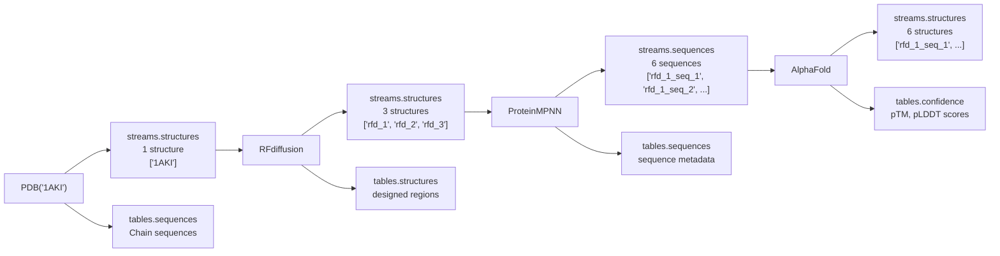
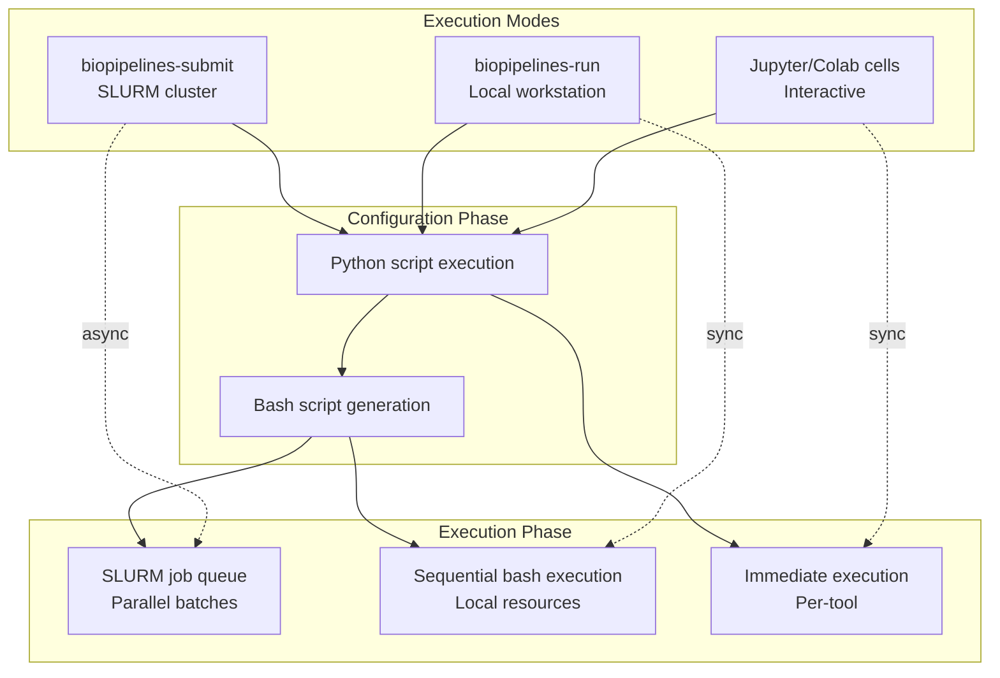

# Your First Pipeline

<details>
<summary>Relevant source files</summary>

The following files were used as context for generating this wiki page:

- [Docs/UserManual.md](Docs/UserManual.md)
- [ExamplePipelines/boltz2.py](ExamplePipelines/boltz2.py)
- [config.yaml](config.yaml)

</details>


This page walks you through creating and executing your first BioPipelines workflow. You will learn the basic structure of a pipeline script, how to use the `Pipeline` context manager, set computational resources, add tools, and run the pipeline in different modes.

For installation and environment setup, see [Installation and Environment Setup](#2.1). For detailed information about individual tools, see [Tool Categories](#5). For advanced combinatorics and data flow patterns, see [Core Concepts](#3).

---

## Anatomy of a Pipeline Script

A BioPipelines script follows a consistent structure that separates configuration from execution. Every pipeline script contains three essential components: imports, the `Pipeline` context, and tool definitions.



**Sources:** [Docs/UserManual.md:30-45](), [ExamplePipelines/boltz2.py:7-45]()

---

## The Pipeline Context

The `Pipeline` context manager is the entry point for all BioPipelines workflows. It establishes the project and job names, manages tool registration, and controls execution mode.

### Basic Usage

```python
from biopipelines.pipeline import *

with Pipeline(project="MyProject",
              job="MyJob",
              description="Brief description of what this pipeline does"):
    # Tools and operations go here
    pass
```

**Parameters:**
- `project` (str): Top-level organizational folder (e.g., `"Examples"`, `"BinderDesign"`)
- `job` (str): Specific pipeline name (e.g., `"RFD-MPNN-AF2"`, `"Boltz2_Screen"`)
- `description` (str): Human-readable description for documentation

**Optional Parameters:**
- `local_output` (bool): If `True`, writes output to `./BioPipelines/` in current directory instead of configured path. Defaults to `True` when `on_the_fly=True`.
- `on_the_fly` (bool): If `True`, executes tools immediately as they are added. Automatically enabled in Jupyter/Colab. See [Interactive Mode](#4.3).

### Pipeline Context Lifecycle



**Sources:** [Docs/UserManual.md:30-45](), [Docs/UserManual.md:423-454]()

---

## Setting Resources

The `Resources` class specifies computational requirements for tools that follow it in the pipeline. This determines SLURM allocation for cluster execution.

### GPU Allocation

```python
with Pipeline("Project", "Job", "Description"):
    # Request specific GPU model
    Resources(gpu="A100", memory="32GB", time="24:00:00")
    tool1 = SomeGPUTool(...)
    
    # Request GPU by memory capacity
    Resources(gpu="80GB|96GB", memory="32GB", time="12:00:00")
    tool2 = AnotherGPUTool(...)
    
    # CPU-only tools
    Resources(memory="128GB", time="4:00:00", cpus=32)
    tool3 = CPUTool(...)
```

**GPU Options:**
| Specification | Meaning |
|---------------|---------|
| `"A100"`, `"H100"`, `"V100"` | Request specific GPU model |
| `"24GB"`, `"32GB"`, `"80GB"`, `"96GB"` | Request GPU by memory capacity |
| `"any"` | Any available GPU |
| `"high-memory"` | Prefer high-memory GPUs (≥80GB) |
| `None` or omitted | CPU-only |

### Batch Dependencies

Multiple `Resources()` calls create sequential batches. Each batch waits for the previous batch to complete before starting.

```python
with Pipeline("Project", "Job", "Description"):
    # Batch 1: GPU-intensive generation
    Resources(gpu="A100", time="4:00:00")
    generation = RFdiffusion(...)
    design = ProteinMPNN(structures=generation, ...)
    
    # Batch 2: CPU analysis (waits for Batch 1)
    Resources(memory="64GB", time="2:00:00")
    filtered = Panda(tables=design.tables.sequences, ...)
```



**Sources:** [Docs/UserManual.md:395-418](), [config.yaml:61-120]()

---

## Adding Tools

Tools are Python classes that represent computational operations. When instantiated within a `Pipeline` context, they automatically register themselves and contribute to the generated execution scripts.

### Basic Tool Usage

```python
from biopipelines.pipeline import *
from biopipelines.pdb import PDB
from biopipelines.rfdiffusion import RFdiffusion

with Pipeline("Examples", "SimpleRFD", "Redesign lysozyme"):
    Resources(gpu="A100", time="4:00:00")
    
    # Utility tool: fetch structure
    lysozyme = PDB("1AKI")
    
    # Processing tool: generate new backbones
    rfd = RFdiffusion(
        pdb=lysozyme,
        contigs='50-70/A81-140',  # Redesign N-terminus
        num_designs=3
    )
```

### Tool Outputs: Streams and Tables

Every tool returns a `StandardizedOutput` object containing:
- **`streams`**: File-based data (structures, sequences, compounds, MSAs, images)
- **`tables`**: CSV-based metrics and metadata



**Common Stream Types:**
| Stream | Data Type | Example Tools |
|--------|-----------|---------------|
| `streams.structures` | PDB/CIF files | `PDB`, `RFdiffusion`, `AlphaFold`, `Boltz2` |
| `streams.sequences` | FASTA or CSV with id/sequence | `Sequence`, `ProteinMPNN`, `LigandMPNN` |
| `streams.compounds` | SMILES CSV or SDF files | `Ligand`, `CompoundLibrary` |
| `streams.msas` | A3M files | `MMseqs2` |
| `streams.images` | PNG files | `PyMOL`, `Plot` |

**Sources:** [Docs/UserManual.md:172-219](), [Docs/UserManual.md:221-326]()

---

## A Complete Example

Here is a minimal but complete pipeline that redesigns a protein structure, generates sequences, and predicts their folded structures.

### Step 1: Create the Script

Create a file `my_first_pipeline.py`:

```python
from biopipelines.pipeline import *
from biopipelines.pdb import PDB
from biopipelines.rfdiffusion import RFdiffusion
from biopipelines.protein_mpnn import ProteinMPNN
from biopipelines.alphafold import AlphaFold

with Pipeline(project="Tutorial",
              job="RFD-MPNN-AF2",
              description="Redesign lysozyme N-terminus"):
    
    # Set computational resources
    Resources(gpu="A100", time="4:00:00", memory="16GB")
    
    # Fetch structure from RCSB PDB
    lysozyme = PDB("1AKI")
    
    # Generate alternative backbones for residues 1-70
    # Keep residues 81-140 fixed
    rfd = RFdiffusion(
        pdb=lysozyme,
        contigs='50-70/A81-140',
        num_designs=3
    )
    
    # Design sequences for generated backbones
    pmpnn = ProteinMPNN(
        structures=rfd,
        num_sequences=2
    )
    
    # Predict structure for designed sequences
    af = AlphaFold(proteins=pmpnn)
```

### Step 2: Understand the Data Flow



### Step 3: Verify Expected Outputs

The pipeline will generate:
- **3 RFdiffusion structures** (`rfd_1`, `rfd_2`, `rfd_3`)
- **6 ProteinMPNN sequences** (3 structures × 2 sequences each)
- **6 AlphaFold predictions** (one per sequence)

ID propagation follows the pattern: `<upstream_id>_<tool_id>_<item_index>`.

**Sources:** [Docs/UserManual.md:30-45](), [ExamplePipelines/boltz2.py:7-45]()

---

## Running Your Pipeline

BioPipelines supports three execution modes. The choice depends on your environment and workflow.

### SLURM Cluster Execution (submit)

For HPC clusters with SLURM workload manager:

```bash
# Activate environment
mamba activate biopipelines

# Submit to SLURM
biopipelines-submit my_first_pipeline.py
```

This creates bash scripts and submits them to SLURM. Jobs run asynchronously on compute nodes. Use `squeue` to monitor progress.

**Batch Dependencies:** If your pipeline has multiple `Resources()` calls, each batch is submitted as a separate SLURM job with `--dependency=afterok:<previous_job_id>`.

### Local Execution (run)

For local workstations without SLURM:

```bash
# Activate environment
mamba activate biopipelines

# Run locally
biopipelines-run my_first_pipeline.py
```

This executes bash scripts sequentially in the current shell. Tools run one after another, using local GPUs if available.

### Interactive Mode (Jupyter/Colab)

For notebooks, on-the-fly execution is **enabled automatically**:

```python
# Cell 1: Create pipeline
Pipeline("Tutorial", "InteractiveTest", "Quick test")

lysozyme = PDB("1AKI")
rfd = RFdiffusion(pdb=lysozyme, contigs='50-70/A81-140', num_designs=3)
# rfd has finished execution at this point
```

```python
# Cell 2: Continue pipeline
pmpnn = ProteinMPNN(structures=rfd, num_sequences=2)
# pmpnn has finished execution at this point
```

Key differences in interactive mode:
- The `with` statement is **optional** (pipeline stays active across cells)
- `Resources()` is **optional** and does not affect execution
- Tools execute immediately when instantiated
- Re-running the `Pipeline()` cell starts a new pipeline
- Output goes to `./BioPipelines/` in current directory



**Sources:** [Docs/UserManual.md:421-454](), [Docs/UserManual.md:457-478]()

---

## Output Structure

After running the pipeline, BioPipelines creates a structured directory containing scripts, logs, and tool outputs.

### Filesystem Layout

```
<biopipelines_output>/<project>/<job>_<NNN>/
├── RunTime/
│   ├── pipeline.sh                # Master execution script
│   ├── slurm.sh                   # SLURM wrapper (if using submit)
│   ├── 001_PDB.sh                 # Tool-specific bash scripts
│   ├── 002_RFdiffusion.sh
│   ├── 003_ProteinMPNN.sh
│   └── 004_AlphaFold.sh
├── Logs/
│   ├── 001_PDB.log                # Tool execution logs
│   ├── 002_RFdiffusion.log
│   ├── 003_ProteinMPNN.log
│   └── 004_AlphaFold.log
├── ToolOutputs/
│   ├── 001_PDB.json               # Output metadata (predicted paths)
│   ├── 002_RFdiffusion.json
│   ├── 003_ProteinMPNN.json
│   └── 004_AlphaFold.json
├── 001_PDB/
│   ├── .expected_outputs.json     # Completion check manifest
│   ├── .completed                 # Marker file (created when done)
│   ├── structures.csv             # Map table (id → file path)
│   ├── 1AKI.pdb                   # Structure file
│   └── sequences.csv              # Extracted sequences
├── 002_RFdiffusion/
│   ├── .expected_outputs.json
│   ├── .completed
│   ├── structures.csv
│   ├── rfd_1.pdb
│   ├── rfd_2.pdb
│   └── rfd_3.pdb
├── 003_ProteinMPNN/
│   ├── .expected_outputs.json
│   ├── .completed
│   ├── sequences.csv              # id, sequence, score, ...
│   ├── rfd_1_seq_1.fasta
│   ├── rfd_1_seq_2.fasta
│   └── ...
└── 004_AlphaFold/
    ├── .expected_outputs.json
    ├── .completed
    ├── confidence.csv             # pTM, pLDDT, ...
    ├── rfd_1_seq_1.pdb
    ├── rfd_1_seq_2.pdb
    └── ...
```

### Key Files

| File/Directory | Purpose |
|----------------|---------|
| `RunTime/*.sh` | Generated bash scripts for execution |
| `Logs/*.log` | stdout/stderr from tool execution |
| `ToolOutputs/*.json` | Predicted output metadata (used by Python) |
| `<NNN>_<Tool>/` | Actual tool outputs (PDBs, CSVs, etc.) |
| `.expected_outputs.json` | Completion check: lists expected files |
| `.completed` | Marker file created when tool finishes successfully |

### Completion Checking

BioPipelines checks for the `.completed` marker before running a tool. If it exists and all expected outputs are present, the tool is skipped. This enables:
- **Resuming failed pipelines** without re-running completed steps
- **Re-running notebooks** without redundant computation
- **Iterative development** by adding new tools to existing pipelines

**Sources:** [Docs/UserManual.md:554-578]()

---

## Next Steps

Now that you understand the basics of BioPipelines, explore these topics:

- **[Pipeline Context and Resources](#3.1)**: Deep dive into project/job organization and resource management
- **[Data Streams and StandardizedOutput](#3.3)**: Understand how data flows between tools
- **[Combinatorics: Each and Bundle](#3.4)**: Learn how to control multi-input combinations
- **[Tool Categories](#5)**: Browse all available tools organized by function
- **[Major Workflows](#6)**: Study complex multi-tool workflows (Boltz2, BoltzGen, etc.)

**Common next examples to try:**
- Add filtering with `Panda` to select best designs based on metrics
- Use `Boltz2` instead of `AlphaFold` for protein-ligand complex prediction
- Explore combinatorics with `Each` and `Bundle` for screening campaigns
- Visualize results with `PyMOL` and `Plot` tools

**Sources:** [Docs/UserManual.md:1-611]()

---