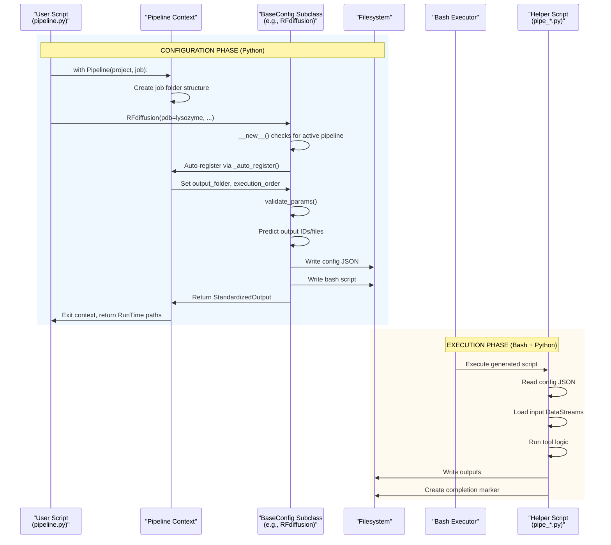
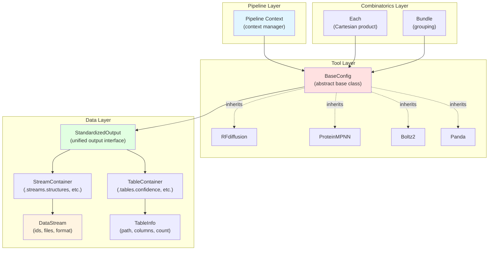
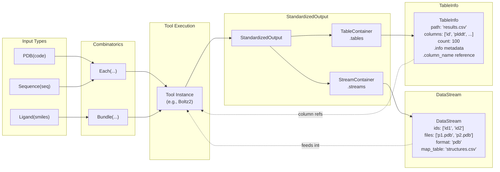
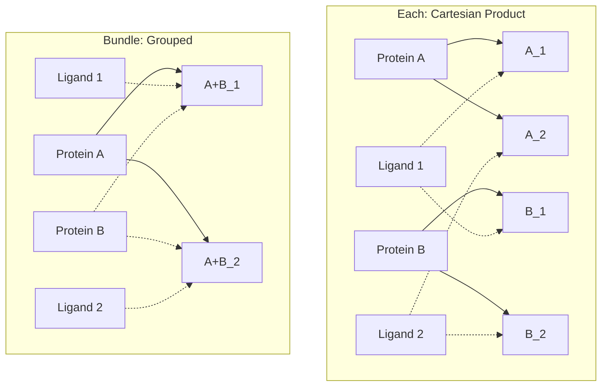
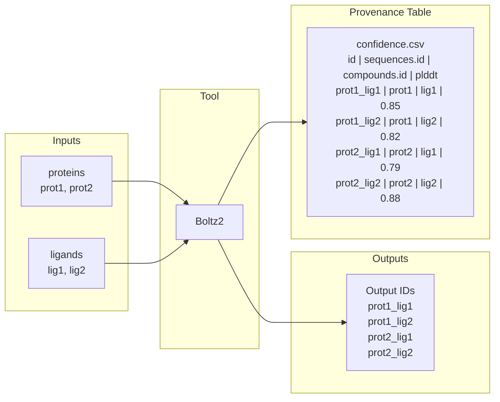
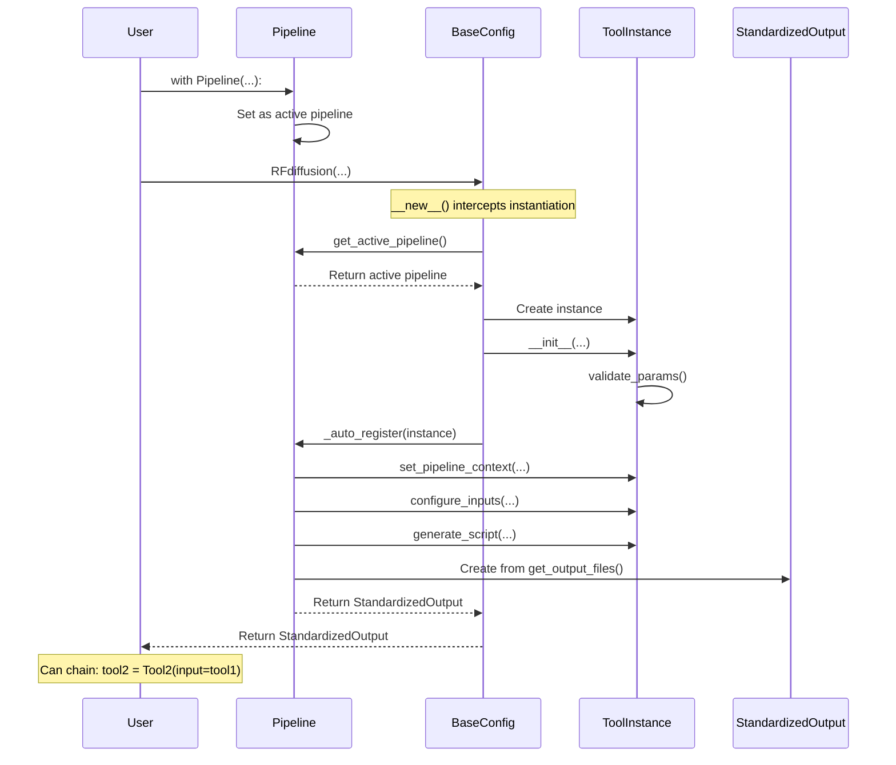

# Core Concepts

<details>
<summary>Relevant source files</summary>

The following files were used as context for generating this wiki page:

- [Docs/UserManual.md](Docs/UserManual.md)
- [HelpScripts/pipe_plot.py](HelpScripts/pipe_plot.py)
- [biopipelines/base_config.py](biopipelines/base_config.py)
- [biopipelines/plot.py](biopipelines/plot.py)
- [biopipelines/pymol.py](biopipelines/pymol.py)
- [config.yaml](config.yaml)

</details>


This page introduces the fundamental architectural concepts that underpin BioPipelines. These concepts define how pipelines are structured, how tools interact, how data flows between components, and how the framework manages execution.

**Scope**: This page provides conceptual overviews with diagrams and examples. For detailed documentation on specific aspects, see:
- Pipeline context and resource management → [Pipeline Context and Resources](#3.1)
- Tool architecture and implementation → [Tools and BaseConfig](#3.2)
- Data structures and I/O patterns → [Data Streams and StandardizedOutput](#3.3)
- Input combination logic → [Combinatorics: Each and Bundle](#3.4)
- ID naming and tracking → [ID Generation and Provenance Tracking](#3.5)

---

## The Two-Phase Execution Model

BioPipelines operates in two distinct phases: **Configuration** (Python) and **Execution** (Bash/external tools). This separation enables the framework to predict the complete filesystem structure, validate dependencies, and generate executable scripts without running any actual computation.



**Sources**: [Docs/UserManual.md:157-171](), [biopipelines/base_config.py:117-160]()

### Configuration Phase (Python)

During this phase, BioPipelines:
1. **Predicts the filesystem structure**: Output folders, file paths, and IDs are determined before execution
2. **Validates parameters**: Tool configurations are checked for consistency
3. **Generates scripts**: Bash wrappers and JSON configs are written to disk
4. **Tracks dependencies**: Tool execution order is determined based on data flow

No actual computation occurs. The `BaseConfig.__new__()` method intercepts tool instantiation and returns a `StandardizedOutput` object instead of the tool instance itself, enabling method chaining while maintaining full prediction capabilities.

**Sources**: [biopipelines/base_config.py:117-160]()

### Execution Phase (Bash)

The generated scripts execute sequentially or via SLURM, reading configurations and performing actual work. Helper scripts in `HelpScripts/` implement tool-specific logic in Python, reading JSON configs generated during configuration.

**Sources**: [Docs/UserManual.md:157-171]()

---

## Core Abstractions

BioPipelines is built on four primary abstractions that work together to create a composable pipeline framework:



**Sources**: [biopipelines/base_config.py:34-657](), [biopipelines/base_config.py:924-1050]()

### Pipeline Context

The `Pipeline` context manager serves as the orchestration layer. It:
- Creates the job folder structure (`<project>/<job>_NNN/`)
- Registers tools automatically via `__new__()` interception
- Assigns execution order and output folders
- Generates the master execution script
- Manages resource allocation per batch

**Sources**: [Docs/UserManual.md:32-46]()

### BaseConfig Abstract Class

All tools inherit from `BaseConfig`, which provides:
- **Parameter validation** via `validate_params()`
- **Input configuration** via `configure_inputs()`
- **Script generation** via `generate_script()`
- **Output prediction** via `get_output_files()`
- **Auto-registration** via `__new__()` method override

The `__new__()` method enables declarative syntax by intercepting instantiation and returning `StandardizedOutput` instead of the tool instance when called within a `Pipeline` context.

**Sources**: [biopipelines/base_config.py:34-160]()

### StandardizedOutput

`StandardizedOutput` provides a unified interface to tool outputs with two containers:
- **StreamContainer** (`.streams`): File-based outputs (structures, sequences, compounds, MSAs, images)
- **TableContainer** (`.tables`): CSV-based metrics and metadata

This abstraction enables tools to consume outputs from any other tool without knowing implementation details.

**Sources**: [biopipelines/base_config.py:1052-1127]()

---

## Data Flow Architecture

Data flows through BioPipelines via typed containers that track IDs, files, and provenance:



**Sources**: [biopipelines/base_config.py:924-1127](), [Docs/UserManual.md:172-219]()

### DataStream

`DataStream` represents a collection of related files (structures, sequences, compounds, etc.) with:
- **IDs**: List of unique identifiers for each item
- **Files**: Corresponding file paths (or sequences as values)
- **Format**: File format (`pdb`, `cif`, `fasta`, `sdf`, etc.)
- **map_table**: CSV file linking IDs to provenance columns

DataStreams support iteration, indexing, and slicing:

```python
for structure in boltz.streams.structures:
    print(f"{structure.ids[0]}: {structure.files[0]}")
    downstream_tool = SomeTool(structures=structure)
```

**Sources**: [Docs/UserManual.md:176-204]()

### TableInfo

`TableInfo` represents CSV files with metadata:
- **path**: File path to the CSV
- **columns**: List of column names
- **count**: Number of rows
- **Column references**: `table.column_name` returns `TableReference` for per-structure data

Table column references enable metadata-driven parameterization:

```python
rfd = RFdiffusion(contigs="50-100", num_designs=5)
# rfd.tables.structures has column "designed" with residue ranges

lmpnn = LigandMPNN(
    structures=rfd,
    redesigned=rfd.tables.structures.designed  # Per-structure column
)
```

**Sources**: [biopipelines/base_config.py:753-801](), [Docs/UserManual.md:373-391]()

### StreamContainer and TableContainer

These containers provide dot-notation access to named streams and tables:

```python
output.streams.structures  # DataStream
output.streams.sequences   # DataStream
output.tables.confidence   # TableInfo
output.tables.affinity     # TableInfo
```

**Sources**: [biopipelines/base_config.py:924-999](), [biopipelines/base_config.py:1001-1050]()

---

## Combinatorics System

The combinatorics system controls how multiple inputs combine when passed to tools. Two operators define the combination logic:

| Operator | Behavior | Example |
|----------|----------|---------|
| `Each` | Cartesian product (default) | 2 proteins × 3 ligands = 6 predictions |
| `Bundle` | Group as single entity | 2 proteins bundled + 3 ligands = 3 predictions |



**Sources**: [Docs/UserManual.md:327-371]()

### Usage Examples

```python
# Default: Each protein with each ligand (6 predictions)
Boltz2(
    proteins=Each(protein_a, protein_b),
    ligands=Each(ligand1, ligand2, ligand3)
)

# Bundle ligands: Each protein with all ligands together (2 predictions)
Boltz2(
    proteins=Each(protein_a, protein_b),
    ligands=Bundle(ligand1, ligand2, ligand3)
)

# Nested: Each ligand paired with cofactor (3 predictions per protein)
Boltz2(
    proteins=protein_a,
    ligands=Bundle(Each(ligand1, ligand2, ligand3), cofactor)
)
```

**Sources**: [Docs/UserManual.md:336-357]()

### Output ID Naming

Output IDs are always the **full Cartesian product** of all iterated axis IDs, joined with `_`:

- 1 protein (`prot1`) × 3 ligands (`lig1`, `lig2`, `lig3`) → `prot1_lig1`, `prot1_lig2`, `prot1_lig3`
- Even with a single input, the ID is included: `prot1_lig1` (never shortened to `lig1`)

**Sources**: [Docs/UserManual.md:359]()

---

## Provenance Tracking

Every output table includes provenance columns (`{stream_name}.id`) that track which input from each axis produced each output row:



**Sources**: [Docs/UserManual.md:361-371]()

This enables filtering by input source:

```python
import pandas as pd

df = pd.read_csv(boltz.tables.confidence.info.path)

# Filter for specific protein
prot1_results = df[df['sequences.id'] == 'prot1']

# Filter for specific ligand
lig2_results = df[df['compounds.id'] == 'lig2']
```

**Sources**: [Docs/UserManual.md:363-371]()

---

## Tool Registration and Auto-Chaining

Tools automatically register with the active `Pipeline` context via the `__new__()` method override in `BaseConfig`:



**Sources**: [biopipelines/base_config.py:117-160]()

This design enables:
1. **Declarative syntax**: Tools are instantiated and immediately usable
2. **Automatic dependency tracking**: Inputs are resolved from prior tool outputs
3. **Method chaining**: `StandardizedOutput` can be passed directly to downstream tools
4. **IDE support**: Type hints preserve autocomplete despite runtime transformation

**Sources**: [biopipelines/base_config.py:50-59](), [biopipelines/base_config.py:117-160]()

---

## Filesystem Structure

BioPipelines creates a predictable folder hierarchy:

```
<biopipelines_output>/<project>/<job>_<NNN>/
├── RunTime/              # Generated scripts
│   ├── pipeline.sh       # Master execution script
│   ├── 001_RFdiffusion.sh
│   └── 002_ProteinMPNN.sh
├── Logs/                 # Execution logs
│   ├── 001_RFdiffusion.log
│   └── 002_ProteinMPNN.log
├── ToolOutputs/          # Predicted output metadata (JSON)
│   ├── 001_RFdiffusion.json
│   └── 002_ProteinMPNN.json
├── 001_RFdiffusion/      # Tool outputs
│   ├── .expected_outputs.json
│   ├── .log
│   ├── structures.csv    # map_table with provenance
│   └── *.pdb             # Output structures
└── 002_ProteinMPNN/
    └── ...
```

**Sources**: [Docs/UserManual.md:554-577]()

Each tool folder contains:
- **Output files**: PDB, CIF, FASTA, CSV, etc.
- **map_table CSVs**: Link IDs to files and track provenance
- **.expected_outputs.json**: Metadata for validation and `Load()`
- **Completion markers**: `<NNN>_<Tool>_COMPLETED` or `_WARNING` in parent folder

**Sources**: [biopipelines/base_config.py:499-649]()

---

## Summary

BioPipelines' core architecture separates **configuration** (pure Python prediction) from **execution** (bash + tool logic), enabling:

1. **Predictable file paths**: All outputs known before execution
2. **Composable tools**: Standardized I/O via `StandardizedOutput`
3. **Flexible input combination**: `Each`/`Bundle` combinatorics
4. **Automatic dependency tracking**: Via `Pipeline` context and `__new__()` interception
5. **Provenance preservation**: ID-based tracking through all transformations

The sub-pages provide detailed documentation on each concept:
- [Pipeline Context and Resources](#3.1)
- [Tools and BaseConfig](#3.2)
- [Data Streams and StandardizedOutput](#3.3)
- [Combinatorics: Each and Bundle](#3.4)
- [ID Generation and Provenance Tracking](#3.5)

**Sources**: [Docs/UserManual.md:155-220](), [biopipelines/base_config.py:1-657]()

---