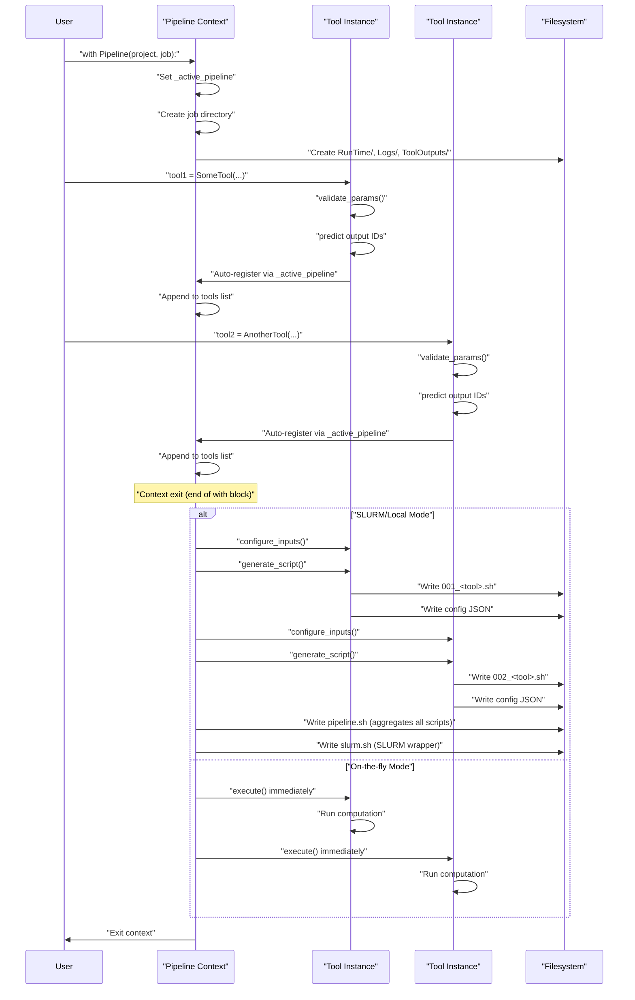
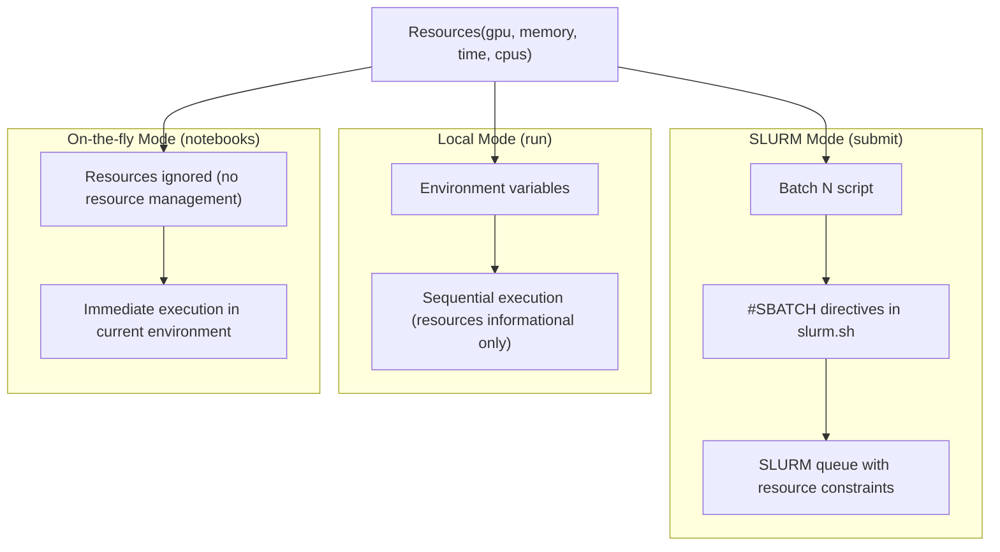
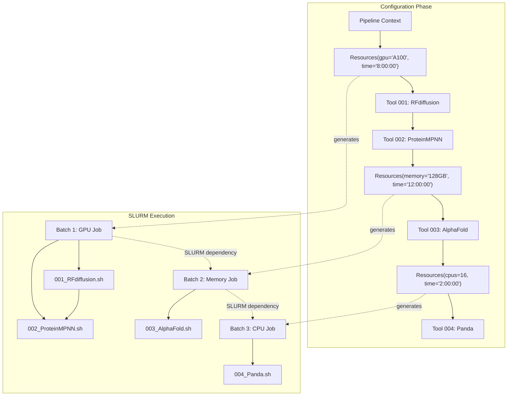

# Pipeline Context and Resources

<details>
<summary>Relevant source files</summary>

The following files were used as context for generating this wiki page:

- [Docs/UserManual.md](Docs/UserManual.md)
- [config.yaml](config.yaml)

</details>


## Purpose and Scope

This page describes the `Pipeline` context manager and the `Resources` allocation system, which together form the foundation of BioPipelines' project organization and execution control. The `Pipeline` context manages job creation, tool registration, and filesystem structure, while `Resources` controls compute allocation and batch sequencing.

For information about how tools are implemented and registered within the pipeline, see [Tools and BaseConfig](#3.2). For details on execution modes (SLURM, local, interactive), see [Execution Modes](#4).

---

## The Pipeline Context Manager

### Basic Usage

The `Pipeline` class is a context manager that defines a single computational job. All tools must be created within an active pipeline context:

```python
from biopipelines.pipeline import Pipeline, Resources

with Pipeline(project="MyProject",
              job="DesignCycle1",
              description="Generate and validate binder designs"):
    Resources(gpu="A100", time="4:00:00")
    # Tools are defined here...
```

**Sources:** [Docs/UserManual.md:32-45](), [Docs/UserManual.md:400-418]()

### Pipeline Parameters

| Parameter | Type | Purpose |
|-----------|------|---------|
| `project` | `str` | Top-level organizational folder (e.g., "AntibodyDesign") |
| `job` | `str` | Specific job name (e.g., "OptimizationRound3") |
| `description` | `str` | Human-readable description for documentation |
| `local_output` | `bool` | If `True`, output to `./BioPipelines/` instead of configured path (default: `False`, auto-enabled in on-the-fly mode) |
| `on_the_fly` | `bool` | If `True`, execute tools immediately instead of generating scripts (default: auto-detected in notebooks) |

The context manager sets itself as the active pipeline during the `with` block. Tools created within the block automatically register themselves with the active pipeline via `Pipeline._active_pipeline`.

**Sources:** [Docs/UserManual.md:32-45](), [Docs/UserManual.md:591-599](), [Docs/UserManual.md:421-454]()

### Context Lifecycle



**Sources:** High-level architecture diagram (Diagram 2: Pipeline Execution Lifecycle)

---

## Project and Job Organization

### Filesystem Structure

Each pipeline execution creates a uniquely numbered job directory:

```
<biopipelines_output>/<project>/<job>_<NNN>/
├── RunTime/                    # Execution scripts
│   ├── pipeline.sh            # Master script (calls all tool scripts)
│   ├── slurm.sh               # SLURM submission wrapper
│   ├── 001_<ToolName>.sh      # Individual tool script (batch 1)
│   ├── 002_<ToolName>.sh      # Individual tool script (batch 1)
│   └── 003_<ToolName>.sh      # Individual tool script (batch 2)
├── Logs/                       # Execution logs
│   ├── 001_<ToolName>.log
│   ├── 002_<ToolName>.log
│   └── 003_<ToolName>.log
├── ToolOutputs/                # Tool output predictions (JSON)
│   ├── 001_<ToolName>.json    # Predicted output files/IDs
│   ├── 002_<ToolName>.json
│   └── 003_<ToolName>.json
├── 001_<ToolName>/             # Actual tool outputs
│   ├── .expected_outputs.json # Copy of ToolOutputs/<NNN>.json
│   ├── .log                   # Tool execution log
│   ├── structures.csv         # Map table for structures DataStream
│   ├── structure_001.pdb
│   ├── structure_002.pdb
│   └── confidence.csv         # Results table
├── 002_<ToolName>/
│   └── ...
└── 003_<ToolName>/
    └── ...
```

**Sources:** [Docs/UserManual.md:556-577]()

### Job Numbering

Jobs are auto-numbered to prevent overwrites. If `<project>/<job>_001/` exists, the next execution creates `<job>_002/`, then `<job>_003/`, etc. This enables iterative refinement without manual renaming.

### Output Location Control

The base output directory is controlled by:

1. **Default:** `folders.base.biopipelines_output` in `config.yaml` (typically `<user>/BioPipelines`)
2. **Local output:** If `local_output=True`, outputs to `./BioPipelines/` in the current working directory
3. **On-the-fly mode:** Automatically sets `local_output=True`

```python
# Standard cluster execution: uses config.yaml path
with Pipeline("Project", "Job", "Description"):
    ...

# Local output: writes to ./BioPipelines/Project/Job_001/
with Pipeline("Project", "Job", "Description", local_output=True):
    ...

# On-the-fly (automatically local_output=True)
Pipeline("Project", "Job", "Description", on_the_fly=True)
```

**Sources:** [Docs/UserManual.md:591-599](), [config.yaml:10-22]()

---

## Resource Allocation

### The Resources Function

The `Resources()` function defines compute requirements for subsequent tools. It must be called within an active pipeline context:

```python
with Pipeline("Project", "Job", "Description"):
    Resources(gpu="A100", memory="32GB", time="24:00:00")
    tool1 = SomeTool(...)  # Uses A100 GPU, 32GB memory, 24h time limit
    
    Resources(memory="128GB", cpus=32, time="4:00:00")
    tool2 = AnotherTool(...)  # CPU-only, 128GB memory, 32 cores, 4h limit
```

**Sources:** [Docs/UserManual.md:395-418]()

### Resource Parameters

| Parameter | Type | Options | Purpose |
|-----------|------|---------|---------|
| `gpu` | `str` | `"T4"`, `"L4"`, `"V100"`, `"A100"`, `"H100"`, `"H200"`, `"24GB"`, `"32GB"`, `"80GB"`, `"96GB"`, `"any"`, `"high-memory"` | GPU type or memory requirement |
| `memory` | `str` | e.g., `"16GB"`, `"128GB"` | RAM allocation |
| `time` | `str` | e.g., `"4:00:00"`, `"24:00:00"` | Wall-clock time limit (HH:MM:SS) |
| `cpus` | `int` | e.g., `16`, `32` | CPU core count |

GPU specifications can be model-based (`"A100"`) or memory-based (`"80GB"`). Memory-based specs allow SLURM to select any GPU with sufficient VRAM (e.g., `"80GB"` matches A100 80GB or H100).

**Sources:** [Docs/UserManual.md:395-418]()

### Resource Application by Execution Mode



**SLURM mode:** Resources translate to `#SBATCH` directives for GPU selection, memory allocation, and time limits.

**Local mode:** Resources are informational only; tools execute sequentially in the current environment.

**On-the-fly mode:** Resources are ignored; tools execute immediately in the active notebook environment.

**Sources:** [Docs/UserManual.md:421-454](), High-level architecture diagram (Diagram 2)

---

## Batch Dependencies and Sequential Execution

### Creating Multiple Batches

Multiple `Resources()` calls within a single pipeline create sequential batches. Each batch waits for the previous batch to complete before starting:

```python
with Pipeline("Project", "MultiStage", "Description"):
    # Batch 1: GPU-intensive generation
    Resources(gpu="A100", time="8:00:00")
    structures = RFdiffusion(contigs="50-100", num_designs=100)
    sequences = ProteinMPNN(structures=structures, num_sequences=10)
    
    # Batch 2: High-memory prediction (waits for Batch 1)
    Resources(memory="128GB", time="12:00:00")
    predictions = AlphaFold(proteins=sequences)
    
    # Batch 3: CPU analysis (waits for Batch 2)
    Resources(cpus=16, time="2:00:00")
    filtered = Panda(tables=predictions.tables.confidence,
                     operations=[Panda.filter("pLDDT > 80")])
```

**Sources:** [Docs/UserManual.md:408-418]()

### Batch Dependency Flow



**Key Points:**
- Tools between `Resources()` calls belong to the same batch
- Batches execute sequentially (Batch 2 waits for Batch 1, etc.)
- Within a batch, tools execute sequentially (Script 001 → Script 002)
- In SLURM mode, batches use `--dependency=afterok:<job_id>` for synchronization

**Sources:** [Docs/UserManual.md:408-418](), High-level architecture diagram (Diagram 2)

### External Dependencies

The `Dependencies()` function specifies external SLURM job IDs that must complete before the pipeline starts:

```python
from biopipelines.pipeline import Pipeline, Resources, Dependencies

with Pipeline("Project", "Job", "Description"):
    Dependencies("12345678")  # Wait for SLURM job 12345678
    # or
    Dependencies(["12345678", "87654321"])  # Wait for multiple jobs
    
    Resources(gpu="V100", time="4:00:00")
    tool = SomeTool(...)
```

External dependencies are applied to Batch 1. If the pipeline has multiple batches, each subsequent batch depends only on the previous batch within the same pipeline.

**Sources:** [Docs/UserManual.md:486-494]()

---

## Pipeline Activation and Tool Registration

### Auto-Registration Mechanism

Tools automatically register with the active pipeline during `__init__()`. The `Pipeline` context sets a class-level `_active_pipeline` attribute:


Tools retrieve the active pipeline via `Pipeline._active_pipeline` and call `register_tool()` to append themselves to the pipeline's tool list. This enables tools to be created with simple instantiation syntax without explicit pipeline references.

**Sources:** High-level architecture diagram (Diagram 1: Overall System Architecture), [Docs/UserManual.md:32-45]()

### On-the-fly vs Script Generation

The pipeline's mode determines when tool logic executes:

**Script generation mode (default):**
1. Tools register and predict outputs during configuration phase
2. `Pipeline.__exit__()` calls `configure_inputs()` and `generate_script()` on all tools
3. Tools write bash scripts to `RunTime/<NNN>_<ToolName>.sh`
4. Execution happens later via `submit` or `run` commands

**On-the-fly mode (notebooks):**
1. Tools register and execute immediately during `__init__()`
2. Each tool completes before the next tool is created
3. No script generation; Python directly calls helper scripts or inline logic
4. Pipeline context remains active across notebook cells (no `with` statement required)

**Sources:** [Docs/UserManual.md:421-454](), [Docs/UserManual.md:155-171](), High-level architecture diagram (Diagram 2)

---

## Environment and Configuration Integration

### Environment Resolution

The pipeline context collaborates with `config.yaml` to resolve execution environments. Each tool is mapped to a conda environment or container:

```yaml
# config.yaml
environments:
  RFdiffusion: "SE3nv"
  ProteinMPNN: "SE3nv"
  AlphaFold: "biopipelines"
  Boltz2: "Boltz2Env"

containers:
  # Optional: overrides environment mapping
  RFdiffusionAllAtom: "<containers>/rf_se3_diffusion.sif"
```

When generating scripts, the pipeline embeds environment activation commands:

```bash
# Generated in RunTime/001_RFdiffusion.sh
mamba activate SE3nv
python <HelpScripts>/pipe_rfdiffusion.py --config 001_RFdiffusion.json
```

For containers, the activation becomes a Singularity/Apptainer exec call:

```bash
# Generated for containerized tools
apptainer exec <container_path> python <script> --config <config.json>
```

**Sources:** [config.yaml:62-121](), [config.yaml:122-128](), [config.yaml:140-154]()

### Folder Path Resolution

The pipeline resolves output paths using hierarchical placeholder substitution from `config.yaml`:

```yaml
folders:
  base:
    home: "/home/<username>"
    data: "<home>/data"
    biopipelines_output: "<user>/BioPipelines"
  infrastructure:
    HelpScripts: "<biopipelines>/HelpScripts"
```

Runtime placeholders (`<username>`, `<cwd>`) are injected when the pipeline starts. Cross-references (`<home>`, `<biopipelines>`) are resolved in dependency order.

**Sources:** [config.yaml:1-60](), High-level architecture diagram (Diagram 6: Configuration and Environment Management)

---

## Summary

The `Pipeline` context manager and `Resources` allocation system provide:

1. **Job organization:** Automatic directory creation with unique numbering
2. **Tool orchestration:** Auto-registration and dependency tracking
3. **Resource management:** GPU/memory/time specifications for SLURM, local, and interactive execution
4. **Batch sequencing:** Multi-stage pipelines with sequential dependencies
5. **Configuration integration:** Environment and path resolution from `config.yaml`

Together, these components form the foundation for BioPipelines' two-phase execution model, enabling the framework to predict filesystem structure during configuration and defer actual computation to the execution phase.

For details on how tools implement their configuration and script generation logic, see [Tools and BaseConfig](#3.2). For information on execution modes, see [Execution Modes](#4).

---