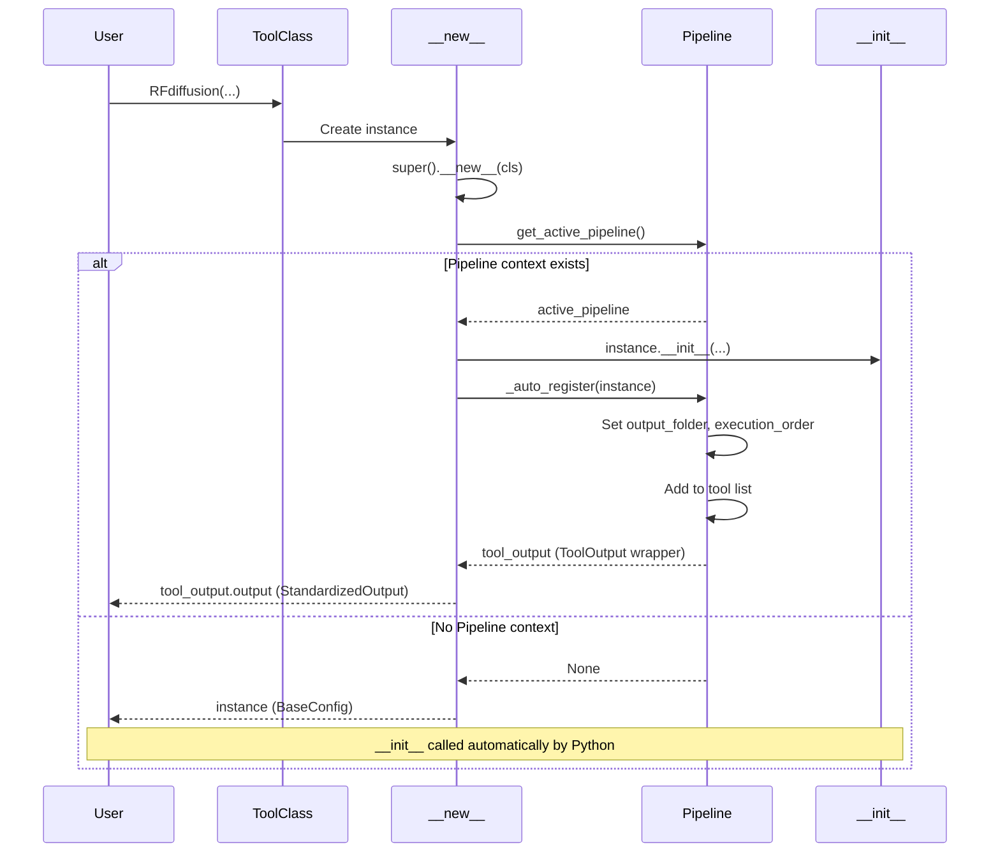
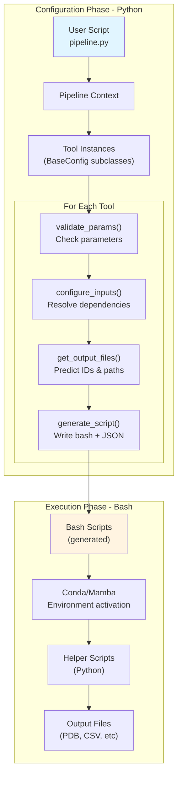
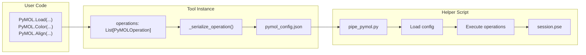
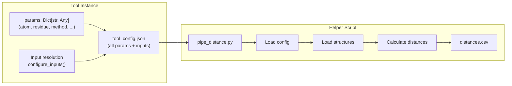
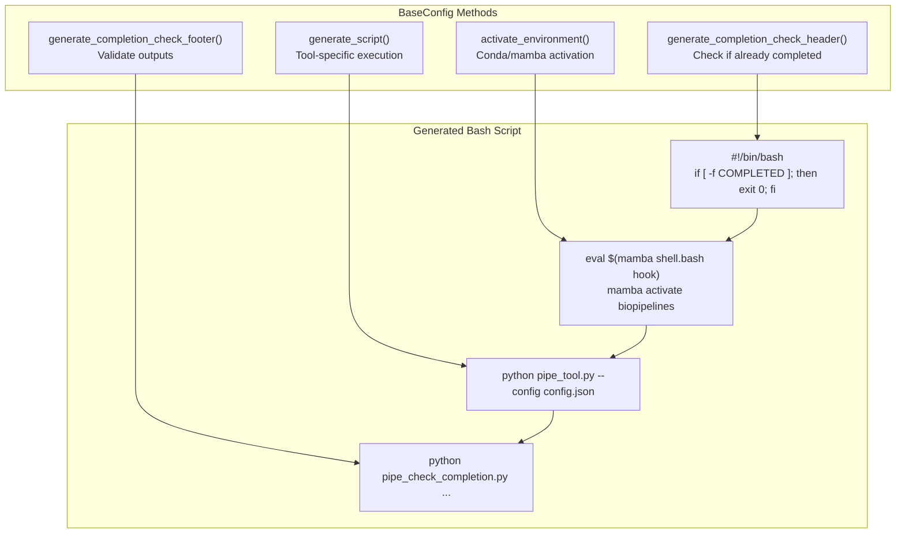
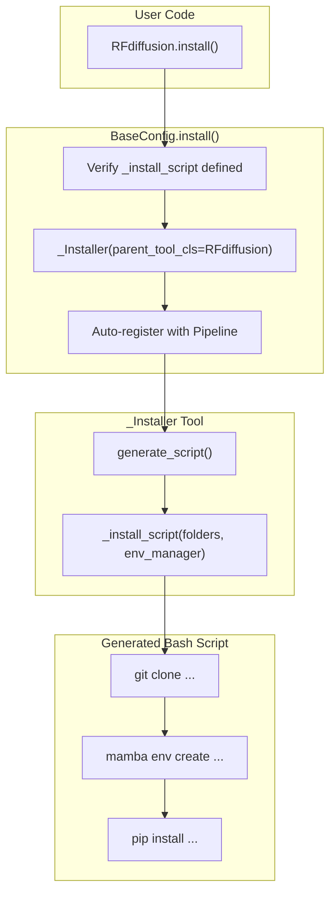

# Tools and BaseConfig

<details>
<summary>Relevant source files</summary>

The following files were used as context for generating this wiki page:

- [Docs/Tool/Analysis.md](Docs/Tool/Analysis.md)
- [Docs/Tool/DataManagement.md](Docs/Tool/DataManagement.md)
- [Docs/ToolReference.md](Docs/ToolReference.md)
- [HelpScripts/pipe_plot.py](HelpScripts/pipe_plot.py)
- [biopipelines/base_config.py](biopipelines/base_config.py)
- [biopipelines/plot.py](biopipelines/plot.py)
- [biopipelines/pymol.py](biopipelines/pymol.py)

</details>


This page explains the tool architecture in BioPipelines: the `BaseConfig` abstract class, the auto-registration mechanism, the two-phase execution model, and how tools generate bash scripts that wrap helper scripts. For information about how tools produce and consume data, see [Data Streams and StandardizedOutput](#3.3). For information about the Pipeline context that manages tools, see [Pipeline Context and Resources](#3.1).

---

## Overview

Every tool in BioPipelines inherits from the `BaseConfig` abstract class, which provides:
- **Auto-registration** into the active Pipeline context
- **Two-phase execution**: configuration (Python) and execution (Bash)
- **Script generation**: bash wrappers around helper scripts
- **Standardized I/O**: all tools produce `StandardizedOutput` objects
- **Environment management**: conda/mamba/pip activation
- **Completion tracking**: automatic output validation

The framework uses a strict separation between configuration and execution. During configuration, tools predict their outputs, validate parameters, and generate bash scripts. During execution, those scripts run the actual work via helper scripts.

Sources: [biopipelines/base_config.py:1-657]()

---

## BaseConfig Abstract Class

`BaseConfig` is the foundation for all tools. It defines the contract that every tool must implement and provides common functionality.

### Class Structure

```mermaid
graph TB
    subgraph "Abstract Base Class"
        BaseConfig["BaseConfig<br/>(ABC)"]
    end
    
    subgraph "Required Abstract Methods"
        validate_params["validate_params()<br/>Parameter validation"]
        configure_inputs["configure_inputs()<br/>Resolve dependencies"]
        generate_script["generate_script()<br/>Create bash script"]
        get_output_files["get_output_files()<br/>Predict outputs"]
    end
    
    subgraph "Common Functionality"
        new["__new__()<br/>Auto-registration"]
        init["__init__()<br/>Common parameters"]
        activate_env["activate_environment()<br/>Conda/mamba/pip"]
        completion_header["generate_completion_check_header()"]
        completion_footer["generate_completion_check_footer()"]
        get_provenance["get_id_provenance()"]
    end
    
    subgraph "Tool-Specific Attributes"
        TOOL_NAME["TOOL_NAME<br/>class attribute"]
        environments["environments<br/>from config.yaml"]
        output_folder["output_folder<br/>set by Pipeline"]
        params["params<br/>dict of kwargs"]
    end
    
    BaseConfig --> validate_params
    BaseConfig --> configure_inputs
    BaseConfig --> generate_script
    BaseConfig --> get_output_files
    
    BaseConfig --> new
    BaseConfig --> init
    BaseConfig --> activate_env
    BaseConfig --> completion_header
    BaseConfig --> completion_footer
    BaseConfig --> get_provenance
    
    BaseConfig --> TOOL_NAME
    BaseConfig --> environments
    BaseConfig --> output_folder
    BaseConfig --> params
```



Sources: [biopipelines/base_config.py:34-657]()

### Required Abstract Methods

Every tool must implement four abstract methods:

| Method | Purpose | Returns |
|--------|---------|---------|
| `validate_params()` | Validate tool-specific parameters | `None` (raises on error) |
| `configure_inputs(pipeline_folders)` | Resolve dependencies and input sources | `None` |
| `generate_script(script_path)` | Generate bash execution script | `str` (script content) |
| `get_output_files()` | Predict output structure | `Dict[str, Any]` |

**Example: Distance tool implementation**

```python
def validate_params(self):
    """Validate distance measurement parameters."""
    if not self.params.get('atom'):
        raise ValueError("atom parameter is required")
    if not self.params.get('residue'):
        raise ValueError("residue parameter is required")
    # ... more validation

def configure_inputs(self, pipeline_folders):
    """Resolve structure inputs."""
    self.folders = pipeline_folders
    structures = self.params.get('structures')
    # Extract DataStream from StandardizedOutput if needed
    # ...

def generate_script(self, script_path):
    """Generate bash script calling pipe_distance.py."""
    config = {
        "structures": self.structures_ds.to_dict(),
        "atom": self.params['atom'],
        "residue": self.params['residue'],
        # ... more config
    }
    # Write config JSON
    # Return bash script that activates environment and runs helper
    # ...

def get_output_files(self):
    """Predict distances.csv output."""
    return {
        "tables": {
            "distances": TableInfo(
                name="distances",
                path=os.path.join(self.output_folder, "distances.csv"),
                columns=["id", "source_structure", self.metric_name, "unit"],
                # ...
            )
        },
        "output_folder": self.output_folder
    }
```

Sources: [biopipelines/base_config.py:283-372]()

### Common Attributes

All tools inherit these attributes from `BaseConfig`:

| Attribute | Type | Description |
|-----------|------|-------------|
| `TOOL_NAME` | `str` | Class attribute identifying the tool (e.g., "Distance", "Boltz2") |
| `tool_name` | `str` | Instance copy of `TOOL_NAME` |
| `job_name` | `str` | Optional user-provided name for this tool instance |
| `pipeline` | `Pipeline` | Reference to the Pipeline instance (set during auto-registration) |
| `environments` | `List[str]` | Environment names from config.yaml (e.g., `["biopipelines"]`) |
| `resources` | `Dict[str, str]` | SLURM resource requirements |
| `dependencies` | `List[BaseConfig]` | Other tools this tool depends on |
| `output_folder` | `str` | Path to tool output directory (set by Pipeline) |
| `params` | `Dict[str, Any]` | All kwargs passed to `__init__` |
| `folders` | `Dict[str, str]` | Resolved folder paths from config.yaml |

Sources: [biopipelines/base_config.py:162-194]()

---

## Auto-Registration Mechanism

The auto-registration mechanism allows tools to be used with clean syntax inside a Pipeline context:

```python
with Pipeline("my_pipeline") as pipeline:
    rfd = RFdiffusion(...)      # Auto-registered, returns StandardizedOutput
    pmpnn = ProteinMPNN(rfd)    # Auto-registered, uses rfd outputs
```

This is implemented via the `__new__` method magic:

### Auto-Registration Flow



Sources: [biopipelines/base_config.py:117-160]()

### Implementation

The `__new__` method intercepts instance creation:

```python
def __new__(cls, *args, **kwargs):
    """Create tool instance with optional auto-registration."""
    # Create the instance normally
    instance = super(BaseConfig, cls).__new__(cls)
    
    # Check for active pipeline context
    from .pipeline import Pipeline
    active_pipeline = Pipeline.get_active_pipeline()
    
    if active_pipeline is not None:
        # Inside Pipeline context - auto-register
        instance.__init__(*args, **kwargs)  # Initialize explicitly
        tool_output = active_pipeline._auto_register(instance)
        return tool_output.output  # Return StandardizedOutput
    else:
        # Outside Pipeline - return instance normally
        return instance  # __init__ will be called by Python
```

**Key points:**
- Returns `StandardizedOutput` when inside a Pipeline context
- Returns `BaseConfig` instance when used standalone
- Enables chaining: `ProteinMPNN(RFdiffusion(...))`
- Tools don't need `pipeline.add()` calls

Sources: [biopipelines/base_config.py:117-160]()

---

## Two-Phase Execution Model

BioPipelines strictly separates configuration (Python) from execution (Bash). This enables the framework to be a pure configuration layer while maintaining execution independence.

### Phase Separation



Sources: [biopipelines/base_config.py:341-362](), High-level diagrams

### Configuration Phase Details

During configuration, each tool:

1. **Validates parameters** (`validate_params()`)
   - Checks required parameters exist
   - Validates parameter types and values
   - Raises `ValueError` on invalid input

2. **Resolves inputs** (`configure_inputs()`)
   - Extracts `DataStream` objects from dependencies
   - Stores `self.folders` for path resolution
   - Builds `self.input_sources` mapping

3. **Predicts outputs** (`get_output_files()`)
   - Generates output IDs based on combinatorics
   - Predicts file paths (doesn't create files yet)
   - Returns `Dict[str, Any]` with structure:
     ```python
     {
         "streams": {"structures": DataStream(...)},
         "tables": {"results": TableInfo(...)},
         "output_folder": "/path/to/output"
     }
     ```

4. **Generates script** (`generate_script()`)
   - Writes JSON config file with all parameters
   - Generates bash script that:
     - Checks for completion
     - Activates environment
     - Calls helper script with config path
     - Validates outputs

**Example configuration-time script generation:**

```python
def generate_script(self, script_path):
    """Generate Distance measurement script."""
    # Write JSON config at configuration time
    config = {
        "structures": self.structures_ds.to_dict(),
        "atom": self.params['atom'],
        "residue": self.params['residue'],
        "method": self.params['method'],
        "output_folder": self.output_folder
    }
    
    config_file = os.path.join(self.output_folder, "distance_config.json")
    with open(config_file, 'w') as f:
        json.dump(config, f, indent=2)
    
    # Build bash script
    script = "#!/bin/bash\n"
    script += self.generate_completion_check_header()
    script += self.activate_environment()
    script += f'python "{self.pipe_distance}" --config "{config_file}"\n'
    script += self.generate_completion_check_footer()
    
    return script
```

Sources: [biopipelines/base_config.py:341-362](), [biopipelines/pymol.py:659-690]()

### Execution Phase Details

During execution (triggered by `submit` or `run`):

1. **Bash orchestration**
   - Reads generated bash scripts
   - Executes them in order (respecting dependencies)
   - Manages SLURM job submission or local execution

2. **Completion checking** (header)
   - Checks for `NNN_ToolName_COMPLETED` or `NNN_ToolName_WARNING` markers
   - Skips execution if already complete
   - Sources: [biopipelines/base_config.py:499-524]()

3. **Environment activation**
   - Activates conda/mamba environment or uses pip mode
   - Sources helper script resolver (`resolve_stream_item.sh`)
   - Sources: [biopipelines/base_config.py:227-281]()

4. **Helper script execution**
   - Reads JSON config file
   - Loads input data (from DataStreams)
   - Performs actual computation
   - Writes output files

5. **Output validation** (footer)
   - Runs `pipe_check_completion.py` with expected outputs
   - Creates `COMPLETED` or `WARNING` marker files
   - Sources: [biopipelines/base_config.py:526-649]()

**Example helper script pattern:**

```python
#!/usr/bin/env python3
# pipe_distance.py

import argparse
import json
import pandas as pd
from Bio.PDB import PDBParser

def main():
    parser = argparse.ArgumentParser()
    parser.add_argument("--config", required=True)
    args = parser.parse_args()
    
    # Load config (written during configuration phase)
    with open(args.config) as f:
        config = json.load(f)
    
    # Load structures from DataStream
    structures_ds = DataStream.from_dict(config["structures"])
    
    # Perform computation
    results = []
    for struct_id, struct_file in zip(structures_ds.ids, structures_ds.files):
        # ... calculate distances ...
        results.append({
            "id": struct_id,
            "distance": distance,
            # ...
        })
    
    # Write outputs
    df = pd.DataFrame(results)
    output_path = os.path.join(config["output_folder"], "distances.csv")
    df.to_csv(output_path, index=False)

if __name__ == "__main__":
    main()
```

Sources: [HelpScripts/pipe_plot.py:1-758]()

---

## Tool Implementation Patterns

Tools fall into two main categories based on their design pattern:

### Declarative Tools

Declarative tools use an operation-based API where users build a sequence of operations that are serialized and executed by a single helper script.

**Examples: `PyMOL`, `Plot`**

#### PyMOL Pattern



**Key characteristics:**
- Operations are immutable value objects (`PyMOLOperation`, `PlotOperation`)
- Each operation type has a static factory method (`PyMOL.Load()`, `Plot.Scatter()`)
- Operations store references to data sources (tables, structures)
- `generate_script()` serializes operations to JSON
- Single helper script interprets and executes all operations

Sources: [biopipelines/pymol.py:41-786](), [biopipelines/plot.py:29-642]()

#### Plot Example

```python
# User creates operations
Plot(
    Plot.Histogram(data=analysis.tables.results, x="pLDDT", bins=20),
    Plot.Scatter(data=analysis.tables.results, x="pLDDT", y="affinity"),
    Plot.Column(
        data=[cycle0.tables.results, cycle1.tables.results],
        y="score",
        labels=["Cycle 0", "Cycle 1"]
    )
)

# Tool serializes to JSON:
{
    "operations": [
        {
            "op": "histogram",
            "data": {"type": "table_info", "path": "/path/to/results.csv"},
            "x": "pLDDT",
            "bins": 20
        },
        {
            "op": "scatter",
            "data": {"type": "table_info", "path": "/path/to/results.csv"},
            "x": "pLDDT",
            "y": "affinity"
        },
        {
            "op": "column",
            "data": [
                {"type": "table_info", "path": "/path/to/cycle0.csv"},
                {"type": "table_info", "path": "/path/to/cycle1.csv"}
            ],
            "y": "score",
            "labels": ["Cycle 0", "Cycle 1"]
        }
    ]
}

# Helper script (pipe_plot.py) executes all operations
```

Sources: [biopipelines/plot.py:362-642](), [HelpScripts/pipe_plot.py:1-758]()

### Processing Tools

Processing tools have fixed input/output patterns and direct parameter mapping to helper scripts.

**Examples: `Distance`, `Contacts`, `Panda`, `ConformationalChange`**

#### Processing Tool Pattern



**Key characteristics:**
- Parameters directly map to helper script arguments
- Single JSON config file contains all parameters
- Helper script has single responsibility
- Output structure is predictable

Sources: [Docs/Tool/Analysis.md:7-39]()

---

## Helper Script Architecture

`BaseConfig` provides methods for generating bash scripts that wrap helper scripts. The pattern is consistent across all tools:

### Script Generation Flow



Sources: [biopipelines/base_config.py:499-649]()

### Completion Checking

The completion check pattern ensures tools don't re-run if already complete:

**Header** (pre-execution):
```bash
# Check if already completed
if [ -f "PipelineName_001/001_RFdiffusion_COMPLETED" ] || [ -f "PipelineName_001/001_RFdiffusion_WARNING" ]; then
    echo "RFdiffusion already completed, skipping..."
    exit 0
fi
```

**Footer** (post-execution):
```bash
# Check completion and create status files
python pipe_check_completion.py "output_folder" "RFdiffusion" "expected_outputs.json"

if [ $? -eq 0 ]; then
    echo "RFdiffusion completed successfully"
else
    echo "RFdiffusion - some outputs missing"
fi
```

The footer runs `pipe_check_completion.py`, which:
1. Reads `.expected_outputs.json` (written during configuration)
2. Checks if all predicted files exist
3. Creates `NNN_ToolName_COMPLETED` if all files exist
4. Creates `NNN_ToolName_WARNING` if some files missing

Sources: [biopipelines/base_config.py:499-649]()

### Environment Activation

The `activate_environment()` method generates environment activation commands based on `config.yaml` settings:

**Conda/Mamba mode:**
```bash
# Activate environment: biopipelines
echo "=== Activating Environment ==="
echo "Requested: biopipelines"
eval "$(mamba shell.bash hook)"
mamba activate biopipelines
echo "Environment: $CONDA_DEFAULT_ENV"
echo "Location: $CONDA_PREFIX"
echo "Python: $(which python)"
echo "Python version: $(python --version 2>&1)"
==============================
source "/path/to/HelpScripts/resolve_stream_item.sh"
```

**Pip mode** (Colab/Jupyter):
```bash
# pip mode: no environment activation needed
source "/path/to/HelpScripts/resolve_stream_item.sh"
```

The `resolve_stream_item.sh` script provides runtime file resolution for DataStream items accessed by index.

Sources: [biopipelines/base_config.py:227-281]()

---

## Tool Installation Support

Tools can provide installation scripts via the `_install_script()` class method and `install()` convenience method.

### Installation Pattern



Sources: [biopipelines/base_config.py:61-116](), [biopipelines/base_config.py:693-736]()

### Implementation Example

```python
class RFdiffusion(BaseConfig):
    @classmethod
    def _install_script(cls, folders, env_manager="mamba", 
                       force_reinstall=False, **kwargs):
        """Generate installation bash commands."""
        rfdiffusion_dir = folders.get("RFdiffusion", "")
        
        # Skip check unless force_reinstall
        skip = "" if force_reinstall else f"""
if [ -d "{rfdiffusion_dir}" ] && {env_manager} env list | grep -q "SE3nv"; then
    echo "RFdiffusion already installed. Use force_reinstall=True to reinstall."
    exit 0
fi
"""
        
        return f"""
{skip}
echo "=== Installing RFdiffusion ==="

# Clone repository
git clone https://github.com/RosettaCommons/RFdiffusion.git {rfdiffusion_dir}

# Create environment
{env_manager} env create -f {rfdiffusion_dir}/env/SE3nv.yml

echo "=== RFdiffusion installation complete ==="
"""

# Usage in pipeline
with Pipeline("setup"):
    Resources(time="01:00:00", mem="8gb")
    RFdiffusion.install()  # Auto-registers _Installer tool
    RFdiffusion.install(force_reinstall=True)  # Force reinstall
```

The `_Installer` class is a special `BaseConfig` subclass that:
- Uses `biopipelines` environment (since it creates other environments)
- Calls parent tool's `_install_script()` method
- Returns empty output structure (installation is side-effect only)

Sources: [biopipelines/base_config.py:693-736]()

---

## Path Descriptors

`BaseConfig` uses lazy path descriptors via the `Path` class to compute paths on-demand:

```python
from .file_paths import Path

class MyTool(BaseConfig):
    # Lazy evaluation - computed when accessed
    config_file = Path(lambda self: os.path.join(self.output_folder, "config.json"))
    results_csv = Path(lambda self: os.path.join(self.output_folder, "results.csv"))

# Usage
tool = MyTool(...)
# output_folder set by Pipeline during registration
path = tool.config_file  # Evaluates lambda now
```

This pattern enables:
- Paths that depend on `self.output_folder` (set later by Pipeline)
- Paths that depend on other computed attributes
- Clean attribute access syntax

Common path descriptors:
- `pipeline_name`: Extracted from `output_folder` structure
- `log_file`: Computed from `output_folder` naming pattern

Sources: [biopipelines/base_config.py:46-329]()

---

## Provenance Tracking

`BaseConfig` provides `get_id_provenance()` to extract parent-child ID mappings from output map tables:

```python
def get_id_provenance(self) -> Dict[str, Dict[str, str]]:
    """
    Get provenance mapping for this tool's output IDs.
    
    Returns:
        Dict mapping axis_name -> {output_id: parent_id}
    """
    # Reads map_table CSVs from DataStreams
    # Extracts columns ending in ".id" (e.g., "structures.id", "sequences.id")
    # Builds child->parent mappings for each axis
```

**Example map table:**

| id | file | structures.id | sequences.id |
|----|------|---------------|--------------|
| 1a2b_001 | 1a2b_001.pdb | 1a2b | seq_1 |
| 1a2b_002 | 1a2b_002.pdb | 1a2b | seq_2 |

**Returned provenance:**
```python
{
    "structures": {"1a2b_001": "1a2b", "1a2b_002": "1a2b"},
    "sequences": {"1a2b_001": "seq_1", "1a2b_002": "seq_2"}
}
```

This enables filtering by parent IDs - see [ID Generation and Provenance Tracking](#3.5) for details.

Sources: [biopipelines/base_config.py:374-423]()

---

## TableInfo and TableContainer

`BaseConfig` defines helper classes for table metadata:

### TableInfo

Represents a single CSV table with metadata access via `.info` and column references via attribute access:

```python
class TableInfo:
    """Information about a table."""
    
    def __init__(self, name, path, columns, description="", count=0):
        self._info = TableMetadata(name, path, columns, description, count)
        
        # Set column attributes for IDE autocompletion
        for column in columns:
            setattr(self, column, TableReference(path, column))
    
    @property
    def info(self):
        """Access metadata: .info.path, .info.columns, .info.count"""
        return self._info
    
    def __getattr__(self, column_name):
        """Return TableReference for column access."""
        return TableReference(self._info.path, column_name)
```

**Usage:**
```python
table = TableInfo(
    name="distances",
    path="/output/distances.csv",
    columns=["id", "distance", "unit"],
    count=100
)

# Metadata access
table.info.path      # "/output/distances.csv"
table.info.columns   # ["id", "distance", "unit"]
table.info.count     # 100

# Column reference (for Panda filters, PyMOL selections, etc)
table.distance       # TableReference(path, "distance")
```

Sources: [biopipelines/base_config.py:753-802]()

### IndexedTableContainer

For tools that produce one table per input ID (e.g., CABSflex RMSF):

```python
class IndexedTableContainer:
    """Collection of TableInfo objects indexed by ID."""
    
    def __init__(self, name, columns, description=""):
        self.name = name
        self.columns = columns
        self._entries = {}
    
    def add(self, entry_id, path, count=0):
        """Add a per-ID table entry."""
        self._entries[entry_id] = TableInfo(...)
        return self
    
    def __getitem__(self, entry_id):
        """Get TableInfo by ID."""
        return self._entries[entry_id]
```

**Usage:**
```python
rmsf = IndexedTableContainer(
    name="rmsf",
    columns=["id", "chain", "resi", "rmsf"]
)
rmsf.add("1a2b", path="/output/1a2b_RMSF.csv", count=150)
rmsf.add("1gfl", path="/output/1gfl_RMSF.csv", count=200)

# Access per-structure tables
rmsf["1a2b"].info.path     # "/output/1a2b_RMSF.csv"
rmsf["1gfl"].info.count    # 200

# Iterate
for struct_id, table_info in rmsf:
    print(struct_id, table_info.info.path)
```

Sources: [biopipelines/base_config.py:804-922]()

### TableContainer

Provides dot-notation access to tables:

```python
class TableContainer:
    """Container for named tables."""
    
    def __init__(self, tables):
        self._tables = tables
        for name, info in tables.items():
            setattr(self, name, info)
    
    def __getitem__(self, key):
        """Get table path by name."""
        entry = self._tables[key]
        if isinstance(entry, IndexedTableContainer):
            return entry
        return entry.info.path
```

**Usage:**
```python
tables = TableContainer({
    "results": TableInfo(...),
    "confidence": TableInfo(...),
    "rmsf": IndexedTableContainer(...)
})

tables.results          # TableInfo object
tables.results.score    # TableReference for column
tables["results"]       # Path string
tables.rmsf["1a2b"]     # TableInfo for specific structure
```

Sources: [biopipelines/base_config.py:924-981]()

---

## Summary

The `BaseConfig` architecture provides:

1. **Consistent interface** for all tools via abstract methods
2. **Auto-registration** for clean syntax inside Pipeline contexts
3. **Two-phase execution** separating configuration from execution
4. **Script generation** with bash wrappers around helper scripts
5. **Environment management** supporting conda/mamba/pip
6. **Completion tracking** with automatic output validation
7. **Provenance tracking** via map table analysis
8. **Installation support** with tool-specific installation scripts

Every tool follows the same pattern:
- Inherit from `BaseConfig`
- Set `TOOL_NAME` class attribute
- Implement four abstract methods
- Return `StandardizedOutput` from `get_output_files()`
- Generate bash script that calls helper script with JSON config

This architecture enables BioPipelines to orchestrate complex workflows while maintaining execution independence and supporting multiple execution modes (SLURM, local, interactive).

Sources: [biopipelines/base_config.py:1-657]()

---