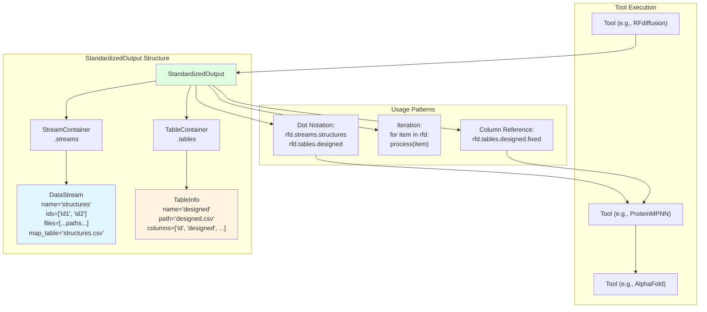
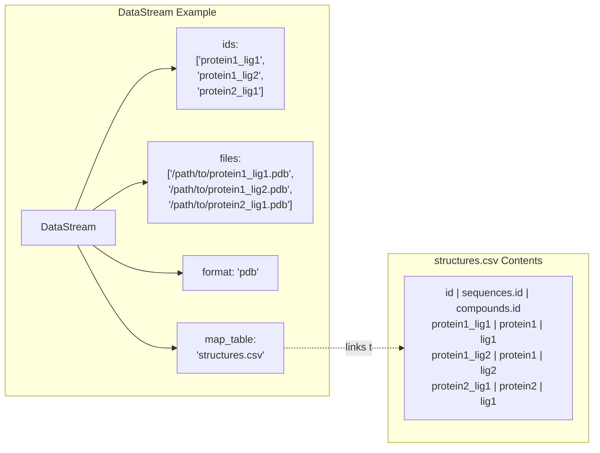
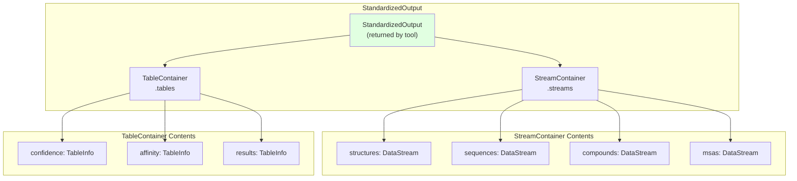
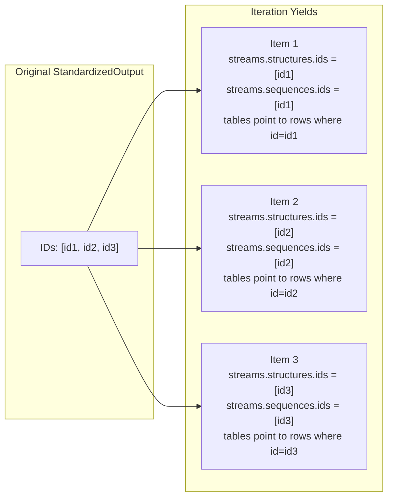
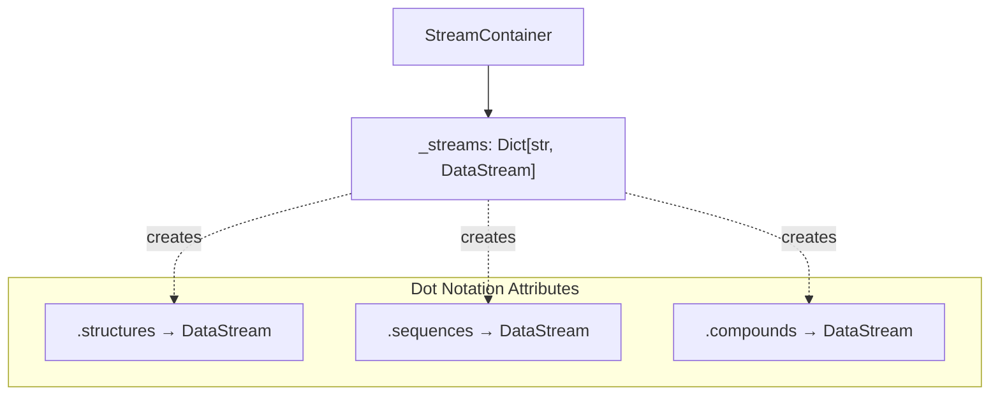
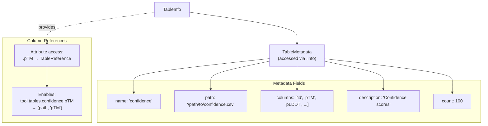
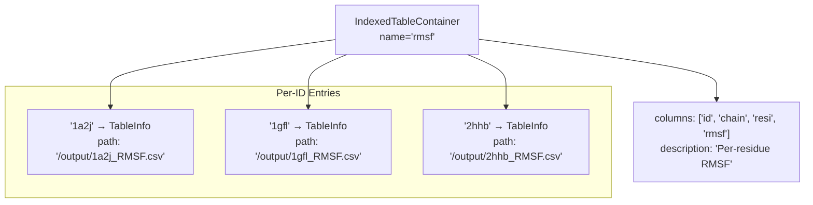
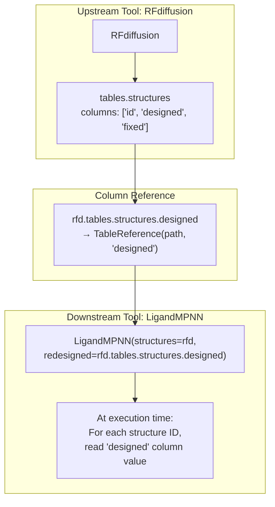
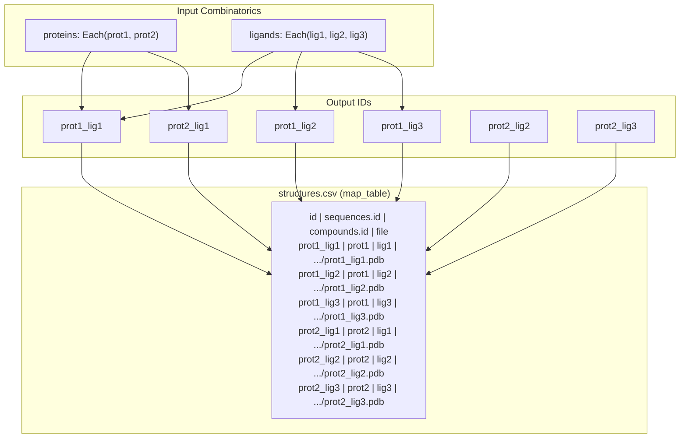
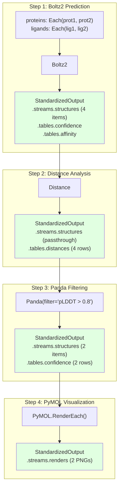

# Data Streams and StandardizedOutput

<details>
<summary>Relevant source files</summary>

The following files were used as context for generating this wiki page:

- [Docs/UserManual.md](Docs/UserManual.md)
- [HelpScripts/pipe_plot.py](HelpScripts/pipe_plot.py)
- [biopipelines/base_config.py](biopipelines/base_config.py)
- [biopipelines/plot.py](biopipelines/plot.py)
- [biopipelines/pymol.py](biopipelines/pymol.py)
- [config.yaml](config.yaml)

</details>


## Purpose and Scope

BioPipelines uses a **unified I/O system** to standardize how tools communicate. Every tool produces a `StandardizedOutput` object containing **DataStreams** (for file collections like structures, sequences, compounds) and **Tables** (for CSV metrics and metadata). This system enables:

- **Type-safe tool chaining**: Tools know exactly what data types to expect from upstream tools
- **ID-based provenance tracking**: Every output ID traces back to its input sources via `map_table` CSVs
- **Dot-notation access**: Access outputs naturally via `tool.streams.structures` or `tool.tables.confidence`
- **Iteration and slicing**: Iterate over individual items while preserving relationships across streams and tables

For information about how tools produce these outputs, see [Tools and BaseConfig](#3.2). For combinatorics operators that control how multiple inputs combine, see [Combinatorics: Each and Bundle](#3.4).

---

## Data Flow Architecture

The following diagram shows how tools produce and consume `StandardizedOutput` objects:



**Sources**: [biopipelines/base_config.py:1052-1195]()

---

## DataStream: File Collections with ID Tracking

A `DataStream` represents a collection of files (or values) with tracked IDs and provenance. It is the fundamental unit for passing file-based data between tools.

### Structure

| Attribute | Type | Description |
|-----------|------|-------------|
| `name` | `str` | Stream name (e.g., "structures", "sequences", "compounds") |
| `ids` | `List[str]` | List of unique identifiers |
| `files` | `List[str]` | File paths corresponding to each ID (or empty for value-based streams) |
| `format` | `str` | File format ("pdb", "cif", "fasta", "sdf", etc.) |
| `map_table` | `str` | Path to CSV tracking provenance with `{stream_name}.id` columns |



**Sources**: [Docs/UserManual.md:176-204](), [biopipelines/base_config.py:1001-1050]()

### Common Stream Types

BioPipelines defines standard stream names accessed via `tool.streams.<name>`:

| Stream Name | Format | Description | Example Tools |
|-------------|--------|-------------|---------------|
| `structures` | `pdb`, `cif`, `pdb\|cif` | Protein/complex structures | RFdiffusion, AlphaFold, Boltz2 |
| `sequences` | CSV with `id`, `sequence` columns | Protein/DNA/RNA sequences | ProteinMPNN, Sequence |
| `compounds` | CSV with `smiles` column, or `sdf`/`pdb` | Small molecules | Ligand, CompoundLibrary |
| `msas` | `a3m`, CSV | Multiple sequence alignments | MMseqs2 |
| `images` | `png`, `jpg`, `svg` | Visualizations | PyMOL, Plot |
| `plots` | `png` | Generated plots | Plot |
| `renders` | `png` | PyMOL renders | PyMOL |

**Sources**: [Docs/UserManual.md:198-204](), [config.yaml:166-187]()

### Iteration Patterns

DataStreams support multiple iteration patterns:

```python
# 1. Iterate over individual items (each is a single-item DataStream)
for structure in boltz.streams.structures:
    print(f"{structure.ids[0]}: {structure.files[0]}")
    # Pass directly to downstream tools
    analysis = SomeTool(structures=structure)

# 2. Count items
num_structures = len(boltz.streams.structures)
print(f"Generated {num_structures} structures")

# 3. Access by index
first_structure = boltz.streams.structures[0]  # Single-item DataStream

# 4. Get all IDs
all_ids = boltz.streams.structures.ids
```

**Sources**: [Docs/UserManual.md:179-196]()

---

## StandardizedOutput: Unified Container

`StandardizedOutput` is the top-level container returned by every tool. It provides unified access to both file-based outputs (streams) and tabular data (tables).



### Access Patterns

```python
# Direct stream access
structures = boltz.streams.structures  # DataStream
sequences = boltz.streams.sequences    # DataStream

# Direct table access
confidence = boltz.tables.confidence   # TableInfo
affinity = boltz.tables.affinity       # TableInfo

# Check existence
if boltz.streams.compounds is not None:
    print("Contains compounds")

# Iterate over entire output (all streams must share same IDs)
for item in boltz:
    # Each item is a single-item StandardizedOutput
    print(item.streams.structures.ids[0])  # Same ID across all streams
    downstream_tool = SomeTool(structures=item)
```

**Sources**: [biopipelines/base_config.py:1052-1195](), [Docs/UserManual.md:179-196]()

### Iteration Over StandardizedOutput

When you iterate over a `StandardizedOutput`, each iteration yields a **single-item slice** with the same ID across all streams:



**Sources**: [biopipelines/base_config.py:1126-1195]()

---

## StreamContainer: Named Stream Access

`StreamContainer` provides dot-notation access to named `DataStream` objects.

### Implementation



### Usage

```python
# Access by attribute
structures = tool.streams.structures

# Access by key
structures = tool.streams["structures"]

# Check if stream exists
if "compounds" in tool.streams:
    compounds = tool.streams.compounds

# Iterate over stream names
for name in tool.streams.keys():
    stream = tool.streams[name]
    print(f"{name}: {len(stream)} items")

# Get with default
msas = tool.streams.get("msas", None)
```

**Sources**: [biopipelines/base_config.py:1001-1050]()

---

## TableContainer and TableInfo: CSV Metadata

`TableContainer` holds named `TableInfo` objects, which provide **metadata** about CSV files without loading the full data into memory.

### TableInfo Structure



### Access Patterns

```python
# Access metadata via .info
info = boltz.tables.confidence.info
print(info.path)        # /path/to/confidence.csv
print(info.columns)     # ["id", "pTM", "pLDDT", ...]
print(info.count)       # 100

# Column references for downstream tools (see next section)
plddt_ref = boltz.tables.confidence.pLDDT  # TableReference

# Load actual data with pandas
import pandas as pd
df = pd.read_csv(boltz.tables.confidence.info.path)
```

**Sources**: [biopipelines/base_config.py:753-802](), [Docs/UserManual.md:205-218]()

### IndexedTableContainer: Per-ID Tables

Some tools produce **one table per input ID** (e.g., per-structure RMSF, per-trajectory metrics). `IndexedTableContainer` handles this pattern:



**Usage**:

```python
# Access by ID
rmsf_1a2j = cabsflex.tables.rmsf["1a2j"]  # TableInfo
print(rmsf_1a2j.info.path)

# Iterate over all entries
for struct_id, table_info in cabsflex.tables.rmsf:
    df = pd.read_csv(table_info.info.path)
    print(f"{struct_id}: {len(df)} residues")

# Get all IDs
all_ids = cabsflex.tables.rmsf.ids
```

**Sources**: [biopipelines/base_config.py:804-922]()

---

## Table Column References: Metadata-Driven Parameterization

`TableInfo` supports **column references** that enable downstream tools to access per-structure metadata:



### Example

```python
# RFdiffusion outputs table with 'designed' column listing designed residues
rfd = RFdiffusion(contigs="50-100", num_designs=5)

# Pass column reference to LigandMPNN
# At runtime, for each structure, the 'designed' value is read from the CSV
lmpnn = LigandMPNN(
    structures=rfd,
    ligand="LIG",
    redesigned=rfd.tables.structures.designed  # Column reference
)

# The reference is a tuple: (TableInfo, "designed")
# Helper scripts resolve it by matching ID and reading the column value
```

**Sources**: [Docs/UserManual.md:373-392](), [biopipelines/biopipelines_io.py]()

---

## ID Tracking and Provenance

Every `DataStream` has an associated **map_table CSV** that tracks provenance through combinatorics axes. This enables filtering and analysis based on which inputs contributed to each output.

### Map Table Structure

When tools use combinatorics (Each/Bundle), the map_table includes `{stream_name}.id` columns:



### Provenance Columns

The naming pattern `{stream_name}.id` identifies provenance columns:

| Column | Description |
|--------|-------------|
| `id` | Output ID (always present) |
| `sequences.id` | Which protein/sequence from the input contributed |
| `compounds.id` | Which ligand/compound from the input contributed |
| `structures.id` | Which upstream structure contributed (for multi-stage pipelines) |
| `msas.id` | Which MSA contributed |

**Sources**: [Docs/UserManual.md:359-371]()

### Filtering by Provenance

```python
import pandas as pd

# Load confidence table
df = pd.read_csv(boltz.tables.confidence.info.path)

# Filter results for a specific protein
prot1_results = df[df['sequences.id'] == 'prot1']

# Filter results for a specific ligand
lig2_results = df[df['compounds.id'] == 'lig2']

# Filter for specific protein-ligand pair
specific = df[
    (df['sequences.id'] == 'prot1') & 
    (df['compounds.id'] == 'lig2')
]

# Use Panda tool for filtering within pipeline
filtered = Panda(
    tables=boltz.tables.confidence,
    operations=[Panda.filter("sequences.id == 'prot1'")],
    pool=boltz  # Also copy matching structures
)
```

**Sources**: [Docs/UserManual.md:361-371]()

---

## Complete Data Flow Example

The following example shows how `StandardizedOutput` flows through a multi-tool pipeline:



**Code Example**:

```python
from biopipelines.pipeline import *
from biopipelines.combinatorics import Each

with Pipeline("Example", "DataFlow", "Complete data flow example"):
    Resources(gpu="A100", time="4:00:00")
    
    # Step 1: Predict structures
    proteins = Sequence(["MKTV...", "AETG..."], ids=["prot1", "prot2"])
    ligands = Ligand(["ATP", "GTP"], ids=["lig1", "lig2"])
    
    boltz = Boltz2(
        proteins=Each(proteins),
        ligands=Each(ligands)
    )
    # boltz.streams.structures has 4 items (prot1_lig1, prot1_lig2, prot2_lig1, prot2_lig2)
    # boltz.tables.confidence.info.path points to confidence.csv with provenance columns
    
    # Step 2: Calculate distances
    distances = Distance(
        structures=boltz,
        selection_a="resn LIG",
        selection_b="chain A",
        mode="min"
    )
    # distances.streams.structures is passthrough from boltz
    # distances.tables.distances has min distance for each structure
    
    # Step 3: Filter high-confidence results
    filtered = Panda(
        tables=boltz.tables.confidence,
        operations=[Panda.filter("pLDDT > 0.8")],
        pool=boltz  # Copy matching structures
    )
    # filtered.streams.structures has only structures with pLDDT > 0.8
    
    # Step 4: Render each structure
    renders = PyMOL(
        PyMOL.RenderEach(
            structures=filtered,
            color_protein="plddt",
            color_ligand="byatom"
        )
    )
    # renders.streams.renders has one PNG per filtered structure
```

**Sources**: [Docs/UserManual.md:30-45](), [biopipelines/base_config.py:117-161]()

---

## Summary of Key Classes

| Class | Location | Purpose |
|-------|----------|---------|
| `DataStream` | `biopipelines/datastream.py` | File collection with IDs, files, format, map_table |
| `StandardizedOutput` | `biopipelines/base_config.py:1052-1195` | Top-level container with `.streams` and `.tables` |
| `StreamContainer` | `biopipelines/base_config.py:1001-1050` | Holds named DataStreams with dot notation |
| `TableContainer` | `biopipelines/base_config.py:924-999` | Holds named TableInfo objects with dot notation |
| `TableInfo` | `biopipelines/base_config.py:753-802` | CSV metadata with `.info` and column references |
| `IndexedTableContainer` | `biopipelines/base_config.py:804-922` | Per-ID tables sharing the same schema |
| `TableMetadata` | `biopipelines/base_config.py:738-751` | Metadata fields (name, path, columns, count) |

**Sources**: [biopipelines/base_config.py:738-1195]()

---