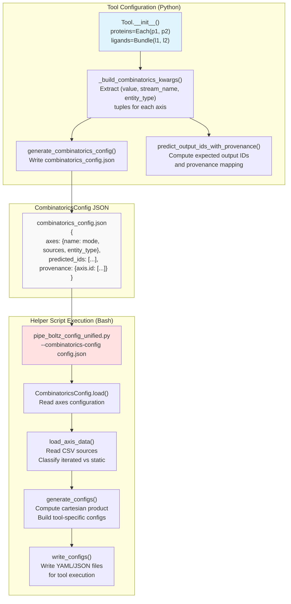
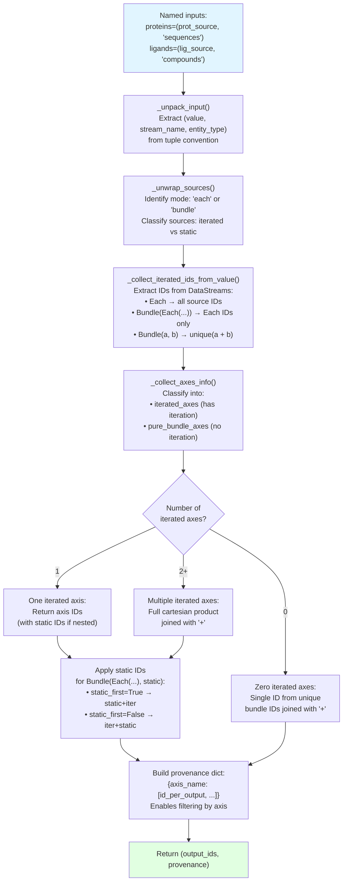

# Combinatorics: Each and Bundle

<details>
<summary>Relevant source files</summary>

The following files were used as context for generating this wiki page:

- [Docs/UserManual.md](Docs/UserManual.md)
- [HelpScripts/pipe_boltz_config_unified.py](HelpScripts/pipe_boltz_config_unified.py)
- [HelpScripts/pipe_boltz_postprocessing.py](HelpScripts/pipe_boltz_postprocessing.py)
- [biopipelines/boltz2.py](biopipelines/boltz2.py)
- [biopipelines/combinatorics.py](biopipelines/combinatorics.py)
- [biopipelines/id_map_utils.py](biopipelines/id_map_utils.py)
- [config.yaml](config.yaml)

</details>


This page explains the combinatorics system in BioPipelines, which controls how multiple inputs combine when passed to tools. The `Each` and `Bundle` operators determine whether inputs form a cartesian product (iterate separately) or group together as a single entity.

For information about how IDs are generated and tracked across tools, see [ID Generation and Provenance Tracking](#3.5). For tool-specific usage examples, see the individual tool documentation in [Tool Categories](#5).

---

## Overview

BioPipelines tools often accept multiple inputs across different parameter axes (proteins, ligands, DNA sequences, etc.). The combinatorics system provides explicit control over how these inputs combine:

- **`Each`** (default): Iterate over inputs, forming a cartesian product axis
- **`Bundle`**: Group inputs together as a single entity that appears in every output

This two-phase system operates at:
1. **Configuration time**: Python code generates a combinatorics config JSON describing how axes combine
2. **Execution time**: Helper scripts read the config and generate appropriate tool-specific configurations

Sources: [biopipelines/combinatorics.py:1-29](), [Docs/UserManual.md:327-371]()

---

## Core Concepts

### Each Operator

The `Each` operator marks inputs for iteration, creating a cartesian product axis. This is the **default behavior** for bare inputs.

```python
from biopipelines.combinatorics import Each

# Explicit Each (identical to bare input)
Boltz2(
    proteins=Each(prot1, prot2),  # Iterate: prot1, prot2
    ligands=Each(lig1, lig2, lig3)  # Iterate: lig1, lig2, lig3
)
# Output: 2 proteins × 3 ligands = 6 predictions
# IDs: prot1+lig1, prot1+lig2, prot1+lig3, prot2+lig1, prot2+lig2, prot2+lig3
```

The `Each` class is defined in [biopipelines/combinatorics.py:37-48]() and serves as an explicit marker for iteration mode.

**Sources**: [biopipelines/combinatorics.py:37-48](), [Docs/UserManual.md:332-343]()

### Bundle Operator

The `Bundle` operator groups multiple inputs as a single entity. All bundled inputs appear together in every output.

```python
from biopipelines.combinatorics import Bundle

# Bundle ligands together
Boltz2(
    proteins=Each(prot1, prot2),  # Iterate: prot1, prot2
    ligands=Bundle(lig1, lig2, lig3)  # Bundle: all 3 together
)
# Output: 2 proteins × 1 bundle = 2 predictions
# IDs: prot1+lig1+lig2+lig3, prot2+lig1+lig2+lig3
```

The `Bundle` class is defined in [biopipelines/combinatorics.py:51-62]().

**Sources**: [biopipelines/combinatorics.py:51-62](), [Docs/UserManual.md:346-350]()

### Nested Combinatorics

`Bundle` can contain `Each` to create sophisticated patterns. The `Each` sources are iterated while other sources are static (appear with every iteration).

```python
# Bundle with nested Each: cofactor + library ligand
Boltz2(
    proteins=prot1,
    ligands=Bundle(cofactor, Each(lib1, lib2, lib3))
)
# Output: 1 protein × 3 library ligands = 3 predictions
# IDs: prot1+cofactor+lib1, prot1+cofactor+lib2, prot1+cofactor+lib3
# Affinity calculated for first ligand in bundle (lib1, lib2, lib3)
```

**Order matters**: Static sources can appear before or after the `Each`:

```python
# Static first (cofactor before library)
Bundle(cofactor, Each(library))  # → cofactor+lib1, cofactor+lib2, ...

# Static last (library before cofactor)
Bundle(Each(library), cofactor)  # → lib1+cofactor, lib2+cofactor, ...
```

**Sources**: [biopipelines/combinatorics.py:234-250](), [Docs/UserManual.md:351-357](), [HelpScripts/pipe_boltz_config_unified.py:514-643]()

---

## Combinatorics Flow

### Configuration Architecture



**Sources**: [biopipelines/combinatorics.py:280-326](), [biopipelines/boltz2.py:302-323](), [HelpScripts/pipe_boltz_config_unified.py:478-659]()

### Data Structures

The combinatorics system uses these core data structures:

| Class | File | Purpose |
|-------|------|---------|
| `Each` | [biopipelines/combinatorics.py:37-48]() | Marks inputs for iteration |
| `Bundle` | [biopipelines/combinatorics.py:51-62]() | Groups inputs as single entity |
| `AxisConfig` | [biopipelines/combinatorics.py:65-81]() | Configuration for a single axis (name, mode, sources, entity_type) |
| `CombinatoricsConfig` | [biopipelines/combinatorics.py:83-145]() | Full config with all axes, predicted IDs, and provenance |

**Sources**: [biopipelines/combinatorics.py:65-145]()

---

## ID Generation Rules

### Cartesian Product Naming

Output IDs are **always** the full cartesian product of all iterated axis IDs joined with `+`. There are no shortcuts based on axis count—even with a single protein, the protein ID is always included.

```python
# 1 protein × 3 ligands → Always include protein ID
proteins = Sequence("MKTVRQ...", ids="prot1")
ligands = CompoundLibrary({"lig1": "CCO", "lig2": "CC(C)O", "lig3": "CCCO"})

boltz = Boltz2(proteins=proteins, ligands=ligands)
# Output IDs: prot1+lig1, prot1+lig2, prot1+lig3
# NOT: lig1, lig2, lig3
```

The `+` separator is distinct from `_` which is reserved for parent→child suffixes (e.g., `protein_1`, `protein_2` from tool multipliers). This ensures multi-axis IDs like `prot1+lig1` are not confused with suffix patterns.

**Sources**: [Docs/UserManual.md:359-360](), [biopipelines/combinatorics.py:518-662]()

### ID Prediction Algorithm



**Sources**: [biopipelines/combinatorics.py:518-662]()

### Static ID Application

For `Bundle(Each(...), static)` patterns, static IDs are prepended or appended based on order:

```python
# Example: Bundle(cofactor, Each(library))
# → static_first=False (Each comes first in iteration)
# → IDs: lib1+cofactor, lib2+cofactor, lib3+cofactor

# Example: Bundle(Each(library), cofactor)  
# → static_first=True (Each comes after static in bundle)
# → IDs: cofactor+lib1, cofactor+lib2, cofactor+lib3
```

The order is determined by comparing the `order` field of sources in the `AxisConfig` ([HelpScripts/pipe_boltz_config_unified.py:114-148]()).

**Sources**: [biopipelines/combinatorics.py:614-626](), [HelpScripts/pipe_boltz_config_unified.py:114-148]()

---

## Provenance Tracking

### Provenance Columns

All output tables include `{axis_name}.id` columns that track which input from each axis produced each output row. This enables filtering and joining across axes.

```python
# 2 proteins × 3 ligands = 6 outputs
boltz = Boltz2(
    proteins=Each(prot1, prot2),
    ligands=Each(lig1, lig2, lig3)
)

# Output table provenance columns:
# id              | proteins.id | ligands.id
# prot1+lig1      | prot1       | lig1
# prot1+lig2      | prot1       | lig2
# prot1+lig3      | prot1       | lig3
# prot2+lig1      | prot2       | lig1
# prot2+lig2      | prot2       | lig2
# prot2+lig3      | prot2       | lig3
```

**Sources**: [Docs/UserManual.md:361-371](), [biopipelines/combinatorics.py:518-662]()

### Provenance in Helper Scripts

Helper scripts propagate provenance from the combinatorics config to output CSVs:

```python
# In pipe_boltz_postprocessing.py
stored_provenance = comb_data.get('provenance', {})
# → {'proteins': ['prot1', 'prot1', ...], 'ligands': ['lig1', 'lig2', ...]}

# Add to output DataFrames
for stream_name, prov_ids in stored_provenance.items():
    col_name = f"{stream_name}.id"
    confidence_df[col_name] = prov_ids
```

**Sources**: [HelpScripts/pipe_boltz_postprocessing.py:59-72](), [HelpScripts/pipe_boltz_postprocessing.py:242-251](), [HelpScripts/pipe_boltz_postprocessing.py:272-281]()

---

## Configuration Generation

### Tool-Side Config Generation

Tools call `generate_combinatorics_config()` to write the config JSON at configuration time:

```python
# In Boltz2.__init__
def _build_combinatorics_kwargs(self) -> Dict:
    """Build combinatorics kwargs for all active axes."""
    kwargs = {}
    if self.proteins is not None:
        kwargs['proteins'] = (self.proteins, "sequences", "protein")
    if self.ligands is not None:
        kwargs['ligands'] = (self.ligands, "compounds", "ligand")
    return kwargs

def _write_combinatorics_config(self) -> str:
    """Write combinatorics config file at configuration time."""
    config_path = os.path.join(self.output_folder, "combinatorics_config.json")
    generate_combinatorics_config(config_path, **self._build_combinatorics_kwargs())
    return config_path
```

The tuple convention `(value, stream_name, entity_type)` tells the system:
- `value`: The actual input (StandardizedOutput, DataStream, etc.)
- `stream_name`: Which stream to extract ("sequences", "compounds", "structures")
- `entity_type`: Metadata for helper scripts ("protein", "ligand", "dna", etc.)

**Sources**: [biopipelines/boltz2.py:302-323](), [biopipelines/combinatorics.py:280-326]()

### Helper Script Config Consumption

Helper scripts load the config and generate tool-specific configurations:

```python
# pipe_boltz_config_unified.py
def main():
    # Load combinatorics config
    comb_config = load_combinatorics_config(args.combinatorics_config)
    axes = comb_config.get('axes', {})
    
    # Load all axes data
    axis_data = {}
    for axis_name, axis_config in axes.items():
        entity_type = axis_config.get('entity_type')
        mode = axis_config.get('mode', 'each')
        iterated, static, static_first = load_axis_data(axis_config)
        axis_data[axis_name] = {
            'entity_type': entity_type,
            'mode': mode,
            'iterated': iterated,
            'static': static,
            'static_first': static_first,
        }
    
    # Generate tool configs (cartesian product)
    configs = generate_configs(axis_data, msa_mappings, args)
    
    # Write output files
    write_configs(configs, args.output_dir)
```

**Sources**: [HelpScripts/pipe_boltz_config_unified.py:710-769](), [HelpScripts/pipe_boltz_config_unified.py:90-148](), [HelpScripts/pipe_boltz_config_unified.py:478-659]()

---

## Practical Examples

### Example 1: Protein-Ligand Screening

Screen 2 proteins against a library of 100 ligands:

```python
proteins = PDB(["4ufc", "1aki"], ids=["POI1", "POI2"])
library = CompoundLibrary("screening_library.csv")  # 100 compounds

# Default (Each): 2 × 100 = 200 predictions
boltz = Boltz2(proteins=proteins, ligands=library)
# IDs: POI1+compound1, POI1+compound2, ..., POI2+compound99, POI2+compound100

# Filter results by protein
df = pd.read_csv(boltz.tables.confidence.info.path)
poi1_results = df[df['proteins.id'] == 'POI1']
```

**Sources**: [Docs/UserManual.md:332-343]()

### Example 2: Cofactor + Library Screening

Screen a library with a required cofactor present in all predictions:

```python
protein = Sequence("MKTVRQ...", ids="enzyme")
cofactor = Ligand("ATP")
library = CompoundLibrary("inhibitors.csv")  # 50 compounds

# Bundle cofactor with library: affinity calculated for library ligand
boltz = Boltz2(
    proteins=protein,
    ligands=Bundle(Each(library), cofactor)
)
# Output: 50 predictions (one per library compound)
# IDs: enzyme+inhibitor1+ATP, enzyme+inhibitor2+ATP, ...
# Affinity calculated for inhibitor (first in bundle)
```

**Sources**: [Docs/UserManual.md:351-357](), [HelpScripts/pipe_boltz_config_unified.py:514-558]()

### Example 3: Multi-Component Complex

Predict a complex with multiple chains, all bundled together:

```python
chain_a = Sequence("MKTVR...", ids="ChainA")
chain_b = Sequence("AETGF...", ids="ChainB")
chain_c = Sequence("GRSLA...", ids="ChainC")
ligand = Ligand("NAD")

# Bundle all components: single prediction with all chains
boltz = Boltz2(
    proteins=Bundle(chain_a, chain_b, chain_c),
    ligands=ligand
)
# Output: 1 prediction
# ID: ChainA+ChainB+ChainC+NAD
```

**Sources**: [biopipelines/combinatorics.py:234-250]()

### Example 4: Nested Each in Bundle

```python
# Two proteins × (library + cofactor) combinations
proteins = PDB(["4ufc", "1aki"])
cofactor = Ligand("NAD")
library = CompoundLibrary({"inh1": "CCO", "inh2": "CC(C)O"})

boltz = Boltz2(
    proteins=Each(proteins),
    ligands=Bundle(cofactor, Each(library))
)
# Output: 2 proteins × 2 library ligands = 4 predictions
# IDs: 4ufc+cofactor+inh1, 4ufc+cofactor+inh2, 1aki+cofactor+inh1, 1aki+cofactor+inh2
# Provenance:
#   proteins.id: [4ufc, 4ufc, 1aki, 1aki]
#   ligands.id: [cofactor+inh1, cofactor+inh2, cofactor+inh1, cofactor+inh2]
#   ligands.1.id: [cofactor, cofactor, cofactor, cofactor]  # Static source
#   ligands.2.id: [inh1, inh2, inh1, inh2]  # Iterated source
```

**Sources**: [biopipelines/combinatorics.py:234-250](), [biopipelines/combinatorics.py:606-611]()

---

## Advanced Patterns

### Source Ordering in Bundles

When multiple sources are present in a Bundle with nested Each, their order determines the output ID structure and affects affinity calculation:

```python
# Static first (cofactor before library)
Bundle(cofactor, Each(library))
# → IDs: cofactor+lib1, cofactor+lib2, ...
# → Affinity calculated for lib1, lib2 (first iterated source)

# Static last (library before cofactor)
Bundle(Each(library), cofactor)
# → IDs: lib1+cofactor, lib2+cofactor, ...
# → Affinity still calculated for lib1, lib2 (iterated source takes priority)
```

The `static_first` flag is determined by comparing the `order` field of sources ([HelpScripts/pipe_boltz_config_unified.py:114-148]()).

**Sources**: [HelpScripts/pipe_boltz_config_unified.py:114-148](), [HelpScripts/pipe_boltz_config_unified.py:614-643]()

### Multiple Bundle Axes

Pure bundle axes (no iteration) contribute a prefix to all output IDs:

```python
# Two pure bundle axes
base_protein = Sequence("MKTVR...", ids="scaffold")
fusion_partner = Sequence("AETGF...", ids="partner")
library = CompoundLibrary({"lig1": "CCO", "lig2": "CC(C)O"})

result = SomeTool(
    proteins=Bundle(base_protein, fusion_partner),
    ligands=Each(library)
)
# Output: 2 predictions
# IDs: scaffold+partner+lig1, scaffold+partner+lig2
```

**Sources**: [biopipelines/combinatorics.py:561-577](), [biopipelines/combinatorics.py:649-660]()

### Provenance Column Explosion

For Bundle axes with multiple sources, provenance columns are created for each bundled ID:

```python
# Bundle with 3 ligands
boltz = Boltz2(
    proteins=protein,
    ligands=Bundle(lig1, lig2, lig3)
)

# Provenance columns in output table:
# ligands.id: ["lig1+lig2+lig3", ...]  # Joined representation
# ligands.1.id: ["lig1", ...]          # Individual component 1
# ligands.2.id: ["lig2", ...]          # Individual component 2
# ligands.3.id: ["lig3", ...]          # Individual component 3
```

**Sources**: [biopipelines/combinatorics.py:606-611](), [biopipelines/combinatorics.py:656-660]()

---

## Implementation Details

### Source Path Extraction

The `_extract_source_paths()` function extracts CSV file paths from various input types:

```python
def _extract_source_paths(source: Any, stream_name: str) -> List[str]:
    """
    Extract CSV file paths from a source.
    
    Handles:
    - Direct path strings
    - Lists of sources
    - DataStream (uses map_table)
    - StandardizedOutput (uses stream_name to get DataStream)
    """
```

**Sources**: [biopipelines/combinatorics.py:175-214]()

### Mode and Source Unwrapping

The `_unwrap_sources()` function determines the combinatorics mode and classifies sources as iterated or static:

```python
def _unwrap_sources(value: Any, stream_name: str) -> tuple:
    """
    Returns (mode: str, sources: list)
    
    For Bundle(Each(library), cofactor):
    - mode = "bundle"
    - Each sources marked iterate=True
    - Bare sources marked iterate=False
    """
```

**Sources**: [biopipelines/combinatorics.py:217-278]()

### ID Collection

Different collection strategies based on wrapper type:

| Wrapper | Collection Strategy | Example |
|---------|-------------------|---------|
| `Each(a, b)` | Collect IDs from all sources | `[id_a1, id_a2, id_b1, id_b2]` |
| `Bundle(a, b)` | Unique IDs from all sources | `[id_a1, id_a2, id_b1, id_b2]` (deduplicated) |
| `Bundle(Each(a), b)` | IDs from Each sources only | `[id_a1, id_a2]` |

**Sources**: [biopipelines/combinatorics.py:388-478]()

---