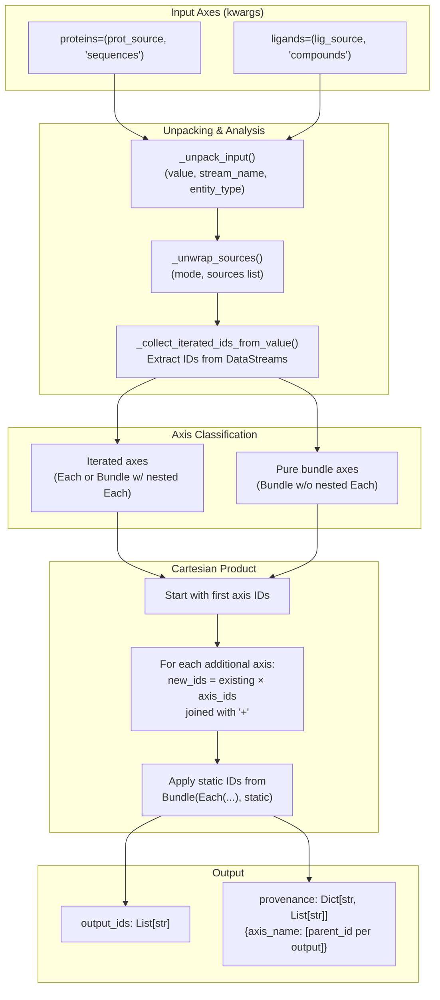
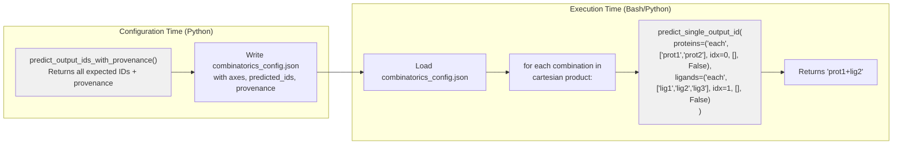
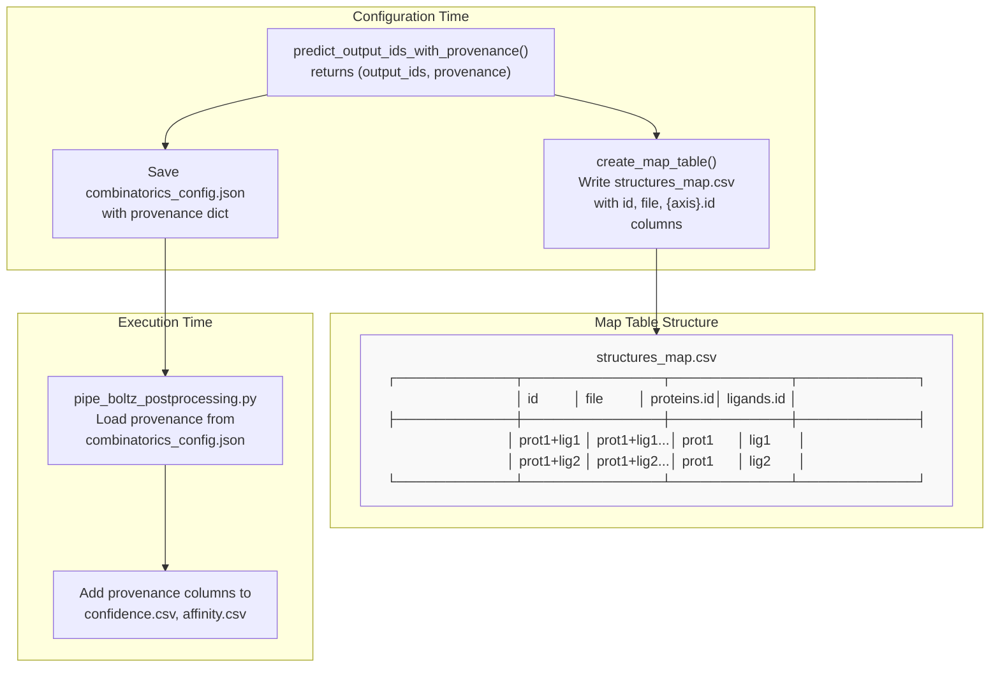
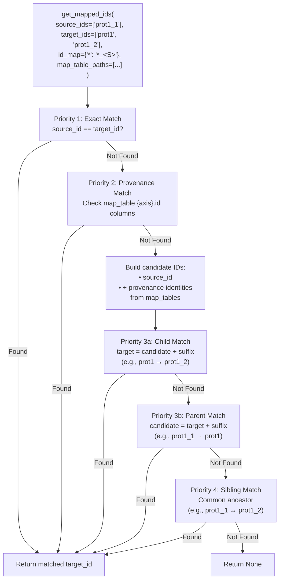
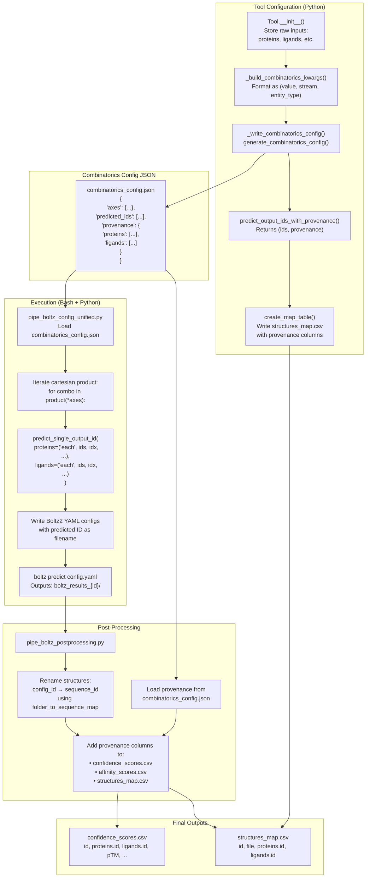

# ID Generation and Provenance Tracking

<details>
<summary>Relevant source files</summary>

The following files were used as context for generating this wiki page:

- [Docs/UserManual.md](Docs/UserManual.md)
- [HelpScripts/pipe_boltz_config_unified.py](HelpScripts/pipe_boltz_config_unified.py)
- [HelpScripts/pipe_boltz_postprocessing.py](HelpScripts/pipe_boltz_postprocessing.py)
- [HelpScripts/pipe_stitch_sequences.py](HelpScripts/pipe_stitch_sequences.py)
- [biopipelines/boltz2.py](biopipelines/boltz2.py)
- [biopipelines/combinatorics.py](biopipelines/combinatorics.py)
- [biopipelines/id_map_utils.py](biopipelines/id_map_utils.py)
- [config.yaml](config.yaml)

</details>


This page explains how BioPipelines systematically generates unique IDs for pipeline outputs and tracks their provenance across multi-axis combinatorics. Understanding these mechanisms is essential for filtering results, joining tables, and debugging ID mismatches.

For combinatorics control (Each/Bundle operators), see [Combinatorics: Each and Bundle](#3.4). For using provenance columns in Panda operations, see [Data Management Tools](#5.6).

---

## ID Generation Fundamentals

BioPipelines generates output IDs at **configuration time** (Python execution) by predicting the cartesian product structure from combinatorics modes. The same IDs are then regenerated at **execution time** (bash script) using identical logic to ensure consistency.

### Multi-Axis Naming Convention

Output IDs are constructed by joining component IDs from all iterated axes using the **`+` separator**:

```
protein1+ligand1
protein1+ligand2
protein2+ligand1
protein2+ligand2
```

**Why `+` instead of `_`?** The `_` separator is reserved for parent→child suffix relationships (e.g., `protein_1`, `protein_2`). Using `+` for multi-axis combinations ensures that suffix-stripping algorithms (`*_<S>` pattern) can distinguish between axes and generations.

**Sources:** [biopipelines/combinatorics.py:520-662](), [biopipelines/id_map_utils.py:184-291]()

### Suffix Patterns for Tool Outputs

When a tool generates multiple outputs per input (e.g., ProteinMPNN generating 10 sequences per structure), child IDs append numeric suffixes:

```
protein → protein_1, protein_2, ..., protein_10
```

Non-numeric suffixes are also supported (e.g., `protein_19A` for mutations at position 19).

**Default ID mapping pattern:** `{"*": "*_<S>"}` — recursively strips any `_suffix` pattern:
- `protein_1_2_3` → `protein_1_2` → `protein_1` → `protein`

**Sources:** [biopipelines/combinatorics.py:752-790](), [biopipelines/id_map_utils.py:130-182]()

---

## Configuration-Time ID Prediction

### The `predict_output_ids_with_provenance()` Function

[biopipelines/combinatorics.py:518-662]() implements the core ID prediction algorithm. It returns both output IDs and provenance mappings.



**Sources:** [biopipelines/combinatorics.py:518-662](), [biopipelines/combinatorics.py:147-173]()

### Example: Two Proteins × Three Ligands

```python
# Configuration time
from biopipelines.combinatorics import predict_output_ids_with_provenance

output_ids, provenance = predict_output_ids_with_provenance(
    proteins=(prot_source, "sequences"),  # prot1, prot2
    ligands=(lig_source, "compounds")      # lig1, lig2, lig3
)

# Result:
output_ids = [
    "prot1+lig1", "prot1+lig2", "prot1+lig3",
    "prot2+lig1", "prot2+lig2", "prot2+lig3"
]

provenance = {
    "proteins": ["prot1", "prot1", "prot1", "prot2", "prot2", "prot2"],
    "ligands":  ["lig1", "lig2", "lig3", "lig1", "lig2", "lig3"]
}
```

**Sources:** [Docs/UserManual.md:359-370]()

---

## Execution-Time ID Generation

Helper scripts regenerate IDs at runtime using `predict_single_output_id()` [biopipelines/combinatorics.py:688-750](). This function takes axis selections (which items were chosen in the current iteration) and produces the same ID that configuration-time prediction would generate.



**Sources:** [biopipelines/combinatorics.py:688-750](), [HelpScripts/pipe_boltz_config_unified.py:653-656]()

### Axis Selection Tuple Format

`predict_single_output_id()` receives axis selections as named kwargs where each value is:

```python
(mode, all_ids, selected_idx, static_ids, static_first)
```

| Field | Type | Description |
|-------|------|-------------|
| `mode` | str | `"each"` or `"bundle"` |
| `all_ids` | List[str] | All IDs available on this axis |
| `selected_idx` | Optional[int] | Index of chosen ID (None for bundle) |
| `static_ids` | List[str] | Static IDs from Bundle(Each(...), static) |
| `static_first` | bool | Whether static IDs come before iterated |

**Sources:** [biopipelines/combinatorics.py:688-750]()

---

## Provenance Tracking System

Provenance columns enable downstream tools to filter and join results by tracking which input from each axis produced each output.

### Provenance Column Naming

For each named input axis, BioPipelines adds a `{axis_name}.id` column to output tables:

```csv
id,file,proteins.id,ligands.id,confidence_score
prot1+lig1,prot1+lig1.pdb,prot1,lig1,0.85
prot1+lig2,prot1+lig2.pdb,prot1,lig2,0.79
prot2+lig1,prot2+lig1.pdb,prot2,lig1,0.91
```

**Usage example:**

```python
import pandas as pd

# Filter Boltz2 results for a specific protein
df = pd.read_csv(boltz.tables.confidence.info.path)
prot1_results = df[df['proteins.id'] == 'prot1']

# Filter for a specific ligand
lig2_results = df[df['ligands.id'] == 'lig2']
```

**Sources:** [Docs/UserManual.md:361-370](), [HelpScripts/pipe_boltz_postprocessing.py:242-251]()

### Map Tables and Provenance Storage

Map tables (`.csv` files with `id`, `file`, `value` columns) serve as the canonical storage for provenance:



**Sources:** [biopipelines/datastream.py:create_map_table](), [HelpScripts/pipe_boltz_postprocessing.py:60-72](), [HelpScripts/pipe_boltz_postprocessing.py:272-310]()

### Provenance in Combinatorics Config

The `combinatorics_config.json` file stores predicted IDs and provenance for use by helper scripts:

```json
{
  "axes": {
    "proteins": {
      "name": "proteins",
      "mode": "each",
      "sources": [{"path": "proteins.csv", "iterate": true}],
      "entity_type": "protein"
    },
    "ligands": {
      "name": "ligands",
      "mode": "each",
      "sources": [{"path": "ligands.csv", "iterate": true}],
      "entity_type": "ligand"
    }
  },
  "predicted_ids": [
    "prot1+lig1", "prot1+lig2", "prot1+lig3",
    "prot2+lig1", "prot2+lig2", "prot2+lig3"
  ],
  "provenance": {
    "proteins": ["prot1", "prot1", "prot1", "prot2", "prot2", "prot2"],
    "ligands": ["lig1", "lig2", "lig3", "lig1", "lig2", "lig3"]
  }
}
```

**Sources:** [biopipelines/combinatorics.py:84-124](), [biopipelines/combinatorics.py:313-325]()

---

## ID Mapping and Lookup

When a tool consumes outputs from upstream tools, it must match IDs between datasets. BioPipelines uses **pattern-based ID mapping** with recursive suffix stripping.

### ID Mapping Pattern Syntax

ID mapping patterns use the format `{"*": "<pattern>"}` where `*` represents the base ID:

| Pattern | Meaning | Example |
|---------|---------|---------|
| `{"*": "*"}` | Identity (no mapping) | `protein_1` → `protein_1` |
| `{"*": "*_<S>"}` | Strip any `_suffix` recursively (DEFAULT) | `protein_1_19A` → `protein_1` → `protein` |
| `{"*": "*_<N>"}` | Strip numeric `_123` suffixes only | `protein_1_2` → `protein_1` → `protein` |
| `{"*": "*-seq-<N>"}` | Strip specific pattern | `protein-seq-42` → `protein` |

**`<N>` placeholder:** Matches one or more digits (`\d+`)  
**`<S>` placeholder:** Matches any non-underscore segment (`[^_]+`)

**Sources:** [biopipelines/id_map_utils.py:13-46](), [biopipelines/id_map_utils.py:53-128]()

### Recursive Suffix Stripping

The `map_table_ids_to_ids()` function [biopipelines/id_map_utils.py:188-291]() generates all candidate IDs by recursively stripping suffixes:

```python
from biopipelines.id_map_utils import map_table_ids_to_ids

# Default pattern: {"*": "*_<S>"}
candidates = map_table_ids_to_ids("protein_1_19A", {"*": "*_<S>"})
# Returns: ['protein_1_19A', 'protein_1', 'protein']

# Multi-axis expansion: "+" components are also candidates
candidates = map_table_ids_to_ids("prot1+lig1_2", {"*": "*_<S>"})
# Returns: ['prot1+lig1_2', 'prot1+lig1', 'prot1', 'lig1_2', 'lig1']
```

**Why multi-axis expansion?** This allows tools to match `prot1+lig1` against tables containing either `prot1` or `lig1` without requiring provenance columns.

**Sources:** [biopipelines/id_map_utils.py:188-291](), [biopipelines/id_map_utils.py:274-289]()

### Priority-Based Matching with `get_mapped_ids()`

[biopipelines/id_map_utils.py:340-534]() implements a priority-based matching strategy:



**Matching priority order:**

1. **Exact match:** `source_id == target_id` (highest priority)
2. **Provenance match:** Check `{axis}.id` columns in map_table CSVs (most reliable)
3. **For each candidate** (source_id + provenance identities):
   - **Child match:** Target derives from candidate (`target = candidate + suffix`)
   - **Parent match:** Candidate derives from target (`candidate = target + suffix`)
4. **Sibling match:** Common ancestor (both derive from same base)

**Sources:** [biopipelines/id_map_utils.py:340-534](), [biopipelines/id_map_utils.py:294-337]()

### Provenance-Based Matching

When suffix-based matching fails (e.g., Panda auto-renamed IDs like `Panda_1`), `get_mapped_ids()` falls back to provenance columns in map_tables:

```python
# Panda renamed "LID_001_1" to "Panda_1"
# Panda's map_table preserves provenance:
# id,file,structures.id
# Panda_1,Panda_1.pdb,LID_001_1

get_mapped_ids(
    source_ids=["Panda_1"],
    target_ids=["LID_001_1"],
    map_table_paths=["path/to/Panda/map.csv"]
)
# Returns: {'Panda_1': 'LID_001_1'}  (via provenance column)
```

**Sources:** [biopipelines/id_map_utils.py:437-445](), [biopipelines/biopipelines_io.py:resolve_id_by_provenance]()

---

## Multiplied ID Generation

Some tools multiply inputs (e.g., ProteinMPNN generating 10 sequences per structure). The `generate_multiplied_ids()` function [biopipelines/combinatorics.py:752-790]() handles this:

```python
from biopipelines.combinatorics import generate_multiplied_ids

output_ids, provenance = generate_multiplied_ids(
    input_ids=["prot_1", "prot_2"],
    suffixes=["1", "2", "3"],
    input_stream_name="structures"
)

# Returns:
output_ids = [
    "prot_1_1", "prot_1_2", "prot_1_3",
    "prot_2_1", "prot_2_2", "prot_2_3"
]

provenance = {
    "structures": ["prot_1", "prot_1", "prot_1", 
                   "prot_2", "prot_2", "prot_2"]
}
```

**Pattern-based variant:** `generate_multiplied_ids_pattern()` [biopipelines/combinatorics.py:793-815]() composes ID patterns without expanding them (used when suffixes are dynamic).

**Sources:** [biopipelines/combinatorics.py:752-790](), [biopipelines/combinatorics.py:793-815]()

---

## StitchSequences Special Case

The `StitchSequences` tool demonstrates complex ID generation with template-substitution matching. IDs are constructed from:

1. Template ID (base)
2. Substitution source IDs
3. Indel source IDs

```python
# Example: template "prot1" + substitution from "sub1" + indel from "ind1"
# Output ID: "prot1_1_1"
#            └─┬─┘ │ │
#              │   │ └─ indel index (1st option)
#              │   └─── substitution index (1st option)
#              └─────── template ID
```

For raw (non-ToolOutput) substitutions/indels with fixed positions, all templates get the full cartesian product of options. For ToolOutput substitutions with dynamic positions, matching uses `get_mapped_ids()` to pair templates with substitution sequences by base ID.

**Sources:** [HelpScripts/pipe_stitch_sequences.py:523-596](), [HelpScripts/pipe_stitch_sequences.py:599-786]()

---

## Implementation Code Entities

### Key Functions

| Function | Location | Purpose |
|----------|----------|---------|
| `predict_output_ids_with_provenance()` | [biopipelines/combinatorics.py:518-662]() | Configuration-time ID and provenance prediction |
| `predict_single_output_id()` | [biopipelines/combinatorics.py:688-750]() | Execution-time single ID generation |
| `generate_multiplied_ids()` | [biopipelines/combinatorics.py:752-790]() | Generate parent→child IDs with provenance |
| `map_table_ids_to_ids()` | [biopipelines/id_map_utils.py:188-291]() | Recursive suffix stripping with multi-axis expansion |
| `get_mapped_ids()` | [biopipelines/id_map_utils.py:340-534]() | Priority-based ID matching with provenance fallback |
| `parse_id_map_pattern()` | [biopipelines/id_map_utils.py:53-128]() | Parse ID mapping pattern to regex |
| `create_map_table()` | [biopipelines/datastream.py]() | Write map_table CSV with provenance columns |

### Key Classes and Data Structures

| Entity | Location | Purpose |
|--------|----------|---------|
| `CombinatoricsConfig` | [biopipelines/combinatorics.py:84-145]() | Dataclass storing axes, predicted_ids, provenance |
| `AxisConfig` | [biopipelines/combinatorics.py:66-81]() | Single axis configuration (name, mode, sources, entity_type) |
| `Each` | [biopipelines/combinatorics.py:37-48]() | Wrapper marking input for iteration |
| `Bundle` | [biopipelines/combinatorics.py:51-62]() | Wrapper grouping inputs as one entity |

**Sources:** [biopipelines/combinatorics.py:1-815](), [biopipelines/id_map_utils.py:1-598]()

---

## Provenance Flow Diagram



**Sources:** [biopipelines/boltz2.py:302-323](), [HelpScripts/pipe_boltz_config_unified.py:710-720](), [HelpScripts/pipe_boltz_postprocessing.py:60-72](), [HelpScripts/pipe_boltz_postprocessing.py:236-253](), [HelpScripts/pipe_boltz_postprocessing.py:272-310]()

---

## Best Practices

### Filtering by Provenance

Always use provenance columns for filtering multi-axis results:

```python
# ✅ Correct: Use provenance column
df = pd.read_csv(boltz.tables.confidence.info.path)
prot1_results = df[df['proteins.id'] == 'prot1']

# ❌ Incorrect: String matching on output ID
prot1_results = df[df['id'].str.contains('prot1')]  # Fragile!
```

### Joining Tables from Different Tools

Use provenance columns to join tables that share a common axis:

```python
# Join ProteinMPNN sequences with AlphaFold predictions
pmpnn_df = pd.read_csv(pmpnn.tables.sequences.info.path)
af_df = pd.read_csv(af.tables.confidence.info.path)

# Both have 'structures.id' provenance column
merged = pd.merge(
    pmpnn_df,
    af_df,
    on='structures.id',  # Common parent structure
    suffixes=('_pmpnn', '_af')
)
```

### Handling Missing Matches

When `get_mapped_ids()` returns `None`, it means no valid match was found. Always check for this:

```python
from biopipelines.id_map_utils import get_mapped_ids

matches = get_mapped_ids(
    source_ids=panda_ids,
    target_ids=upstream_ids,
    id_map={"*": "*_<S>"},
    map_table_paths=[panda.streams.structures.map_table]
)

for source_id, target_id in matches.items():
    if target_id is None:
        print(f"Warning: No match found for {source_id}")
```

**Sources:** [Docs/UserManual.md:361-370](), [biopipelines/id_map_utils.py:408-534]()

---