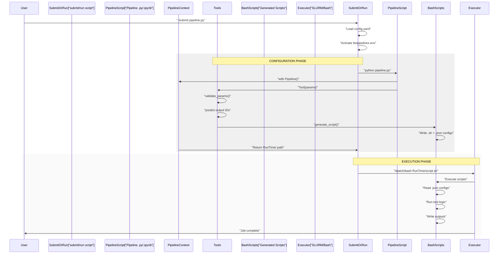
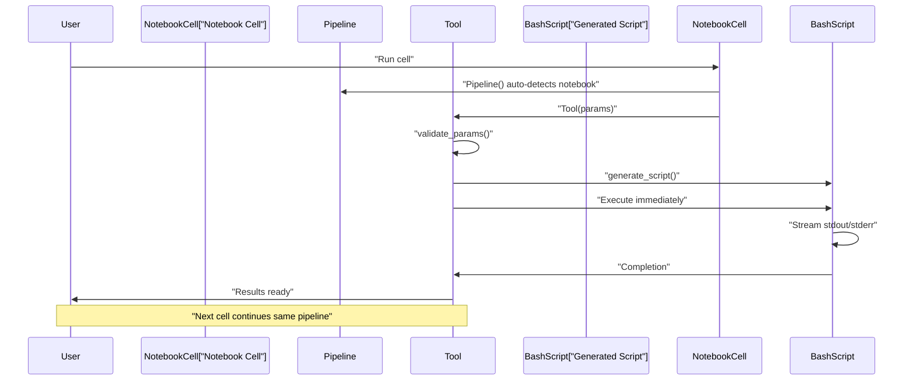
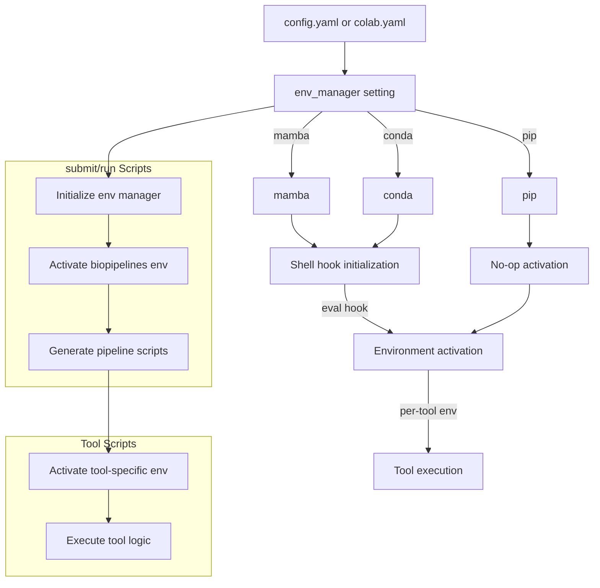
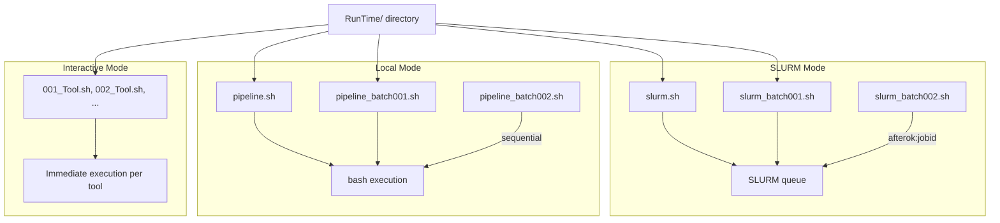
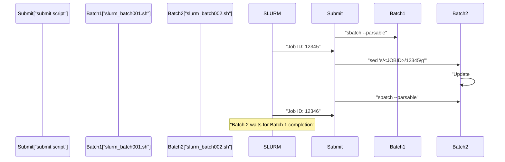
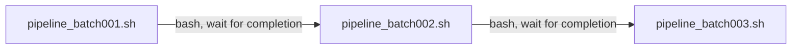
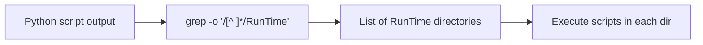
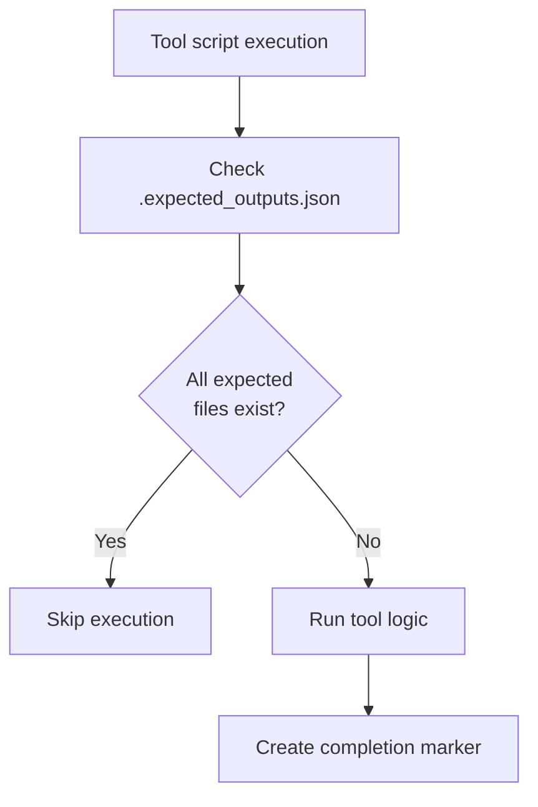

# Execution Modes

<details>
<summary>Relevant source files</summary>

The following files were used as context for generating this wiki page:

- [Docs/UserManual.md](Docs/UserManual.md)
- [config.yaml](config.yaml)
- [run](run)
- [submit](submit)

</details>


This page describes the three execution modes supported by BioPipelines: SLURM cluster submission, local execution, and interactive notebook mode. These modes differ in how they execute the bash scripts generated during the configuration phase and in their environment management strategies.

For detailed information about specific execution modes, see:
- SLURM cluster execution: [SLURM Cluster Execution (submit)](#4.1)
- Local execution: [Local Execution (run)](#4.2)
- Interactive notebook execution: [Interactive Mode (Jupyter/Colab)](#4.3)

For information about the Pipeline context and how tools are registered, see [Pipeline Context and Resources](#3.1).

---

## Two-Phase vs One-Phase Execution

BioPipelines operates in either a two-phase model (configuration + execution) or a one-phase model (on-the-fly) depending on the execution mode.

### Two-Phase Model (SLURM and Local)

When using the `submit` or `run` scripts, BioPipelines operates in two distinct phases:



**Sources:** [Docs/UserManual.md:159-171](), [submit:80-147](), [run:82-115]()

| Phase | What Happens | Language | Output |
|-------|--------------|----------|---------|
| **Configuration** | Validate parameters, predict filesystem structure, generate bash scripts and JSON configs | Python | Scripts in `RunTime/`, predictions in `ToolOutputs/` |
| **Execution** | Execute bash scripts, run actual computations, create output files | Bash + tool-specific environments | PDB files, CSVs, logs in numbered tool directories |

**Sources:** [Docs/UserManual.md:159-171]()

### One-Phase Model (Interactive)

In Jupyter notebooks or Google Colab, the configuration and execution phases are merged. Each tool executes immediately when added to the pipeline:



**Sources:** [Docs/UserManual.md:421-453]()

---

## Execution Mode Comparison

The following table summarizes the key differences between execution modes:

| Feature | SLURM (`submit`) | Local (`run`) | Interactive (Notebooks) |
|---------|------------------|---------------|------------------------|
| **Script** | `./submit pipeline.py` | `./run pipeline.py` | Notebook cells |
| **Configuration phase** | Yes (Python) | Yes (Python) | Merged with execution |
| **Execution phase** | SLURM batch jobs | Sequential bash execution | Immediate per-tool |
| **Parallelization** | SLURM scheduler | None | None |
| **Dependencies** | Multi-batch with `afterok` | Sequential batches | Sequential tools |
| **Environment manager** | `mamba`/`conda` | `mamba`/`conda` | `pip` (Colab) or `mamba`/`conda` |
| **Config file** | `config.yaml` | `config.yaml` | `colab.yaml` (auto-detected) or `config.yaml` |
| **Output location** | Configured path | Configured path | `./BioPipelines/` |
| **Resource allocation** | `Resources()` controls SLURM | `Resources()` ignored | `Resources()` ignored |
| **Pipeline context** | `with Pipeline()` required | `with Pipeline()` required | `with Pipeline()` optional |
| **Re-execution** | Full pipeline regeneration | Full pipeline regeneration | Completion markers preserved |

**Sources:** [Docs/UserManual.md:128-136](), [Docs/UserManual.md:444-453](), [submit:1-311](), [run:1-252]()

---

## Environment Manager Configuration

BioPipelines supports three environment managers: `mamba`, `conda`, and `pip`. The `env_manager` setting in `config.yaml` controls which is used.

### Environment Manager Flow



**Sources:** [config.yaml:140-146](), [submit:20-41](), [run:19-42]()

### Environment Manager Settings

The `env_manager` is configured in `config.yaml`:

```yaml
cluster:
  env_manager: "mamba"  # or "conda" or "pip"
```

**Sources:** [config.yaml:140-142]()

| Setting | Shell Hook Command | Environment Activation | Use Case |
|---------|-------------------|----------------------|----------|
| `mamba` | `eval "$(mamba shell hook --shell bash)"` | `mamba activate <env>` | Recommended for HPC clusters |
| `conda` | `eval "$(conda shell.bash hook)"` | `conda activate <env>` | Alternative for HPC clusters |
| `pip` | No-op | No-op (single environment) | Google Colab, Jupyter notebooks |

**Sources:** [submit:36-41](), [run:28-42](), [Docs/UserManual.md:88-92]()

When `env_manager: "pip"` is set (as in `colab.yaml`), environment activation becomes a no-op and all tools run in the single Python environment. This is automatically configured for Google Colab environments.

**Sources:** [Docs/UserManual.md:88-92]()

---

## Script Generation and Execution

All execution modes follow the same script generation pattern but differ in how those scripts are executed.

### Generated Script Structure

During the configuration phase, BioPipelines generates a directory structure in `<job>/RunTime/`:

```
RunTime/
├── pipeline.sh              # Main bash script (local execution)
├── slurm.sh                 # SLURM wrapper (cluster execution)
├── slurm_batch001.sh        # Multi-batch: first batch
├── slurm_batch002.sh        # Multi-batch: second batch (depends on 001)
├── pipeline_batch001.sh     # Multi-batch: local execution of batch 1
├── pipeline_batch002.sh     # Multi-batch: local execution of batch 2
├── 001_ToolName.sh          # Individual tool scripts
├── 002_ToolName.sh
└── ...
```

**Sources:** [submit:168-220](), [run:143-170]()

### Script Execution by Mode



**Sources:** [submit:168-259](), [run:143-196](), [Docs/UserManual.md:421-453]()

---

## Multi-Batch Pipeline Handling

When a pipeline contains multiple `Resources()` calls, BioPipelines creates separate batches with dependencies.

### Batch Dependency Resolution (SLURM)

The `submit` script manages batch dependencies by replacing the `<JOBID>` placeholder with the actual SLURM job ID from the previous batch:



**Sources:** [submit:178-220]()

The `<JOBID>` placeholder is defined in each batch script's SLURM header:

```bash
#SBATCH --dependency=afterok:<JOBID>
```

The `submit` script replaces this with the actual job ID from the previous batch:

```bash
sed -i "s/<JOBID>/$last_job_id/g" "$batch_file"
```

**Sources:** [submit:185-192]()

### Sequential Execution (Local)

The `run` script executes batches sequentially without parallelization:



**Sources:** [run:146-173]()

---

## Mode Selection Guide

### Use SLURM Mode When:

- Running on an HPC cluster with SLURM
- Pipeline requires GPU resources
- Pipeline has multiple batches with different resource requirements
- Need parallel execution of multiple tools
- Want automatic dependency management

**Command:** `./submit pipeline.py` or `biopipelines-submit pipeline.py`

**Sources:** [Docs/UserManual.md:459-478]()

### Use Local Mode When:

- Testing pipelines on a local workstation
- No SLURM cluster available
- Pipeline is lightweight (CPU-only, small datasets)
- Debugging pipeline logic
- Want to see real-time output

**Command:** `./run pipeline.py` or `biopipelines-run pipeline.py`

**Sources:** [Docs/UserManual.md:465-478]()

### Use Interactive Mode When:

- Prototyping in Jupyter notebooks
- Running on Google Colab
- Want step-by-step execution and inspection
- Experimenting with tool parameters
- Teaching or demonstration purposes

**Activation:** Automatically enabled in notebooks, or set `on_the_fly=True` in `Pipeline()`

**Sources:** [Docs/UserManual.md:421-453]()

---

## Runtime Directory Discovery

Both `submit` and `run` scripts discover pipeline output by parsing the configuration phase output for `RunTime` directory paths.

### Directory Extraction Pattern



**Sources:** [submit:117-147](), [run:117-123]()

The extraction pattern in both scripts:

```bash
runtime_dirs=$(echo "$pipeline_output" | grep -o '/[^ ]*/RunTime' | sort -u)
```

**Sources:** [submit:118](), [run:118]()

This allows BioPipelines to support multiple pipelines in a single script (though uncommon in practice).

---

## Completion Checking

All execution modes preserve the completion checking mechanism. Each tool creates a `.expected_outputs.json` file that is checked before re-execution:



This mechanism ensures that re-running a notebook or re-submitting a job skips already-completed tools.

**Sources:** [Docs/UserManual.md:452]()

---

## Environment Activation in Generated Scripts

Each generated tool script activates the appropriate environment before execution. The activation command depends on the `env_manager` setting.

### Tool Script Environment Activation

Generated tool scripts include environment activation commands based on `config.yaml`:

```bash
# For mamba
eval "$(mamba shell hook --shell bash)"
mamba activate <tool_env>

# For conda  
eval "$(conda shell.bash hook)"
conda activate <tool_env>

# For pip (no-op)
# No activation needed
```

The environment mapping is defined in `config.yaml`:

```yaml
environments:
  RFdiffusion: "SE3nv"
  ProteinMPNN: "proteinmpnn_env"
  Boltz2: "Boltz2Env"
  # ...
```

**Sources:** [config.yaml:61-120]()

Tools can override the conda environment by using Singularity containers when configured in the `containers` section:

```yaml
containers:
  RFdiffusionAllAtom: "<containers>/rf_se3_diffusion.sif"
```

**Sources:** [config.yaml:122-128]()

---