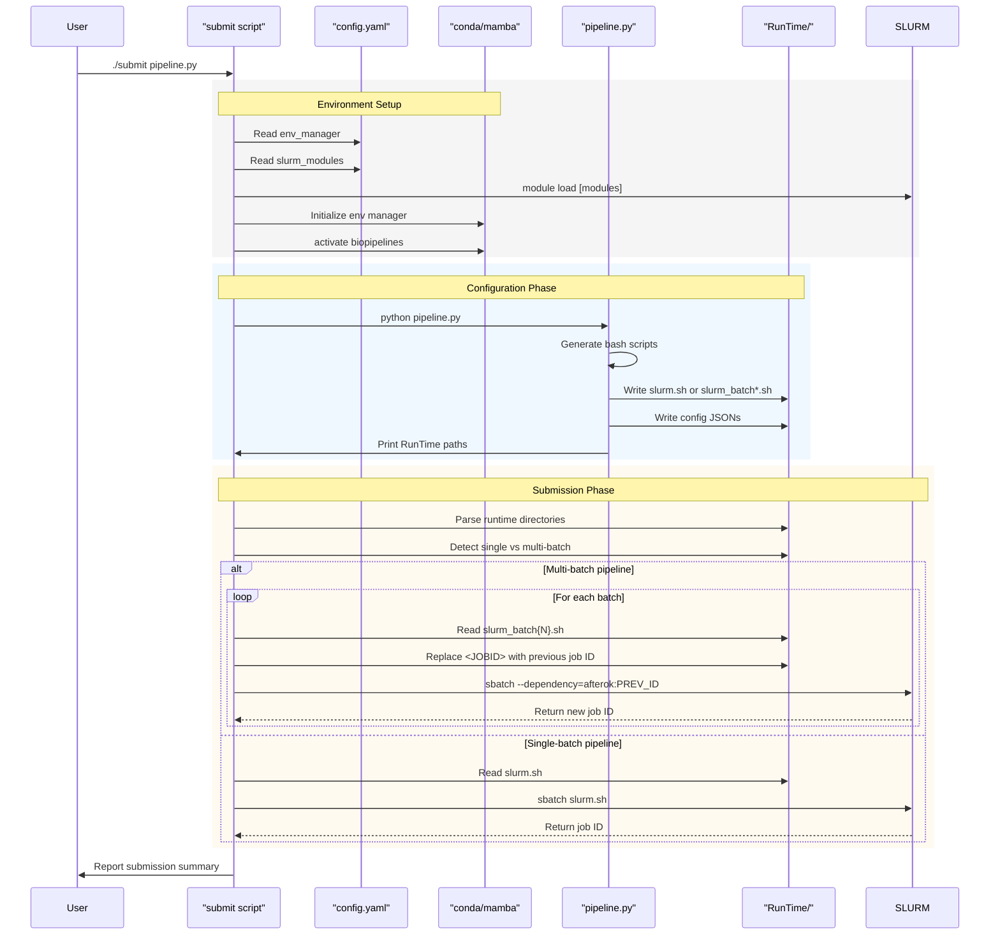
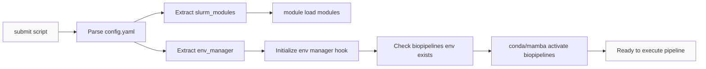
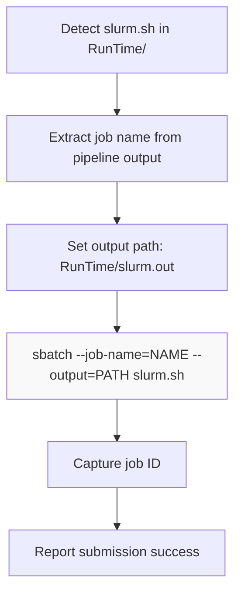
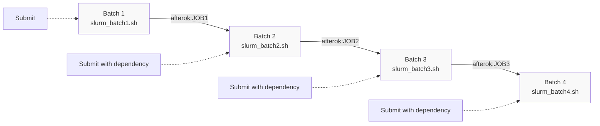
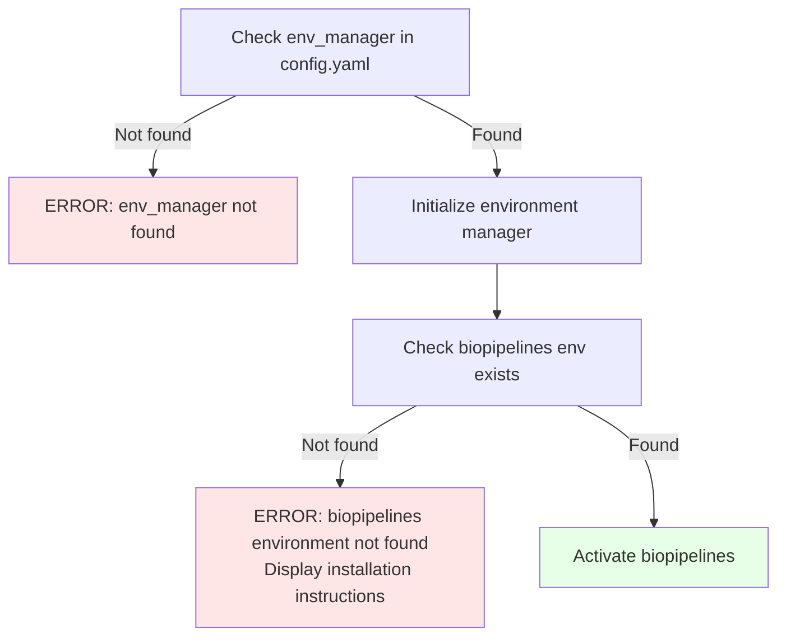

# SLURM Cluster Execution (submit)

<details>
<summary>Relevant source files</summary>

The following files were used as context for generating this wiki page:

- [run](run)
- [submit](submit)

</details>


The `submit` script orchestrates SLURM cluster execution for BioPipelines. It performs two sequential operations: (1) runs the Python pipeline script in the **configuration phase** to generate bash execution scripts and JSON configs, and (2) submits the generated scripts to SLURM with automatic dependency management for multi-batch pipelines. The script handles environment activation, runtime directory parsing, job naming, output redirection, and dependency chain creation.

For local execution without SLURM, see [Local Execution (run)](#4.2). For interactive notebook execution, see [Interactive Mode (Jupyter/Colab)](#4.3).

---

## Overview

The `submit` script is the primary entry point for cluster execution. It wraps the two-phase execution model described in [Tools and BaseConfig](#3.2):

1. **Configuration Phase**: Executes the Python pipeline script to generate bash scripts, JSON configs, and predict output directories
2. **Submission Phase**: Parses runtime directories and submits generated SLURM scripts with appropriate dependencies

The script is located at the repository root and must be executed from within the `biopipelines` conda/mamba environment.

**Sources**: [submit:1-311]()

---

## Execution Workflow



**Sources**: [submit:80-263](), [submit:16-42]()

---

## Configuration and Environment Setup

The `submit` script reads cluster configuration from `config.yaml` before activating the Python environment. This ensures that environment managers and SLURM modules are available.

### Config Parameters

| Parameter | Type | Purpose | Location |
|-----------|------|---------|----------|
| `env_manager` | `"mamba"` or `"conda"` | Environment manager for activation | [submit:20-26]() |
| `slurm_modules` | List of strings | Modules to load before execution | [submit:28-34]() |

### Initialization Sequence



The script performs robust environment manager initialization:

```bash
# Conditional initialization based on env_manager
if [ "$ENV_MANAGER" = "conda" ]; then
    eval "$(conda shell.bash hook)"
else
    eval "$($ENV_MANAGER shell hook --shell bash)"
fi
```

**Sources**: [submit:16-57]()

---

## Pipeline Generation Phase

The `submit` script executes the Python pipeline script and captures its output. The Python script performs all configuration-phase operations described in [Tools and BaseConfig](#3.2), including parameter validation, ID generation, and script creation.

### Output Parsing

The script extracts runtime directories from the pipeline output using pattern matching:

```bash
# Extract ALL runtime directories from pipeline output
local runtime_dirs=$(echo "$pipeline_output" | grep -o '/[^ ]*/RunTime' | sort -u)
```

Each runtime directory corresponds to one pipeline context (one `with Pipeline(...)` block) and contains:

- **Single-batch**: `slurm.sh` and `pipeline.sh`
- **Multi-batch**: `slurm_batch1.sh`, `slurm_batch2.sh`, ..., `pipeline_batch1.sh`, `pipeline_batch2.sh`, ...

### Verbose Mode

The `-v` or `--verbose` flag controls output verbosity:

| Mode | Behavior |
|------|----------|
| Normal | Show only errors, warnings, and tracebacks | [submit:95-105]() |
| Verbose (`-v`) | Show complete pipeline generation output | [submit:91-94]() |

**Sources**: [submit:80-115](), [submit:117-147]()

---

## Job Submission Phase

After pipeline generation, the script processes each runtime directory and submits jobs to SLURM. The submission strategy differs for single-batch vs multi-batch pipelines.

### Single-Batch Pipeline Submission

For pipelines with a single batch, the script submits `slurm.sh` directly:



The submission command includes:
- `--job-name`: Pipeline name or extracted from output
- `--output`: Redirected to `RunTime/slurm.out`
- `--parsable`: Returns only the job ID for parsing

**Sources**: [submit:226-258]()

---

## Multi-Batch Pipeline with Dependencies

Multi-batch pipelines require sequential execution of batches, where each batch depends on the successful completion of the previous batch. The `submit` script automatically constructs this dependency chain.

### Dependency Chain Construction



### Placeholder Replacement

Generated SLURM batch scripts contain a `<JOBID>` placeholder for dependency injection:

```bash
# Before submission (in slurm_batch2.sh)
#SBATCH --dependency=afterok:<JOBID>

# After replacement by submit script
#SBATCH --dependency=afterok:12345678
```

The replacement occurs at [submit:185-192]():

```bash
if [ -n "$last_job_id" ]; then
    echo "Updating $batch_file with dependency on job $last_job_id"
    sed -i "s/<JOBID>/$last_job_id/g" "$batch_file"
fi
```

### Batch Submission Loop

The script processes batches in sequence, maintaining the previous job ID:

| Step | Action | Variables |
|------|--------|-----------|
| 1 | Sort batch files with `sort -V` | `slurm_batch1.sh`, `slurm_batch2.sh`, ... |
| 2 | For each batch, replace `<JOBID>` | `last_job_id` from previous iteration |
| 3 | Extract batch number from filename | `batch_num` via regex |
| 4 | Set job name and output path | `pipeline_name_batch{N}`, `job_batch{N}.out` |
| 5 | Submit with `sbatch --parsable` | Capture new job ID |
| 6 | Update `last_job_id` for next iteration | Store for dependency chain |

**Sources**: [submit:168-224]()

---

## Job Naming and Output Redirection

### Naming Convention

| Pipeline Type | Job Name Pattern | Output File Pattern |
|---------------|------------------|---------------------|
| Single-batch | `{pipeline_name}` | `RunTime/slurm.out` |
| Multi-batch | `{pipeline_name}_batch{N}` | `RunTime/job_batch{N}.out` |

The `{pipeline_name}` is extracted from the parent directory of `RunTime/`:

```bash
local pipeline_name=$(basename "$(dirname "$runtime_dir")")
```

### Output Files

All SLURM output (stdout and stderr) is redirected to structured output files within the `RunTime/` directory:

```
MyProject/
└── Job_MyJob/
    ├── RunTime/
    │   ├── slurm.out              # Single-batch output
    │   ├── job_batch1.out          # Multi-batch batch 1 output
    │   ├── job_batch2.out          # Multi-batch batch 2 output
    │   └── ...
    └── ToolOutputs/
```

This enables easy debugging and log tracking per batch.

**Sources**: [submit:162-166](), [submit:196-202](), [submit:235-241]()

---

## Error Handling and Validation

The `submit` script performs comprehensive error checking at each stage:

### Environment Validation



**Sources**: [submit:21-26](), [submit:45-57]()

### Pipeline Execution Validation

| Check | Error Condition | Action |
|-------|-----------------|--------|
| Script exists | File not found | Exit with error message |
| Python execution | Non-zero exit code | Display traceback and exit |
| Runtime directories | No RunTime paths found | Check for legacy sbatch commands, otherwise fail |
| SLURM submission | `sbatch` fails or returns error | Display error message and exit |

### Submission Validation

The script checks both exit codes and output content for submission failures:

```bash
if [ $submit_exit -eq 0 ] && ! echo "$submit_output" | grep -qi "error\|invalid\|failed"; then
    # Success
    last_job_id="$submit_output"
else
    # Failure - report and exit
    echo "✗ Failed to submit batch $batch_num"
    echo "   Error: $submit_output"
    return 1
fi
```

This dual-check prevents false positives where `sbatch` returns exit code 0 but prints an error message.

**Sources**: [submit:207-219](), [submit:241-252](), [submit:300-304]()

---

## Usage and Command-Line Interface

### Basic Usage

```bash
./submit <pipeline_script>
```

### Options

| Option | Description | Example |
|--------|-------------|---------|
| `-v`, `--verbose` | Show full pipeline generation output | `./submit -v pipeline.py` |
| `-h`, `--help` | Display usage information | `./submit --help` |

### Examples

```bash
# Submit a pipeline script
./submit pipeline.py

# Submit with verbose output for debugging
./submit -v ExamplePipelines/ligandmpnn_boltz2.py

# Submit from a Jupyter notebook export
./submit pipeline.ipynb
```

**Sources**: [submit:60-78](), [submit:266-290]()

---

## Submission Summary Output

The `submit` script provides structured feedback during execution:

### Single-Batch Output Format

```
Generating pipeline: pipeline.py
Found 1 pipeline(s) to submit
==========================================
Processing pipeline: MyPipeline
Runtime directory: /path/to/MyProject/Job_MyJob/RunTime
Detected single-batch pipeline
Submitting job...
------------------------------------------
✓ Job submitted: Job ID 12345678
==========================================
All pipelines submitted. Total jobs: 1
```

### Multi-Batch Output Format

```
Generating pipeline: pipeline.py
Found 1 pipeline(s) to submit
==========================================
Processing pipeline: MyPipeline
Runtime directory: /path/to/MyProject/Job_MyJob/RunTime
Detected multi-batch pipeline
Submitting jobs with dependencies...
------------------------------------------
Submitting batch 1...
  Job name: MyPipeline_batch1
  Output: /path/to/RunTime/job_batch1.out
✓ Batch 1 submitted: Job ID 12345678

Updating slurm_batch2.sh with dependency on job 12345678
Submitting batch 2...
  Job name: MyPipeline_batch2
  Output: /path/to/RunTime/job_batch2.out
  Dependency: afterok:12345678
✓ Batch 2 submitted: Job ID 12345679

Pipeline MyPipeline: 2 batch(es) submitted
==========================================
All pipelines submitted. Total jobs: 2
```

**Sources**: [submit:149-263]()

---

## Comparison with Local Execution

The `submit` script shares core logic with the `run` script but differs in the execution phase:

| Feature | `submit` (SLURM) | `run` (Local) |
|---------|------------------|---------------|
| Environment activation | Required | Required |
| Pipeline generation | Python script | Python script |
| Execution scripts | `slurm.sh`, `slurm_batch*.sh` | `pipeline.sh`, `pipeline_batch*.sh` |
| Execution method | `sbatch` with job queue | Direct `bash` execution |
| Batch handling | Parallel with dependencies | Sequential execution |
| Output redirection | SLURM `--output` flag | Inherited from terminal |
| Job dependencies | Automatic via `afterok` | Implicit via sequential execution |

For detailed information on local execution, see [Local Execution (run)](#4.2).

**Sources**: [submit:1-311](), [run:1-252]()

---

## Integration with Pipeline Context

The `submit` script relies on the [Pipeline Context](#3.1) to generate runtime directories. The context manager creates the following structure during the configuration phase:

```
MyProject/
└── Job_MyJob/
    ├── RunTime/
    │   ├── slurm.sh               # Generated by Pipeline.__exit__()
    │   ├── slurm_batch1.sh         # If multi-batch
    │   ├── slurm_batch2.sh
    │   ├── pipeline.sh             # Local execution alternative
    │   └── pipeline_batch*.sh      # Multi-batch local execution
    ├── Configs/
    │   ├── tool1_config.json
    │   └── tool2_config.json
    └── ToolOutputs/
        └── (created during execution)
```

The `submit` script discovers these directories by parsing the Python output for `/[^ ]*/RunTime` patterns, enabling it to support multiple pipeline contexts in a single script.

**Sources**: [submit:117-119](), [submit:157-166]()

---