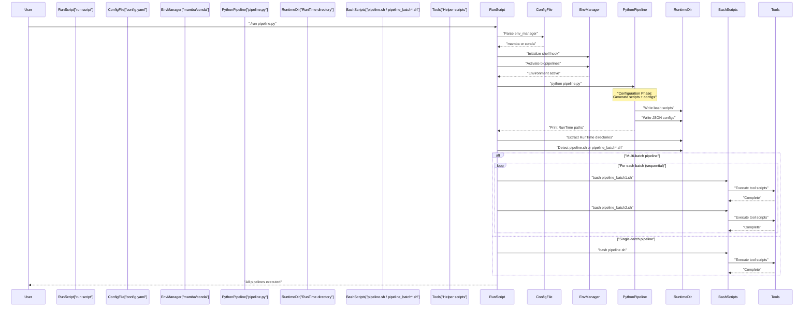
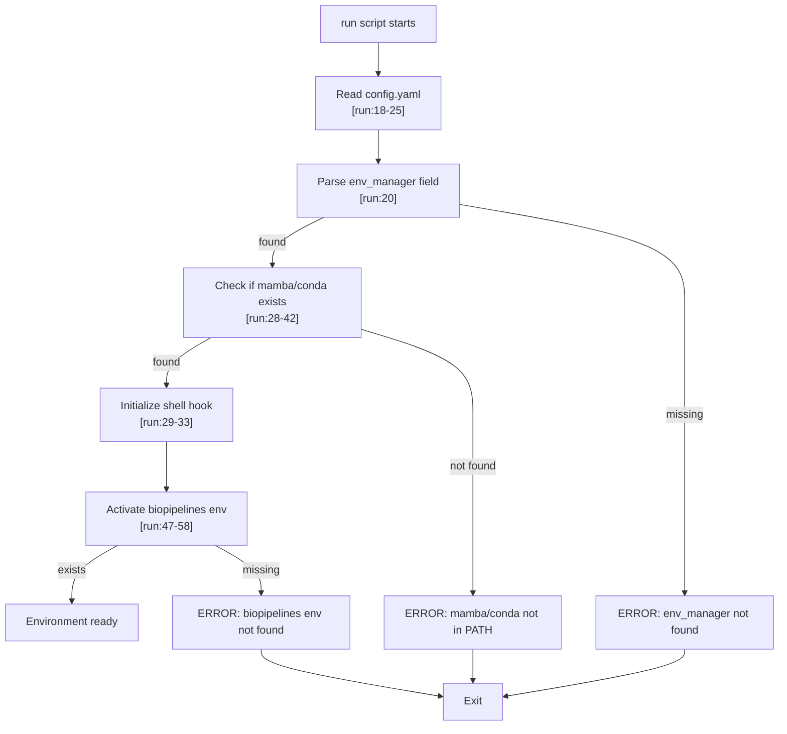
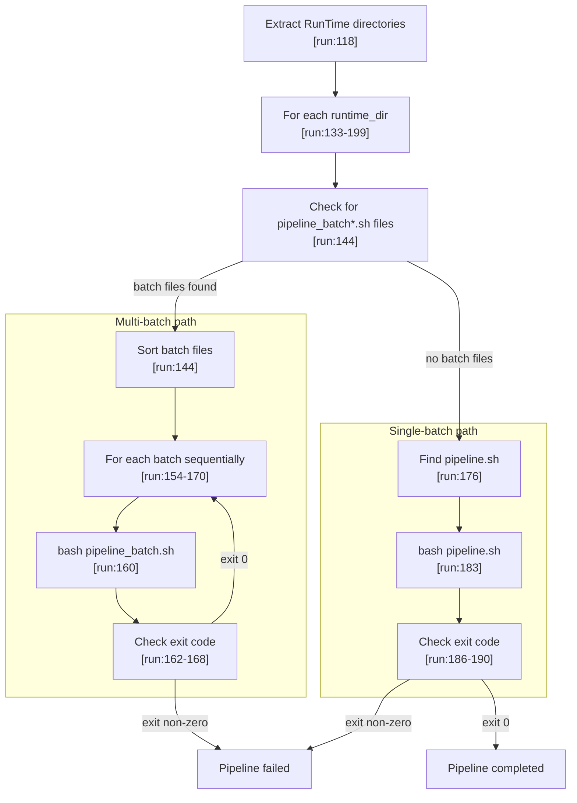
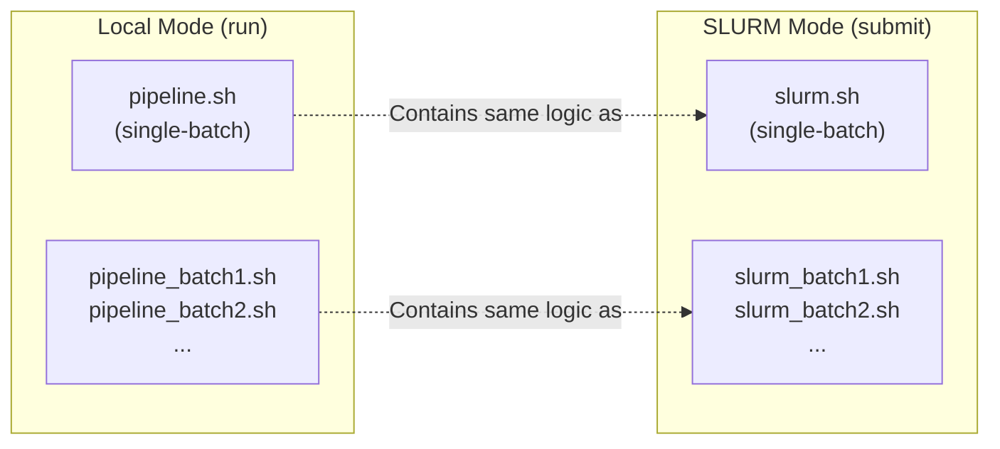

# Local Execution (run)

<details>
<summary>Relevant source files</summary>

The following files were used as context for generating this wiki page:

- [run](run)
- [submit](submit)

</details>


This document describes the local execution mode for BioPipelines via the `run` script. Local execution runs pipeline jobs directly on the current machine without SLURM job scheduling, executing generated bash scripts sequentially in the current shell environment. This mode is intended for workstation execution, debugging, and small-scale pipelines where SLURM overhead is unnecessary.

For SLURM cluster execution with job scheduling and parallelization, see [SLURM Cluster Execution (submit)](#4.1). For interactive notebook execution with on-the-fly computation, see [Interactive Mode (Jupyter/Colab)](#4.3).

## Overview

The `run` script implements the two-phase execution model in local mode:

1. **Configuration Phase**: Executes the Python pipeline script to generate bash scripts and JSON configuration files
2. **Execution Phase**: Executes the generated bash scripts sequentially using `bash` directly (no job scheduler)

The key difference from SLURM mode is that all batches execute **sequentially** in the current shell, while SLURM mode submits batches as independent jobs with dependency chains.

**Local Execution Workflow**



Sources: [run:1-252]()

## Script Invocation

### Command Syntax

```bash
./run [-v|--verbose] <pipeline_script>
```

### Arguments

| Argument | Type | Description |
|----------|------|-------------|
| `pipeline_script` | Required | Path to pipeline script (`.py` or `.ipynb`) |
| `-v, --verbose` | Optional | Show full pipeline generation output including all Python stdout/stderr |

### Examples

```bash
# Basic execution
./run pipeline.py

# Verbose mode (show all Python output)
./run -v pipeline.py

# Execute from notebook
./run pipeline.ipynb

# Execute example pipeline
./run ExamplePipelines/boltz2.py
```

Sources: [run:61-79]()

## Environment Setup Process

The `run` script performs environment initialization before executing any pipeline code. This ensures the correct Python environment and dependencies are available.

**Environment Initialization Flow**



### Configuration File Parsing

The script reads `env_manager` from `config.yaml` to determine which package manager to use:

```bash
ENV_MANAGER=$(grep '^\s*env_manager:' "$CONFIG_FILE" 2>/dev/null | head -1 | ...)
```

Supported values: `mamba` or `conda`

Sources: [run:16-25]()

### Shell Hook Initialization

The environment manager's shell hook is evaluated to enable environment activation in the current bash session:

```bash
if [ "$ENV_MANAGER" = "conda" ]; then
    eval "$(conda shell.bash hook)"
else
    eval "$($ENV_MANAGER shell hook --shell bash)"
fi
```

This makes `conda activate` or `mamba activate` available in the script context.

Sources: [run:28-42]()

### Biopipelines Environment Activation

The script verifies the `biopipelines` environment exists and activates it:

```bash
if $ENV_MANAGER env list 2>/dev/null | grep -qw "biopipelines"; then
    $ENV_MANAGER activate biopipelines
else
    echo "ERROR: biopipelines environment not found."
    exit 1
fi
```

If missing, the script exits with installation instructions.

Sources: [run:46-58]()

## Pipeline Generation and Execution

The `run_pipeline_locally()` function [run:82-203]() orchestrates the two-phase execution process.

### Configuration Phase

The Python pipeline script is executed to generate bash scripts and JSON configuration files:

```bash
local pipeline_output=$(python "$pipeline_script" 2>&1)
local exit_code=$?
```

This phase:
- Instantiates tool objects
- Validates parameters
- Predicts output IDs
- Generates bash scripts (`pipeline.sh` or `pipeline_batch*.sh`)
- Writes JSON configuration files for each tool
- Prints `RunTime` directory paths to stdout

Sources: [run:86-115]()

### Runtime Directory Extraction

The script extracts all `RunTime` directory paths from the Python script's output:

```bash
local runtime_dirs=$(echo "$pipeline_output" | grep -o '/[^ ]*/RunTime' | sort -u)
```

Each `RunTime` directory contains the generated execution scripts for one pipeline. Multiple pipelines in a single Python script result in multiple `RunTime` directories.

Sources: [run:117-123]()

### Execution Phase

For each detected `RunTime` directory, the script executes the appropriate bash scripts directly using `bash <script>`.

**Runtime Directory Processing**



Sources: [run:133-199]()

## Batch Handling

The `run` script handles both single-batch and multi-batch pipelines differently from SLURM mode.

### Multi-Batch Pipelines

Multi-batch pipelines contain multiple `pipeline_batch*.sh` files in the `RunTime` directory. These are executed **sequentially** in numerical order:

```bash
local batch_files=$(ls "$runtime_dir"/pipeline_batch*.sh 2>/dev/null | sort -V)

for batch_file in $batch_files; do
    bash "$batch_file"
    local batch_exit=$?
    if [ $batch_exit -eq 0 ]; then
        echo "Batch $batch_num completed successfully"
    else
        echo "Batch $batch_num failed with exit code $batch_exit"
        return 1
    fi
done
```

**Key difference from SLURM mode**: Batches execute one after another in the same shell. There are no job dependencies or parallel execution. If batch 2 fails, batches 3+ are never executed.

Sources: [run:143-173]()

### Single-Batch Pipelines

Single-batch pipelines contain a single `pipeline.sh` file:

```bash
local pipeline_sh="$runtime_dir/pipeline.sh"
if [ -f "$pipeline_sh" ]; then
    bash "$pipeline_sh"
    local run_exit=$?
    if [ $run_exit -eq 0 ]; then
        echo "Pipeline completed successfully"
    else
        echo "Pipeline failed with exit code $run_exit"
        return 1
    fi
fi
```

Sources: [run:175-197]()

### Batch File Detection Logic

The script uses file existence checks to determine pipeline structure:

| Condition | Interpretation |
|-----------|----------------|
| `pipeline_batch*.sh` files exist | Multi-batch pipeline |
| No batch files, `pipeline.sh` exists | Single-batch pipeline |
| No scripts found | Warning, skip directory |

Sources: [run:144](), [run:176]()

## Error Handling

The `run` script implements fail-fast error handling with detailed error reporting.

### Exit on Error

The script uses `set -e` to exit immediately on any command failure:

```bash
set -e  # Exit on any error
```

This applies to the script itself but not to subprocesses. Each subprocess (Python script, bash script) is checked explicitly.

Sources: [run:44]()

### Pipeline Generation Errors

If the Python pipeline script fails, the script displays the error and exits:

```bash
if [ $exit_code -ne 0 ]; then
    echo "Pipeline generation failed with exit code $exit_code"
    if [ "$verbose" != "1" ]; then
        echo "Re-run with -v to see full output"
    fi
    return 1
fi
```

**Error Context Display**: Even in non-verbose mode, the script extracts and displays Python tracebacks:

```bash
local error_output=$(echo "$pipeline_output" | awk '
    /^Traceback \(most recent call last\)/ { capture=1 }
    capture { print }
    !capture && /^[A-Za-z]*[Ee]rror:|^[A-Za-z]*[Ee]xception:/ { print }
')
```

Sources: [run:96-114]()

### Batch Execution Errors

If any batch fails, execution halts immediately:

```bash
if [ $batch_exit -eq 0 ]; then
    echo "Batch $batch_num completed successfully"
else
    echo "Batch $batch_num failed with exit code $batch_exit"
    return 1
fi
```

Subsequent batches are not executed when a batch fails.

Sources: [run:163-168]()

### Missing Environment Errors

The script validates that the `biopipelines` environment exists before execution:

```bash
if $ENV_MANAGER env list 2>/dev/null | grep -qw "biopipelines"; then
    $ENV_MANAGER activate biopipelines
else
    echo "ERROR: biopipelines environment not found."
    echo "Please install it first..."
    exit 1
fi
```

Provides installation instructions if the environment is missing.

Sources: [run:47-58]()

## Differences from SLURM Execution

The following table summarizes key differences between `run` (local) and `submit` (SLURM) execution modes:

| Aspect | `run` (Local) | `submit` (SLURM) |
|--------|---------------|------------------|
| **Execution context** | Current shell, sequential | SLURM jobs, parallel |
| **Multi-batch handling** | Sequential in-process | Chained jobs with `afterok` dependencies |
| **Parallelization** | None (single-threaded) | Full SLURM parallelization |
| **Job isolation** | All batches share environment | Each batch runs in isolated job |
| **Output redirection** | Terminal stdout/stderr | Redirected to `job_batch<N>.out` files |
| **Batch scripts** | `pipeline_batch*.sh` | `slurm_batch*.sh` |
| **Failure behavior** | Immediate halt, no retry | Job fails, dependent jobs never start |
| **Job tracking** | None (process-based) | SLURM job IDs, `squeue` monitoring |
| **Resource allocation** | Uses local machine resources | SLURM allocates GPU/memory/time |
| **SLURM modules** | Not loaded | Loaded from `config.yaml` |
| **Job naming** | N/A | `--job-name` parameter to `sbatch` |
| **Dependency injection** | N/A | `<JOBID>` placeholder replacement |

**Batch Script Naming Difference**



The bash scripts contain identical tool execution logic; only the wrapper (direct `bash` vs `sbatch`) differs.

Sources: [run:144](), [run:176](), [submit:169](), [submit:227]()

## Verbose Output Mode

The `-v` or `--verbose` flag controls whether the full Python pipeline generation output is displayed.

### Default Mode (Non-Verbose)

By default, only errors and tracebacks are shown:

```bash
local error_output=$(echo "$pipeline_output" | awk '
    /^Traceback \(most recent call last\)/ { capture=1 }
    capture { print }
    !capture && /^[A-Za-z]*[Ee]rror:|^[A-Za-z]*[Ee]xception:/ { print }
')
if [ -n "$error_output" ]; then
    echo "$error_output"
fi
```

This keeps the output clean for normal execution while preserving error context.

Sources: [run:96-106]()

### Verbose Mode

With `-v`, all output from the Python script is displayed:

```bash
if [ "$verbose" = "1" ]; then
    echo "$pipeline_output"
fi
```

This includes:
- Tool registration messages
- ID generation logs
- File path predictions
- Script generation confirmations
- `RunTime` directory paths

Useful for debugging pipeline configuration issues.

Sources: [run:92-95]()

## Execution Summary

At the end of execution, the script reports the total number of pipelines executed:

```bash
echo "=========================================="
echo "All pipelines executed. Total: $total_pipelines_run"
```

This count represents the number of `RunTime` directories processed, where each directory corresponds to one `Pipeline` context in the Python script.

Sources: [run:201-202]()

## Use Cases

Local execution via `run` is appropriate for:

1. **Development and Testing**: Quickly iterate on pipeline logic without SLURM overhead
2. **Debugging**: Run pipelines with full terminal output and immediate failure visibility
3. **Small Pipelines**: Execute lightweight workflows on workstations or laptops
4. **Notebook Conversion**: Execute exported `.py` files from Jupyter notebooks locally
5. **Sequential Dependencies**: When tools must run strictly in order without parallelization

For production workloads on HPC clusters with large batch sizes, use [SLURM Cluster Execution (submit)](#4.1) instead.

Sources: [run:1-252]()

---