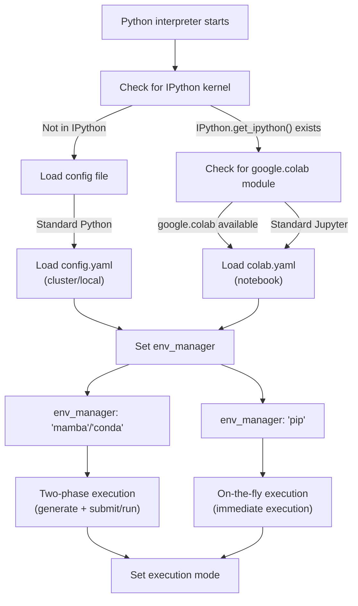
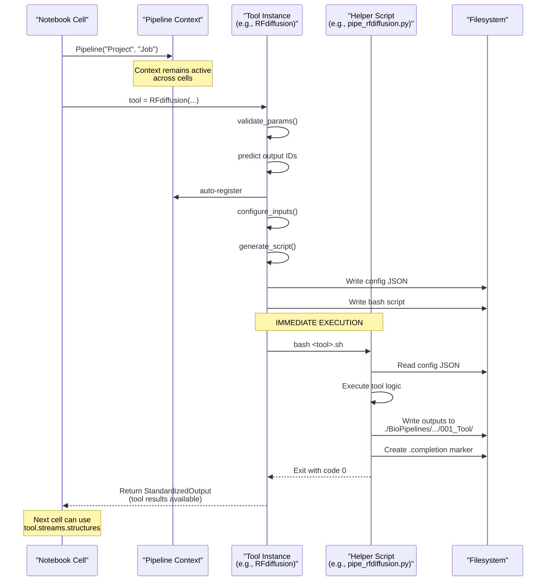
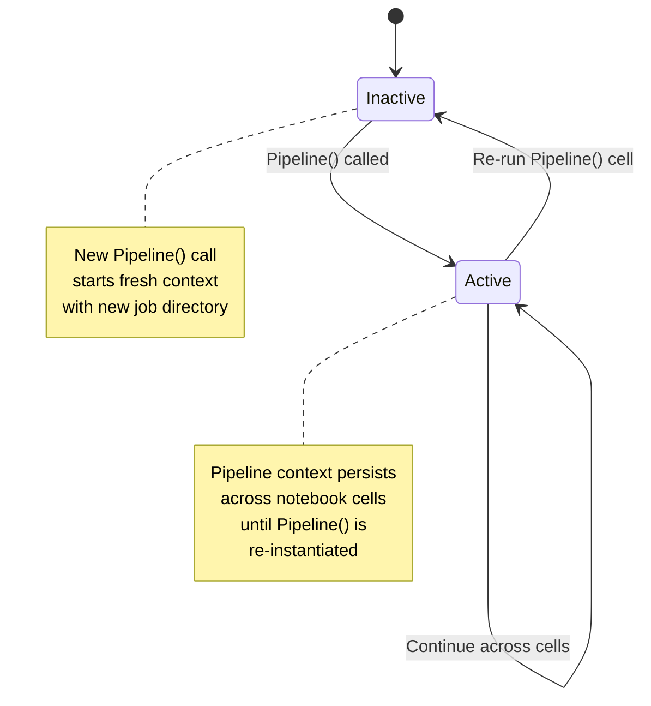
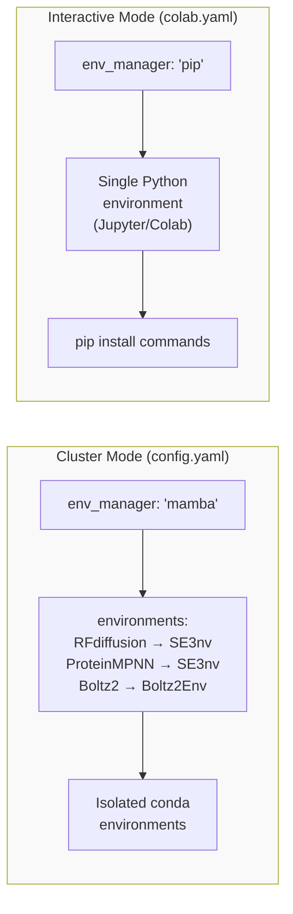
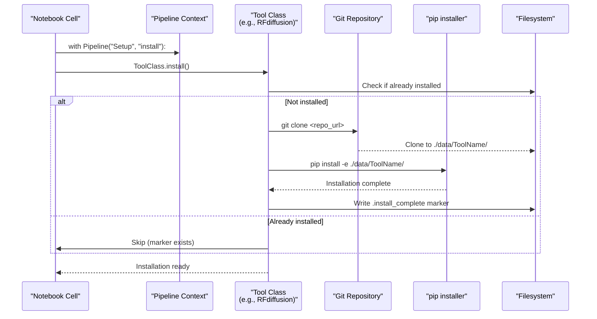
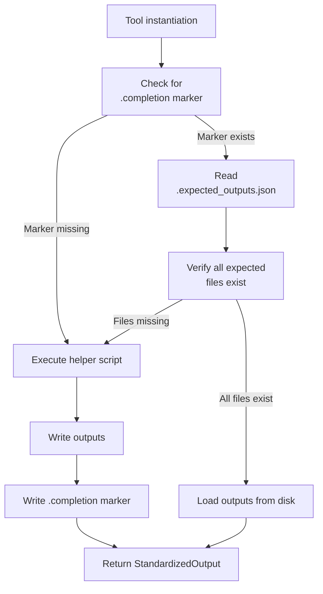

# Interactive Mode (Jupyter/Colab)

<details>
<summary>Relevant source files</summary>

The following files were used as context for generating this wiki page:

- [Docs/UserManual.md](Docs/UserManual.md)
- [config.yaml](config.yaml)
- [run](run)
- [submit](submit)

</details>


This page describes BioPipelines' interactive execution mode for Jupyter notebooks and Google Colab environments. Interactive mode enables on-the-fly execution where tools run immediately upon instantiation, allowing step-by-step development and real-time feedback. This differs from cluster execution ([4.1](#4.1)) and local execution ([4.2](#4.2)), which use a two-phase model.

For information about the two-phase execution model used in cluster and local modes, see [Pipeline Context and Resources](#3.1) and [Tools and BaseConfig](#3.2).

---

## Automatic Environment Detection

BioPipelines automatically detects when running in Jupyter/Colab environments and activates interactive mode without requiring explicit configuration. The detection mechanism examines the Python runtime context and loads appropriate configuration files.



**Sources:** [Docs/UserManual.md:73-139](), [config.yaml:1-188]()

The detection flow prioritizes `colab.yaml` when in notebook environments, which sets `env_manager: "pip"` and automatically enables on-the-fly execution. In standard Python environments, `config.yaml` is loaded with `env_manager: "mamba"` or `"conda"`, defaulting to two-phase execution.

---

## Configuration File Comparison

Interactive mode uses a separate configuration file (`colab.yaml`) that overrides key settings from the standard `config.yaml`:

| Setting | config.yaml (Cluster) | colab.yaml (Notebooks) |
|---------|----------------------|------------------------|
| `env_manager` | `"mamba"` or `"conda"` | `"pip"` |
| Output directory | Configured path (e.g., `<user>/BioPipelines`) | `./BioPipelines/` (current directory) |
| SLURM modules | Required for cluster | Ignored |
| Container support | Singularity/Apptainer paths | Not applicable |
| Environment mapping | Tool → conda environment | Tool → pip package |

**Sources:** [Docs/UserManual.md:127-136](), [config.yaml:62-163]()

The `env_manager: "pip"` setting transforms environment activation into no-ops, as all tools share the single Python environment provided by Jupyter/Colab. Tool-specific conda environments defined in `config.yaml` are replaced by pip-based installation commands.

---

## On-the-Fly Execution Model

On-the-fly execution fundamentally changes when tool logic executes. In cluster/local modes, tool instantiation only generates bash scripts (configuration phase), with execution deferred to SLURM or sequential bash execution. In interactive mode, tool instantiation triggers immediate execution.



**Sources:** [Docs/UserManual.md:421-454]()

### Key Behavioral Differences

Interactive mode introduces several execution model changes:

| Aspect | Cluster/Local Mode | Interactive Mode |
|--------|-------------------|------------------|
| **`with` statement** | Required to define pipeline scope | Optional; pipeline persists across cells |
| **Tool execution** | Deferred to bash script submission | Immediate upon instantiation |
| **Output availability** | After SLURM job completes | After cell execution completes |
| **Execution order** | Controlled by batch dependencies | Sequential, cell-by-cell |
| **stdout/stderr** | Written to log files | Streamed to notebook output |
| **Resources()** | Controls SLURM allocation | Parsed but ignored for execution |
| **Completion checking** | Prevents duplicate SLURM jobs | Skips already-completed steps on re-run |

**Sources:** [Docs/UserManual.md:445-454]()

The optional `with` statement allows pipelines to span multiple notebook cells, supporting iterative development:

```python
# Cell 1: Initialize pipeline (optional with statement)
Pipeline("Examples", "interactive_design",
         description="Iterative binder design")

lysozyme = PDB("168L")
rfd = RFdiffusion(pdb=lysozyme, contigs='50-70/A81-140', num_designs=3)
# rfd.streams.structures is immediately available

# Cell 2: Continue in same pipeline
pmpnn = ProteinMPNN(structures=rfd, num_sequences=2)
# pmpnn.streams.sequences is immediately available

# Cell 3: Analyze results and add more tools
from biopipelines.panda import Panda
best = Panda(tables=pmpnn.tables.sequences,
             operations=[Panda.sort("score", ascending=False)])
```

**Sources:** [Docs/UserManual.md:426-441]()

---

## Pipeline Lifecycle in Notebooks

The `Pipeline` context manager exhibits different lifecycle semantics in interactive mode compared to standard Python execution.



**Sources:** [Docs/UserManual.md:421-454]()

### Multi-Cell Pipeline Pattern

```python
# Cell 1: Create pipeline
Pipeline("Examples", "test", description="Multi-step workflow")
proteins = PDB(["4ufc", "1aki"])

# Cell 2: Add tools (pipeline still active)
rfd = RFdiffusion(pdb=proteins, contigs='50-100', num_designs=2)

# Cell 3: Continue adding tools
pmpnn = ProteinMPNN(structures=rfd, num_sequences=3)

# Cell 4: Analyze
print(f"Generated {len(pmpnn.streams.sequences)} sequences")
print(pmpnn.streams.sequences.ids)

# Cell 5: Re-run Pipeline() to start fresh
Pipeline("Examples", "test_v2", description="Second iteration")
# Previous pipeline is no longer active
```

**Sources:** [Docs/UserManual.md:426-441]()

Re-running the cell containing `Pipeline()` instantiation creates a new pipeline context with a new job directory. Previous pipeline outputs remain on disk but are no longer the active context.

---

## Environment Management with pip

Interactive mode replaces conda/mamba environment management with pip-based installation. Each tool's `install()` method executes `pip install` commands instead of creating isolated conda environments.



**Sources:** [Docs/UserManual.md:88-93](), [config.yaml:62-163]()

### Environment Activation Behavior

When `env_manager: "pip"`, environment activation commands become no-ops:

| Operation | Cluster Mode | Interactive Mode |
|-----------|--------------|------------------|
| Tool instantiation | Records environment name from `config.yaml` | Ignores environment mapping |
| Script generation | Writes `mamba activate <env>` to bash scripts | Writes no-op or skips activation |
| Execution | Activates tool-specific conda environment | Uses current Jupyter kernel |
| Dependencies | Isolated per-tool environments | Shared across all tools |
| Conflicts | Prevented by isolation | User must manage manually |

**Sources:** [Docs/UserManual.md:88-93](), [config.yaml:140-142]()

---

## Tool Installation

Tools must be explicitly installed in interactive mode using the `.install()` class method. This replaces the pre-configured conda environments used in cluster mode.



**Sources:** [Docs/UserManual.md:94-108]()

### Installation Example

```python
from biopipelines.pipeline import Pipeline
from biopipelines.rfdiffusion import RFdiffusion
from biopipelines.protein_mpnn import ProteinMPNN
from biopipelines.alphafold import AlphaFold

# Dedicated installation pipeline
with Pipeline("Setup", "install", description="Install tools"):
    RFdiffusion.install()
    ProteinMPNN.install()
    AlphaFold.install()
    # Each .install() runs once per session
    # Re-running the cell skips already-completed installations
```

**Sources:** [Docs/UserManual.md:98-108]()

Installation commands clone repositories to `./data/<ToolName>/` and execute `pip install -e .` in the repository directory. Completion markers prevent duplicate installations when cells are re-run.

---

## Output Directory Structure

Interactive mode writes outputs to the current working directory instead of the configured shared storage path:

```
./BioPipelines/
├── <project>/
│   └── <job>_001/
│       ├── RunTime/
│       │   ├── pipeline.sh
│       │   ├── 001_RFdiffusion.sh
│       │   └── 002_ProteinMPNN.sh
│       ├── Logs/
│       │   ├── 001_RFdiffusion.log
│       │   └── 002_ProteinMPNN.log
│       ├── ToolOutputs/
│       │   ├── 001_RFdiffusion.json
│       │   └── 002_ProteinMPNN.json
│       └── 001_RFdiffusion/
│           ├── .completion
│           ├── .expected_outputs.json
│           └── output_files...
```

**Sources:** [Docs/UserManual.md:132-134](), [Docs/UserManual.md:556-577]()

The `local_output=True` flag is automatically set when `on_the_fly` is enabled, overriding the `biopipelines_output` path from `config.yaml`. This ensures notebook outputs remain in the working directory for easy access.

---

## Execution Flow Comparison

The following diagram contrasts the execution flows between cluster mode (two-phase) and interactive mode (on-the-fly):

```mermaid
graph TB
    subgraph ClusterMode["Cluster Mode (submit script)"]
        C1["Pipeline script:<br/>with Pipeline():<br/>  tool1 = Tool1()<br/>  tool2 = Tool2()"]
        C2["Configuration Phase:<br/>Generate bash scripts<br/>Predict outputs<br/>Write configs"]
        C3["Exit Python:<br/>Output RunTime paths"]
        C4["Submit script:<br/>Parse RunTime/<br/>Submit to SLURM"]
        C5["Execution Phase:<br/>SLURM executes<br/>bash scripts<br/>(async)"]
        
        C1 --> C2
        C2 --> C3
        C3 --> C4
        C4 --> C5
    end
    
    subgraph InteractiveMode["Interactive Mode (Jupyter/Colab)"]
        I1["Notebook cell:<br/>Pipeline()"]
        I2["Notebook cell:<br/>tool1 = Tool1()"]
        I3["Generate config<br/>Generate script"]
        I4["Execute bash script<br/>(blocking)"]
        I5["tool1 outputs available"]
        I6["Notebook cell:<br/>tool2 = Tool2(tool1)"]
        I7["Generate config<br/>Generate script"]
        I8["Execute bash script<br/>(blocking)"]
        I9["tool2 outputs available"]
        
        I1 --> I2
        I2 --> I3
        I3 --> I4
        I4 --> I5
        I5 --> I6
        I6 --> I7
        I7 --> I8
        I8 --> I9
    end
    
    style ClusterMode fill:#f9f9f9
    style InteractiveMode fill:#f9f9f9
```



**Sources:** [Docs/UserManual.md:162-171](), [Docs/UserManual.md:421-454]()

In cluster mode, the entire pipeline is configured before any execution occurs. In interactive mode, each tool executes immediately upon instantiation, enabling incremental development and immediate result inspection.

---

## Google Colab Specific Considerations

Google Colab imposes runtime constraints that affect interactive mode:

### Session Ephemerality

Colab sessions disconnect after inactivity periods or runtime limits. All installed tools and generated outputs are lost upon disconnection. Mitigation strategies:

```python
# Mount Google Drive for persistent storage
from google.colab import drive
drive.mount('/content/drive')

# Run pipeline with outputs to Drive
Pipeline("Examples", "design", 
         description="Persistent outputs",
         local_output=True)  # Still writes to ./BioPipelines/

# Manually copy critical outputs
!cp -r ./BioPipelines/Examples/design_001/001_Boltz2/ /content/drive/MyDrive/results/
```

**Sources:** [Docs/UserManual.md:137-139]()

### GPU Allocation

Colab assigns GPU types dynamically. The `Resources()` call is parsed but does not control GPU allocation:

```python
# This is parsed but does not affect Colab GPU assignment
Resources(gpu="A100", memory="32GB")  

# Use the GPU Colab provides
import torch
print(f"GPU: {torch.cuda.get_device_name(0)}")
print(f"Memory: {torch.cuda.get_device_properties(0).total_memory / 1e9:.1f} GB")
```

**Sources:** [Docs/UserManual.md:127-136]()

### Installation Persistence

Tool installations persist for the session duration but must be re-run after runtime disconnects:

```python
# Cell 1: Always run first (idempotent due to completion markers)
!git clone https://github.com/locbp-uzh/biopipelines
%cd biopipelines
!pip install -e .

# Cell 2: Install tools (skips if already done this session)
with Pipeline("Setup", "install"):
    RFdiffusion.install()
    ProteinMPNN.install()
```

**Sources:** [Docs/UserManual.md:79-108]()

---

## Completion Checking and Re-runs

Interactive mode preserves BioPipelines' completion checking mechanism. Tools inspect the filesystem for `.completion` markers before executing:



**Sources:** [Docs/UserManual.md:452-453]()

This enables safe re-execution of notebook cells:

```python
# First run: Executes all tools
rfd = RFdiffusion(pdb=lysozyme, contigs='50-100', num_designs=5)
pmpnn = ProteinMPNN(structures=rfd, num_sequences=3)

# Re-run same cell: Skips completed tools, loads from disk
rfd = RFdiffusion(pdb=lysozyme, contigs='50-100', num_designs=5)  # Skipped
pmpnn = ProteinMPNN(structures=rfd, num_sequences=3)  # Skipped
```

To force re-execution, delete the `.completion` marker:

```python
import os
completion_marker = "./BioPipelines/Examples/test_001/001_RFdiffusion/.completion"
if os.path.exists(completion_marker):
    os.remove(completion_marker)
```

**Sources:** [Docs/UserManual.md:452-453]()

---

## Forcing Interactive Mode Outside Notebooks

Interactive mode can be explicitly enabled in standard Python scripts using the `on_the_fly` parameter:

```python
from biopipelines.pipeline import Pipeline

# Force on-the-fly execution in a .py script
with Pipeline("Test", "local_dev", 
              description="Local development",
              on_the_fly=True):
    
    lysozyme = PDB("168L")
    rfd = RFdiffusion(pdb=lysozyme, contigs='50-100', num_designs=3)
    # Blocks until RFdiffusion completes
    
    pmpnn = ProteinMPNN(structures=rfd, num_sequences=2)
    # Blocks until ProteinMPNN completes
```

**Sources:** [Docs/UserManual.md:443-444]()

This is useful for rapid prototyping without SLURM overhead, though cluster/local execution modes are recommended for production workflows.

---

## Limitations and Workarounds

### No Batch Dependencies

Interactive mode executes tools sequentially in cell order. The `Resources()` batch dependency mechanism is ignored:

```python
# In cluster mode, this creates two SLURM batches with dependencies
Resources(gpu="V100", time="4:00:00")  # Batch 1
tool1 = RFdiffusion(...)

Resources(time="2:00:00")  # Batch 2 (waits for Batch 1)
tool2 = Panda(...)

# In interactive mode, both Resources() calls are no-ops
# Tools execute sequentially regardless
```

**Sources:** [Docs/UserManual.md:447-448]()

### No Parallel Execution

All tools execute sequentially in interactive mode. For parallel execution, use cluster mode with SLURM array jobs.

### Resource Constraints

Interactive environments have fixed resource allocations:
- **Colab Free:** ~12-16 GB RAM, T4 GPU (16 GB VRAM)
- **Colab Pro:** ~25-30 GB RAM, V100/A100 GPU
- **Jupyter local:** Host machine resources

Large-scale workflows may require cluster execution ([4.1](#4.1)).

**Sources:** [Docs/UserManual.md:132-134]()

---

## Complete Colab Example

```python
# Cell 1: Setup (run once per session)
!git clone https://github.com/locbp-uzh/biopipelines
%cd biopipelines
!pip install -e .

# Cell 2: Install tools
from biopipelines.pipeline import Pipeline
from biopipelines.rfdiffusion import RFdiffusion
from biopipelines.protein_mpnn import ProteinMPNN
from biopipelines.alphafold import AlphaFold

with Pipeline("Setup", "install", description="Install tools"):
    RFdiffusion.install()
    ProteinMPNN.install()
    AlphaFold.install()

# Cell 3: Run workflow
from biopipelines.entities import PDB

Pipeline("Examples", "binder_design",
         description="RFdiffusion → ProteinMPNN → AlphaFold")

target = PDB("168L")
backbones = RFdiffusion(pdb=target, 
                        contigs='50-70/A81-140',
                        num_designs=5)
# backbones.streams.structures immediately available

sequences = ProteinMPNN(structures=backbones, 
                        num_sequences=3)
# sequences.streams.sequences immediately available

predictions = AlphaFold(proteins=sequences)
# predictions.streams.structures immediately available

# Cell 4: Analyze results
import pandas as pd
df = pd.read_csv(predictions.tables.confidence.info.path)
print(df.head())
print(f"Generated {len(predictions.streams.structures)} predictions")

# Cell 5: Filter and visualize
from biopipelines.panda import Panda
from biopipelines.pymol_tool import PyMOL

best = Panda(
    tables=predictions.tables.confidence,
    operations=[Panda.sort("plddt", ascending=False), Panda.head(3)],
    pool=predictions
)

pymol = PyMOL(
    structures=best.streams.structures,
    commands=["zoom", "show cartoon", "color spectrum"]
)
```

**Sources:** [Docs/UserManual.md:79-124](), [Docs/UserManual.md:426-441]()

---

## Summary: Interactive vs. Cluster/Local

| Feature | Cluster Mode ([4.1](#4.1)) | Local Mode ([4.2](#4.2)) | Interactive Mode |
|---------|---------------------------|-------------------------|------------------|
| **Execution model** | Two-phase (generate + SLURM) | Two-phase (generate + bash) | On-the-fly (immediate) |
| **Environment** | conda/mamba per tool | conda/mamba per tool | Single pip environment |
| **Pipeline scope** | `with` statement required | `with` statement required | `with` optional, spans cells |
| **Tool execution** | Async via SLURM | Sequential bash scripts | Sequential, blocking |
| **Output location** | Configured in `config.yaml` | Configured in `config.yaml` | `./BioPipelines/` |
| **Resources()** | Controls SLURM allocation | Ignored | Parsed but ignored |
| **Batch dependencies** | Supported (SLURM) | Supported (sequential) | Ignored |
| **stdout/stderr** | Written to log files | Written to log files | Streamed to notebook |
| **GPU allocation** | Requested via Resources() | Uses available GPUs | Colab-assigned |
| **Use case** | Production, large-scale | Local testing, small jobs | Prototyping, learning |

**Sources:** [Docs/UserManual.md:127-136](), [Docs/UserManual.md:162-171](), [Docs/UserManual.md:421-454]()

---