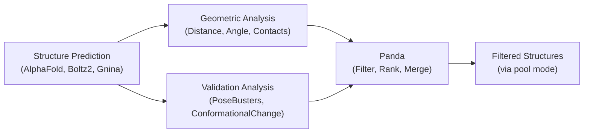
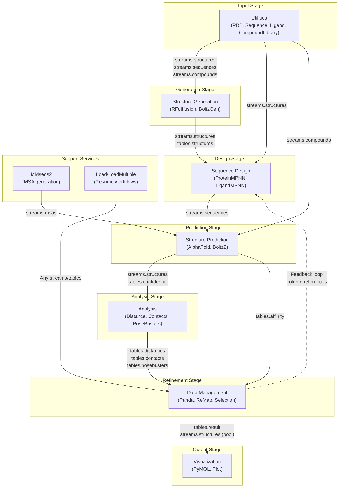

# Tool Categories

Relevant source files

The following files were used as context for generating this wiki page:

- [Docs/Tool/Analysis.md](Docs/Tool/Analysis.md)
- [Docs/Tool/DataManagement.md](Docs/Tool/DataManagement.md)
- [Docs/ToolReference.md](Docs/ToolReference.md)
- [Docs/UserManual.md](Docs/UserManual.md)
- [config.yaml](config.yaml)

## Purpose and Scope

BioPipelines organizes its tools into six major functional categories that represent the typical workflow stages of computational protein design and analysis. This page provides an overview of these categories, their relationships, and the tools available in each.

For detailed documentation of individual tools, see the category-specific pages: [Utilities](#5.1), [Structure Generation](#5.2), [Sequence Design](#5.3), [Structure Prediction](#5.4), [Analysis](#5.5), [Data Management](#5.6), and [Visualization](#5.7).

For information about how tools inherit from `BaseConfig` and integrate with the framework, see [Tools and BaseConfig](#3.2).

Sources: [Docs/ToolReference.md:1-98]()

---

## Category Overview

BioPipelines tools are organized into functional categories that mirror typical computational protein design workflows:

| Category | Purpose | Importance Score | Typical Position in Workflow |
|----------|---------|------------------|------------------------------|
| **Utilities** | Data input, retrieval, and MSA generation | 48.13 | Start (input) or middle (MSA) |
| **Structure Generation** | De novo backbone design and generation | 47.09 | Early stage (after input) |
| **Sequence Design** | Sequence optimization for fixed backbones | 46.51 | Middle stage (after structure generation) |
| **Structure Prediction** | Structure prediction and docking | 50.21 | Middle-to-late (validation) |
| **Analysis** | Geometric and interaction analysis | 52.66 | Late stage (evaluation) |
| **Data Management** | Filtering, ranking, and ID manipulation | 52.66 | Any stage (iterative refinement) |
| **Visualization** | Rendering and plotting | N/A | End stage (presentation) |

**Importance scores** reflect the combined complexity and usage frequency of tools in each category, calculated from cluster analysis of the codebase ([see high-level diagrams]()).

Sources: [Docs/ToolReference.md:1-98](), [Docs/UserManual.md:1-611]()

---

## Tool Workflow Architecture

The following diagram illustrates how tool categories form a directed acyclic graph (DAG) representing typical computational protein design workflows:

```mermaid
graph TB
    subgraph Utilities["Utilities (Importance: 48.13)"]
        PDB["PDB<br/>Local/RCSB fetch"]
        RCSB["RCSB<br/>Search API"]
        Sequence["Sequence<br/>From strings/files"]
        Ligand["Ligand<br/>CCD/PubChem/SMILES"]
        CompoundLibrary["CompoundLibrary<br/>Chemical collections"]
        Load["Load/LoadMultiple<br/>Previous outputs"]
        MMseqs2["MMseqs2<br/>MSA generation"]
    end
    
    subgraph StructureGen["Structure Generation (Importance: 47.09)"]
        RFdiffusion["RFdiffusion<br/>Backbone generation"]
        RFdiffusion3["RFdiffusion3<br/>3rd gen design"]
        RFdiffusionAA["RFdiffusionAllAtom<br/>All-atom with ligands"]
        BoltzGen["BoltzGen<br/>End-to-end binder design"]
    end
    
    subgraph SeqDesign["Sequence Design (Importance: 46.51)"]
        ProteinMPNN["ProteinMPNN<br/>Fixed backbone design"]
        LigandMPNN["LigandMPNN<br/>Ligand-aware design"]
        MutationComposer["MutationComposer<br/>Combinatorial mutants"]
        Fuse["Fuse<br/>Fusion proteins + linkers"]
        StitchSequences["StitchSequences<br/>Substitutions + indels"]
    end
    
    subgraph StructurePred["Structure Prediction (Importance: 50.21)"]
        AlphaFold["AlphaFold<br/>AF2 predictions"]
        Boltz2["Boltz2<br/>Biomolecular complexes<br/>Affinity calculation"]
        Gnina["Gnina<br/>CNN-based docking"]
    end
    
    subgraph Analysis["Analysis Tools (Importance: 52.66)"]
        Distance["Distance<br/>Atom/residue distances"]
        Angle["Angle<br/>Bond/torsional/vector angles"]
        DistanceSelector["DistanceSelector<br/>Proximity-based selection"]
        Contacts["Contacts<br/>Protein-ligand interactions"]
        ConformationalChange["ConformationalChange<br/>RMSD analysis"]
        PoseBusters["PoseBusters<br/>Pose validation"]
        CABSflex["CABSflex<br/>Flexibility simulation"]
    end
    
    subgraph DataMgmt["Data Management (Importance: 52.66)"]
        Panda["Panda<br/>filter, sort, merge<br/>calculate, rank, groupby"]
        ReMap["ReMap<br/>ID management"]
        Selection["Selection<br/>PyMOL selection ops"]
        ExtractMetrics["ExtractMetrics<br/>Export for Prism"]
    end
    
    subgraph Visualization["Visualization"]
        PyMOL["PyMOL<br/>Sessions + images"]
        Plot["Plot<br/>Scatter, histogram, heatmap"]
    end
    
    PDB --> RFdiffusion
    RCSB --> RFdiffusion
    Ligand --> RFdiffusionAA
    Ligand --> BoltzGen
    Ligand --> Boltz2
    
    RFdiffusion --> ProteinMPNN
    RFdiffusion3 --> ProteinMPNN
    BoltzGen --> LigandMPNN
    
    ProteinMPNN --> AlphaFold
    LigandMPNN --> Boltz2
    StitchSequences --> AlphaFold
    
    AlphaFold --> Distance
    Boltz2 --> Contacts
    Boltz2 --> PoseBusters
    Gnina --> PoseBusters
    
    Distance --> Panda
    Contacts --> Panda
    PoseBusters --> Panda
    
    Panda --> ReMap
    Panda --> PyMOL
    Panda --> Plot
    
    DistanceSelector --> LigandMPNN
    Selection --> ProteinMPNN
    
    MMseqs2 --> Boltz2
    MMseqs2 --> AlphaFold
```

**Critical feedback loops**:
- `DistanceSelector` → `LigandMPNN`: Enables binding site-focused sequence design
- `Selection` → `ProteinMPNN`: Enables position-selective redesign
- `Panda` → upstream tools: Enables filtering-driven iterative refinement
- `MMseqs2` → structure prediction: Accelerates predictions by providing MSAs

Sources: [Docs/UserManual.md:1-611](), [Docs/ToolReference.md:1-98]()

---

## Utilities

**Purpose**: Provide data input, retrieval, and preprocessing capabilities. These tools are typically used at the start of workflows to fetch structures, define sequences, or generate MSAs.

**Tools**:

| Tool | Class Name | Purpose | Helper Script(s) |
|------|------------|---------|------------------|
| **PDB** | `PDB` | Fetch protein structures from local folders or RCSB | [HelpScripts/pipe_pdb.py]() |
| **RCSB** | `RCSB` | Search RCSB PDB and download multiple structures | [HelpScripts/pipe_pdb.py]() |
| **Sequence** | `Sequence` | Create sequences from strings, lists, or files | [HelpScripts/pipe_sequence.py]() |
| **Ligand** | `Ligand` | Fetch small molecules from RCSB CCD, PubChem, or SMILES | [HelpScripts/pipe_ligand.py]() |
| **CompoundLibrary** | `CompoundLibrary` | Create compound collections with R-group expansion | [biopipelines/compound_library.py]() |
| **Load** | `Load` | Load previous tool outputs | [biopipelines/load.py]() |
| **LoadMultiple** | `LoadMultiple` | Load multiple outputs by tool name | [biopipelines/load.py]() |
| **MMseqs2** | `MMseqs2` | MSA generation via distributed server | [HelpScripts/pipe_mmseqs2_sequences.py]() |

**Key Features**:
- Priority-based lookup: local → repository cache → external database ([config.yaml:25-60]())
- Format conversion and standardization (PDB ↔ CIF, SMILES → 3D)
- MSA generation via client-server architecture with automatic retry

**Detailed Documentation**: See [Utilities](#5.1)

Sources: [Docs/ToolReference.md:7-25](), [Docs/UserManual.md:222-326](), [config.yaml:25-60]()

---

## Structure Generation

**Purpose**: Generate novel protein backbones and structures using diffusion-based generative models. These tools create the structural scaffolds upon which sequences will be designed.

**Tools**:

| Tool | Class Name | Purpose | Helper Script(s) |
|------|------------|---------|------------------|
| **RFdiffusion** | `RFdiffusion` | Backbone generation with contig specification | [HelpScripts/pipe_rfdiffusion.py]() |
| **RFdiffusion3** | `RFdiffusion3` | Third-generation design with advanced features | [HelpScripts/pipe_rfdiffusion3_postprocess.py](), [HelpScripts/pipe_rfdiffusion3_table.py]() |
| **RFdiffusionAllAtom** | `RFdiffusionAllAtom` | All-atom design with ligand support | [HelpScripts/pipe_rfdaa_prepare_ligand.py]() |
| **BoltzGen** | `BoltzGen` | End-to-end binder design with inverse folding | [HelpScripts/pipe_boltzgen.py](), [HelpScripts/pipe_boltzgen_import.py](), [HelpScripts/pipe_boltzgen_merge.py]() |

**Key Features**:
- Contig-based specification of fixed and designed regions
- Constraint support (hotspots, symmetry, secondary structure)
- All-atom modeling with small molecule ligands
- Integration with sequence design (BoltzGen combines generation + sequence design)

**Environments**: `SE3nv` (RFdiffusion, RFdiffusionAllAtom), `foundry` (RFdiffusion3), `boltzgen` (BoltzGen)

**Detailed Documentation**: See [Structure Generation Tools](#5.2)

Sources: [Docs/ToolReference.md:28-36](), [config.yaml:66-72]()

---

## Sequence Design

**Purpose**: Design and optimize amino acid sequences for fixed protein backbones. These tools enable position-specific design, combinatorial mutagenesis, and protein fusion.

**Tools**:

| Tool | Class Name | Purpose | Helper Script(s) |
|------|------------|---------|------------------|
| **ProteinMPNN** | `ProteinMPNN` | Sequence design for backbones | [HelpScripts/pipe_pmpnn_fixed_positions.py]() |
| **LigandMPNN** | `LigandMPNN` | Ligand-aware sequence design | [HelpScripts/pipe_lmpnn_runtime_positions.py]() |
| **MutationComposer** | `MutationComposer` | Combinatorial mutant library generation | Tool-specific |
| **Mutagenesis** | `Mutagenesis` | Systematic single/double mutations | Tool-specific |
| **Fuse** | `Fuse` | Fusion proteins with flexible linkers | Tool-specific |
| **StitchSequences** | `StitchSequences` | Sequence substitutions and indels | [HelpScripts/pipe_stitch_sequences.py]() |
| **DNAEncoder** | `DNAEncoder` | Codon optimization | Tool-specific |
| **RBSDesigner** | `RBSDesigner` | Ribosome binding site design | Tool-specific |

**Key Features**:
- Position-selective design via fixed/redesigned specifications
- Column reference support for dynamic position selection ([see Table Column References](#3.4))
- Combinatorial expansion of mutation combinations
- Linker design for fusion proteins

**Environments**: `SE3nv` (ProteinMPNN), `ligandmpnn_env` (LigandMPNN), `MutationEnv` (MutationComposer, Mutagenesis), `biopipelines` (others)

**Detailed Documentation**: See [Sequence Design Tools](#5.3)

Sources: [Docs/ToolReference.md:39-51](), [config.yaml:74-82](), [HelpScripts/pipe_stitch_sequences.py]()

---

## Structure Prediction

**Purpose**: Predict 3D structures from sequences, model biomolecular complexes, and dock ligands. These tools validate designed sequences and predict binding modes.

**Tools**:

| Tool | Class Name | Purpose | Helper Script(s) |
|------|------------|---------|------------------|
| **AlphaFold** | `AlphaFold` | AlphaFold2 structure prediction | Wrapper around LocalColabFold |
| **Boltz2** | `Boltz2` | Biomolecular complex prediction with constraints | [HelpScripts/pipe_boltz_config_unified.py](), [HelpScripts/pipe_boltz_postprocessing.py]() |
| **Gnina** | `Gnina` | CNN-based molecular docking | Tool-specific |

**Key Features**:
- **AlphaFold**: Fast predictions using LocalColabFold, MSA support
- **Boltz2**: Multi-entity complexes (protein, RNA, DNA, ligands), constraint system (template, pocket, glycosylation, covalent linkage, contacts), affinity calculation, MSA recycling
- **Gnina**: CNN scoring function, exhaustive and local docking modes

**Boltz2 Constraint Types**:
- `template`: Fix backbone coordinates
- `pocket`: Define binding pocket residues
- `glycosylation`: N-glycosylation sites
- `covalent_linkage`: Covalent bonds between entities
- `contacts`: Predicted inter-entity contacts

**Environments**: `biopipelines` (AlphaFold, Gnina), `Boltz2Env` (Boltz2)

**Detailed Documentation**: See [Structure Prediction Tools](#5.4) and [Boltz2 Workflow](#6.1)

Sources: [Docs/ToolReference.md:54-61](), [config.yaml:84-88](), [Docs/UserManual.md:1-611]()

---

## Analysis

**Purpose**: Analyze structural properties, interactions, and pose quality. These tools provide quantitative metrics for filtering and ranking designed structures.

**Tools**:

| Tool | Class Name | Purpose | Output Metrics |
|------|------------|---------|----------------|
| **Distance** | `Distance` | Atom/residue distance measurements | Custom metric name (default: "distance") |
| **Angle** | `Angle` | Bond, torsional, and vector-vector angles | Custom metric name (default: "angle"/"torsion"/"vector_angle") |
| **DistanceSelector** | `DistanceSelector` | Proximity-based residue selection | `within`, `beyond` (PyMOL selection strings) |
| **Contacts** | `Contacts` | Protein-ligand contact analysis | `contacts`, `min_distance`, `max_distance`, `mean_distance` |
| **ConformationalChange** | `ConformationalChange` | Structure alignment and RMSD | `RMSD`, `num_aligned_atoms` |
| **PoseBusters** | `PoseBusters` | Pose validation suite | 13 validation checks + `all_pass` |
| **PoseChange** | `PoseChange` | Ligand pose comparison | `ligand_rmsd`, `centroid_distance`, `alignment_rmsd` |
| **CABSflex** | `CABSflex` | Protein flexibility simulation | Per-residue RMSF, ensemble structures |

**Analysis Workflow Pattern**:

**Key Features**:
- Custom metric naming for downstream filtering
- PyMOL-based selection syntax
- Support for table column references (e.g., `designed` residues from RFdiffusion)
- Integration with `Panda` for metric-based filtering

**Environments**: `biopipelines` (Distance, Angle, DistanceSelector, Gnina), `ProteinEnv` (Contacts, ConformationalChange, PoseChange), `posebusters` (PoseBusters), `CABSflex` (CABSflex)

**Detailed Documentation**: See [Analysis Tools](#5.5)

Sources: [Docs/Tool/Analysis.md:1-458](), [config.yaml:93-105]()

---

## Data Management

**Purpose**: Transform, filter, and manipulate tables and data streams. These tools enable iterative refinement and ID management across workflows.

**Tools**:

| Tool | Class Name | Purpose | Key Operations |
|------|------------|---------|----------------|
| **Panda** | `Panda` | Unified pandas-style transformations | `filter`, `sort`, `merge`, `concat`, `calculate`, `rank`, `groupby` |
| **ReMap** | `ReMap` | Rename IDs across streams and tables | Auto-numbering, explicit mapping, alignment onto other tools |
| **Selection** | `Selection` | PyMOL selection string manipulation | `add`, `subtract`, `expand`, `shrink`, `shift`, `invert` |
| **ExtractMetrics** | `ExtractMetrics` | Export metrics for GraphPad Prism | Per-metric CSV files with columns per condition |

**Panda Operations** (comprehensive list):

```mermaid
graph TB
    Input["Input Tables"]
    
    subgraph "Row Operations"
        Filter["filter(expr)"]
        Sort["sort(by, ascending)"]
        Head["head(n)"]
        Tail["tail(n)"]
        Sample["sample(n, frac)"]
        DropDuplicates["drop_duplicates(subset)"]
    end
    
    subgraph "Column Operations"
        Calculate["calculate(exprs)"]
        SelectColumns["select_columns(cols)"]
        DropColumns["drop_columns(cols)"]
        Rename["rename(mapping)"]
        FillNA["fillna(value)"]
    end
    
    subgraph "Multi-Table Operations"
        Merge["merge(on, how, prefixes)"]
        Concat["concat(fill, add_source)"]
    end
    
    subgraph "Aggregation Operations"
        Rank["rank(by, prefix)"]
        GroupBy["groupby(by, agg)"]
        Pivot["pivot(index, columns, values)"]
        Melt["melt(id_vars)"]
        AvgBySource["average_by_source()"]
    end
    
    Output["Output Table<br/>+ Optional Streams (pool mode)"]
    
    Input --> Filter
    Input --> Calculate
    Input --> Merge
    Input --> Rank
    
    Filter --> Output
    Calculate --> Output
    Merge --> Output
    Rank --> Output
```

**Pool Mode**: When `pool` parameter is provided, `Panda` copies files (structures, sequences, compounds) matching filtered IDs, enabling metric-based structure selection.

**Rename Mode**: When `rename` parameter is provided, output IDs are renumbered (e.g., `best_1`, `best_2`, ...).

**Environments**: All data management tools use `biopipelines` environment (except `Selection` which uses `ProteinEnv`)

**Detailed Documentation**: See [Data Management Tools](#5.6)

Sources: [Docs/Tool/DataManagement.md:1-247](), [Docs/UserManual.md:497-551]()

---

## Visualization

**Purpose**: Generate visual representations of structures and data for analysis and presentation.

**Tools**:

| Tool | Class Name | Purpose | Output Formats |
|------|------------|---------|----------------|
| **PyMOL** | `PyMOL` | PyMOL session and image generation | PSE sessions, PNG images |
| **Plot** | `Plot` | Statistical plots | PNG images, CSV data |

**PyMOL Features**:
- Declarative operation system (color, hide, show, zoom, etc.)
- Automatic session creation
- Batch image rendering

**Plot Types**:
- Scatter plots
- Histograms
- Bar charts
- Column charts
- Heatmaps

**Environments**: `ProteinEnv` (PyMOL), `biopipelines` (Plot)

**Detailed Documentation**: See [Visualization Tools](#5.7)

Sources: [Docs/ToolReference.md:22-25](), [config.yaml:119-120]()

---

## Tool-to-Category Complete Mapping

The following table provides a comprehensive mapping of all tools to their categories, helper scripts, and conda environments:

| Tool | Category | Class Location | Helper Script(s) | Environment |
|------|----------|----------------|------------------|-------------|
| PDB | Utilities | `biopipelines/pdb.py` | `HelpScripts/pipe_pdb.py` | `biopipelines` |
| RCSB | Utilities | `biopipelines/rcsb.py` | `HelpScripts/pipe_pdb.py` | `biopipelines` |
| Sequence | Utilities | `biopipelines/sequence.py` | `HelpScripts/pipe_sequence.py` | `biopipelines` |
| Ligand | Utilities | `biopipelines/ligand.py` | `HelpScripts/pipe_ligand.py` | `biopipelines` |
| CompoundLibrary | Utilities | `biopipelines/compound_library.py` | N/A | `biopipelines` |
| Load | Utilities | `biopipelines/load.py` | N/A | `biopipelines` |
| LoadMultiple | Utilities | `biopipelines/load.py` | N/A | `biopipelines` |
| MMseqs2 | Utilities | `biopipelines/mmseqs2.py` | `HelpScripts/pipe_mmseqs2_sequences.py` | `biopipelines` |
| RFdiffusion | Structure Generation | `biopipelines/rfdiffusion.py` | `HelpScripts/pipe_rfdiffusion.py` | `SE3nv` |
| RFdiffusion3 | Structure Generation | `biopipelines/rfdiffusion3.py` | `HelpScripts/pipe_rfdiffusion3_*.py` | `foundry` |
| RFdiffusionAllAtom | Structure Generation | `biopipelines/rfdiffusion_all_atom.py` | `HelpScripts/pipe_rfdaa_*.py` | `SE3nv` |
| BoltzGen | Structure Generation | `biopipelines/boltzgen.py` | `HelpScripts/pipe_boltzgen*.py` | `boltzgen` |
| ProteinMPNN | Sequence Design | `biopipelines/protein_mpnn.py` | `HelpScripts/pipe_pmpnn_*.py` | `SE3nv` |
| LigandMPNN | Sequence Design | `biopipelines/ligand_mpnn.py` | `HelpScripts/pipe_lmpnn_*.py` | `ligandmpnn_env` |
| MutationComposer | Sequence Design | `biopipelines/mutation_composer.py` | Tool-specific | `MutationEnv` |
| Mutagenesis | Sequence Design | `biopipelines/mutagenesis.py` | Tool-specific | `MutationEnv` |
| Fuse | Sequence Design | `biopipelines/fuse.py` | Tool-specific | `biopipelines` |
| StitchSequences | Sequence Design | `biopipelines/stitch_sequences.py` | `HelpScripts/pipe_stitch_sequences.py` | `biopipelines` |
| DNAEncoder | Sequence Design | `biopipelines/dna_encoder.py` | Tool-specific | `biopipelines` |
| RBSDesigner | Sequence Design | `biopipelines/rbs_designer.py` | Tool-specific | `rbs_designer` |
| AlphaFold | Structure Prediction | `biopipelines/alphafold.py` | LocalColabFold wrapper | `biopipelines` |
| Boltz2 | Structure Prediction | `biopipelines/boltz2.py` | `HelpScripts/pipe_boltz_*.py` | `Boltz2Env` |
| Gnina | Structure Prediction | `biopipelines/gnina.py` | Tool-specific | `biopipelines` |
| Distance | Analysis | `biopipelines/distance.py` | Tool-specific | `biopipelines` |
| Angle | Analysis | `biopipelines/angle.py` | Tool-specific | `biopipelines` |
| DistanceSelector | Analysis | `biopipelines/distance_selector.py` | `HelpScripts/pipe_distance_selector.py` | `biopipelines` |
| Contacts | Analysis | `biopipelines/contacts.py` | Tool-specific | `ProteinEnv` |
| ConformationalChange | Analysis | `biopipelines/conformational_change.py` | Tool-specific | `ProteinEnv` |
| PoseBusters | Analysis | `biopipelines/posebusters.py` | Tool-specific | `posebusters` |
| PoseChange | Analysis | `biopipelines/pose_change.py` | Tool-specific | `ProteinEnv` |
| CABSflex | Analysis | `biopipelines/cabsflex.py` | Tool-specific | `CABSflex` |
| Panda | Data Management | `biopipelines/panda.py` | Tool-specific | `biopipelines` |
| ReMap | Data Management | `biopipelines/remap.py` | Tool-specific | `biopipelines` |
| Selection | Data Management | `biopipelines/selection.py` | Tool-specific | `ProteinEnv` |
| ExtractMetrics | Data Management | `biopipelines/extract_metrics.py` | Tool-specific | `biopipelines` |
| PyMOL | Visualization | `biopipelines/pymol.py` | `HelpScripts/pipe_pymol.py` | `ProteinEnv` |
| Plot | Visualization | `biopipelines/plot.py` | `HelpScripts/pipe_plot.py` | `biopipelines` |

**Environment Lookup**: All environments are defined in [config.yaml:65-121](), which maps tool names to conda environments or container images.

Sources: [config.yaml:65-128](), [Docs/ToolReference.md:1-98]()

---

## Category Relationships and Data Flow

The following diagram shows how data flows between categories using the `StandardizedOutput` and `DataStream` types:

**Key Data Types**:
- **`DataStream`**: ID-tracked file collections (PDB, FASTA, SDF, A3M) or value tables (sequences, compounds)
- **`StandardizedOutput`**: Container with `StreamContainer` (`.streams.structures`, `.streams.sequences`, etc.) and `TableContainer` (`.tables.confidence`, `.tables.affinity`, etc.)
- **Column References**: Tuple `(TableInfo, "column_name")` enabling metadata-driven parameterization

**Feedback Mechanism**: Tools like `DistanceSelector` and `Selection` analyze structures and produce position specifications (stored in tables), which are then passed to sequence design tools via column references. This enables structure-informed sequence design.

Sources: [Docs/UserManual.md:172-220](), [Docs/UserManual.md:373-392]()

---