# Utilities

<details>
<summary>Relevant source files</summary>

The following files were used as context for generating this wiki page:

- [Docs/Tool/Analysis.md](Docs/Tool/Analysis.md)
- [Docs/Tool/DataManagement.md](Docs/Tool/DataManagement.md)
- [Docs/ToolReference.md](Docs/ToolReference.md)
- [HelpScripts/pipe_ligand.py](HelpScripts/pipe_ligand.py)
- [HelpScripts/pipe_pdb.py](HelpScripts/pipe_pdb.py)
- [HelpScripts/pipe_rfdaa_prepare_ligand.py](HelpScripts/pipe_rfdaa_prepare_ligand.py)
- [HelpScripts/pipe_rfdiffusion3_postprocess.py](HelpScripts/pipe_rfdiffusion3_postprocess.py)
- [HelpScripts/pipe_rfdiffusion3_table.py](HelpScripts/pipe_rfdiffusion3_table.py)
- [HelpScripts/pipe_sequence.py](HelpScripts/pipe_sequence.py)
- [biopipelines/entities.py](biopipelines/entities.py)
- [biopipelines/pdb.py](biopipelines/pdb.py)
- [biopipelines/rcsb.py](biopipelines/rcsb.py)

</details>


Utility tools provide data input and loading functionality for BioPipelines workflows. They fetch, create, or load input entities (structures, sequences, ligands, compounds) that serve as starting points for design and prediction tools. All utility tools output `StandardizedOutput` objects with typed streams (`DataStream`) and tables (`TableInfo`), enabling seamless integration with downstream tools.

For visualization tools (PyMOL, Plot), see [Visualization Tools](#5.7). For data transformation tools (Panda, ReMap, Selection), see [Data Management Tools](#5.6).

---

## Architecture Overview

All utility tools follow a common two-phase execution model: configuration (Python) predicts outputs and generates scripts, execution (Bash) performs actual work via helper scripts.

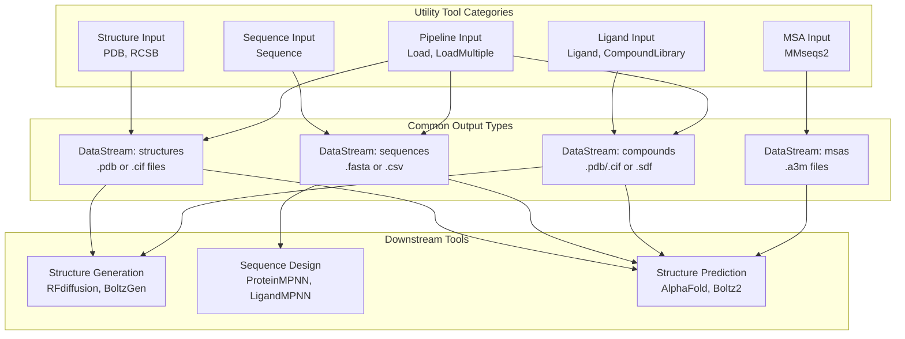

**Sources:** Docs/ToolReference.md:1-98, High-level diagrams (Diagram 1, Diagram 3)

---

## PDB: Structure Fetching

The `PDB` tool fetches protein structures using a priority-based lookup: local folder → repository `PDBs/` folder → RCSB download. Downloads are cached in `PDBs/` for reuse across pipelines.

### Priority-Based Lookup

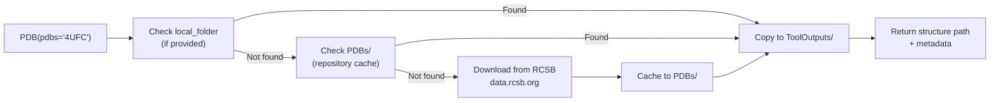

**Sources:** HelpScripts/pipe_pdb.py:569-628, biopipelines/pdb.py:304-396

### Format Conversion

The `PDB` tool supports flexible format handling via the `convert` parameter:

| `convert` value | Behavior |
|-----------------|----------|
| `None` (default) | Keep whatever format found locally or downloaded (no conversion) |
| `"pdb"` | Convert to PDB format (CIF → PDB if needed) |
| `"cif"` | Convert to CIF format (PDB → CIF not yet implemented) |

CIF to PDB conversion uses BioPython's `MMCIFParser` and `PDBIO`.

**Sources:** HelpScripts/pipe_pdb.py:28-78, biopipelines/pdb.py:109-223

### Operations

PDB supports post-load operations via positional arguments. Currently supports `PDB.Rename(old, new)` for residue renaming.

```python
from biopipelines.pdb import PDB

# Rename ligand residue (useful for RFdiffusion3 compatibility)
pdb = PDB(
    pdbs="rifampicin.pdb",
    PDB.Rename("LIG", ":L:")
)

# Multiple renames
pdb = PDB(
    pdbs="4ufc",
    PDB.Rename("ATP", ":A:"),
    PDB.Rename("GDP", ":G:")
)
```

Operations are applied in sequence after fetching/conversion. The rename operation modifies PDB residue name field (columns 17-19, 0-indexed 17:20).

**Sources:** biopipelines/pdb.py:27-106, HelpScripts/pipe_pdb.py:119-174

### Sequence Extraction

PDB automatically extracts protein sequences from structures. By default, returns the longest chain to avoid inflating memory in downstream tools (multi-chain complexes often contain identical chains).

```python
# Default: longest chain
pdb = PDB(pdbs="4ufc")  # Extracts sequence from longest chain

# Specific chain
pdb = PDB(pdbs="4ufc", chain="A")  # Extract chain A only

# Keep entire structure but extract specific chain sequence
pdb = PDB(pdbs="4ufc", chain="E")  # Sequence from chain E
```

**Sources:** HelpScripts/pipe_pdb.py:279-337, HelpScripts/pipe_pdb.py:339-433

### Ligand Detection

PDB automatically detects ligands (HETATM records excluding waters, ions, crystallization agents) and fetches SMILES strings from RCSB REST API.

**Exclusion list:** HOH, WAT, H2O, SOL, NA, CL, K, CA, MG, ZN, SO4, PO4, GOL, EDO, PEG, ACT, BME, etc.

**Sources:** HelpScripts/pipe_pdb.py:436-567, HelpScripts/pipe_pdb.py:515-566

### Output Specification

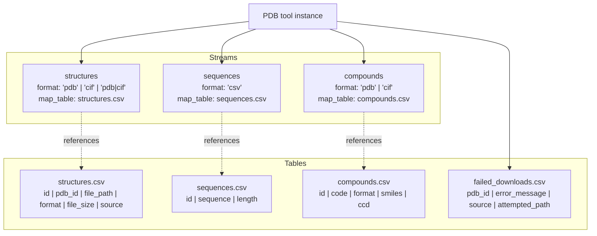

**Sources:** biopipelines/pdb.py:77-83, HelpScripts/pipe_pdb.py:1445-1513

### Helper Script: pipe_pdb.py

The runtime execution is handled by `pipe_pdb.py`, which implements:

- **Priority lookup logic:** [HelpScripts/pipe_pdb.py:569-628]()
- **RCSB download:** [HelpScripts/pipe_pdb.py:738-930]()
- **CIF→PDB conversion:** [HelpScripts/pipe_pdb.py:28-78]()
- **Water removal:** [HelpScripts/pipe_pdb.py:177-203]()
- **Chain filtering:** [HelpScripts/pipe_pdb.py:206-276]()
- **Sequence extraction:** [HelpScripts/pipe_pdb.py:279-337]()
- **Ligand detection:** [HelpScripts/pipe_pdb.py:436-512]()
- **SMILES fetching:** [HelpScripts/pipe_pdb.py:515-566]()
- **Operations (rename):** [HelpScripts/pipe_pdb.py:97-174]()

**Sources:** HelpScripts/pipe_pdb.py:1-1513

---

## RCSB: Search API Integration

The `RCSB` tool provides programmatic access to the RCSB PDB Search API v2, enabling structure discovery based on text, attributes, sequence similarity, structure similarity, and chemical similarity.

### Query Construction

RCSB uses a typed attribute system via `StructureAttribute` namespace, which mirrors the RCSB advanced search interface:

```python
from biopipelines.rcsb import RCSB, StructureAttribute, PolymerEntityType, SymmetryType

# Attribute-based search
results = RCSB(
    StructureAttribute.NonpolymerFeatures.ComponentIdentifier.is_any("FMN", "FAD"),
    StructureAttribute.PolymerMolecularFeatures.PolymerEntityType.equals(PolymerEntityType.PROTEIN),
    StructureAttribute.AssemblyFeatures.SymmetryType.equals(SymmetryType.ASYMMETRIC),
    StructureAttribute.PolymerMolecularFeatures.PolymerEntitySequenceLength.between(80, 300),
    max_results=100
)
```

### Attribute Categories

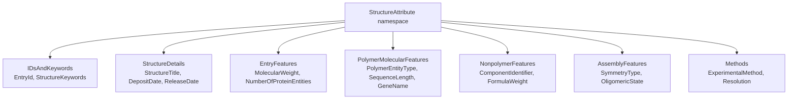

**Sources:** biopipelines/rcsb.py:169-252

### Comparison Methods

Each attribute descriptor exposes typed comparison methods:

| Method | Description | Example |
|--------|-------------|---------|
| `equals(value)` | Exact match | `.equals(PolymerEntityType.PROTEIN)` |
| `is_any(*values)` | One of multiple values | `.is_any("FMN", "FAD")` |
| `contains(text)` | Case-insensitive substring | `.contains("kinase")` |
| `contains_phrase(text)` | Exact phrase | `.contains_phrase("insulin receptor")` |
| `between(low, high)` | Numeric/date range | `.between(80, 300)` |
| `greater_than(value)` | Numeric comparison | `.greater_than(2.5)` |
| `less_than(value)` | Numeric comparison | `.less_than(2.0)` |
| `exists()` | Attribute has value | `.exists()` |
| `not_equals(value)` | Negation | `.not_equals(PolymerEntityType.DNA)` |
| `not_any(*values)` | Exclude values | `.not_any("HOH", "WAT")` |

**Sources:** biopipelines/rcsb.py:80-167

### Static Query Constructors

For non-attribute searches, use static methods:

```python
# Text search (full-text)
RCSB(RCSB.Text("insulin receptor + human"), max_results=10)

# Sequence similarity (BLAST-like)
RCSB(RCSB.Sequence("MKTVRQERLK...", identity_cutoff=0.9), max_results=50)

# Structure similarity
RCSB(RCSB.Structure("4HHB", assembly_id=1), max_results=10)

# Sequence motif (PROSITE format)
RCSB(RCSB.SeqMotif("C-x(2,4)-C-x(3)-[LIVMFYWC]-x(8)-H", pattern_type="prosite"))

# Chemical similarity (SMILES-based)
RCSB(RCSB.Chemical("c1ccc(cc1)C(=O)O", match_type="fingerprint-similarity"))
```

**Sources:** biopipelines/rcsb.py:350-467

### Execution Flow

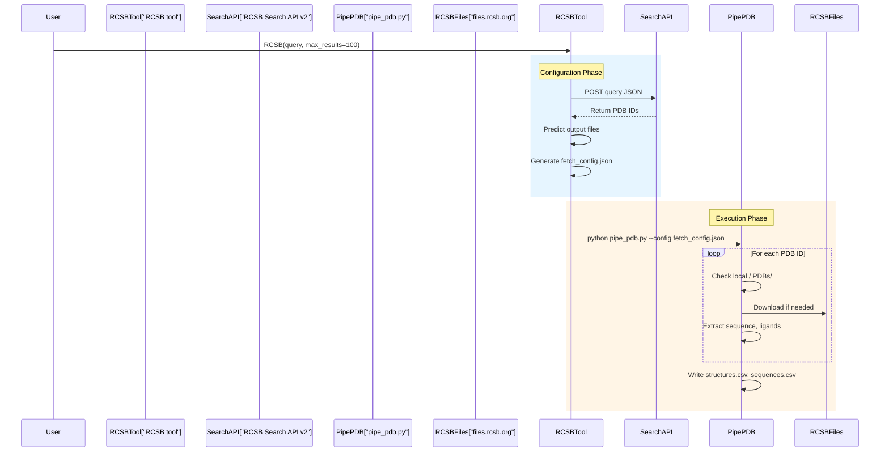

**Sources:** biopipelines/rcsb.py:254-721

### Output

RCSB produces identical output to PDB tool:
- **Streams:** `structures`, `sequences`, `compounds`
- **Tables:** `structures.csv`, `sequences.csv`, `compounds.csv`, `failed_downloads.csv`, `search_results.csv`

The `search_results.csv` contains the raw search API response with scores and metadata.

**Sources:** biopipelines/rcsb.py:341-348, biopipelines/rcsb.py:671-721

---

## Ligand: Small Molecule Fetching

The `Ligand` tool fetches small molecules from multiple sources with automatic format detection and 3D coordinate generation.

### Lookup Type Detection

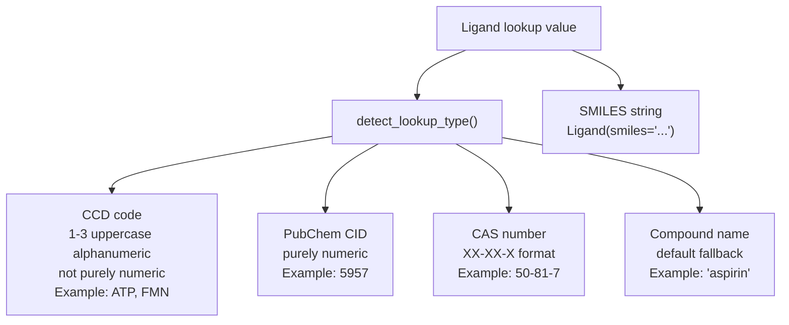

**Sources:** HelpScripts/pipe_ligand.py:25-49

### Priority-Based Lookup (Non-SMILES)

Similar to PDB, Ligand uses priority-based file lookup:

1. **local_folder** (if provided)
2. **Ligands/** (repository cache)
3. **RCSB CCD** (for CCD codes) or **PubChem** (for CID/CAS/name)

**Sources:** HelpScripts/pipe_ligand.py:51-83

### SMILES to 3D Conversion

For direct SMILES input or when downloading from PubChem/RCSB returns only SMILES, the tool generates 3D coordinates:

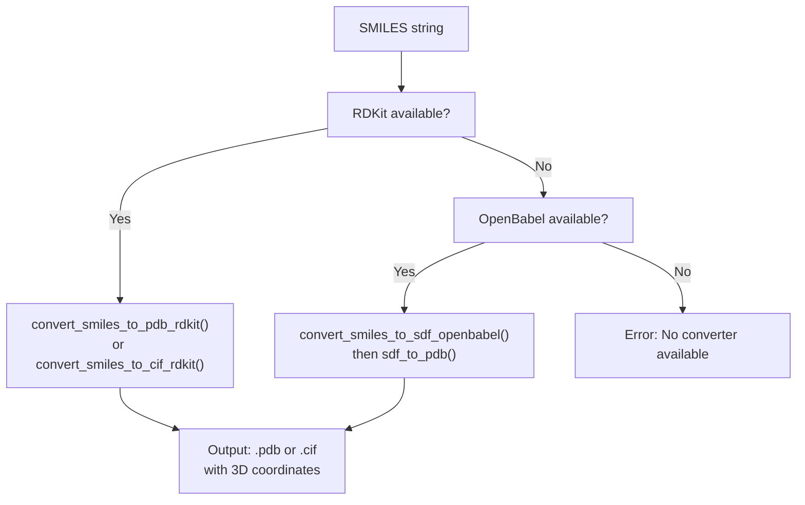

**RDKit method (preferred):**
- Parse SMILES with `Chem.MolFromSmiles()`
- Add hydrogens: `Chem.AddHs()`
- Generate 3D: `AllChem.EmbedMolecule()` with ETKDG v3
- Optimize: `AllChem.MMFFOptimizeMolecule()`
- Remove hydrogens: `Chem.RemoveHs()`
- Export: `Chem.MolToPDBBlock()` or custom CIF generation

**Important:** RDKit atom naming is preserved for compatibility with tools like RFdiffusion3 that internally regenerate conformers.

**Sources:** HelpScripts/pipe_ligand.py:171-240, HelpScripts/pipe_ligand.py:243-385

### Format Conversion

The `convert` parameter controls output format:

| Value | Behavior |
|-------|----------|
| `None` (default) | Keep source format (PDB or CIF) |
| `"pdb"` | Convert to PDB |
| `"cif"` | Convert to CIF |

CIF output includes explicit bond information via `_chem_comp_bond` category (required by some tools like RFdiffusion3).

**Sources:** HelpScripts/pipe_ligand.py:243-385

### Residue Renaming

Ligand tool automatically renames residue codes to match the `residue_code` parameter:

```python
from biopipelines.ligand import Ligand

# Fetch ATP but rename to :A: for RFdiffusion3
lig = Ligand(ligands="ATP", residue_code=":A:")

# Custom SMILES with custom residue code
lig = Ligand(smiles="CCO", residue_code=":L:")
```

**Sources:** HelpScripts/pipe_ligand.py:388-491, HelpScripts/pipe_ligand.py:494-532

### Output Specification

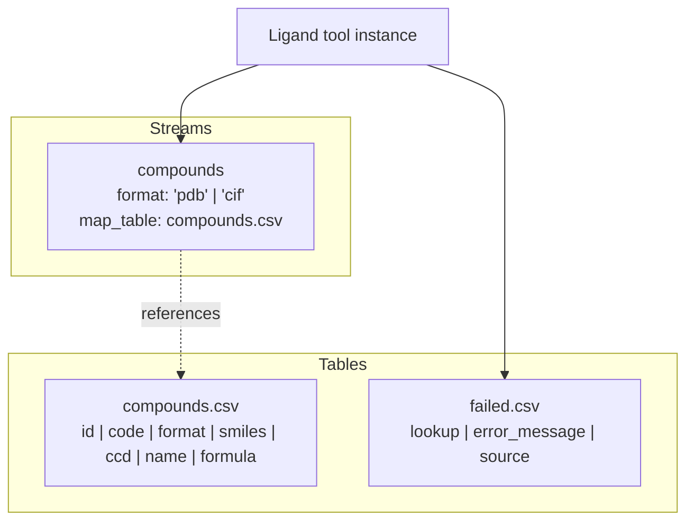

**Sources:** HelpScripts/pipe_ligand.py:1240-1320

---

## Sequence: Sequence Creation

The `Sequence` tool creates sequence entities from raw amino acid or nucleotide strings.

### Usage

```python
from biopipelines.sequence import Sequence

# Single sequence
seq = Sequence(sequences="MKTVRQERLK", ids="kinase")

# Multiple sequences
seqs = Sequence(
    sequences=["MKTVRQERLK", "AAAAAAA"],
    ids=["seq1", "seq2"]
)

# Auto-numbering
seqs = Sequence(
    sequences=["MKTVRQERLK", "AAAAAAA"],
    ids="design"  # Outputs: design_1, design_2
)

# Specify type
dna = Sequence(sequences="ATCGATCG", type="dna")
```

### Execution Flow

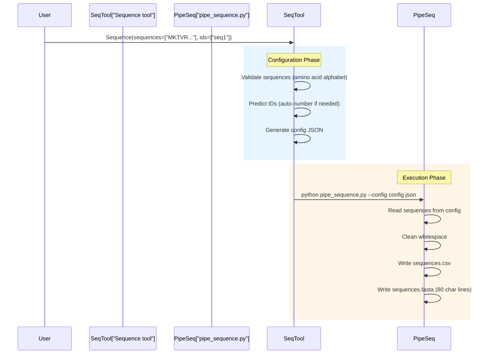

**Sources:** HelpScripts/pipe_sequence.py:1-124

### Output

- **DataStream:** `sequences` (format: `"csv"`, map_table: `"sequences.csv"`)
- **TableInfo:** `sequences.csv` with columns: `id`, `sequence`, `type`, `length`
- **File:** `sequences.fasta` (FASTA format, not exposed as DataStream)

**Sources:** HelpScripts/pipe_sequence.py:20-80

---

## CompoundLibrary: Compound Collections

The `CompoundLibrary` tool creates collections of small molecules, either from explicit lists or from compound libraries (e.g., fragment libraries, drug-like compounds).

### Usage

```python
from biopipelines.compound_library import CompoundLibrary

# From explicit SMILES list
library = CompoundLibrary(
    smiles=["CCO", "c1ccccc1", "CC(=O)O"],
    ids=["ethanol", "benzene", "acetate"]
)

# From library name (predefined collections)
library = CompoundLibrary(library="fragments")

# With filters
library = CompoundLibrary(
    library="drugbank",
    mw_range=(200, 500),
    logp_range=(-1, 5)
)
```

### Output

Similar to Ligand tool:
- **DataStream:** `compounds` (3D structures as PDB/CIF)
- **TableInfo:** `compounds.csv` with SMILES, molecular properties

---

## Load / LoadMultiple: Pipeline Output Reuse

The `Load` and `LoadMultiple` tools enable reusing outputs from previous pipeline runs.

### Load: Single Tool Output

```python
from biopipelines.load import Load

# Load by job name
previous = Load(job="MyPreviousJob", tool="RFdiffusion", batch=1)

# Load by absolute path
previous = Load(folder="/path/to/ToolOutputs/Job_Tool_batch1")

# Access streams
previous.streams.structures
previous.tables.results
```

### LoadMultiple: Multiple Outputs

```python
from biopipelines.load import LoadMultiple

# Load multiple batches
all_batches = LoadMultiple(
    job="MyJob",
    tool="ProteinMPNN",
    batches=[1, 2, 3]
)

# Access merged streams
all_batches.streams.sequences  # All sequences combined
```

### Implementation

Load tools read the `ToolOutputs/` directory structure and reconstruct `StandardizedOutput` objects by parsing CSV files and discovering file streams.

---

## MMseqs2: Distributed MSA Generation

The `MMseqs2` tool generates Multiple Sequence Alignments via a client-server architecture that supports GPU acceleration and automatic server management.

### Client-Server Architecture

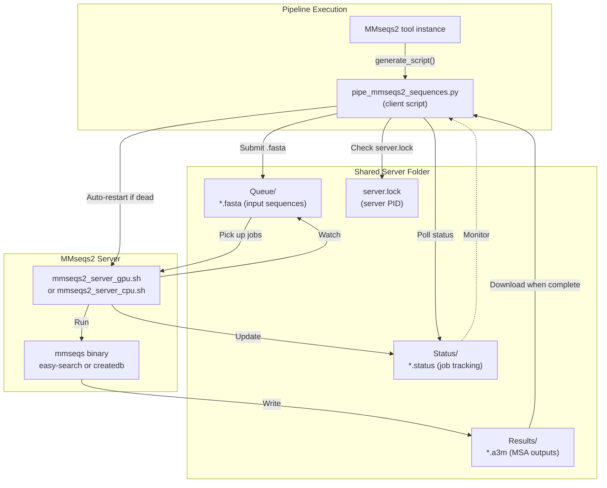

**Sources:** High-level diagram (Diagram 5)

### Server Management

The client script automatically manages the server:

1. **Check server health:** Read `server.lock` for PID, verify process exists
2. **Start server if needed:** Submit SLURM job with `mmseqs2_server_gpu.sh`
3. **Submit jobs:** Write FASTA to `Queue/`
4. **Poll for completion:** Check `Status/*.status` files
5. **Download results:** Copy from `Results/*.a3m`

**Auto-restart logic:** If server PID is stale (process doesn't exist), client resubmits server job.

### MSA Masking

MMseqs2 tool supports masking specific regions during MSA search to prevent bias:

```python
from biopipelines.mmseqs2 import MMseqs2

# Mask designed regions (only search fixed scaffold)
msas = MMseqs2(
    sequences=designs,
    mask_regions=designs.tables.structures.designed  # Column reference
)
```

Masked regions are converted to 'X' during search, then restored in output MSAs.

### Output

- **DataStream:** `msas` (format: `"a3m"`, map_table: `"msas.csv"`)
- **TableInfo:** `msas.csv` with columns: `id`, `file`, `num_sequences`, `coverage`

**Sources:** High-level diagram (Diagram 5), MMseqs2 section

---

## Helper Script Patterns

All utility tools follow a common helper script pattern:

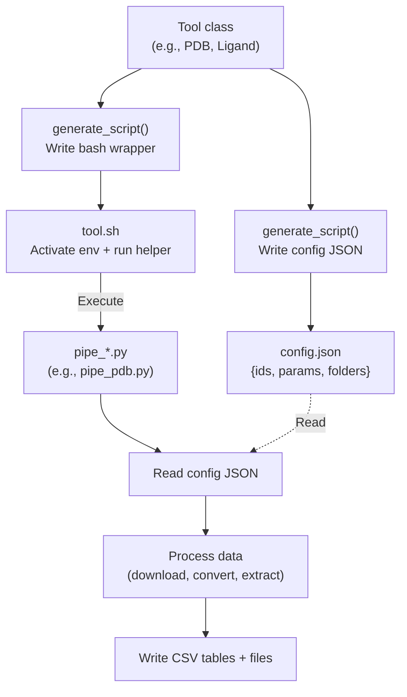

**Configuration JSON** contains all parameters needed for execution (IDs, source paths, conversion settings, etc.)

**Bash wrapper** activates the appropriate conda/mamba environment and invokes the Python helper script.

**Helper script** reads config, performs the actual work (fetching, conversion, parsing), and writes standardized outputs.

**Sources:** HelpScripts/pipe_pdb.py:1445-1513, HelpScripts/pipe_ligand.py:1240-1320, HelpScripts/pipe_sequence.py:83-123

---

## Summary

Utility tools provide typed, reusable data input for BioPipelines workflows:

| Tool | Primary Purpose | Key Feature |
|------|-----------------|-------------|
| **PDB** | Fetch structures | Priority-based lookup, format conversion, operations |
| **RCSB** | Search & download | Advanced search API, typed attributes, query composition |
| **Ligand** | Fetch ligands | Multi-source lookup, SMILES→3D conversion, residue renaming |
| **Sequence** | Create sequences | Simple string→FASTA/CSV conversion |
| **CompoundLibrary** | Compound collections | Library support, property filtering |
| **Load/LoadMultiple** | Reuse outputs | Read previous pipeline results |
| **MMseqs2** | Generate MSAs | Client-server, GPU acceleration, masking |

All produce `StandardizedOutput` with typed streams and tables for seamless downstream integration.

---