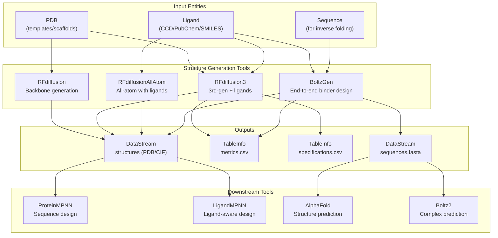
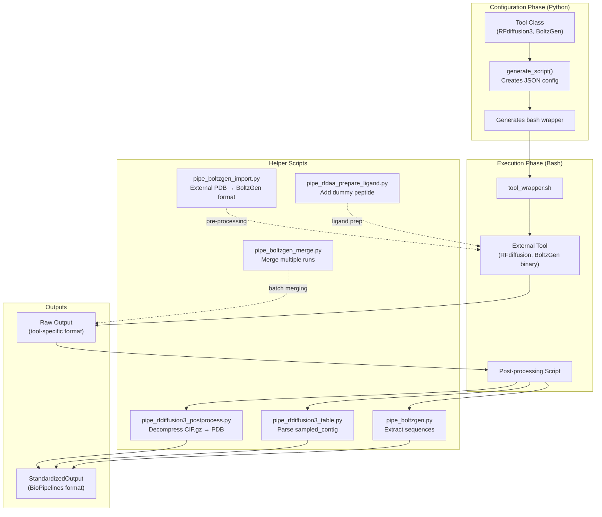
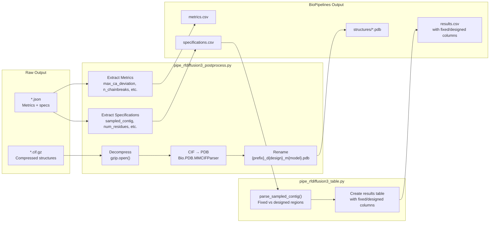
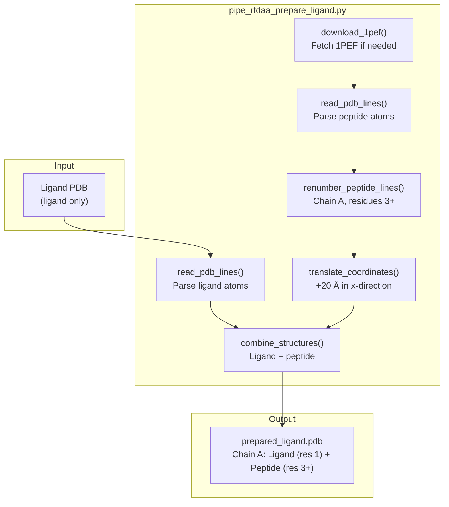
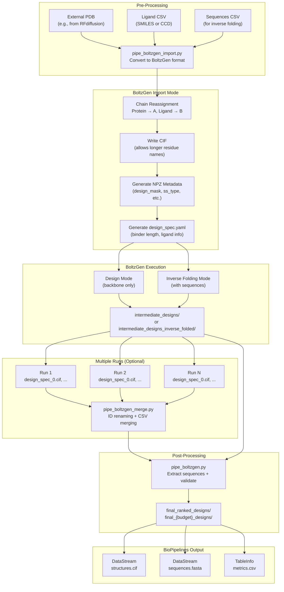
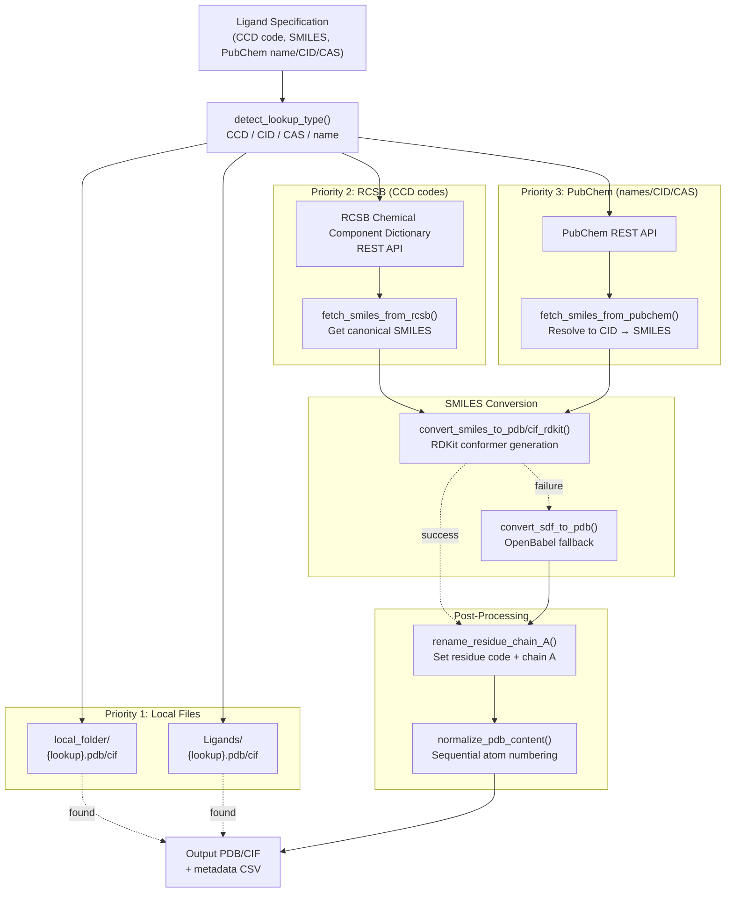

# Structure Generation Tools

<details>
<summary>Relevant source files</summary>

The following files were used as context for generating this wiki page:

- [Docs/Tool/Analysis.md](Docs/Tool/Analysis.md)
- [Docs/Tool/DataManagement.md](Docs/Tool/DataManagement.md)
- [Docs/ToolReference.md](Docs/ToolReference.md)
- [HelpScripts/pipe_boltzgen.py](HelpScripts/pipe_boltzgen.py)
- [HelpScripts/pipe_boltzgen_import.py](HelpScripts/pipe_boltzgen_import.py)
- [HelpScripts/pipe_boltzgen_merge.py](HelpScripts/pipe_boltzgen_merge.py)
- [HelpScripts/pipe_ligand.py](HelpScripts/pipe_ligand.py)
- [HelpScripts/pipe_rfdaa_prepare_ligand.py](HelpScripts/pipe_rfdaa_prepare_ligand.py)
- [HelpScripts/pipe_rfdiffusion3_postprocess.py](HelpScripts/pipe_rfdiffusion3_postprocess.py)
- [HelpScripts/pipe_rfdiffusion3_table.py](HelpScripts/pipe_rfdiffusion3_table.py)
- [HelpScripts/pipe_sequence.py](HelpScripts/pipe_sequence.py)

</details>


This page documents the structure generation tools in BioPipelines: **RFdiffusion**, **RFdiffusion3**, **RFdiffusionAllAtom**, and **BoltzGen**. These tools generate novel protein backbones or complete binder structures, forming the foundation for computational protein design workflows.

For sequence design on existing backbones, see [Sequence Design Tools](#5.3). For structure prediction and validation, see [Structure Prediction Tools](#5.4) and [Analysis Tools](#5.5).

---

## Overview and Tool Ecosystem

Structure generation tools consume **input specifications** (contigs, hotspots, ligands) and produce **protein structures** (PDB/CIF files) with accompanying **metadata tables**. They are the primary entry point for de novo design pipelines.

**Tool Landscape:**



**Sources:** [Docs/ToolReference.md:28-36](), [HelpScripts/pipe_rfdiffusion3_postprocess.py:1-25](), [HelpScripts/pipe_boltzgen.py:1-14]()

---

## Architecture: Helper Scripts and Post-Processing

All structure generation tools follow a **two-phase execution model** with dedicated helper scripts for runtime processing and post-processing:



**Sources:** [HelpScripts/pipe_rfdiffusion3_postprocess.py:1-25](), [HelpScripts/pipe_rfdiffusion3_table.py:1-23](), [HelpScripts/pipe_boltzgen_import.py:1-22](), [HelpScripts/pipe_boltzgen_merge.py:1-24](), [HelpScripts/pipe_boltzgen.py:1-14](), [HelpScripts/pipe_rfdaa_prepare_ligand.py:1-12]()

---

## RFdiffusion3

Third-generation RFdiffusion with native ligand support and advanced contig specifications.

### Output Format and Post-Processing

RFdiffusion3 generates compressed CIF files that require post-processing:

**Post-Processing Pipeline:**



**Sources:** [HelpScripts/pipe_rfdiffusion3_postprocess.py:1-406](), [HelpScripts/pipe_rfdiffusion3_table.py:1-362]()

### Sampled Contig Parsing

RFdiffusion3's `sampled_contig` specification encodes which residues are **fixed** (from input structure) vs **designed** (de novo generated). The parser in [pipe_rfdiffusion3_table.py:25-89]() interprets this format:

**Contig Format Examples:**

| `sampled_contig` | Interpretation | `fixed` | `designed` |
|------------------|----------------|---------|------------|
| `"17,A9-140"` | 17 designed residues (1-17), then fixed A9-140 mapped to 18-149 | `18-149` | `1-17` |
| `"A1-50,20,A60-100"` | Fixed A1-50 (1-50), 20 designed (51-70), fixed A60-100 (71-111) | `1-50+71-111` | `51-70` |
| `"160"` | De novo design with only length specified | `` | `1-160` |
| `"A1-50"` | Scaffold-only (no designed residues) | `1-50` | `` |

**Parser Implementation:**

[HelpScripts/pipe_rfdiffusion3_table.py:25-89]() parses the contig string by:
1. Splitting by comma to get segments
2. Classifying each segment:
   - `^[A-Z]\d+-\d+$` → Fixed region from input chain (e.g., `A9-140`)
   - `^\d+$` → Designed region with specified length (e.g., `17`)
   - `^[A-Z]\d+$` → Single fixed residue (e.g., `A50`)
3. Tracking `current_pos` to map to final structure numbering
4. Converting residue lists to PyMOL selection strings via `list_to_sele()`

**Metrics Extracted:**

[HelpScripts/pipe_rfdiffusion3_postprocess.py:150-188]() extracts from JSON:
- `max_ca_deviation`: Maximum Cα deviation from input template
- `n_chainbreaks`: Number of chain breaks
- `n_clashing_interresidue_w_sidechain`: Sidechain clashes
- `n_clashing_interresidue_w_backbone`: Backbone clashes
- `ligand_clashes`: Ligand-protein clashes
- `ligand_min_distance`: Minimum ligand-protein distance
- Secondary structure content: `helix_fraction`, `sheet_fraction`, `loop_fraction`
- Compositional metrics: `alanine_content`, `glycine_content`, `radius_of_gyration`

**Specifications Extracted:**

[HelpScripts/pipe_rfdiffusion3_postprocess.py:190-218]() extracts:
- `sampled_contig`: Actual contig used (resolved from ranges)
- `num_tokens_in`: Input tokens
- `num_residues_in`: Input residues
- `num_chains`: Number of chains
- `num_atoms`: Total atoms
- `num_residues`: Total residues in output

**Sources:** [HelpScripts/pipe_rfdiffusion3_postprocess.py:1-406](), [HelpScripts/pipe_rfdiffusion3_table.py:1-362]()

---

## RFdiffusionAllAtom

All-atom RFdiffusion variant with native ligand support. Requires **protein atoms** in the input structure.

### Ligand Preparation

For ligand-only inputs, [pipe_rfdaa_prepare_ligand.py:1-269]() adds a dummy peptide to satisfy RFdiffusion-AllAtom's requirements:

**Ligand Preparation Process:**



**Transformation Details:**

1. **Peptide Selection:** Downloads `1PEF` from RCSB [pipe_rfdaa_prepare_ligand.py:21-59]()
2. **Chain Assignment:** Both ligand and peptide assigned to chain A [pipe_rfdaa_prepare_ligand.py:80-122]()
3. **Residue Numbering:** Ligand at residue 1, peptide starts at residue 3 [pipe_rfdaa_prepare_ligand.py:80-122]()
4. **Spatial Separation:** Peptide translated +20 Å in x-direction to avoid clashes [pipe_rfdaa_prepare_ligand.py:125-163]()

**Rationale:** RFdiffusion-AllAtom requires protein atoms to initialize the diffusion process. The dummy peptide provides this while remaining spatially separated from the design region.

**Sources:** [HelpScripts/pipe_rfdaa_prepare_ligand.py:1-269]()

---

## BoltzGen

End-to-end binder design workflow that combines structure generation, sequence design, and folding.

### Complete Workflow



**Sources:** [HelpScripts/pipe_boltzgen_import.py:1-22](), [HelpScripts/pipe_boltzgen_merge.py:1-24](), [HelpScripts/pipe_boltzgen.py:1-14]()

### Import Mode: External Structure Conversion

[pipe_boltzgen_import.py:787-909]() converts external PDB structures (e.g., from RFdiffusion) into BoltzGen's expected filesystem format:

**Key Transformations:**

1. **Chain Reassignment:** [pipe_boltzgen_import.py:355-521]()
   - Longest chain → Protein (chain A)
   - Non-standard residues → Ligand (chain B)
   - Residue code renamed to `LIG1` (or custom via `--ligand-name`)

2. **CIF Format Output:** [pipe_boltzgen_import.py:148-353]()
   - **Why CIF, not PDB?** CIF allows residue names longer than 3 characters (e.g., `LIG1`, `LIG2`)
   - BoltzGen's `parse_mmcif` accepts `mols` dictionary for ligand resolution
   - PDB format limited to 3-character residue names

3. **NPZ Metadata Generation:** [pipe_boltzgen_import.py:717-784]()
   ```python
   # Per-token arrays required by BoltzGen dataloader
   design_mask = np.concatenate([
       np.ones(n_protein_residues, dtype=np.float32),   # Protein: designed
       np.zeros(n_ligand_atoms, dtype=np.float32)        # Ligand: fixed
   ])
   ```
   - `design_mask`: 1.0 for protein (designed), 0.0 for ligand (fixed)
   - `inverse_fold_design_mask`: Same as design_mask
   - `ss_type`, `binding_type`: All UNSPECIFIED (0)
   - `token_resolved_mask`: All resolved (1.0)

4. **design_spec.yaml Generation:** [pipe_boltzgen_import.py:663-714]()
   ```yaml
   entities:
   - protein:
       id: A
       sequence: 100..200  # Or exact number if binder_min == binder_max
   - ligand:
       id: B
       smiles: CCO  # Or ccd: ATP
   ```

**Inverse Folding Mode:** [pipe_boltzgen_import.py:355-521]()
- `--mode inverse_folding` + `--sequences sequences.csv`
- Replaces residue names with new sequence
- **Backbone coordinates preserved, sidechain coordinates zeroed**
- Uses template from `AA_ATOMS` dictionary [pipe_boltzgen_import.py:49-70]() for each amino acid

**ID Mapping for Sequence Matching:** [pipe_boltzgen_import.py:551-638]()
- Default pattern: `{"*": "*_<S>"}` handles recursive suffix stripping
- Example: `design_spec_0` structure matches `design_spec_0_1`, `design_spec_0_1_1`, etc.
- Fallback to prefix/suffix matching if regex fails

**Sources:** [HelpScripts/pipe_boltzgen_import.py:1-1309]()

### Merge Mode: Combining Multiple Runs

[pipe_boltzgen_merge.py:250-412]() merges multiple BoltzGen output directories with ID renaming to avoid collisions:

**Merge Strategy:**

1. **ID Renaming:** [pipe_boltzgen_merge.py:36-50]()
   - Template: `batch{i:03d}_` (default) or custom via `--id_template`
   - Example: `batch000_design_spec_0.cif`, `batch001_design_spec_0.cif`
   - Regex pattern: `r'(design_spec_\d+(?:_model_\d+)?)'` [pipe_boltzgen_merge.py:148]()

2. **File Processing:**
   - **Structure files (CIF, NPZ):** Copied with renamed filenames [pipe_boltzgen_merge.py:299-321]()
   - **CSV files:** Merged using pandas with ID updates in all string columns [pipe_boltzgen_merge.py:132-166]()
   - **Pickle files (.pkl.gz):** Merged DataFrames with ID updates [pipe_boltzgen_merge.py:169-223]()

3. **Molecule Pickles:** [pipe_boltzgen_merge.py:395-410]()
   - Copied from **first source only** (ligand same across runs)
   - Placed in both `intermediate_designs/molecules_out_dir` and `intermediate_designs_inverse_folded/molecules_out_dir`
   - Required by BoltzGen's `parse_mmcif` for ligand resolution during analysis

4. **CSV-Only Mode:** [pipe_boltzgen_merge.py:250]()
   - `--csv` flag: Skip structure file copying, only merge CSVs
   - Useful for quick re-merging when structure files already in place

**Why Pandas for CSV Merging?**
- Preserves data types (numeric columns stay numeric, not converted to strings)
- Handles different column sets across runs gracefully
- Proper NaN handling

**Sources:** [HelpScripts/pipe_boltzgen_merge.py:1-496]()

### Post-Processing: Sequence Extraction

[pipe_boltzgen.py:72-148]() extracts sequences from final designed structures:

**Process:**

1. **Structure Collection:** [pipe_boltzgen.py:83-99]()
   - Glob `*.cif` and `*.pdb` in `final_ranked_designs/final_{budget}_designs/`
   - Sort by name for consistent ordering

2. **Sequence Extraction:** [pipe_boltzgen.py:23-69]()
   - Uses BioPython's `MMCIFParser` or `PDBParser`
   - Converts three-letter codes to single-letter via `protein_letters_3to1`
   - Extracts from first model, first chain

3. **Output Files:**
   - `sequences.csv`: ID, sequence, source_id, source_pdb, chain, length
   - `structures.csv`: ID, pdb path
   - `final_structures.txt`: Line-separated list of structure paths

**Sources:** [HelpScripts/pipe_boltzgen.py:1-326]()

---

## Ligand Input Processing

All structure generation tools that accept ligands use [pipe_ligand.py:1-1218]() for ligand fetching and conversion.

### Ligand Lookup Priority



**Sources:** [HelpScripts/pipe_ligand.py:1-1218]()

### SMILES to Structure Conversion

**RDKit Pipeline (Preferred):** [pipe_ligand.py:171-241]()
1. Parse SMILES with `Chem.MolFromSmiles()`
2. Add hydrogens via `Chem.AddHs()`
3. Generate 3D coordinates with ETKDG: `AllChem.ETKDGv3()` [pipe_ligand.py:200-212]()
4. Optimize geometry with MMFF force field [pipe_ligand.py:215-218]()
5. Remove hydrogens for cleaner output [pipe_ligand.py:221]()
6. Generate PDB/CIF block [pipe_ligand.py:224-232]()

**Why Preserve RDKit Atom Naming?**
[pipe_ligand.py:171-184](): RFdiffusion3 internally uses RDKit to regenerate conformers and expects matching atom names. Renaming atoms would break this compatibility.

**CIF Output for RFdiffusion3:** [pipe_ligand.py:243-386]()
- Includes `_atom_site` category (required by biotite/foundry for structure parsing)
- Note: Bond orders intentionally omitted from structure CIF files (foundry/biotite infer bonds from coordinates)

**PDB Normalization:** [pipe_ligand.py:574-698]()
- Sequential atom serial numbers (1, 2, 3, ...)
- Element-numbered atom names (C1, C2, N1, O1, ...)
- Chain ID = 'A', Residue number = 1
- Renumbered CONECT records

**Sources:** [HelpScripts/pipe_ligand.py:1-1218]()

---

## Common Output Structures

All structure generation tools produce a **StandardizedOutput** with consistent stream and table organization:

### DataStream: structures

| Field | Description |
|-------|-------------|
| `ids` | List of structure identifiers |
| `files` | List of absolute paths to PDB/CIF files |
| `format` | File format: `"pdb"` or `"cif"` |
| `map_table` | Path to structures CSV with columns: `id`, `pdb` |

### TableInfo: metrics

Metrics vary by tool but commonly include:

**RFdiffusion3:** [pipe_rfdiffusion3_postprocess.py:150-188]()
- Geometric quality: `max_ca_deviation`, `n_chainbreaks`, `radius_of_gyration`
- Clashes: `n_clashing_interresidue_w_sidechain`, `ligand_clashes`
- Secondary structure: `helix_fraction`, `sheet_fraction`, `loop_fraction`
- Composition: `alanine_content`, `glycine_content`

**BoltzGen:** [pipe_boltzgen.py:151-188]()
- Design metrics from BoltzGen's internal scoring
- Confidence scores
- Binding affinity predictions (if enabled)

### TableInfo: specifications/results

**RFdiffusion3:** [pipe_rfdiffusion3_table.py:226-357]()

| Column | Description |
|--------|-------------|
| `id` | Structure identifier |
| `design` | Design number (batch index) |
| `model` | Model number (sample within design) |
| `pdb` | Filename (relative to output folder) |
| `fixed` | PyMOL selection of fixed residues (e.g., `"18-149"`) |
| `designed` | PyMOL selection of designed residues (e.g., `"1-17"`) |
| `contig` | Original contig specification |
| `length` | Total residue count |
| `status` | `"success"` or `"missing"` |

**BoltzGen:** [pipe_boltzgen.py:104-148]()
- `id`, `sequence`, `source_id`, `source_pdb`, `chain`, `length`

**Sources:** [HelpScripts/pipe_rfdiffusion3_postprocess.py:1-406](), [HelpScripts/pipe_rfdiffusion3_table.py:1-362](), [HelpScripts/pipe_boltzgen.py:1-326]()

---

## Integration Patterns

### Typical Workflow Examples

**De Novo Binder Design with RFdiffusion3:**
```python
from biopipelines.rfdiffusion3 import RFdiffusion3
from biopipelines.ligand import Ligand
from biopipelines.protein_mpnn import ProteinMPNN
from biopipelines.alphafold import AlphaFold

# 1. Define ligand
ligand = Ligand(smiles="CCO", ids="ethanol")

# 2. Generate backbones
backbones = RFdiffusion3(
    ligands=ligand,
    contig="100-150",
    hotspots="LIG:10,15,20",
    num_designs=10
)

# 3. Design sequences
sequences = ProteinMPNN(
    structures=backbones,
    design_positions=backbones.tables.results.designed
)

# 4. Validate with AlphaFold
predictions = AlphaFold(sequences=sequences)
```

**BoltzGen End-to-End:**
```python
from biopipelines.boltzgen import BoltzGen
from biopipelines.ligand import Ligand

ligand = Ligand(ccd="ATP")

# Single call: design + fold + rank
designs = BoltzGen(
    ligands=ligand,
    binder_length_min=100,
    binder_length_max=150,
    budget=100
)

# Access top designs
top_structures = designs.streams.structures  # Final ranked designs
top_sequences = designs.streams.sequences    # Extracted sequences
metrics = designs.tables.metrics             # Design metrics
```

**Importing External Structures to BoltzGen:**
```python
from biopipelines.rfdiffusion import RFdiffusion
from biopipelines.boltzgen_import import BoltzGenImport
from biopipelines.boltzgen import BoltzGen

# 1. Generate backbones with RFdiffusion
backbones = RFdiffusion(contig="100-150", num_designs=100)

# 2. Import to BoltzGen format
imported = BoltzGenImport(
    structures=backbones,
    ligands=Ligand(smiles="CCO"),
    mode="design"  # or "inverse_folding" with sequences
)

# 3. Continue with BoltzGen workflow
# (manually run BoltzGen with imported structures)
```

**Sources:** [Docs/ToolReference.md:28-36](), [HelpScripts/pipe_boltzgen_import.py:1-22]()

---