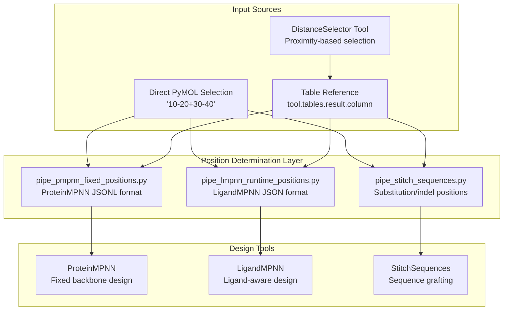
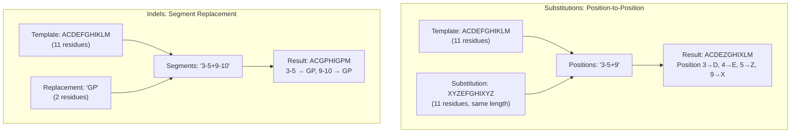
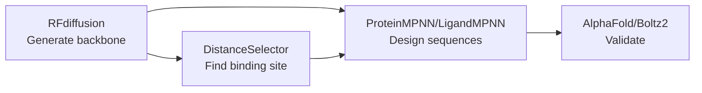
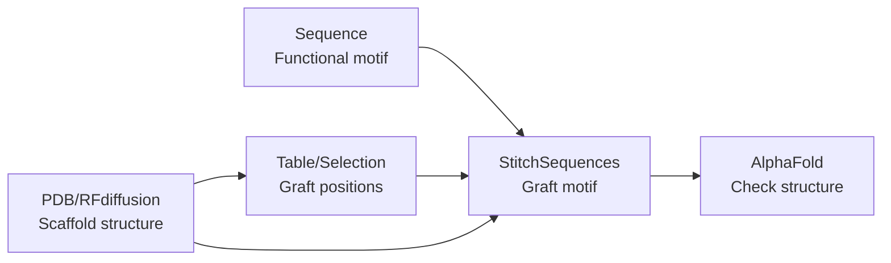
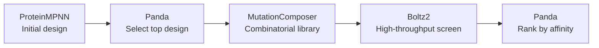
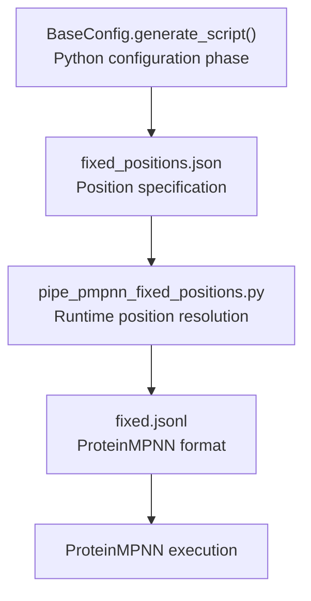
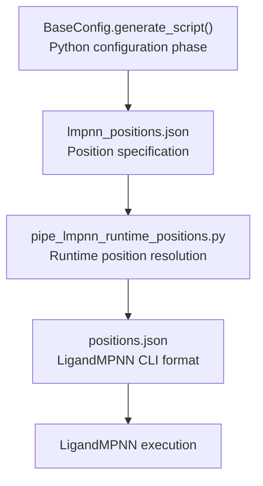
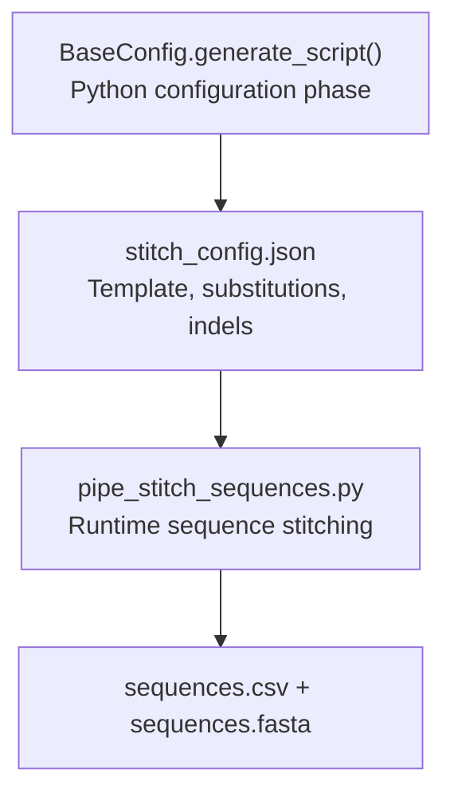

# Sequence Design Tools

<details>
<summary>Relevant source files</summary>

The following files were used as context for generating this wiki page:

- [Docs/Tool/Analysis.md](Docs/Tool/Analysis.md)
- [Docs/Tool/DataManagement.md](Docs/Tool/DataManagement.md)
- [Docs/ToolReference.md](Docs/ToolReference.md)
- [HelpScripts/pipe_distance_selector.py](HelpScripts/pipe_distance_selector.py)
- [HelpScripts/pipe_lmpnn_runtime_positions.py](HelpScripts/pipe_lmpnn_runtime_positions.py)
- [HelpScripts/pipe_pmpnn_fixed_positions.py](HelpScripts/pipe_pmpnn_fixed_positions.py)
- [HelpScripts/pipe_stitch_sequences.py](HelpScripts/pipe_stitch_sequences.py)

</details>


Sequence design tools generate or modify amino acid sequences for protein structures. These tools operate on fixed backbones (from structure generation or existing PDBs) and produce sequence variants that are subsequently validated by structure prediction. This page documents eight sequence design tools and their position selection mechanisms.

For structure generation (backbone design), see [Structure Generation Tools](#5.2). For validation of designed sequences, see [Structure Prediction Tools](#5.4). For selecting positions based on structural features, see [Analysis Tools](#5.5).

---

## Position Selection Architecture

Sequence design tools require specifying which residues to redesign versus which to keep fixed. BioPipelines provides three position specification mechanisms:



**Sources:** `HelpScripts/pipe_pmpnn_fixed_positions.py`, `HelpScripts/pipe_lmpnn_runtime_positions.py`, `HelpScripts/pipe_stitch_sequences.py`, `Docs/Tool/Analysis.md`

### Position Specification Formats

| Format | Example | Behavior |
|--------|---------|----------|
| **Direct selection** | `"10-20+30-40"` | PyMOL-style ranges applied to all structures |
| **Table reference** | `tool.tables.result.column` | Per-structure selections from upstream tool |
| **Table reference (raw)** | `"TABLE_REFERENCE:path.csv:column"` | Explicit table path and column name |

**Table Reference Matching:** When using table references, structure IDs are matched to table IDs using the tool's `id_map` pattern. The default `{"*": "*_<N>"}` matches child IDs to parent IDs (e.g., `design_1_5` matches `design_1`). See [ID Generation and Provenance Tracking](#3.5) for details.

**Sources:** `HelpScripts/pipe_pmpnn_fixed_positions.py:114-144`, `HelpScripts/pipe_lmpnn_runtime_positions.py:84-113`, `Docs/Tool/Analysis.md:133-162`

---

## ProteinMPNN

Fixed backbone sequence design using the ProteinMPNN neural network. Generates sequences optimized for a given backbone structure while optionally fixing specific regions.

**Environment:** `proteinmpnn_env`

**Parameters:**
- `structures`: Union[str, List[str], ToolOutput, StandardizedOutput] (required) - Input backbone structures
- `fixed`: Optional[Union[str, ToolOutput]] = None - Residues to keep unchanged (PyMOL selection or table reference)
- `designed`: Optional[Union[str, ToolOutput]] = None - Residues to redesign (overrides `fixed` logic)
- `num_seq_per_target`: int = 1 - Number of sequences to generate per structure
- `sampling_temp`: float = 0.1 - Sampling temperature (0.1 = greedy, higher = more diversity)
- `seed`: int = 37 - Random seed for reproducibility
- `chain`: str = "auto" - Chain ID to design (auto-detects single chain)

**Position Selection Logic:**
1. If `designed` specified: redesign only those positions, fix all others
2. If only `fixed` specified: fix those positions, redesign all others
3. If neither specified: redesign all positions

**Streams:**
- `sequences`: FASTA format sequences

**Tables:**
- `sequences`: 

  | id | sequence | structures.id | fixed | mobile |
  |----|----------|---------------|-------|--------|

**Examples:**

```python
from biopipelines.proteinmpnn import ProteinMPNN
from biopipelines.rfdiffusion import RFdiffusion

# Redesign entire backbone
backbones = RFdiffusion(...)
sequences = ProteinMPNN(structures=backbones, num_seq_per_target=10)

# Fix scaffold, redesign binder
sequences = ProteinMPNN(
    structures=backbones,
    fixed="1-100",  # Scaffold region
    num_seq_per_target=5
)

# Redesign only binding interface (from DistanceSelector)
from biopipelines.distance_selector import DistanceSelector

interface = DistanceSelector(
    structures=backbones,
    ligand="LIG",
    distance=8.0
)

sequences = ProteinMPNN(
    structures=backbones,
    designed=interface.tables.selections.within,
    num_seq_per_target=10
)
```

**Sources:** `Docs/ToolReference.md:43`, `HelpScripts/pipe_pmpnn_fixed_positions.py`, `Docs/Tool/Analysis.md:133-162`

---

## LigandMPNN

Ligand-aware sequence design that considers small molecule binding partners. Generates sequences optimized for protein-ligand complex structures.

**Environment:** `ligandmpnn_env`

**Parameters:**
- `structures`: Union[str, List[str], ToolOutput, StandardizedOutput] (required) - Protein-ligand complex structures
- `ligand`: str (required) - Ligand residue name (3-letter code, e.g., 'LIG', 'ATP')
- `fixed`: Optional[Union[str, ToolOutput]] = None - Fixed residues
- `designed`: Optional[Union[str, ToolOutput]] = None - Designed residues
- `num_seq_per_target`: int = 1 - Sequences per structure
- `sampling_temp`: float = 0.1 - Sampling temperature
- `seed`: int = 37 - Random seed

**Position Selection Logic:** Same as ProteinMPNN, but ligand atoms are automatically considered during design.

**Streams:**
- `sequences`: FASTA format sequences

**Tables:**
- `sequences`:

  | id | sequence | structures.id | ligand | fixed | designed |
  |----|----------|---------------|--------|-------|----------|

**Examples:**

```python
from biopipelines.ligandmpnn import LigandMPNN
from biopipelines.rfdiffusionallatom import RFdiffusionAllAtom

# Design binding pocket for ATP
complex_structures = RFdiffusionAllAtom(ligand="ATP", ...)
sequences = LigandMPNN(
    structures=complex_structures,
    ligand="ATP",
    num_seq_per_target=20
)

# Design only residues near ligand
from biopipelines.distance_selector import DistanceSelector

pocket = DistanceSelector(
    structures=complex_structures,
    ligand="LIG",
    distance=5.0
)

sequences = LigandMPNN(
    structures=complex_structures,
    ligand="LIG",
    designed=pocket.tables.selections.within,
    num_seq_per_target=10
)
```

**Sources:** `Docs/ToolReference.md:44`, `HelpScripts/pipe_lmpnn_runtime_positions.py`, `Docs/Tool/Analysis.md:133-162`

---

## MutationComposer

Generates combinatorial mutant libraries by systematically substituting residues at specified positions. Produces Cartesian product of all mutation combinations.

**Environment:** `biopipelines`

**Parameters:**
- `sequences`: Union[str, List[str], ToolOutput, StandardizedOutput] (required) - Template sequence(s)
- `mutations`: Dict[str, List[str]] (required) - Position -> amino acid list mapping (1-indexed)

**Streams:**
- `sequences`: FASTA format sequences

**Tables:**
- `sequences`:

  | id | sequence | sequences.id |
  |----|----------|--------------|

**ID Generation:** Template IDs are suffixed with mutation indices: `template_1_2_3` means position mutations 1, 2, 3 from the mutation lists.

**Examples:**

```python
from biopipelines.mutation_composer import MutationComposer
from biopipelines.sequence import Sequence

# Single template with mutations at positions 10, 15, 20
template = Sequence(sequences=["ACDEFGHIKLMNPQRSTVWY"])

mutants = MutationComposer(
    sequences=template,
    mutations={
        "10": ["A", "G", "S"],    # 3 options at position 10
        "15": ["D", "E"],          # 2 options at position 15
        "20": ["F", "Y", "W"]      # 3 options at position 20
    }
)
# Generates 3 × 2 × 3 = 18 mutant sequences

# Apply mutations to multiple templates
templates = Sequence(sequences=["ACDEFG", "GHIKLM"])
mutants = MutationComposer(
    sequences=templates,
    mutations={
        "2": ["A", "V", "I"],
        "5": ["E", "D"]
    }
)
# Generates 2 templates × 3 × 2 = 12 mutants
```

**Sources:** `Docs/ToolReference.md:45`

---

## Mutagenesis (SDM - Site Directed Mutagenesis)

Systematic single-site or multi-site substitutions. Unlike MutationComposer, generates mutations independently (not combinatorially).

**Environment:** `biopipelines`

**Parameters:**
- `sequences`: Union[str, List[str], ToolOutput, StandardizedOutput] (required) - Template sequence(s)
- `positions`: List[int] (required) - Positions to mutate (1-indexed)
- `amino_acids`: List[str] = None - Amino acids to substitute (default: all 20 standard)
- `mode`: str = "single" - Mutagenesis mode: "single" (one mutation per variant) or "all" (all specified mutations)

**Streams:**
- `sequences`: FASTA format sequences

**Tables:**
- `sequences`:

  | id | sequence | sequences.id | mutations |
  |----|----------|--------------|-----------|

**Examples:**

```python
from biopipelines.mutagenesis import Mutagenesis
from biopipelines.sequence import Sequence

template = Sequence(sequences=["ACDEFGHIKLM"])

# Single-site saturation mutagenesis at position 5
saturated = Mutagenesis(
    sequences=template,
    positions=[5],
    mode="single"
)
# Generates 20 variants (one for each amino acid at position 5)

# Multi-site with specific amino acids
mutants = Mutagenesis(
    sequences=template,
    positions=[3, 7, 10],
    amino_acids=["A", "G"],
    mode="single"
)
# Generates 6 variants (3 positions × 2 amino acids)
```

**Sources:** `Docs/ToolReference.md:46`

---

## Fuse

Creates fusion proteins by joining multiple sequences with flexible linkers. Supports combinatorial linker design and position tracking.

**Environment:** `biopipelines`

**Parameters:**
- `sequences`: List[Union[str, ToolOutput, StandardizedOutput]] (required) - Sequences to fuse (2 or more)
- `linkers`: Union[str, List[str]] = "GS" - Linker sequences (single string or list per junction)
- `linker_lengths`: Union[int, List[int]] = None - Auto-generate linkers of specified length(s)
- `linker_composition`: str = "GS" - Amino acids for auto-generated linkers

**Streams:**
- `sequences`: FASTA format sequences

**Tables:**
- `sequences`:

  | id | sequence | L1 | Linker1 | L2 | Linker2 | L3 | ... |
  |----|----------|----|---------|----|---------|----|----|

  Position columns (L1, L2, ...) show residue ranges for each input sequence in the fusion product.

**Examples:**

```python
from biopipelines.fuse import Fuse
from biopipelines.sequence import Sequence

# Simple fusion with GS linker
seq1 = Sequence(sequences=["ACDEFG"])
seq2 = Sequence(sequences=["HIKLMN"])

fusion = Fuse(
    sequences=[seq1, seq2],
    linkers="GS"
)
# Result: ACDEFG-GS-HIKLMN

# Multiple linkers
seq3 = Sequence(sequences=["PQRST"])
fusion = Fuse(
    sequences=[seq1, seq2, seq3],
    linkers=["GGS", "GGGGS"]
)
# Result: ACDEFG-GGS-HIKLMN-GGGGS-PQRST

# Combinatorial linker design
fusion = Fuse(
    sequences=[seq1, seq2],
    linkers=["GS", "GGS", "GGGS"]
)
# Generates 3 fusion variants with different linkers

# Auto-generate linkers of specific lengths
fusion = Fuse(
    sequences=[seq1, seq2],
    linker_lengths=[3, 5, 7],
    linker_composition="GS"
)
# Generates fusions with 3-mer, 5-mer, 7-mer GS linkers
```

**Sources:** `Docs/ToolReference.md:47`

---

## StitchSequences

Advanced sequence grafting that combines template sequences with substitutions (position-to-position replacements) and indels (segment replacements). Supports Cartesian product combinatorics.

**Environment:** `biopipelines`

### Substitutions vs. Indels



**Sources:** `HelpScripts/pipe_stitch_sequences.py:90-252`

**Parameters:**
- `template`: Union[str, List[str], ToolOutput, StandardizedOutput] (required) - Base sequence(s)
- `substitutions`: Dict[str, Union[str, List[str], ToolOutput]] = {} - Position range -> replacement sequences
- `indels`: Dict[str, Union[str, List[str], ToolOutput]] = {} - Segment range -> replacement sequences
- `position_table`: Optional[ToolOutput] = None - Table with per-template position specifications
- `remove_duplicates`: bool = True - Filter duplicate sequences
- `id_map`: Dict[str, str] = {"*": "*_<S>"} - ID mapping pattern for matching sequences

### Position Specification Modes

| Mode | `substitutions`/`indels` value | Positions | Behavior |
|------|-------------------------------|-----------|----------|
| **Fixed positions** | `{"10-20": ["SEQ1", "SEQ2"]}` | Same for all templates | Cartesian product |
| **Table positions** | `{"TABLE_REFERENCE:path:col": ["SEQ1"]}` | Per-template from table | Match by ID |
| **Tool output sequences** | `{position_str: tool_output}` | From tool's sequences | Match by ID |

**Streams:**
- `sequences`: FASTA format sequences

**Tables:**
- `sequences`:

  | id | sequence | template.id |
  |----|----------|-------------|
- `missing`: Removed duplicates and upstream missing entries

**Examples:**

```python
from biopipelines.stitch_sequences import StitchSequences
from biopipelines.sequence import Sequence

# Simple substitution: replace positions 10-15 with motif
template = Sequence(sequences=["ACDEFGHIKLMNPQRSTVWY"])
stitched = StitchSequences(
    template=template,
    substitutions={
        "10-15": ["IGDWGE"]  # Must be 20 residues (same as template)
    }
)

# Combinatorial substitutions at multiple regions
stitched = StitchSequences(
    template=template,
    substitutions={
        "5-8": ["AAAA", "GGGG"],      # 2 options
        "12-15": ["DDDD", "EEEE", "FFFF"]  # 3 options
    }
)
# Generates 2 × 3 = 6 sequences

# Indels: insert/delete segments
stitched = StitchSequences(
    template=template,
    indels={
        "6-7": ["GP", "GGGP", "GGGGP"]  # Replace 2-residue segment with 2-, 4-, or 5-residue
    }
)
# Changes sequence length

# Table-based positions (different positions per template)
from biopipelines.distance_selector import DistanceSelector

templates = ProteinMPNN(structures=backbones, num_seq_per_target=10)
binding_sites = DistanceSelector(structures=backbones, ligand="LIG", distance=5.0)

motif_grafted = StitchSequences(
    template=templates,
    substitutions={
        f"TABLE_REFERENCE:{binding_sites.tables.selections.within}": ["IGDWGE"]
    }
)
# Each template gets motif grafted at structure-specific binding site positions
```

**Helper Script Details:**

[HelpScripts/pipe_stitch_sequences.py:90-196]() implements `apply_substitutions`:
- Validates template and substitution sequence lengths match
- Applies position-to-position replacements
- Shows detailed alignment output for debugging

[HelpScripts/pipe_stitch_sequences.py:199-252]() implements `apply_indels`:
- Processes segments from end to start (preserves indices)
- Handles variable-length replacements
- Supports multi-segment specifications like `"6-7+9-10+17-18"`

**Sources:** `Docs/ToolReference.md:48`, `HelpScripts/pipe_stitch_sequences.py`

---

## DNAEncoder

Reverse translates protein sequences to DNA with codon optimization for specific organisms or expression systems.

**Environment:** `biopipelines`

**Parameters:**
- `sequences`: Union[str, List[str], ToolOutput, StandardizedOutput] (required) - Protein sequences to encode
- `organism`: str = "ecoli" - Target organism for codon optimization
- `avoid_restriction_sites`: List[str] = [] - Restriction sites to avoid
- `gc_content_target`: Optional[float] = None - Target GC content (0.0-1.0)

**Streams:**
- `sequences`: DNA sequences (FASTA format)

**Tables:**
- `sequences`:

  | id | dna_sequence | protein_sequence | gc_content | sequences.id |
  |----|--------------|------------------|------------|--------------|

**Examples:**

```python
from biopipelines.dna_encoder import DNAEncoder

# Basic codon optimization for E. coli
protein_seqs = ProteinMPNN(structures=backbones)
dna = DNAEncoder(
    sequences=protein_seqs,
    organism="ecoli"
)

# Avoid restriction sites
dna = DNAEncoder(
    sequences=protein_seqs,
    organism="ecoli",
    avoid_restriction_sites=["EcoRI", "BamHI", "XhoI"]
)

# Target specific GC content
dna = DNAEncoder(
    sequences=protein_seqs,
    organism="yeast",
    gc_content_target=0.55
)
```

**Sources:** `Docs/ToolReference.md:49`

---

## RBSDesigner

Designs ribosome binding sites (RBS) for bacterial expression with predicted translation initiation rates.

**Environment:** `biopipelines`

**Parameters:**
- `sequences`: Union[str, List[str], ToolOutput, StandardizedOutput] (required) - Coding sequences
- `target_tir`: float = 10000.0 - Target translation initiation rate
- `organism`: str = "ecoli" - Target organism
- `min_spacing`: int = 5 - Minimum spacing between RBS and start codon
- `max_spacing`: int = 15 - Maximum spacing

**Streams:**
- `sequences`: DNA sequences with designed RBS (FASTA format)

**Tables:**
- `sequences`:

  | id | rbs_sequence | full_sequence | predicted_tir | spacing | sequences.id |
  |----|--------------|---------------|---------------|---------|--------------|

**Examples:**

```python
from biopipelines.rbs_designer import RBSDesigner

# Design RBS for protein expression
protein_seqs = ProteinMPNN(structures=backbones)
dna = DNAEncoder(sequences=protein_seqs, organism="ecoli")

constructs = RBSDesigner(
    sequences=dna,
    target_tir=10000.0,
    organism="ecoli"
)

# High expression with tight spacing
constructs = RBSDesigner(
    sequences=dna,
    target_tir=50000.0,
    min_spacing=5,
    max_spacing=8
)
```

**Sources:** `Docs/ToolReference.md:50`

---

## Data Flow Patterns

### Pattern 1: Structure-Guided Sequence Design



```python
# Generate backbone
backbone = RFdiffusion(ligand=target_ligand, ...)

# Identify binding site residues
binding_site = DistanceSelector(
    structures=backbone,
    ligand="LIG",
    distance=5.0
)

# Design sequences for binding site only
sequences = LigandMPNN(
    structures=backbone,
    ligand="LIG",
    designed=binding_site.tables.selections.within,
    num_seq_per_target=20
)

# Validate designs
validation = Boltz2(proteins=sequences, ligands="LIG")
```

**Sources:** `Docs/Tool/Analysis.md:133-162`, High-level diagrams

### Pattern 2: Motif Grafting Workflow



```python
# Define motif to graft
motif = Sequence(sequences=["IGDWGE"])

# Generate scaffolds
scaffolds = RFdiffusion(...)

# Identify positions for grafting (e.g., loop region)
positions = DistanceSelector(
    structures=scaffolds,
    reference_type="residues",
    reference_selection="50-55",  # Target loop
    distance=0.0  # Select exact positions
)

# Graft motif into scaffolds
grafted = StitchSequences(
    template=scaffolds,
    substitutions={
        f"TABLE_REFERENCE:{positions.tables.selections.within}": [motif]
    }
)

# Validate
validation = AlphaFold(sequences=grafted)
```

**Sources:** `HelpScripts/pipe_stitch_sequences.py:342-380`

### Pattern 3: Combinatorial Mutant Library



```python
# Generate initial designs
initial = ProteinMPNN(structures=backbone, num_seq_per_target=100)

# Select best
best = Panda(
    tables=initial.tables.sequences,
    operations=[Panda.sort("score", ascending=False), Panda.head(1)],
    pool=initial
)

# Create mutant library at key positions
mutants = MutationComposer(
    sequences=best,
    mutations={
        "15": ["A", "D", "E", "K", "R"],  # Charge variants
        "42": ["F", "Y", "W"],            # Aromatic variants
        "87": ["G", "A", "S"]             # Small variants
    }
)
# Generates 5 × 3 × 3 = 45 mutants

# Screen all mutants
screen = Boltz2(proteins=mutants, ligands="LIG")

# Rank by predicted affinity
ranked = Panda(
    tables=screen.tables.affinity,
    operations=[Panda.sort("affinity", ascending=True)]
)
```

**Sources:** `Docs/Tool/DataManagement.md:7-117`, High-level diagrams

---

## Helper Script Architecture

Sequence design tools use helper scripts to determine positions at execution time. This enables dynamic position specification from tables generated by upstream tools.

### ProteinMPNN Position Determination



**Position Resolution Logic** [HelpScripts/pipe_pmpnn_fixed_positions.py:173-212]():

1. Load structures DataStream (IDs and file paths)
2. Resolve `fixed` parameter:
   - Direct selection: same positions for all structures
   - Table reference: lookup per-structure positions using ID matching
3. Resolve `designed` parameter (same logic)
4. Compute final fixed positions:
   - If `designed` specified: `fixed = explicit_fixed ∪ complement(designed)`
   - If only `fixed` specified: use as-is
   - If neither: redesign all (empty fixed set)
5. Write JSONL file: `{"design_id": {"chain": [res1, res2, ...]}, ...}`

**Sources:** `HelpScripts/pipe_pmpnn_fixed_positions.py`

### LigandMPNN Position Determination



**Position Resolution Logic** [HelpScripts/pipe_lmpnn_runtime_positions.py:126-158]():

1. Load structures DataStream
2. Process based on `input_source`:
   - `"selection"`: Direct PyMOL or table reference
   - `"table"`: Legacy table format
   - `"ligand"`: Distance-based (placeholder)
3. For each structure:
   - Resolve `fixed` positions (table lookup or direct)
   - Resolve `designed` positions (table lookup or direct)
   - If both empty: fix all residues (outputs original sequence)
4. Write JSON file: `{"design_id": {"fixed_option": "--fixed_residues ...", "redesigned_option": "--redesigned_residues ..."}}`

**Special Case:** When table reference resolves to empty selection (e.g., DistanceSelector found no residues within cutoff), the helper script fixes all residues. This ensures the tool runs without errors and outputs the original sequence, which can be filtered out downstream.

**Sources:** `HelpScripts/pipe_lmpnn_runtime_positions.py`

### StitchSequences Position Determination



**Stitching Strategies** [HelpScripts/pipe_stitch_sequences.py:447-452]():

1. **Raw operations with fixed positions** [HelpScripts/pipe_stitch_sequences.py:523-596]():
   - All substitutions/indels are raw sequences (not from ToolOutput)
   - All positions are fixed strings (not table references)
   - Behavior: Apply to all templates via Cartesian product
   
2. **Matched sequences** [HelpScripts/pipe_stitch_sequences.py:599-786]():
   - At least one substitution/indel uses ToolOutput sequences OR table positions
   - Behavior: Match sequences/positions to templates by ID using `id_map`
   - For each template:
     - Find matching substitution sequences (by ID)
     - Find matching positions (by ID if table reference)
     - Generate Cartesian product of matched options

**ID Matching with `get_mapped_ids`** [HelpScripts/pipe_stitch_sequences.py:365-378]():
- Uses flexible matching from `biopipelines.id_map_utils`
- Supports exact, child, parent, and sibling matches
- Example: template `design_1` matches substitution `design_1_5` (child match)

**Sources:** `HelpScripts/pipe_stitch_sequences.py:382-820`

---

## Integration with DistanceSelector

DistanceSelector is frequently used to dynamically determine redesign positions based on ligand proximity or structural features.

### DistanceSelector → ProteinMPNN

```python
from biopipelines.distance_selector import DistanceSelector
from biopipelines.proteinmpnn import ProteinMPNN

# Generate backbones
backbones = RFdiffusionAllAtom(ligand="ATP", ...)

# Find residues within 8Å of ligand
pocket = DistanceSelector(
    structures=backbones,
    ligand="ATP",
    distance=8.0
)

# Redesign only pocket residues
sequences = ProteinMPNN(
    structures=backbones,
    designed=pocket.tables.selections.within,  # Table reference
    num_seq_per_target=10
)
```

At execution time:
1. DistanceSelector creates `selections.csv` with columns: `id, pdb, within, beyond, distance_cutoff, reference_ligand`
2. ProteinMPNN's `designed` parameter becomes: `"TABLE_REFERENCE:path/to/selections.csv:within"`
3. Helper script `pipe_pmpnn_fixed_positions.py` loads table and matches IDs
4. For each structure ID, looks up `within` column value (e.g., `"10-15+20-25"`)
5. Generates JSONL with structure-specific positions

**Sources:** `Docs/Tool/Analysis.md:133-162`, `HelpScripts/pipe_pmpnn_fixed_positions.py:114-144`

### DistanceSelector with Restrictions

```python
# Redesign only binding site residues that are also in the designed region
from biopipelines.selection import Selection

designed_region = rfdiffusion.tables.structures.designed

pocket_in_designed = DistanceSelector(
    structures=backbones,
    ligand="LIG",
    distance=5.0,
    restrict=designed_region  # Intersect with designed region
)

sequences = LigandMPNN(
    structures=backbones,
    ligand="LIG",
    designed=pocket_in_designed.tables.selections.within
)
```

**Sources:** `HelpScripts/pipe_distance_selector.py:210-248`

---