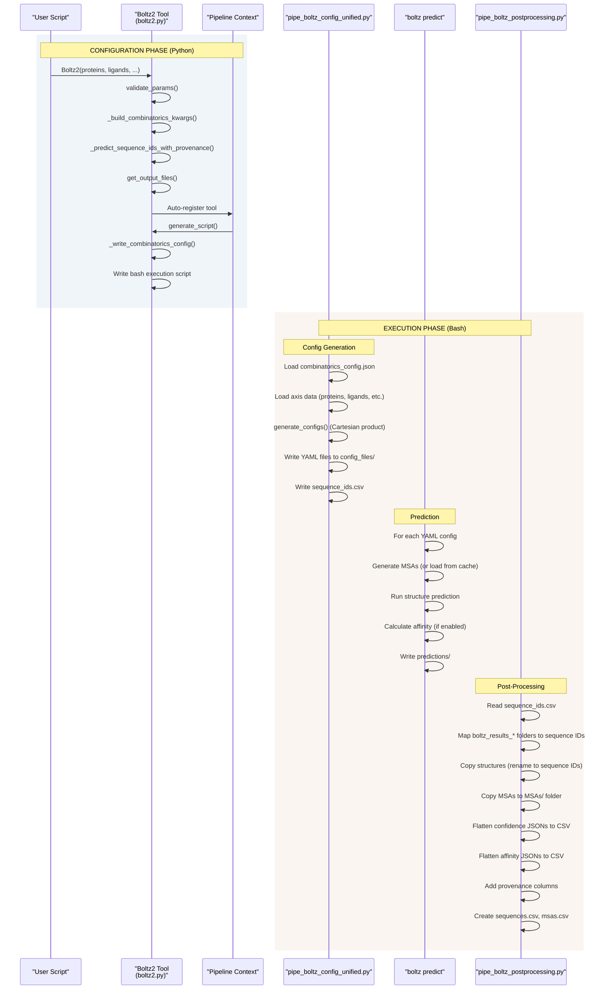
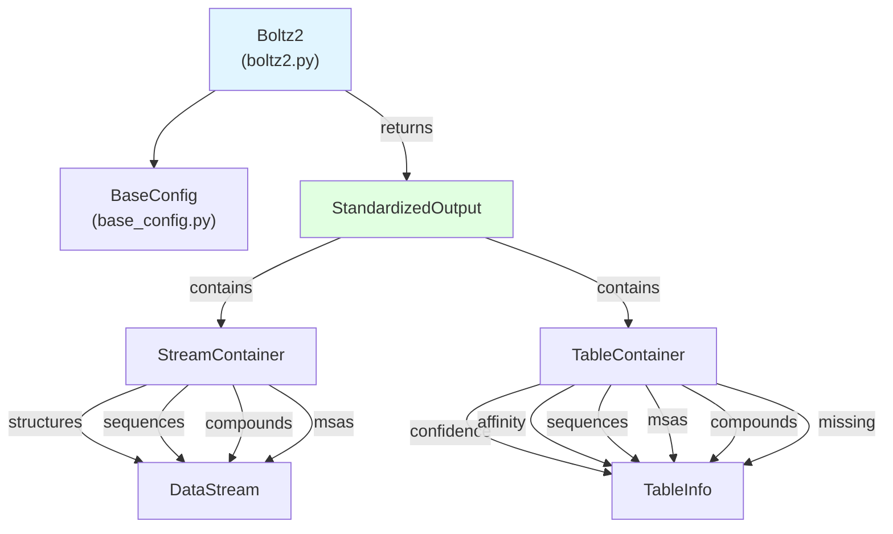
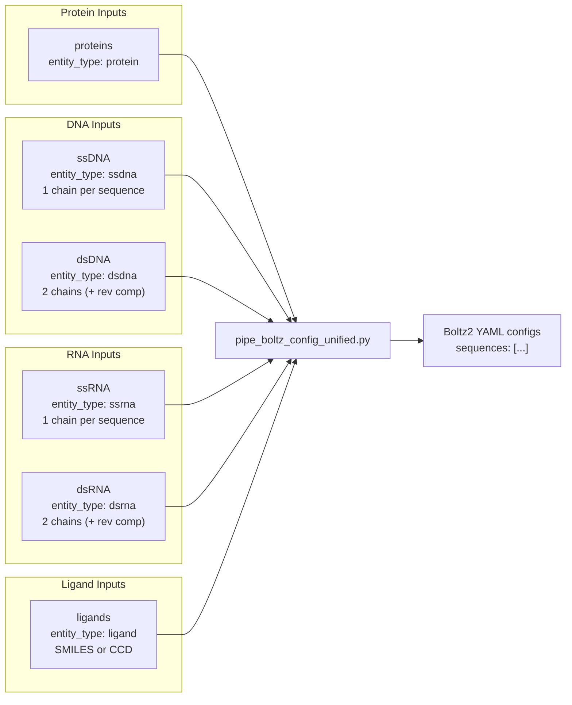
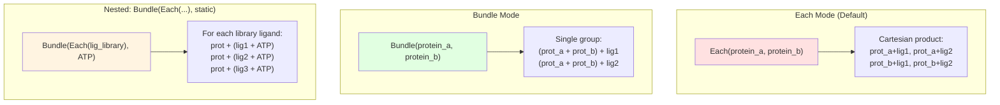
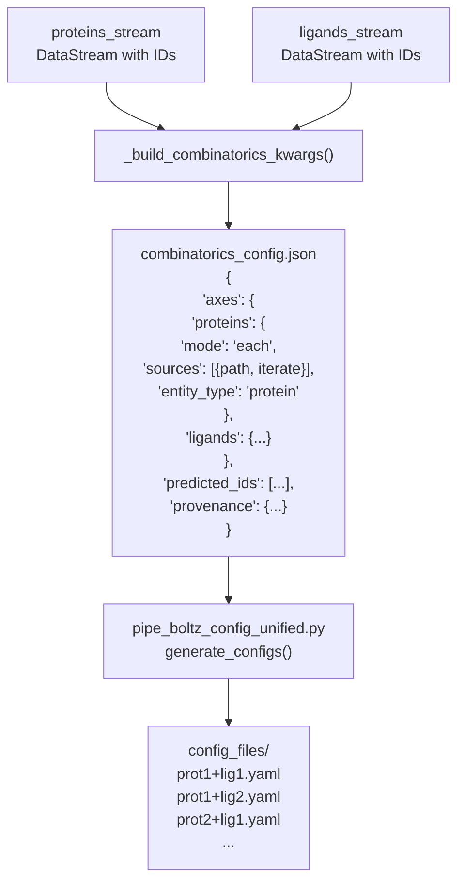
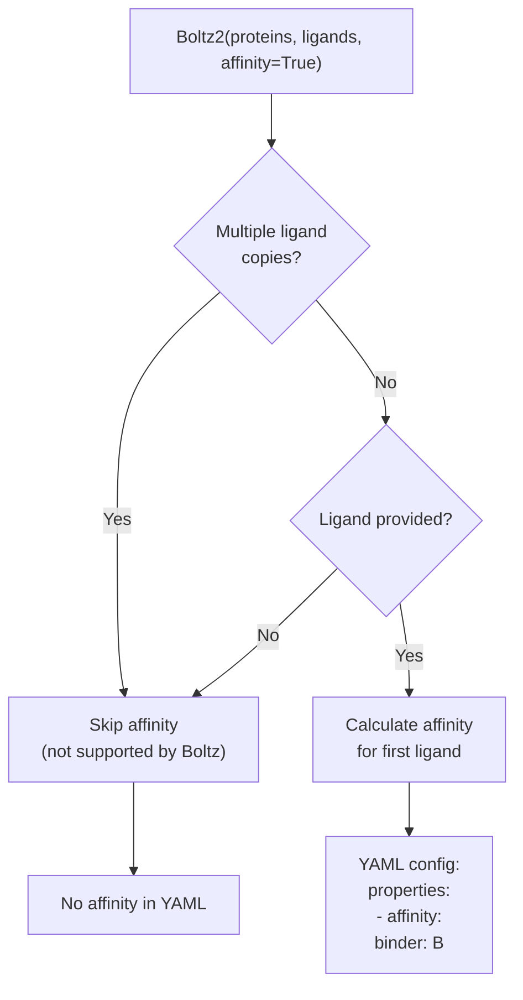
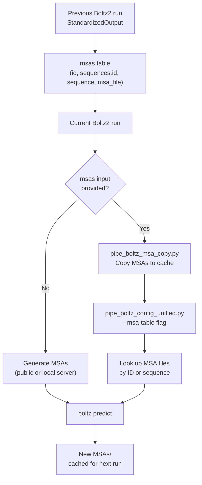
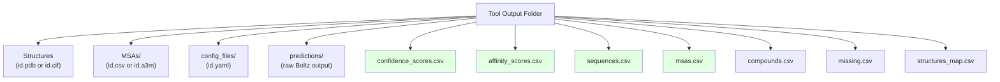

# Structure Prediction Tools

<details>
<summary>Relevant source files</summary>

The following files were used as context for generating this wiki page:

- [Docs/Tool/Analysis.md](Docs/Tool/Analysis.md)
- [Docs/Tool/DataManagement.md](Docs/Tool/DataManagement.md)
- [Docs/ToolReference.md](Docs/ToolReference.md)
- [ExamplePipelines/boltz2.py](ExamplePipelines/boltz2.py)
- [HelpScripts/pipe_boltz_config_unified.py](HelpScripts/pipe_boltz_config_unified.py)
- [HelpScripts/pipe_boltz_postprocessing.py](HelpScripts/pipe_boltz_postprocessing.py)
- [biopipelines/boltz2.py](biopipelines/boltz2.py)
- [biopipelines/combinatorics.py](biopipelines/combinatorics.py)
- [biopipelines/id_map_utils.py](biopipelines/id_map_utils.py)

</details>


Structure prediction tools fold protein sequences and biomolecular complexes into 3D structures. This category provides wrappers for state-of-the-art prediction models that integrate with BioPipelines' combinatorics system, resource management, and data flow architecture.

For generating novel backbones before prediction, see [Structure Generation Tools](#5.2). For designing sequences on existing structures, see [Sequence Design Tools](#5.3). For analyzing predicted structures, see [Analysis Tools](#5.5).

---

## Tool Overview

BioPipelines provides three structure prediction tools:

| Tool | Purpose | Key Features | Environment |
|------|---------|--------------|-------------|
| **AlphaFold** | Monomer/multimer structure prediction | MSA generation, multimer support | `AlphaFoldEnv` |
| **Boltz2** | Biomolecular complex prediction | Proteins, DNA, RNA, ligands, constraints, affinity | `Boltz2Env` |
| **Gnina** | CNN-based molecular docking | Protein-ligand docking with scoring | `gnina` |

Boltz2 is the most feature-rich tool and is detailed extensively in this document. It supports multi-axis combinatorics (proteins × ligands × DNA), MSA recycling, constraint-based prediction, and binding affinity calculation.

**Sources:** [Docs/ToolReference.md:54-61]()

---

## Boltz2 Architecture

### Execution Flow

Boltz2 uses a two-phase execution model with unified config generation and post-processing:



**Sources:** [biopipelines/boltz2.py:373-455](), [HelpScripts/pipe_boltz_config_unified.py:710-772](), [HelpScripts/pipe_boltz_postprocessing.py:54-401]()

---

### Class Architecture



**Sources:** [biopipelines/boltz2.py:32-103]()

---

## Input Types and Combinatorics

Boltz2 supports six biomolecular entity types, each mapped to a combinatorics axis:

### Entity Types



**Entity type resolution** (for backward compatibility):

| Axis Name | Inferred Entity Type |
|-----------|---------------------|
| `proteins`, `sequences` | `protein` |
| `ssDNA` | `ssdna` |
| `dsDNA` | `dsdna` |
| `ssRNA` | `ssrna` |
| `dsRNA` | `dsrna` |
| `ligands`, `compounds` | `ligand` |

**Sources:** [HelpScripts/pipe_boltz_config_unified.py:431-460](), [biopipelines/boltz2.py:106-218]()

---

### Combinatorics Modes

Each input axis supports `Each` (iterate) or `Bundle` (group) modes:



**Static ordering:** In `Bundle(Each(...), static)` patterns, the `order` field in sources determines whether static items appear before or after iterated items:

```python
# Bundle(cofactor, Each(library)) - static first
ligands=Bundle(atp, Each(ligand_library))
# Result: prot + (ATP + lig1), prot + (ATP + lig2), ...
# Affinity calculated for ATP (first ligand in bundle)

# Bundle(Each(library), cofactor) - static last
ligands=Bundle(Each(ligand_library), atp)
# Result: prot + (lig1 + ATP), prot + (lig2 + ATP), ...
# Affinity calculated for lig1, lig2, ... (first ligand in bundle)
```

**Sources:** [ExamplePipelines/boltz2.py:111-147](), [HelpScripts/pipe_boltz_config_unified.py:478-658](), [biopipelines/combinatorics.py:37-63]()

---

### Combinatorics Config Generation

The `generate_combinatorics_config()` function creates a JSON file describing how inputs combine:



**Sources:** [biopipelines/boltz2.py:302-323](), [biopipelines/combinatorics.py:280-326]()

---

## Constraints

Boltz2 supports five constraint types to guide structure prediction:

### Constraint Types

| Constraint | Purpose | Format | Boltz2 Parameter |
|-----------|---------|--------|-----------------|
| **Template** | Force alignment to reference structure | PDB file path + chain IDs | `template`, `template_chain_ids`, `template_force`, `template_threshold` |
| **Pocket** | Define binding site residues | List of residue positions | `pocket_residues`, `pocket_max_distance`, `pocket_force` |
| **Glycosylation** | Add N-glycosylation (NAG) | `{chain: [positions]}` | `glycosylation` |
| **Covalent Linkage** | Bond protein to ligand | Atom specifications | `covalent_linkage` |
| **Contacts** | Distance constraints between tokens | List of contact dicts | `contacts` |

**Sources:** [biopipelines/boltz2.py:124-138](), [HelpScripts/pipe_boltz_config_unified.py:197-340]()

---

### Template Constraint

Forces alignment to a reference PDB structure:

```python
Boltz2(
    proteins=sequence,
    template="path/to/reference.pdb",
    template_chain_ids=["A", "B"],  # Optional: specific chains
    template_force=True,            # Force usage (fail if can't match)
    template_threshold=5.0          # RMSD threshold for matching
)
```

**YAML output:**

```yaml
templates:
  - pdb: path/to/reference.pdb
    chain_id: ["A", "B"]
    force: true
    threshold: 5.0
```

**Sources:** [HelpScripts/pipe_boltz_config_unified.py:197-211](), [ExamplePipelines/boltz2.py:13-20]()

---

### Pocket Constraint

Defines binding site residues that should be near the ligand:

```python
Boltz2(
    proteins=sequence,
    ligands=ligand,
    pocket_residues=[10, 15, 20, 25],  # Residue positions
    pocket_max_distance=7.0,            # Max distance in Angstroms
    pocket_force=True                   # Force constraint
)
```

**YAML output:**

```yaml
constraints:
  - pocket:
      binder: B  # Ligand chain ID (auto-assigned)
      contacts: [10, 15, 20, 25]
      max_distance: 7.0
      force: true
```

**Sources:** [HelpScripts/pipe_boltz_config_unified.py:214-235](), [biopipelines/boltz2.py:129-132]()

---

### Glycosylation Constraint

Adds N-glycosylation (NAG ligand) at Asn positions:

```python
Boltz2(
    proteins=fc_fragment,
    glycosylation={"A": [73]}  # Chain A, position 73 (Asn-297 in IgG1 Fc)
)
```

**YAML output:**

```yaml
sequences:
  - protein: {id: A, sequence: ...}
  - ligand: {id: B, ccd: NAG}  # Auto-added NAG ligand

constraints:
  - bond:
      atom1: [A, 73, ND2]  # Asn side chain
      atom2: [B, 1, C1]    # NAG anomeric carbon
```

**Sources:** [HelpScripts/pipe_boltz_config_unified.py:238-268](), [ExamplePipelines/boltz2.py:153-162]()

---

### Covalent Linkage Constraint

Creates a covalent bond between protein and ligand atoms:

```python
Boltz2(
    proteins=SnapTag,
    ligands=benzyl,
    covalent_linkage={
        "chain": "A",
        "position": 145,           # Cys-145
        "protein_atom": "SG",      # Cysteine sulfur
        "ligand_atom": "C15"       # Ligand atom (check CIF file)
    }
)
```

**YAML output:**

```yaml
constraints:
  - bond:
      atom1: [A, 145, SG]
      atom2: [B, 1, C15]  # B = ligand chain ID
```

**Important:** Run prediction without constraint first to inspect ligand atom names in output CIF file.

**Sources:** [HelpScripts/pipe_boltz_config_unified.py:271-296](), [ExamplePipelines/boltz2.py:164-185]()

---

### Contact Constraints

Enforce distance constraints between specific atoms/residues:

```python
Boltz2(
    proteins=protein,
    ligands=ligand,
    contacts=[
        {
            "token1": ["A", 145],      # Chain A, residue 145 (protein)
            "token2": ["B", "C15"],    # Chain B, atom C15 (ligand)
            "max_distance": 8.0,       # Angstroms
            "force": False             # Optional: fail if can't satisfy
        }
    ]
)
```

**Token format:**
- **Protein:** `[chain_id, residue_index]` or `[chain_id, residue_index, atom_name]`
- **Ligand:** `[chain_id, atom_name]` (must be atom name, not residue index)

**Validation:** The config generator checks that ligand tokens use atom names, not residue indices:

```python
if chain_id in ligand_chain_ids and isinstance(token_value, int):
    raise ValueError(
        f"Contact constraint {key}={token}: chain '{chain_id}' is a ligand, "
        f"so the second element must be an atom name (string, e.g. 'C1'), "
        f"not a residue index (integer)."
    )
```

**Sources:** [HelpScripts/pipe_boltz_config_unified.py:299-340](), [ExamplePipelines/boltz2.py:202-212](), [biopipelines/boltz2.py:281-297]()

---

## Affinity Calculation

Boltz2 can predict protein-ligand binding affinity for the **first ligand** in a complex:

### Affinity Rules



**Duplicate detection:**

```python
def has_duplicate_ligand(config: Dict, binder_chain_id: str) -> bool:
    """
    Check if the affinity binder ligand has duplicate copies in the config.
    Boltz does not allow affinity calculation for a ligand that appears
    multiple times in the same config.
    """
    binder_identity = get_ligand_identity(binder_ligand_entry)  # smiles or ccd
    count = sum(1 for entry in config['sequences'] 
                if get_ligand_identity(entry) == binder_identity)
    return count > 1
```

**Sources:** [HelpScripts/pipe_boltz_config_unified.py:353-377](), [HelpScripts/pipe_boltz_config_unified.py:564-572]()

---

### Affinity with Bundled Ligands

For `Bundle(Each(...), cofactor)` patterns, affinity is calculated for the **first** ligand in the bundle:

```python
# Bundle order affects affinity target
ligands=Bundle(Each(library), ATP)
# Affinity calculated for: lig1, lig2, lig3 (library ligands)
# ATP is present as cofactor but not scored

ligands=Bundle(ATP, Each(library))
# Affinity calculated for: ATP (in presence of library ligands)
```

**Sources:** [ExamplePipelines/boltz2.py:111-147](), [HelpScripts/pipe_boltz_config_unified.py:564-572]()

---

## MSA Recycling

Boltz2 can reuse MSAs from previous predictions to speed up subsequent runs:

### MSA Recycling Flow



**Usage:**

```python
# First run: generate MSAs
boltz1 = Boltz2(proteins=sequences, ligands=ligands)

# Second run: recycle MSAs (matched by ID or sequence)
boltz2 = Boltz2(
    proteins=sequences,
    ligands=ligands,
    msas=boltz1  # Reuse MSAs from boltz1
)

# Third run: recycle again (MSAs accumulate)
boltz3 = Boltz2(
    proteins=new_sequences,
    msas=boltz2  # Includes MSAs from boltz1 + boltz2
)
```

**MSA matching logic:**

```python
def get_msa_file(protein_id: str, sequence: str, msa_mappings: Dict) -> Optional[str]:
    """Look up MSA file for a protein by ID or sequence."""
    # Try by ID first
    msa_file = msa_mappings['by_id'].get(protein_id)
    if msa_file and os.path.exists(msa_file):
        return msa_file
    
    # Try by sequence (for renamed proteins)
    msa_file = msa_mappings['by_seq'].get(sequence)
    if msa_file and os.path.exists(msa_file):
        print(f"MSA matched by sequence for protein '{protein_id}'")
        return msa_file
    
    return None
```

**Sources:** [biopipelines/boltz2.py:500-523](), [HelpScripts/pipe_boltz_config_unified.py:151-195](), [ExamplePipelines/boltz2.py:36-41]()

---

## Output Files and Tables

### Output Structure



**Sources:** [biopipelines/boltz2.py:70-99](), [HelpScripts/pipe_boltz_postprocessing.py:261-381]()

---

### DataStreams

| Stream | Format | ID Pattern | Description |
|--------|--------|-----------|-------------|
| `structures` | `pdb` or `mmcif` | `<id>.pdb` or `<id>.cif` | Predicted structures |
| `sequences` | `csv` | N/A (table-based) | Input protein sequences |
| `compounds` | `csv` or `smiles` | N/A (table-based) | Input ligand definitions |
| `msas` | `csv` or `a3m` | `MSAs/<id>.csv` or `MSAs/<id>.a3m` | Generated MSAs for recycling |

**Sources:** [biopipelines/boltz2.py:583-639]()

---

### Tables

#### confidence

Flattened confidence metrics from Boltz2 JSON output:

| Column | Description |
|--------|-------------|
| `id` | Structure ID |
| `input_file` | Original input reference |
| `confidence_score` | Aggregated score: `0.8 * complex_plddt + 0.2 * iptm` |
| `ptm` | Predicted TM score for complex |
| `iptm` | Predicted TM score at interfaces |
| `complex_plddt` | Average pLDDT for complex |
| `complex_iplddt` | Average pLDDT at interfaces |
| `chains_ptm:0`, `chains_ptm:1`, ... | Per-chain pTM scores |
| `pair_chains_iptm:0-1`, ... | Pairwise interface pTM scores |

**Flattening logic:**

```python
def flatten_confidence(conf, parent_key=""):
    """
    Flattens nested confidence dict.
    {'chains_ptm': {'0': 0.85, '1': 0.83}} 
    becomes {'chains_ptm:0': 0.85, 'chains_ptm:1': 0.83}
    """
    items = {}
    for key, value in conf.items():
        new_key = f"{parent_key}:{key}" if parent_key else key
        if isinstance(value, dict):
            for subkey, subvalue in value.items():
                if isinstance(subvalue, dict):
                    for subsubkey, subsubvalue in subvalue.items():
                        final_key = f"{new_key}-{subkey}-{subsubkey}"
                        items[final_key] = subsubvalue
                else:
                    final_key = f"{new_key}:{subkey}"
                    items[final_key] = subvalue
        else:
            items[new_key] = value
    return items
```

**Sources:** [HelpScripts/pipe_boltz_postprocessing.py:28-52](), [HelpScripts/pipe_boltz_postprocessing.py:261-284](), [biopipelines/boltz2.py:649-655]()

---

#### affinity

Binding affinity predictions (if enabled):

| Column | Description |
|--------|-------------|
| `id` | Structure ID |
| `input_file` | Original input reference |
| `affinity_pred_value` | Predicted binding affinity value |
| `affinity_probability_binary` | Binary classification probability |

**Empty rows:** Structures without affinity data (e.g., apo structures, duplicate ligands) get empty rows to maintain consistency.

**Sources:** [HelpScripts/pipe_boltz_postprocessing.py:287-319](), [biopipelines/boltz2.py:672-679]()

---

#### sequences

Input protein sequences used for prediction:

| Column | Description |
|--------|-------------|
| `id` | Sequence ID |
| `sequence` | Protein sequence |

Written by `pipe_boltz_config_unified.py` during config generation:

```python
def write_protein_sequences(configs: List[tuple], output_path: str):
    """Write protein sequences CSV with id and sequence columns."""
    with open(output_path, 'w', newline='') as f:
        writer = csv.writer(f)
        writer.writerow(['id', 'sequence'])
        for config_id, config in configs:
            seq = ''
            for entry in config.get('sequences', []):
                if 'protein' in entry:
                    seq = entry['protein'].get('sequence', '')
                    break
            writer.writerow([config_id, seq])
```

**Sources:** [HelpScripts/pipe_boltz_config_unified.py:687-707](), [biopipelines/boltz2.py:656-662]()

---

#### msas

MSA files for recycling:

| Column | Description |
|--------|-------------|
| `id` | MSA ID (same as structure ID) |
| `sequences.id` | Corresponding protein sequence ID |
| `sequence` | Protein sequence |
| `msa_file` | Path to MSA file (CSV or A3M) |

**Sources:** [HelpScripts/pipe_boltz_postprocessing.py:337-381](), [biopipelines/boltz2.py:663-669]()

---

#### missing

Propagated from upstream tools (empty if no upstream failures):

| Column | Description |
|--------|-------------|
| `id` | Failed sequence ID |
| `removed_by` | Tool that removed this ID |
| `cause` | Reason for removal |

**Propagation script:**

```bash
if [ -f "{upstream_missing_path}" ]; then
    python {propagate_missing_py} \
        --upstream-folders "{upstream_folder}" \
        --output-folder "{output_folder}"
else
    echo "id,removed_by,cause" > "{missing_csv}"
fi
```

**Sources:** [biopipelines/boltz2.py:540-568](), [biopipelines/boltz2.py:686-693]()

---

## Advanced Configuration

### Direct YAML Mode

For custom configurations not supported by the tool parameters:

```python
yaml_config = """
sequences:
  - protein:
      id: A
      sequence: MVLSPADKTNVKAAWGKVGAHAGEYGAEALERMFLSFPTTKTYFPHFDLSH
  - ligand:
      id: B
      smiles: CCO

constraints:
  - contact:
      token1: [A, 10]
      token2: [B, C1]
      max_distance: 6.0
"""

boltz = Boltz2(config=yaml_config)
```

**Validation:** Cannot specify both `config` and sequence parameters:

```python
if self.config is not None and has_sequence_input:
    raise ValueError("Cannot specify both config and sequence parameters")
```

**Sources:** [biopipelines/boltz2.py:108](), [biopipelines/boltz2.py:264-266](), [biopipelines/boltz2.py:400-408]()

---

### Prediction Parameters

Advanced Boltz2 execution parameters:

| Parameter | Type | Default | Description |
|-----------|------|---------|-------------|
| `recycling_steps` | `int` | None | Number of MSA recycling steps |
| `diffusion_samples` | `int` | None | Number of diffusion samples |
| `use_potentials` | `bool` | False | Enable potentials for improved prediction |
| `output_format` | `str` | `"pdb"` | Output format: `"pdb"` or `"mmcif"` |
| `msa_server` | `str` | `"public"` | MSA generation: `"public"` or `"local"` |

**Script generation:**

```python
boltz_options = f"--cache {boltz_cache_folder} --out_dir {self.output_folder}"
boltz_options += f"{msa_option} --output_format {self.output_format}"

if self.recycling_steps is not None:
    boltz_options += f" --recycling_steps {self.recycling_steps}"

if self.diffusion_samples is not None:
    boltz_options += f" --diffusion_samples {self.diffusion_samples}"

if self.use_potentials:
    boltz_options += " --use_potentials"
```

**Sources:** [biopipelines/boltz2.py:117-123](), [biopipelines/boltz2.py:416-425]()

---

## AlphaFold and Gnina

### AlphaFold

AlphaFold2 wrapper for protein structure prediction. Less extensively documented in the provided files, but follows similar patterns to Boltz2:

- MSA generation and caching
- Multimer support
- Confidence scoring (pLDDT, pTM)
- Integration with BioPipelines data streams

**Sources:** [Docs/ToolReference.md:58]()

---

### Gnina

CNN-based molecular docking tool for protein-ligand binding pose prediction:

- Docking of ligands into protein structures
- CNN-based scoring function
- Compatible with Analysis tools (PoseBusters, PoseChange)

**Sources:** [Docs/ToolReference.md:60]()

---

## Common Usage Patterns

### Basic Prediction

```python
from biopipelines.pipeline import *
from biopipelines.boltz2 import Boltz2

with Pipeline(project="Prediction", job="Boltz2_Basic"):
    Resources(gpu="A100", time="4:00:00", memory="16GB")
    
    # Simple sequence prediction
    boltz = Boltz2(proteins=Sequence("MVLSPADKTNVKA..."))
```

**Sources:** [ExamplePipelines/boltz2.py:11-27]()

---

### Protein-Ligand Complex

```python
# Fetch protein from PDB
lysozyme = PDB("1AKI", ids="LYZ")

# Multiple ligands (Cartesian product)
compounds = CompoundLibrary({
    'ethanol': 'CCO',
    'methanol': 'CO',
    'propanol': 'CCCO'
})

boltz = Boltz2(
    proteins=lysozyme,
    ligands=compounds,
    affinity=True  # Calculate binding affinity
)
# Generates 3 predictions: LYZ+ethanol, LYZ+methanol, LYZ+propanol
```

**Sources:** [ExamplePipelines/boltz2.py:50-60]()

---

### Cofactor Binding

```python
library = Ligand(['aspirin', 'caffeine', 'ibuprofen'])
atp = Ligand("ATP")

# Each library ligand with ATP as cofactor
boltz = Boltz2(
    proteins=protein,
    ligands=Bundle(Each(library), atp)
)
# Affinity calculated for: aspirin, caffeine, ibuprofen
# (ATP present but not scored)
```

**Sources:** [ExamplePipelines/boltz2.py:111-125]()

---

### DNA-Protein Complex

```python
# Double-stranded DNA (auto-generates reverse complement)
dna = Sequence("GATTACAGATTACA", type="dna", ids="DNA_strand")

boltz = Boltz2(dsDNA=dna)
# Emits 2 chains: forward + reverse complement
```

**Sources:** [ExamplePipelines/boltz2.py:217-224]()

---

### Multi-Axis Combinatorics

```python
# 2 proteins × 1 DNA × 2 ligands = 4 predictions
boltz = Boltz2(
    proteins=Each(protein_a, protein_b),
    dsDNA=dna_target,
    ligands=Each(Ligand("aspirin"), Ligand("caffeine"))
)
# Output IDs: protA+DNA_target+aspirin, protA+DNA_target+caffeine,
#             protB+DNA_target+aspirin, protB+DNA_target+caffeine
```

**Sources:** [ExamplePipelines/boltz2.py:240-250]()

---

### Constrained Prediction

```python
# Template + covalent + glycosylation
boltz = Boltz2(
    proteins=SnapTag,
    ligands=benzyl,
    template="reference.pdb",
    template_chain_ids=["A"],
    template_force=True,
    glycosylation={"A": [67]},
    covalent_linkage={
        "chain": "A",
        "position": 145,
        "protein_atom": "SG",
        "ligand_atom": "C15"
    }
)
```

**Sources:** [ExamplePipelines/boltz2.py:187-200]()

---

## ID Generation and Provenance

### Multi-Axis ID Format

Structure IDs use `+` as separator for multi-axis combinatorics:

```
<protein_id>+<ligand_id>
<protein_id>+<dna_id>+<ligand_id>
```

**Provenance columns** in output tables track which input from each axis contributed:

| id | proteins.id | ligands.id | ... |
|----|-------------|-----------|-----|
| prot1+lig1 | prot1 | lig1 | ... |
| prot1+lig2 | prot1 | lig2 | ... |
| prot2+lig1 | prot2 | lig1 | ... |

**Sources:** [biopipelines/combinatorics.py:518-612](), [HelpScripts/pipe_boltz_postprocessing.py:60-72](), [HelpScripts/pipe_boltz_postprocessing.py:234-253]()

---

### ID Mapping for Downstream Tools

BioPipelines ID mapping utilities support multi-axis IDs:

```python
# map_table_ids_to_ids expands "+" components
>>> map_table_ids_to_ids("prot1+lig1_2", {"*": "*_<S>"})
['prot1+lig1_2', 'prot1+lig1', 'prot1', 'lig1_2', 'lig1']
```

This allows downstream tools (Panda, ReMap) to match multi-axis IDs against their constituent components without requiring provenance columns.

**Sources:** [biopipelines/id_map_utils.py:188-291]()

---