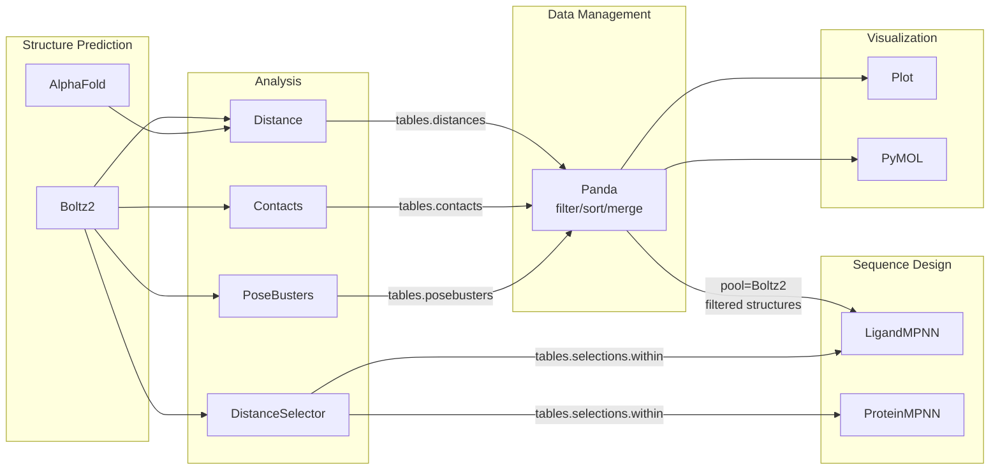

# Analysis Tools

<details>
<summary>Relevant source files</summary>

The following files were used as context for generating this wiki page:

- [Docs/Tool/Analysis.md](Docs/Tool/Analysis.md)
- [Docs/Tool/DataManagement.md](Docs/Tool/DataManagement.md)
- [Docs/ToolReference.md](Docs/ToolReference.md)
- [HelpScripts/pipe_distance_selector.py](HelpScripts/pipe_distance_selector.py)
- [HelpScripts/pipe_lmpnn_runtime_positions.py](HelpScripts/pipe_lmpnn_runtime_positions.py)
- [HelpScripts/pipe_pmpnn_fixed_positions.py](HelpScripts/pipe_pmpnn_fixed_positions.py)

</details>


Analysis tools quantify structural features, validate molecular poses, and compute metrics from protein and protein-ligand structures. These tools consume `DataStream` objects containing structures (typically from Structure Generation [5.2](#5.2), Sequence Design [5.3](#5.3), or Structure Prediction [5.4](#5.4)) and produce `TableInfo` objects with computed metrics. For data transformation and filtering on these tables, see Data Management Tools [5.6](#5.6). For visualization of analysis results, see Visualization Tools [5.7](#5.7).

---

## Overview

BioPipelines provides eight analysis tools organized into four functional categories:

| Category | Tools | Purpose |
|----------|-------|---------|
| **Geometric Measurements** | Distance, Angle | Measure distances and angles between specific atoms/residues |
| **Position Selection** | DistanceSelector | Identify residues based on proximity to reference points |
| **Structural Comparison** | ConformationalChange, PoseChange | Quantify structural differences via RMSD |
| **Interaction Analysis** | Contacts | Analyze protein-ligand contact patterns |
| **Pose Validation** | PoseBusters | Validate computational poses against physical constraints |
| **Dynamics Simulation** | CABSflex | Simulate protein flexibility and generate conformational ensembles |

All analysis tools follow the BioPipelines pattern: they inherit from `BaseConfig`, produce `StandardizedOutput` with `TableContainer` objects, and integrate seamlessly into multi-tool workflows through table column references and the `Panda` tool.

**Sources:** [Docs/Tool/Analysis.md:1-458](), [Docs/ToolReference.md:64-76]()

---

## Tool Architecture

```mermaid
graph TB
    subgraph "Input Sources"
        Structures["StandardizedOutput<br/>with structures DataStream"]
        RefStructures["Reference structures<br/>(for comparative tools)"]
    end
    
    subgraph "Analysis Tools"
        Distance["Distance<br/>biopipelines/distance.py"]
        Angle["Angle<br/>biopipelines/angle.py"]
        DistanceSelector["DistanceSelector<br/>biopipelines/distance_selector.py"]
        ConformationalChange["ConformationalChange<br/>biopipelines/conformational_change.py"]
        Contacts["Contacts<br/>biopipelines/contacts.py"]
        PoseBusters["PoseBusters<br/>biopipelines/posebusters.py"]
        PoseChange["PoseChange<br/>biopipelines/pose_change.py"]
        CABSflex["CABSflex<br/>biopipelines/cabsflex.py"]
    end
    
    subgraph "Helper Scripts"
        PipeDistSel["pipe_distance_selector.py<br/>Distance-based residue selection"]
        PipePMPNNFixed["pipe_pmpnn_fixed_positions.py<br/>ProteinMPNN position specs"]
        PipeLMPNNRuntime["pipe_lmpnn_runtime_positions.py<br/>LigandMPNN position specs"]
        PipeConformChange["pipe_conformational_change.py<br/>PyMOL RMSD calculation"]
        PipeContacts["pipe_contacts.py<br/>Protein-ligand contact analysis"]
        PipePoseBusters["pipe_posebusters.py<br/>Pose validation checks"]
        PipeCABSflex["pipe_cabsflex.py<br/>Flexibility simulation"]
    end
    
    subgraph "Output Tables"
        DistanceTable["TableInfo: distances<br/>columns: id, distance, unit"]
        AngleTable["TableInfo: angles<br/>columns: id, angle, unit"]
        SelectionTable["TableInfo: selections<br/>columns: id, within, beyond"]
        ChangeTable["TableInfo: changes<br/>columns: id, RMSD, num_aligned_atoms"]
        ContactsTable["TableInfo: contacts<br/>columns: id, contacts, min_distance"]
        PoseBustersTable["TableInfo: posebusters<br/>columns: id, all_pass, bond_lengths..."]
        RMSFTable["TableInfo: rmsf_all<br/>columns: id, chain, resi, rmsf"]
    end
    
    Structures --> Distance
    Structures --> Angle
    Structures --> DistanceSelector
    Structures --> Contacts
    Structures --> PoseBusters
    Structures --> CABSflex
    
    RefStructures --> ConformationalChange
    Structures --> ConformationalChange
    
    RefStructures --> PoseChange
    Structures --> PoseChange
    
    Distance --> DistanceTable
    Angle --> AngleTable
    DistanceSelector --> SelectionTable
    ConformationalChange --> ChangeTable
    Contacts --> ContactsTable
    PoseBusters --> PoseBustersTable
    CABSflex --> RMSFTable
    
    Distance -.uses.-> biopipelines_pdb_parser["biopipelines.pdb_parser"]
    Angle -.uses.-> biopipelines_pdb_parser
    DistanceSelector -.calls.-> PipeDistSel
    ConformationalChange -.calls.-> PipeConformChange
    Contacts -.calls.-> PipeContacts
    PoseBusters -.calls.-> PipePoseBusters
    CABSflex -.calls.-> PipeCABSflex
    
    PipeDistSel -.used_by.-> PipePMPNNFixed
    PipeDistSel -.used_by.-> PipeLMPNNRuntime
```



**Architecture Pattern**: Analysis tools follow the two-phase execution model. During the configuration phase, tools predict output IDs and generate bash scripts that invoke helper scripts with JSON configuration files. During execution, helper scripts read structures via `biopipelines_io.load_datastream()`, perform analysis using native parsers (`biopipelines.pdb_parser`) or external tools (PyMOL, PoseBusters, CABSflex), and write CSV tables to `ToolOutputs/{tool_name}/`.

**Sources:** [Docs/Tool/Analysis.md:1-458](), [HelpScripts/pipe_distance_selector.py:1-553]()

---

## Geometric Measurements

### Distance

Measures distances between specific atoms and residues across structures. Supports multiple distance calculation methods and custom metric naming for use in downstream filtering.

**Implementation**: [biopipelines/distance.py]()

**Helper Script**: [HelpScripts/pipe_distance.py]()

**Environment**: `biopipelines`

#### Parameters

| Parameter | Type | Default | Description |
|-----------|------|---------|-------------|
| `structures` | Union[ToolOutput, StandardizedOutput] | required | Input structures |
| `atom` | str | required | Atom selection (e.g., `'LIG.Cl'`, `'name CA'`, `'A10.CA'`) |
| `residue` | str | required | Residue selection (e.g., `'D in IGDWG'`, `'145'`, `'resn ALA'`) |
| `method` | str | `"min"` | Distance calculation: `min`, `max`, `mean`, `closest` |
| `metric_name` | str | `None` | Custom column name (default: `"distance"`) |
| `unit` | str | `"angstrom"` | Output unit: `"angstrom"` or `"nm"` |

#### Selection Syntax

- **Ligand atoms**: `'LIG.Cl'` - Chlorine atom in ligand LIG
- **Named atoms**: `'name CA'` - All alpha carbons
- **Residue atoms**: `'A10.CA'` - Alpha carbon of residue 10 in chain A
- **Sequence context**: `'D in IGDWG'` - Aspartic acid within sequence motif

#### Output Tables

**`distances`**: One row per input structure

| Column | Type | Description |
|--------|------|-------------|
| `id` | str | Structure identifier |
| `source_structure` | str | Path to input PDB/CIF file |
| `{metric_name}` | float | Computed distance value |
| `unit` | str | Distance unit (angstrom or nm) |

#### Example

```python
from biopipelines.distance import Distance

# Track chlorine-aspartate distance
distances = Distance(
    structures=boltz,
    atom="LIG.Cl",
    residue="D in IGDWG",
    method="min",
    metric_name="chlorine_distance"
)

# Filter structures by distance threshold
from biopipelines.panda import Panda
filtered = Panda(
    tables=distances.tables.distances,
    operations=[Panda.filter("chlorine_distance < 5.0")],
    pool=boltz
)
```

**Sources:** [Docs/Tool/Analysis.md:7-38]()

---

### Angle

Calculates angles between atoms in structures. Supports three modes based on the tuple shape: bond angles (3 atoms), torsional/dihedral angles (4 atoms), and vector-to-vector angles (2 vectors). Useful for backbone phi/psi analysis, side chain rotamers, ligand geometry verification, and measuring relative orientations between structural elements.

**Implementation**: [biopipelines/angle.py]()

**Helper Script**: [HelpScripts/pipe_angle.py]()

**Environment**: `biopipelines`

#### Parameters

| Parameter | Type | Default | Description |
|-----------|------|---------|-------------|
| `structures` | Union[ToolOutput, StandardizedOutput] | required | Input structures |
| `atoms` | tuple | required | Atom selections (shape determines mode) |
| `metric_name` | str | `None` | Custom column name (auto: `"angle"`, `"torsion"`, or `"vector_angle"`) |
| `unit` | str | `"degrees"` | Output unit: `"degrees"` or `"radians"` |

#### Angle Modes

| Tuple Form | Mode | Description | Range | Metric |
|------------|------|-------------|-------|--------|
| `(a, o, b)` | Bond | Angle at vertex o (a–o–b) | 0–180° | Angle between bonds |
| `(a, x1, x2, b)` | Torsional | Dihedral along axis x1–x2 | −180° to 180° | Rotation around bond |
| `((a1, a2), (b1, b2))` | Vector | Angle between vectors a1→a2 and b1→b2 | 0–180° | Vector separation |

**Note**: Each selection may resolve to multiple atoms; centroids are used in that case.

#### Selection Syntax

Same as Distance, with additional support for `residue.atom` format:
- `'10.CA'` - Alpha carbon of residue 10
- `'-1.C'` - Carbonyl carbon of last residue (C-terminus)
- `'LIG.C1'` - Atom C1 of ligand residue LIG
- `'D in IGDWG'` - Aspartic acid in sequence context (uses centroid)

#### Output Tables

**`angles`**: One row per input structure

| Column | Type | Description |
|--------|------|-------------|
| `id` | str | Structure identifier |
| `source_structure` | str | Path to input PDB/CIF file |
| `{metric_name}` | float | Computed angle value |
| `unit` | str | Angle unit (degrees or radians) |

#### Examples

```python
from biopipelines.angle import Angle

# Bond angle at CA (N-CA-C)
bond_angle = Angle(
    structures=boltz,
    atoms=('10.N', '10.CA', '10.C'),
    metric_name="nca_angle"
)

# Phi backbone torsion (C-N-CA-C)
phi = Angle(
    structures=boltz,
    atoms=('9.C', '10.N', '10.CA', '10.C'),
    metric_name="phi"
)

# Chi1 side chain rotamer
chi1 = Angle(
    structures=boltz,
    atoms=('50.N', '50.CA', '50.CB', '50.CG'),
    metric_name="chi1"
)

# Vector angle between structural elements
orientation = Angle(
    structures=boltz,
    atoms=(('66.NE1', '66.CA'), ('-173.OH', '-173.CA')),
    metric_name="orientation"
)

# Output in radians for use with trigonometric functions
orientation_rad = Angle(
    structures=boltz,
    atoms=(('66.NE1', '66.CA'), ('-173.OH', '-173.CA')),
    metric_name="orientation",
    unit="radians"
)

# Use in calculations via Panda
from biopipelines.panda import Panda
analyzed = Panda(
    tables=orientation_rad.tables.angles,
    operations=[
        Panda.calculate({
            "kappa2": "cos(orientation) ** 2",
            "fret_efficiency": "1 / (1 + (distance / R0) ** 6)"
        })
    ]
)
```

**Sources:** [Docs/Tool/Analysis.md:42-131]()

---

## Position Selection

### DistanceSelector

Selects protein residues based on proximity to ligands or other reference points. Generates PyMOL-formatted position specifications for downstream design tools (ProteinMPNN, LigandMPNN). This is a critical tool for binding site-focused design, enabling workflows where only residues near a ligand are redesigned.

**Implementation**: [biopipelines/distance_selector.py]()

**Helper Script**: [HelpScripts/pipe_distance_selector.py:1-553]()

**Environment**: `biopipelines`

#### Parameters

| Parameter | Type | Default | Description |
|-----------|------|---------|-------------|
| `structures` | Union[str, List[str], ToolOutput] | required | Input structures |
| `ligand` | str | required | Ligand identifier for distance reference |
| `distance` | float | `5.0` | Distance cutoff in Angstroms |
| `reference_type` | str | `"ligand"` | Type: `"ligand"`, `"atoms"`, or `"residues"` |
| `reference_selection` | str | `""` | PyMOL selection if not using ligand |
| `restrict_to` | Union[str, TableInfo, None] | `None` | Limit search to specific residues |
| `include_reference` | bool | `True` | Include reference residues in `within` |

#### Reference Specification

The `reference_type` and `reference_selection` parameters control what serves as the distance reference:

```python
# Ligand-based (most common)
selector = DistanceSelector(
    structures=rfdaa,
    ligand="ATP",
    reference_type="ligand"  # default
)

# Residue-based
selector = DistanceSelector(
    structures=rfdaa,
    reference_selection="87-100",
    reference_type="residues"
)

# Atom-based (PyMOL selection)
selector = DistanceSelector(
    structures=boltz,
    reference_selection="resname ATP",
    reference_type="atoms"
)
```

#### Restriction Mechanism

The `restrict_to` parameter limits which residues are considered, useful for multi-region analysis:

```python
# Restrict to designed region from RFdiffusion
selector = DistanceSelector(
    structures=rfdaa,
    ligand="LIG",
    distance=8.0,
    restrict_to=rfdaa.tables.structures.designed
)

# Direct PyMOL selection
selector = DistanceSelector(
    structures=boltz,
    ligand="ATP",
    restrict_to="10-50+80-120"
)
```

#### Output Tables

**`selections`**: One row per input structure

| Column | Type | Description |
|--------|------|-------------|
| `id` | str | Structure identifier |
| `pdb` | str | Path to input structure file |
| `within` | str | PyMOL selection of residues ≤ distance cutoff |
| `beyond` | str | PyMOL selection of residues > distance cutoff |
| `distance_cutoff` | float | Distance threshold used (Å) |
| `reference_ligand` | str | Reference identifier |

#### Integration with Design Tools

DistanceSelector outputs are designed for direct use with ProteinMPNN and LigandMPNN:

```python
from biopipelines.distance_selector import DistanceSelector
from biopipelines.ligandmpnn import LigandMPNN

# Select residues near ligand
selector = DistanceSelector(
    structures=rfdaa,
    ligand="LIG",
    distance=8.0
)

# Redesign only nearby residues
sequences = LigandMPNN(
    structures=rfdaa,
    designed_positions=selector.tables.selections.within,
    ligand="LIG"
)
```

#### Helper Script Implementation

The helper script [HelpScripts/pipe_distance_selector.py:1-553]() implements distance calculations using the native PDB parser:

**Key functions**:
- `parse_reference_spec()` [HelpScripts/pipe_distance_selector.py:47-65]() - Parse reference specification into type and selection
- `get_ligand_atoms()` [HelpScripts/pipe_distance_selector.py:68-88]() - Extract ligand atoms by residue name
- `get_residue_atoms()` [HelpScripts/pipe_distance_selector.py:90-120]() - Select atoms from specific residues
- `calculate_residue_distances()` [HelpScripts/pipe_distance_selector.py:250-303]() - Compute minimum distances from protein residues to reference
- `resolve_restriction_spec()` [HelpScripts/pipe_distance_selector.py:210-249]() - Resolve table references or direct selections

**Distance calculation**: Uses Euclidean distance with placeholder atom filtering [HelpScripts/pipe_distance_selector.py:146-171]() to exclude atoms at (0,0,0) that represent missing side chains.

**Sources:** [Docs/Tool/Analysis.md:133-162](), [HelpScripts/pipe_distance_selector.py:1-553]()

---

## Structural Comparison

### ConformationalChange

Quantifies structural changes between reference and target structures using PyMOL's alignment algorithms. Computes RMSD to measure similarity, useful for validating design fidelity, comparing apo vs holo states, or assessing prediction accuracy.

**Implementation**: [biopipelines/conformational_change.py]()

**Helper Script**: [HelpScripts/pipe_conformational_change.py]()

**Environment**: `ProteinEnv`

#### Parameters

| Parameter | Type | Default | Description |
|-----------|------|---------|-------------|
| `reference_structures` | Union[DataStream, StandardizedOutput] | required | Reference structures (one or same count as targets) |
| `target_structures` | Union[DataStream, StandardizedOutput] | required | Target structures to compare |
| `selection` | Optional[str] | `None` | Residue range (e.g., `'10-20+30-40'`). None = whole structure |
| `alignment` | str | `"align"` | Alignment method: `align`, `super`, `cealign` |
| `atoms` | str | `"all"` | Atom subset: `"all"`, `"CA"`, `"backbone"`, or `+`-separated names |

#### Alignment Methods

| Method | Use Case | Reference |
|--------|----------|-----------|
| `align` | Sequence similarity > 50% | Standard sequence-based alignment |
| `super` | General purpose | Sequence-independent superposition |
| `cealign` | Low sequence similarity | Combinatorial extension algorithm |

#### Atom Subset Selection

| Value | Atoms Included |
|-------|----------------|
| `"all"` | All atoms (default) |
| `"CA"` | Alpha carbons only |
| `"backbone"` | CA + C + N + O |
| `"CA+CB"` | Custom atom names (joined by `+`) |

#### Output Tables

**`changes`**: One row per comparison

| Column | Type | Description |
|--------|------|-------------|
| `id` | str | Target structure identifier |
| `reference_structure` | str | Path to reference structure file |
| `target_structure` | str | Path to target structure file |
| `selection` | str | Residue selection used (or "all") |
| `num_aligned_atoms` | int | Number of atoms used in RMSD calculation |
| `RMSD` | float | Root mean square deviation (Å) |

#### Examples

```python
from biopipelines.conformational_change import ConformationalChange

# All-atom RMSD on a specific region
conf_change = ConformationalChange(
    reference_structures=apo_structures,
    target_structures=holo_structures,
    selection="10-50",
    alignment="super"
)

# CA-only RMSD for backbone comparison
conf_change = ConformationalChange(
    reference_structures=design,
    target_structures=refolded,
    atoms="CA"
)

# Backbone RMSD on redesigned region (from table reference)
conf_change = ConformationalChange(
    reference_structures=kinase,
    target_structures=refolded,
    selection=backbones.tables.structures.fixed,
    atoms="backbone"
)
```

**Sources:** [Docs/Tool/Analysis.md:165-215]()

---

### PoseChange

Measures ligand pose distance between reference holo structure and sample structures. Calculates RMSD after protein alignment to quantify how well designed structures reproduce known binding poses. Useful for validating binding site design or docking results.

**Implementation**: [biopipelines/pose_change.py]()

**Helper Script**: [HelpScripts/pipe_pose_change.py]()

**Environment**: `ProteinEnv`

#### Parameters

| Parameter | Type | Default | Description |
|-----------|------|---------|-------------|
| `reference_structure` | Union[str, ToolOutput, StandardizedOutput] | required | Reference holo structure (e.g., crystal structure) |
| `sample_structures` | Union[str, List[str], ToolOutput, StandardizedOutput] | required | Designed/predicted structures |
| `reference_ligand` | str | required | Ligand residue name in reference (e.g., `'ATP'`) |
| `sample_ligand` | Optional[str] | `None` | Ligand name in samples (default: same as reference) |
| `reference_alignment` | Optional[str] | `None` | PyMOL selection for reference alignment (default: `"not resn {reference_ligand}"`) |
| `target_alignment` | Optional[str] | `None` | PyMOL selection for target alignment (default: `"not resn {sample_ligand}"`) |

#### Output Tables

**`changes`**: One row per sample structure

| Column | Type | Description |
|--------|------|-------------|
| `id` | str | Sample structure identifier |
| `target_structure` | str | Path to sample structure file |
| `reference_structure` | str | Path to reference structure file |
| `ligand_rmsd` | float | Ligand RMSD after protein alignment (Å) |
| `centroid_distance` | float | Distance between ligand centroids (Å) |
| `alignment_rmsd` | float | RMSD of protein alignment (Å) |
| `num_ligand_atoms` | int | Number of atoms in ligand |
| `reference_alignment` | str | PyMOL selection used for reference alignment |
| `target_alignment` | str | PyMOL selection used for target alignment |

#### Example

```python
from biopipelines.pose_change import PoseChange
from biopipelines.pdb import PDB
from biopipelines.boltz2 import Boltz2
from biopipelines.panda import Panda

# Compare designed structures to crystal reference
xrc = PDB(pdbs="4ufc", ids="reference")
designed = Boltz2(proteins=sequences, ligands="CCO")

pose_analysis = PoseChange(
    reference_structure=xrc,
    sample_structures=designed,
    reference_ligand="ATP",
    sample_ligand="LIG",
    # By default aligns on "not resn ATP" (reference) and "not resn LIG" (target)
)

# Filter structures with good pose reproduction
good_poses = Panda(
    tables=pose_analysis.tables.changes,
    pool=designed,
    operations=[Panda.filter("ligand_rmsd < 2.0")]
)
```

**Sources:** [Docs/Tool/Analysis.md:327-383]()

---

## Interaction Analysis

### Contacts

Analyzes contacts between selected protein regions and ligands. For each selected residue, calculates the minimum distance to any ligand atom and counts residues within a contact threshold. Returns contact statistics including count, minimum/maximum/mean distances, and a normalized sum metric.

**Implementation**: [biopipelines/contacts.py]()

**Helper Script**: [HelpScripts/pipe_contacts.py]()

**Environment**: `ProteinEnv`

#### Parameters

| Parameter | Type | Default | Description |
|-----------|------|---------|-------------|
| `structures` | Union[ToolOutput, StandardizedOutput] | required | Input structures |
| `selections` | Union[str, ToolOutput] | `None` | Protein region (string format `'10-20+30-40'`, table reference, or None for all) |
| `ligand` | str | required | Ligand residue name (3-letter code, e.g., `'LIG'`, `'ATP'`) |
| `contact_threshold` | float | `5.0` | Distance threshold for counting contacts (Å) |
| `contact_metric_name` | str | `None` | Custom column name (default: `"contacts"`) |

#### Output Tables

**`contacts`**: One row per input structure

| Column | Type | Description |
|--------|------|-------------|
| `id` | str | Structure identifier |
| `source_structure` | str | Path to input structure file |
| `selections` | str | Protein residues analyzed (e.g., `'10-20+30-40'` or `'all_protein'`) |
| `ligand` | str | Ligand residue name |
| `contacts` | int | Number of residues within contact threshold |
| `min_distance` | float | Minimum distance from any selected residue to ligand (Å) |
| `max_distance` | float | Maximum distance from any selected residue to ligand (Å) |
| `mean_distance` | float | Mean distance from selected residues to ligand (Å) |
| `sum_distances_sqrt_normalized` | float | Sum of distances / √(number of residues) |

#### Examples

```python
from biopipelines.contacts import Contacts

# Analyze contacts with designed region
contacts = Contacts(
    structures=rfdaa,
    selections=rfdaa.tables.structures.designed,
    ligand="LIG",
    contact_threshold=5.0
)

# Fixed selection for all structures
contacts = Contacts(
    structures=boltz,
    selections='10-20+30-40',
    ligand="ATP",
    contact_threshold=4.0
)

# Analyze all protein residues
contacts = Contacts(
    structures=boltz,
    ligand="GDP"
)

# Filter by contact count
from biopipelines.panda import Panda
strong_binders = Panda(
    tables=contacts.tables.contacts,
    pool=boltz,
    operations=[Panda.filter("contacts >= 5")]
)
```

**Sources:** [Docs/Tool/Analysis.md:219-273]()

---

## Pose Validation

### PoseBusters

Validates computationally generated molecule poses by checking bond lengths, bond angles, internal steric clashes, volume overlap with protein, and more. Supports `dock` mode (ligand + protein) and `redock` mode (+ reference ligand for RMSD comparison). Uses the PoseBusters package to apply 16 physical validation checks.

**Implementation**: [biopipelines/posebusters.py]()

**Helper Script**: [HelpScripts/pipe_posebusters.py]()

**Environment**: `posebusters`

#### Parameters

| Parameter | Type | Default | Description |
|-----------|------|---------|-------------|
| `structures` | Union[DataStream, StandardizedOutput] | required | Protein-ligand complexes (PDB/CIF) |
| `ligand` | str | required | 3-letter residue code (e.g., `'LIG'`, `'ATP'`) |
| `reference_ligand` | Union[DataStream, StandardizedOutput, None] | `None` | Reference ligand for redock mode |
| `reference_ligand_code` | Optional[str] | `None` | Residue code in reference (defaults to `ligand`) |
| `mode` | str | `"dock"` | Validation mode: `'dock'` or `'redock'` (auto-set if reference provided) |

#### Output Tables

**`posebusters`**: One row per ligand instance (suffixed with `_lig1`, `_lig2` if multiple copies)

| Column | Type | Description |
|--------|------|-------------|
| `id` | str | Structure identifier (with ligand suffix) |
| `source_structure` | str | Path to input structure file |
| **Loading Checks** |  |  |
| `mol_pred_loaded` | bool | Predicted ligand successfully loaded |
| `mol_cond_loaded` | bool | Protein successfully loaded |
| `mol_true_loaded` | bool | Reference ligand loaded (redock only) |
| **Chemical Checks** |  |  |
| `sanitization` | bool | RDKit sanitization successful |
| `all_atoms_connected` | bool | All atoms in single connected component |
| **Geometry Checks** |  |  |
| `bond_lengths` | bool | Bond lengths within acceptable ranges |
| `bond_angles` | bool | Bond angles within acceptable ranges |
| `internal_steric_clash` | bool | No steric clashes within ligand |
| `aromatic_ring_flatness` | bool | Aromatic rings are planar |
| `double_bond_flatness` | bool | Double bonds are planar |
| **Energy & Physics** |  |  |
| `internal_energy` | bool | Internal energy below threshold |
| **Protein Interaction** |  |  |
| `volume_overlap_with_protein` | bool | No unphysical volume overlap |
| `minimum_distance_to_protein` | bool | Minimum distance within range |
| **Redock-Only** |  |  |
| `rmsd` | float | RMSD to reference ligand (redock only) |
| **Summary** |  |  |
| `all_pass` | bool | True only if all checks pass |

#### Examples

```python
from biopipelines.posebusters import PoseBusters

# Dock mode — validate predicted poses
validation = PoseBusters(
    structures=boltz_holo,
    ligand="LIG"
)

# Redock mode — validate against crystal reference
xrc = PDB("1ABC")
validation = PoseBusters(
    structures=boltz_holo,
    ligand="ATP",
    reference_ligand=xrc,
    reference_ligand_code="ATP",
    mode="redock"
)

# Filter only valid poses
from biopipelines.panda import Panda
valid_poses = Panda(
    tables=validation.tables.posebusters,
    pool=boltz_holo,
    operations=[Panda.filter("all_pass == True")]
)

# Detailed filtering
strict_validation = Panda(
    tables=validation.tables.posebusters,
    pool=boltz_holo,
    operations=[
        Panda.filter("bond_lengths == True"),
        Panda.filter("volume_overlap_with_protein == True"),
        Panda.filter("rmsd < 2.0")  # redock mode only
    ]
)
```

**Sources:** [Docs/Tool/Analysis.md:277-323]()

---

## Dynamics Simulation

### CABSflex

Fast coarse-grained Monte Carlo simulation of protein structure flexibility. Produces conformational ensembles and per-residue RMSF (root mean square fluctuation) profiles. Optionally rebuilds models to all-atom representation using MODELLER.

**Implementation**: [biopipelines/cabsflex.py]()

**Helper Script**: [HelpScripts/pipe_cabsflex.py]()

**Environment**: `CABSflex` (Python 2.7 with `modeller` and `cabs`)

**Installation**: 
```bash
conda create -n CABSflex python=2.7
conda install -c salilab modeller -c lcbio cabs
```
On Colab: `pip install modeller cabs`

**WARNING**: MODELLER requires a license key (free for academics). Get one at https://salilab.org/modeller/registration.html and set `KEY_MODELLER` environment variable before running.

#### Parameters

| Parameter | Type | Default | Description |
|-----------|------|---------|-------------|
| `structures` | Union[DataStream, StandardizedOutput] | required | Input protein structures |
| `num_models` | int | `10` | Number of cluster medoids / final models per input |
| `mc_cycles` | int | `50` | Monte Carlo cycles between trajectory frames |
| `mc_steps` | int | `50` | Monte Carlo steps per cycle |
| `mc_annealing` | int | `20` | Temperature annealing cycles |
| `temperature` | Optional[str] | `None` | Temperature range as `"TINIT TFINAL"` (default: `"1.4 1.4"`) |
| `flexibility` | Optional[str] | `None` | Residue flexibility: float (0=flexible, 1=stiff), `'bf'`, `'bfi'`, `'bfg'`, or filename |
| `filtering_count` | int | `1000` | Number of low-energy models for clustering |
| `aa_rebuild` | bool | `True` | Rebuild to all-atom with MODELLER |
| `restraints` | str | `"ss2"` | Restraint mode: `'all'`, `'ss1'`, `'ss2'` |
| `restraints_gap` | int | `3` | Minimum gap along chain for restraints |
| `restraints_min` | float | `3.8` | Minimum distance for restraints (Å) |
| `restraints_max` | float | `8.0` | Maximum distance for restraints (Å) |
| `weighted_fit` | str | `"gauss"` | Fit method: `'gauss'`, `'flex'`, `'ss'`, `'off'`, or filename |

#### Output Streams

| Stream | Format | Description |
|--------|--------|-------------|
| `structures` | PDB | Ensemble models (`num_models` per input structure) |
| `images` | SVG | Plots (RMSF, RMSD, energy) per input structure |
| `rmsf` | CSV | Per-residue RMSF values (one file per input structure) |

#### Output Tables

**`structures`**: Map ensemble models to source structures

| Column | Type | Description |
|--------|------|-------------|
| `id` | str | Ensemble model identifier |
| `file` | str | Path to PDB file |
| `structures.id` | str | Source structure identifier |

**`rmsf_all`**: Merged RMSF data across all input structures

| Column | Type | Description |
|--------|------|-------------|
| `id` | str | Structure identifier |
| `chain` | str | Chain identifier |
| `resi` | int | Residue number |
| `rmsf` | float | Root mean square fluctuation (Å) |

#### RMSF CSV Format

Per-structure RMSF files follow the `per-residue-values-csv` format:

```csv
id,chain,resi,rmsf
structure_1,A,1,0.45
structure_1,A,2,0.52
structure_1,A,3,1.23
...
```

#### Examples

```python
from biopipelines.cabsflex import CABSflex

# Basic flexibility simulation
protein = PDB("1AHN")
flex = CABSflex(structures=protein, num_models=10)

# Access merged RMSF table
flex.tables.rmsf_all  # All structures combined

# Access per-structure RMSF stream
for rmsf_ds in flex.streams.rmsf:
    print(f"{rmsf_ds.ids[0]}: {rmsf_ds.files[0]}")

# Access ensemble models
flex.streams.structures  # 10 PDB models per input

# Custom simulation parameters
flex = CABSflex(
    structures=protein,
    num_models=5,
    mc_cycles=100,
    mc_annealing=30,
    temperature="1.4 2.0",
    flexibility=0.5,
    aa_rebuild=True
)

# Filter flexible regions by RMSF
from biopipelines.panda import Panda
flexible = Panda(
    tables=flex.tables.rmsf_all,
    operations=[Panda.filter("rmsf > 1.5")]
)
```

**Sources:** [Docs/Tool/Analysis.md:387-457]()

---

## Integration Patterns

Analysis tools integrate with other BioPipelines components through two primary mechanisms: **table column references** and **direct pool filtering**.



### Table Column References

Analysis tool outputs can be directly referenced in downstream tools using the `tool.tables.{table_name}.{column_name}` syntax:

```python
# Distance selector output used in design
selector = DistanceSelector(structures=rfdaa, ligand="LIG", distance=8.0)
sequences = LigandMPNN(
    structures=rfdaa,
    designed_positions=selector.tables.selections.within  # Column reference
)

# Conformational change selection used in design
changes = ConformationalChange(
    reference_structures=apo,
    target_structures=holo,
    selection="10-100"
)
sequences = ProteinMPNN(
    structures=holo,
    fixed_positions=changes.tables.changes.selection  # Column reference
)
```

### Pool Filtering Pattern

Analysis tables are commonly used with `Panda` to filter structures by metric thresholds:

```python
# Filter by distance
distances = Distance(
    structures=boltz,
    atom="LIG.Cl",
    residue="D in IGDWG",
    metric_name="chlorine_distance"
)
filtered = Panda(
    tables=distances.tables.distances,
    pool=boltz,  # Copy matching structures
    operations=[Panda.filter("chlorine_distance < 5.0")]
)

# Filter by validation
validation = PoseBusters(structures=boltz, ligand="LIG")
valid = Panda(
    tables=validation.tables.posebusters,
    pool=boltz,
    operations=[Panda.filter("all_pass == True")]
)

# Multi-metric filtering
merged = Panda(
    tables=[distances.tables.distances, contacts.tables.contacts],
    operations=[
        Panda.merge(),
        Panda.filter("chlorine_distance < 5.0"),
        Panda.filter("contacts >= 3")
    ],
    pool=boltz
)
```

### Feedback Loops

Analysis tools enable iterative design workflows where metrics inform subsequent design rounds:

```python
# Round 1: Generate and analyze
designed = LigandMPNN(structures=rfdaa, ligand="LIG")
predicted = Boltz2(proteins=designed.streams.sequences, ligands="LIG")
contacts = Contacts(structures=predicted, ligand="LIG")

# Round 2: Redesign only weak binders
weak_binders = Panda(
    tables=contacts.tables.contacts,
    pool=predicted,
    operations=[Panda.filter("contacts < 3")]
)
redesigned = LigandMPNN(
    structures=weak_binders.streams.structures,
    ligand="LIG"
)
```

**Sources:** [Docs/Tool/Analysis.md:1-458](), [Docs/Tool/DataManagement.md:1-247]()

---

## Common Workflow Patterns

### Binding Site Analysis

```python
from biopipelines.rfdiffusion_all_atom import RFdiffusionAllAtom
from biopipelines.distance_selector import DistanceSelector
from biopipelines.ligandmpnn import LigandMPNN
from biopipelines.boltz2 import Boltz2
from biopipelines.contacts import Contacts
from biopipelines.panda import Panda

# Generate backbones with ligand
backbones = RFdiffusionAllAtom(
    ligand="ATP",
    contig="A50-80",
    num_designs=100
)

# Identify binding site residues
selector = DistanceSelector(
    structures=backbones,
    ligand="ATP",
    distance=8.0
)

# Design sequences for binding site only
sequences = LigandMPNN(
    structures=backbones,
    designed_positions=selector.tables.selections.within,
    ligand="ATP"
)

# Predict and validate
predicted = Boltz2(proteins=sequences.streams.sequences, ligands="ATP")
contacts = Contacts(
    structures=predicted,
    selections=selector.tables.selections.within,
    ligand="ATP"
)

# Filter by contact count
binders = Panda(
    tables=contacts.tables.contacts,
    pool=predicted,
    operations=[Panda.filter("contacts >= 5")]
)
```

### Pose Validation Pipeline

```python
from biopipelines.pdb import PDB
from biopipelines.boltz2 import Boltz2
from biopipelines.posebusters import PoseBusters
from biopipelines.pose_change import PoseChange
from biopipelines.panda import Panda

# Reference structure
xrc = PDB(pdbs="4UFC", ids="reference")

# Generate predictions
predicted = Boltz2(proteins=sequences, ligands="ATP")

# Physical validation
validation = PoseBusters(
    structures=predicted,
    ligand="ATP",
    reference_ligand=xrc,
    mode="redock"
)

# Pose comparison
pose_comp = PoseChange(
    reference_structure=xrc,
    sample_structures=predicted,
    reference_ligand="ATP",
    sample_ligand="ATP"
)

# Combined filtering
merged = Panda(
    tables=[validation.tables.posebusters, pose_comp.tables.changes],
    operations=[
        Panda.merge(),
        Panda.filter("all_pass == True"),
        Panda.filter("ligand_rmsd < 2.0")
    ],
    pool=predicted
)
```

### Flexibility-Informed Design

```python
from biopipelines.pdb import PDB
from biopipelines.cabsflex import CABSflex
from biopipelines.panda import Panda
from biopipelines.proteinmpnn import ProteinMPNN

# Simulate flexibility
protein = PDB("1AHN")
flex = CABSflex(structures=protein, num_models=10)

# Identify rigid regions (low RMSF)
rigid = Panda(
    tables=flex.tables.rmsf_all,
    operations=[Panda.filter("rmsf < 0.5")]
)

# Design only flexible regions
sequences = ProteinMPNN(
    structures=protein,
    fixed_positions=rigid.tables.result.resi  # Note: would need Selection to format properly
)
```

**Sources:** [Docs/Tool/Analysis.md:1-458](), [HelpScripts/pipe_distance_selector.py:1-553](), [HelpScripts/pipe_lmpnn_runtime_positions.py:1-259]()

---