# Data Management Tools

<details>
<summary>Relevant source files</summary>

The following files were used as context for generating this wiki page:

- [Docs/Tool/Analysis.md](Docs/Tool/Analysis.md)
- [Docs/Tool/DataManagement.md](Docs/Tool/DataManagement.md)
- [Docs/ToolReference.md](Docs/ToolReference.md)
- [Docs/UserManual.md](Docs/UserManual.md)
- [config.yaml](config.yaml)

</details>


Data management tools enable transformation, filtering, and manipulation of tabular data and file collections produced by upstream tools in BioPipelines pipelines. These tools operate on `TableInfo` objects and `StandardizedOutput` containers, providing pandas-style operations, ID renaming, selection string manipulation, and metric export capabilities.

For information about input data loading (PDB, Ligand, Sequence), see [Utilities](#5.1). For structure and interaction analysis that produces tables, see [Analysis Tools](#5.5). For visualization of processed data, see [Visualization Tools](#5.7).

---

## Tool Overview

BioPipelines provides four primary data management tools:

| Tool | Primary Function | Input Types | Output Types |
|------|------------------|-------------|--------------|
| **Panda** | Table transformations (filter, sort, merge, calculate) | `TableInfo`, `StandardizedOutput` | `TableInfo`, optionally `DataStream` (pool mode) |
| **ReMap** | ID renaming across streams and tables | `StandardizedOutput` | All streams and tables with new IDs |
| **Selection** | PyMOL selection string manipulation | Column references with selection strings | `TableInfo` with modified selections |
| **ExtractMetrics** | Export metrics for statistical software | List of `TableInfo` | Separate CSV per metric |

All data management tools inherit from `BaseConfig` and use the `biopipelines` conda environment (or `ProteinEnv` for Selection). They follow the two-phase execution model: configuration phase predicts outputs and generates scripts, execution phase performs transformations.

**Sources:** [Docs/Tool/DataManagement.md:1-247](), [Docs/UserManual.md:497-551]()

---

## Architecture Overview

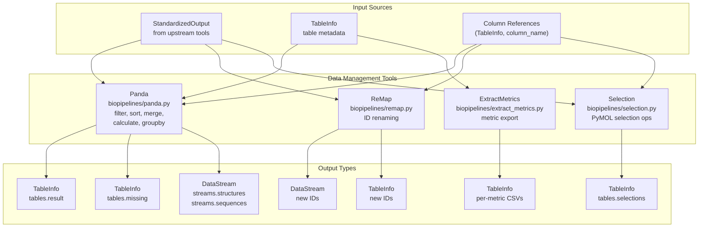

**Diagram: Data Management Tool Architecture**

This diagram shows the primary data management tools and their relationships to input/output types. `Panda` is the most versatile, accepting both tables and tool outputs with optional pooling. `ReMap` operates on complete tool outputs to rename IDs across all streams and tables. `Selection` manipulates PyMOL selection strings from column references. `ExtractMetrics` reorganizes metrics for statistical analysis.

**Sources:** [Docs/Tool/DataManagement.md:1-247](), [config.yaml:106-109]()

---

## Panda: Unified Table Transformations

`Panda` provides pandas-style operations on CSV tables with optional file pooling. It replaces legacy tools (Filter, Rank, SelectBest, MergeTables, ConcatenateTables, SliceTable) with a unified operation-based interface.

### Core Class Structure

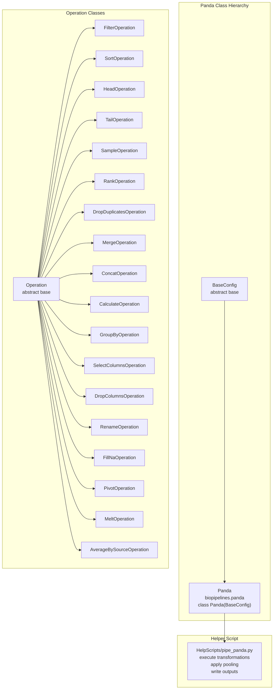

**Diagram: Panda Class Structure and Operations**

The `Panda` class accepts operations as static factory methods (e.g., `Panda.filter()`, `Panda.sort()`), which return operation objects. These are serialized into JSON configuration and executed by `pipe_panda.py`.

**Sources:** [Docs/Tool/DataManagement.md:7-118](), [Docs/UserManual.md:497-551]()

### Parameters and Modes

| Parameter | Type | Description |
|-----------|------|-------------|
| `table` | `TableInfo` \| `StandardizedOutput` \| `str` | Single table input |
| `tables` | `List[TableInfo \| StandardizedOutput \| str]` | Multiple tables (for merge/concat) |
| `operations` | `List[Operation]` | Sequence of transformations to apply |
| `pool` | `StandardizedOutput` \| `List[StandardizedOutput]` | Copy files matching filtered IDs |
| `rename` | `str` | Rename output IDs to `{rename}_1`, `{rename}_2`, ... |

**Pool Mode**: When `pool` is provided, Panda copies files from the source tool's streams (structures, sequences, compounds) that match the filtered IDs. This enables workflows like "filter by confidence, keep matching structures."

**Rename Mode**: When `rename` is provided, output IDs are sequentially numbered regardless of source IDs. Combined with `pool`, this creates ranked file collections.

**Sources:** [Docs/Tool/DataManagement.md:13-19]()

### Operations Reference

#### Single-Table Operations

| Operation | Signature | Description |
|-----------|-----------|-------------|
| `filter(expr)` | `Panda.filter("pLDDT > 80")` | Keep rows matching boolean expression |
| `sort(by, ascending)` | `Panda.sort("score", ascending=False)` | Sort by column |
| `head(n)` | `Panda.head(10)` | Keep first n rows |
| `tail(n)` | `Panda.tail(5)` | Keep last n rows |
| `sample(n, frac)` | `Panda.sample(n=100)` or `Panda.sample(frac=0.1)` | Random sample |
| `rank(by, prefix)` | `Panda.rank(by="score")` | Add rank column |
| `drop_duplicates(subset)` | `Panda.drop_duplicates(subset="sequence")` | Remove duplicate rows |

**Sources:** [Docs/Tool/DataManagement.md:20-31]()

#### Multi-Table Operations

| Operation | Signature | Description |
|-----------|-----------|-------------|
| `merge(on, how, prefixes)` | `Panda.merge(prefixes=["a_", "b_"])` | Horizontal join (on="id" by default) |
| `concat(fill, add_source)` | `Panda.concat(fill="", add_source=True)` | Vertical stack |

**Merge behavior**: When `on=None` (default), uses BioPipelines ID matching. Prefixes are applied to all non-ID columns to avoid collisions.

**Concat behavior**: When `add_source=True`, adds a `source` column indicating which table each row came from. `fill` specifies default value for missing columns.

**Sources:** [Docs/Tool/DataManagement.md:31-33]()

#### Column Operations

| Operation | Signature | Description |
|-----------|-----------|-------------|
| `calculate(exprs)` | `Panda.calculate({"delta": "a - b"})` | Add calculated columns |
| `select_columns(cols)` | `Panda.select_columns(["id", "score"])` | Keep only specified columns |
| `drop_columns(cols)` | `Panda.drop_columns(["temp"])` | Remove columns |
| `rename(mapping)` | `Panda.rename({"old": "new"})` | Rename columns |
| `fillna(value)` | `Panda.fillna(0)` | Fill missing values |

**Calculate expressions**: Support Python math operators (`+`, `-`, `*`, `/`, `**`) and functions (`cos`, `sin`, `sqrt`, `log`, `exp`, `radians`, `degrees`, `pi`). Expressions can reference columns defined earlier in the same `calculate` call.

**Sources:** [Docs/Tool/DataManagement.md:33-41]()

#### Reshaping Operations

| Operation | Signature | Description |
|-----------|-----------|-------------|
| `groupby(by, agg)` | `Panda.groupby("cat", {"score": "mean"})` | Group and aggregate |
| `pivot(index, columns, values)` | `Panda.pivot("id", "metric", "value")` | Pivot table |
| `melt(id_vars)` | `Panda.melt(id_vars="id")` | Unpivot table |
| `average_by_source()` | `Panda.average_by_source()` | Average across `source` column groups |

**Sources:** [Docs/Tool/DataManagement.md:39-41]()

### Execution Flow

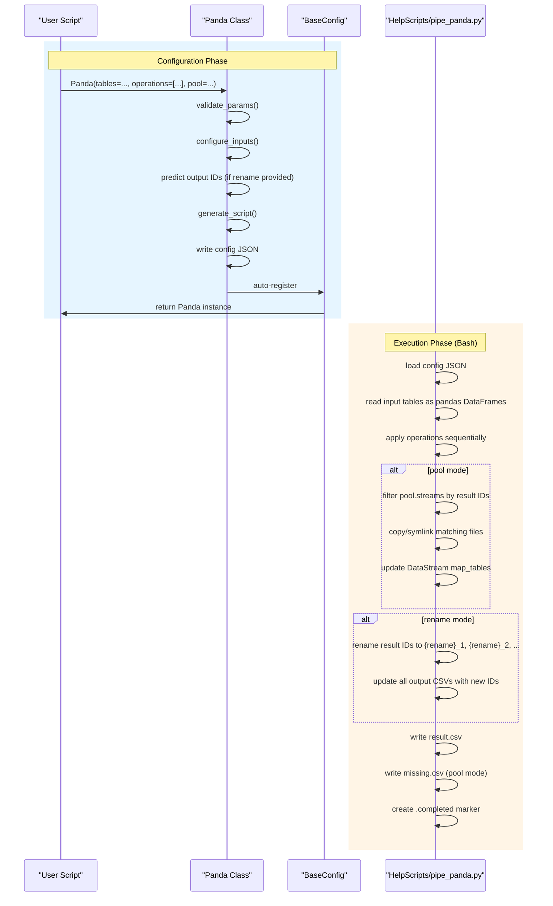

**Diagram: Panda Execution Flow**

During configuration, `Panda` validates operations and predicts output structure. During execution, `pipe_panda.py` loads tables as pandas DataFrames, applies operations, and optionally pools files or renames IDs.

**Sources:** [Docs/Tool/DataManagement.md:7-118](), [Docs/UserManual.md:1-611]()

### Common Usage Patterns

#### Filter and Pool

```python
from biopipelines.panda import Panda

# Filter high-confidence predictions and copy their structures
filtered = Panda(
    tables=boltz.tables.confidence,
    operations=[Panda.filter("pLDDT > 80")],
    pool=boltz
)
# Output: filtered.streams.structures (matching IDs only)
#         filtered.tables.result (filtered confidence.csv)
#         filtered.tables.missing (filtered out IDs)
```

**Sources:** [Docs/Tool/DataManagement.md:49-58]()

#### Sort, Head, and Rename

```python
# Select top 5 by score and rename to "best_1", "best_2", etc.
best = Panda(
    tables=boltz.tables.confidence,
    operations=[
        Panda.sort("confidence_score", ascending=False),
        Panda.head(5)
    ],
    pool=boltz,
    rename="best"
)
# Output IDs: best_1, best_2, best_3, best_4, best_5
```

**Sources:** [Docs/Tool/DataManagement.md:69-76]()

#### Merge and Calculate

```python
# Merge apo and holo affinity tables, calculate delta
merged = Panda(
    tables=[apo.tables.affinity, holo.tables.affinity],
    operations=[
        Panda.merge(prefixes=["apo_", "holo_"]),
        Panda.calculate({"delta": "holo_affinity - apo_affinity"})
    ]
)
# Result columns: id, apo_affinity, holo_affinity, delta
```

**Sources:** [Docs/Tool/DataManagement.md:78-84]()

#### Complex Calculations

```python
# Calculate FRET efficiency from distance and orientation angle
# Math functions: cos, sin, sqrt, log, exp, radians, degrees, pi
fret = Panda(
    tables=[distances.tables.result, angles.tables.angles],
    operations=[
        Panda.merge(),
        Panda.calculate({
            "kappa2": "cos(orientation) ** 2",
            "R0_eff": "49.0 * (kappa2 / 0.6667) ** (1.0 / 6.0)",
            "efficiency": "1 / (1 + (distance / R0_eff) ** 6)"
        })
    ]
)
# Expressions can reference earlier-defined columns in same calculate call
```

**Sources:** [Docs/Tool/DataManagement.md:86-99]()

#### Multi-Source Pooling

```python
# Select best structure from multiple design cycles
best = Panda(
    tables=[cycle1.tables.result, cycle2.tables.result],
    operations=[
        Panda.concat(add_source=True),
        Panda.sort("metric", ascending=True),
        Panda.head(1)
    ],
    pool=[cycle1, cycle2],  # Pool list matches tables list
    rename="best"
)
# Selects best structure across all cycles, renames to "best_1"
```

**Sources:** [Docs/Tool/DataManagement.md:106-117]()

---

## ReMap: ID Management

`ReMap` renames IDs across all streams and tables from a source tool output. At execution time, files are symlinked (not copied) and CSV tables are rewritten with new IDs. This enables workflows where upstream IDs need to be aligned with a different ID scheme.

### Class Structure

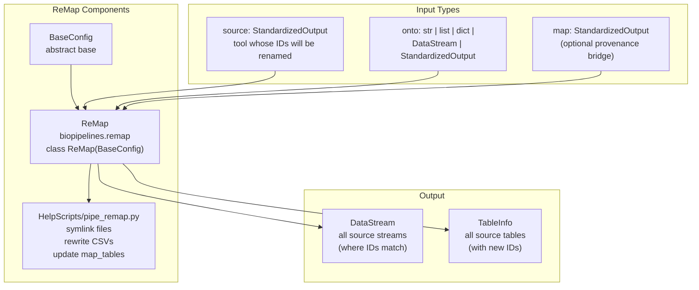

**Diagram: ReMap Architecture**

`ReMap` takes a `source` tool output and an `onto` specification. During execution, `pipe_remap.py` creates symlinks for all files and rewrites CSV tables with new IDs. Streams whose IDs cannot be fully remapped are discarded with a warning.

**Sources:** [Docs/Tool/DataManagement.md:121-171]()

### Parameters

| Parameter | Type | Description |
|-----------|------|-------------|
| `source` | `StandardizedOutput` | Tool output whose IDs will be renamed |
| `onto` | `str` \| `list` \| `dict` \| `list[tuple]` \| `DataStream` \| `StandardizedOutput` | Target ID specification (see table below) |
| `map` | `StandardizedOutput` (optional) | Intermediate tool for provenance bridging |

**Sources:** [Docs/Tool/DataManagement.md:127-130]()

### `onto` Specification Modes

| Type | Behavior | Example |
|------|----------|---------|
| `str` | Auto-number with prefix | `"design"` → `design_1`, `design_2`, ... |
| `list[str]` | Explicit new IDs (matched by position) | `["kinase_apo", "kinase_holo"]` |
| `dict` | Selective mapping | `{"old_id": "new_id"}` |
| `list[tuple]` | Same as dict | `[("old_id", "new_id")]` |
| `DataStream` | Align onto stream's IDs | `tool_b.streams.structures` |
| `StandardizedOutput` | Align onto tool's IDs (all streams must share IDs) | `tool_b` |

**Auto-numbering**: When `onto` is a string, output IDs are `{onto}_1`, `{onto}_2`, etc., matching the order of source IDs.

**Alignment**: When `onto` is a `DataStream` or `StandardizedOutput`, ReMap attempts to match source IDs to target IDs. Unmatched IDs are dropped.

**Sources:** [Docs/Tool/DataManagement.md:132-140]()

### Provenance Bridging with `map`

The optional `map` parameter enables ID remapping through an intermediate tool:

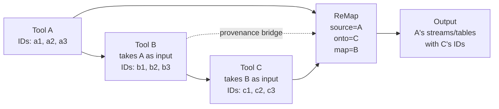

**Diagram: Provenance Bridging Pattern**

When Tool A produces outputs consumed by Tool B, which produces outputs consumed by Tool C, and you want to remap Tool A's IDs onto Tool C's IDs, use `ReMap(source=A, onto=C, map=B)`. ReMap traces provenance columns through B to establish A→C mapping.

**Sources:** [Docs/Tool/DataManagement.md:127-171]()

### Usage Examples

#### Auto-Numbered Renaming

```python
from biopipelines.remap import ReMap

# Rename tool_a's IDs to "design_1", "design_2", ...
remapped = ReMap(source=tool_a, onto="design")
```

**Sources:** [Docs/Tool/DataManagement.md:149-152]()

#### Explicit List Mapping

```python
# Rename two structures to specific IDs
remapped = ReMap(source=tool_a, onto=["kinase_apo", "kinase_holo"])
```

**Sources:** [Docs/Tool/DataManagement.md:154-155]()

#### Dictionary Mapping

```python
# Selective renaming
remapped = ReMap(
    source=tool_a, 
    onto={"prot1": "complex_A", "prot2": "complex_B"}
)

# Or with list of tuples
remapped = ReMap(
    source=tool_a, 
    onto=[("prot1", "complex_A"), ("prot2", "complex_B")]
)
```

**Sources:** [Docs/Tool/DataManagement.md:157-162]()

#### Alignment to Another Tool

```python
# Align tool_a's IDs onto tool_b's IDs
remapped = ReMap(source=tool_a, onto=tool_b)

# Or align onto a specific stream
remapped = ReMap(source=tool_a, onto=tool_b.streams.structures)
```

**Sources:** [Docs/Tool/DataManagement.md:164-167]()

#### Provenance Bridging

```python
# Map tool_a onto tool_c through intermediate tool_b
remapped = ReMap(source=tool_a, onto=tool_c, map=tool_b)
```

**Sources:** [Docs/Tool/DataManagement.md:169-171]()

---

## Selection: PyMOL Selection String Manipulation

`Selection` combines and modifies PyMOL-formatted selection strings using composable operations. This is useful for creating complex residue selections from multiple upstream analyses (e.g., "binding site residues, expanded by 2, excluding flexible regions").

### Class Structure

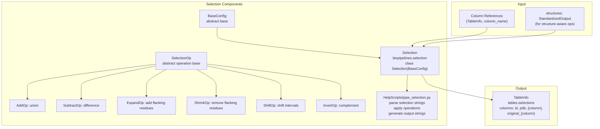

**Diagram: Selection Tool Architecture**

`Selection` accepts a sequence of operations created by static factory methods (`Selection.add()`, `Selection.subtract()`, etc.). Each operation modifies the running selection. Structure-aware operations (expand, shrink, shift, invert) require the `structures` parameter to determine chain lengths.

**Sources:** [Docs/Tool/DataManagement.md:203-246](), [config.yaml:109]()

### Parameters

| Parameter | Type | Description |
|-----------|------|-------------|
| `*ops` | Sequence of `SelectionOp` | Operations to apply left-to-right |
| `structures` | `StandardizedOutput` (optional) | Required for structure-aware ops (expand, shrink, shift, invert) |

**Sources:** [Docs/Tool/DataManagement.md:210-212]()

### Operations

| Operation | Description | Structure-Aware |
|-----------|-------------|-----------------|
| `Selection.add(*refs)` | Union of one or more column references | No |
| `Selection.subtract(*refs)` | Remove residues from running selection | No |
| `Selection.expand(n)` | Add n residues on each side | Yes |
| `Selection.shrink(n)` | Remove n residues from each side | Yes |
| `Selection.shift(n)` | Shift all intervals by n | Yes |
| `Selection.invert()` | Select complement | Yes |

**Selection string format**: PyMOL-style range notation (e.g., `"10-20+30-40"`) with `+` separating ranges.

**Structure-aware operations**: Require `structures` parameter because they need to know chain boundaries. For example, `invert()` needs to know the total chain length to compute the complement.

**Sources:** [Docs/Tool/DataManagement.md:214-221]()

### Execution Pattern

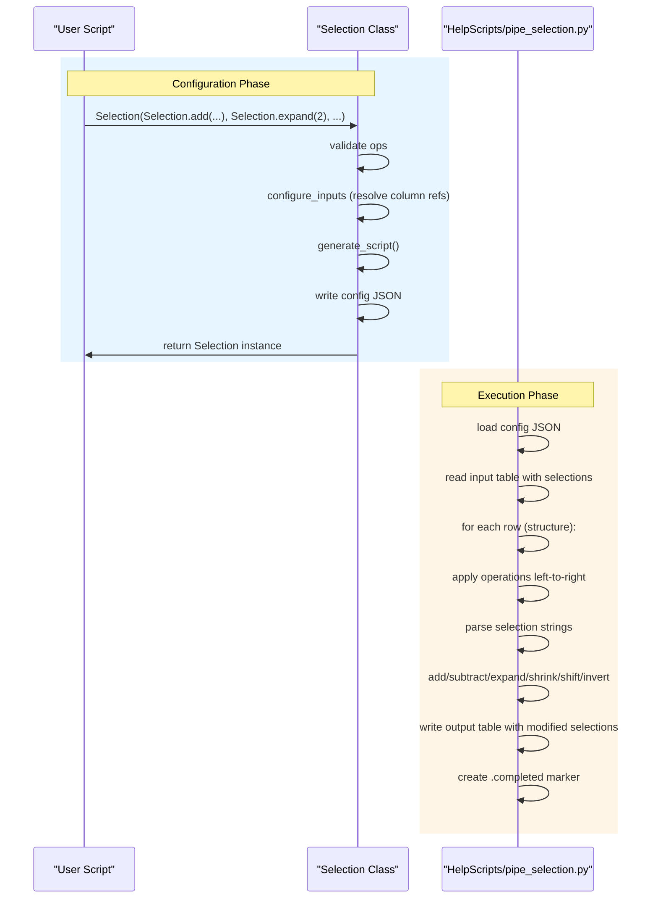

**Diagram: Selection Execution Flow**

Operations are applied sequentially. For example, `Selection.add(col1, col2)` creates a union, then `Selection.expand(2)` adds 2 residues on each side, then `Selection.subtract(col3)` removes specified residues.

**Sources:** [Docs/Tool/DataManagement.md:203-246]()

### Usage Examples

#### Expand Binding Site

```python
from biopipelines.selection import Selection
from biopipelines.distance_selector import DistanceSelector

# Find residues within 5Å of ligand
distances = DistanceSelector(structures=rfdaa, ligand="LIG", distance=5)

# Expand by 2 residues on each side
expanded = Selection(
    Selection.add(distances.tables.selections.within),
    Selection.expand(2),
    structures=rfdaa
)
# Output: distances.tables.selections.within expanded by 2 residues
```

**Sources:** [Docs/Tool/DataManagement.md:227-238]()

#### Union and Invert

```python
from biopipelines.selection import Selection

# Union two regions (e.g., two linkers), then invert to get fixed positions
fixed = Selection(
    Selection.add(fuse.tables.sequences.L1, fuse.tables.sequences.L2),
    Selection.invert(),
    structures=fused_protein
)
# Output: complement of L1+L2 (i.e., everything except linkers)
```

**Sources:** [Docs/Tool/DataManagement.md:240-246]()

#### Multi-Column Operations

```python
# Combine binding site, conserved regions, exclude flexible loops
design_positions = Selection(
    Selection.add(binding_site.tables.selections.within),  # Start with binding site
    Selection.expand(3),  # Add 3 residues around
    Selection.add(conserved.tables.selections.region),  # Add conserved region
    Selection.subtract(flexible.tables.selections.loops),  # Remove flexible loops
    structures=protein
)
```

**Sources:** [Docs/Tool/DataManagement.md:203-246]()

---

## ExtractMetrics: Statistical Software Export

`ExtractMetrics` reorganizes tabular data into a format suitable for statistical software like GraphPad Prism. It creates one CSV file per metric, with columns representing different experimental conditions.

### Class Structure

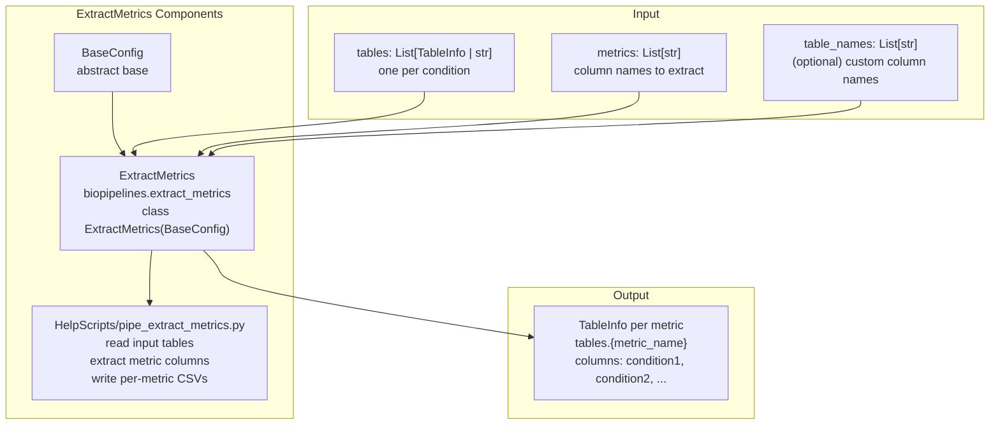

**Diagram: ExtractMetrics Architecture**

`ExtractMetrics` takes multiple tables (one per experimental condition) and extracts specified metric columns. Each metric becomes a separate CSV file with conditions as columns.

**Sources:** [Docs/Tool/DataManagement.md:175-200](), [config.yaml:108]()

### Parameters

| Parameter | Type | Description |
|-----------|------|-------------|
| `tables` | `List[TableInfo \| str]` | Input tables (one per condition) |
| `metrics` | `List[str]` | Column names to extract |
| `table_names` | `List[str]` (optional) | Custom column names for output CSVs (default: table_1, table_2, ...) |

**Sources:** [Docs/Tool/DataManagement.md:180-184]()

### Output Format

For each metric in `metrics`, `ExtractMetrics` creates a table with:
- Rows: one per unique ID across all input tables
- Columns: one per input table (named by `table_names` if provided, otherwise `table_1`, `table_2`, ...)

**Example transformation**:

Input tables (3 conditions):
```
# cycle0_affinity.csv
id,affinity
prot1,-8.5
prot2,-7.2

# cycle1_affinity.csv
id,affinity
prot1,-9.1
prot2,-7.8

# cycle2_affinity.csv
id,affinity
prot1,-9.5
prot2,-8.0
```

Output (affinity.csv):
```
id,Cycle0,Cycle1,Cycle2
prot1,-8.5,-9.1,-9.5
prot2,-7.2,-7.8,-8.0
```

**Sources:** [Docs/Tool/DataManagement.md:186-188]()

### Usage Example

```python
from biopipelines.extract_metrics import ExtractMetrics

# Extract affinity and pLDDT metrics from three design cycles
metrics = ExtractMetrics(
    tables=[
        cycle0.tables.merged, 
        cycle1.tables.merged, 
        cycle2.tables.merged
    ],
    metrics=["affinity_delta", "pLDDT"],
    table_names=["Cycle0", "Cycle1", "Cycle2"]
)
# Output: 
#   metrics.tables.affinity_delta (path: affinity_delta.csv)
#   metrics.tables.pLDDT (path: pLDDT.csv)
```

**Sources:** [Docs/Tool/DataManagement.md:190-200]()

---

## Data Transformation Workflows

### Typical Data Management Patterns

```mermaid
graph TB
    subgraph "Pattern 1: Filter and Pool"
        A1["Upstream Tool<br/>generates structures + metrics"]
        A2["Panda<br/>filter(metric > threshold)"]
        A3["Output<br/>filtered structures"]
        A1 --> A2
        A2 --> A3
    end
    
    subgraph "Pattern 2: Merge and Calculate"
        B1["Tool A<br/>affinity metrics"]
        B2["Tool B<br/>confidence metrics"]
        B3["Panda<br/>merge + calculate"]
        B4["Output<br/>combined metrics"]
        B1 --> B3
        B2 --> B3
        B3 --> B4
    end
    
    subgraph "Pattern 3: Rank and Rename"
        C1["Upstream Tool<br/>scored structures"]
        C2["Panda<br/>sort + head + rename"]
        C3["Output<br/>top_1, top_2, top_3, ..."]
        C1 --> C2
        C2 --> C3
    end
    
    subgraph "Pattern 4: Selection Manipulation"
        D1["DistanceSelector<br/>binding site"]
        D2["Selection<br/>expand + subtract"]
        D3["Downstream Design Tool<br/>redesigned positions"]
        D1 --> D2
        D2 --> D3
    end
    
    subgraph "Pattern 5: ID Alignment"
        E1["Design Tool<br/>IDs: design_1, design_2, ..."]
        E2["Prediction Tool<br/>IDs: pred_1, pred_2, ..."]
        E3["ReMap<br/>align IDs"]
        E4["Downstream Analysis<br/>matched IDs"]
        E1 --> E3
        E2 --> E3
        E3 --> E4
    end
```

**Diagram: Common Data Management Workflow Patterns**

These five patterns represent the most common use cases for data management tools in BioPipelines. Pattern 1 filters results and pools matching files. Pattern 2 merges metrics from different tools. Pattern 3 ranks and renames for clarity. Pattern 4 manipulates residue selections for design. Pattern 5 aligns ID schemes across tools.

**Sources:** [Docs/Tool/DataManagement.md:1-247](), [Docs/UserManual.md:497-551]()

### Multi-Cycle Design Workflow

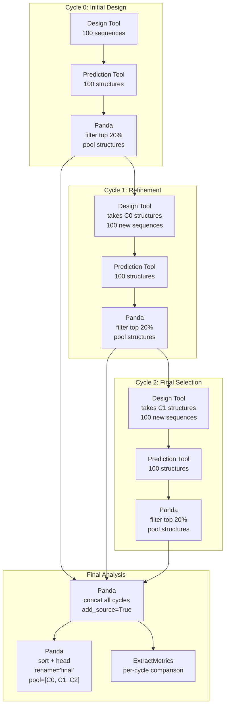

**Diagram: Multi-Cycle Design with Data Management**

This workflow demonstrates how Panda enables iterative design refinement. Each cycle filters the top performers and pools their structures for the next cycle. Final analysis concatenates all cycles, selects the global best, and exports metrics for statistical comparison.

**Sources:** [Docs/Tool/DataManagement.md:49-117](), [Docs/UserManual.md:497-551]()

---

## Integration with Other Tools

### Data Management in Analysis Workflows

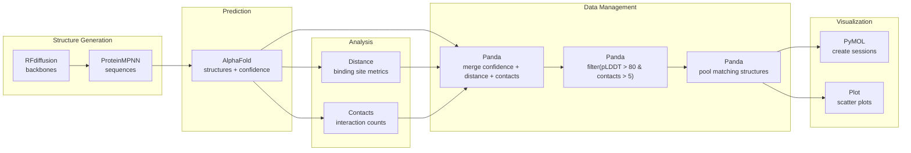

**Diagram: Data Management in Analysis Workflows**

Data management tools serve as a bridge between analysis and visualization. `Panda` merges metrics from multiple analysis tools, filters based on combined criteria, and pools matching structures for visualization.

**Sources:** [Docs/Tool/DataManagement.md:1-247](), [Docs/Tool/Analysis.md:1-458]()

### Column References and Metadata Propagation

Data management tools extensively use **column references** to pass metadata between tools. A column reference is a tuple `(TableInfo, "column_name")` that enables dynamic parameter resolution at execution time.

```python
from biopipelines.rfdiffusion import RFdiffusion
from biopipelines.ligandmpnn import LigandMPNN
from biopipelines.panda import Panda

# RFdiffusion outputs table with 'designed' column
rfd = RFdiffusion(contigs="50-100", num_designs=5)

# Use column reference for per-structure designed positions
lmpnn = LigandMPNN(
    structures=rfd,
    ligand="LIG",
    redesigned=rfd.tables.structures.designed  # Column reference
)

# Filter by confidence, pool structures
filtered = Panda(
    tables=lmpnn.tables.confidence,
    operations=[Panda.filter("confidence_score > 0.8")],
    pool=lmpnn
)

# Use filtered results for downstream design
# Selection tool can reference filtered table columns
from biopipelines.selection import Selection
expanded = Selection(
    Selection.add(filtered.tables.result.designed_positions),
    Selection.expand(2),
    structures=filtered
)
```

For more information on column references and how they enable metadata-driven parameterization, see [Table Column References and Metadata Propagation](#7.4).

**Sources:** [Docs/UserManual.md:373-392](), [Docs/Tool/DataManagement.md:1-247]()

---

## Environment and Dependencies

All data management tools use the `biopipelines` conda environment except `Selection`, which uses `ProteinEnv` (for PyMOL-based selection parsing).

| Tool | Environment | Key Dependencies |
|------|-------------|------------------|
| `Panda` | `biopipelines` | pandas, numpy |
| `ReMap` | `biopipelines` | pandas |
| `Selection` | `ProteinEnv` | pymol (via PyMOL environment) |
| `ExtractMetrics` | `biopipelines` | pandas |

**Sources:** [config.yaml:106-109](), [Docs/Tool/DataManagement.md:11-179-208]()

---

## Summary

Data management tools provide the glue between computational stages in BioPipelines workflows:

- **Panda**: Unified table transformations with optional file pooling, enabling filter-pool-redesign cycles
- **ReMap**: ID alignment across tool outputs, critical for provenance tracking and multi-tool comparisons
- **Selection**: Composable residue selection manipulation, bridging structural analysis and design
- **ExtractMetrics**: Export to statistical software for publication-ready analysis

All tools follow the two-phase execution model, use JSON configuration files, and integrate seamlessly with other BioPipelines tools through `StandardizedOutput` and column references.

**Sources:** [Docs/Tool/DataManagement.md:1-247](), [Docs/UserManual.md:1-611]()

---