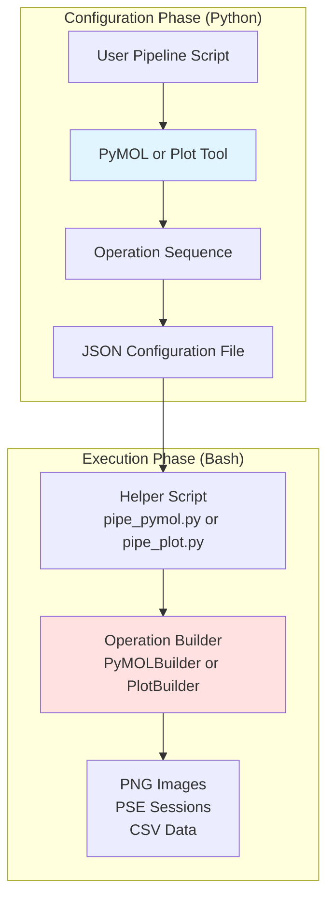
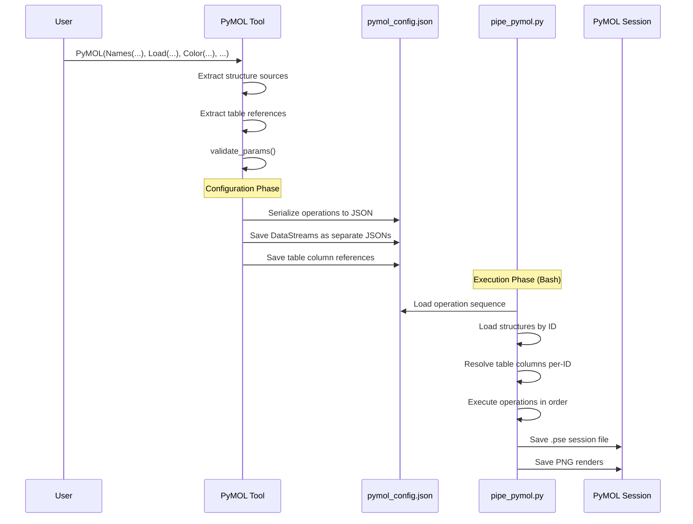
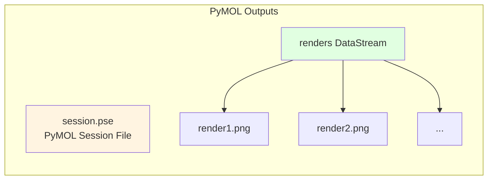
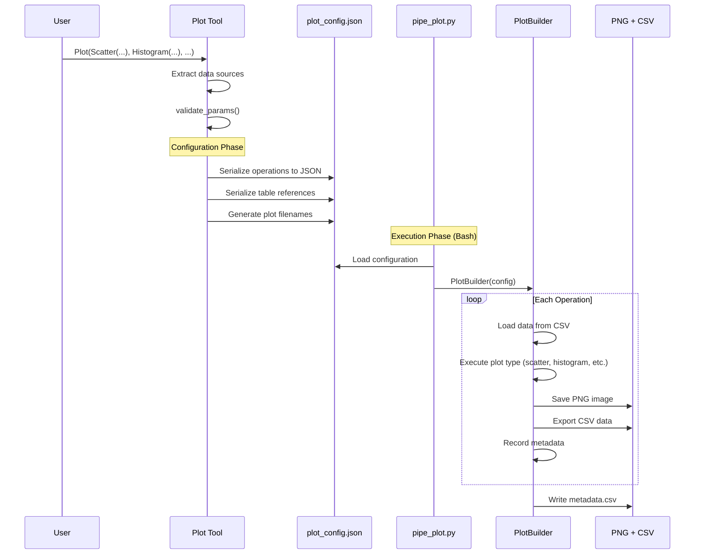
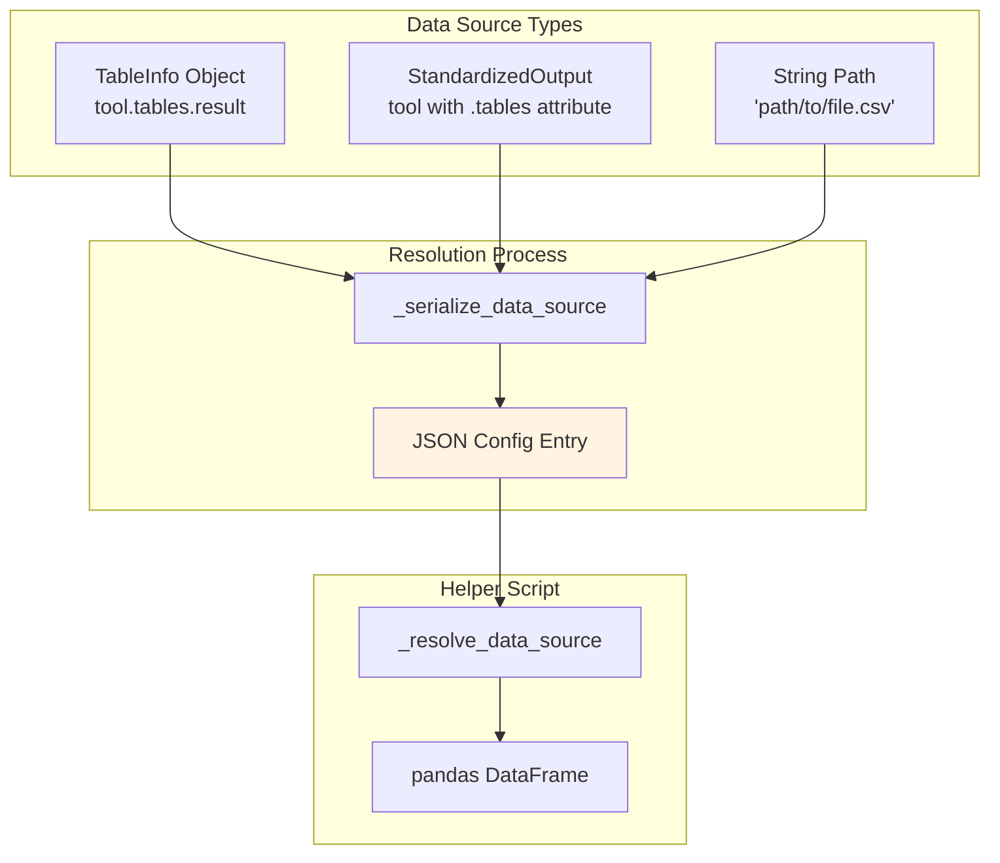
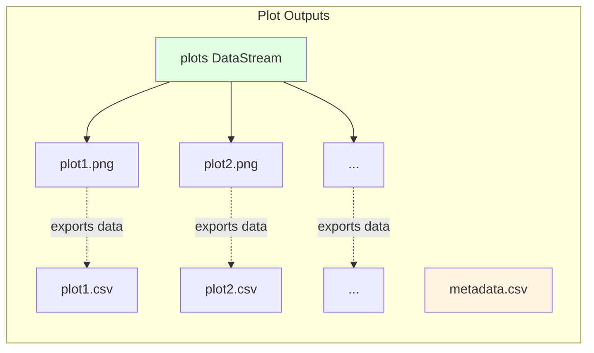
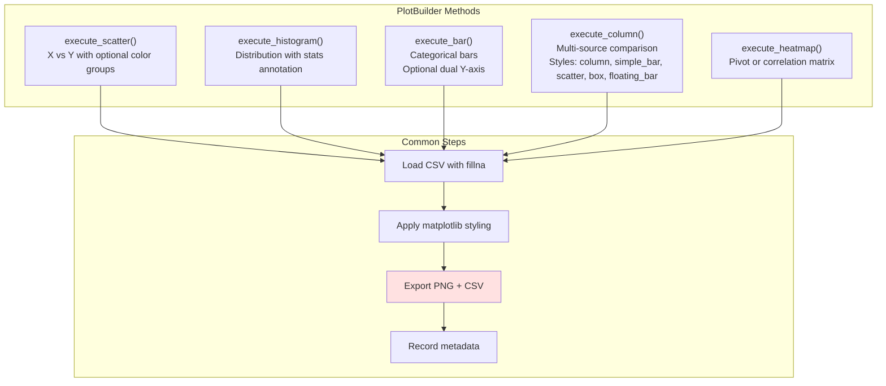
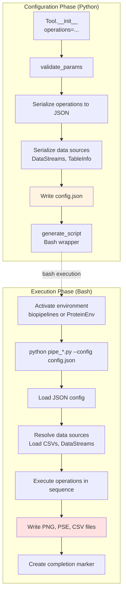

# Visualization Tools

<details>
<summary>Relevant source files</summary>

The following files were used as context for generating this wiki page:

- [Docs/Tool/Analysis.md](Docs/Tool/Analysis.md)
- [Docs/Tool/DataManagement.md](Docs/Tool/DataManagement.md)
- [Docs/ToolReference.md](Docs/ToolReference.md)
- [HelpScripts/pipe_plot.py](HelpScripts/pipe_plot.py)
- [biopipelines/base_config.py](biopipelines/base_config.py)
- [biopipelines/plot.py](biopipelines/plot.py)
- [biopipelines/pymol.py](biopipelines/pymol.py)

</details>


BioPipelines provides two visualization tools for creating publication-quality figures and interactive structure sessions: **PyMOL** for structure visualization and **Plot** for data plotting. Both tools use a declarative operation-based API that separates visualization logic from execution, enabling reproducible graphics generation across different environments.

For data transformation before visualization, see [Data Management Tools](#5.6). For analysis tools that generate metrics to visualize, see [Analysis Tools](#5.5).

---

## Overview of Visualization Architecture

Both PyMOL and Plot follow the same design pattern:



**Key Characteristics:**
1. **Declarative API**: Users specify *what* to visualize, not *how* to execute it
2. **Operation Sequencing**: Visualizations are built as a sequence of composable operations
3. **Data Source Abstraction**: Operations reference `StandardizedOutput` or `TableInfo` objects without file paths
4. **Config-Driven Execution**: Python generates JSON configs; bash scripts execute via helper scripts
5. **Dual Output**: Images (PNG) and session files (PSE) or data tables (CSV)

Sources: [biopipelines/pymol.py:1-786](), [biopipelines/plot.py:1-642]()

---

## PyMOL Tool

The `PyMOL` tool creates PyMOL sessions (`.pse`) and renders structure images (`.png`) using a sequence of declarative operations. It supports ID-based matching between structures and table columns for per-structure selections and naming.

### PyMOL Class Architecture

```mermaid
graph TB
    subgraph "PyMOL Class (BaseConfig)"
        Init["__init__(*operations, session='session')"]
        StaticOps[Static Operation Factories<br/>Names, Load, Color, Align, etc.]
        Methods[Instance Methods<br/>validate_params()<br/>configure_inputs()<br/>generate_script()<br/>get_output_files()]
    end
    
    subgraph "PyMOLOperation Objects"
        OpNames["PyMOLOperation('names')"]
        OpLoad["PyMOLOperation('load')"]
        OpColor["PyMOLOperation('color')"]
        OpAlign["PyMOLOperation('align')"]
        OpRender["PyMOLOperation('render_each')"]
    end
    
    subgraph "Outputs"
        Session[".pse Session File"]
        Renders["DataStream (renders)"]
        PNG["PNG Image Files"]
    end
    
    Init --> OpNames
    Init --> OpLoad
    Init --> OpColor
    Init --> OpAlign
    Init --> OpRender
    
    StaticOps --> OpNames
    StaticOps --> OpLoad
    
    Methods --> Session
    Methods --> Renders
    Renders --> PNG
    
    style Init fill:#e1f5ff
    style Session fill:#ffe1e1
```

Sources: [biopipelines/pymol.py:41-95](), [biopipelines/pymol.py:503-525]()

### Available PyMOL Operations

The `PyMOL` class provides static factory methods for creating operations:

| Operation | Purpose | Key Parameters |
|-----------|---------|----------------|
| `Names(prefix, basename, suffix)` | Map IDs to PyMOL object names | `basename`: table column for variable part |
| `Load(structures)` | Load structures into session | `structures`: StandardizedOutput or DataStream |
| `Color(color, structures, selection)` | Color structures or selections | `selection`: table column or string |
| `ColorAF(structures, upper)` | Color by pLDDT (B-factor) | `upper`: max B-factor (1 for Boltz2, 100 for AF2) |
| `ColorAlign(reference, targets, ...)` | Color by sequence alignment | Shows identical/similar/different residues |
| `Align(method, target, selection)` | Align structures | `method`: "align", "super", "cealign" |
| `Show(structures, representation, selection)` | Show representation | `representation`: "cartoon", "sticks", etc. |
| `Hide(structures, representation, selection)` | Hide representation | `representation`: "everything", "cartoon", etc. |
| `Set(setting, value, selection)` | Set PyMOL setting | Any PyMOL setting |
| `Center(selection)` | Center view without rotation | |
| `Zoom(selection, buffer)` | Zoom to fit selection | `buffer`: extra space in Å |
| `Orient(selection)` | Orient view by principal axes | |
| `Ray(width, height)` | Ray trace current view | Dimensions in pixels |
| `PNG(filename, width, height, ray, dpi)` | Save PNG image | `filename`: supports `{id}` placeholder |
| `Render(structures, ...)` | Single rendered image | Orients and ray traces |
| `RenderEach(structures, ...)` | Render each structure separately | Creates multiple PNGs |

Sources: [biopipelines/pymol.py:136-500]()

### PyMOL Operation Execution Flow



Sources: [biopipelines/pymol.py:576-691](), [biopipelines/pymol.py:659-691]()

### ID-Based Matching and Table References

PyMOL supports **per-structure selections** using table column references. When a table column is passed as a `selection` parameter, PyMOL looks up the value for each structure's ID:

**Example:**
```python
# fuse.tables.sequences has columns: id | D1 | L1 | D2 | lengths
# D1="1-50", L1="51-60", D2="61-120" for each structure

PyMOL(
    PyMOL.Names(prefix="sensor", basename=fuse.tables.sequences.lengths, suffix="parts"),
    PyMOL.Load(fused_structures),
    PyMOL.Color("marine", selection=fuse.tables.sequences.D1),   # Per-structure D1 selection
    PyMOL.Color("gray50", selection=fuse.tables.sequences.L1),   # Per-structure L1 selection
    PyMOL.Color("white", selection=fuse.tables.sequences.D2),    # Per-structure D2 selection
    PyMOL.Align(selection=fuse.tables.sequences.D2),             # Align only on D2
)
```

**Table Column Resolution:**
- `fuse.tables.sequences.D1` creates a `TableReference(path, "D1")`
- Serialized to JSON as `{"type": "table_column", "table_path": "...", "column_name": "D1"}`
- Helper script reads CSV, looks up `D1` value for each structure ID
- Applied as PyMOL selection: `select domain1, {object_name} and resi {D1_value}`

Sources: [biopipelines/pymol.py:174-196](), [biopipelines/pymol.py:590-657]()

### PyMOL Output Structure



**Output Files:**
- **Session File**: `.pse` file containing all loaded structures, colors, alignments
- **Renders DataStream**: PNG images from `Render`, `RenderEach`, or `PNG` operations
  - IDs: structure IDs or custom names
  - Files: PNG file paths
  - Format: "png"

Sources: [biopipelines/pymol.py:692-753]()

### PyMOL Configuration Example

```python
from biopipelines.pymol import PyMOL

# Color protein by pLDDT, ligand by atom, orient on ligand, render each
viz = PyMOL(
    PyMOL.RenderEach(
        structures=boltz_predictions,
        orient_selection="resn LIG",
        color_protein="plddt",
        color_ligand="byatom",
        ligand_selection="resn LIG",
        plddt_upper=1,  # Boltz2 uses 0-1 confidence
        width=1920,
        height=1080
    )
)

# Multi-structure session with alignment coloring
viz = PyMOL(
    PyMOL.Load(reference),
    PyMOL.Load(designs),
    PyMOL.ColorAlign(
        reference=reference,
        targets=designs,
        identical="white",
        similar="wheat",
        different="salmon",
        notcovered="gray50"
    ),
    PyMOL.Align(method="super"),
    PyMOL.Save("alignment.pse")
)
```

Sources: [biopipelines/pymol.py:49-61](), [Docs/Tool/Utilities.md:23-24]()

---

## Plot Tool

The `Plot` tool creates data visualizations from CSV tables using matplotlib and seaborn. It supports scatter plots, histograms, bar charts, column plots (Prism-style), and heatmaps.

### Plot Class Architecture

```mermaid
graph TB
    subgraph "Plot Class (BaseConfig)"
        Init["__init__(*operations)"]
        StaticOps[Static Operation Factories<br/>Scatter, Histogram, Bar, Column, HeatMap]
        Methods[Instance Methods<br/>validate_params()<br/>configure_inputs()<br/>generate_script()<br/>get_output_files()]
    end
    
    subgraph "PlotOperation Objects"
        OpScatter["PlotOperation('scatter')"]
        OpHist["PlotOperation('histogram')"]
        OpBar["PlotOperation('bar')"]
        OpCol["PlotOperation('column')"]
        OpHeat["PlotOperation('heatmap')"]
    end
    
    subgraph "Outputs"
        Plots["DataStream (plots)"]
        PNG["PNG Image Files"]
        CSV["CSV Data Exports"]
        Metadata["metadata.csv Table"]
    end
    
    Init --> OpScatter
    Init --> OpHist
    Init --> OpBar
    Init --> OpCol
    Init --> OpHeat
    
    StaticOps --> OpScatter
    
    Methods --> Plots
    Methods --> Metadata
    Plots --> PNG
    PNG --> CSV
    
    style Init fill:#e1f5ff
    style Plots fill:#ffe1e1
```

Sources: [biopipelines/plot.py:41-96](), [biopipelines/plot.py:362-383]()

### Available Plot Operations

| Operation | Purpose | Required Parameters | Optional Parameters |
|-----------|---------|---------------------|---------------------|
| `Scatter(data, x, y)` | X vs Y scatter plot | `x`, `y`: column names | `color`: grouping column<br/>`title`, `xlabel`, `ylabel`<br/>`figsize`, `dpi`<br/>`x_tick_rotation`, `grid`<br/>`color_legend_loc`, `color_legend_outside` |
| `Histogram(data, x)` | Distribution histogram | `x`: column name | `bins`: number of bins<br/>`title`, `xlabel`, `ylabel`<br/>`figsize`, `dpi` |
| `Bar(data, x, y)` | Categorical bar chart | `x`: categories, `y`: values | `y_right`: secondary Y axis<br/>`title`, `xlabel`, `ylabel`, `ylabel_right`<br/>`color_left`, `color_right`<br/>`figsize`, `dpi`<br/>`x_tick_rotation`, `grid`<br/>`legend_loc`, `legend_outside` |
| `Column(data, y)` | Multi-source comparison | `data`: list of sources, `y`: column | `labels`: x-axis labels<br/>`style`: "column", "simple_bar", "scatter", "box", "floating_bar"<br/>`show_error`: "sd", "sem", "ci"<br/>`color_groups`, `colors`<br/>`color_legend_title`, `color_legend_loc`, `color_legend_outside`<br/>`figsize`, `dpi`, `grid` |
| `HeatMap(data, ...)` | Heatmap matrix | **Pivot mode**: `x`, `y`, `value`<br/>**Correlation mode**: `columns` | `title`, `xlabel`, `ylabel`<br/>`cmap`, `annotate`<br/>`figsize`, `dpi` |

Sources: [biopipelines/plot.py:104-359]()

### Plot Operation Execution Flow



Sources: [biopipelines/plot.py:398-430](), [biopipelines/plot.py:533-563](), [HelpScripts/pipe_plot.py:33-95]()

### Data Source Resolution

Plot operations accept multiple data source types:



**Serialization:**
- **TableInfo**: `{"type": "table_info", "path": "...", "name": "..."}`
- **StandardizedOutput**: Extracts first table, saves as `{"type": "standardized_output", "path": "...", "name": "...", "output_folder": "..."}`
- **String**: Direct path string

Sources: [biopipelines/plot.py:482-501](), [HelpScripts/pipe_plot.py:50-73]()

### Plot Output Structure



**Output Files:**
- **plots DataStream**: PNG image files
  - IDs: "plot_1", "plot_2", ...
  - Files: PNG file paths (generated from title or operation type)
  - Format: "png"
- **Tables**: 
  - `metadata`: Summary CSV with columns `[filename, type, title, x_column, y_column, data_sources]`
  - `{plot_name}`: Data CSV for each plot (same name as PNG without extension)

Sources: [biopipelines/plot.py:565-610](), [HelpScripts/pipe_plot.py:191-208]()

### Plot Helper Script Operations

The `pipe_plot.py` helper script implements plot generation using `PlotBuilder`:



**Key Features:**
1. **Automatic styling**: Consistent whitegrid theme, spines removed, grid control
2. **Data export**: Every plot saves both PNG and CSV with plot data
3. **Metadata tracking**: Aggregates plot info into metadata.csv
4. **Label resolution**: Uses `xlabel` > `x_name` > column name for axis labels
5. **Error handling**: NaN handling for string columns, validation of column existence

Sources: [HelpScripts/pipe_plot.py:128-716]()

### Plot Configuration Examples

```python
from biopipelines.plot import Plot

# Single scatter plot with color grouping
Plot(
    Plot.Scatter(
        data=analysis.tables.results,
        x="pLDDT",
        y="affinity",
        color="source",
        title="pLDDT vs Affinity by Source",
        color_legend_outside=True
    )
)

# Multi-plot comparison
Plot(
    Plot.Histogram(data=cycle0, x="pLDDT", bins=30, title="Cycle 0"),
    Plot.Histogram(data=cycle1, x="pLDDT", bins=30, title="Cycle 1"),
    Plot.Histogram(data=cycle2, x="pLDDT", bins=30, title="Cycle 2"),
)

# Column plot (Prism-style) with color groups
Plot(
    Plot.Column(
        data=[apo.tables.results, holo.tables.results, mutant.tables.results],
        y="affinity",
        labels=["Apo", "Holo", "Mutant"],
        style="column",
        show_error="sd",
        color_groups=["WT", "WT", "Mutant"],
        colors=["#1f77b4", "#1f77b4", "#ff7f0e"],
        color_legend_title="Variant",
        title="Affinity Comparison"
    )
)

# Correlation heatmap
Plot(
    Plot.HeatMap(
        data=analysis.tables.merged,
        columns=["pLDDT", "affinity", "contacts", "RMSD"],
        title="Metric Correlations",
        annotate=True
    )
)

# Dual Y-axis bar chart
Plot(
    Plot.Bar(
        data=results,
        x="condition",
        y="affinity",
        y_right="pLDDT",
        ylabel="Affinity (nM)",
        ylabel_right="pLDDT",
        title="Affinity and Confidence by Condition",
        legend_outside=True
    )
)
```

Sources: [biopipelines/plot.py:49-85](), [Docs/Tool/Utilities.md:23-24]()

---

## Helper Script Execution Model

Both PyMOL and Plot follow the same two-phase execution pattern:



**Configuration Phase Steps:**
1. User creates tool with operation sequence
2. Tool extracts dependencies (structure sources, table references)
3. Operations serialized to JSON with data source metadata
4. DataStreams saved as separate JSON files
5. Table references converted to `{table_path, column_name}` dicts
6. Config file written to `output_folder/config.json`
7. Bash script generated with environment activation + helper invocation

**Execution Phase Steps:**
1. Bash script activates appropriate environment
2. Helper script invoked with `--config` flag
3. Config JSON loaded
4. Data sources resolved (DataStreams from JSON, tables from CSV)
5. Operations executed in sequence
6. Outputs written (PNG, PSE, CSV)
7. Completion marker created

Sources: [biopipelines/pymol.py:659-691](), [biopipelines/plot.py:533-563](), [HelpScripts/pipe_plot.py:740-770]()

---

## Environment Requirements

| Tool | Environment | Key Dependencies | Installation |
|------|-------------|-----------------|--------------|
| **PyMOL** | `ProteinEnv` (conda)<br/>or `pip` (Colab) | `pymol-open-source` | `PyMOL.install()`<br/>or pip mode auto-installs |
| **Plot** | `biopipelines` | `matplotlib`<br/>`seaborn`<br/>`pandas`<br/>`numpy` | No installation needed<br/>(uses biopipelines env) |

**Environment Activation:**
- PyMOL uses [biopipelines/base_config.py:227-281]() `activate_environment()` method
- Plot uses biopipelines environment (already activated for framework)
- Pip mode (Colab/Jupyter): No environment activation, direct `python` invocation

Sources: [biopipelines/pymol.py:66-93](), [biopipelines/plot.py:90-95]()

---

## Integration with Pipeline

Visualization tools integrate seamlessly with other BioPipelines tools:

```python
from biopipelines import Pipeline, Resources
from biopipelines.boltz2 import Boltz2
from biopipelines.panda import Panda
from biopipelines.plot import Plot
from biopipelines.pymol import PyMOL

with Pipeline("visualization_example"):
    Resources(gpu=1, memory="16GB")
    
    # Structure prediction
    predictions = Boltz2(proteins=sequences, ligands="ATP")
    
    # Filter by confidence
    filtered = Panda(
        tables=predictions.tables.confidence,
        operations=[Panda.filter("confidence_score > 0.8")],
        pool=predictions
    )
    
    # Plot confidence distribution
    Plot(
        Plot.Histogram(data=predictions, x="confidence_score", bins=20),
        Plot.Scatter(data=predictions, x="confidence_score", y="affinity", color="source")
    )
    
    # Render top structures
    PyMOL(
        PyMOL.RenderEach(
            structures=filtered,
            orient_selection="resn ATP",
            color_protein="plddt",
            plddt_upper=1
        )
    )
```

**Key Integration Points:**
1. **Data Flow**: Tools accept `StandardizedOutput` from any upstream tool
2. **Table References**: Can reference table columns for per-ID selections/grouping
3. **Provenance**: Output IDs preserve provenance from input sources
4. **Pooling**: Visualization filters can use `pool` parameter to copy matching files

Sources: [biopipelines/pymol.py:49-61](), [biopipelines/plot.py:49-85]()

---