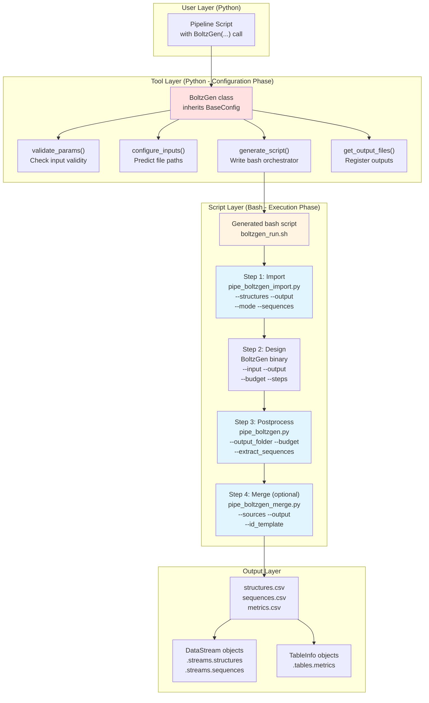
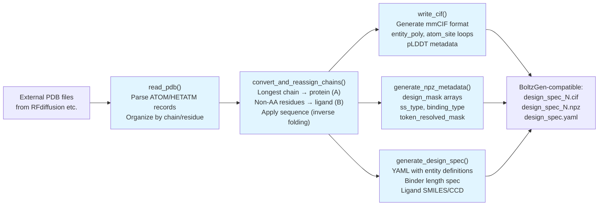
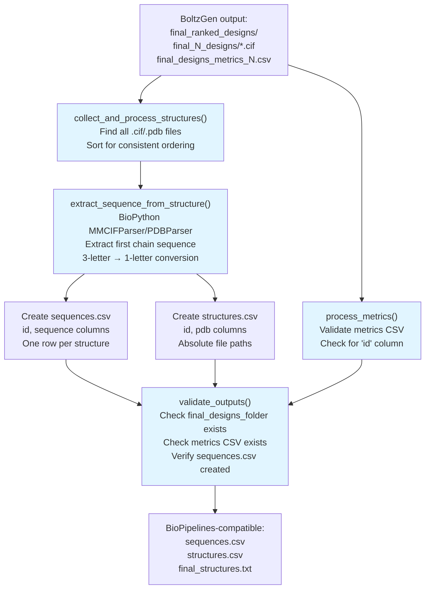
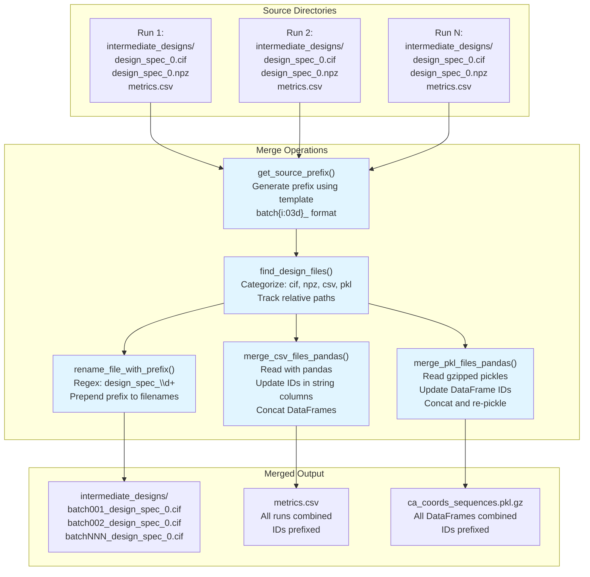
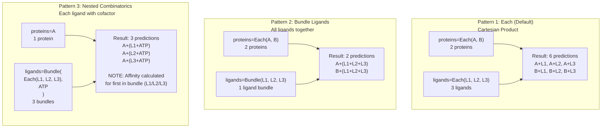

# Major Workflows

<details>
<summary>Relevant source files</summary>

The following files were used as context for generating this wiki page:

- [ExamplePipelines/boltz2.py](ExamplePipelines/boltz2.py)
- [HelpScripts/pipe_boltzgen.py](HelpScripts/pipe_boltzgen.py)
- [HelpScripts/pipe_boltzgen_import.py](HelpScripts/pipe_boltzgen_import.py)
- [HelpScripts/pipe_boltzgen_merge.py](HelpScripts/pipe_boltzgen_merge.py)

</details>


This page provides an overview of complex multi-tool workflows in BioPipelines that require orchestrated pre-processing, execution, and post-processing steps. These workflows involve multiple helper scripts, specialized file formats, and coordination between tools.

**Scope**: This page covers the general architecture and patterns of major workflows. For detailed implementation guides, see the child pages: [Boltz2 Workflow](#6.1), [BoltzGen Workflow](#6.2), [RFdiffusion3 Workflow](#6.3), and [MMseqs2 Distributed MSA Generation](#6.4).

For simple single-tool usage patterns, see [Tool Categories](#5). For the helper script architecture that enables these workflows, see [Helper Script Architecture](#7.1).

---

## What Are Major Workflows?

Major workflows are multi-step processes that combine BioPipelines tools with specialized helper scripts to accomplish complex bioinformatics tasks. Unlike simple tools like `PDB()` or `Sequence()` that operate independently, major workflows require:

1. **Pre-processing**: Format conversion, structure preparation, configuration generation
2. **Main execution**: Running the core tool (often an external software package)
3. **Post-processing**: Extracting results, renaming IDs, merging outputs, validation

These workflows are necessary when integrating external tools that have specific filesystem requirements, custom output formats, or need multiple execution stages.

**Key Characteristics**:
- Multiple helper scripts coordinated by a single tool class
- Specialized file format requirements (CIF, NPZ, YAML configs)
- Multi-stage execution (import → design → analysis → merge)
- ID mapping and provenance tracking across stages
- Complex combinatorics with Bundle/Each operators

Sources: [HelpScripts/pipe_boltzgen_import.py:1-22](), [HelpScripts/pipe_boltzgen_merge.py:1-24](), [ExamplePipelines/boltz2.py:1-251]()

---

## Simple vs. Complex Workflows

The following diagram illustrates the difference between simple single-tool operations and complex multi-step workflows:

**Diagram: Workflow Complexity Spectrum**

```mermaid
graph TB
    subgraph Simple["Simple Single-Tool Workflow"]
        S_User["User Code:<br/>pdb = PDB('1AKI')"]
        S_Tool["Tool Class:<br/>PDB"]
        S_Script["Helper Script:<br/>pipe_pdb.py"]
        S_Output["StandardizedOutput:<br/>.streams.structures"]
        
        S_User --> S_Tool
        S_Tool --> S_Script
        S_Script --> S_Output
    end
    
    subgraph Complex["Complex Multi-Stage Workflow"]
        C_User["User Code:<br/>boltzgen = BoltzGen(...)"]
        C_Tool["Tool Class:<br/>BoltzGen"]
        
        subgraph Stage1["Pre-processing Stage"]
            C_Import["pipe_boltzgen_import.py<br/>Format conversion<br/>Chain reassignment<br/>NPZ generation"]
        end
        
        subgraph Stage2["Main Execution Stage"]
            C_Design["BoltzGen binary<br/>Design generation<br/>Inverse folding"]
        end
        
        subgraph Stage3["Post-processing Stage"]
            C_Post["pipe_boltzgen.py<br/>Sequence extraction<br/>Metrics processing"]
            C_Merge["pipe_boltzgen_merge.py<br/>Multi-run merging<br/>ID renaming"]
        end
        
        C_Output["StandardizedOutput:<br/>.streams.structures<br/>.streams.sequences<br/>.tables.metrics"]
        
        C_User --> C_Tool
        C_Tool --> C_Import
        C_Import --> C_Design
        C_Design --> C_Post
        C_Post --> C_Merge
        C_Merge --> C_Output
    end
    
    style S_Tool fill:#ffe1e1
    style C_Tool fill:#ffe1e1
    style C_Import fill:#e1f5ff
    style C_Post fill:#e1f5ff
    style C_Merge fill:#e1f5ff
```



Sources: [HelpScripts/pipe_boltzgen_import.py:6-22](), [HelpScripts/pipe_boltzgen.py:6-14](), [HelpScripts/pipe_boltzgen_merge.py:6-24]()

---

## Helper Script Orchestration Pattern

Major workflows follow a consistent pattern where a single tool class (inheriting from `BaseConfig`) orchestrates multiple helper scripts. The tool class is responsible for generating bash scripts that call helper scripts in the correct order with appropriate arguments.

**Diagram: Helper Script Orchestration Architecture**



Sources: [HelpScripts/pipe_boltzgen_import.py:942-1060](), [HelpScripts/pipe_boltzgen.py:231-325](), [HelpScripts/pipe_boltzgen_merge.py:415-495]()

---

## Pre-Processing: Format Conversion and Preparation

Pre-processing helper scripts convert external data into the format required by downstream tools. This often involves:

- **Structure format conversion**: PDB → CIF with specific mmCIF fields
- **Chain reassignment**: Standardizing chain IDs (protein=A, ligand=B)
- **Metadata generation**: Creating NPZ files with per-token annotations
- **Configuration files**: Generating YAML files with design specifications

**Example: BoltzGen Import Process**

The `pipe_boltzgen_import.py` script demonstrates a comprehensive pre-processing workflow:



**Key Implementation Details**:

| Function | Purpose | Key Operations |
|----------|---------|----------------|
| `read_pdb()` | Parse PDB manually | Extract ATOM/HETATM records into chain/residue structure |
| `convert_and_reassign_chains()` | Standardize structure | Identify protein (longest chain), separate ligand, apply sequence mutations |
| `write_cif()` | Generate mmCIF | Create entity loops, atom_site records, pLDDT metadata |
| `generate_npz_metadata()` | Create NPZ arrays | design_mask (1.0=protein, 0.0=ligand), ss_type, binding_type |
| `generate_design_spec()` | Create YAML config | Entity definitions with binder length and ligand info |

The CIF format is used instead of PDB because:
1. CIF allows longer residue names (e.g., `LIG1`) vs. PDB's 3-character limit
2. BoltzGen's `parse_mmcif` accepts the `mols` dictionary for ligand resolution, while `parse_pdb` does not

Sources: [HelpScripts/pipe_boltzgen_import.py:130-146](), [HelpScripts/pipe_boltzgen_import.py:355-522](), [HelpScripts/pipe_boltzgen_import.py:148-353](), [HelpScripts/pipe_boltzgen_import.py:717-784](), [HelpScripts/pipe_boltzgen_import.py:663-714]()

---

## Post-Processing: Extraction and Validation

Post-processing scripts extract useful data from tool outputs and convert them to BioPipelines' standardized formats. This includes:

- **Sequence extraction**: Reading protein sequences from structure files
- **Metrics processing**: Converting tool-specific CSV formats to standard tables
- **Validation**: Checking that expected outputs were generated
- **ID mapping**: Creating correspondence between structure IDs and sequences

**Example: BoltzGen Postprocessing**



Sources: [HelpScripts/pipe_boltzgen.py:72-149](), [HelpScripts/pipe_boltzgen.py:23-70](), [HelpScripts/pipe_boltzgen.py:151-188](), [HelpScripts/pipe_boltzgen.py:190-228]()

---

## Multi-Run Merging and ID Management

When running tools in batches or iterations, outputs from multiple runs must be merged while avoiding ID collisions. The merging process handles:

- **ID renaming**: Prepending prefixes to design IDs (e.g., `batch001_design_spec_0`)
- **File merging**: Concatenating CSV files with proper type handling
- **Structure file copying**: Renaming and organizing CIF/NPZ files
- **Pickle merging**: Combining pandas DataFrames from multiple runs

**Diagram: Multi-Run Merge Architecture**



**ID Renaming Pattern**:

The regex pattern `(design_spec_\d+(?:_model_\d+)?)` matches:
- `design_spec_0` → `batch001_design_spec_0`
- `design_spec_5_model_2` → `batch001_design_spec_5_model_2`

This pattern is applied to:
1. Filenames during copy operations
2. CSV column values (string columns only)
3. Pickle DataFrame indices and columns

Sources: [HelpScripts/pipe_boltzgen_merge.py:36-51](), [HelpScripts/pipe_boltzgen_merge.py:53-111](), [HelpScripts/pipe_boltzgen_merge.py:226-246](), [HelpScripts/pipe_boltzgen_merge.py:132-167](), [HelpScripts/pipe_boltzgen_merge.py:169-224]()

---

## Combinatorics in Complex Workflows

Major workflows often involve complex combinatorics using `Each()` and `Bundle()` operators. These control how multiple inputs are combined during execution.

**Example: Boltz2 Combinatorics Patterns**



**Critical Note on Affinity Calculation**:

When using `Bundle()` with multiple ligands in Boltz2, affinity is only calculated for the **first ligand** in the bundle. The order of ligands in the bundle determines which one gets affinity scoring.

Example from code:
```python
# Affinity for library ligands (in presence of ATP)
Boltz2(
    proteins=protein_a,
    ligands=Bundle(Each(ligand_library), atp)  # L1/L2/L3 first
)

# Affinity for ATP (in presence of library ligands)
Boltz2(
    proteins=protein_a,
    ligands=Bundle(atp, Each(ligand_library))  # ATP first
)
```

Sources: [ExamplePipelines/boltz2.py:74-148]()

---

## The Four Major Workflows

BioPipelines includes four major workflows, each with specialized helper scripts and multi-stage processing:

| Workflow | Purpose | Stages | Key Helper Scripts |
|----------|---------|--------|-------------------|
| **Boltz2** | Biomolecular structure prediction with constraints | Config generation → Prediction → Postprocessing | `pipe_boltz_config_unified.py`, `pipe_boltz_postprocessing.py` |
| **BoltzGen** | End-to-end binder design from scratch | Import → Design → Inverse Folding → Merge | `pipe_boltzgen_import.py`, `pipe_boltzgen.py`, `pipe_boltzgen_merge.py` |
| **RFdiffusion3** | Third-generation protein backbone generation | Ligand prep → Generation → Decompression → Parsing | `pipe_rfdaa_prepare_ligand.py`, `pipe_rfdiffusion3_postprocess.py`, `pipe_rfdiffusion3_table.py` |
| **MMseqs2** | Distributed MSA generation with client-server architecture | Job submission → Polling → Server processing → Retrieval | `mmseqs2_client.sh`, `mmseqs2_server_gpu.sh`, `pipe_mmseqs2_sequences.py` |

Each workflow is documented in detail in its respective child page:

- [Boltz2 Workflow](#6.1) - Complete guide to structure prediction with constraints, affinity calculation, and MSA recycling
- [BoltzGen Workflow](#6.2) - Importing external structures, design/inverse folding modes, and multi-run merging
- [RFdiffusion3 Workflow](#6.3) - Ligand preparation, CIF processing, and contig parsing
- [MMseqs2 Distributed MSA Generation](#6.4) - Client-server setup, job queue management, and error recovery

---

## Common Workflow Patterns

All major workflows share common implementation patterns:

**1. Configuration-Driven Execution**

Helper scripts read JSON configuration files generated by the tool class during the configuration phase. This separates parameter validation (Python) from execution (Bash).

**2. Completion Markers**

Scripts create `.complete` marker files to signal successful execution. The tool class checks for these markers to determine if a step needs re-running.

**3. ID Mapping Files**

CSV files with `id` columns serve as the canonical mapping between input IDs and output IDs. These are used for:
- Provenance tracking
- Filtering and selection
- Metadata propagation

**4. Staged Directory Structure**

Workflows create nested directory structures:
```
ToolOutputs/
├── config/                    # JSON configs for helper scripts
├── intermediate_designs/      # Raw outputs from external tool
├── refold_cif/               # Post-processed structures
└── final_ranked_designs/     # Filtered and ranked results
    └── final_N_designs/      # Top N designs
```

**5. External Tool Integration**

Major workflows wrap external tools (BoltzGen binary, MMseqs2, etc.) with BioPipelines' standardized I/O:
- Input: DataStream objects (structures, sequences, compounds, MSAs)
- Output: StandardizedOutput with StreamContainer and TableContainer
- Metadata: Automatic tracking of provenance through ID mapping

Sources: [HelpScripts/pipe_boltzgen_import.py:787-910](), [HelpScripts/pipe_boltzgen.py:72-149](), [HelpScripts/pipe_boltzgen_merge.py:249-412]()

---

## Next Steps

For detailed implementation guides and usage examples:

1. **[Boltz2 Workflow](#6.1)** - Learn about constraints (template, pocket, glycosylation, covalent linkage, contacts), affinity calculation, and MSA recycling
2. **[BoltzGen Workflow](#6.2)** - Understand external structure import, design vs. inverse folding modes, and multi-run merging with ID renaming
3. **[RFdiffusion3 Workflow](#6.3)** - Explore ligand preparation, CIF format handling, and sampled_contig parsing
4. **[MMseqs2 Distributed MSA Generation](#6.4)** - Set up the client-server architecture, manage job queues, and handle error recovery

For information about the underlying helper script architecture, see [Helper Script Architecture](#7.1).

For simple tool usage without workflows, see [Tool Categories](#5).

---