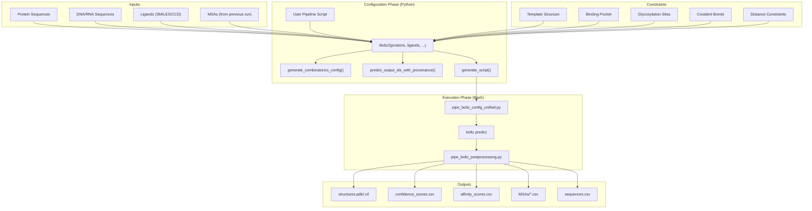
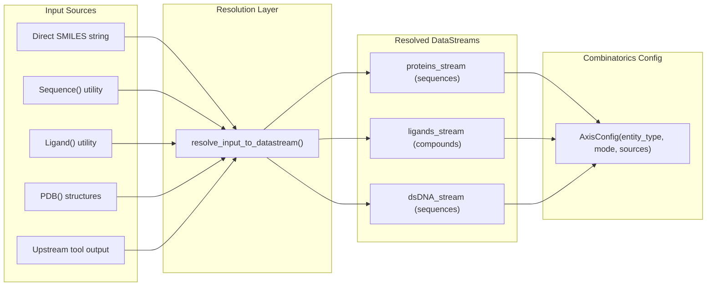
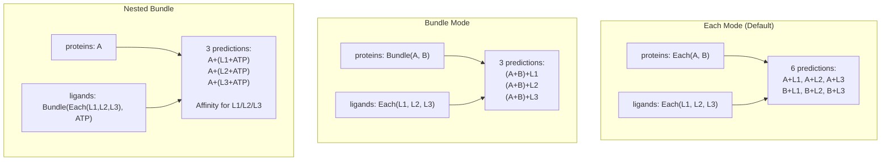
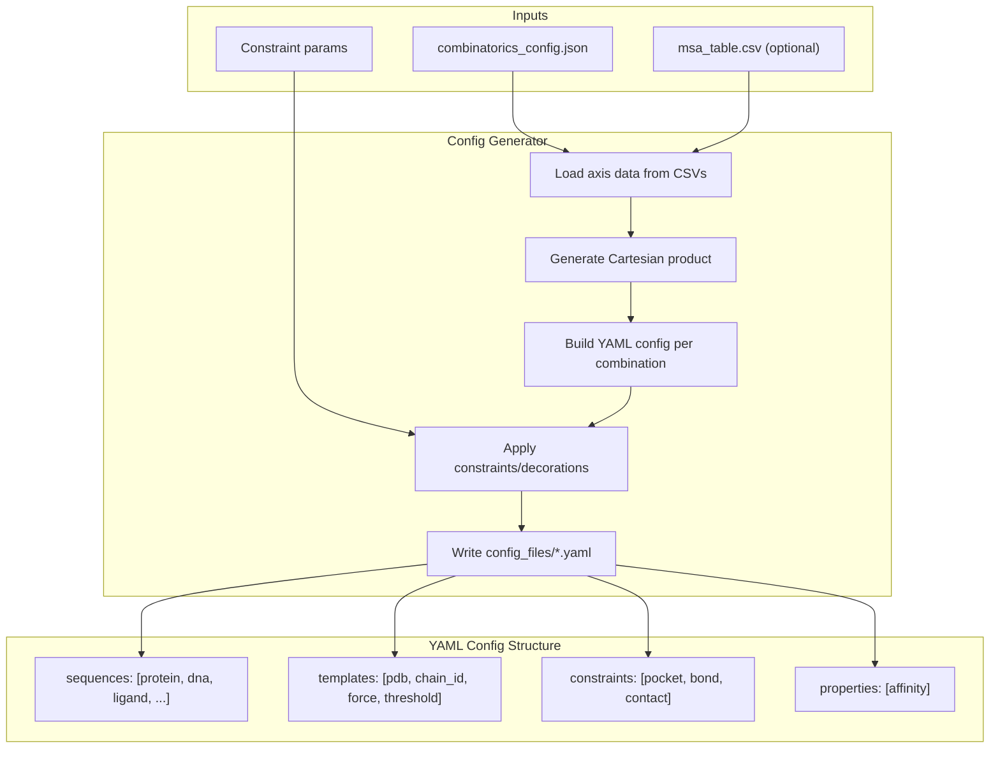
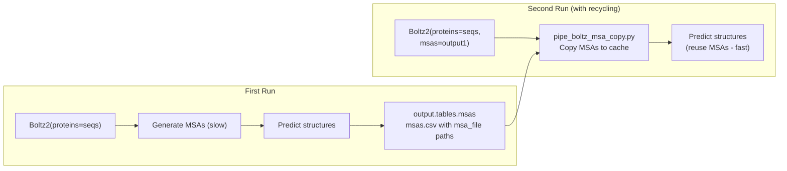
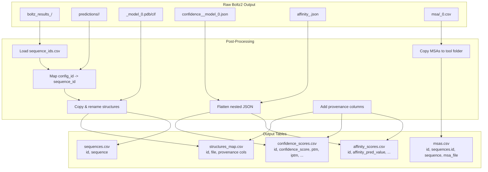

# Boltz2 Workflow

<details>
<summary>Relevant source files</summary>

The following files were used as context for generating this wiki page:

- [ExamplePipelines/boltz2.py](ExamplePipelines/boltz2.py)
- [HelpScripts/pipe_boltz_config_unified.py](HelpScripts/pipe_boltz_config_unified.py)
- [HelpScripts/pipe_boltz_postprocessing.py](HelpScripts/pipe_boltz_postprocessing.py)
- [biopipelines/boltz2.py](biopipelines/boltz2.py)
- [biopipelines/combinatorics.py](biopipelines/combinatorics.py)
- [biopipelines/id_map_utils.py](biopipelines/id_map_utils.py)

</details>


This page provides a complete guide to the Boltz2 workflow in BioPipelines, covering input preparation, combinatorics configuration, constraint specification, affinity calculation, MSA recycling, and post-processing. Boltz2 is a biomolecular structure prediction tool that handles proteins, DNA, RNA, and small molecule ligands with advanced constraint support.

For general information about structure prediction tools, see [Structure Prediction Tools](#5.4). For basic Boltz2 usage without advanced constraints, see the tool reference in [Complete Tool Reference](#8.2).

---

## Workflow Overview

The Boltz2 workflow follows BioPipelines' two-phase execution model, with configuration-time combinatorics expansion and execution-time prediction.



**Sources:** [biopipelines/boltz2.py:1-799](), [HelpScripts/pipe_boltz_config_unified.py:1-773](), [HelpScripts/pipe_boltz_postprocessing.py:1-401]()

---

## Input Types and Resolution

Boltz2 accepts multiple input types through dedicated parameters. Each input type is resolved to a `DataStream` at configuration time.

| Parameter | Entity Type | Chains Emitted | Description |
|-----------|-------------|----------------|-------------|
| `proteins` | `protein` | 1 per sequence | Protein sequences |
| `ssDNA` | `ssdna` | 1 per sequence | Single-stranded DNA |
| `dsDNA` | `dsdna` | 2 per sequence | Double-stranded DNA (auto reverse-complement) |
| `ssRNA` | `ssrna` | 1 per sequence | Single-stranded RNA |
| `dsRNA` | `dsrna` | 2 per sequence | Double-stranded RNA (auto reverse-complement) |
| `ligands` | `ligand` | 1 per compound | Small molecules (SMILES/CCD/PubChem) |
| `msas` | - | - | MSAs from previous Boltz2 run (for recycling) |

### Input Resolution



**Sources:** [biopipelines/boltz2.py:204-218](), [biopipelines/datastream_resolver.py]()

---

## Combinatorics with Bundle and Each

Boltz2 uses the combinatorics system to control how multiple inputs combine. The default mode is `Each` (Cartesian product), but `Bundle` groups entities together.

### Combinatorics Modes



### Affinity Calculation and Bundle Order

**Critical**: Boltz2 calculates affinity **only for the FIRST ligand** in a bundle. Bundle order determines which ligand is analyzed:

```python
# Affinity calculated for aspirin/caffeine/ibuprofen (in presence of ATP)
Boltz2(
    proteins=protein_a,
    ligands=Bundle(Each(ligand_library), atp)
)

# Affinity calculated for ATP (in presence of aspirin/caffeine/ibuprofen)
Boltz2(
    proteins=protein_a,
    ligands=Bundle(atp, Each(ligand_library))
)
```

### ID Generation Rules

Output IDs follow a strict hierarchical pattern:

| Pattern | Example Input | Output IDs | Description |
|---------|---------------|------------|-------------|
| Single axis | `proteins=Each(A, B)` | `A`, `B` | Direct IDs from iterated axis |
| Two axes (Each) | `proteins=Each(A,B)`<br/>`ligands=Each(L1,L2)` | `A+L1`, `A+L2`, `B+L1`, `B+L2` | Cartesian product with `+` separator |
| Bundle all | `proteins=Bundle(A,B)`<br/>`ligands=Bundle(L1,L2)` | `A+B+L1+L2` | Single prediction with all entities |
| Nested Bundle | `proteins=A`<br/>`ligands=Bundle(Each(L1,L2), ATP)` | `A+L1+ATP`, `A+L2+ATP` | Static entities appear in all IDs |

**Important**: The `+` separator distinguishes multi-axis combinatorics from parent-child relationships (which use `_`). This enables automatic ID matching in downstream tools without requiring explicit provenance columns.

**Sources:** [ExamplePipelines/boltz2.py:62-148](), [biopipelines/combinatorics.py:517-661](), [biopipelines/boltz2.py:302-323]()

---

## Configuration Generation

At execution time, `pipe_boltz_config_unified.py` generates individual YAML configuration files for each predicted combination.



### Chain ID Assignment

Boltz2 assigns chain IDs sequentially (A, B, C, ...) to each entity in the order they appear in the config:

1. Iterated items (from `Each` or `Bundle(Each(...))`)
2. Static items (from `Bundle(...)` without `Each`)
3. Glycosylation NAG ligands (auto-added)

**Sources:** [HelpScripts/pipe_boltz_config_unified.py:478-658](), [HelpScripts/pipe_boltz_config_unified.py:541-558]()

---

## Constraint Types

Boltz2 supports five types of structural constraints. All constraints are applied during YAML config generation.

### Template Constraint

Forces predicted structure to match a template PDB file.

```python
Boltz2(
    proteins=my_protein,
    template="/path/to/template.pdb",
    template_chain_ids=["A", "B"],  # Optional: apply to specific chains
    template_force=True,            # Force constraint (vs. soft guidance)
    template_threshold=5.0          # RMSD threshold in Angstroms
)
```

**YAML Output:**
```yaml
templates:
  - pdb: /path/to/template.pdb
    chain_id: [A, B]
    force: true
    threshold: 5.0
```

**Sources:** [biopipelines/boltz2.py:125-128](), [HelpScripts/pipe_boltz_config_unified.py:197-211]()

### Pocket Constraint

Constrains ligand to binding pocket defined by residue positions.

```python
Boltz2(
    proteins=protein,
    ligands=ligand,
    pocket_residues=[45, 67, 89, 112],  # Residue indices
    pocket_max_distance=7.0,            # Max distance in Angstroms
    pocket_force=True
)
```

**YAML Output:**
```yaml
constraints:
  - pocket:
      binder: B  # Auto-assigned ligand chain ID
      contacts: [45, 67, 89, 112]
      max_distance: 7.0
      force: true
```

**Sources:** [biopipelines/boltz2.py:129-132](), [HelpScripts/pipe_boltz_config_unified.py:214-235]()

### Glycosylation Constraint

Adds N-acetylglucosamine (NAG) ligands at specified Asn positions with automatic bond constraints.

```python
# N-glycosylation on IgG1 Fc at Asn-297 (internal numbering: position 73)
Boltz2(
    proteins=fc_fragment,
    glycosylation={"A": [73]}  # Chain ID: [Asn positions]
)
```

**YAML Output:**
```yaml
sequences:
  - protein: {id: A, sequence: ...}
  - ligand: {id: B, ccd: NAG}  # Auto-added
constraints:
  - bond:
      atom1: [A, 73, ND2]  # Asn side chain nitrogen
      atom2: [B, 1, C1]     # NAG anomeric carbon
```

**Workflow:**
1. For each glycosylation site, adds a NAG ligand with auto-assigned chain ID
2. Creates bond constraint linking Asn ND2 to NAG C1
3. Chain IDs increment sequentially after all input entities

**Sources:** [ExamplePipelines/boltz2.py:153-162](), [HelpScripts/pipe_boltz_config_unified.py:237-268]()

### Covalent Linkage Constraint

Creates bond constraint between protein atom and ligand atom.

```python
# Benzylated SNAP-Tag: Cys-145 SG bonded to ligand C15
Boltz2(
    proteins=SnapTag,
    ligands=benzyl,
    covalent_linkage={
        "chain": "A",
        "position": 145,
        "protein_atom": "SG",      # Cysteine sulfur
        "ligand_atom": "C15",      # Ligand atom name
        "ligand_residue": 1        # Optional (default: 1)
    }
)
```

**YAML Output:**
```yaml
constraints:
  - bond:
      atom1: [A, 145, SG]
      atom2: [B, 1, C15]
```

**Important**: Run prediction **without** covalent linkage first to inspect atom names in the output structure. Ligand atom names depend on the source (SMILES, CCD, PubChem) and may differ from expectations.

**Sources:** [ExamplePipelines/boltz2.py:164-185](), [HelpScripts/pipe_boltz_config_unified.py:271-296]()

### Contact Constraints

Specifies distance constraints between tokens (residues or atoms).

```python
# Force residue 145 to be within 8Å of ligand atom C15
Boltz2(
    proteins=protein,
    ligands=ligand,
    contacts=[
        {
            "token1": ["A", 145],      # Protein: [chain, residue_index]
            "token2": ["B", "C15"],    # Ligand: [chain, atom_name]
            "max_distance": 8.0,       # 4-20 Angstroms (default: 6.0)
            "force": False             # Soft constraint
        }
    ]
)
```

**Token Format Rules:**
- **Proteins/DNA/RNA**: `[chain_id, residue_index]` (integer index)
- **Ligands**: `[chain_id, atom_name]` (string atom name)
- Mixing integer and string in the same token causes a validation error

**YAML Output:**
```yaml
constraints:
  - contact:
      token1: [A, 145]
      token2: [B, C15]
      max_distance: 8.0
      force: false
```

**Sources:** [ExamplePipelines/boltz2.py:202-212](), [HelpScripts/pipe_boltz_config_unified.py:299-340](), [biopipelines/boltz2.py:281-296]()

---

## MSA Recycling

MSA generation is the slowest step in structure prediction. Boltz2 supports MSA recycling to reuse MSAs from previous runs.

### MSA Recycling Workflow



### Implementation

```python
# First prediction - generates MSAs
first_run = Boltz2(proteins=my_proteins)

# Second prediction - reuses MSAs (5-10x faster)
second_run = Boltz2(
    proteins=my_proteins,
    msas=first_run  # Pass previous Boltz2 output
)
```

MSA recycling uses the `msas` table from the previous run:

| Column | Description |
|--------|-------------|
| `id` | Prediction ID |
| `sequences.id` | Protein sequence ID |
| `sequence` | Actual protein sequence |
| `msa_file` | Path to MSA file (.csv or .a3m) |

The helper script `pipe_boltz_msa_copy.py` copies MSA files to the new prediction's cache folder, and `pipe_boltz_config_unified.py` adds MSA paths to the generated YAML configs.

**Sources:** [ExamplePipelines/boltz2.py:36-41](), [biopipelines/boltz2.py:500-523](), [HelpScripts/pipe_boltz_config_unified.py:151-194]()

---

## Affinity Calculation

Affinity calculation predicts ligand binding affinity. It is enabled by default when ligands are present.

### Affinity Behavior

```python
# Affinity enabled by default
Boltz2(proteins=protein, ligands=ligand, affinity=True)

# Explicitly disable
Boltz2(proteins=protein, ligands=ligand, affinity=False)

# Auto-disabled if no ligands
Boltz2(proteins=protein)  # affinity=False automatically
```

### Duplicate Ligand Detection

Boltz2 **cannot** calculate affinity when the same ligand appears multiple times in a configuration. The config generator detects duplicates and skips affinity:

```python
# Duplicate ligand - affinity skipped automatically
Boltz2(
    proteins=protein,
    ligands=Bundle(Ligand("ATP"), Ligand("ATP")),  # Same ligand twice
    affinity=True  # Will be skipped with warning
)
```

Duplicate detection compares ligand identity (SMILES or CCD code):

**Sources:** [HelpScripts/pipe_boltz_config_unified.py:343-377](), [HelpScripts/pipe_boltz_config_unified.py:564-570]()

---

## Post-Processing

The helper script `pipe_boltz_postprocessing.py` organizes Boltz2 outputs into BioPipelines-compatible CSV tables.

### Post-Processing Workflow



### ID Mapping Strategy

Boltz2 generates folders with config IDs (which may contain special characters), but BioPipelines expects sequence IDs. The post-processor maps between them:

1. **Single prediction**: Use the expected sequence ID regardless of config ID
2. **Exact match**: config_id == sequence_id
3. **Pattern match**: config_id contains sequence_id as component (handles `+` separators)
4. **Error**: If no mapping found, crash instead of guessing (ensures output validation)

### Provenance Propagation

Post-processing adds provenance columns from `combinatorics_config.json` to all output tables:

```csv
id,input_file,confidence_score,ptm,proteins.id,ligands.id
prot1+lig1,prot1+lig1,0.85,0.82,prot1,lig1
prot1+lig2,prot1+lig2,0.91,0.88,prot1,lig2
```

This enables downstream tools to filter/join on any input axis without needing ID parsing.

**Sources:** [HelpScripts/pipe_boltz_postprocessing.py:54-254](), [HelpScripts/pipe_boltz_postprocessing.py:260-320]()

---

## Output Files and Tables

Boltz2 produces multiple output streams and tables.

### Output Structure

```
ToolOutputs/05_Boltz2/
├── combinatorics_config.json       # Configuration-time combinatorics
├── sequence_ids.csv                # Expected output IDs
├── sequences.csv                   # Input protein sequences
├── config_files/                   # Generated YAML configs
│   ├── prot1+lig1.yaml
│   └── prot1+lig2.yaml
├── predictions/                    # Boltz2 raw output
│   └── boltz_results_*/
├── MSAs/                          # Copied MSA files
│   ├── prot1+lig1.csv
│   └── prot1+lig2.csv
├── prot1+lig1.pdb                 # Renamed structures
├── prot1+lig2.pdb
├── structures_map.csv             # Structure file mapping
├── confidence_scores.csv          # Confidence metrics
├── affinity_scores.csv            # Affinity predictions
└── msas.csv                       # MSA file mapping
```

### Output Tables

| Table | Columns | Description |
|-------|---------|-------------|
| `structures` | `id`, `file`, provenance | Predicted structure files |
| `confidence` | `id`, `input_file`, `confidence_score`, `ptm`, `iptm`, `complex_plddt`, `complex_iplddt`, ... | Confidence metrics (flattened JSON) |
| `affinity` | `id`, `input_file`, `affinity_pred_value`, `affinity_probability_binary` | Binding affinity predictions |
| `sequences` | `id`, `sequence` | Input protein sequences |
| `msas` | `id`, `sequences.id`, `sequence`, `msa_file` | MSA files for recycling |
| `missing` | `id`, `removed_by`, `cause` | Propagated from upstream (if any) |

### Confidence Score Interpretation

The `confidence_score` is a weighted combination: `0.8 * complex_plddt + 0.2 * iptm` (or `ptm` for single chains).

Key metrics:
- **confidence_score**: Overall ranking metric (higher is better)
- **ptm**: Predicted TM-score for the complex
- **iptm**: Predicted TM-score at interfaces
- **complex_plddt**: Average pLDDT across all residues
- **complex_iplddt**: Average pLDDT upweighting interface residues
- **ligand_iptm**: Interface TM-score for protein-ligand interfaces only
- **chains_ptm**: Per-chain TM-scores (flattened as `chains_ptm:0`, `chains_ptm:1`, ...)
- **pair_chains_iptm**: Pairwise interface TM-scores (flattened as `pair_chains_iptm:0-1`, ...)

**Sources:** [HelpScripts/pipe_boltz_postprocessing.py:384-400](), [biopipelines/boltz2.py:641-689]()

---

## Complete Examples

### Example 1: Simple Protein Prediction

```python
from biopipelines.pipeline import *
from biopipelines.boltz2 import Boltz2

with Pipeline(project="Examples", job="SimpleBoltz2"):
    Resources(gpu="A100", time="4:00:00", memory="16GB")
    
    # Fetch structure from RCSB and predict
    lysozyme = PDB("1AKI", ids="LYZ")
    prediction = Boltz2(proteins=lysozyme)
    
    # Access outputs
    # prediction.streams.structures  -> PDB files
    # prediction.tables.confidence   -> Confidence scores
```

### Example 2: Protein-Ligand with Affinity

```python
# Screen multiple ligands against a protein
protein = Sequence("MVLSPADKTNVKAAWGKVGAHAGEYGAEALERMFLSFPTTKTYFPHFDLSH")
ligands = Ligand(['aspirin', 'caffeine', 'ibuprofen'])

screening = Boltz2(
    proteins=protein,
    ligands=ligands,     # Each mode (default): 3 predictions
    affinity=True        # Calculate binding affinity
)

# Output IDs: protein+aspirin, protein+caffeine, protein+ibuprofen
# screening.tables.affinity -> affinity_pred_value for each ligand
```

### Example 3: Combinatorial with Cofactor

```python
# Test library ligands in presence of ATP cofactor
library = Ligand(['aspirin', 'caffeine', 'ibuprofen'])
atp = Ligand("ATP")

# Bundle(Each(library), atp): ATP bundled with each library ligand
screening = Boltz2(
    proteins=protein,
    ligands=Bundle(Each(library), atp),
    affinity=True  # Affinity calculated for library ligands (first in bundle)
)

# Output IDs: protein+aspirin+ATP, protein+caffeine+ATP, protein+ibuprofen+ATP
# Affinity calculated for aspirin/caffeine/ibuprofen (in presence of ATP)
```

### Example 4: Multi-Constraint Glycosylated Protein

```python
# IgG1 Fc with N-glycosylation and ligand
fc = Sequence("TCPPCPAPELLGGPSVFLFPPKPKDTLMISRTPEVTCVVVDVSHEDPEV...", ids="IgG1_Fc")
ligand = Ligand("rituximab_epitope")

prediction = Boltz2(
    proteins=fc,
    ligands=ligand,
    glycosylation={"A": [73]},  # Asn-297 glycosylation (internal position 73)
    pocket_residues=[70, 71, 72, 74, 75],  # Binding pocket near glycosylation
    pocket_max_distance=7.0,
    affinity=True
)

# Output includes:
# - NAG ligand auto-added and bonded at position 73
# - Ligand constrained to pocket
# - Affinity calculated for ligand
```

### Example 5: Covalent Ligand with Inspection

```python
# Benzylated SNAP-Tag (two-step workflow)
snap = Sequence("MDKDCEMKRTTLDSPLGKLELSGCEQGLHRIIFLGKGTSAADAVEV...")
benzyl = Ligand(smiles="CC1=CC=CC=C1")

# Step 1: Predict without covalent bond to inspect atom names
inspection = Boltz2(proteins=snap, ligands=benzyl)

# Step 2: Add covalent bond and recycle MSAs
covalent = Boltz2(
    proteins=snap,
    ligands=benzyl,
    msas=inspection,  # Recycle MSAs from step 1
    covalent_linkage={
        "chain": "A",
        "position": 145,      # Cys-145
        "protein_atom": "SG", # Cysteine sulfur
        "ligand_atom": "C15"  # Verified from inspection output
    }
)
```

**Sources:** [ExamplePipelines/boltz2.py:11-251]()

---

## Advanced Patterns

### Multiple Constraints in Single Prediction

Constraints can be combined freely:

```python
Boltz2(
    proteins=protein,
    ligands=ligand,
    template="/path/to/template.pdb",
    glycosylation={"A": [67]},
    covalent_linkage={"chain": "A", "position": 145, "protein_atom": "SG", "ligand_atom": "C15"},
    contacts=[
        {"token1": ["A", 100], "token2": ["B", "C1"], "max_distance": 6.0},
        {"token1": ["A", 120], "token2": ["B", "C10"], "max_distance": 8.0}
    ],
    affinity=True
)
```

### DNA-Protein-Ligand Three-Axis Combinatorics

```python
proteins = Each(protein_a, protein_b)     # 2 proteins
dna = Sequence("AATTAATTAATTAATT", type="dna")  # 1 dsDNA (2 chains)
ligands = Each(Ligand("aspirin"), Ligand("caffeine"))  # 2 ligands

prediction = Boltz2(
    proteins=proteins,
    dsDNA=dna,        # Emits 2 chains (auto reverse-complement)
    ligands=ligands
)

# 4 predictions (2 proteins × 1 DNA × 2 ligands):
# protein_a+DNA_target+aspirin
# protein_a+DNA_target+caffeine
# protein_b+DNA_target+aspirin
# protein_b+DNA_target+caffeine
```

**Sources:** [ExamplePipelines/boltz2.py:240-250]()

---

## Performance Considerations

1. **MSA Recycling**: Reusing MSAs can reduce runtime by 5-10x. Always recycle MSAs when testing constraint variations on the same sequences.

2. **Bundle vs Each**: `Bundle` reduces the number of predictions but increases model complexity. Use `Bundle` when entities must be modeled together (e.g., multi-protein complexes).

3. **Affinity Overhead**: Affinity calculation adds minimal overhead (~5% runtime increase).

4. **GPU Requirements**: Boltz2 requires GPU acceleration. Larger complexes (>500 residues) may require A100 GPUs.

5. **MSA Server**: Using `msa_server="local"` requires a local MMseqs2 server but is faster and more reliable than the public server for batch jobs.

**Sources:** [biopipelines/boltz2.py:373-455]()

---

## Troubleshooting

### Common Issues

| Issue | Cause | Solution |
|-------|-------|----------|
| "Cannot map config_id to expected sequence ID" | Post-processor can't match Boltz2 folder names to sequence IDs | Check `sequence_ids.csv` for expected IDs; ensure combinatorics config matches inputs |
| "Affinity binder ligand has duplicates" | Same ligand appears multiple times in Bundle | Review Bundle composition; Boltz2 limitation |
| Contact constraint validation error | Using integer for ligand token or string for protein token | Proteins use `[chain, residue_index]` (int); ligands use `[chain, atom_name]` (string) |
| "MSA file not found" | MSA recycling path broken | Check `msas.csv` from previous run; ensure MSA files exist at specified paths |
| Out of memory during prediction | Complex too large for GPU | Reduce complex size, use A100 GPU, or split into separate predictions |

### Debugging Workflow

1. **Check combinatorics config**: Inspect `combinatorics_config.json` to verify predicted IDs match expectations
2. **Inspect YAML configs**: Review `config_files/*.yaml` to verify entity order and chain assignments
3. **Run without constraints first**: Test basic prediction before adding complex constraints
4. **Verify atom names**: For covalent/contact constraints, run without constraints and inspect output structure for correct atom names
5. **Check provenance columns**: In output CSVs, verify provenance columns correctly map to input IDs

**Sources:** [biopipelines/boltz2.py:250-296](), [HelpScripts/pipe_boltz_postprocessing.py:115-145]()

---