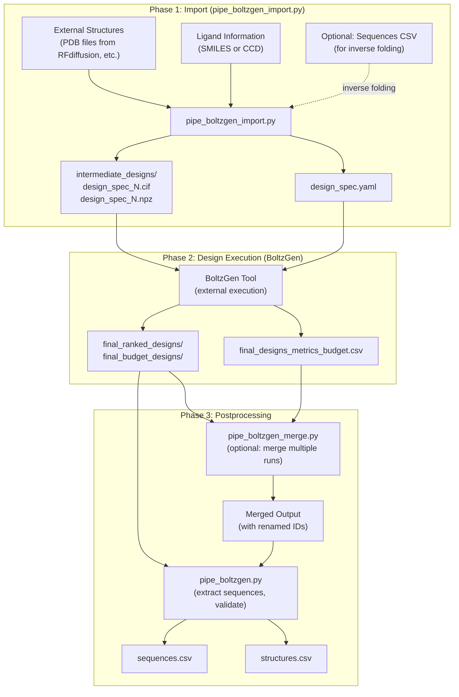
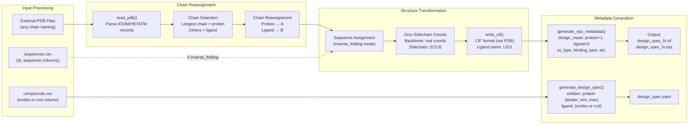
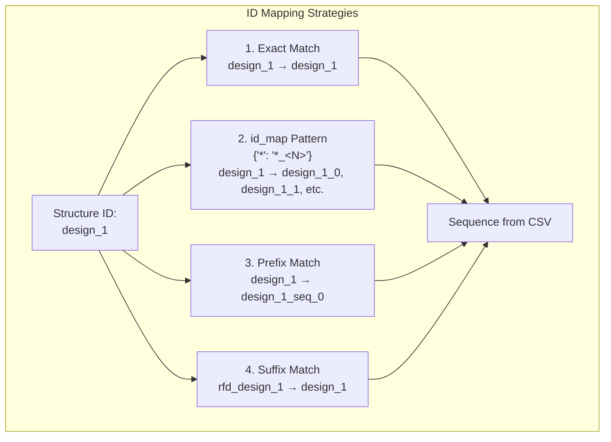
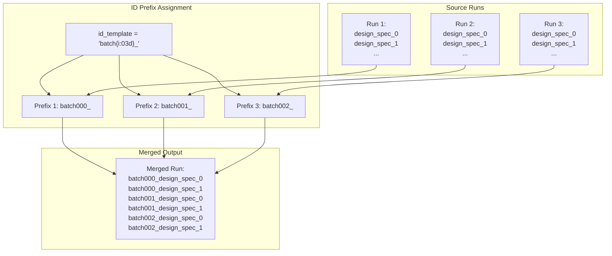
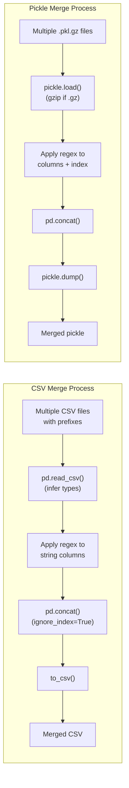
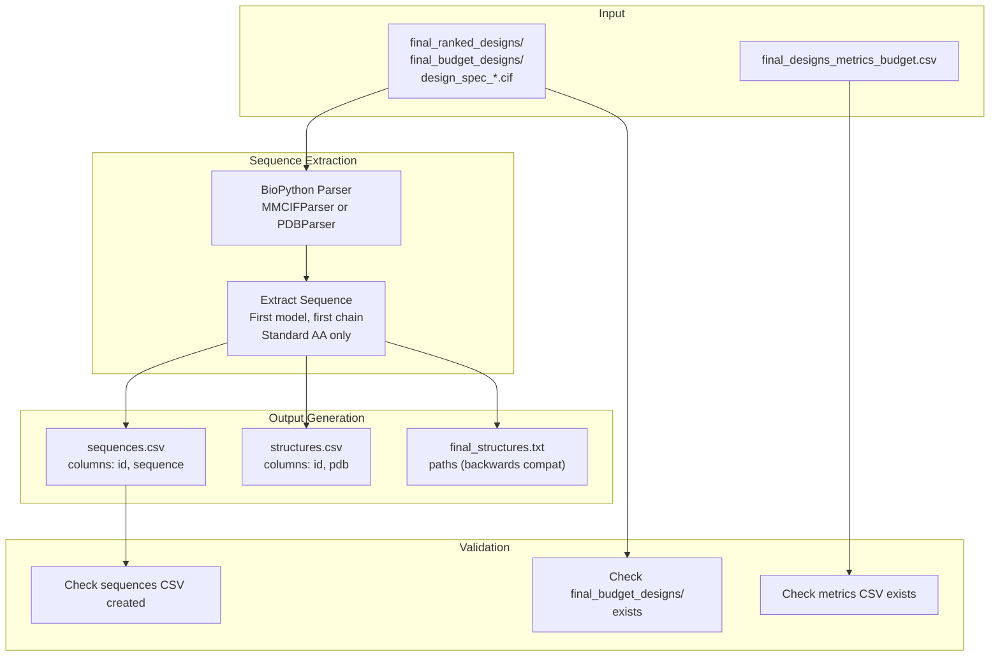

# BoltzGen Workflow

<details>
<summary>Relevant source files</summary>

The following files were used as context for generating this wiki page:

- [HelpScripts/pipe_boltzgen.py](HelpScripts/pipe_boltzgen.py)
- [HelpScripts/pipe_boltzgen_import.py](HelpScripts/pipe_boltzgen_import.py)
- [HelpScripts/pipe_boltzgen_merge.py](HelpScripts/pipe_boltzgen_merge.py)

</details>


BoltzGen is an end-to-end protein binder design tool that generates both backbone structures and sequences optimized for target ligand binding. This page documents the complete BoltzGen workflow in BioPipelines, covering three main phases: importing external structures, design execution, and merging/postprocessing outputs.

This workflow is distinct from [Boltz2](#6.1), which performs structure prediction and affinity calculation. BoltzGen focuses on generative design of new binder proteins. For general structure generation tools, see [Structure Generation Tools](#5.2).

---

## Overview: Three-Phase Workflow

The BoltzGen workflow consists of three phases, each handled by a dedicated helper script:



**Sources:** [HelpScripts/pipe_boltzgen_import.py:1-1081](), [HelpScripts/pipe_boltzgen_merge.py:1-496](), [HelpScripts/pipe_boltzgen.py:1-326]()

---

## Phase 1: Importing External Structures

The import phase converts external structure files into BoltzGen's required filesystem format using `pipe_boltzgen_import.py`. This enables using backbones from other design tools (e.g., RFdiffusion, RFdiffusionAllAtom) as starting points for BoltzGen sequence design.

### Design Modes

BoltzGen supports two import modes:

| Mode | Purpose | Sequence Handling | Use Case |
|------|---------|-------------------|----------|
| `design` | Generate new sequences | Sidechains zeroed (backbone only) | Use RFdiffusion backbones for de novo design |
| `inverse_folding` | Refold existing sequences | Sequences assigned, sidechains zeroed | Optimize existing binder sequences |

**Sources:** [HelpScripts/pipe_boltzgen_import.py:806-859]()

### File Format Conversion

The import script performs several critical transformations:



**Sources:** [HelpScripts/pipe_boltzgen_import.py:130-146](), [HelpScripts/pipe_boltzgen_import.py:148-353](), [HelpScripts/pipe_boltzgen_import.py:355-522]()

### Why CIF Format?

BoltzGen import uses mmCIF format instead of PDB for two critical reasons:

1. **Residue Name Length**: CIF allows longer residue names (e.g., `LIG1`, `LIG2`) while PDB is limited to 3 characters
2. **Ligand Resolution**: BoltzGen's `parse_mmcif` accepts the `mols` dictionary parameter for ligand resolution, while `parse_pdb` does not

**Sources:** [HelpScripts/pipe_boltzgen_import.py:6-22](), [HelpScripts/pipe_boltzgen_import.py:867-873]()

### Sequence to Structure ID Mapping

In `inverse_folding` mode, the import script matches sequences to structures using a configurable ID mapping pattern:



The default pattern `{"*": "*_<N>"}` supports recursive numeric suffixes, enabling one-to-many structure-to-sequence mappings common in combinatorial design.

**Sources:** [HelpScripts/pipe_boltzgen_import.py:551-638]()

### NPZ Metadata Structure

BoltzGen requires NPZ files alongside each CIF structure with per-token metadata arrays:

| Array | Shape | Description | Protein Value | Ligand Value |
|-------|-------|-------------|---------------|--------------|
| `design_mask` | `(n_tokens,)` | Designable positions | `1.0` | `0.0` |
| `inverse_fold_design_mask` | `(n_tokens,)` | Inverse folding mask | `1.0` | `0.0` |
| `ss_type` | `(n_tokens,)` | Secondary structure type | `0` (unspecified) | `0` |
| `binding_type` | `(n_tokens,)` | Binding annotation | `0` (unspecified) | `0` |
| `token_resolved_mask` | `(n_tokens,)` | Resolved positions | `1.0` | `1.0` |

Note: `n_tokens = n_protein_residues + n_ligand_atoms` (hydrogen excluded from ligand).

**Sources:** [HelpScripts/pipe_boltzgen_import.py:717-785]()

### Command-Line Usage

```bash
# Design mode: backbone only
python pipe_boltzgen_import.py \
    --structures structures.txt \
    --output /path/to/boltzgen_input \
    --mode design \
    --ligand-csv compounds.csv \
    --binder-min 50 \
    --binder-max 150

# Inverse folding mode: with sequences
python pipe_boltzgen_import.py \
    --structures structures.txt \
    --output /path/to/boltzgen_input \
    --mode inverse_folding \
    --sequences sequences.csv \
    --ligand-csv compounds.csv \
    --id-map '{"*": "*_<N>"}' \
    --binder-min 50 \
    --binder-max 150

# Generate design_spec.yaml only (for molecule pickle generation)
python pipe_boltzgen_import.py \
    --generate-design-spec \
    --output design_spec.yaml \
    --ligand-csv compounds.csv \
    --binder-min 50 \
    --binder-max 150
```

**Sources:** [HelpScripts/pipe_boltzgen_import.py:942-1076]()

---

## Phase 2: BoltzGen Design Execution

After import, BoltzGen executes as an external tool (not documented here). It reads from `intermediate_designs/` or `intermediate_designs_inverse_folded/` and produces ranked designs in `final_ranked_designs/`.

BoltzGen's execution is handled by the `BoltzGen` tool class in BioPipelines (see [Structure Generation Tools](#5.2)).

---

## Phase 3: Merging Multiple Runs

When running BoltzGen in parallel batches (common for large-scale design campaigns), `pipe_boltzgen_merge.py` consolidates outputs while preventing ID collisions through systematic renaming.

### ID Renaming Strategy



The `id_template` parameter supports placeholders:
- `{i}`: Source index (0-based)
- `{name}`: Source folder name

**Sources:** [HelpScripts/pipe_boltzgen_merge.py:36-51]()

### File Type Processing

The merge script handles different file types with specialized logic:

| File Type | Processing | ID Renaming Location |
|-----------|------------|---------------------|
| `.cif` | Copy with renamed filename | Regex pattern in filename |
| `.npz` | Copy with renamed filename | Regex pattern in filename |
| `.csv` | Merge using pandas | All string columns (via regex) |
| `.pkl.gz` | Merge DataFrames | String columns + index |
| `molecules_out_dir/` | Copy from first source | No renaming (shared ligand) |

**Sources:** [HelpScripts/pipe_boltzgen_merge.py:53-111](), [HelpScripts/pipe_boltzgen_merge.py:132-167](), [HelpScripts/pipe_boltzgen_merge.py:169-224]()

### Regex-Based ID Transformation

All ID renaming uses a consistent regex pattern to match design IDs:

```python
pattern = re.compile(r'(design_spec_\d+(?:_model_\d+)?)')
```

This matches:
- `design_spec_0`
- `design_spec_123`
- `design_spec_5_model_2`

The replacement prepends the prefix: `batch000_design_spec_0`

**Sources:** [HelpScripts/pipe_boltzgen_merge.py:113-130](), [HelpScripts/pipe_boltzgen_merge.py:148-167]()

### Pandas-Based Merging

CSV and pickle files use pandas for type-safe merging:



This approach preserves data types (numeric columns remain numeric) while updating IDs in string columns only.

**Sources:** [HelpScripts/pipe_boltzgen_merge.py:132-167](), [HelpScripts/pipe_boltzgen_merge.py:169-224]()

### CSV-Only Mode

For rapid re-merging when structure files are already in place:

```bash
python pipe_boltzgen_merge.py \
    --sources /run1 /run2 /run3 \
    --output /merged \
    --csv
```

This skips copying `.cif` and `.npz` files, only updating CSV tables with new ID prefixes.

**Sources:** [HelpScripts/pipe_boltzgen_merge.py:249-283]()

### Molecule Pickle Handling

BoltzGen's ligand resolution requires molecule pickle files in `molecules_out_dir/`. Since the ligand is identical across all runs, the merge script copies these from the first source only:

```python
# Copy from first source to both intermediate_designs directories
molecules_src = os.path.join(first_source, parent_dir, 'molecules_out_dir')
molecules_dst = os.path.join(output_dir, parent_dir, 'molecules_out_dir')
shutil.copytree(molecules_src, molecules_dst)
```

**Sources:** [HelpScripts/pipe_boltzgen_merge.py:394-411]()

### Complete Merge Example

```bash
python pipe_boltzgen_merge.py \
    --sources /scratch/boltzgen_batch1 \
          /scratch/boltzgen_batch2 \
          /scratch/boltzgen_batch3 \
    --output /data/merged_boltzgen \
    --id_template "batch{i:03d}_"
```

**Output Statistics:**
```
Sources processed: 3
Files copied: 4500
IDs renamed: 1500
CSV files merged: 5
  - final_designs_metrics_100.csv: 3 sources
  - ca_coords.csv: 3 sources
Pickle files merged: 2
  - ca_coords_sequences.pkl.gz: 3 sources
Molecule pickles: copied from first source
```

**Sources:** [HelpScripts/pipe_boltzgen_merge.py:415-492]()

---

## Phase 4: Postprocessing for BioPipelines

`pipe_boltzgen.py` extracts sequences from final structures and validates outputs for BioPipelines compatibility.

### Sequence Extraction Workflow



**Sources:** [HelpScripts/pipe_boltzgen.py:23-70](), [HelpScripts/pipe_boltzgen.py:72-149]()

### BioPython Sequence Extraction

The script uses BioPython to parse structures and extract protein sequences:

```python
def extract_sequence_from_structure(structure_file):
    from Bio import PDB
    from Bio.PDB import MMCIFParser, PDBParser
    from Bio.PDB.Polypeptide import protein_letters_3to1
    
    # Choose parser based on extension
    if str(structure_file).endswith('.cif'):
        parser = MMCIFParser(QUIET=True)
    else:
        parser = PDBParser(QUIET=True)
    
    structure = parser.get_structure('structure', structure_file)
    
    # Extract from first model, first chain
    for model in structure:
        for chain in model:
            seq = ""
            for residue in chain:
                if PDB.is_aa(residue, standard=True):
                    resname = residue.get_resname()
                    seq += protein_letters_3to1[resname]
            if seq:
                return seq
```

**Sources:** [HelpScripts/pipe_boltzgen.py:23-70]()

### Output CSV Formats

**sequences.csv:**
```csv
id,sequence
design_spec_0,MKTAYIAKQRQISFVKSHFSRQLEERLGLIEVQAPILSRVGDGTQDNLSGAEK...
design_spec_1,MKTFIAKQRQISFVKSHFSRQLEERLGLIEVQAPILSRVGDGTQDNLSGAEK...
```

**structures.csv:**
```csv
id,pdb
design_spec_0,/path/to/final_100_designs/design_spec_0.cif
design_spec_1,/path/to/final_100_designs/design_spec_1.cif
```

**Sources:** [HelpScripts/pipe_boltzgen.py:126-148]()

### Validation Checks

The postprocessing script performs three validation checks:

1. **Final Designs Folder**: `final_ranked_designs/final_{budget}_designs/` exists
2. **Metrics CSV**: `final_ranked_designs/final_designs_metrics_{budget}.csv` exists
3. **Sequences CSV**: `sequences.csv` was created successfully

**Sources:** [HelpScripts/pipe_boltzgen.py:190-229]()

### Command-Line Usage

```bash
python pipe_boltzgen.py \
    --output_folder /path/to/boltzgen_output \
    --budget 100 \
    --extract_sequences \
    --validate
```

**Output:**
```
============================================================
BoltzGen Postprocessing
============================================================

1. Extracting sequences from structures...
Found 100 final structures
Saved sequences to: /path/to/boltzgen_output/sequences.csv
Saved structures list to: /path/to/boltzgen_output/structures.csv
  ✓ Processed 100 structures

2. Processing metrics...
Processed 100 metric entries
  ✓ Metrics processed successfully

3. Validating outputs...
  ✓ All outputs validated

============================================================
BoltzGen postprocessing completed successfully ✓
============================================================
```

**Sources:** [HelpScripts/pipe_boltzgen.py:231-326]()

---

## Complete Workflow Example

Here's a complete end-to-end BoltzGen workflow combining all phases:

```python
from biopipelines import Pipeline, Resources
from biopipelines.tools import RFdiffusion, Ligand, BoltzGenImport, BoltzGen, BoltzGenMerge

# Design ligand binders using BoltzGen
with Pipeline("boltzgen_binder_design") as pipeline:
    
    # 1. Define ligand target
    ligand = Ligand(
        smiles="CC(C)Cc1ccc(cc1)C(C)C(=O)O"  # Ibuprofen
    )
    
    # 2. Generate backbone scaffolds with RFdiffusion
    backbones = RFdiffusion(
        contig="A1-100",
        num_designs=1000,
        resources=Resources(gpu=1, time="4h")
    )
    
    # 3. Import scaffolds for BoltzGen
    boltzgen_input = BoltzGenImport(
        structures=backbones,
        ligands=ligand,
        mode="design",
        binder_min=50,
        binder_max=150,
        resources=Resources(cpu=1, time="1h")
    )
    
    # 4. Run BoltzGen design (in batches for parallelization)
    # Each batch handles subset of structures
    designs_batch1 = BoltzGen(
        input_dir=boltzgen_input,
        budget=100,
        batch_indices="0-250",
        resources=Resources(gpu=1, time="24h")
    )
    
    designs_batch2 = BoltzGen(
        input_dir=boltzgen_input,
        budget=100,
        batch_indices="250-500",
        resources=Resources(gpu=1, time="24h")
    )
    
    designs_batch3 = BoltzGen(
        input_dir=boltzgen_input,
        budget=100,
        batch_indices="500-750",
        resources=Resources(gpu=1, time="24h")
    )
    
    designs_batch4 = BoltzGen(
        input_dir=boltzgen_input,
        budget=100,
        batch_indices="750-1000",
        resources=Resources(gpu=1, time="24h")
    )
    
    # 5. Merge batches with ID renaming
    merged = BoltzGenMerge(
        sources=[designs_batch1, designs_batch2, designs_batch3, designs_batch4],
        id_template="batch{i:03d}_",
        resources=Resources(cpu=1, time="2h")
    )
    
    # 6. Postprocessing happens automatically
    # merged.streams.structures contains final CIF files
    # merged.streams.sequences contains extracted sequences
    # merged.tables.metrics contains design metrics
```

**Resulting DataStream IDs:**
```
batch000_design_spec_0
batch000_design_spec_1
...
batch001_design_spec_0
batch001_design_spec_1
...
batch003_design_spec_99
```

**Sources:** Documentation example (synthesized from all helper scripts)

---

## Key Differences from Other Workflows

| Aspect | BoltzGen | Boltz2 | RFdiffusion |
|--------|----------|--------|-------------|
| **Purpose** | End-to-end binder design | Structure prediction | Backbone generation |
| **Input** | Ligand + optional scaffold | Sequences + ligand | Contig spec + hotspots |
| **Output** | Backbone + sequence | Structure + confidence | Backbone only |
| **Import required** | Yes (for external scaffolds) | No | No |
| **Merge support** | Yes (batch parallelization) | No | No |
| **Sequence design** | Integrated | No | No |

**Sources:** High-level system architecture diagrams

---

## Filesystem Layout

A complete BoltzGen workflow produces the following directory structure:

```
BoltzGenOutput/
├── design_spec.yaml              # Generated by import
├── intermediate_designs/         # Import output (design mode)
│   ├── design_spec_0.cif
│   ├── design_spec_0.npz
│   ├── design_spec_1.cif
│   ├── design_spec_1.npz
│   └── molecules_out_dir/        # Ligand pickles
│       └── LIG1.pkl
├── intermediate_designs_inverse_folded/  # Import output (inverse folding)
│   ├── design_spec_0.cif
│   ├── design_spec_0.npz
│   ├── ca_coords.csv             # Generated by BoltzGen
│   ├── ca_coords_sequences.pkl.gz
│   ├── refold_cif/               # Refolded structures
│   └── refold_design_cif/        # Design structures
├── final_ranked_designs/         # BoltzGen output
│   ├── final_100_designs/        # Top N designs
│   │   ├── design_spec_0.cif
│   │   ├── design_spec_1.cif
│   │   └── ...
│   └── final_designs_metrics_100.csv
├── sequences.csv                 # Generated by postprocessing
├── structures.csv                # Generated by postprocessing
└── final_structures.txt          # Generated by postprocessing
```

After merging multiple runs:
```
MergedBoltzGen/
├── design_spec.yaml
├── intermediate_designs_inverse_folded/
│   ├── batch000_design_spec_0.cif
│   ├── batch000_design_spec_0.npz
│   ├── batch001_design_spec_0.cif
│   ├── batch001_design_spec_0.npz
│   ├── ca_coords.csv             # Merged from all batches
│   └── molecules_out_dir/        # Copied from first source
└── final_ranked_designs/
    ├── final_100_designs/
    │   ├── batch000_design_spec_0.cif
    │   ├── batch001_design_spec_5.cif
    │   └── ...
    └── final_designs_metrics_100.csv  # Merged with renamed IDs
```

**Sources:** [HelpScripts/pipe_boltzgen_import.py:854-860](), [HelpScripts/pipe_boltzgen_merge.py:60-109]()

---