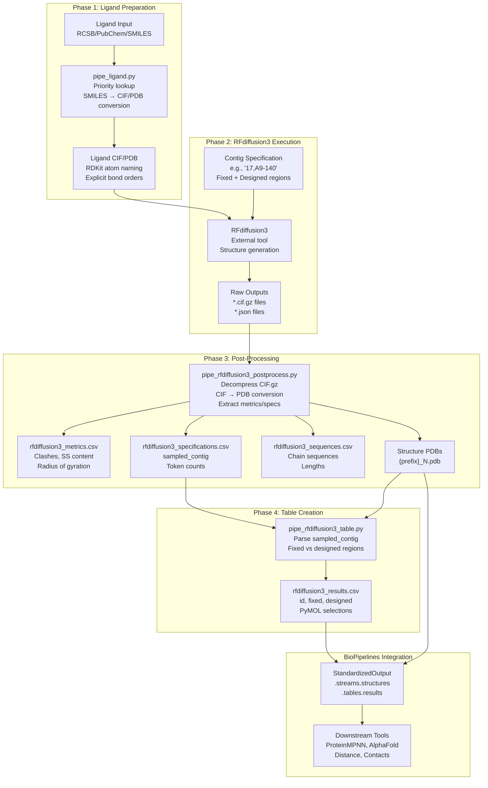
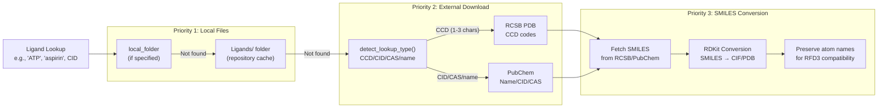
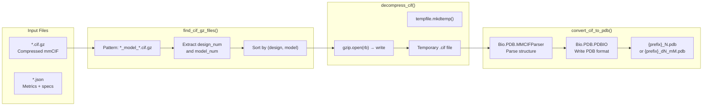
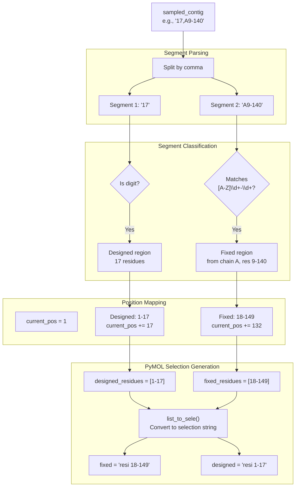
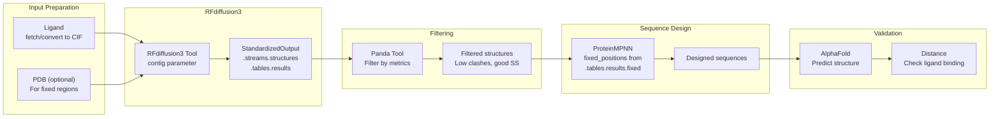

# RFdiffusion3 Workflow

<details>
<summary>Relevant source files</summary>

The following files were used as context for generating this wiki page:

- [HelpScripts/pipe_ligand.py](HelpScripts/pipe_ligand.py)
- [HelpScripts/pipe_rfdaa_prepare_ligand.py](HelpScripts/pipe_rfdaa_prepare_ligand.py)
- [HelpScripts/pipe_rfdiffusion3_postprocess.py](HelpScripts/pipe_rfdiffusion3_postprocess.py)
- [HelpScripts/pipe_rfdiffusion3_table.py](HelpScripts/pipe_rfdiffusion3_table.py)
- [HelpScripts/pipe_sequence.py](HelpScripts/pipe_sequence.py)

</details>


## Purpose and Scope

This page documents the RFdiffusion3 workflow in BioPipelines, covering ligand preparation, structure generation, post-processing, and integration with downstream tools. RFdiffusion3 is a third-generation protein backbone design tool that supports ligand-conditioned design and produces all-atom structures with explicit bond information.

For general structure generation concepts, see [Structure Generation Tools](#5.2). For sequence design on generated backbones, see [Sequence Design Tools](#5.3). For alternative structure generation approaches, see [BoltzGen Workflow](#6.2).

## Overview of RFdiffusion3

RFdiffusion3 is a structure generation tool that extends RFdiffusion with:
- **All-atom output**: Generates complete structures including sidechains (not just backbones)
- **Ligand conditioning**: Designs protein backbones around small molecule ligands
- **Explicit bond orders**: Outputs structures in mmCIF format with chemical connectivity
- **Contig-based control**: Specifies fixed and designed regions using contig strings

The workflow consists of three phases: ligand preparation, RFdiffusion3 execution (external tool), and post-processing for BioPipelines integration.

## Workflow Architecture



**Sources:** [HelpScripts/pipe_ligand.py:1-1485](), [HelpScripts/pipe_rfdiffusion3_postprocess.py:1-407](), [HelpScripts/pipe_rfdiffusion3_table.py:1-362]()

## Ligand Preparation with pipe_ligand.py

### Priority-Based Ligand Lookup

The ligand preparation system uses a three-tier priority lookup strategy:



**Sources:** [HelpScripts/pipe_ligand.py:25-83](), [HelpScripts/pipe_ligand.py:997-1074]()

### SMILES to CIF Conversion for RFdiffusion3

RFdiffusion3 requires ligands in mmCIF format with explicit bond orders. The conversion process:

| Step | Function | Purpose |
|------|----------|---------|
| 1. Parse SMILES | `Chem.MolFromSmiles()` | Create RDKit molecule object |
| 2. Add hydrogens | `Chem.AddHs()` | Proper 3D geometry generation |
| 3. Generate 3D coords | `AllChem.EmbedMolecule(ETKDGv3)` | 3D conformer with ETKDG algorithm |
| 4. Optimize geometry | `AllChem.MMFFOptimizeMolecule()` | MMFF force field optimization |
| 5. Remove hydrogens | `Chem.RemoveHs()` | Cleaner output (RFD3 adds them back) |
| 6. Build mmCIF | Custom CIF writer | Include `_atom_site` and metadata |

**Sources:** [HelpScripts/pipe_ligand.py:243-386]()

### Critical: Atom Naming Preservation

```python
# From pipe_ligand.py:171-233
# IMPORTANT: This preserves RDKit's atom naming convention, which is required
# for compatibility with tools like RFdiffusion3 that internally use RDKit
# to regenerate conformers and expect matching atom names.
```

RFdiffusion3 internally uses RDKit to regenerate conformers and expects the original RDKit atom naming scheme. The `convert_smiles_to_pdb_rdkit()` and `convert_smiles_to_cif_rdkit()` functions preserve this naming:

- **Element-based naming**: C1, C2, N1, O1, etc.
- **No custom renumbering**: Atom names match RDKit's internal generation
- **Residue code only**: Only the 3-letter residue code is customized

**Sources:** [HelpScripts/pipe_ligand.py:171-241](), [HelpScripts/pipe_ligand.py:243-386]()

### mmCIF Format with Explicit Bond Orders

The generated mmCIF includes the `_atom_site` category required by biotite/foundry parsers:

```
_atom_site.group_PDB
_atom_site.id
_atom_site.type_symbol
_atom_site.label_atom_id
_atom_site.label_comp_id
_atom_site.label_asym_id
_atom_site.Cartn_x
_atom_site.Cartn_y
_atom_site.Cartn_z
```

Note: The `_chem_comp_bond` category is intentionally omitted as it's for CCD files, not structure files. RFdiffusion3/foundry infer bonds from coordinates and the molecule topology.

**Sources:** [HelpScripts/pipe_ligand.py:300-376]()

## RFdiffusion3 Execution

### Contig Specification Format

Contigs define which regions are fixed (from input structure) and which are designed (de novo):

| Contig String | Interpretation | Fixed Regions | Designed Regions |
|---------------|----------------|---------------|------------------|
| `"160"` | 160 designed residues | None | 1-160 |
| `"17,A9-140"` | 17 designed + fixed A9-140 | 18-149 (from A9-140) | 1-17 |
| `"A1-50,20,A60-100"` | Fixed + designed + fixed | 1-50 (A1-50), 71-111 (A60-100) | 51-70 |
| `"10-20,A1-100"` | Variable length designed + fixed | 11-110 (A1-100) | 1-10 or 1-20 (sampled) |

After execution, RFdiffusion3 records the **sampled_contig** in the JSON output, which resolves variable ranges to actual numbers used.

**Sources:** [HelpScripts/pipe_rfdiffusion3_table.py:26-89]()

### Output File Structure

RFdiffusion3 generates paired files for each design:

```
raw_output/
├── {prefix}_0_model_0.cif.gz     # Compressed structure (design 0, model 0)
├── {prefix}_0_model_0.json       # Metrics and specifications
├── {prefix}_0_model_1.cif.gz     # Model 1 of design 0
├── {prefix}_0_model_1.json
├── {prefix}_1_model_0.cif.gz     # Design 1, model 0
├── {prefix}_1_model_0.json
└── ...
```

Naming convention: `{prefix}_{design}_model_{model}.{ext}`

**Sources:** [HelpScripts/pipe_rfdiffusion3_postprocess.py:45-99]()

## Post-Processing Pipeline

### Stage 1: CIF Decompression and Conversion



**Sources:** [HelpScripts/pipe_rfdiffusion3_postprocess.py:45-148]()

### Stage 2: Metrics Extraction

The `extract_metrics_from_json()` function extracts quality metrics from JSON files:

| Metric Field | JSON Path | Description |
|--------------|-----------|-------------|
| `max_ca_deviation` | `metrics.max_ca_deviation` | Maximum Cα deviation from ideal |
| `n_chainbreaks` | `metrics.n_chainbreaks` | Number of chain breaks |
| `n_clashing_interresidue_w_sidechain` | `metrics.n_clashing.interresidue_clashes_w_sidechain` | Inter-residue clashes with sidechains |
| `n_clashing_interresidue_w_backbone` | `metrics.n_clashing.interresidue_clashes_w_backbone` | Inter-residue clashes with backbone |
| `ligand_clashes` | `metrics.n_clashing.ligand_clashes` | Clashes with ligand |
| `ligand_min_distance` | `metrics.n_clashing.ligand_min_distance` | Minimum distance to ligand |
| `helix_fraction` | `metrics.helix_fraction` | Fraction of helical residues |
| `sheet_fraction` | `metrics.sheet_fraction` | Fraction of sheet residues |
| `radius_of_gyration` | `metrics.radius_of_gyration` | Compactness measure |
| `alanine_content` | `metrics.alanine_content` | Fraction of alanines |
| `glycine_content` | `metrics.glycine_content` | Fraction of glycines |

**Sources:** [HelpScripts/pipe_rfdiffusion3_postprocess.py:150-188]()

### Stage 3: Specifications Extraction

The `extract_specifications_from_json()` function extracts design specifications:

| Specification Field | JSON Path | Description |
|---------------------|-----------|-------------|
| `sampled_contig` | `specification.extra.sampled_contig` | Resolved contig string (critical for parsing) |
| `num_tokens_in` | `specification.extra.num_tokens_in` | Input tokens count |
| `num_residues_in` | `specification.extra.num_residues_in` | Input residue count |
| `num_chains` | `specification.extra.num_chains` | Number of chains in output |
| `num_atoms` | `specification.extra.num_atoms` | Total atom count |
| `num_residues` | `specification.extra.num_residues` | Total residue count |

**Sources:** [HelpScripts/pipe_rfdiffusion3_postprocess.py:190-219]()

### Stage 4: Sequence Extraction

The `extract_sequence_from_pdb()` function parses PDB files to extract amino acid sequences:

- Uses `Bio.PDB.PDBParser` to read structure
- Converts 3-letter residue names to 1-letter codes with `Bio.SeqUtils.seq1()`
- Skips HETATM records (water, ligands)
- Generates separate entries for multi-chain structures

**Sources:** [HelpScripts/pipe_rfdiffusion3_postprocess.py:221-259]()

### Conditional Naming: Design vs Model

When `num_models > 1`:
```
{prefix}_d{design_num}_m{model_num}.pdb
```

When `num_models == 1`:
```
{prefix}_{design_num}.pdb
```

This simplifies filenames for single-model runs while maintaining clarity for multi-model runs.

**Sources:** [HelpScripts/pipe_rfdiffusion3_postprocess.py:309-314]()

## Sampled Contig Parsing

### Understanding sampled_contig Format

The `parse_sampled_contig()` function in `pipe_rfdiffusion3_table.py` interprets the resolved contig string:



**Sources:** [HelpScripts/pipe_rfdiffusion3_table.py:26-89]()

### Segment Type Recognition

The parser recognizes three segment types:

1. **Chain range** (regex `^([A-Z])(\d+)-(\d+)$`): Fixed region from input structure
   - Example: `"A9-140"` → chain A, residues 9-140
   - Maps to contiguous output positions

2. **Numeric** (regex `^\d+$`): Designed region with specified length
   - Example: `"17"` → 17 de novo designed residues
   - Maps to contiguous output positions

3. **Single chain residue** (regex `^([A-Z])(\d+)$`): Single fixed residue
   - Example: `"A50"` → chain A, residue 50
   - Maps to one output position

**Sources:** [HelpScripts/pipe_rfdiffusion3_table.py:54-88]()

### PyMOL Selection String Generation

The `list_to_sele()` function from `biopipelines.sele_utils` converts residue lists to PyMOL selection strings:

```python
# Example conversion
fixed_residues = [18, 19, 20, ..., 149]
# Becomes: "resi 18-149"

designed_residues = [1, 2, 3, ..., 17, 51, 52, ..., 70]
# Becomes: "resi 1-17+51-70"
```

These selections can be used in downstream tools like ProteinMPNN to specify design regions.

**Sources:** [HelpScripts/pipe_rfdiffusion3_table.py:22-23](), [HelpScripts/pipe_rfdiffusion3_table.py:89]()

## Output Files and Data Structures

### Post-Processing Outputs

| File | Format | Content |
|------|--------|---------|
| `{prefix}_N.pdb` | PDB | Converted structure files |
| `rfdiffusion3_metrics.csv` | CSV | Quality metrics (clashes, SS, Rg) |
| `rfdiffusion3_specifications.csv` | CSV | Design specs (sampled_contig, counts) |
| `rfdiffusion3_sequences.csv` | CSV | Extracted sequences per chain |

**Sources:** [HelpScripts/pipe_rfdiffusion3_postprocess.py:262-393]()

### Results Table Schema

The `pipe_rfdiffusion3_table.py` script generates a standardized results table:

| Column | Type | Description |
|--------|------|-------------|
| `id` | str | Structure ID (`{prefix}_N` or `{prefix}_dN_mM`) |
| `design` | int | Design number (batch index) |
| `model` | int | Model number (sample within batch) |
| `pdb` | str | PDB filename |
| `fixed` | str | PyMOL selection for fixed residues |
| `designed` | str | PyMOL selection for designed residues |
| `contig` | str | Original contig specification |
| `length` | int | Total protein length |
| `time` | float | Generation time (if available) |
| `status` | str | "success" or "missing" |

**Sources:** [HelpScripts/pipe_rfdiffusion3_table.py:326-338]()

### StandardizedOutput Integration

The RFdiffusion3 tool in BioPipelines wraps these outputs into a `StandardizedOutput` object:

```
StandardizedOutput
├── .streams.structures
│   ├── DataStream(ids=[...], files=[...], format='pdb')
│   └── map_table: structures.csv
└── .tables
    ├── .results (rfdiffusion3_results.csv)
    │   └── .fixed, .designed column references
    ├── .metrics (rfdiffusion3_metrics.csv)
    └── .specifications (rfdiffusion3_specifications.csv)
```

This enables seamless integration with downstream tools.

**Sources:** Based on workflow architecture and BioPipelines data model (see [Data Streams and StandardizedOutput](#3.3))

## Integration with BioPipelines

### Typical Pipeline Flow



**Sources:** Based on tool ecosystem and typical workflow patterns (see [Tool Ecosystem by Category](#diagram-4-in-high-level-diagrams))

### Using Fixed/Designed Selections in ProteinMPNN

The `fixed` and `designed` columns from the results table can be used directly with ProteinMPNN:

```python
# Example pipeline snippet (conceptual)
rfd3_output = RFdiffusion3(
    ligand=my_ligand,
    contig="20,A1-100",  # 20 designed + fixed A1-100
    num_designs=100
)

# Filter for low clashes
filtered = Panda(rfd3_output.tables.results).filter(
    "ligand_clashes < 5"
)

# Design sequences, keeping fixed regions unchanged
designs = ProteinMPNN(
    structures=filtered.streams.structures,
    # Use the 'fixed' column to preserve fixed regions
    fixed_positions=filtered.tables.results.fixed
)
```

The `fixed` column contains PyMOL selection strings that ProteinMPNN converts to residue lists.

**Sources:** [HelpScripts/pipe_rfdiffusion3_table.py:89](), workflow integration pattern

### Metrics-Based Filtering

Common filtering strategies using the metrics table:

| Filter Criterion | Panda Expression | Purpose |
|------------------|------------------|---------|
| Low ligand clashes | `"ligand_clashes < 5"` | Ensure good ligand fit |
| No chain breaks | `"n_chainbreaks == 0"` | Continuous backbone |
| High helical content | `"helix_fraction > 0.3"` | Favor α-helical structures |
| Compact structures | `"radius_of_gyration < 20"` | Favor globular folds |
| Low alanine | `"alanine_content < 0.15"` | Avoid poly-alanine collapse |

**Sources:** [HelpScripts/pipe_rfdiffusion3_postprocess.py:169-184]()

### Column References for Metadata-Driven Design

The specifications table can inform downstream design:

```python
# Filter by sampled contig pattern
specs_filtered = Panda(rfd3_output.tables.specifications).filter(
    "sampled_contig.str.contains('A')"  # Only designs with fixed regions
)

# Use num_residues to select size range
size_filtered = Panda(rfd3_output.tables.specifications).filter(
    "num_residues >= 100 & num_residues <= 150"
)
```

**Sources:** [HelpScripts/pipe_rfdiffusion3_postprocess.py:207-215]()

## Key Implementation Details

### Filename Pattern Recognition

The post-processing script uses glob patterns to find RFdiffusion3 outputs:

```python
# Pattern: *_model_*.cif.gz (no "design" word in newer RFD3 versions)
pattern = os.path.join(raw_folder, "*_model_*.cif.gz")
```

It extracts design and model numbers by splitting on `"_model_"`:
```python
# Example: "myprotein_5_model_3.cif.gz"
# → design_num = 5, model_num = 3
parts = name_without_ext.split("_model_")
model_num = int(parts[1])
design_num = int(parts[0].split("_")[-1])
```

**Sources:** [HelpScripts/pipe_rfdiffusion3_postprocess.py:56-92]()

### BioPython Structure Parsing

The CIF to PDB conversion preserves all atoms using a custom `Select` class:

```python
class AllAtoms(Select):
    """Select all atoms for PDB output."""
    def accept_atom(self, atom):
        return True
```

This ensures that both protein and ligand atoms are retained in the output PDB.

**Sources:** [HelpScripts/pipe_rfdiffusion3_postprocess.py:39-42]()

### Error Handling and Validation

The post-processing pipeline validates expected output counts:

```python
expected_total = args.num_designs * args.num_models
if len(cif_files) != expected_total:
    print(f"WARNING: Found {len(cif_files)} files but expected {expected_total}")
```

It continues processing even if some files are missing, marking them as `status = "missing"` in the results table.

**Sources:** [HelpScripts/pipe_rfdiffusion3_postprocess.py:290-293](), [HelpScripts/pipe_rfdiffusion3_table.py:320-324]()

### Temporary File Management

The post-processing script uses `tempfile.mkdtemp()` for safe temporary file handling:

```python
temp_dir = tempfile.mkdtemp(prefix="rfd3_postprocess_")
try:
    # ... processing ...
finally:
    if os.path.exists(temp_dir):
        shutil.rmtree(temp_dir)
```

This ensures cleanup even if errors occur during processing.

**Sources:** [HelpScripts/pipe_rfdiffusion3_postprocess.py:295-402]()

---