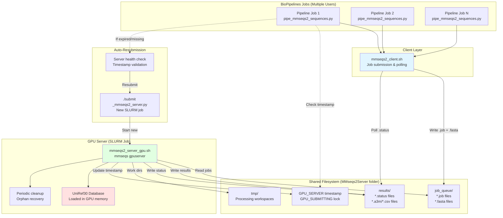
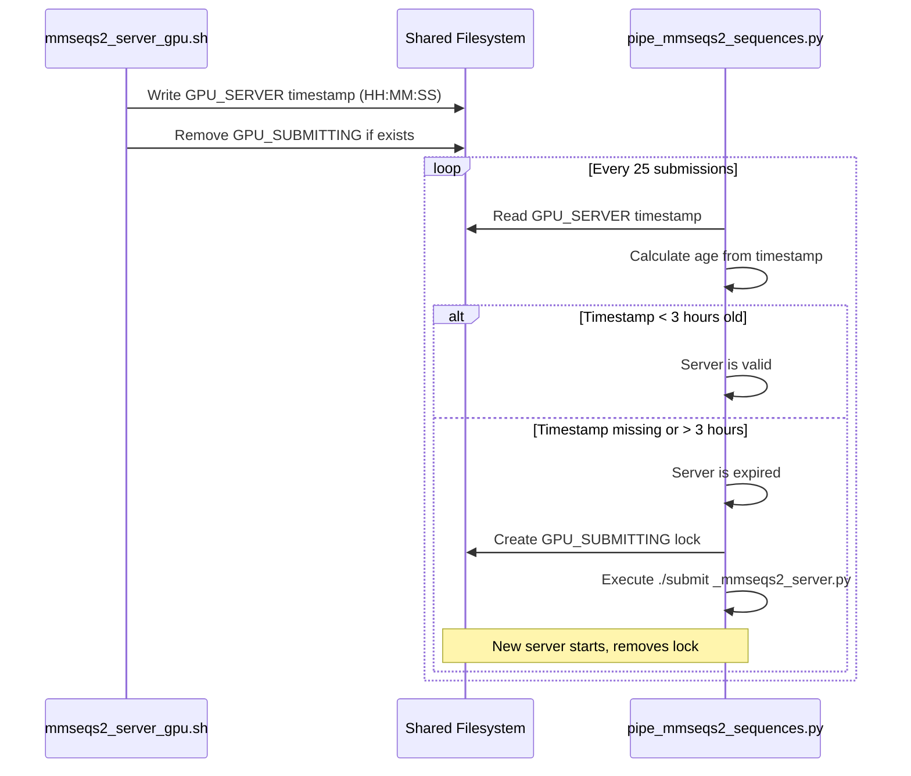
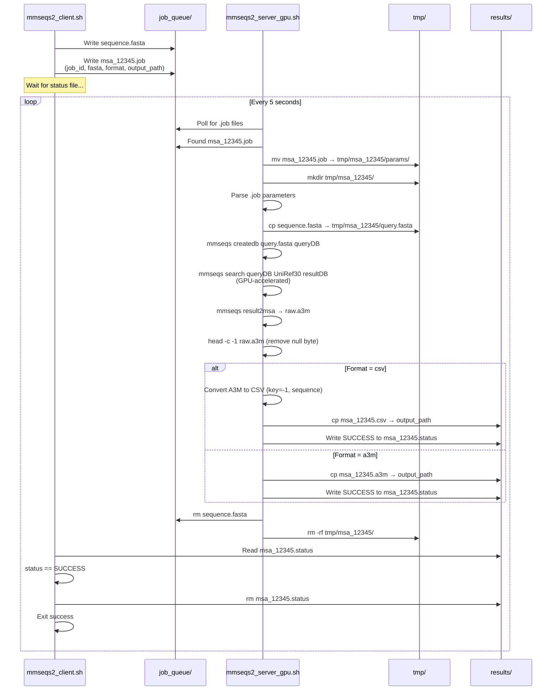
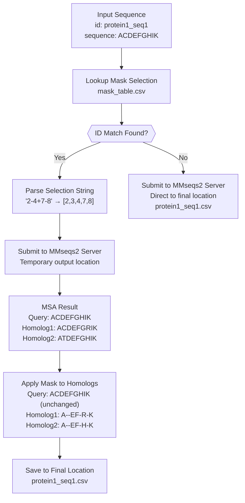

# MMseqs2 Distributed MSA Generation

<details>
<summary>Relevant source files</summary>

The following files were used as context for generating this wiki page:

- [HelpScripts/mmseqs2_client.sh](HelpScripts/mmseqs2_client.sh)
- [HelpScripts/mmseqs2_server_gpu.sh](HelpScripts/mmseqs2_server_gpu.sh)
- [HelpScripts/pipe_mmseqs2_sequences.py](HelpScripts/pipe_mmseqs2_sequences.py)

</details>


## Purpose and Scope

This document describes the MMseqs2 distributed MSA (Multiple Sequence Alignment) generation system in BioPipelines. The system provides a client-server architecture for generating MSAs from protein sequences using the MMseqs2 tool with GPU acceleration. It supports automatic server management, job queuing, error recovery, and MSA masking for integration with structure prediction tools.

For information about using the MMseqs2 tool in pipelines, see [Utilities](#5.1). For information about integrating MSAs with AlphaFold, see [Structure Prediction Tools](#5.4). For the complete Boltz2 workflow including MSA generation, see [Boltz2 Workflow](#6.1).

---

## System Overview

The MMseqs2 distributed system enables multiple BioPipelines jobs to share a single GPU-accelerated MMseqs2 server, avoiding redundant database loading and improving throughput. The system consists of three main components:

1. **GPU Server** (`mmseqs2_server_gpu.sh`) - Long-running server that loads the UniRef30 database into GPU memory and processes MSA requests
2. **Client Script** (`mmseqs2_client.sh`) - Submits individual sequence queries and waits for results
3. **Python Helper** (`pipe_mmseqs2_sequences.py`) - Batch processor that handles multiple sequences, manages server health, and applies MSA masking

**Sources:** [HelpScripts/mmseqs2_server_gpu.sh:1-433](), [HelpScripts/mmseqs2_client.sh:1-229](), [HelpScripts/pipe_mmseqs2_sequences.py:1-643]()

---

## Architecture Diagram



**Sources:** [HelpScripts/mmseqs2_server_gpu.sh:22-49](), [HelpScripts/mmseqs2_client.sh:22-26](), [HelpScripts/pipe_mmseqs2_sequences.py:104-153]()

---

## Server Component

### GPU Server Script

The GPU server (`mmseqs2_server_gpu.sh`) is a long-running SLURM job that:

1. **Database Loading** - Downloads and loads UniRef30 database into GPU memory (3-minute warm-up)
2. **Job Processing** - Continuously polls the job queue for new MSA requests
3. **MSA Generation** - Uses `mmseqs gpuserver` for GPU-accelerated searches
4. **Format Conversion** - Converts results to A3M or CSV format
5. **Periodic Maintenance** - Cleans up old files and recovers orphaned jobs

**Key Configuration:**

| Parameter | Default | Description |
|-----------|---------|-------------|
| `MMSEQS_MAX_MEMORY` | 150G | Maximum memory for MMseqs2 |
| `OMP_NUM_THREADS` | 4 | Parallel threads for CPU operations |
| `MAX_SEQS` | 10,000 | Maximum homologs per query |
| `POLL_INTERVAL` | 10s | Job queue polling frequency |
| `CLEANUP_INTERVAL` | 3600s | File cleanup frequency (1 hour) |

**Sources:** [HelpScripts/mmseqs2_server_gpu.sh:40-48](), [HelpScripts/mmseqs2_server_gpu.sh:108-118](), [HelpScripts/mmseqs2_server_gpu.sh:160-172]()

### Server Timestamp and Detection

The server creates a timestamp file (`GPU_SERVER`) containing its start time in `HH:MM:SS` format. Clients validate this timestamp to determine if the server is running and recent (< 3 hours old).



**Sources:** [HelpScripts/mmseqs2_server_gpu.sh:89-102](), [HelpScripts/pipe_mmseqs2_sequences.py:154-217](), [HelpScripts/mmseqs2_client.sh:48-89]()

### MMseqs2 Installation Check

The server automatically downloads and installs MMseqs2 if not found at the configured path:

**Sources:** [HelpScripts/mmseqs2_server_gpu.sh:59-85]()

---

## Client Component

### Client Script Interface

The `mmseqs2_client.sh` script provides a simple interface for submitting MSA jobs:

**Command-line Arguments:**

| Argument | Required | Description |
|----------|----------|-------------|
| `-s, --sequence` | Yes (or `-f`) | Protein sequence string |
| `-f, --fasta` | Yes (or `-s`) | Path to FASTA file |
| `-t, --type` | No | Output format: `a3m` or `csv` (default: csv) |
| `-o, --output` | No | Output file path (server writes directly to this location) |
| `-u, --status` | No | Check server status and job queue |

**Job Submission Process:**

1. Create unique job ID: `msa_$(date +%s)_$$`
2. Write FASTA file to `job_queue/`
3. Write `.job` metadata file with parameters
4. Poll `results/` directory for `.status` file
5. Parse status (SUCCESS/FAILED) and retrieve output

**Sources:** [HelpScripts/mmseqs2_client.sh:28-45](), [HelpScripts/mmseqs2_client.sh:132-224]()

### Retry Logic

The client implements retry logic for recoverable failures:

- **Max Retries:** 3 attempts
- **Retry Delay:** 10 seconds between attempts
- **Recoverable Failures:** Server crashes, orphaned jobs
- **Permanent Failures:** Input not found, unknown format

**Sources:** [HelpScripts/mmseqs2_client.sh:153-229]()

---

## Job Lifecycle



**Sources:** [HelpScripts/mmseqs2_server_gpu.sh:298-422](), [HelpScripts/mmseqs2_client.sh:156-224]()

---

## Python Helper Script

### Batch Processing

The `pipe_mmseqs2_sequences.py` script processes multiple sequences in batch:

**Input:** CSV file with columns `id`, `sequence`

**Output:** MSA summary CSV with columns:
- `id` - MSA identifier (e.g., `seq1_msa`)
- `sequences.id` - Original sequence ID
- `sequence` - Query sequence
- `msa_file` - Path to individual MSA CSV file

**Individual MSA Files:** Each sequence gets its own MSA file saved as `{output_dir}/{sequence_id}.csv` in Boltz2-compatible format (columns: `key`, `sequence` where `key=-1` for all rows).

**Sources:** [HelpScripts/pipe_mmseqs2_sequences.py:421-641]()

### Server Health Monitoring

The helper script checks server health every 25 submissions:

**Validation Logic:**

1. Read timestamp from `GPU_SERVER` file
2. Parse `HH:MM:SS` format and calculate age
3. Handle midnight wraparound (add 86400s if negative)
4. Valid if age < 3 hours (10,800 seconds)
5. If invalid, trigger resubmission

**Resubmission Lock:**

To prevent multiple jobs from resubmitting the server simultaneously, the script uses a `GPU_SUBMITTING` lock file. The server removes this file on startup.

**Sources:** [HelpScripts/pipe_mmseqs2_sequences.py:154-286](), [HelpScripts/pipe_mmseqs2_sequences.py:526-541]()

### Automatic Retry on Existing MSA

The script checks if an MSA file already exists before submission, enabling resume on job failures:

**Sources:** [HelpScripts/pipe_mmseqs2_sequences.py:547-570]()

---

## MSA Masking

### Purpose

MSA masking replaces specific positions in homologous sequences with gap characters (`-`) while preserving the query sequence. This is useful for:

- **Binder Design:** Mask the target protein to prevent homology bias
- **Interface-Focused Prediction:** Mask regions outside the binding interface
- **Custom Constraints:** Control which regions contribute to MSA statistics

### Masking Modes

**1. Global Masking (all sequences):**

```bash
--mask_selection "10-20+30-40"
```

Applies the same mask to all sequences.

**2. Per-Sequence Masking (from table):**

```bash
--mask_table path/to/table.csv \
--mask_column "designed_positions"
```

Looks up mask selection for each sequence ID using the ID mapping pattern.

**3. ID Mapping:**

Uses `id_map` JSON pattern to match sequence IDs to table IDs:

```json
{"*": "*_<S>"}
```

For sequence ID `protein1_seq1`, tries candidates in order:
1. `protein1_seq1` (exact match)
2. `protein1` (strip `_<S>` suffix)

**Sources:** [HelpScripts/pipe_mmseqs2_sequences.py:430-525]()

### Masking Implementation



**Key Functions:**

- `sele_to_list(s)` - Parses selection strings like `"10-20+30-40"` into position lists [HelpScripts/pipe_mmseqs2_sequences.py:31-73]()
- `apply_mask_to_msa(sequences, positions)` - Replaces positions with `-` in all sequences except the query [HelpScripts/pipe_mmseqs2_sequences.py:75-102]()

**Sources:** [HelpScripts/pipe_mmseqs2_sequences.py:574-619]()

---

## Error Recovery and Cleanup

### Orphaned Job Recovery

The server detects and recovers jobs that were interrupted by a server crash:

**Detection Logic:**

1. Find temporary directories older than 30 minutes (`tmp/msa_*`)
2. Check if status file exists (job completed)
3. If no status file, job was interrupted

**Recovery Actions:**

- If `.job` file exists in `tmp/msa_*/params/`: Move back to queue for reprocessing
- If `.job` file missing: Mark as `FAILED` with message "Server died during processing"

**Sources:** [HelpScripts/mmseqs2_server_gpu.sh:232-282]()

### Periodic Cleanup

The server runs cleanup every hour to remove old files:

| File Type | Location | Age Threshold | Action |
|-----------|----------|---------------|--------|
| `.status` files | `results/` | 24 hours | Delete (results already copied to client) |
| `.a3m` files | `results/` | 24 hours | Delete (results already copied to client) |
| `.csv` files | `results/` | 24 hours | Delete (results already copied to client) |
| `tmp/` directories | `tmp/` | 24 hours | Delete recursively |
| `.fasta` files | `job_queue/` | 24 hours | Delete (orphaned submissions) |
| `.job` files | `job_queue/` | 24 hours | Delete (stale/failed submissions) |

**Sources:** [HelpScripts/mmseqs2_server_gpu.sh:191-230](), [HelpScripts/mmseqs2_server_gpu.sh:424-430]()

### Null Byte Handling

MMseqs2 `result2msa` adds a null byte at the end of A3M files, which crashes Boltz2. The server removes it:

**Sources:** [HelpScripts/mmseqs2_server_gpu.sh:128-139]()

---

## Output Formats

### A3M Format

Standard MSA format with gap characters:

```
>query_sequence
ACDEFGHIKLMNPQRSTVWY
>homolog_1
AC-EFGHIKLMNPQRSTVWY
>homolog_2
ACDEFG-IKLMNPQRSTVWY
```

### CSV Format (Boltz2-compatible)

| key | sequence |
|-----|----------|
| -1 | ACDEFGHIKLMNPQRSTVWY |
| -1 | AC-EFGHIKLMNPQRSTVWY |
| -1 | ACDEFG-IKLMNPQRSTVWY |

**Note:** All rows have `key=-1` to indicate MSA sequences (as opposed to paired sequences with matching keys).

**Sources:** [HelpScripts/mmseqs2_server_gpu.sh:145-158](), [HelpScripts/pipe_mmseqs2_sequences.py:376-419]()

---

## Integration with Structure Prediction

### AlphaFold Integration

AlphaFold2 expects A3M format MSAs. The MMseqs2 tool can generate A3M files directly:

```python
from biopipelines import Pipeline, MMseqs2, AlphaFold

with Pipeline() as pipe:
    sequences = Sequence(["ACDEFGHIK"])
    msas = MMseqs2(sequences, output_format="a3m")
    predictions = AlphaFold(sequences, msas=msas.streams.msas)
```

### Boltz2 Integration

Boltz2 expects CSV format with `key=-1` for all MSA rows. The default CSV format is compatible:

```python
from biopipelines import Pipeline, MMseqs2, Boltz2

with Pipeline() as pipe:
    sequences = Sequence(["ACDEFGHIK"])
    msas = MMseqs2(sequences)  # Default output_format="csv"
    predictions = Boltz2(sequences, msas=msas.streams.msas)
```

**With Masking:**

```python
# Mask positions 10-20 in all MSAs
msas = MMseqs2(sequences, mask_selection="10-20")

# Or per-sequence masking from a table
distance_results = Distance(...)  # Creates table with "interface_residues" column
msas = MMseqs2(sequences, 
               mask_table=distance_results.tables.results,
               mask_column="interface_residues",
               id_map={"*": "*_<S>"})
```

**Sources:** [HelpScripts/pipe_mmseqs2_sequences.py:331-376]()

---

## Configuration Requirements

### Folder Resolution

The system requires several folders configured in `config.yaml`:

| Folder Key | Usage |
|------------|-------|
| `MMseqs2Server` | Shared job queue, results, and timestamps |
| `MMseqs2Databases` | UniRef30 database location |
| `MMseqs2` | MMseqs2 binary installation directory |
| `data` | General data directory |

**Fallback:** Scripts attempt to resolve folders using `biopipelines-config folder <key>` if environment variables are not set.

**Sources:** [HelpScripts/mmseqs2_server_gpu.sh:22-39](), [HelpScripts/mmseqs2_client.sh:12-20]()

### Environment Variables

The server and client can be configured via environment variables (overriding `config.yaml`):

| Variable | Default | Description |
|----------|---------|-------------|
| `MMSEQS2_SHARED_FOLDER` | From config | Shared folder for job queue/results |
| `MMSEQS2_DB_DIR` | From config | Database directory |
| `MMSEQS2_DIR` | From config | MMseqs2 installation |
| `BIOPIPELINES_DATA_DIR` | From config | Data directory |
| `MMSEQS_MAX_MEMORY` | 150G | Maximum memory allocation |
| `OMP_NUM_THREADS` | 4 | CPU threads |

**Sources:** [HelpScripts/mmseqs2_server_gpu.sh:32-39]()

---

## Job Queue Status

### Checking Server Status

Use the client script to check server and queue status:

```bash
./mmseqs2_client.sh --status
```

**Output:**

```
[2026-01-15 10:30:45] MMseqs2 GPU server: RUNNING (started at 08:15:30, 2h 15m ago)
[2026-01-15 10:30:45] Jobs in queue: 12 (pending: 8, processing: 4)
```

**Job States:**

- **Pending:** `.job` files in `job_queue/` not yet picked up by server
- **Processing:** Temporary directories in `tmp/` without status files
- **Completed:** Status files in `results/` (cleaned up after client reads them)

**Sources:** [HelpScripts/mmseqs2_client.sh:48-129]()

---

## Performance Characteristics

### Database Loading Time

**Initial Load:** 3 minutes for UniRef30 to load into GPU memory

**Subsequent Searches:** Near-instantaneous prefiltering due to GPU server mode

**Sources:** [HelpScripts/mmseqs2_server_gpu.sh:169-172]()

### Search Parameters

| Parameter | Value | Impact |
|-----------|-------|--------|
| `--max-seqs` | 10,000 | Maximum homologs per query |
| `-s` (sensitivity) | 7.5 | Balance between speed and sensitivity |
| `--gpu 1` | Enabled | GPU-accelerated prefilter |
| `--gpu-server 1` | Enabled | Persistent GPU server mode |
| `--prefilter-mode 1` | Enabled | Use prefilter for faster searches |
| `-a 1` | Enabled | Alignment mode |

**Sources:** [HelpScripts/mmseqs2_server_gpu.sh:351-360]()

### Throughput Optimization

**Shared Database:** Multiple jobs share the same in-memory database, avoiding redundant loads

**Concurrent Processing:** While one job searches, others can submit to the queue

**Typical Processing Time:** 30-60 seconds per sequence (excluding queue wait time)

---

## Error Messages and Troubleshooting

### Common Errors

**"MMseqs2 not found at {path}"**

- **Cause:** MMseqs2 binary not installed
- **Solution:** Server automatically downloads from `https://mmseqs.com/latest/mmseqs-linux-gpu.tar.gz`

**"Server died during processing and job cannot be recovered"**

- **Cause:** Server crashed while processing, and `.job` file is missing from temp directory
- **Solution:** Client retries automatically (up to 3 attempts)

**"No valid MMseqs2 server is running"**

- **Cause:** Server timestamp expired or missing
- **Solution:** Script automatically resubmits server via `./submit ExamplePipelines/_mmseqs2_server.py`

**"Input FASTA not found"**

- **Cause:** FASTA file was deleted or path is incorrect
- **Solution:** Check that `.job` file contains correct `fasta=` path

**Sources:** [HelpScripts/mmseqs2_server_gpu.sh:62-80](), [HelpScripts/mmseqs2_server_gpu.sh:266-268](), [HelpScripts/mmseqs2_client.sh:203-218]()

### GPU Memory Issues

The server logs GPU memory usage before and after each search:

```
[2026-01-15 10:30:00] GPU memory before search: 8234MB
[2026-01-15 10:30:45] GPU memory after successful search: 12456MB
```

**If search fails:** Check if GPU is out of memory and reduce `MMSEQS_MAX_MEMORY` or `MAX_SEQS`.

**Sources:** [HelpScripts/mmseqs2_server_gpu.sh:348-371]()

---

## Implementation Details

### Job ID Generation

Job IDs are generated using timestamp and process ID:

```bash
job_id="msa_$(date +%s)_$$"
# Example: msa_1736937045_12345
```

This ensures uniqueness across concurrent submissions.

**Sources:** [HelpScripts/mmseqs2_client.sh:143-151]()

### File Cleanup Strategy

**Immediate Cleanup:**

- `.job` file and input `.fasta` deleted after processing
- Temporary directories cleaned after status file creation

**Deferred Cleanup:**

- `.status` files cleaned by client after reading
- Result files (`.a3m`, `.csv`) cleaned after copying to client path

**Periodic Cleanup:**

- Old files (24+ hours) removed every hour
- Prevents disk space exhaustion from orphaned jobs

**Sources:** [HelpScripts/mmseqs2_server_gpu.sh:418-422](), [HelpScripts/mmseqs2_client.sh:190-199]()

### Graceful Shutdown

The server installs signal handlers for clean shutdown:

```bash
cleanup() {
  kill $GPUSERVER_PID
  rm -f "$PID_FILE"
  rm -f "$SERVER_TIMESTAMP_FILE"
  exit 0
}
trap cleanup SIGINT SIGTERM
```

**Sources:** [HelpScripts/mmseqs2_server_gpu.sh:175-189]()

---