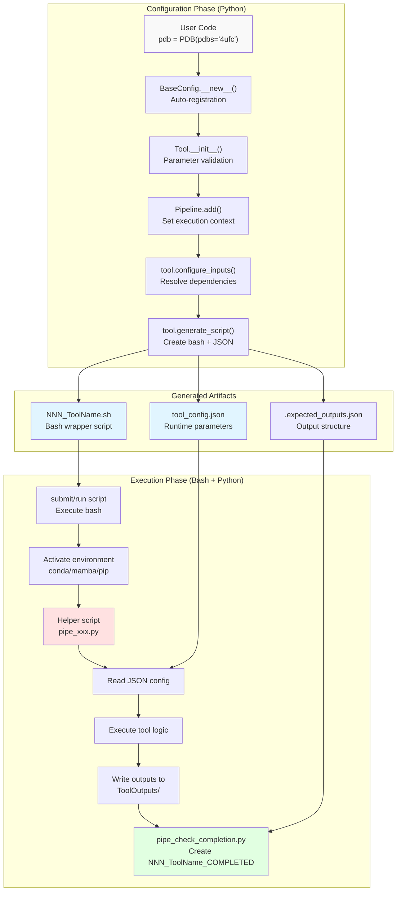
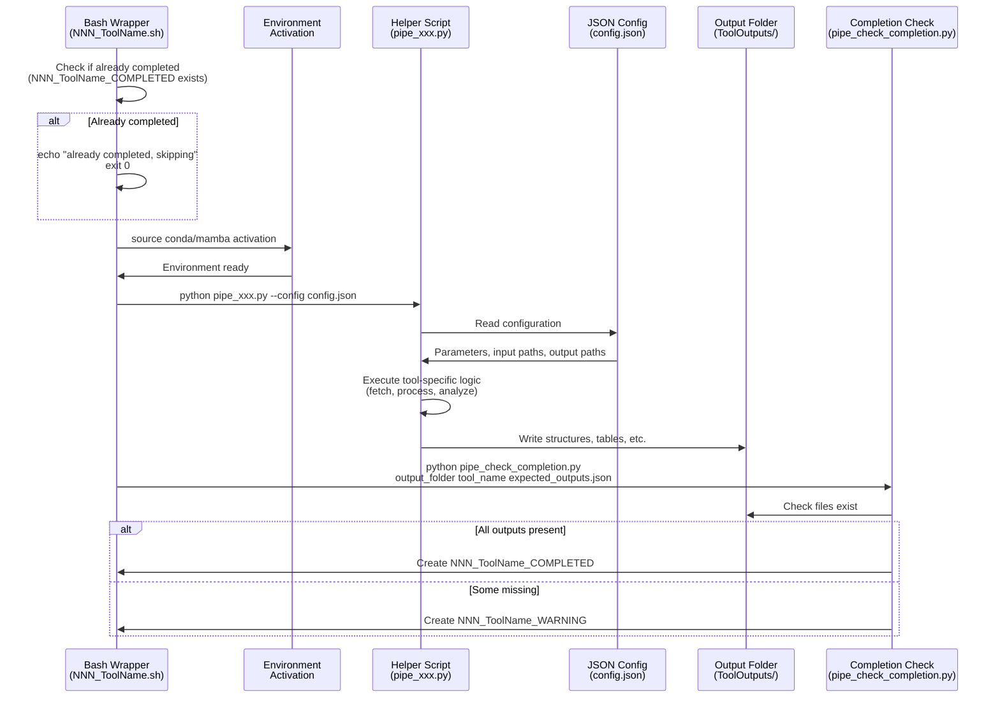
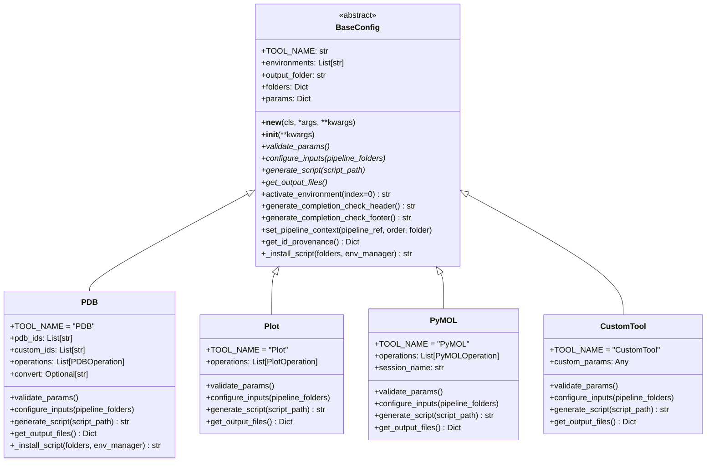

# Advanced Topics

<details>
<summary>Relevant source files</summary>

The following files were used as context for generating this wiki page:

- [HelpScripts/pipe_pdb.py](HelpScripts/pipe_pdb.py)
- [HelpScripts/pipe_plot.py](HelpScripts/pipe_plot.py)
- [biopipelines/base_config.py](biopipelines/base_config.py)
- [biopipelines/entities.py](biopipelines/entities.py)
- [biopipelines/pdb.py](biopipelines/pdb.py)
- [biopipelines/plot.py](biopipelines/plot.py)
- [biopipelines/pymol.py](biopipelines/pymol.py)
- [biopipelines/rcsb.py](biopipelines/rcsb.py)

</details>


This section covers advanced usage patterns for BioPipelines power users and developers. These topics include the helper script architecture that underpins tool execution, developing custom tools by extending `BaseConfig`, using Singularity containers as an alternative to conda environments, and leveraging table column references for metadata-driven design workflows.

For basic tool usage and pipeline construction, see [Core Concepts](#3). For detailed guides on specific workflows, see [Major Workflows](#6).

---

## Overview of Advanced Patterns

BioPipelines employs several architectural patterns that enable flexible, reproducible execution across diverse computational environments:

**Helper Script Architecture**: Tools generate JSON configuration files and bash wrapper scripts that invoke specialized Python helper scripts at runtime. This separates configuration-time logic (Python) from execution-time logic (bash + Python), enabling SLURM job submission, dependency management, and completion tracking.

**BaseConfig Extension Pattern**: All tools inherit from the abstract `BaseConfig` class, implementing a standard interface (`validate_params`, `configure_inputs`, `generate_script`, `get_output_files`). This enables uniform pipeline integration while allowing tool-specific logic.

**Container Execution**: The framework supports Singularity/Apptainer containers as an alternative to conda environments, with per-tool container mappings in `config.yaml`.

**Table Column References**: Tools can reference upstream table columns (e.g., `boltz.tables.affinity.kd`) to drive parameterization, creating feedback loops where analysis results inform design decisions.

---

## Tool Execution Architecture

The following diagram illustrates how a tool progresses from user instantiation to runtime execution:



**Sources**: [biopipelines/base_config.py:117-160](), [biopipelines/base_config.py:342-362](), [biopipelines/base_config.py:499-649](), [biopipelines/pdb.py:566-627]()

---

## Helper Script Pattern

Helper scripts are the runtime execution layer of BioPipelines. Each tool generates a bash wrapper that invokes a Python helper script with a JSON configuration file.

### Configuration-Driven Execution Flow



**Sources**: [biopipelines/base_config.py:499-524](), [biopipelines/base_config.py:526-649](), [HelpScripts/pipe_pdb.py:1-50]()

### JSON Configuration Structure

Helper scripts receive all runtime parameters via a JSON configuration file. Example for `pipe_pdb.py`:

```json
{
  "pdb_ids": ["4ufc", "1abc"],
  "custom_ids": ["POI", "control"],
  "convert": "pdb",
  "local_folder": null,
  "repo_pdbs_folder": "/path/to/PDBs",
  "biological_assembly": false,
  "remove_waters": true,
  "chain": "longest",
  "output_folder": "/path/to/001_PDB/ToolOutputs",
  "structures_table": "/path/to/001_PDB/ToolOutputs/structures.csv",
  "sequences_table": "/path/to/001_PDB/ToolOutputs/sequences.csv",
  "failed_table": "/path/to/001_PDB/ToolOutputs/failed_downloads.csv",
  "compounds_table": "/path/to/001_PDB/ToolOutputs/compounds.csv",
  "operations": [
    {"op": "rename", "old": "LIG", "new": ":L:"}
  ]
}
```

**Sources**: [biopipelines/pdb.py:579-627](), [HelpScripts/pipe_pdb.py:13-26]()

---

## BaseConfig Extension Architecture

All tools inherit from `BaseConfig` and implement a standard interface. The following diagram shows the class hierarchy and required methods:



**Sources**: [biopipelines/base_config.py:34-656](), [biopipelines/pdb.py:39-66](), [biopipelines/plot.py:41-86](), [biopipelines/pymol.py:41-63]()

### Required Method Implementation Pattern

Each tool must implement four core methods:

| Method | Purpose | Called By | Returns |
|--------|---------|-----------|---------|
| `validate_params()` | Validate constructor parameters | `__init__()` | None (raises on error) |
| `configure_inputs(pipeline_folders)` | Resolve dependencies, check files | `Pipeline.configure()` | None (mutates self) |
| `generate_script(script_path)` | Generate bash execution script | `Pipeline.generate_scripts()` | Script content (str) |
| `get_output_files()` | Return expected output structure | `Pipeline.generate_scripts()` | `Dict[str, Any]` |

**Sources**: [biopipelines/base_config.py:283-372]()

---

## Table Column Reference System

Table column references enable metadata-driven workflows where upstream analysis results parameterize downstream design tools. The following diagram shows how table references flow through the system:

```mermaid
graph LR
    subgraph "Upstream Tool"
        Boltz2["Boltz2<br/>Structure prediction"]
        AffinityTable["affinity.csv<br/>id | kd | delta_g"]
        TableInfo["TableInfo object<br/>.info.path<br/>.info.columns"]
        
        Boltz2 --> AffinityTable
        AffinityTable --> TableInfo
    end
    
    subgraph "Table Column Reference"
        ColRef["boltz.tables.affinity.kd<br/>TableReference object"]
        RefAttrs["path: affinity.csv<br/>column: 'kd'"]
        
        TableInfo --> ColRef
        ColRef --> RefAttrs
    end
    
    subgraph "Downstream Tool"
        ToolConfig["Tool configuration<br/>(e.g., Panda.filter())"]
        ScriptGen["generate_script()"]
        JSONConfig["tool_config.json<br/>{path: ..., column: 'kd'}"]
        
        ColRef --> ToolConfig
        ToolConfig --> ScriptGen
        ScriptGen --> JSONConfig
    end
    
    subgraph "Execution Phase"
        HelpScript["Helper script<br/>reads JSON"]
        LoadTable["pd.read_csv(path)"]
        ExtractCol["df['kd'] values"]
        ApplyLogic["Filter/sort/compute"]
        
        JSONConfig --> HelpScript
        HelpScript --> LoadTable
        LoadTable --> ExtractCol
        ExtractCol --> ApplyLogic
    end
    
    style ColRef fill:#ffe1e1
    style JSONConfig fill:#e1f5ff
    style TableInfo fill:#e1ffe1
```



**Sources**: [biopipelines/base_config.py:753-801](), [biopipelines/biopipelines_io.py:1-50]()

### Example: Affinity-Driven Filtering

```python
# Upstream: Boltz2 generates affinity table
boltz = Boltz2(
    proteins=designs,
    ligands=compounds,
    affinity=True
)

# Reference column for filtering
high_affinity = Panda(
    data=boltz,
    Panda.filter(boltz.tables.affinity.kd, "<", 100)  # kd < 100 nM
)

# Use filtered structures downstream
visualize = PyMOL(
    PyMOL.Load(high_affinity),
    PyMOL.ColorAF(),
    session="high_affinity_binders"
)
```

In this example:
- `boltz.tables.affinity.kd` creates a `TableReference` object
- `Panda.filter()` serializes this to JSON: `{"path": "affinity.csv", "column": "kd"}`
- At runtime, `pipe_panda.py` reads the CSV and filters on the `kd` column

**Sources**: [biopipelines/panda.py:150-250](), [HelpScripts/pipe_panda.py:1-100]()

---

## Environment and Container Management

BioPipelines supports three execution modes, controlled by the `env_manager` setting in `config.yaml`:

| Mode | Activation | Use Case |
|------|------------|----------|
| **mamba** | `mamba activate env_name` | HPC clusters, local workstations |
| **conda** | `conda activate env_name` | Systems without mamba |
| **pip** | No activation (uses current env) | Jupyter/Colab notebooks |

### Container Override Pattern

Tools can use Singularity/Apptainer containers instead of conda environments by specifying a `containers` mapping in `config.yaml`:

```yaml
# config.yaml
env_manager: mamba

environments:
  RFdiffusion: SE3nv
  ProteinMPNN: proteinmpnn_env
  
containers:
  RFdiffusion: /path/to/rfdiffusion.sif
  # ProteinMPNN still uses conda env
```

When a container is specified, `BaseConfig.activate_environment()` generates container execution instead of conda activation:

```bash
# With conda (no container specified):
mamba activate proteinmpnn_env

# With container (RFdiffusion):
singularity exec /path/to/rfdiffusion.sif /bin/bash -c "..."
```

**Sources**: [biopipelines/base_config.py:195-281](), [biopipelines/config_manager.py:1-200]()

---

## Completion Tracking and Idempotency

Tools use completion marker files to enable idempotent execution. The `generate_completion_check_header()` and `generate_completion_check_footer()` methods create bash code that checks for prior completion:

```bash
# Header: Skip if already completed
if [ -f "PipelineName_001/001_PDB_COMPLETED" ] || [ -f "PipelineName_001/001_PDB_WARNING" ]; then
    echo "PDB already completed, skipping..."
    exit 0
fi

# ... tool execution ...

# Footer: Check outputs and create marker
python pipe_check_completion.py "001_PDB/ToolOutputs" "PDB" ".expected_outputs.json"

if [ $? -eq 0 ]; then
    touch "PipelineName_001/001_PDB_COMPLETED"
    echo "PDB completed successfully"
else
    touch "PipelineName_001/001_PDB_WARNING"
    echo "PDB - some outputs missing"
fi
```

The `pipe_check_completion.py` script compares actual files against `.expected_outputs.json` to determine success/warning status.

**Sources**: [biopipelines/base_config.py:499-649](), [HelpScripts/pipe_check_completion.py:1-100]()

---

## Summary of Advanced Patterns

| Pattern | Key Classes/Files | Purpose |
|---------|-------------------|---------|
| **Helper Scripts** | `pipe_*.py` in `HelpScripts/` | Runtime execution with JSON configs |
| **BaseConfig Extension** | `BaseConfig`, tool classes in `biopipelines/` | Uniform tool interface |
| **Table References** | `TableReference`, `TableInfo` | Metadata-driven parameterization |
| **Container Support** | `ConfigManager`, `config.yaml` | Singularity as conda alternative |
| **Completion Tracking** | `pipe_check_completion.py`, `.expected_outputs.json` | Idempotent execution |

These patterns work together to create a flexible, reproducible framework that adapts to diverse computational environments while maintaining a consistent Python API.

**Sources**: [biopipelines/base_config.py:1-656](), [biopipelines/config_manager.py:1-200](), [HelpScripts/pipe_pdb.py:1-1000](), [HelpScripts/pipe_plot.py:1-700]()

---