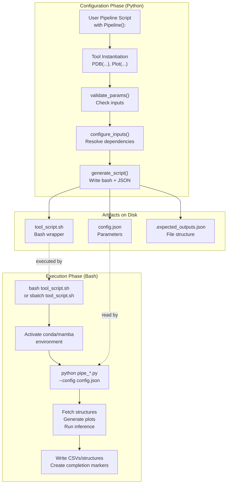
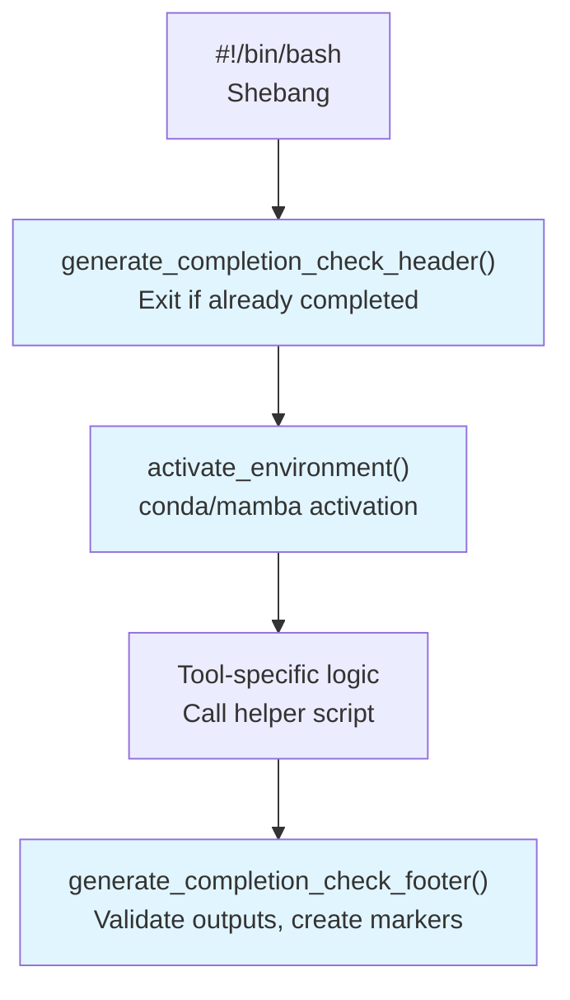
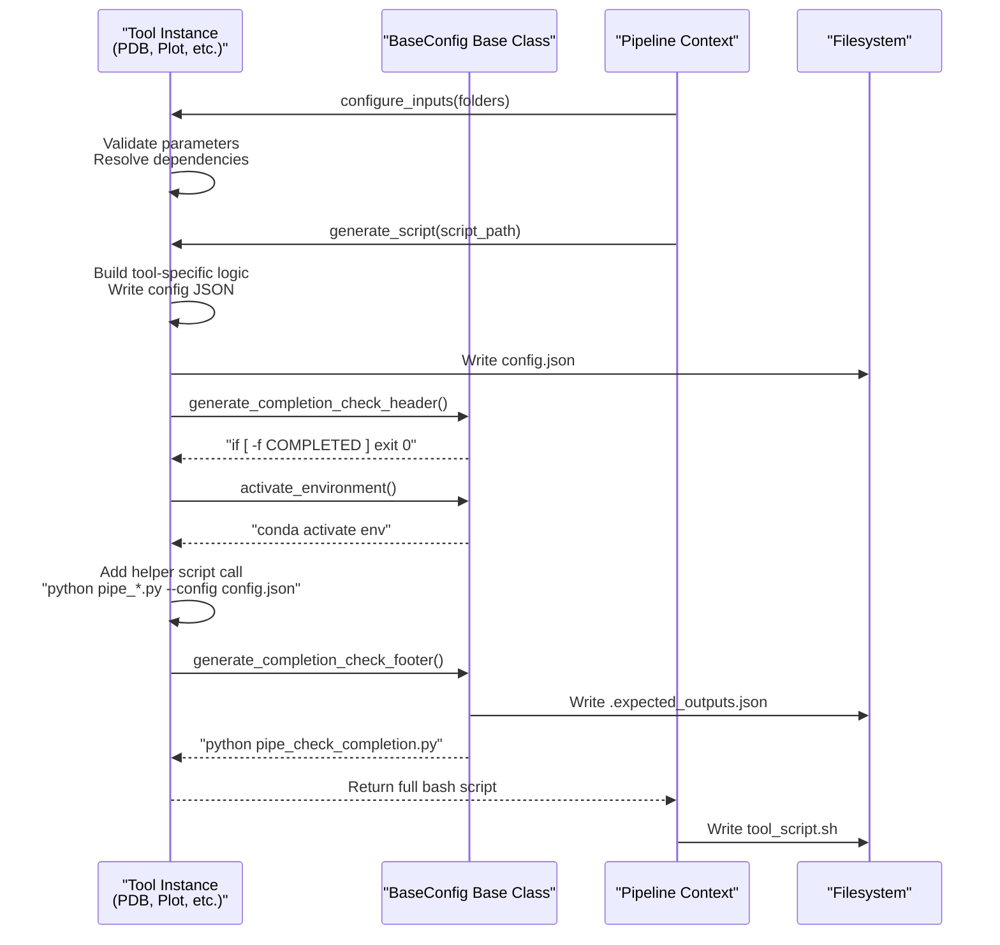
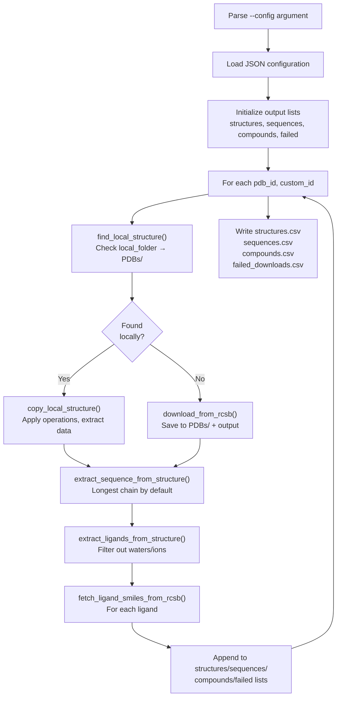
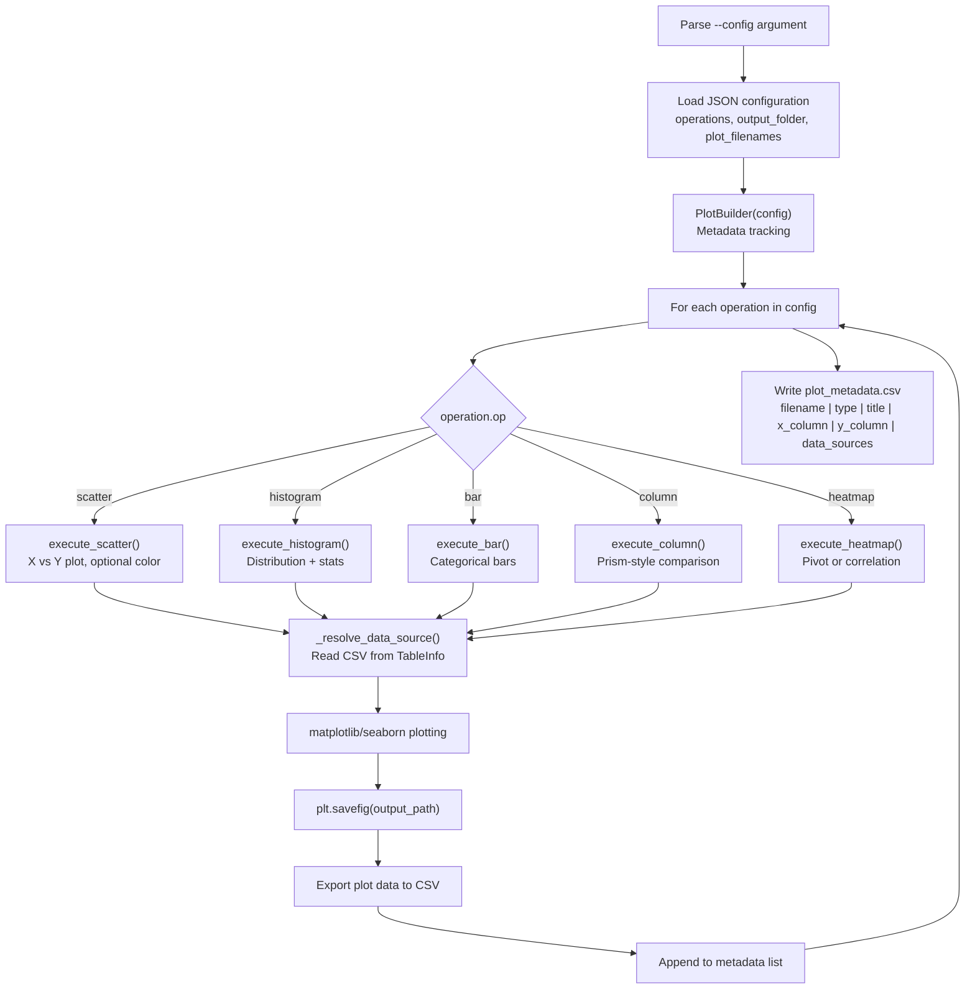

# Helper Script Architecture

<details>
<summary>Relevant source files</summary>

The following files were used as context for generating this wiki page:

- [HelpScripts/pipe_pdb.py](HelpScripts/pipe_pdb.py)
- [HelpScripts/pipe_plot.py](HelpScripts/pipe_plot.py)
- [biopipelines/base_config.py](biopipelines/base_config.py)
- [biopipelines/entities.py](biopipelines/entities.py)
- [biopipelines/pdb.py](biopipelines/pdb.py)
- [biopipelines/plot.py](biopipelines/plot.py)
- [biopipelines/pymol.py](biopipelines/pymol.py)
- [biopipelines/rcsb.py](biopipelines/rcsb.py)

</details>


This page explains the architecture of helper scripts in BioPipelines, which are runtime execution components that perform the actual work of tools. Helper scripts are Python executables (or bash scripts) that read JSON configuration files generated during the configuration phase and execute tool-specific operations during the execution phase.

For information about the two-phase execution model that helper scripts enable, see [Core Concepts: Tools and BaseConfig](#3.2). For specific helper script implementations in workflows, see [Major Workflows](#6).

---

## Overview

Helper scripts are the execution backend of BioPipelines tools. During the configuration phase, tools inherit from `BaseConfig` and generate:

1. **Bash wrapper scripts** - Activate environments, call helper scripts, check completion
2. **JSON configuration files** - Contain all parameters needed for execution
3. **Expected output metadata** - File paths, formats, IDs for downstream tools

During the execution phase (triggered by `submit` or `run`), the bash wrapper scripts execute and call the helper scripts, which read the JSON configs and perform the actual work (structure fetching, plot generation, MSA alignment, etc.).

**Key architectural principle**: The configuration phase (Python) is pure prediction and planning with no actual computation. All computation happens in the execution phase (Bash + helper scripts), enabling cluster execution and dependency management.

Sources: [biopipelines/base_config.py:352-362](), [biopipelines/base_config.py:499-649]()

---

## Two-Phase Separation



**Diagram: Two-Phase Execution Model**

Sources: [biopipelines/base_config.py:342-362](), [HelpScripts/pipe_pdb.py:1-11]()

---

## BaseConfig Script Generation Pattern

All tools implement the `generate_script()` abstract method, which returns a bash script string. The `BaseConfig` class provides utilities to build these scripts:

### Script Structure



**Diagram: Bash Script Structure**

### BaseConfig Methods for Script Generation

| Method | Purpose | Returns |
|--------|---------|---------|
| `generate_script(script_path)` | Abstract - tools override this | Full bash script content |
| `activate_environment(index=0)` | Generate env activation snippet | Bash commands to activate conda env |
| `generate_completion_check_header()` | Check if tool already completed | Bash `if [ -f COMPLETED ] exit 0` |
| `generate_completion_check_footer()` | Validate outputs, create markers | Call to `pipe_check_completion.py` |

Sources: [biopipelines/base_config.py:227-281](), [biopipelines/base_config.py:499-524](), [biopipelines/base_config.py:526-649]()

---

## JSON Configuration Interface

Helper scripts receive all parameters through JSON configuration files written during the configuration phase. This decouples the Python tool definition from the execution-time script.

### Example: PDB Tool Configuration

**Generated by**: [biopipelines/pdb.py:566-627]()

**Consumed by**: [HelpScripts/pipe_pdb.py]()

```json
{
  "pdb_ids": ["4ufc", "1abc"],
  "custom_ids": ["receptor", "ligand"],
  "convert": "pdb",
  "local_folder": null,
  "repo_pdbs_folder": "/path/to/PDBs",
  "biological_assembly": false,
  "remove_waters": true,
  "chain": "longest",
  "output_folder": "/path/to/output/001_PDB",
  "structures_table": "/path/to/output/001_PDB/structures.csv",
  "sequences_table": "/path/to/output/001_PDB/sequences.csv",
  "failed_table": "/path/to/output/001_PDB/failed_downloads.csv",
  "compounds_table": "/path/to/output/001_PDB/compounds.csv",
  "fetch_compounds": true,
  "operations": [
    {"op": "rename", "old": "LIG", "new": ":L:"}
  ]
}
```

### Example: Plot Tool Configuration

**Generated by**: [biopipelines/plot.py:533-574]()

**Consumed by**: [HelpScripts/pipe_plot.py]()

```json
{
  "output_folder": "/path/to/output/003_Plot",
  "plot_filenames": ["plddt_distribution.png", "affinity_vs_plddt.png"],
  "operations": [
    {
      "op": "histogram",
      "data": {
        "type": "table_info",
        "path": "/path/to/results.csv",
        "name": "results"
      },
      "x": "pLDDT",
      "bins": 20,
      "title": "pLDDT Distribution",
      "figsize": [800, 600],
      "dpi": 100
    },
    {
      "op": "scatter",
      "data": {
        "type": "table_info",
        "path": "/path/to/results.csv",
        "name": "results"
      },
      "x": "pLDDT",
      "y": "affinity",
      "title": "Affinity vs pLDDT",
      "figsize": [800, 600],
      "dpi": 100
    }
  ]
}
```

Sources: [biopipelines/pdb.py:580-615](), [biopipelines/plot.py:533-574](), [HelpScripts/pipe_plot.py:33-49]()

---

## Script Generation Workflow



**Diagram: Script Generation Sequence**

Sources: [biopipelines/base_config.py:342-362](), [biopipelines/pdb.py:566-627](), [biopipelines/plot.py:533-574]()

---

## Example: PDB Helper Script

The `pipe_pdb.py` helper script demonstrates the standard pattern for helper scripts.

### Command-Line Interface

```bash
python HelpScripts/pipe_pdb.py --config /path/to/fetch_config.json
```

### Internal Workflow



**Diagram: pipe_pdb.py Execution Flow**

### Key Functions

| Function | Purpose | Lines |
|----------|---------|-------|
| `find_local_structure()` | Priority lookup: local_folder → PDBs/ | [HelpScripts/pipe_pdb.py:569-628]() |
| `copy_local_structure()` | Copy + convert + apply operations | [HelpScripts/pipe_pdb.py:631-735]() |
| `download_from_rcsb()` | HTTP download + cache to PDBs/ | [HelpScripts/pipe_pdb.py:738-930]() |
| `convert_cif_to_pdb()` | BioPython CIF → PDB conversion | [HelpScripts/pipe_pdb.py:28-77]() |
| `apply_operations()` | Apply rename, filter, etc. | [HelpScripts/pipe_pdb.py:97-116]() |
| `extract_sequence_from_structure()` | Parse longest chain sequence | [HelpScripts/pipe_pdb.py:279-336]() |
| `extract_ligands_from_structure()` | Find HETATM ligands | [HelpScripts/pipe_pdb.py:436-512]() |
| `fetch_ligand_smiles_from_rcsb()` | RCSB REST API for SMILES | [HelpScripts/pipe_pdb.py:515-566]() |

Sources: [HelpScripts/pipe_pdb.py:569-930]()

---

## Example: Plot Helper Script

The `pipe_plot.py` helper script demonstrates operation-based execution.

### Command-Line Interface

```bash
python HelpScripts/pipe_plot.py --config /path/to/plot_config.json
```

### Internal Workflow



**Diagram: pipe_plot.py Execution Flow**

### Key Classes and Methods

| Class/Method | Purpose | Lines |
|--------------|---------|-------|
| `PlotBuilder` | Orchestrates plot generation | [HelpScripts/pipe_plot.py:33-49]() |
| `PlotBuilder._resolve_data_source()` | Load CSV from config | [HelpScripts/pipe_plot.py:60-73]() |
| `PlotBuilder.execute_scatter()` | X vs Y scatter plot | [HelpScripts/pipe_plot.py:128-208]() |
| `PlotBuilder.execute_histogram()` | Distribution histogram | [HelpScripts/pipe_plot.py:210-272]() |
| `PlotBuilder.execute_bar()` | Categorical bar chart | [HelpScripts/pipe_plot.py:274-389]() |
| `PlotBuilder.execute_column()` | Prism-style column plot | [HelpScripts/pipe_plot.py:391-594]() |
| `PlotBuilder.execute_heatmap()` | Heatmap visualization | [HelpScripts/pipe_plot.py:596-689]() |
| `PlotBuilder._apply_style()` | Consistent plot styling | [HelpScripts/pipe_plot.py:83-118]() |

Sources: [HelpScripts/pipe_plot.py:33-689]()

---

## Completion Checking Mechanism

BioPipelines uses completion markers to avoid re-executing already-completed tools. This is critical for cluster execution where jobs may be resubmitted.

### Completion Check Header

**Generated by**: [biopipelines/base_config.py:499-524]()

```bash
# Check if already completed
if [ -f "/path/to/pipeline/001_PDB_COMPLETED" ] || [ -f "/path/to/pipeline/001_PDB_WARNING" ]; then
    echo "PDB already completed, skipping..."
    exit 0
fi
```

This snippet is inserted at the start of every generated bash script. It checks for:
- `NNN_ToolName_COMPLETED` - Tool finished successfully
- `NNN_ToolName_WARNING` - Tool finished with warnings (missing optional outputs)

### Completion Check Footer

**Generated by**: [biopipelines/base_config.py:526-649]()

```bash
# Check completion and create status files
echo "Checking outputs and creating completion status..."

python /path/to/HelpScripts/pipe_check_completion.py \
    "/path/to/output/001_PDB" \
    "PDB" \
    "/path/to/output/001_PDB/.expected_outputs.json"

if [ $? -eq 0 ]; then
    echo "PDB completed successfully"
else
    echo "PDB - some outputs missing"
fi
```

The `pipe_check_completion.py` script:
1. Reads `.expected_outputs.json` (written during config phase)
2. Checks if all expected files exist
3. Creates `NNN_ToolName_COMPLETED` if all present
4. Creates `NNN_ToolName_WARNING` if some optional outputs missing
5. Does not create marker if critical outputs missing

Sources: [biopipelines/base_config.py:499-649]()

---

## Environment Activation

Helper scripts run in specific conda/mamba environments defined in `config.yaml`. The `activate_environment()` method generates the activation bash code.

### Environment Activation Snippet

**Generated by**: [biopipelines/base_config.py:227-281]()

```bash
# Activate environment: proteinmpnn_env
echo "=== Activating Environment ==="
echo "Requested: proteinmpnn_env"
eval "$(conda shell.bash hook)"
conda activate proteinmpnn_env
echo "Environment: $CONDA_DEFAULT_ENV"
echo "Location: $CONDA_PREFIX"
echo "Python: $(which python)"
echo "Python version: $(python --version 2>&1)"
echo "=============================="
source "/path/to/HelpScripts/resolve_stream_item.sh"
```

### Environment Manager Modes

| Mode | Description | Activation |
|------|-------------|------------|
| `mamba` | Mamba package manager | `eval "$(mamba shell.bash hook)" && mamba activate env` |
| `conda` | Conda package manager | `eval "$(conda shell.bash hook)" && conda activate env` |
| `pip` | Pip mode (Colab/Jupyter) | No activation - uses existing Python environment |

**For pip mode**, `activate_environment()` returns:
```bash
# pip mode: no environment activation needed
source "/path/to/HelpScripts/resolve_stream_item.sh"
```

Sources: [biopipelines/base_config.py:227-281](), [biopipelines/base_config.py:196-226]()

---

## Common Helper Script Patterns

Most helper scripts follow these patterns:

### 1. Argument Parsing

```python
parser = argparse.ArgumentParser(description="Tool helper script")
parser.add_argument("--config", required=True, help="JSON configuration file")
args = parser.parse_args()
```

### 2. Configuration Loading

```python
with open(args.config, 'r') as f:
    config = json.load(f)

output_folder = config.get("output_folder")
param1 = config.get("param1")
param2 = config.get("param2")
```

### 3. Output Accumulation

```python
results = []

for item in input_list:
    result = process_item(item)
    results.append(result)

# Write to CSV
df = pd.DataFrame(results)
df.to_csv(output_path, index=False)
```

### 4. Error Handling

```python
failed = []

for item in input_list:
    try:
        result = process_item(item)
        results.append(result)
    except Exception as e:
        failed.append({
            "item_id": item.id,
            "error_message": str(e),
            "source": "processing_error"
        })

# Write both success and failure tables
df_results.to_csv(results_path, index=False)
df_failed.to_csv(failed_path, index=False)
```

### 5. Operation-Based Execution

```python
# For tools like Plot, PyMOL that use operation sequences
for op in config["operations"]:
    op_type = op.get("op")
    
    if op_type == "scatter":
        execute_scatter(op)
    elif op_type == "histogram":
        execute_histogram(op)
    elif op_type == "bar":
        execute_bar(op)
    # ... etc
```

Sources: [HelpScripts/pipe_pdb.py:1-50](), [HelpScripts/pipe_plot.py:1-50]()

---

## Helper Script Catalog

### Structure & Ligand Processing

| Script | Purpose | Tool |
|--------|---------|------|
| `pipe_pdb.py` | Structure fetching with priority lookup | PDB, RCSB |
| `pipe_ligand.py` | Ligand processing (CCD/PubChem/SMILES) | Ligand |
| `pipe_rfdaa_prepare_ligand.py` | Add dummy peptide for RFdiffusion-AA | RFdiffusionAllAtom |

### Prediction Workflows

| Script | Purpose | Tool |
|--------|---------|------|
| `pipe_boltz_config_unified.py` | Generate Boltz2 YAML configs | Boltz2 |
| `pipe_boltz_postprocessing.py` | Rename outputs, flatten JSONs | Boltz2 |
| `pipe_boltzgen_import.py` | Import external structures | BoltzGen |
| `pipe_boltzgen_merge.py` | Merge multiple runs | BoltzGen |
| `pipe_boltzgen.py` | Extract sequences from CIFs | BoltzGen |
| `pipe_rfdiffusion3_postprocess.py` | Decompress CIF.gz, convert to PDB | RFdiffusion3 |
| `pipe_rfdiffusion3_table.py` | Parse sampled_contig | RFdiffusion3 |

### MSA Generation

| Script | Purpose | Tool |
|--------|---------|------|
| `pipe_mmseqs2_sequences.py` | Batch sequence processing | MMseqs2 |
| `mmseqs2_client.sh` | Submit jobs to server queue | MMseqs2 |
| `mmseqs2_server_gpu.sh` | GPU-accelerated search | MMseqs2 (server) |

### Position Selection

| Script | Purpose | Tool |
|--------|---------|------|
| `pipe_distance_selector.py` | Distance-based residue selection | DistanceSelector |
| `pipe_pmpnn_fixed_positions.py` | JSONL for ProteinMPNN | ProteinMPNN |
| `pipe_lmpnn_runtime_positions.py` | JSON for LigandMPNN | LigandMPNN |

### Sequence Operations

| Script | Purpose | Tool |
|--------|---------|------|
| `pipe_stitch_sequences.py` | Substitutions + indels | StitchSequences |
| `pipe_sequence.py` | Generate CSV + FASTA | Sequence |

### Visualization

| Script | Purpose | Tool |
|--------|---------|------|
| `pipe_plot.py` | Matplotlib/seaborn plotting | Plot |
| `pipe_pymol.py` | PyMOL session generation | PyMOL |

Sources: Referenced from Diagram 5 in high-level architecture overview

---

## Summary Table: Script Generation Components

| Component | Implemented By | Purpose | Output |
|-----------|---------------|---------|--------|
| **Script Structure** | `BaseConfig.generate_script()` | Tool-specific override | Full bash script |
| **Completion Header** | `BaseConfig.generate_completion_check_header()` | Skip if already done | Bash early-exit check |
| **Environment Activation** | `BaseConfig.activate_environment()` | Conda/mamba setup | Bash env activation |
| **Tool Logic** | Tool's `generate_script()` | Call helper script | Bash command calling Python |
| **Completion Footer** | `BaseConfig.generate_completion_check_footer()` | Validate outputs | Bash call to `pipe_check_completion.py` |
| **JSON Config** | Tool's `generate_script()` | Parameters for helper | JSON file on disk |
| **Expected Outputs** | `BaseConfig.generate_completion_check_footer()` | Completion validation | `.expected_outputs.json` |

Sources: [biopipelines/base_config.py:227-649](), [biopipelines/pdb.py:566-627](), [biopipelines/plot.py:533-574]()

---