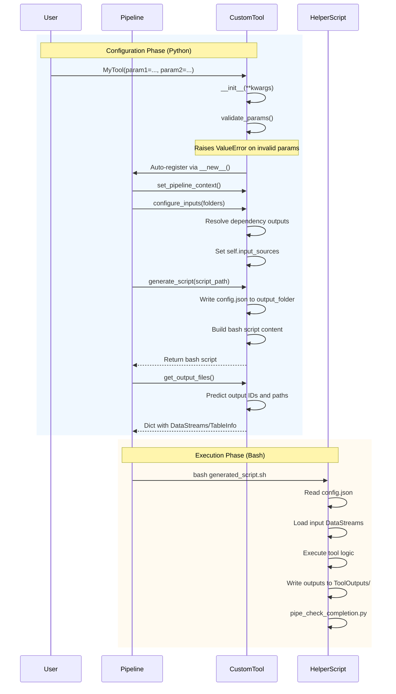
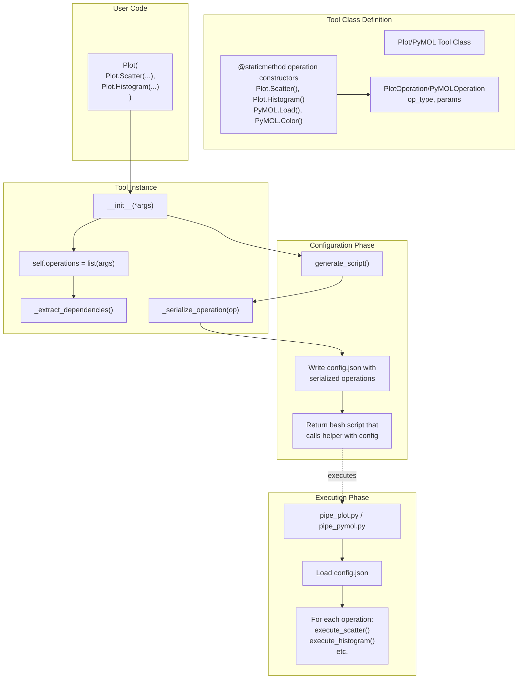
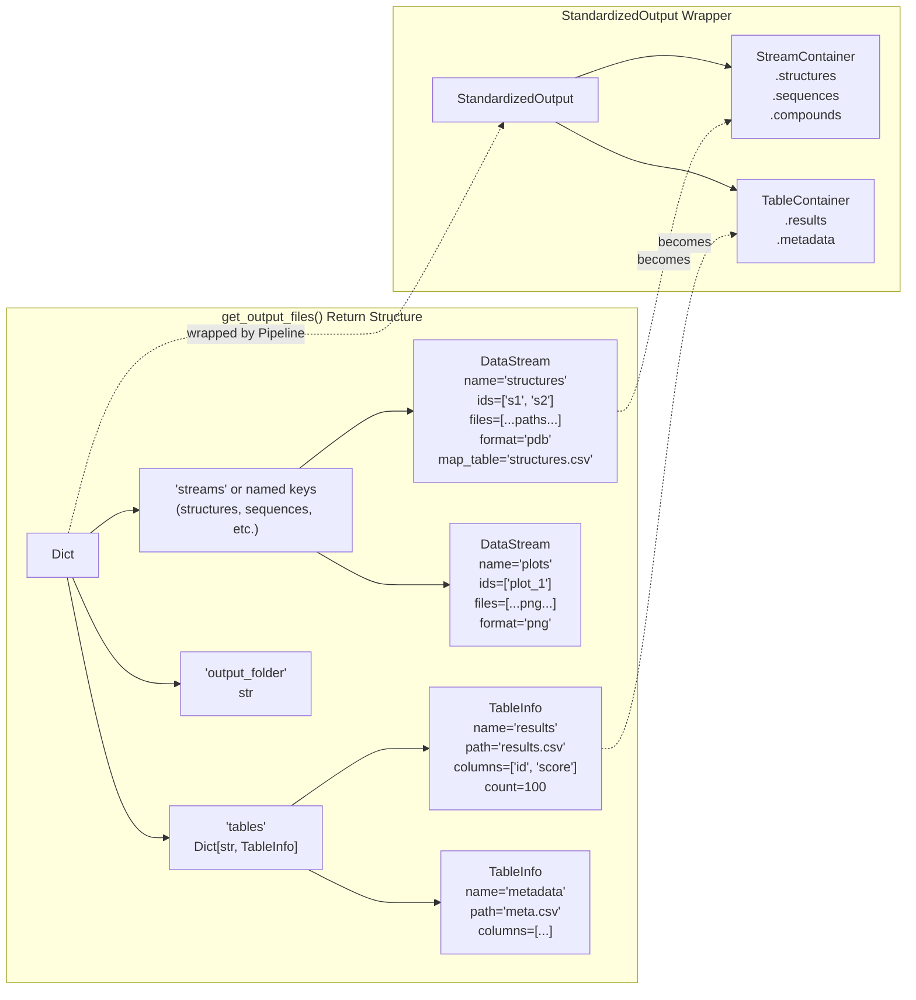
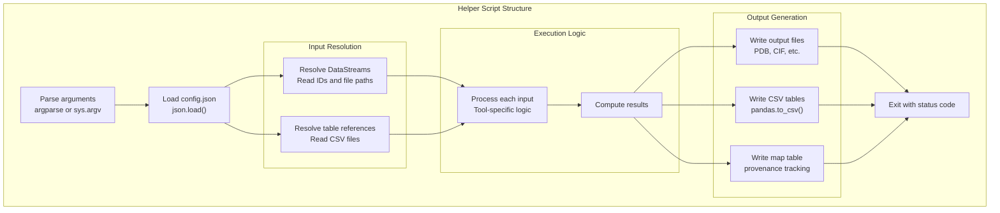

# Developing Custom Tools

<details>
<summary>Relevant source files</summary>

The following files were used as context for generating this wiki page:

- [Docs/Tool/Analysis.md](Docs/Tool/Analysis.md)
- [Docs/Tool/DataManagement.md](Docs/Tool/DataManagement.md)
- [Docs/ToolReference.md](Docs/ToolReference.md)
- [HelpScripts/pipe_plot.py](HelpScripts/pipe_plot.py)
- [biopipelines/base_config.py](biopipelines/base_config.py)
- [biopipelines/plot.py](biopipelines/plot.py)
- [biopipelines/pymol.py](biopipelines/pymol.py)

</details>


This page provides a technical guide for creating custom tools that integrate with BioPipelines. Custom tools extend the framework with new analysis, design, or processing capabilities while maintaining compatibility with the pipeline system's execution model, data flow, and auto-registration mechanisms.

For tool usage documentation, see [Complete Tool Reference](#8.2). For understanding the execution model custom tools operate within, see [Helper Script Architecture](#7.1).

---

## BaseConfig Abstract Class

All BioPipelines tools inherit from `BaseConfig`, which provides the interface between tool-specific logic and the pipeline execution system. The class defines abstract methods for parameter validation, input resolution, script generation, and output prediction.

```mermaid
graph TB
    subgraph "BaseConfig Abstract Interface"
        BaseConfig["BaseConfig<br/>(base_config.py:34)"]
        
        ValidateParams["validate_params()<br/>Parameter validation"]
        ConfigureInputs["configure_inputs()<br/>Input resolution"]
        GenerateScript["generate_script()<br/>Bash script creation"]
        GetOutputFiles["get_output_files()<br/>Output prediction"]
    end
    
    subgraph "Provided by BaseConfig"
        AutoReg["__new__()<br/>Auto-registration"]
        LoadEnvs["_load_environments()<br/>Environment config"]
        ActivateEnv["activate_environment()<br/>Conda/pip activation"]
        CompCheck["generate_completion_check_header/footer<br/>Status tracking"]
        PathDesc["Path descriptors<br/>pipeline_name, log_file"]
    end
    
    subgraph "Custom Tool Implementation"
        MyTool["MyTool(BaseConfig)"]
        MyToolValidate["validate_params()<br/>Check tool params"]
        MyToolConfigure["configure_inputs()<br/>Resolve dependencies"]
        MyToolScript["generate_script()<br/>Create bash wrapper"]
        MyToolOutput["get_output_files()<br/>Return DataStreams/Tables"]
        MyToolHelper["my_tool_helper.py<br/>Execution logic"]
    end
    
    BaseConfig --> ValidateParams
    BaseConfig --> ConfigureInputs
    BaseConfig --> GenerateScript
    BaseConfig --> GetOutputFiles
    
    BaseConfig -.->|provides| AutoReg
    BaseConfig -.->|provides| LoadEnvs
    BaseConfig -.->|provides| ActivateEnv
    BaseConfig -.->|provides| CompCheck
    BaseConfig -.->|provides| PathDesc
    
    MyTool -->|extends| BaseConfig
    MyTool --> MyToolValidate
    MyTool --> MyToolConfigure
    MyTool --> MyToolScript
    MyTool --> MyToolOutput
    
    MyToolScript -.->|calls| MyToolHelper
```



Sources: [biopipelines/base_config.py:34-161](), [biopipelines/base_config.py:195-282]()

---

## Required Method Implementations

Custom tools must implement four abstract methods that control the configuration and execution phases:

| Method | Purpose | Called During | Returns |
|--------|---------|---------------|---------|
| `validate_params()` | Check constructor parameters | Tool instantiation | None (raises on error) |
| `configure_inputs()` | Resolve dependency outputs | Pipeline.configure_inputs() | None (sets self.input_sources) |
| `generate_script()` | Create bash execution script | Pipeline.generate_scripts() | str (bash script content) |
| `get_output_files()` | Predict output structure | Multiple contexts | Dict with DataStreams/TableInfo |



Sources: [biopipelines/base_config.py:283-372](), [biopipelines/base_config.py:499-649]()

---

## Minimal Tool Implementation

The simplest custom tool demonstrates the core structure. This example creates a tool that counts lines in input files:

```python
# biopipelines/line_counter.py
import os
import json
from typing import Dict, List, Any
from .base_config import BaseConfig, TableInfo
from .datastream import DataStream
from .file_paths import Path


class LineCounter(BaseConfig):
    """Counts lines in input files."""
    
    TOOL_NAME = "LineCounter"
    
    # Path descriptors for lazy evaluation
    config_file = Path(lambda self: os.path.join(self.output_folder, "config.json"))
    helper_script = Path(lambda self: os.path.join(
        self.folders["HelpScripts"], "pipe_line_counter.py"
    ))
    
    def __init__(self, files, **kwargs):
        """
        Initialize line counter.
        
        Args:
            files: DataStream or StandardizedOutput with text files
        """
        self.files_source = files
        super().__init__(**kwargs)
    
    def validate_params(self):
        """Validate constructor parameters."""
        if self.files_source is None:
            raise ValueError("files parameter is required")
        
        # Check if source has appropriate output
        if hasattr(self.files_source, 'streams'):
            if not hasattr(self.files_source.streams, 'files'):
                raise ValueError("Input source must have 'files' stream")
    
    def configure_inputs(self, pipeline_folders: Dict[str, str]):
        """Resolve input file paths."""
        self.folders = pipeline_folders
        
        # Extract file DataStream from source
        if hasattr(self.files_source, 'streams'):
            files_stream = self.files_source.streams.files
        else:
            files_stream = self.files_source
        
        # Store for script generation
        self.input_sources = {
            'files': {
                'ids': list(files_stream.ids),
                'paths': list(files_stream.files),
                'format': files_stream.format
            }
        }
    
    def generate_script(self, script_path: str) -> str:
        """Generate bash script that calls helper script."""
        # Create config for helper script
        config = {
            'input_files': self.input_sources['files'],
            'output_folder': self.output_folder,
            'output_table': os.path.join(self.output_folder, "line_counts.csv")
        }
        
        # Write config at configuration time
        os.makedirs(self.output_folder, exist_ok=True)
        with open(self.config_file, 'w') as f:
            json.dump(config, f, indent=2)
        
        # Build bash script
        script = "#!/bin/bash\n"
        script += f"# LineCounter execution script\n"
        script += self.generate_completion_check_header()
        script += self.activate_environment()
        script += f'\necho "Counting lines in {len(self.input_sources["files"]["ids"])} files..."\n'
        script += f'python "{self.helper_script}" "{self.config_file}"\n'
        script += self.generate_completion_check_footer()
        
        return script
    
    def get_output_files(self) -> Dict[str, Any]:
        """Predict output files."""
        output_table = os.path.join(self.output_folder, "line_counts.csv")
        
        return {
            "tables": {
                "counts": TableInfo(
                    name="counts",
                    path=output_table,
                    columns=["id", "file", "line_count"],
                    description="Line counts for each file",
                    count=len(self.input_sources['files']['ids'])
                )
            },
            "output_folder": self.output_folder
        }
```

Corresponding helper script:

```python
#!/usr/bin/env python3
# HelpScripts/pipe_line_counter.py
import sys
import json
import pandas as pd


def main():
    if len(sys.argv) != 2:
        print("Usage: pipe_line_counter.py <config.json>")
        sys.exit(1)
    
    # Load config
    with open(sys.argv[1]) as f:
        config = json.load(f)
    
    input_files = config['input_files']
    output_table = config['output_table']
    
    # Count lines in each file
    results = []
    for file_id, file_path in zip(input_files['ids'], input_files['paths']):
        with open(file_path) as f:
            line_count = sum(1 for _ in f)
        
        results.append({
            'id': file_id,
            'file': file_path,
            'line_count': line_count
        })
    
    # Write output table
    df = pd.DataFrame(results)
    df.to_csv(output_table, index=False)
    
    print(f"Counted lines in {len(results)} files")
    print(f"Output written to: {output_table}")


if __name__ == '__main__':
    main()
```

Sources: [biopipelines/base_config.py:162-194](), [biopipelines/base_config.py:341-372]()

---

## Operation-Based Tool Pattern

Complex tools with multiple operation types (like `Plot` and `PyMOL`) use an operation-based API where users build sequences of operations that are serialized and executed by the helper script:



Example from `Plot` tool:

```python
# Static method creates operation object
@staticmethod
def Scatter(data, x: str, y: str, color: str = None, ...) -> PlotOperation:
    """Create X vs Y scatter plot operation."""
    return PlotOperation("scatter", data=data, x=x, y=y, color=color, ...)

# Instance method serializes operations to JSON
def _serialize_operation(self, op: PlotOperation) -> Dict[str, Any]:
    """Convert operation to JSON-safe dictionary."""
    result = {"op": op.op_type}
    
    for key, value in op.params.items():
        if isinstance(value, TableInfo):
            # Serialize table reference
            result[key] = {
                "type": "table_info",
                "path": value.info.path,
                "columns": value.info.columns
            }
        elif isinstance(value, DataStream):
            # Save DataStream to separate JSON file
            ds_json_path = os.path.join(self.output_folder, f"op_{key}.json")
            value.save_json(ds_json_path)
            result[key] = {"type": "datastream", "ds_json": ds_json_path}
        else:
            result[key] = value
    
    return result

# Helper script executes operations
def execute_operation(self, op: Dict[str, Any], output_path: str):
    """Execute single operation from config."""
    op_type = op.get("op")
    
    if op_type == "scatter":
        self.execute_scatter(op, output_path)
    elif op_type == "histogram":
        self.execute_histogram(op, output_path)
    # ...
```

Sources: [biopipelines/plot.py:29-39](), [biopipelines/plot.py:104-360](), [biopipelines/plot.py:503-521](), [HelpScripts/pipe_plot.py:33-49](), [HelpScripts/pipe_plot.py:717-739]()

---

## Output Specification with DataStreams and Tables

Tools predict their outputs during the configuration phase by returning `DataStream` objects (for file collections) and `TableInfo` objects (for CSV tables) from `get_output_files()`:



Implementation example:

```python
def get_output_files(self) -> Dict[str, Any]:
    """Predict tool outputs."""
    # Predict structure file paths based on input IDs
    structure_ids = []
    structure_files = []
    
    for input_id in self.input_sources['sequences']['ids']:
        structure_ids.append(input_id)
        structure_files.append(
            os.path.join(self.output_folder, f"{input_id}.pdb")
        )
    
    # Create DataStream for structures
    structures = DataStream(
        name="structures",
        ids=structure_ids,
        files=structure_files,
        format="pdb",
        map_table=os.path.join(self.output_folder, "structures.csv")
    )
    
    # Create TableInfo objects for CSV outputs
    tables = {
        "confidence": TableInfo(
            name="confidence",
            path=os.path.join(self.output_folder, "confidence.csv"),
            columns=["id", "pLDDT", "pAE"],
            description="Per-structure confidence metrics",
            count=len(structure_ids)
        ),
        "metrics": TableInfo(
            name="metrics",
            path=os.path.join(self.output_folder, "metrics.csv"),
            columns=["id", "metric1", "metric2"],
            count=len(structure_ids)
        )
    }
    
    return {
        "structures": structures,
        "tables": tables,
        "output_folder": self.output_folder
    }
```

The map table CSV tracks provenance:

| id | file | sequences.id | other_axis.id |
|----|------|--------------|---------------|
| design_1 | design_1.pdb | seq_A | ligand_X |
| design_2 | design_2.pdb | seq_B | ligand_X |

Sources: [biopipelines/base_config.py:364-372](), [biopipelines/plot.py:565-610](), [biopipelines/pymol.py:692-753]()

---

## Environment and Dependency Management

Custom tools integrate with BioPipelines' environment system by setting `TOOL_NAME` and optionally defining `_install_script()`:

```python
class MyTool(BaseConfig):
    TOOL_NAME = "MyTool"
    
    @classmethod
    def _install_script(cls, folders: Dict[str, str], env_manager: str = "mamba",
                        force_reinstall: bool = False, **kwargs) -> Optional[str]:
        """
        Generate bash commands for installing this tool.
        
        Args:
            folders: Resolved paths from config.yaml (folders["data"], folders["MyTool"], etc.)
            env_manager: "mamba", "conda", or "pip"
            force_reinstall: If False, skip if already installed
        
        Returns:
            Bash script content for installation
        """
        repo_path = folders.get("MyTool", "")
        env_name = "mytool_env"
        
        skip_check = "" if force_reinstall else f"""
# Check if already installed
if [ -d "{repo_path}" ] && {env_manager} env list | grep -q "{env_name}"; then
    echo "MyTool already installed, skipping."
    exit 0
fi
"""
        
        return f"""
{skip_check}
echo "=== Installing MyTool ==="

# Clone repository
git clone https://github.com/user/mytool.git {repo_path}

# Create environment
{env_manager} env create -f {repo_path}/environment.yaml -n {env_name}

# Install dependencies
{env_manager} run -n {env_name} pip install -e {repo_path}

echo "=== MyTool installation complete ==="
"""
```

The environment name is configured in `config.yaml`:

```yaml
environments:
  MyTool: "mytool_env"
```

Tools call `activate_environment()` in their bash scripts:

```python
def generate_script(self, script_path: str) -> str:
    script = "#!/bin/bash\n"
    script += self.generate_completion_check_header()
    script += self.activate_environment()  # Activates mytool_env
    script += '# Tool execution commands...\n'
    script += self.generate_completion_check_footer()
    return script
```

For pip mode (Colab/Jupyter), `activate_environment()` returns a no-op comment.

Sources: [biopipelines/base_config.py:61-115](), [biopipelines/base_config.py:195-281](), [biopipelines/pymol.py:66-93]()

---

## Helper Script Patterns

Helper scripts follow consistent patterns for configuration-driven execution:



Example helper script skeleton:

```python
#!/usr/bin/env python3
"""Helper script for MyTool execution."""
import sys
import json
import os
import pandas as pd


def load_config(config_path: str) -> dict:
    """Load JSON configuration."""
    with open(config_path) as f:
        return json.load(f)


def resolve_datastream(ds_config: dict) -> tuple:
    """
    Resolve DataStream from serialized config.
    
    Returns:
        (ids, files) tuple
    """
    if ds_config.get("type") == "datastream":
        ds_json = ds_config.get("ds_json")
        if ds_json and os.path.exists(ds_json):
            with open(ds_json) as f:
                ds_data = json.load(f)
            return ds_data["ids"], ds_data["files"]
    
    # Fallback to inline config
    return ds_config.get("ids", []), ds_config.get("files", [])


def process_inputs(config: dict) -> pd.DataFrame:
    """Execute tool-specific logic."""
    input_ids, input_files = resolve_datastream(config["input_data"])
    
    results = []
    for file_id, file_path in zip(input_ids, input_files):
        # Tool-specific processing
        result = do_computation(file_path)
        
        results.append({
            "id": file_id,
            "source_file": file_path,
            "metric": result
        })
    
    return pd.DataFrame(results)


def write_outputs(df: pd.DataFrame, output_folder: str):
    """Write output files and tables."""
    os.makedirs(output_folder, exist_ok=True)
    
    # Write main results table
    results_path = os.path.join(output_folder, "results.csv")
    df.to_csv(results_path, index=False)
    
    # Write map table for provenance
    map_table_path = os.path.join(output_folder, "map.csv")
    df[["id", "source_file"]].to_csv(map_table_path, index=False)
    
    print(f"Results written to: {results_path}")


def main():
    if len(sys.argv) != 2:
        print("Usage: pipe_mytool.py <config.json>")
        sys.exit(1)
    
    config = load_config(sys.argv[1])
    
    print("Processing inputs...")
    results_df = process_inputs(config)
    
    print("Writing outputs...")
    write_outputs(results_df, config["output_folder"])
    
    print("MyTool execution complete")


if __name__ == "__main__":
    main()
```

Sources: [HelpScripts/pipe_plot.py:14-59](), [HelpScripts/pipe_plot.py:740-771]()

---

## Table Column References and Provenance

Tools can accept table column references as parameters, enabling metadata-driven parameterization:

```python
class ProteinSelector(BaseConfig):
    """Select residues based on table column."""
    
    def __init__(self, structures, selection_column, **kwargs):
        """
        Args:
            structures: Structure DataStream
            selection_column: TableReference (e.g., tool.tables.residues.designed)
        """
        self.structures_source = structures
        self.selection_column = selection_column
        super().__init__(**kwargs)
    
    def validate_params(self):
        """Validate selection column is a TableReference."""
        if not hasattr(self.selection_column, 'path') or \
           not hasattr(self.selection_column, 'column'):
            raise ValueError(
                "selection_column must be a table column reference "
                "(e.g., upstream_tool.tables.results.column_name)"
            )
    
    def generate_script(self, script_path: str) -> str:
        # Serialize TableReference to config
        config = {
            'structures': self._serialize_datastream(self.structures_source),
            'selection_table': self.selection_column.path,
            'selection_column': self.selection_column.column,
            'output_folder': self.output_folder
        }
        
        # ... write config and generate bash script
```

Helper script resolves the reference:

```python
def resolve_selection(structure_id: str, table_path: str, column_name: str) -> str:
    """Get selection string for a specific structure ID."""
    df = pd.read_csv(table_path)
    
    # Find row matching this structure ID
    row = df[df['id'] == structure_id]
    if row.empty:
        raise ValueError(f"No selection found for ID: {structure_id}")
    
    return row.iloc[0][column_name]


# Usage in processing loop
for struct_id, struct_path in zip(structure_ids, structure_files):
    selection = resolve_selection(
        struct_id,
        config['selection_table'],
        config['selection_column']
    )
    
    # Use selection for processing
    process_structure(struct_path, selection)
```

Sources: [biopipelines/base_config.py:753-801](), [biopipelines/pymol.py:590-657]()

---

## Tool Installation and Testing

Custom tools can be tested independently before integration:

```python
# test_mytool.py
from biopipelines import Pipeline, Resources
from biopipelines.mytool import MyTool
from biopipelines.pdb import PDB

# Test outside pipeline context
tool = MyTool(files=some_datastream)
tool.validate_params()  # Should not raise

# Test within pipeline
with Pipeline("test_mytool", project_dir="./test_output"):
    Resources(time="00:10:00")
    
    # Create test input
    pdbs = PDB(pdbs=["1ABC", "2DEF"])
    
    # Test tool
    result = MyTool(files=pdbs)
    
    # Check output structure
    assert hasattr(result.tables, 'results')
    assert hasattr(result.streams, 'processed_files')

# Execute locally
# ./run test_mytool.py
```

For tool installation:

```python
with Pipeline("install_mytool", project_dir="./setup"):
    Resources(time="01:00:00")
    
    # Install dependencies
    MyTool.install()
    
    # Or force reinstall
    MyTool.install(force_reinstall=True)
```

The `install()` method adds an `_Installer` tool that runs `_install_script()` during execution.

Sources: [biopipelines/base_config.py:82-115](), [biopipelines/base_config.py:693-735]()

---

## Advanced Patterns

### IndexedTableContainer for Per-ID Tables

When a tool produces one table per input (e.g., per-residue data for each structure):

```python
from biopipelines.base_config import IndexedTableContainer

def get_output_files(self):
    # Create indexed container
    rmsf_tables = IndexedTableContainer(
        name="rmsf",
        columns=["id", "chain", "resi", "rmsf"],
        description="Per-residue RMSF values"
    )
    
    # Add one table per structure
    for struct_id in self.input_ids:
        table_path = os.path.join(self.output_folder, f"{struct_id}_RMSF.csv")
        rmsf_tables.add(struct_id, path=table_path, count=expected_residues)
    
    return {
        "tables": {
            "rmsf": rmsf_tables  # Accessed as tool.tables.rmsf["struct_id"]
        }
    }
```

Users access indexed tables by ID:

```python
# Access specific structure's RMSF table
rmsf_path = cabsflex.tables.rmsf["1ABC"].info.path
rmsf_df = pd.read_csv(rmsf_path)

# Iterate over all structures
for struct_id, table_info in cabsflex.tables.rmsf:
    print(f"{struct_id}: {table_info.info.path}")
```

Sources: [biopipelines/base_config.py:804-922]()

### Custom Path Descriptors

Tools can define lazy-evaluated path properties using `Path` descriptors:

```python
from biopipelines.file_paths import Path

class MyTool(BaseConfig):
    # Lazy path evaluation - computed when first accessed
    config_file = Path(lambda self: os.path.join(self.output_folder, "config.json"))
    results_csv = Path(lambda self: os.path.join(self.output_folder, "results.csv"))
    
    # Can reference other Path descriptors
    summary = Path(lambda self: f"Results: {self.results_csv}")
```

This defers path construction until `output_folder` is set by the pipeline.

Sources: [biopipelines/base_config.py:45-48](), [biopipelines/pymol.py:131-133](), [biopipelines/plot.py:98-100]()

### Multi-Environment Tools

Tools requiring multiple conda environments (e.g., Python 2 + Python 3):

```yaml
# config.yaml
environments:
  DynamicBind: ["dynamicbind", "relax"]  # List of environments
```

```python
def generate_script(self, script_path: str) -> str:
    script = "#!/bin/bash\n"
    script += self.generate_completion_check_header()
    
    # First environment for main processing
    script += self.activate_environment(index=0)  # dynamicbind
    script += 'python run_dynamicbind.py ...\n'
    
    # Second environment for post-processing
    script += self.activate_environment(index=1)  # relax
    script += 'python relax_structures.py ...\n'
    
    script += self.generate_completion_check_footer()
    return script
```

Sources: [biopipelines/base_config.py:195-226](), [biopipelines/base_config.py:227-281]()

---

## Integration Checklist

When implementing a custom tool, ensure:

- [ ] `TOOL_NAME` class variable is set
- [ ] All four abstract methods are implemented
- [ ] `validate_params()` raises `ValueError` for invalid inputs
- [ ] `configure_inputs()` resolves all dependencies and sets `self.folders`
- [ ] `generate_script()` writes config JSON to `output_folder`
- [ ] `get_output_files()` returns consistent structure with predicted paths
- [ ] Helper script reads config JSON and writes to predicted paths
- [ ] Output CSVs include 'id' column for integration with other tools
- [ ] Map tables track provenance with `{source_name}.id` columns
- [ ] Tool works with auto-registration in `with Pipeline()` context
- [ ] Tool handles both StandardizedOutput and direct DataStream inputs
- [ ] Environment activation is included in bash script
- [ ] Completion checking header/footer are included
- [ ] Tool documentation is added to appropriate category file

Sources: All sections above

---