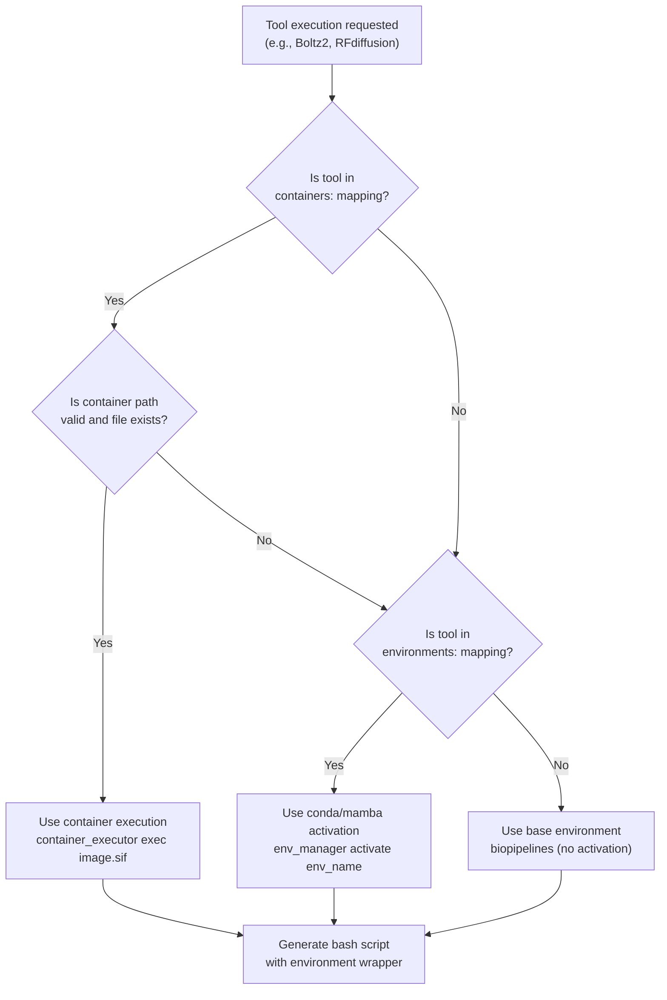
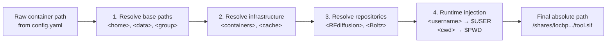
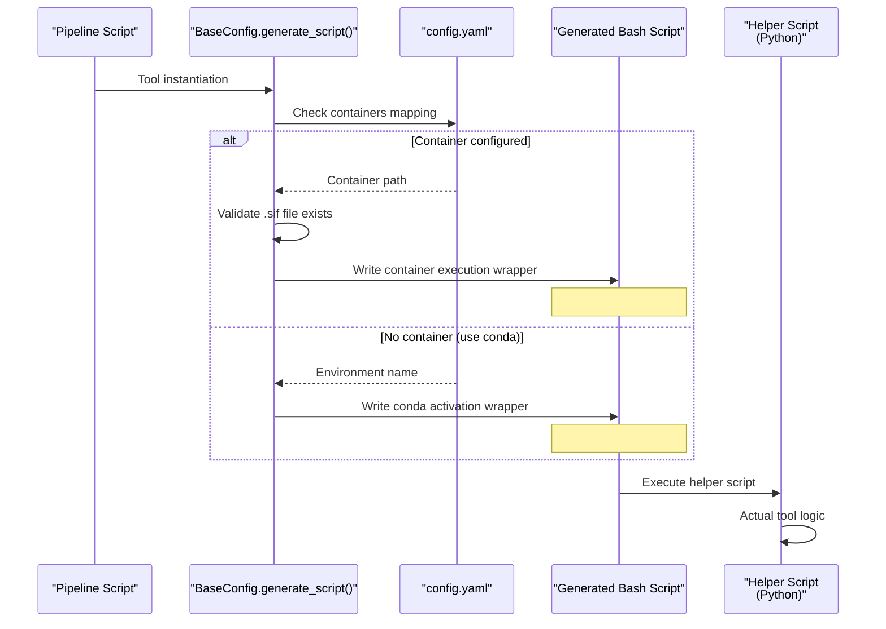
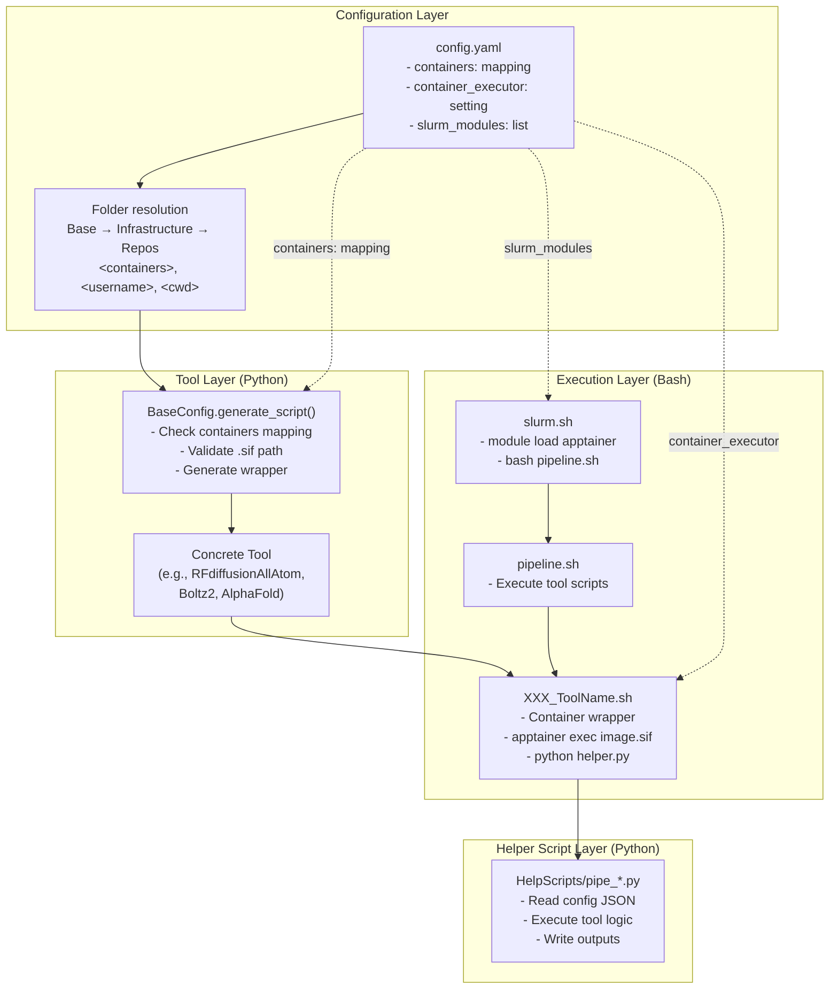

# Container Execution with Singularity

<details>
<summary>Relevant source files</summary>

The following files were used as context for generating this wiki page:

- [Docs/UserManual.md](Docs/UserManual.md)
- [config.yaml](config.yaml)
- [run](run)
- [submit](submit)

</details>


## Purpose and Scope

This page describes how to configure and use Singularity/Apptainer containers as an alternative to conda/mamba environments for tool execution. Containers provide better reproducibility, portability across systems, and isolation from the host environment. When a container is configured for a tool, it completely overrides the conda environment mapping for that tool.

For general environment setup and conda/mamba configuration, see [Installation and Environment Setup](#2.1). For complete configuration file reference, see [Configuration Reference](#8.1). For understanding how tools generate and execute scripts, see [Helper Script Architecture](#7.1).

---

## Container vs Conda Environment Execution

BioPipelines supports two environment management strategies, which can be mixed within the same pipeline:

| Aspect | Conda/Mamba Environments | Singularity Containers |
|--------|-------------------------|------------------------|
| **Activation** | `conda activate <env_name>` or `mamba activate <env_name>` | `singularity exec <image.sif>` or `apptainer exec <image.sif>` |
| **Configuration** | `environments:` mapping in config.yaml | `containers:` mapping in config.yaml |
| **Precedence** | Used if no container is configured | Overrides environment setting when configured |
| **Isolation** | Shared host filesystem, package-level isolation | Complete filesystem isolation, bind mounts required |
| **Use case** | Standard HPC workflows, editable installations | Maximum reproducibility, pre-built images, portability |
| **Setup time** | Slower (environment creation, package installation) | Faster (pre-built image) |

**Resolution logic**: For each tool, BioPipelines checks the `containers:` mapping first. If a container path is found, it uses container execution. Otherwise, it falls back to the `environments:` mapping for conda/mamba activation.

**Sources**: [config.yaml:122-128](), [config.yaml:65-120](), [config.yaml:142-146]()

---

## Configuration in config.yaml

Container execution is configured in two places in `config.yaml`:

### The containers Mapping

The `containers:` section maps tool names to Singularity/Apptainer image paths. Each tool can specify a `.sif` image file:

```yaml
containers:
  # Tool-to-container mapping
  # When configured, the container overrides the conda environment
  RFdiffusionAllAtom: "<RFdiffusionAllAtom>/rf_se3_diffusion.sif"
  Boltz2: "<containers>/boltz2_latest.sif"
  AlphaFold: "/shares/locbp.chem.uzh/containers/alphafold_2.3.2.sif"
```

**Path placeholders**: Container paths support the same placeholder syntax as other folder paths:
- `<containers>` → resolved from `folders.infrastructure.containers`
- `<RFdiffusionAllAtom>` → resolved from `folders.repositories.RFdiffusionAllAtom`
- `<group>`, `<data>`, `<home>` → resolved from `folders.base`

**Runtime placeholders**: `<username>` and `<cwd>` are replaced at execution time.

**Empty configuration**: If the `containers:` section is empty or a tool is not listed, that tool falls back to conda environment activation.

**Sources**: [config.yaml:122-128](), [config.yaml:9-60]()

### The container_executor Setting

The `container_executor:` setting under `cluster:` determines which command is used to execute containers:

```yaml
cluster:
  # Container executor: "apptainer" or "singularity"
  # Used for tools that run inside containers (e.g., RFdiffusionAllAtom)
  container_executor: "apptainer"
```

**Valid values**:
- `"apptainer"` — Uses the Apptainer command (modern Singularity fork, default on many HPC systems)
- `"singularity"` — Uses the original Singularity command

**Effect**: This setting controls which binary is called in generated bash scripts:
- `apptainer exec <image.sif> <command>` vs `singularity exec <image.sif> <command>`

Most systems support both commands as aliases. Choose based on your cluster's module system or installed binary names.

**Sources**: [config.yaml:144-146]()

---

## Environment Resolution Flow

The following diagram shows how BioPipelines determines whether to use a container or conda environment for each tool:



**Sources**: [config.yaml:65-128]()

---

## Container Path Resolution and Validation

Container paths undergo the same hierarchical resolution as other paths in `config.yaml`:

### Resolution Order



**Example resolution**:
```yaml
# config.yaml
folders:
  base:
    group: "/shares/locbp.chem.uzh"
  infrastructure:
    containers: "<group>/containers"

containers:
  Boltz2: "<containers>/boltz2.sif"
  
# Resolves to: /shares/locbp.chem.uzh/containers/boltz2.sif
```

**Sources**: [config.yaml:9-60]()

---

## Execution Flow: Container vs Conda

The following diagram shows the code path for environment activation in generated bash scripts:



**Sources**: [config.yaml:122-128](), [config.yaml:65-120]()

---

## Tool-Specific Container Configuration

### Example: RFdiffusionAllAtom

RFdiffusionAllAtom commonly uses containers because it requires specific CUDA libraries and dependencies that are difficult to install via conda:

```yaml
# config.yaml
folders:
  repositories:
    RFdiffusionAllAtom: "<data>/rf_diffusion_all_atom"

containers:
  RFdiffusionAllAtom: "<RFdiffusionAllAtom>/rf_se3_diffusion.sif"

cluster:
  container_executor: "apptainer"
```

**Generated bash script** (simplified):
```bash
#!/bin/bash
# Environment: Container execution

apptainer exec \
  --nv \
  --bind /path/to/inputs:/inputs \
  --bind /path/to/outputs:/outputs \
  /home/user/data/rf_diffusion_all_atom/rf_se3_diffusion.sif \
  python /path/to/HelpScripts/pipe_rfdaa.py --config /path/to/config.json
```

**Key features**:
- `--nv` flag for GPU access (automatically added by BaseConfig for GPU tools)
- `--bind` mounts for input/output directories
- Container path resolved from `<RFdiffusionAllAtom>` placeholder

**Sources**: [config.yaml:37](), [config.yaml:128]()

### Example: Mixed Environment Pipeline

A single pipeline can use both containers and conda environments for different tools:

```python
from biopipelines.pipeline import *

with Pipeline("Project", "MixedEnv", "Container and conda demo"):
    Resources(gpu="A100", memory="32GB", time="4:00:00")
    
    # Uses container (if configured)
    rfdaa = RFdiffusionAllAtom(
        pdb=template,
        contigs="A1-100/0 B1-50",
        ligand=ligand
    )
    
    # Uses conda environment (boltzgen)
    bgen = BoltzGenImport(
        structures=rfdaa,
        mode="design"
    )
    
    # Uses conda environment (Boltz2Env)
    # OR container if configured in containers:
    boltz = Boltz2(
        proteins=bgen.streams.sequences,
        structures=bgen.streams.structures,
        ligands=ligand
    )
```

**Configuration**:
```yaml
# Some tools use containers
containers:
  RFdiffusionAllAtom: "<containers>/rfdaa.sif"
  # Boltz2 not listed → falls back to conda

# Others use conda
environments:
  BoltzGenImport: "boltzgen"
  Boltz2: "Boltz2Env"
```

**Result**: 
- RFdiffusionAllAtom runs in `rfdaa.sif` container
- BoltzGenImport runs in `boltzgen` conda environment  
- Boltz2 runs in `Boltz2Env` conda environment

**Sources**: [config.yaml:122-128](), [config.yaml:65-120]()

---

## Container Bind Mounts and Arguments

### Automatic Bind Mounts

BaseConfig automatically generates bind mounts for:

| Directory Type | Host Path | Container Mount | Purpose |
|---------------|-----------|-----------------|---------|
| **Input files** | Tool input directories | `/inputs` | Read access to PDB, sequences, ligands |
| **Output files** | Tool output directory | `/outputs` | Write access for results |
| **Helper scripts** | `<HelpScripts>` folder | `/HelpScripts` | Access to Python execution scripts |
| **Repositories** | Tool-specific repo path | Tool-dependent | Access to model weights, configs |

### GPU Access

For GPU-enabled tools, the `--nv` flag is automatically added:
- **Apptainer**: `apptainer exec --nv <image.sif>`
- **Singularity**: `singularity exec --nv <image.sif>`

This flag exposes NVIDIA GPU devices and CUDA libraries to the container.

### Custom Container Arguments

Some tools may require additional container arguments (e.g., environment variables, custom bind mounts). These are typically hard-coded in the tool's `generate_script()` method or helper script.

**Example** (hypothetical tool implementation):
```python
# In tool's generate_script() method
container_args = [
    "--nv",  # GPU access
    f"--bind {input_dir}:/inputs",
    f"--bind {output_dir}:/outputs",
    "--env CUDA_VISIBLE_DEVICES=0",  # Custom env var
    "--bind /scratch:/scratch"  # Custom mount
]
```

**Sources**: Based on standard Singularity/Apptainer usage patterns

---

## SLURM Module Loading for Containers

The `slurm_modules:` setting in `config.yaml` controls which modules are loaded before container execution:

```yaml
cluster:
  # Module load commands for SLURM scripts
  slurm_modules:
    - "miniforge3"    # For conda/mamba
    - "apptainer"     # For container execution
```

**Generated SLURM wrapper** (`slurm.sh`):
```bash
#!/bin/bash
#SBATCH --job-name=MyJob
#SBATCH --gpus=1

# Load modules
module load miniforge3
module load apptainer

# Initialize mamba
eval "$(mamba shell.bash hook)"

# Execute pipeline
bash pipeline.sh
```

**When using containers**: The `apptainer` (or `singularity`) module must be loaded to make the container executor available. This is independent of whether conda/mamba is also used for other tools in the same pipeline.

**Sources**: [config.yaml:148-153](), [submit:28-34]()

---

## Code Entity Mapping: Container Execution



**Key code entities**:
- **config.yaml**: Lines 122-128 (containers mapping), 144-146 (container_executor)
- **BaseConfig**: `generate_script()` method checks `containers:` mapping before falling back to `environments:`
- **submit script**: Lines 28-34 load SLURM modules including apptainer/singularity
- **Generated tool scripts**: Include `apptainer exec` or `singularity exec` commands when container is configured
- **HelpScripts/pipe_*.py**: Helper scripts that execute inside containers (unaware of container boundary)

**Sources**: [config.yaml:122-128](), [config.yaml:144-146](), [submit:28-34]()

---

## Container Availability and Installation

### Pre-built Containers

For tools with published container images:
1. Download the `.sif` file to a shared location (e.g., `<group>/containers/`)
2. Add the tool-to-container mapping in `config.yaml`
3. Verify the container works: `apptainer exec <image.sif> <test_command>`

### Building Custom Containers

For tools requiring custom containers:

**Singularity definition file example** (`tool.def`):
```singularity
Bootstrap: docker
From: nvidia/cuda:12.1.0-cudnn8-runtime-ubuntu22.04

%post
    apt-get update
    apt-get install -y python3 python3-pip
    pip3 install torch torchvision --index-url https://download.pytorch.org/whl/cu121
    # Install tool-specific dependencies
    
%environment
    export PATH=/opt/tool/bin:$PATH
    
%runscript
    python3 /opt/tool/run.py "$@"
```

**Build command**:
```bash
singularity build tool.sif tool.def
```

**Install to shared location**:
```bash
cp tool.sif /shares/locbp.chem.uzh/containers/
```

### Verifying Container Configuration

After configuring a container, test it with a minimal pipeline:

```python
from biopipelines.pipeline import *

with Pipeline("Test", "ContainerTest", "Verify container setup"):
    Resources(gpu="A100", memory="16GB", time="0:30:00")
    
    # This will use the configured container
    result = ToolName(
        # minimal parameters
    )
```

Check the generated script in `RunTime/XXX_ToolName.sh` to verify:
1. Container path is correct
2. `apptainer exec` or `singularity exec` command is present
3. Bind mounts include necessary directories
4. GPU flag `--nv` is present for GPU tools

**Sources**: Standard Singularity/Apptainer documentation patterns

---

## Troubleshooting Container Execution

### Container Not Found

**Symptom**: Error message: `FATAL: container not found: <path>`

**Cause**: Invalid path in `containers:` mapping or placeholder not resolved correctly

**Solution**:
1. Verify the container file exists: `ls -la /full/path/to/image.sif`
2. Check placeholder resolution in config.yaml (base paths must be defined before infrastructure)
3. Test placeholder expansion: add debug output to generated script

### Permission Denied

**Symptom**: Error message: `permission denied` when executing container

**Cause**: Container image lacks execute permissions or is on a no-exec mounted filesystem

**Solution**:
```bash
# Add execute permission
chmod +x /path/to/image.sif

# Verify mount options
mount | grep <filesystem>  # Should not show noexec
```

### Bind Mount Failures

**Symptom**: Error message: `bind: /path/to/dir: no such file or directory`

**Cause**: Directory does not exist on host or container has restricted bind paths

**Solution**:
1. Verify all bind mount source directories exist
2. Check container definition for allowed bind paths
3. Use absolute paths in bind mount specifications

### GPU Not Available Inside Container

**Symptom**: Tool reports no GPU available despite `--nv` flag

**Cause**: NVIDIA drivers not accessible or container built without CUDA support

**Solution**:
1. Verify GPU availability on host: `nvidia-smi`
2. Test container GPU access: `apptainer exec --nv <image.sif> nvidia-smi`
3. Check container base image includes CUDA runtime
4. Verify `slurm_modules:` loads correct CUDA module

### Module Load Failures

**Symptom**: `module: command not found` in SLURM logs

**Cause**: Module system not initialized in non-interactive shell

**Solution**:
```yaml
# config.yaml
cluster:
  slurm_modules:
    - "miniforge3"
    - "apptainer"
```

Verify module load commands in `slurm.sh` match your cluster's module system.

**Sources**: Common HPC and container execution issues

---

## Performance Considerations

### Container Overhead

**Startup time**: Minimal (~50-100ms) for most tools
**Runtime performance**: Near-native (< 5% overhead for compute-intensive tasks)
**I/O performance**: Comparable to native when using bind mounts

### Container Image Size

**Impact**:
- Larger images (> 5GB) may slow down container startup on shared filesystems
- Network transfers can be slow for very large images

**Best practices**:
- Store images on fast local storage (e.g., `/scratch`) if available
- Use multi-stage builds to minimize final image size
- Share base layers between multiple tool containers

### Caching and Shared Storage

**Container cache location**: Singularity caches images in `~/.singularity/cache/` by default

**For shared environments**:
```bash
# Set custom cache location
export SINGULARITY_CACHEDIR=/shares/locbp.chem.uzh/cache/singularity
```

**Group-shared containers**: Store in `<containers>` folder defined in config.yaml to avoid duplication across user accounts.

**Sources**: Singularity/Apptainer performance documentation patterns

---

## Summary

| Aspect | Key Points |
|--------|-----------|
| **Configuration** | `containers:` mapping in config.yaml, `container_executor:` setting |
| **Precedence** | Container overrides conda environment when both are configured |
| **Path resolution** | Supports same placeholder syntax as other paths (`<containers>`, `<group>`, etc.) |
| **Execution** | `apptainer exec` or `singularity exec` with automatic bind mounts and GPU flags |
| **Module system** | Requires appropriate module in `slurm_modules:` list |
| **Mixed pipelines** | Can use containers for some tools, conda for others in same pipeline |
| **Troubleshooting** | Verify path resolution, permissions, bind mounts, and GPU access |

**Sources**: [config.yaml:122-128](), [config.yaml:144-146](), [submit:28-34](), [Docs/UserManual.md:73-139]()

---