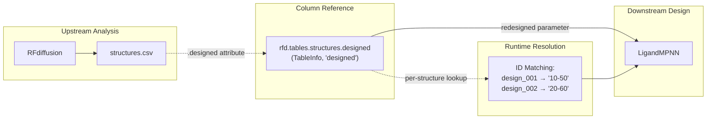
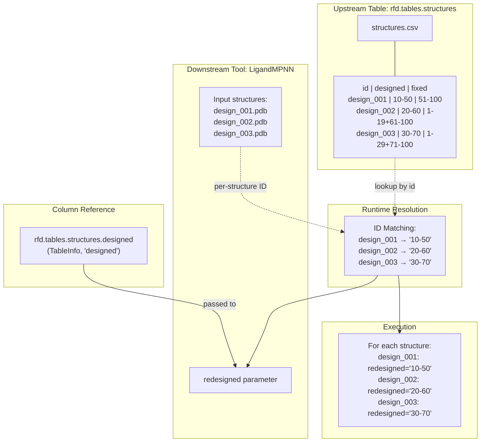
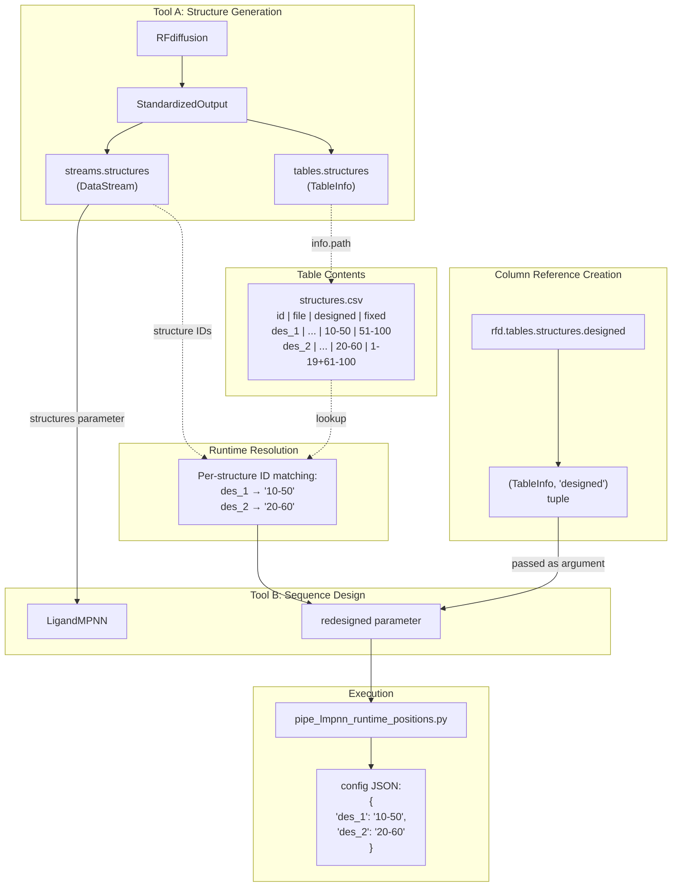
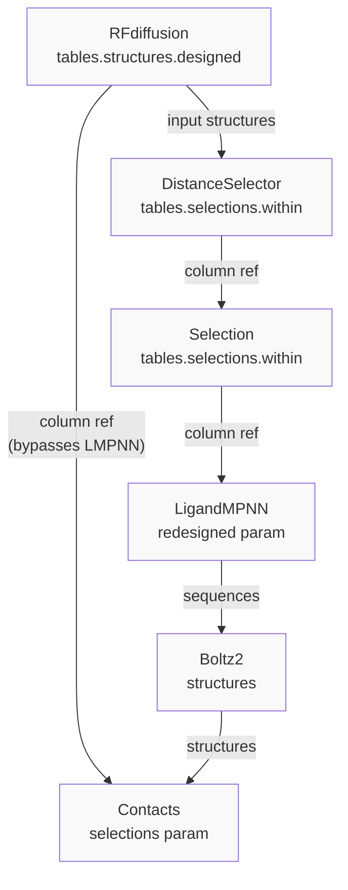

# Table Column References and Metadata Propagation

<details>
<summary>Relevant source files</summary>

The following files were used as context for generating this wiki page:

- [Docs/Tool/Analysis.md](Docs/Tool/Analysis.md)
- [Docs/Tool/DataManagement.md](Docs/Tool/DataManagement.md)
- [Docs/ToolReference.md](Docs/ToolReference.md)
- [Docs/UserManual.md](Docs/UserManual.md)
- [config.yaml](config.yaml)

</details>


Table column references enable **metadata-driven parameterization** in BioPipelines. They allow downstream tools to consume per-structure metadata from upstream analysis tools, creating feedback loops where structural analysis informs design decisions. This page covers the syntax for column references, how metadata propagates through pipelines, and how provenance tracking enables complex filtering and analysis.

For information about table transformations and filtering, see [Data Management Tools](#5.6). For details on ID generation and tracking, see [ID Generation and Provenance Tracking](#3.5).

---

## Overview: Metadata as Parameters

BioPipelines tools accept **column references** as parameters, enabling per-structure parameterization based on upstream analysis. At execution time, the framework resolves column values by matching IDs between the upstream table and the downstream tool's input structures.



**Sources**: [Docs/UserManual.md:373-392]()

---

## Column Reference Syntax

### Creating Column References

Column references use attribute-style access on `TableInfo` objects:

```python
# Syntax: tool.tables.<table_name>.<column_name>
column_ref = rfd.tables.structures.designed

# Returns a tuple: (TableInfo, "designed")
type(column_ref)  # tuple
```

The `TableInfo` object provides metadata about the table, while the column name specifies which column to use for per-structure lookup.

### Accessing Table Metadata

```python
# Access table metadata via .info
info = rfd.tables.structures.info
print(info.path)        # /path/to/structures.csv
print(info.columns)     # ["id", "designed", "fixed", ...]
print(info.description) # "Structure metadata"
print(info.count)       # Number of rows
```

**Sources**: [Docs/UserManual.md:205-218]()

---

## Column Reference Resolution

### ID-Based Matching

At execution time, column values are resolved per-structure by matching the `id` column in the upstream table to the ID of each downstream input:



**Sources**: [Docs/UserManual.md:373-392]()

---

## Common Metadata Propagation Patterns

### 1. Structural Analysis → Design Positions

Pass structural features (binding sites, designed regions) to sequence design tools:

```python
# RFdiffusion generates backbones with designed/fixed regions
rfd = RFdiffusion(pdb=template, contigs="50-70/A81-140", num_designs=5)

# Column 'designed' contains per-structure region specifications
lmpnn = LigandMPNN(
    structures=rfd,
    ligand="ATP",
    redesigned=rfd.tables.structures.designed  # e.g., "50-70"
)
```

### 2. Distance Analysis → Position Selection

Use proximity-based selection for targeted design:

```python
# Identify residues near ligand
selector = DistanceSelector(
    structures=boltz,
    ligand="LIG",
    distance=5.0
)
# Outputs 'within' column: residues < 5Å from ligand

# Design only binding site residues
pmpnn = ProteinMPNN(
    structures=boltz,
    redesigned=selector.tables.selections.within
)
```

### 3. Filtering Scores → Structural Alignment

Pass filtered metrics to alignment or comparison tools:

```python
# Filter high-confidence predictions
best = Panda(
    tables=boltz.tables.confidence,
    operations=[Panda.filter("pLDDT > 80")],
    pool=boltz
)

# Use specific column for alignment selection
alignment = ConformationalChange(
    reference_structures=design,
    target_structures=best,
    selection=rfd.tables.structures.fixed  # Align on fixed region only
)
```

### 4. Combined Selections

Merge multiple column references using `Selection` operations:

```python
# Create binding site + expansion
distances = DistanceSelector(structures=rfdaa, ligand="LIG", distance=5)

expanded = Selection(
    Selection.add(distances.tables.selections.within),
    Selection.expand(2),  # Add 2 residues on each side
    structures=rfdaa
)

# Use expanded region for design
lmpnn = LigandMPNN(
    structures=rfdaa,
    redesigned=expanded.tables.selections.within
)
```

**Sources**: [Docs/UserManual.md:373-392](), [Docs/Tool/Analysis.md:134-162](), [Docs/Tool/DataManagement.md:204-246]()

---

## Provenance Tracking Through Combinatorics

### Provenance Columns

BioPipelines automatically generates **provenance columns** in output tables to track which input from each combinatorics axis produced each output. These columns follow the naming pattern `{stream_name}.id`.

```python
# 2 proteins × 3 ligands = 6 predictions
boltz = Boltz2(
    proteins=Each(protein_a, protein_b),  # IDs: prot_a, prot_b
    ligands=ligand_library                 # IDs: lig_1, lig_2, lig_3
)

# Output table includes provenance columns:
# | id          | sequences.id | compounds.id | pLDDT | ... |
# |-------------|--------------|--------------|-------|-----|
# | prot_a_lig_1| prot_a       | lig_1        | 85.2  | ... |
# | prot_a_lig_2| prot_a       | lig_2        | 82.1  | ... |
# | prot_a_lig_3| prot_a       | lig_3        | 78.9  | ... |
# | prot_b_lig_1| prot_b       | lig_1        | 81.5  | ... |
# | prot_b_lig_2| prot_b       | lig_2        | 79.3  | ... |
# | prot_b_lig_3| prot_b       | lig_3        | 83.7  | ... |
```

### Provenance-Based Filtering

Use provenance columns to filter results by specific inputs:

```python
import pandas as pd

# Filter for specific protein
df = pd.read_csv(boltz.tables.confidence.info.path)
prot_a_results = df[df['sequences.id'] == 'prot_a']

# Filter for specific ligand
lig_2_results = df[df['compounds.id'] == 'lig_2']

# Combine filters
prot_a_lig_2 = df[(df['sequences.id'] == 'prot_a') & (df['compounds.id'] == 'lig_2')]
```

### Provenance in Panda Operations

Use provenance columns in `Panda` for advanced filtering:

```python
# Filter by upstream input
filtered = Panda(
    tables=boltz.tables.confidence,
    operations=[Panda.filter("sequences.id == 'prot_a'")]
)

# Group by provenance axis
grouped = Panda(
    tables=boltz.tables.confidence,
    operations=[
        Panda.groupby("compounds.id", {"pLDDT": "mean"})
    ]
)
```

**Sources**: [Docs/UserManual.md:359-371]()

---

## Metadata Propagation Flow Diagram



**Sources**: [Docs/UserManual.md:373-392](), [Docs/UserManual.md:205-218]()

---

## Table Types and Column References

### DataStream map_table

`DataStream` objects have an associated `map_table` CSV that contains per-ID metadata:

```python
# structures.csv for a DataStream
# | id       | file              | format | ...metadata... |
# |----------|-------------------|--------|----------------|
# | design_1 | design_1.pdb      | pdb    | ...            |
# | design_2 | design_2.pdb      | pdb    | ...            |
```

### TableInfo Columns

`TableInfo` objects represent CSV tables with arbitrary columns. Common patterns:

| Table Type | Common Columns | Purpose |
|------------|----------------|---------|
| `structures` | `id`, `file`, `designed`, `fixed` | Structure metadata from generation tools |
| `confidence` | `id`, `pLDDT`, `pTM`, `complex_plddt` | Prediction confidence scores |
| `affinity` | `id`, `affinity`, `affinity_confidence` | Binding affinity predictions |
| `distances` | `id`, `source_structure`, `{metric_name}`, `unit` | Distance measurements |
| `selections` | `id`, `pdb`, `within`, `beyond` | Proximity-based selections |

### Accessing Columns

```python
# All columns listed in TableInfo
print(rfd.tables.structures.info.columns)
# ['id', 'file', 'designed', 'fixed', 'format']

# Create column reference for any column
designed_ref = rfd.tables.structures.designed  # (TableInfo, "designed")
fixed_ref = rfd.tables.structures.fixed        # (TableInfo, "fixed")
```

**Sources**: [Docs/UserManual.md:173-220]()

---

## Advanced Example: Multi-Stage Metadata Propagation

This example demonstrates metadata flowing through multiple pipeline stages:

```python
from biopipelines.pipeline import Pipeline
from biopipelines.pdb import PDB
from biopipelines.rfdiffusion import RFdiffusion
from biopipelines.distance_selector import DistanceSelector
from biopipelines.selection import Selection
from biopipelines.ligandmpnn import LigandMPNN
from biopipelines.boltz2 import Boltz2
from biopipelines.contacts import Contacts
from biopipelines.panda import Panda

with Pipeline("Advanced", "MetadataPropagation", "Multi-stage metadata flow"):
    # Stage 1: Generate backbones with designed regions
    template = PDB("1ABC")
    rfd = RFdiffusion(
        pdb=template,
        contigs="50-70/A81-140",
        num_designs=10
    )
    # Outputs: tables.structures with 'designed' and 'fixed' columns
    
    # Stage 2: Identify binding site residues
    selector = DistanceSelector(
        structures=rfd,
        ligand="ATP",
        distance=5.0
    )
    # Outputs: tables.selections with 'within' and 'beyond' columns
    
    # Stage 3: Expand binding site selection
    expanded = Selection(
        Selection.add(selector.tables.selections.within),
        Selection.expand(2),
        structures=rfd
    )
    # Outputs: tables.selections with modified 'within' column
    
    # Stage 4: Design sequences targeting binding site
    lmpnn = LigandMPNN(
        structures=rfd,
        ligand="ATP",
        redesigned=expanded.tables.selections.within,  # ← Propagated metadata
        num_sequences=5
    )
    
    # Stage 5: Predict structures
    boltz = Boltz2(
        proteins=lmpnn,
        ligands="ATP"
    )
    # Provenance columns: sequences.id, compounds.id
    
    # Stage 6: Analyze contacts using original designed region
    contacts = Contacts(
        structures=boltz,
        selections=rfd.tables.structures.designed,  # ← Original metadata
        ligand="ATP"
    )
    
    # Stage 7: Filter by both metrics
    best = Panda(
        tables=[boltz.tables.confidence, contacts.tables.contacts],
        operations=[
            Panda.merge(),
            Panda.filter("pLDDT > 80 and contacts > 5")
        ],
        pool=boltz
    )
```

### Metadata Flow Summary



**Sources**: [Docs/Tool/Analysis.md:134-162](), [Docs/Tool/DataManagement.md:204-246]()

---

## Implementation Details

### Column Reference Tuple Structure

Column references are `(TableInfo, str)` tuples. Tools that accept column references unpack this tuple to access both the table metadata and the column name:

```python
# User code
redesigned_ref = rfd.tables.structures.designed

# Tool receives tuple
type(redesigned_ref)  # tuple
redesigned_ref[0]     # TableInfo object
redesigned_ref[1]     # "designed" (column name)

# Tool validates column exists
assert redesigned_ref[1] in redesigned_ref[0].info.columns
```

### Runtime Resolution in Helper Scripts

Helper scripts read the upstream table and perform ID-based lookups:

```python
# Example from pipe_lmpnn_runtime_positions.py (conceptual)
# 1. Load upstream table
table_df = pd.read_csv(table_info.path)

# 2. For each input structure
for structure_id in input_structure_ids:
    # 3. Look up column value by ID
    row = table_df[table_df['id'] == structure_id]
    column_value = row[column_name].values[0]
    
    # 4. Use value as parameter
    run_tool(structure, redesigned=column_value)
```

### Provenance Column Generation

Provenance columns are automatically added during combinatorics expansion. The naming pattern `{stream_name}.id` indicates which input stream an output originated from:

| Combinatorics Axis | Stream Name | Provenance Column |
|-------------------|-------------|-------------------|
| `proteins` parameter | `sequences` | `sequences.id` |
| `ligands` parameter | `compounds` | `compounds.id` |
| `structures` parameter | `structures` | `structures.id` |
| `msas` parameter | `msas` | `msas.id` |

**Sources**: [Docs/UserManual.md:359-371]()

---

## Common Patterns and Recipes

### Pattern 1: Selective Redesign Based on Distance

```python
# Generate structures
rfd = RFdiffusion(pdb=template, contigs="A1-200", num_designs=5)

# Find binding site
binding_site = DistanceSelector(
    structures=rfd,
    ligand="LIG",
    distance=8.0
)

# Design only binding site
lmpnn = LigandMPNN(
    structures=rfd,
    ligand="LIG",
    redesigned=binding_site.tables.selections.within
)
```

### Pattern 2: Fixed Region Alignment

```python
# Generate with fixed scaffold
rfd = RFdiffusion(pdb=scaffold, contigs="50-100/A1-50", num_designs=3)

# Align predictions on fixed region for RMSD comparison
rmsd = ConformationalChange(
    reference_structures=scaffold,
    target_structures=predictions,
    selection=rfd.tables.structures.fixed  # Align only on A1-50
)
```

### Pattern 3: Multi-Condition Filtering

```python
# Predict with combinatorics
boltz = Boltz2(
    proteins=Each(protein_a, protein_b),
    ligands=Each(lig_1, lig_2)
)

# Filter by provenance and score
best_a_lig1 = Panda(
    tables=boltz.tables.confidence,
    operations=[
        Panda.filter("sequences.id == 'protein_a' and compounds.id == 'lig_1'"),
        Panda.sort("pLDDT", ascending=False),
        Panda.head(1)
    ],
    pool=boltz
)
```

### Pattern 4: Chained Selection Operations

```python
# Start with binding site
binding = DistanceSelector(structures=rfd, ligand="ATP", distance=5)

# Expand and merge with scaffold region
final_selection = Selection(
    Selection.add(binding.tables.selections.within),
    Selection.expand(3),
    Selection.add(scaffold.tables.structures.interface),
    structures=rfd
)

# Use combined selection
pmpnn = ProteinMPNN(
    structures=rfd,
    redesigned=final_selection.tables.selections.within
)
```

**Sources**: [Docs/Tool/Analysis.md:134-162](), [Docs/Tool/DataManagement.md:204-246]()

---

## Error Handling and Validation

### Missing IDs

If a column reference contains IDs not present in downstream inputs, those entries are skipped with a warning:

```python
# If table has IDs: [design_1, design_2, design_3]
# But structures only has: [design_1, design_2]
# → design_3 entry is ignored
```

### Missing Columns

If a column reference specifies a non-existent column, validation fails at configuration time:

```python
lmpnn = LigandMPNN(
    structures=rfd,
    redesigned=rfd.tables.structures.nonexistent_column  # Error: column not in table
)
# Error: Column 'nonexistent_column' not found in table 'structures'
```

### Type Validation

Tools validate that column references are actually tuples of `(TableInfo, str)`:

```python
# Correct usage
lmpnn = LigandMPNN(structures=rfd, redesigned=rfd.tables.structures.designed)

# Invalid: passing string instead of column reference
lmpnn = LigandMPNN(structures=rfd, redesigned="10-50")  # Error or warning
```

**Sources**: [Docs/UserManual.md:373-392]()

---